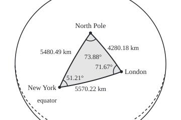

# Triangles on a sphere: angles add to more than 180 and the excess is the area

[Syllabus](../../../SYLLABUS.md) → [Geometry and trig](../README.md) → [Beyond Euclid](../README.md#s06) → Triangles on a sphere

---

## General Overview

London sits at 51.5074° north, 0.1278° west; New York at 40.7128° north, 74.0060° west. On a round Earth of radius 6371 km, the shortest surface route between them is 5570.22 km. It leaves London heading 71.67° west of north, though New York lies 10.79° of latitude further south.

It runs along a **great circle**: a circle on the sphere centred at the sphere's centre, such as the equator or a meridian. Join London, New York and the North Pole by great-circle pieces and the globe carries a triangle. Its corners are 71.67° at London, 51.21° at New York and 73.88° at the pole. They add to 196.76°.

The extra 16.76° is no error. It measures the ground enclosed: 11873957 km^2, 2.33% of the Earth's surface.

**On a sphere a side is an angle seen from the centre, the flat laws of cosines and sines have exact curved versions, and the angles overshoot 180° by an amount proportional to the area.**

**What kind of fact this is:** three theorems about an exact sphere, proved on this card in Why it works; the Earth as a sphere is a model, good to a fraction of a percent.

### The picture: the triangle on the globe

<p align="center"></p>

To scale, seen from far above the triangle's middle: the Earth's 6371 km radius is 150 units. The dashed curve is the equator. The sides look bent because the globe curves away.

---

## The formula

Notation first, in words. The corners are A (London), B (New York) and C (the pole), and each side takes the small letter of the corner it faces. A side is measured as a **central angle**: the angle at the sphere's centre between the arrows to its two ends. Its length on the surface is the radius times that angle in radians ([Radians](../02-Circles%20and%20Solids/02-radians-arcs-and-sectors.md)):

$$s = R\,c$$

$$\cos c = \cos a\cos b + \sin a\sin b\cos C$$

**Read it aloud:** the third side's cosine is the other two sides' cosines multiplied, plus their sines multiplied times the cosine of the angle between them.

$$\frac{\sin A}{\sin a} = \frac{\sin B}{\sin b} = \frac{\sin C}{\sin c}$$

**Read it aloud:** each corner's sine over the sine of the side facing it gives one shared number.

$$K = R^2\,E, \qquad E = A + B + C - \pi$$

**Read it aloud:** the area is the radius squared times the excess, the amount by which the angles, in radians, overshoot π radians, which is 180°.

| Symbol | Plain meaning | In our example | Push it up and the answer… |
| --- | --- | --- | --- |
| $R$ | the sphere's radius | 6371 km | lengths grow, areas grow as its square |
| $a$, $b$ | sides from the pole to New York and to London: 90° minus the latitude | 49.2872° and 38.4926° (5480.49 km, 4280.18 km) | the route lengthens |
| $C$ | the angle at the pole: the gap in longitude | 73.8782° | the route lengthens |
| $c$ | the route's central angle | 50.094212° = 0.874309 rad | — |
| $s$ | the route's length on the surface | 5570.22 km | — |
| $A$, $B$ | the corner angles at London and New York | 71.67° and 51.21° | — |
| $E$ | the excess: angle sum minus 180°, in radians | 16.76° = 0.292537 rad | the area grows in step |
| $K$ | the area enclosed | 11873957 km^2 | — |

The pole makes the inputs easy to read off a map ([Cylindrical and spherical coordinates](../04-Coordinates%20and%20Curves/07-cylindrical-and-spherical-coordinates.md)); the laws hold for any corners.

### When it holds

- **An exact sphere.** The Earth bulges at the equator, so sphere distances are off by a fraction of a percent; surveyors use an ellipsoid, a flattened sphere.
- **Sides the short way round**, each under 180°. Opposite points have endless shortest routes.
- **Routes longer than a few metres.** For tiny c, cos c is so near 1 that rounding swamps it; software uses an equivalent form, the haversine formula.
- **Radians in the length and the area.** Degrees in K = R^2 E make the triangle outgrow the Earth.

---

## Why it works

### Step 0: a side is an angle at the centre

Arrows from the Earth's centre to London and New York meet at 50.094212°. The route is the arc they cut from a great circle: 6371 × 0.874309 = 5570.22 km, so each degree of central angle is 111.19 km. Backwards, a surface distance over the radius is a central angle. A spherical triangle is thus about three arrows from the centre, which the dot product handles.

### Step 1: the law of cosines, from one dot product

Turn the globe so C sits at the pole and A on longitude 0. On a sphere of radius 1 the arrows are C = (0, 0, 1), A = (sin b, 0, cos b) at colatitude b (90° minus latitude), and B = (sin a cos C, sin a sin C, cos a) at colatitude a and longitude C. The directions leaving the pole along those meridians are (1, 0, 0) and (cos C, sin C, 0), so the pole's corner is C.

The dot product of two unit arrows is the cosine of the angle between them, here side c:

cos c = sin b × sin a cos C + 0 + cos b × cos a.

That is the law, and any triangle can be turned to put a corner at the pole.

### Step 2: the law of sines, from one volume

The three arrows span a slanted box; its volume is the determinant of their coordinates, one number made from the nine coordinates by multiplying and adding ([Triple product](../05-Vectors%20in%20Space/03-triple-product-and-volume.md)). Turning the globe does not change it. With C at the pole it works out to sin a sin b sin C; with A there, sin b sin c sin A; with B there, sin c sin a sin B. Divide each by sin a sin b sin c and the ratios agree: 1.252344 each here.

<details>
<summary>The algebra behind this</summary>

With C at the pole the rows are (0, 0, 1), (sin b, 0, cos b) and (sin a cos C, sin a sin C, cos a). Expanding along the first row leaves 1 times sin b × sin a sin C − 0 × sin a cos C, which is sin a sin b sin C. Putting A at the pole relabels C as A and the sides a, b as b, c.

</details>

### Step 3: the excess is the area

Two great circles through opposite points cut out a slice like an orange segment, a **lune**. A lune with corner angle A radians is the share A / 2π of the sphere, whose area is 4πR^2 ([Pyramids, cones and spheres](../02-Circles%20and%20Solids/05-pyramids-cones-and-spheres.md)): 2AR^2.

Extend the sides to full great circles. At each corner take the lune holding the triangle, plus its twin on the far side of the globe. The six lunes cover the sphere once, except the triangle and its far-side mirror, each covered three times. Counting areas both ways gives K = R^2 (A + B + C − π).

<details>
<summary>Detailed proof</summary>

At corner A the two sides, extended, meet again at the point opposite A, bounding a lune of angle A that holds the triangle. Its twin holds the mirror: the points opposite the triangle's. The pair has area 4AR^2; likewise 4BR^2 and 4CR^2.

Each great circle splits the sphere into two halves. A point of the triangle lies in all three corner lunes; a point of the mirror, in all three twins. Any other point off the circles lies on the triangle's side of some circles and the far side of the rest. So exactly one pair of circles has it on the triangle's side of both, or the far side of both, and exactly one of the six lunes holds it.

So the lunes add to the sphere plus two extra copies each of the triangle and its mirror, both of area K: 4AR^2 + 4BR^2 + 4CR^2 = 4πR^2 + 4K. Divide by 4 and rearrange; the circles have no area. This is Albert Girard's theorem of 1629.

</details>

A check: the equator and two meridians 90° apart cut the sphere into eight equal **octants**, each with three 90° corners. The excess, π/2 radians, times R^2 is one eighth of 4πR^2: 63758059 km^2.

### Step 4: small triangles look flat

The excess is area over R^2. On a triangle a few kilometres across it is far too small to measure, so the angles add to 180° as far as anyone can tell ([Triangles](../01-Angles%2C%20Triangles%20and%20Congruence/02-triangle-angle-sum-and-inequality.md)). Flat trigonometry is the small end of spherical trigonometry.

---

## Worked numbers, by hand

| Step | Arithmetic | Value |
| --- | --- | --- |
| side from the pole to London | 90 − 51.5074 | b = 38.4926° |
| side from the pole to New York | 90 − 40.7128 | a = 49.2872° |
| angle at the pole | 74.0060 − 0.1278 | C = 73.8782° |
| route's central angle | inverse cosine of cos a cos b + sin a sin b cos C | c = 50.094212° = 0.874309 rad |
| distance | 6371 × 0.874309 | **5570.22 km** |
| corner at London | cos A = (cos a − cos b cos c) / (sin b sin c) | A = 71.67° |
| corner at New York | the same with a and b swapped | B = 51.21° |
| excess | 71.67 + 51.21 + 73.88 − 180 | 16.76° = 0.292537 rad |
| area | 6371^2 × 0.292536647 (the excess to 9 places) | **11873957 km^2** |

### What breaks if you drop a piece

| Mistake | Comes out at | What went wrong |
| --- | --- | --- |
| Flat law of cosines on sides of 5480.49 and 4280.18 km | 5943.76 km | A flat triangle is another shape |
| Straight line between the two places | 5394.49 km | The chord: a tunnel |
| Angles taken to sum to 180° | 34.45° at New York | The true corner is 51.21° |
| Excess left in degrees in K = R^2 E | 680327650 km^2 | More than the whole Earth |

---

## Code, from first principles, and it actually runs

The code solves the London triangle and the octant by two roads each.

- **The route:** the cosine law, and the straight chord's length k, since on a unit sphere a chord of length k spans the central angle 2 × arcsin(k/2), arcsin being the inverse of sine.
- **The corners:** the rearranged cosine law, and the surface directions leaving each corner, compared by dot and cross products ([Cross product](../05-Vectors%20in%20Space/01-cross-product-and-oriented-area.md)).
- **The area:** Girard, and 262144 small flat triangles with corners on the sphere; each quartering shrinks their gap to Girard about fourfold.

### Python

```python
# Triangles on a sphere -- the check behind the card.  Standard library only.
# London, New York and the North Pole on a round Earth of radius 6371 km, then
# a second case, the octant.  Distance, corner angles and area: two roads each.
from math import sin, cos, acos, asin, atan2, sqrt, radians, degrees, pi
R = 6371.0
def dot(u, v): return sum(x * y for x, y in zip(u, v))
def cross(u, v): return [u[1]*v[2] - u[2]*v[1], u[2]*v[0] - u[0]*v[2], u[0]*v[1] - u[1]*v[0]]
def less(u, v, k=1.0): return [x - k * y for x, y in zip(u, v)]
def length(u): return sqrt(dot(u, u))
def unit(u): return [x / length(u) for x in u]
def point(lat, lon):                    # latitude, longitude in degrees -> unit arrow
    la, lo = radians(lat), radians(lon)
    return [cos(la) * cos(lo), cos(la) * sin(lo), sin(la)]
def corner(p, q, r):                    # road two to an angle: directions leaving p
    t, s = less(q, p, dot(p, q)), less(r, p, dot(p, r))
    return atan2(length(cross(t, s)), dot(t, s))
def flat_area(p, q, r, k):              # road two to the area: 4^k flat triangles
    if k == 0: return length(cross(less(q, p), less(r, p))) / 2
    m, n, o = unit(less(p, q, -1)), unit(less(q, r, -1)), unit(less(r, p, -1))
    return (flat_area(p, m, o, k-1) + flat_area(m, q, n, k-1)
            + flat_area(o, n, r, k-1) + flat_area(m, n, o, k-1))

def solve(lat1, lon1, lat2, lon2):      # A = first place, B = second, C = North Pole
    a, b, C = radians(90 - lat2), radians(90 - lat1), radians(abs(lon1 - lon2))
    c = acos(cos(a) * cos(b) + sin(a) * sin(b) * cos(C))       # road one: cosine law
    PA, PB, PC = point(lat1, lon1), point(lat2, lon2), [0.0, 0.0, 1.0]
    chord = length(less(PA, PB))                               # road two: straight chord
    A = acos((cos(a) - cos(b) * cos(c)) / (sin(b) * sin(c)))
    B = acos((cos(b) - cos(a) * cos(c)) / (sin(a) * sin(c)))
    tangents = [corner(PA, PB, PC), corner(PB, PC, PA), corner(PC, PA, PB)]
    girard = R * R * (A + B + C - pi)
    return a, b, C, c, 2 * asin(chord / 2), chord, [A, B, C], tangents, girard, R * R * flat_area(PA, PB, PC, 9), (PA, PB, PC)

d = lambda x: f"{degrees(x):.2f}"
a, b, C, c, c2, chord, ang, tan, girard, flat, pts = solve(51.5074, -0.1278, 40.7128, -74.0060)
ratios = [sin(ang[0]) / sin(a), sin(ang[1]) / sin(b), sin(C) / sin(c)]
print(f"sides to the pole: a (New York) {degrees(a):.4f} deg = {R * a:.2f} km, b (London) {degrees(b):.4f} deg = {R * b:.2f} km")
print(f"angle C at the pole {degrees(C):.4f} deg; route c by the cosine law {degrees(c):.6f} deg = {c:.6f} rad")
print(f"route c by the straight chord: {degrees(c2):.6f} deg (chord {R * chord:.2f} km)")
print(f"surface distance R x c = {R * c:.2f} km; 1 deg of central angle = {R * pi / 180:.2f} km")
print("corner angles A (London), B (New York), C, by the cosine law:", ", ".join(map(d, ang)))
print("the same corners, by tangent directions:", ", ".join(map(d, tan)))
print(f"sine law ratios: {ratios[0]:.6f}, {ratios[1]:.6f}, {ratios[2]:.6f}")
print(f"angle sum {d(sum(ang))} deg; excess {d(sum(ang) - pi)} deg = {sum(ang) - pi:.6f} rad")
print(f"area by Girard, R^2 x excess: {girard:.0f} km^2; by 262144 flat triangles: {flat:.0f} km^2")
print(f"share of Earth's surface ({4 * pi * R * R:.0f} km^2): {girard / (4 * pi * R * R):.2%}")
oa, ob, oC, oc, oc2, _, oang, otan, ogirard, oflat, _ = solve(0, 90, 0, 0)
print(f"octant: corners {', '.join(map(d, oang))}, sum {d(sum(oang))}; area {ogirard:.0f} km^2, flat triangles {oflat:.0f}, one eighth of 4 pi R^2 {pi * R * R / 2:.0f}")
flat_c = sqrt((R*a)**2 + (R*b)**2 - 2 * (R*a) * (R*b) * cos(C))
print(f"mistakes: flat law of cosines {flat_c:.2f} km; flat 180 deg at New York {d(pi - ang[0] - C)}; "
      f"excess left in degrees {R * R * degrees(sum(ang) - pi):.0f} km^2")
V = unit([x + y + z for x, y, z in zip(*pts)])
up = unit(less([0, 0, 1], V, V[2])); right = cross(up, V)
fig = [f"{180 + 150 * dot(p, right):.1f},{128 - 150 * dot(p, up):.1f}" for p in pts]
print(f"figure, 150 units = 6371 km: London {fig[0]}, New York {fig[1]}, pole {fig[2]}")
assert abs(c - c2) < 1e-12 and abs(oc - oc2) < 1e-12           # cosine law = chord road
assert max(abs(x - y) for x, y in zip(ang + oang, tan + otan)) < 1e-9   # two roads to corners
assert max(ratios) - min(ratios) < 1e-12                       # the sine law holds
assert abs(flat / girard - 1) < 1e-5 and abs(oflat / (pi * R * R / 2) - 1) < 1e-5
print("ALL CHECKS PASS")
```

**Ran 2026-09-24 on macOS, Python 3.14.6, standard library only. All checks passed. Output, pasted from the run:**

```
sides to the pole: a (New York) 49.2872 deg = 5480.49 km, b (London) 38.4926 deg = 4280.18 km
angle C at the pole 73.8782 deg; route c by the cosine law 50.094212 deg = 0.874309 rad
route c by the straight chord: 50.094212 deg (chord 5394.49 km)
surface distance R x c = 5570.22 km; 1 deg of central angle = 111.19 km
corner angles A (London), B (New York), C, by the cosine law: 71.67, 51.21, 73.88
the same corners, by tangent directions: 71.67, 51.21, 73.88
sine law ratios: 1.252344, 1.252344, 1.252344
angle sum 196.76 deg; excess 16.76 deg = 0.292537 rad
area by Girard, R^2 x excess: 11873957 km^2; by 262144 flat triangles: 11873951 km^2
share of Earth's surface (510064472 km^2): 2.33%
octant: corners 90.00, 90.00, 90.00, sum 270.00; area 63758059 km^2, flat triangles 63757861, one eighth of 4 pi R^2 63758059
mistakes: flat law of cosines 5943.76 km; flat 180 deg at New York 34.45; excess left in degrees 680327650 km^2
figure, 150 units = 6371 km: London 241.5,143.4, New York 118.5,174.6, pole 180.0,66.0
ALL CHECKS PASS
```

### Rust

```rust
// Triangles on a sphere -- the same check as the Python, in Rust.  No crates.
// London, New York and the North Pole on a round Earth of radius 6371 km, then
// a second case, the octant.  Distance, corner angles and area: two roads each.
use std::f64::consts::PI;
const R: f64 = 6371.0;
type V = [f64; 3];
fn dot(u: V, v: V) -> f64 { u[0] * v[0] + u[1] * v[1] + u[2] * v[2] }
fn cross(u: V, v: V) -> V { [u[1]*v[2] - u[2]*v[1], u[2]*v[0] - u[0]*v[2], u[0]*v[1] - u[1]*v[0]] }
fn less(u: V, v: V, k: f64) -> V { [u[0] - k * v[0], u[1] - k * v[1], u[2] - k * v[2]] }
fn length(u: V) -> f64 { dot(u, u).sqrt() }
fn unit(u: V) -> V { u.map(|x| x / length(u)) }
fn point(lat: f64, lon: f64) -> V {                // latitude, longitude in degrees -> unit arrow
    let (la, lo) = (lat.to_radians(), lon.to_radians());
    [la.cos() * lo.cos(), la.cos() * lo.sin(), la.sin()]
}
fn corner(p: V, q: V, r: V) -> f64 {               // road two to an angle: directions leaving p
    let (t, s) = (less(q, p, dot(p, q)), less(r, p, dot(p, r)));
    length(cross(t, s)).atan2(dot(t, s))
}
fn flat_area(p: V, q: V, r: V, k: u32) -> f64 {    // road two to the area: 4^k flat triangles
    if k == 0 { return length(cross(less(q, p, 1.0), less(r, p, 1.0))) / 2.0 }
    let (m, n, o) = (unit(less(p, q, -1.0)), unit(less(q, r, -1.0)), unit(less(r, p, -1.0)));
    flat_area(p, m, o, k - 1) + flat_area(m, q, n, k - 1) + flat_area(o, n, r, k - 1) + flat_area(m, n, o, k - 1)
}
struct Tri { a: f64, b: f64, c_ang: f64, c: f64, c2: f64, chord: f64, ang: V, tan: V, girard: f64, flat: f64, pts: [V; 3] }
fn solve(lat1: f64, lon1: f64, lat2: f64, lon2: f64) -> Tri {   // A, B the places, C the pole
    let (a, b, cc) = ((90.0 - lat2).to_radians(), (90.0 - lat1).to_radians(), (lon1 - lon2).abs().to_radians());
    let c = (a.cos() * b.cos() + a.sin() * b.sin() * cc.cos()).acos();      // road one: cosine law
    let (pa, pb, pc) = (point(lat1, lon1), point(lat2, lon2), [0.0, 0.0, 1.0]);
    let chord = length(less(pa, pb, 1.0));                                  // road two: straight chord
    let aa = ((a.cos() - b.cos() * c.cos()) / (b.sin() * c.sin())).acos();
    let bb = ((b.cos() - a.cos() * c.cos()) / (a.sin() * c.sin())).acos();
    Tri { a, b, c_ang: cc, c, c2: 2.0 * (chord / 2.0).asin(), chord, ang: [aa, bb, cc],
          tan: [corner(pa, pb, pc), corner(pb, pc, pa), corner(pc, pa, pb)],
          girard: R * R * (aa + bb + cc - PI), flat: R * R * flat_area(pa, pb, pc, 9), pts: [pa, pb, pc] }
}
fn d(x: f64) -> String { format!("{:.2}", x.to_degrees()) }
fn ds(v: V) -> String { v.iter().map(|&x| d(x)).collect::<Vec<_>>().join(", ") }

fn main() {
    let t = solve(51.5074, -0.1278, 40.7128, -74.0060);
    let (a, b, cc, c) = (t.a, t.b, t.c_ang, t.c);
    let ratios = [t.ang[0].sin() / a.sin(), t.ang[1].sin() / b.sin(), cc.sin() / c.sin()];
    let sum: f64 = t.ang.iter().sum();
    let earth = 4.0 * PI * R * R;
    println!("sides to the pole: a (New York) {:.4} deg = {:.2} km, b (London) {:.4} deg = {:.2} km", a.to_degrees(), R * a, b.to_degrees(), R * b);
    println!("angle C at the pole {:.4} deg; route c by the cosine law {:.6} deg = {:.6} rad", cc.to_degrees(), c.to_degrees(), c);
    println!("route c by the straight chord: {:.6} deg (chord {:.2} km)", t.c2.to_degrees(), R * t.chord);
    println!("surface distance R x c = {:.2} km; 1 deg of central angle = {:.2} km", R * c, R * PI / 180.0);
    println!("corner angles A (London), B (New York), C, by the cosine law: {}", ds(t.ang));
    println!("the same corners, by tangent directions: {}", ds(t.tan));
    println!("sine law ratios: {:.6}, {:.6}, {:.6}", ratios[0], ratios[1], ratios[2]);
    println!("angle sum {} deg; excess {} deg = {:.6} rad", d(sum), d(sum - PI), sum - PI);
    println!("area by Girard, R^2 x excess: {:.0} km^2; by 262144 flat triangles: {:.0} km^2", t.girard, t.flat);
    println!("share of Earth's surface ({:.0} km^2): {:.2}%", earth, 100.0 * t.girard / earth);
    let o = solve(0.0, 90.0, 0.0, 0.0);
    let eighth = PI * R * R / 2.0;
    println!("octant: corners {}, sum {}; area {:.0} km^2, flat triangles {:.0}, one eighth of 4 pi R^2 {:.0}",
             ds(o.ang), d(o.ang.iter().sum()), o.girard, o.flat, eighth);
    let flat_c = ((R * a).powi(2) + (R * b).powi(2) - 2.0 * (R * a) * (R * b) * cc.cos()).sqrt();
    println!("mistakes: flat law of cosines {:.2} km; flat 180 deg at New York {}; excess left in degrees {:.0} km^2",
             flat_c, d(PI - t.ang[0] - cc), R * R * (sum - PI).to_degrees());
    let p = t.pts;
    let v = unit([p[0][0] + p[1][0] + p[2][0], p[0][1] + p[1][1] + p[2][1], p[0][2] + p[1][2] + p[2][2]]);
    let up = unit(less([0.0, 0.0, 1.0], v, v[2]));
    let right = cross(up, v);
    let f: Vec<String> = p.iter().map(|&q| format!("{:.1},{:.1}", 180.0 + 150.0 * dot(q, right), 128.0 - 150.0 * dot(q, up))).collect();
    println!("figure, 150 units = 6371 km: London {}, New York {}, pole {}", f[0], f[1], f[2]);
    assert!((c - t.c2).abs() < 1e-12 && (o.c - o.c2).abs() < 1e-12);                 // cosine law = chord road
    assert!((0..3).all(|i| (t.ang[i] - t.tan[i]).abs() < 1e-9 && (o.ang[i] - o.tan[i]).abs() < 1e-9));
    assert!(ratios.iter().cloned().fold(f64::MIN, f64::max) - ratios.iter().cloned().fold(f64::MAX, f64::min) < 1e-12);
    assert!((t.flat / t.girard - 1.0).abs() < 1e-5 && (o.flat / eighth - 1.0).abs() < 1e-5);
    println!("ALL CHECKS PASS");
}
```

**Ran 2026-09-24 on macOS, rustc 1.98.1, no crates. All checks passed. Output, pasted from the run:**

```
sides to the pole: a (New York) 49.2872 deg = 5480.49 km, b (London) 38.4926 deg = 4280.18 km
angle C at the pole 73.8782 deg; route c by the cosine law 50.094212 deg = 0.874309 rad
route c by the straight chord: 50.094212 deg (chord 5394.49 km)
surface distance R x c = 5570.22 km; 1 deg of central angle = 111.19 km
corner angles A (London), B (New York), C, by the cosine law: 71.67, 51.21, 73.88
the same corners, by tangent directions: 71.67, 51.21, 73.88
sine law ratios: 1.252344, 1.252344, 1.252344
angle sum 196.76 deg; excess 16.76 deg = 0.292537 rad
area by Girard, R^2 x excess: 11873957 km^2; by 262144 flat triangles: 11873951 km^2
share of Earth's surface (510064472 km^2): 2.33%
octant: corners 90.00, 90.00, 90.00, sum 270.00; area 63758059 km^2, flat triangles 63757861, one eighth of 4 pi R^2 63758059
mistakes: flat law of cosines 5943.76 km; flat 180 deg at New York 34.45; excess left in degrees 680327650 km^2
figure, 150 units = 6371 km: London 241.5,143.4, New York 118.5,174.6, pole 180.0,66.0
ALL CHECKS PASS
```

The two outputs match line for line.

### Lean

Lean proves all three laws on a sphere of any radius, for any three corners not on one great circle.

- The corner angles, in radians, add to more than π.
- The area the triangle encloses is R^2 times the excess: K = R^2 (A + B + C − π).
- Lean measures that area as three times the volume of the solid cone from the centre to the triangle, divided by R.
- With each side a central angle, cos c = cos a cos b + sin a sin b cos C. This one holds for any three corners.
- Each corner's sine over the sine of the side facing it gives one shared number.
- The octant's excess, π/2, times R^2 is one eighth of 4πR^2.
- A lune with corner angle A is the share A / 2π of the sphere: 2AR^2.
- Step 3's count, 4AR^2 + 4BR^2 + 4CR^2 = 4πR^2 + 4K, gives K = R^2 (A + B + C − π).

The London numbers, the chord, the flat triangles, the mistakes and the figure are left to the Python and Rust checks.

```lean
-- Triangles on a sphere: on a sphere of any radius R, a triangle's area is R^2 times the amount its angles overshoot pi, and its sides and angles obey the spherical laws of cosines and sines.
import Mathlib.Geometry.Euclidean.Angle.Unoriented.Basic
import Mathlib.MeasureTheory.Measure.Haar.InnerProductSpace
import Mathlib.Analysis.SpecialFunctions.Trigonometric.Basic
import Mathlib.Tactic.Ring
import Mathlib.Tactic.NormNum
import Mathlib

open InnerProductGeometry MeasureTheory Set
open scoped Pointwise RealInnerProductSpace Real

/-- Space: arrows from the sphere's centre, the origin, in three dimensions. -/
local notation "E3" => EuclideanSpace ℝ (Fin 3)

/-- The corner angle at `P` of a spherical triangle, between the great-circle arcs from `P` to
`Q` and from `P` to `S`. The arc to `Q` leaves `P` in the direction of the part of `Q` at right
angles to `P`, which is `Q - (⟪P, Q⟫ / ⟪P, P⟫) • P`; the corner angle is the angle between the two
such directions. -/
noncomputable def cornerAngle (P Q S : E3) : ℝ :=
  angle (Q - (⟪P, Q⟫ / ⟪P, P⟫) • P) (S - (⟪P, S⟫ / ⟪P, P⟫) • P)

/-- The spherical triangle with corners `A`, `B`, `C` on the sphere of radius `R`: the points of
the sphere that are a mix `s A + t B + u C` with no negative weight. These are exactly the points
fenced in by the three short great-circle arcs. -/
def sphericalTriangle (R : ℝ) (A B C : E3) : Set E3 :=
  {x | ‖x‖ = R ∧ ∃ s t u : ℝ, 0 ≤ s ∧ 0 ≤ t ∧ 0 ≤ u ∧ x = s • A + t • B + u • C}

/-- The surface area of a piece `S` of the sphere of radius `R`, measured as Archimedes did:
three times the volume of the solid cone from the centre out to `S`, divided by `R`. The cone is
`Ioo 0 1 • S`, every point `r x` with `x` in `S` and `0 < r < 1`. With `R = 1` this is exactly
Mathlib's surface measure on the unit sphere, `Measure.toSphere`. -/
noncomputable def sphereArea (R : ℝ) (S : Set E3) : ℝ :=
  3 / R * (volume (Ioo (0 : ℝ) 1 • S)).toReal

lemma sph_inner_proj (R : ℝ) (hR : 0 < R) (P Q S : E3) (hP : ‖P‖ = R) :
    ⟪Q - (⟪P, Q⟫ / ⟪P, P⟫) • P, S - (⟪P, S⟫ / ⟪P, P⟫) • P⟫ =
      ⟪Q, S⟫ - ⟪P, Q⟫ * ⟪P, S⟫ / R ^ 2 := by
  have hPP : ⟪P, P⟫ = R ^ 2 := by rw [real_inner_self_eq_norm_sq, hP]
  have hR2 : R ^ 2 ≠ 0 := by positivity
  simp only [inner_sub_left, inner_sub_right, real_inner_smul_left, real_inner_smul_right, hPP]
  rw [real_inner_comm Q P]
  field_simp
  ring

#print axioms sph_inner_proj

lemma sph_norm_proj (R : ℝ) (hR : 0 < R) (P Q : E3) (hP : ‖P‖ = R) (hQ : ‖Q‖ = R) :
    ‖Q - (⟪P, Q⟫ / ⟪P, P⟫) • P‖ = R * Real.sin (angle P Q) := by
  have h1 := sph_inner_proj R hR P Q Q hP
  rw [real_inner_self_eq_norm_sq, real_inner_self_eq_norm_sq Q, hQ] at h1
  have hc := cos_angle P Q
  rw [hP, hQ] at hc
  have hs := Real.sin_sq_add_cos_sq (angle P Q)
  have hsn := sin_angle_nonneg P Q
  have hR2 : R ^ 2 ≠ 0 := by positivity
  have key : ‖Q - (⟪P, Q⟫ / ⟪P, P⟫) • P‖ ^ 2 = (R * Real.sin (angle P Q)) ^ 2 := by
    rw [h1, mul_pow, show Real.sin (angle P Q) ^ 2 = 1 - Real.cos (angle P Q) ^ 2 by linarith, hc]
    field_simp
  have := mul_nonneg hR.le hsn
  nlinarith [norm_nonneg (Q - (⟪P, Q⟫ / ⟪P, P⟫) • P), sq_nonneg (‖Q - (⟪P, Q⟫ / ⟪P, P⟫) • P‖ - R * Real.sin (angle P Q)), sq_nonneg (‖Q - (⟪P, Q⟫ / ⟪P, P⟫) • P‖ + R * Real.sin (angle P Q))]

#print axioms sph_norm_proj

lemma sph_sin_corner (R : ℝ) (hR : 0 < R) (P Q S : E3) (hP : ‖P‖ = R) (hQ : ‖Q‖ = R)
    (hS : ‖S‖ = R) :
    Real.sin (cornerAngle P Q S) * (R * Real.sin (angle P Q) * (R * Real.sin (angle P S))) =
      √(R ^ 4 - ⟪P, Q⟫ ^ 2 - ⟪Q, S⟫ ^ 2 - ⟪P, S⟫ ^ 2 + 2 * ⟪P, Q⟫ * ⟪Q, S⟫ * ⟪P, S⟫ / R ^ 2) := by
  have h := sin_angle_mul_norm_mul_norm (Q - (⟪P, Q⟫ / ⟪P, P⟫) • P) (S - (⟪P, S⟫ / ⟪P, P⟫) • P)
  rw [sph_norm_proj R hR P Q hP hQ, sph_norm_proj R hR P S hP hS, sph_inner_proj R hR P Q S hP,
    sph_inner_proj R hR P Q Q hP, sph_inner_proj R hR P S S hP, real_inner_self_eq_norm_sq Q,
    real_inner_self_eq_norm_sq S, hQ, hS] at h
  unfold cornerAngle
  rw [h]
  congr 1
  have hR2 : R ^ 2 ≠ 0 := by positivity
  field_simp
  ring

#print axioms sph_sin_corner

lemma sph_sin_pos (R : ℝ) (hR : 0 < R) (P Q : E3) (hP : ‖P‖ = R) (hQ : ‖Q‖ = R)
    (h : ∀ k : ℝ, Q ≠ k • P) : 0 < Real.sin (angle P Q) := by
  rcases (sin_angle_nonneg P Q).lt_or_eq with h1 | h1
  · exact h1
  · exfalso
    have h2 := sph_norm_proj R hR P Q hP hQ
    rw [← h1, mul_zero, norm_eq_zero, sub_eq_zero] at h2
    exact h _ h2

#print axioms sph_sin_pos

lemma sph_indep (A B C : E3) (htri : LinearIndependent ℝ ![A, B, C]) (a b c : ℝ)
    (h : a • A + b • B + c • C = 0) : a = 0 ∧ b = 0 ∧ c = 0 := by
  rw [Fintype.linearIndependent_iff] at htri
  have := htri ![a, b, c] (by simpa [Fin.sum_univ_three] using h)
  exact ⟨this 0, this 1, this 2⟩

#print axioms sph_indep

lemma sph_radial (R : ℝ) (hR : 0 < R) :
    ∫⁻ r in Ioi (0 : ℝ), ENNReal.ofReal r * ENNReal.ofReal (2 * √(R ^ 2 - r ^ 2)) =
      ENNReal.ofReal (2 / 3 * R ^ 3) := by
  have hsplit : Ioi (0 : ℝ) = Ioc 0 R ∪ Ioi R := (Ioc_union_Ioi_eq_Ioi hR.le).symm
  rw [hsplit, lintegral_union measurableSet_Ioi (Ioc_disjoint_Ioi le_rfl)]
  have h2 : ∫⁻ r in Ioi R, ENNReal.ofReal r * ENNReal.ofReal (2 * √(R ^ 2 - r ^ 2)) = 0 := by
    rw [setLIntegral_congr_fun measurableSet_Ioi (g := fun _ => 0)]
    · simp
    · intro r hr
      have : R ^ 2 - r ^ 2 ≤ 0 := by
        have := hr.out; nlinarith
      simp [Real.sqrt_eq_zero'.mpr this]
  rw [h2, add_zero]
  have h3 : ∫⁻ r in Ioc 0 R, ENNReal.ofReal r * ENNReal.ofReal (2 * √(R ^ 2 - r ^ 2)) =
      ∫⁻ r in Ioc 0 R, ENNReal.ofReal (r * (2 * √(R ^ 2 - r ^ 2))) := by
    apply setLIntegral_congr_fun measurableSet_Ioc
    intro r hr
    simp only
    rw [ENNReal.ofReal_mul hr.1.le]
  rw [h3]
  have hcont : Continuous (fun r : ℝ => r * (2 * √(R ^ 2 - r ^ 2))) := by fun_prop
  rw [← ofReal_integral_eq_lintegral_ofReal]
  · congr 1
    rw [← intervalIntegral.integral_of_le hR.le]
    have hF : ∀ x ∈ Ioo 0 R, HasDerivAt (fun r : ℝ => -(2 / 3) * √(R ^ 2 - r ^ 2) ^ 3)
        (x * (2 * √(R ^ 2 - x ^ 2))) x := by
      intro x hx
      have hpos : 0 < R ^ 2 - x ^ 2 := by nlinarith [hx.1, hx.2]
      have h1 : HasDerivAt (fun r : ℝ => R ^ 2 - r ^ 2) (-(2 * x)) x := by
        have := (hasDerivAt_pow 2 x).const_sub (R ^ 2)
        convert this using 1; push_cast; ring
      have h2 := (Real.hasDerivAt_sqrt hpos.ne').comp x h1
      have h3 := (h2.pow 3).const_mul (-(2 / 3))
      apply h3.congr_deriv
      have hs : √(R ^ 2 - x ^ 2) ≠ 0 := (Real.sqrt_pos.mpr hpos).ne'
      simp only [Function.comp]
      field_simp
      push_cast
      ring
    rw [intervalIntegral.integral_eq_sub_of_hasDerivAt_of_le hR.le (by fun_prop) hF
      (hcont.intervalIntegrable _ _)]
    simp
    rw [Real.sqrt_sq hR.le]
  · exact (hcont.integrableOn_Icc).mono_set Ioc_subset_Icc_self
  · filter_upwards [ae_restrict_mem measurableSet_Ioc] with r hr
    exact mul_nonneg hr.1.le (by positivity)

#print axioms sph_radial

lemma sph_angle_cond (r θ α : ℝ) (hr : 0 < r) (hθ1 : -π < θ) (hθ2 : θ < π) (hα0 : 0 < α)
    (hαπ : α < π) :
    (0 ≤ r * Real.sin θ ∧ 0 ≤ r * Real.cos θ * Real.sin α - r * Real.sin θ * Real.cos α) ↔
      (0 ≤ θ ∧ θ ≤ α) := by
  have e : r * Real.cos θ * Real.sin α - r * Real.sin θ * Real.cos α = r * Real.sin (α - θ) := by
    rw [Real.sin_sub]; ring
  rw [e]
  constructor
  · rintro ⟨h1, h2⟩
    constructor
    · by_contra h
      push Not at h
      have := Real.sin_neg_of_neg_of_neg_pi_lt h hθ1
      nlinarith
    · by_contra h
      push Not at h
      have := Real.sin_neg_of_neg_of_neg_pi_lt (show α - θ < 0 by linarith) (by linarith)
      nlinarith
  · rintro ⟨h1, h2⟩
    exact ⟨mul_nonneg hr.le (Real.sin_nonneg_of_nonneg_of_le_pi h1 (by linarith)),
      mul_nonneg hr.le (Real.sin_nonneg_of_nonneg_of_le_pi (by linarith) (by linarith))⟩

#print axioms sph_angle_cond

lemma sph_planar (R α : ℝ) (hR : 0 < R) (hα0 : 0 < α) (hαπ : α < π) :
    ∫⁻ p : ℝ × ℝ, ({p : ℝ × ℝ | 0 ≤ p.2 ∧ 0 ≤ p.1 * Real.sin α - p.2 * Real.cos α}.indicator
      (fun p => ENNReal.ofReal (2 * √(R ^ 2 - p.1 ^ 2 - p.2 ^ 2))) p) =
      ENNReal.ofReal (2 / 3 * R ^ 3 * α) := by
  rw [← lintegral_comp_polarCoord_symm]
  rw [setLIntegral_congr_fun polarCoord.open_target.measurableSet
    (g := fun p => (ENNReal.ofReal p.1 * ENNReal.ofReal (2 * √(R ^ 2 - p.1 ^ 2))) *
      (Icc 0 α).indicator 1 p.2)]
  · rw [polarCoord_target, Measure.volume_eq_prod, ← Measure.prod_restrict,
      lintegral_prod_mul (f := fun r => ENNReal.ofReal r * ENNReal.ofReal (2 * √(R ^ 2 - r ^ 2)))
        (g := fun θ => (Icc 0 α).indicator 1 θ) (by fun_prop)
        ((measurable_one.indicator measurableSet_Icc).aemeasurable)]
    rw [sph_radial R hR, lintegral_indicator_one measurableSet_Icc,
      Measure.restrict_apply measurableSet_Icc,
      inter_eq_left.mpr (Icc_subset_Ioo (by linarith [Real.pi_pos]) hαπ), Real.volume_Icc,
      ← ENNReal.ofReal_mul (by positivity)]
    congr 1
    ring
  · rintro ⟨r, θ⟩ ⟨hr, hθ⟩
    simp only [mem_Ioi] at hr
    simp only [mem_Ioo] at hθ
    simp only [polarCoord_symm_apply, Set.indicator, mem_ofPred_eq, mem_Icc, smul_eq_mul]
    have hsq : R ^ 2 - (r * Real.cos θ) ^ 2 - (r * Real.sin θ) ^ 2 = R ^ 2 - r ^ 2 := by
      have := Real.sin_sq_add_cos_sq θ
      linear_combination (-r ^ 2) * this
    rw [hsq]
    by_cases h : 0 ≤ θ ∧ θ ≤ α
    · rw [ite_eq_left ((sph_angle_cond r θ α hr hθ.1 hθ.2 hα0 hαπ).mpr h), ite_eq_left h]
      simp
    · rw [ite_eq_right (fun h' => h ((sph_angle_cond r θ α hr hθ.1 hθ.2 hα0 hαπ).mp h')), ite_eq_right h]
      simp

#print axioms sph_planar

lemma sph_slice (c : ℝ) : volume {z : ℝ | z ^ 2 < c} = ENNReal.ofReal (2 * √c) := by
  have : {z : ℝ | z ^ 2 < c} = Ioo (-√c) (√c) := by
    ext z; simp only [mem_ofPred_eq, mem_Ioo]; exact Real.sq_lt
  rw [this, Real.volume_Ioo]
  congr 1; ring

#print axioms sph_slice

lemma sph_canon_meas (R α : ℝ) :
    MeasurableSet {y : E3 | ‖y‖ < R ∧ 0 ≤ y 1 ∧ 0 ≤ y 0 * Real.sin α - y 1 * Real.cos α} := by
  have c1 : Continuous fun y : E3 => y 1 := by fun_prop
  have c0 : Continuous fun y : E3 => y 0 := by fun_prop
  have m1 : MeasurableSet {y : E3 | ‖y‖ < R} :=
    measurableSet_lt continuous_norm.measurable measurable_const
  have m2 : MeasurableSet {y : E3 | 0 ≤ y 1} := measurableSet_le measurable_const c1.measurable
  have m3 : MeasurableSet {y : E3 | 0 ≤ y 0 * Real.sin α - y 1 * Real.cos α} :=
    measurableSet_le measurable_const
      ((c0.mul continuous_const).sub (c1.mul continuous_const)).measurable
  exact m1.inter (m2.inter m3)

#print axioms sph_canon_meas

lemma sph_canon (R α : ℝ) (hR : 0 < R) (hα0 : 0 < α) (hαπ : α < π) :
    volume {y : E3 | ‖y‖ < R ∧ 0 ≤ y 1 ∧ 0 ≤ y 0 * Real.sin α - y 1 * Real.cos α} =
      ENNReal.ofReal (2 / 3 * R ^ 3 * α) := by
  have hS := sph_canon_meas R α
  rw [← (PiLp.volume_preserving_toLp (Fin 3)).measure_preimage hS.nullMeasurableSet]
  set S' : Set (Fin 3 → ℝ) := {v | v 0 ^ 2 + v 1 ^ 2 + v 2 ^ 2 < R ^ 2 ∧ 0 ≤ v 1 ∧
      0 ≤ v 0 * Real.sin α - v 1 * Real.cos α} with hS'
  have e1 : (WithLp.toLp 2 : (Fin 3 → ℝ) → E3) ⁻¹' {y : E3 | ‖y‖ < R ∧ 0 ≤ y 1 ∧
      0 ≤ y 0 * Real.sin α - y 1 * Real.cos α} = S' := by
    ext v
    simp only [mem_preimage, mem_ofPred_eq, hS']
    have hn : ‖(WithLp.toLp 2 v : E3)‖ ^ 2 = v 0 ^ 2 + v 1 ^ 2 + v 2 ^ 2 := by
      rw [EuclideanSpace.norm_eq, Real.sq_sqrt (by positivity), Fin.sum_univ_three]; simp
    have : ‖(WithLp.toLp 2 v : E3)‖ < R ↔ v 0 ^ 2 + v 1 ^ 2 + v 2 ^ 2 < R ^ 2 := by
      rw [← hn]
      constructor
      · intro h; exact pow_lt_pow_left₀ h (norm_nonneg _) two_ne_zero
      · intro h; exact lt_of_pow_lt_pow_left₀ 2 hR.le h
    rw [this]
  rw [e1]
  have hS'm : MeasurableSet S' := by
    have c0 : Continuous fun v : Fin 3 → ℝ => v 0 := continuous_apply 0
    have c1 : Continuous fun v : Fin 3 → ℝ => v 1 := continuous_apply 1
    have c2 : Continuous fun v : Fin 3 → ℝ => v 2 := continuous_apply 2
    rw [hS']
    have m1 : MeasurableSet {v : Fin 3 → ℝ | v 0 ^ 2 + v 1 ^ 2 + v 2 ^ 2 < R ^ 2} :=
      measurableSet_lt (((c0.pow 2).add (c1.pow 2)).add (c2.pow 2)).measurable measurable_const
    have m2 : MeasurableSet {v : Fin 3 → ℝ | 0 ≤ v 1} := measurableSet_le measurable_const c1.measurable
    have m3 : MeasurableSet {v : Fin 3 → ℝ | 0 ≤ v 0 * Real.sin α - v 1 * Real.cos α} :=
      measurableSet_le measurable_const
        ((c0.mul continuous_const).sub (c1.mul continuous_const)).measurable
    exact m1.inter (m2.inter m3)
  have hP := (volume_preserving_piFinSuccAbove (fun _ : Fin 3 => ℝ) 2).symm
  rw [← hP.measure_preimage hS'm.nullMeasurableSet]
  set X := (MeasurableEquiv.piFinSuccAbove (fun _ : Fin 3 => ℝ) 2).symm ⁻¹' S' with hX
  have hXm : MeasurableSet X := hS'm.preimage (MeasurableEquiv.measurable _)
  rw [Measure.volume_eq_prod, Measure.prod_apply_symm hXm]
  have e2 : ∀ q : Fin 2 → ℝ, volume ((fun z : ℝ => (z, q)) ⁻¹' X) =
      {p : ℝ × ℝ | 0 ≤ p.2 ∧ 0 ≤ p.1 * Real.sin α - p.2 * Real.cos α}.indicator
        (fun p => ENNReal.ofReal (2 * √(R ^ 2 - p.1 ^ 2 - p.2 ^ 2))) (q 0, q 1) := by
    intro q
    have hins : ∀ z : ℝ, ((MeasurableEquiv.piFinSuccAbove (fun _ : Fin 3 => ℝ) 2).symm (z, q)) =
        ![q 0, q 1, z] := by
      intro z
      ext i
      fin_cases i <;> rfl
    by_cases h : 0 ≤ q 1 ∧ 0 ≤ q 0 * Real.sin α - q 1 * Real.cos α
    · rw [indicator_of_mem (by exact h)]
      have : (fun z : ℝ => (z, q)) ⁻¹' X = {z | z ^ 2 < R ^ 2 - q 0 ^ 2 - q 1 ^ 2} := by
        ext z
        simp only [hX, hS', mem_preimage, hins, mem_ofPred_eq]
        simp only [Matrix.cons_val_zero, Matrix.cons_val_one, Matrix.cons_val_two,
          Matrix.head_cons, Matrix.tail_cons]
        constructor
        · rintro ⟨h1, -⟩; linarith
        · intro h1; exact ⟨by linarith, h⟩
      rw [this, sph_slice]
    · rw [indicator_of_notMem (by exact h)]
      have : (fun z : ℝ => (z, q)) ⁻¹' X = ∅ := by
        ext z
        simp only [hX, hS', mem_preimage, hins, mem_ofPred_eq, mem_empty_iff_false, iff_false]
        simp only [Matrix.cons_val_zero, Matrix.cons_val_one, Matrix.cons_val_two,
          Matrix.head_cons, Matrix.tail_cons]
        rintro ⟨-, h2⟩
        exact h h2
      rw [this, measure_empty]
  simp_rw [e2]
  rw [← sph_planar R α hR hα0 hαπ, ← (volume_preserving_finTwoArrow ℝ).lintegral_comp_emb
    (MeasurableEquiv.measurableEmbedding _)]
  simp only [MeasurableEquiv.finTwoArrow_apply]

#print axioms sph_canon

lemma sph_wedge (R : ℝ) (hR : 0 < R) (P Q S : E3)
    (hind : ∀ a b c : ℝ, a • P + b • Q + c • S = 0 → a = 0 ∧ b = 0 ∧ c = 0)
    (hspan : ∀ x : E3, ∃ a b c : ℝ, x = a • P + b • Q + c • S) :
    volume (Metric.ball (0 : E3) R ∩
      {x | ∃ a t u : ℝ, 0 ≤ t ∧ 0 ≤ u ∧ x = a • P + t • Q + u • S}) =
      ENNReal.ofReal (2 / 3 * R ^ 3 * cornerAngle P Q S) := by
  have hP0 : P ≠ 0 := by
    intro h; have := (hind 1 0 0 (by simp [h])).1; norm_num at this
  have hPP : ⟪P, P⟫ ≠ 0 := by
    rw [real_inner_self_eq_norm_sq]; have := norm_pos_iff.mpr hP0; positivity
  have hα : cornerAngle P Q S = angle (Q - (⟪P, Q⟫ / ⟪P, P⟫) • P) (S - (⟪P, S⟫ / ⟪P, P⟫) • P) := rfl
  set cQ := ⟪P, Q⟫ / ⟪P, P⟫ with hcQ
  set cS := ⟪P, S⟫ / ⟪P, P⟫ with hcS
  set Q' := Q - cQ • P with hQ'
  set S' := S - cS • P with hS'
  have hPQ' : ⟪P, Q'⟫ = 0 := by
    rw [hQ', inner_sub_right, real_inner_smul_right, hcQ]; field_simp; ring
  have hPS' : ⟪P, S'⟫ = 0 := by
    rw [hS', inner_sub_right, real_inner_smul_right, hcS]; field_simp; ring
  have hQ'0 : Q' ≠ 0 := by
    intro h
    have := (hind (-cQ) 1 0 (by rw [← h, hQ']; module)).2.1
    norm_num at this
  set nQ := ‖Q'‖ with hnQdef
  have hnQ : 0 < nQ := norm_pos_iff.mpr hQ'0
  set e1 := nQ⁻¹ • Q' with he1
  have hQ'e1 : Q' = nQ • e1 := by rw [he1, smul_inv_smul₀ hnQ.ne']
  set k1 := ⟪e1, S'⟫ with hk1
  set S'' := S' - k1 • e1 with hS''
  have hS''0 : S'' ≠ 0 := by
    intro h
    have := (hind (-cS + k1 * nQ⁻¹ * cQ) (-(k1 * nQ⁻¹)) 1
      (by rw [← h, hS'', he1, hS', hQ']; module)).2.2
    norm_num at this
  set k2 := ‖S''‖ with hk2def
  have hk2 : 0 < k2 := norm_pos_iff.mpr hS''0
  set e2 := k2⁻¹ • S'' with he2
  set e3 := ‖P‖⁻¹ • P with he3
  have hPn : 0 < ‖P‖ := norm_pos_iff.mpr hP0
  clear_value e3 e2 k2 S'' k1 e1 nQ S' Q' cS cQ
  have h11 : ⟪e1, e1⟫ = 1 := by
    rw [he1, real_inner_smul_left, real_inner_smul_right, real_inner_self_eq_norm_sq, ← hnQdef]
    field_simp
  have hS''e1 : ⟪e1, S''⟫ = 0 := by
    rw [hS'', inner_sub_right, real_inner_smul_right, h11, ← hk1]; ring
  have h22 : ⟪e2, e2⟫ = 1 := by
    rw [he2, real_inner_smul_left, real_inner_smul_right, real_inner_self_eq_norm_sq, ← hk2def]
    field_simp
  have h33 : ⟪e3, e3⟫ = 1 := by
    rw [he3, real_inner_smul_left, real_inner_smul_right, real_inner_self_eq_norm_sq]
    field_simp
  have n1 : ‖e1‖ = 1 := by
    rw [← sq_eq_sq₀ (norm_nonneg _) zero_le_one, one_pow, ← real_inner_self_eq_norm_sq, h11]
  have n2 : ‖e2‖ = 1 := by
    rw [← sq_eq_sq₀ (norm_nonneg _) zero_le_one, one_pow, ← real_inner_self_eq_norm_sq, h22]
  have n3 : ‖e3‖ = 1 := by
    rw [← sq_eq_sq₀ (norm_nonneg _) zero_le_one, one_pow, ← real_inner_self_eq_norm_sq, h33]
  have h12 : ⟪e1, e2⟫ = 0 := by rw [he2, real_inner_smul_right, hS''e1, mul_zero]
  have hP1 : ⟪e1, P⟫ = 0 := by rw [he1, real_inner_smul_left, real_inner_comm, hPQ', mul_zero]
  have h13 : ⟪e1, e3⟫ = 0 := by rw [he3, real_inner_smul_right, hP1, mul_zero]
  have hP2 : ⟪e2, P⟫ = 0 := by
    rw [he2, real_inner_smul_left, hS'', inner_sub_left, real_inner_smul_left, hP1,
      real_inner_comm, hPS']; ring
  have h23 : ⟪e2, e3⟫ = 0 := by rw [he3, real_inner_smul_right, hP2, mul_zero]
  have hQ1 : ⟪e1, Q⟫ = nQ := by
    have : Q = Q' + cQ • P := by rw [hQ']; abel
    rw [this, inner_add_right, real_inner_smul_right, hP1, hQ'e1, real_inner_smul_right, h11]
    ring
  have hS1 : ⟪e1, S⟫ = k1 := by
    have : S = S' + cS • P := by rw [hS']; abel
    rw [this, inner_add_right, real_inner_smul_right, hP1, hk1]; ring
  have hQ2 : ⟪e2, Q⟫ = 0 := by
    have : Q = Q' + cQ • P := by rw [hQ']; abel
    rw [this, inner_add_right, real_inner_smul_right, hP2, hQ'e1, real_inner_smul_right,
      real_inner_comm, h12]; ring
  have hS2 : ⟪e2, S⟫ = k2 := by
    have : S = S'' + k1 • e1 + cS • P := by rw [hS'', hS']; abel
    rw [this, inner_add_right, inner_add_right, real_inner_smul_right, real_inner_smul_right,
      hP2, real_inner_comm e1, h12, he2, real_inner_smul_left, real_inner_self_eq_norm_sq,
      ← hk2def]
    field_simp
    ring
  -- the corner angle
  have hS'eq : S' = S'' + k1 • e1 := by rw [hS'']; abel
  have hnS2 : ‖S'‖ ^ 2 = k1 ^ 2 + k2 ^ 2 := by
    rw [← real_inner_self_eq_norm_sq, hS'eq, inner_add_left, inner_add_right, inner_add_right,
      real_inner_smul_left, real_inner_smul_right, real_inner_smul_left, real_inner_smul_right,
      h11, real_inner_comm e1 S'', hS''e1, real_inner_self_eq_norm_sq, ← hk2def]
    ring
  have hnS : 0 < ‖S'‖ := by
    have : 0 < ‖S'‖ ^ 2 := by rw [hnS2]; positivity
    exact (norm_nonneg _).lt_of_ne (by intro h; rw [← h] at this; simp at this)
  have hcos : Real.cos (cornerAngle P Q S) = k1 / ‖S'‖ := by
    rw [hα, cos_angle, hQ'e1, real_inner_smul_left, ← hk1, norm_smul, Real.norm_eq_abs,
      abs_of_pos hnQ, n1]
    field_simp
  have hsin : Real.sin (cornerAngle P Q S) = k2 / ‖S'‖ := by
    have hs0 : 0 ≤ Real.sin (cornerAngle P Q S) := by rw [hα]; exact sin_angle_nonneg _ _
    have hsq : Real.sin (cornerAngle P Q S) ^ 2 = (k2 / ‖S'‖) ^ 2 := by
      rw [Real.sin_sq, hcos]
      field_simp
      linarith [hnS2]
    exact (pow_left_inj₀ hs0 (by positivity) two_ne_zero).mp hsq
  have hspos : 0 < Real.sin (cornerAngle P Q S) := by rw [hsin]; positivity
  have hα0 : 0 < cornerAngle P Q S := by
    rcases (show 0 ≤ cornerAngle P Q S from angle_nonneg _ _).lt_or_eq with h | h
    · exact h
    · rw [← h, Real.sin_zero] at hspos; exact absurd hspos (lt_irrefl 0)
  have hαπ : cornerAngle P Q S < π := by
    rcases (show cornerAngle P Q S ≤ π from angle_le_pi _ _).lt_or_eq with h | h
    · exact h
    · rw [h, Real.sin_pi] at hspos; exact absurd hspos (lt_irrefl 0)
  -- the orthonormal frame
  have hon : Orthonormal ℝ ![e1, e2, e3] := by
    rw [orthonormal_iff_ite]
    intro i j
    fin_cases i <;> fin_cases j <;>
      simp [n1, n2, n3, h12, h13, h23, real_inner_comm e1 e2, real_inner_comm e1 e3,
        real_inner_comm e2 e3]
  have hsp : ⊤ ≤ Submodule.span ℝ (Set.range ![e1, e2, e3]) :=
    (hon.linearIndependent.span_eq_top_of_card_eq_finrank (by simp)).ge
  set f := OrthonormalBasis.mk hon hsp with hf
  have key := sph_canon R (cornerAngle P Q S) hR hα0 hαπ
  rw [← (f.measurePreserving_repr).measure_preimage
    (sph_canon_meas R (cornerAngle P Q S)).nullMeasurableSet] at key
  rw [← key]
  congr 1
  ext x
  have r0 : (f.repr x) 0 = ⟪e1, x⟫ := by
    rw [f.repr_apply_apply, hf, OrthonormalBasis.coe_mk]; rfl
  have r1 : (f.repr x) 1 = ⟪e2, x⟫ := by
    rw [f.repr_apply_apply, hf, OrthonormalBasis.coe_mk]; rfl
  simp only [mem_preimage, mem_ofPred_eq, mem_inter_iff, mem_ball_zero_iff,
    LinearIsometryEquiv.norm_map, r0, r1, hcos, hsin]
  apply and_congr_right
  intro _
  have hexp : ∀ (e : E3) (a b c : ℝ), ⟪e, a • P + b • Q + c • S⟫ =
      a * ⟪e, P⟫ + b * ⟪e, Q⟫ + c * ⟪e, S⟫ := by
    intro e a b c
    simp only [inner_add_right, real_inner_smul_right]
  constructor
  · rintro ⟨a, t, u, ht, hu, rfl⟩
    rw [hexp, hexp, hP1, hQ1, hS1, hP2, hQ2, hS2]
    constructor
    · nlinarith
    · have : (a * 0 + t * nQ + u * k1) * (k2 / ‖S'‖) - (a * 0 + t * 0 + u * k2) * (k1 / ‖S'‖) =
          t * (nQ * k2 / ‖S'‖) := by ring
      rw [this]; positivity
  · rintro ⟨h1, h2⟩
    obtain ⟨a, b, c, rfl⟩ := hspan x
    rw [hexp, hP2, hQ2, hS2] at h1
    rw [hexp, hexp, hP1, hQ1, hS1, hP2, hQ2, hS2] at h2
    have h2' : (a * 0 + b * nQ + c * k1) * (k2 / ‖S'‖) - (a * 0 + b * 0 + c * k2) * (k1 / ‖S'‖) =
        b * (nQ * k2 / ‖S'‖) := by ring
    rw [h2'] at h2
    have hpos : 0 < nQ * k2 / ‖S'‖ := by positivity
    refine ⟨a, b, c, ?_, ?_, rfl⟩
    · by_contra hb; push Not at hb; have := mul_neg_of_neg_of_pos hb hpos; linarith
    · by_contra hc; push Not at hc; have := mul_neg_of_neg_of_pos hc hk2; linarith

#print axioms sph_wedge

lemma sph_wedge_coord (R : ℝ) (hR : 0 < R) (P Q S : E3) (f0 f1 f2 : E3 → ℝ)
    (hdec : ∀ x, x = f0 x • P + f1 x • Q + f2 x • S)
    (hind : ∀ a b c : ℝ, a • P + b • Q + c • S = 0 → a = 0 ∧ b = 0 ∧ c = 0) :
    volume (Metric.ball (0 : E3) R ∩ {x | 0 ≤ f1 x ∧ 0 ≤ f2 x}) =
      ENNReal.ofReal (2 / 3 * R ^ 3 * cornerAngle P Q S) := by
  have : {x | 0 ≤ f1 x ∧ 0 ≤ f2 x} =
      {x | ∃ a t u : ℝ, 0 ≤ t ∧ 0 ≤ u ∧ x = a • P + t • Q + u • S} := by
    ext x
    constructor
    · rintro ⟨h1, h2⟩
      exact ⟨f0 x, f1 x, f2 x, h1, h2, hdec x⟩
    · rintro ⟨a, t, u, ht, hu, hx⟩
      have e : (a - f0 x) • P + (t - f1 x) • Q + (u - f2 x) • S =
          (a • P + t • Q + u • S) - (f0 x • P + f1 x • Q + f2 x • S) := by module
      rw [← hx, ← hdec x, sub_self] at e
      obtain ⟨-, h2, h3⟩ := hind _ _ _ e
      exact ⟨by linarith, by linarith⟩
  rw [this]
  exact sph_wedge R hR P Q S hind (fun x => ⟨_, _, _, hdec x⟩)

#print axioms sph_wedge_coord

lemma sph_count (a b c : ℝ) (ha : a ≠ 0) (hb : b ≠ 0) (hc : c ≠ 0) :
    ((if 0 ≤ b ∧ 0 ≤ c then 1 else 0) + (if 0 ≤ c ∧ 0 ≤ a then 1 else 0) +
      (if 0 ≤ a ∧ 0 ≤ b then 1 else 0) + (if b ≤ 0 ∧ c ≤ 0 then 1 else 0) +
      (if c ≤ 0 ∧ a ≤ 0 then 1 else 0) + (if a ≤ 0 ∧ b ≤ 0 then 1 else 0) : ENNReal) =
      1 + (if 0 ≤ a ∧ 0 ≤ b ∧ 0 ≤ c then 1 else 0) + (if 0 ≤ a ∧ 0 ≤ b ∧ 0 ≤ c then 1 else 0) +
        (if a ≤ 0 ∧ b ≤ 0 ∧ c ≤ 0 then 1 else 0) + (if a ≤ 0 ∧ b ≤ 0 ∧ c ≤ 0 then 1 else 0) := by
  rcases ha.lt_or_gt with ha | ha <;> rcases hb.lt_or_gt with hb | hb <;>
    rcases hc.lt_or_gt with hc | hc <;>
    simp [ha.le, hb.le, hc.le, not_le.mpr ha, not_le.mpr hb, not_le.mpr hc] <;> norm_num

#print axioms sph_count

lemma sph_neg2 (R : ℝ) (g h : E3 →ₗ[ℝ] ℝ) :
    volume (Metric.ball (0 : E3) R ∩ {x | g x ≤ 0 ∧ h x ≤ 0}) =
      volume (Metric.ball (0 : E3) R ∩ {x | 0 ≤ g x ∧ 0 ≤ h x}) := by
  rw [← Measure.measure_neg]
  congr 1
  ext x
  simp [Set.mem_neg, mem_ball_zero_iff, norm_neg]

#print axioms sph_neg2

lemma sph_neg3 (R : ℝ) (f g h : E3 →ₗ[ℝ] ℝ) :
    volume (Metric.ball (0 : E3) R ∩ {x | f x ≤ 0 ∧ g x ≤ 0 ∧ h x ≤ 0}) =
      volume (Metric.ball (0 : E3) R ∩ {x | 0 ≤ f x ∧ 0 ≤ g x ∧ 0 ≤ h x}) := by
  rw [← Measure.measure_neg]
  congr 1
  ext x
  simp [Set.mem_neg, mem_ball_zero_iff, norm_neg]

#print axioms sph_neg3

/-- Girard's theorem: the excess is the area. On an exact sphere of radius `R`, take three
corners `A`, `B`, `C` that form a genuine triangle (not all on one great circle, so every side is
under 180°). Its angles, in radians, add to more than π, and the area it encloses is the radius
squared times the overshoot: `K = R^2 (A + B + C - π)`. -/
theorem spherical_excess_eq_area (R : ℝ) (hR : 0 < R) (A B C : E3)
    (hA : ‖A‖ = R) (hB : ‖B‖ = R) (hC : ‖C‖ = R)
    (htri : LinearIndependent ℝ ![A, B, C]) :
    π < cornerAngle A B C + cornerAngle B C A + cornerAngle C A B ∧
    sphereArea R (sphericalTriangle R A B C) =
      R ^ 2 * (cornerAngle A B C + cornerAngle B C A + cornerAngle C A B - π) := by
  have hcard : Fintype.card (Fin 3) = Module.finrank ℝ E3 := by simp
  set bas := basisOfLinearIndependentOfCardEqFinrank htri hcard with hbasdef
  have hbas : ⇑bas = ![A, B, C] := coe_basisOfLinearIndependentOfCardEqFinrank htri hcard
  set σ : Fin 3 → E3 →ₗ[ℝ] ℝ := fun i => bas.coord i with hσ
  have hdec : ∀ x, x = σ 0 x • A + σ 1 x • B + σ 2 x • C := by
    intro x
    conv_lhs => rw [← bas.sum_repr x]
    simp [Fin.sum_univ_three, hbas, hσ]
  have hind := sph_indep A B C htri
  have huniq : ∀ x s t u, x = s • A + t • B + u • C → s = σ 0 x ∧ t = σ 1 x ∧ u = σ 2 x := by
    intro x s t u hx
    have e : (s - σ 0 x) • A + (t - σ 1 x) • B + (u - σ 2 x) • C =
        (s • A + t • B + u • C) - (σ 0 x • A + σ 1 x • B + σ 2 x • C) := by module
    rw [← hx, ← hdec x, sub_self] at e
    obtain ⟨h1, h2, h3⟩ := hind _ _ _ e
    exact ⟨by linarith, by linarith, by linarith⟩
  have hcont : ∀ i, Continuous (σ i) := fun i => (σ i).continuous_of_finiteDimensional
  set Bl := Metric.ball (0 : E3) R with hBl
  -- the six wedges
  have vA := sph_wedge_coord R hR A B C (σ 0) (σ 1) (σ 2) hdec hind
  have vB := sph_wedge_coord R hR B C A (σ 1) (σ 2) (σ 0)
    (fun x => (hdec x).trans (by abel))
    (fun a b c h => by
      obtain ⟨h1, h2, h3⟩ := hind c a b (by rw [← h]; abel)
      exact ⟨h2, h3, h1⟩)
  have vC := sph_wedge_coord R hR C A B (σ 2) (σ 0) (σ 1)
    (fun x => (hdec x).trans (by abel))
    (fun a b c h => by
      obtain ⟨h1, h2, h3⟩ := hind b c a (by rw [← h]; abel)
      exact ⟨h3, h1, h2⟩)
  have nA := sph_neg2 R (σ 1) (σ 2)
  have nB := sph_neg2 R (σ 2) (σ 0)
  have nC := sph_neg2 R (σ 0) (σ 1)
  have nT := sph_neg3 R (σ 0) (σ 1) (σ 2)
  rw [← hBl] at vA vB vC nA nB nC nT
  -- measurability
  have mle : ∀ i, MeasurableSet {x : E3 | 0 ≤ σ i x} :=
    fun i => measurableSet_le measurable_const (hcont i).measurable
  have mge : ∀ i, MeasurableSet {x : E3 | σ i x ≤ 0} :=
    fun i => measurableSet_le (hcont i).measurable measurable_const
  have mW0 : MeasurableSet {x : E3 | 0 ≤ σ 1 x ∧ 0 ≤ σ 2 x} := (mle 1).inter (mle 2)
  have mW1 : MeasurableSet {x : E3 | 0 ≤ σ 2 x ∧ 0 ≤ σ 0 x} := (mle 2).inter (mle 0)
  have mW2 : MeasurableSet {x : E3 | 0 ≤ σ 0 x ∧ 0 ≤ σ 1 x} := (mle 0).inter (mle 1)
  have mN0 : MeasurableSet {x : E3 | σ 1 x ≤ 0 ∧ σ 2 x ≤ 0} := (mge 1).inter (mge 2)
  have mN1 : MeasurableSet {x : E3 | σ 2 x ≤ 0 ∧ σ 0 x ≤ 0} := (mge 2).inter (mge 0)
  have mN2 : MeasurableSet {x : E3 | σ 0 x ≤ 0 ∧ σ 1 x ≤ 0} := (mge 0).inter (mge 1)
  have mT : MeasurableSet {x : E3 | 0 ≤ σ 0 x ∧ 0 ≤ σ 1 x ∧ 0 ≤ σ 2 x} :=
    (mle 0).inter ((mle 1).inter (mle 2))
  have mT' : MeasurableSet {x : E3 | σ 0 x ≤ 0 ∧ σ 1 x ≤ 0 ∧ σ 2 x ≤ 0} :=
    (mge 0).inter ((mge 1).inter (mge 2))
  -- the coordinate planes are null
  have hnull : ∀ i, ∀ᵐ x : E3, σ i x ≠ 0 := by
    intro i
    rw [ae_iff]
    simp only [ne_eq, not_not]
    have hker : LinearMap.ker (σ i) ≠ ⊤ := by
      intro h
      have : bas i ∈ LinearMap.ker (σ i) := by rw [h]; trivial
      rw [LinearMap.mem_ker, hσ] at this
      simp at this
    have := Measure.addHaar_submodule volume _ hker
    convert this using 2
    ext x; simp
  -- the counting identity, integrated over the ball
  have key : ∫⁻ x in Bl, ({x : E3 | 0 ≤ σ 1 x ∧ 0 ≤ σ 2 x}.indicator 1 x +
      {x : E3 | 0 ≤ σ 2 x ∧ 0 ≤ σ 0 x}.indicator 1 x +
      {x : E3 | 0 ≤ σ 0 x ∧ 0 ≤ σ 1 x}.indicator 1 x +
      {x : E3 | σ 1 x ≤ 0 ∧ σ 2 x ≤ 0}.indicator 1 x +
      {x : E3 | σ 2 x ≤ 0 ∧ σ 0 x ≤ 0}.indicator 1 x +
      {x : E3 | σ 0 x ≤ 0 ∧ σ 1 x ≤ 0}.indicator 1 x) =
      ∫⁻ x in Bl, (1 + {x : E3 | 0 ≤ σ 0 x ∧ 0 ≤ σ 1 x ∧ 0 ≤ σ 2 x}.indicator 1 x +
      {x : E3 | 0 ≤ σ 0 x ∧ 0 ≤ σ 1 x ∧ 0 ≤ σ 2 x}.indicator 1 x +
      {x : E3 | σ 0 x ≤ 0 ∧ σ 1 x ≤ 0 ∧ σ 2 x ≤ 0}.indicator 1 x +
      {x : E3 | σ 0 x ≤ 0 ∧ σ 1 x ≤ 0 ∧ σ 2 x ≤ 0}.indicator 1 x) := by
    apply lintegral_congr_ae
    filter_upwards [ae_restrict_of_ae (hnull 0), ae_restrict_of_ae (hnull 1),
      ae_restrict_of_ae (hnull 2)] with x h0 h1 h2
    simp only [Set.indicator_apply, mem_ofPred_eq, Pi.one_apply]
    exact sph_count _ _ _ h0 h1 h2
  have mi : ∀ s : Set E3, MeasurableSet s → Measurable (s.indicator (1 : E3 → ENNReal)) :=
    fun s hs => measurable_one.indicator hs
  rw [lintegral_add_right _ (mi _ mN2), lintegral_add_right _ (mi _ mN1),
    lintegral_add_right _ (mi _ mN0), lintegral_add_right _ (mi _ mW2),
    lintegral_add_right _ (mi _ mW1)] at key
  rw [lintegral_add_right _ (mi _ mT'), lintegral_add_right _ (mi _ mT'),
    lintegral_add_right _ (mi _ mT), lintegral_add_right _ (mi _ mT)] at key
  simp only [lintegral_indicator_one mW0, lintegral_indicator_one mW1, lintegral_indicator_one mW2,
    lintegral_indicator_one mN0, lintegral_indicator_one mN1, lintegral_indicator_one mN2,
    lintegral_indicator_one mT, lintegral_indicator_one mT', Measure.restrict_apply mW0,
    Measure.restrict_apply mW1, Measure.restrict_apply mW2, Measure.restrict_apply mN0,
    Measure.restrict_apply mN1, Measure.restrict_apply mN2, Measure.restrict_apply mT,
    Measure.restrict_apply mT', lintegral_one, Measure.restrict_apply_univ] at key
  simp only [Set.inter_comm _ Bl] at key
  rw [nA, nB, nC, nT, vA, vB, vC, hBl, EuclideanSpace.volume_ball_fin_three, ← hBl] at key
  set V := volume (Bl ∩ {x : E3 | 0 ≤ σ 0 x ∧ 0 ≤ σ 1 x ∧ 0 ≤ σ 2 x}) with hV
  have hVfin : V ≠ ⊤ := ((measure_mono inter_subset_left).trans_lt measure_ball_lt_top).ne
  have hα0 : 0 ≤ cornerAngle A B C := angle_nonneg _ _
  have hβ0 : 0 ≤ cornerAngle B C A := angle_nonneg _ _
  have hγ0 : 0 ≤ cornerAngle C A B := angle_nonneg _ _
  set a := 2 / 3 * R ^ 3 * cornerAngle A B C with hadef
  set b := 2 / 3 * R ^ 3 * cornerAngle B C A with hbdef
  set c := 2 / 3 * R ^ 3 * cornerAngle C A B with hcdef
  have ha : 0 ≤ a := by positivity
  have hb : 0 ≤ b := by positivity
  have hc : 0 ≤ c := by positivity
  rw [← ENNReal.ofReal_toReal hVfin] at key
  set Vr := V.toReal with hVrdef
  have hVr0 : 0 ≤ Vr := ENNReal.toReal_nonneg
  rw [← ENNReal.ofReal_pow hR.le, ← ENNReal.ofReal_mul (by positivity)] at key
  set K := R ^ 3 * (π * 4 / 3) with hK
  have hK0 : 0 ≤ K := by positivity
  have hL : ENNReal.ofReal (a + b + c + a + b + c) = ENNReal.ofReal a + ENNReal.ofReal b +
      ENNReal.ofReal c + ENNReal.ofReal a + ENNReal.ofReal b + ENNReal.ofReal c := by
    rw [ENNReal.ofReal_add (by linarith) hc, ENNReal.ofReal_add (by linarith) hb,
      ENNReal.ofReal_add (by linarith) ha, ENNReal.ofReal_add (by linarith) hc,
      ENNReal.ofReal_add ha hb]
  have hRt : ENNReal.ofReal (K + Vr + Vr + Vr + Vr) = ENNReal.ofReal K + ENNReal.ofReal Vr +
      ENNReal.ofReal Vr + ENNReal.ofReal Vr + ENNReal.ofReal Vr := by
    rw [ENNReal.ofReal_add (by linarith) hVr0, ENNReal.ofReal_add (by linarith) hVr0,
      ENNReal.ofReal_add (by linarith) hVr0, ENNReal.ofReal_add hK0 hVr0]
  rw [← hL, ← hRt, ENNReal.ofReal_eq_ofReal_iff (by linarith) (by linarith)] at key
  -- the solid cone over the triangle
  have hmain : volume (Ioo (0 : ℝ) 1 • sphericalTriangle R A B C) = V := by
    apply le_antisymm
    · apply measure_mono
      intro z hz
      obtain ⟨r, hr, y, hy, rfl⟩ := Set.mem_smul.mp hz
      obtain ⟨hyn, s, t, u, hs, ht, hu, hyd⟩ := hy
      obtain ⟨e0, e1, e2⟩ := huniq y s t u hyd
      refine ⟨?_, ?_⟩
      · rw [mem_ball_zero_iff, norm_smul, Real.norm_eq_abs, abs_of_pos hr.1, hyn]
        nlinarith [hr.2]
      · simp only [mem_ofPred_eq, map_smul, smul_eq_mul]
        rw [← e0, ← e1, ← e2]
        exact ⟨mul_nonneg hr.1.le hs, mul_nonneg hr.1.le ht, mul_nonneg hr.1.le hu⟩
    · calc V ≤ volume (Ioo (0 : ℝ) 1 • sphericalTriangle R A B C ∪ {0}) := by
            apply measure_mono
            rintro z ⟨hzB, hz0, hz1, hz2⟩
            by_cases hz : z = 0
            · right; exact hz
            left
            rw [Set.mem_smul]
            have hn : 0 < ‖z‖ := norm_pos_iff.mpr hz
            have hzR : ‖z‖ < R := mem_ball_zero_iff.mp hzB
            refine ⟨‖z‖ / R, ⟨by positivity, (div_lt_one hR).mpr hzR⟩, (R / ‖z‖) • z,
              ⟨?_, R / ‖z‖ * σ 0 z, R / ‖z‖ * σ 1 z, R / ‖z‖ * σ 2 z,
                mul_nonneg (by positivity) hz0, mul_nonneg (by positivity) hz1,
                mul_nonneg (by positivity) hz2, ?_⟩, ?_⟩
            · rw [norm_smul, Real.norm_eq_abs, abs_of_pos (by positivity)]
              field_simp
            · rw [mul_smul, mul_smul, mul_smul, ← smul_add, ← smul_add, ← hdec z]
            · rw [smul_smul]
              have : ‖z‖ / R * (R / ‖z‖) = 1 := by field_simp
              rw [this, one_smul]
        _ ≤ volume (Ioo (0 : ℝ) 1 • sphericalTriangle R A B C) + volume ({0} : Set E3) :=
            measure_union_le _ _
        _ = volume (Ioo (0 : ℝ) 1 • sphericalTriangle R A B C) := by
            rw [measure_singleton, add_zero]
  -- the cone has positive volume
  have hVpos : 0 < V := by
    have hU : IsOpen (Bl ∩ {x : E3 | 0 < σ 0 x ∧ 0 < σ 1 x ∧ 0 < σ 2 x}) :=
      Metric.isOpen_ball.inter ((isOpen_lt continuous_const (hcont 0)).inter
        ((isOpen_lt continuous_const (hcont 1)).inter (isOpen_lt continuous_const (hcont 2))))
    have hne : (Bl ∩ {x : E3 | 0 < σ 0 x ∧ 0 < σ 1 x ∧ 0 < σ 2 x}).Nonempty := by
      refine ⟨(1 / 6 : ℝ) • (A + B + C), ?_, ?_⟩
      · rw [hBl, mem_ball_zero_iff, norm_smul, Real.norm_eq_abs, abs_of_pos (by norm_num)]
        have h3 : ‖A + B + C‖ ≤ ‖A‖ + ‖B‖ + ‖C‖ := norm_add₃_le
        rw [hA, hB, hC] at h3
        nlinarith [norm_nonneg (A + B + C)]
      · obtain ⟨e0, e1, e2⟩ := huniq ((1 / 6 : ℝ) • (A + B + C)) (1 / 6) (1 / 6) (1 / 6)
          (by module)
        simp only [mem_ofPred_eq]
        rw [← e0, ← e1, ← e2]
        norm_num
    calc (0 : ENNReal) < volume (Bl ∩ {x : E3 | 0 < σ 0 x ∧ 0 < σ 1 x ∧ 0 < σ 2 x}) :=
          hU.measure_pos volume hne
      _ ≤ V := measure_mono (inter_subset_inter_right _
          (fun x hx => ⟨hx.1.le, hx.2.1.le, hx.2.2.le⟩))
  have hVr : 0 < Vr := ENNReal.toReal_pos hVpos.ne' hVfin
  have hR3 : 0 < R ^ 3 := by positivity
  have hsum : Vr = R ^ 3 * (cornerAngle A B C + cornerAngle B C A + cornerAngle C A B - π) / 3 := by
    rw [hadef, hbdef, hcdef, hK] at key
    linarith
  refine ⟨?_, ?_⟩
  · by_contra h
    push Not at h
    have : R ^ 3 * (cornerAngle A B C + cornerAngle B C A + cornerAngle C A B - π) ≤ 0 :=
      mul_nonpos_of_nonneg_of_nonpos hR3.le (by linarith)
    linarith
  · unfold sphereArea
    rw [hmain, ← hVrdef, hsum]
    field_simp

/-- The spherical law of cosines. On a sphere, a side is the angle at the centre between the
arrows to its two ends: side `a = angle B C` faces corner `A`, `b = angle C A`, `c = angle A B`.
Then `cos c = cos a cos b + sin a sin b cos C`, with `C` the corner angle at `C`. -/
theorem spherical_law_of_cosines (R : ℝ) (hR : 0 < R) (A B C : E3)
    (hA : ‖A‖ = R) (hB : ‖B‖ = R) (hC : ‖C‖ = R) :
    Real.cos (angle A B) =
      Real.cos (angle B C) * Real.cos (angle C A) +
        Real.sin (angle B C) * Real.sin (angle C A) * Real.cos (cornerAngle C A B) := by
  have h1 := cos_angle_mul_norm_mul_norm (A - (⟪C, A⟫ / ⟪C, C⟫) • C) (B - (⟪C, B⟫ / ⟪C, C⟫) • C)
  rw [sph_inner_proj R hR C A B hC, sph_norm_proj R hR C A hC hA, sph_norm_proj R hR C B hC hB] at h1
  have hc1 := cos_angle A B
  have hc2 := cos_angle B C
  have hc3 := cos_angle C A
  rw [hA, hB] at hc1; rw [hB, hC] at hc2; rw [hC, hA] at hc3
  unfold cornerAngle
  rw [angle_comm B C, hc1, hc3]
  rw [angle_comm B C] at hc2
  rw [hc2]
  have hR2 : R ^ 2 ≠ 0 := by positivity
  have hRR : R * R ≠ 0 := by positivity
  generalize Real.cos (angle (A - (⟪C, A⟫ / ⟪C, C⟫) • C) (B - (⟪C, B⟫ / ⟪C, C⟫) • C)) = X at h1 ⊢
  rw [real_inner_comm B C] at h1
  field_simp
  field_simp at h1
  linear_combination (-1) * h1

/-- The spherical law of sines: in a genuine spherical triangle, each corner's sine over the sine
of the side facing it gives one shared number, `sin A / sin a = sin B / sin b = sin C / sin c`. -/
theorem spherical_law_of_sines (R : ℝ) (hR : 0 < R) (A B C : E3)
    (hA : ‖A‖ = R) (hB : ‖B‖ = R) (hC : ‖C‖ = R)
    (htri : LinearIndependent ℝ ![A, B, C]) :
    Real.sin (cornerAngle A B C) / Real.sin (angle B C) =
        Real.sin (cornerAngle B C A) / Real.sin (angle C A) ∧
      Real.sin (cornerAngle B C A) / Real.sin (angle C A) =
        Real.sin (cornerAngle C A B) / Real.sin (angle A B) := by
  have sa : 0 < Real.sin (angle B C) := sph_sin_pos R hR B C hB hC (fun k hk => by
    have := (sph_indep A B C htri 0 k (-1) (by rw [hk]; simp)).2.2; norm_num at this)
  have sb : 0 < Real.sin (angle C A) := sph_sin_pos R hR C A hC hA (fun k hk => by
    have := (sph_indep A B C htri (-1) 0 k (by rw [hk]; simp)).1; norm_num at this)
  have sc : 0 < Real.sin (angle A B) := sph_sin_pos R hR A B hA hB (fun k hk => by
    have := (sph_indep A B C htri k (-1) 0 (by rw [hk]; simp)).2.1; norm_num at this)
  have e1 := sph_sin_corner R hR A B C hA hB hC
  have e2 := sph_sin_corner R hR B C A hB hC hA
  have e3 := sph_sin_corner R hR C A B hC hA hB
  rw [angle_comm A C] at e1
  rw [angle_comm B A] at e2
  rw [angle_comm C B] at e3
  rw [real_inner_comm C A] at e1
  rw [real_inner_comm A B] at e2
  rw [real_inner_comm B C] at e3
  set K := √(R ^ 4 - ⟪A, B⟫ ^ 2 - ⟪B, C⟫ ^ 2 - ⟪C, A⟫ ^ 2 + 2 * ⟪A, B⟫ * ⟪B, C⟫ * ⟪C, A⟫ / R ^ 2)
  have e2' : Real.sin (cornerAngle B C A) * (R * Real.sin (angle B C) * (R * Real.sin (angle A B))) = K := by
    rw [e2]; congr 1; ring
  have e3' : Real.sin (cornerAngle C A B) * (R * Real.sin (angle C A) * (R * Real.sin (angle B C))) = K := by
    rw [e3]; congr 1; ring
  have e1' : Real.sin (cornerAngle A B C) * (R * Real.sin (angle A B) * (R * Real.sin (angle C A))) = K := by
    rw [e1]
  clear e1 e2 e3
  constructor
  · rw [div_eq_div_iff sa.ne' sb.ne']
    have : (R * R * Real.sin (angle A B)) ≠ 0 := by positivity
    apply mul_right_cancel₀ this
    linear_combination e1' - e2'
  · rw [div_eq_div_iff sb.ne' sc.ne']
    have : (R * R * Real.sin (angle B C)) ≠ 0 := by positivity
    apply mul_right_cancel₀ this
    linear_combination e2' - e3'

-- The octant: three 90° corners add to 270°, overshooting 180° by 90°, one eighth of 720°.
example : (90 + 90 + 90 : ℕ) = 270 ∧ (270 - 180 : ℕ) = 90 ∧ 8 * 90 = 720 := by decide
-- In radians: the excess of the octant is π/2, and R^2 times it is one eighth of 4 π R^2.
example (R : ℝ) : R ^ 2 * (π / 2 + π / 2 + π / 2 - π) = 4 * π * R ^ 2 / 8 := by ring
-- A lune with corner angle A is the share A / 2π of the sphere's 4 π R^2, which is 2 A R^2.
example (R A : ℝ) : A / (2 * π) * (4 * π * R ^ 2) = 2 * A * R ^ 2 := by
  field_simp [Real.pi_ne_zero]
  ring
-- Step 3's count: the six lunes give 4AR^2 + 4BR^2 + 4CR^2 = 4πR^2 + 4K, so K = R^2 (A + B + C - π).
example (R A B C K : ℝ) (h : 4 * A * R ^ 2 + 4 * B * R ^ 2 + 4 * C * R ^ 2 = 4 * π * R ^ 2 + 4 * K) :
    K = R ^ 2 * (A + B + C - π) := by
  linarith

#print axioms spherical_excess_eq_area
#print axioms spherical_law_of_cosines
#print axioms spherical_law_of_sines
```

**Checked 2026-11-11 on macOS, Lean 4.36.0-rc2, Mathlib v4.36.0-rc2. Every proof is complete and uses only Lean's standard axioms. Output, pasted from the run:**

```
'sph_inner_proj' depends on axioms: [propext, Classical.choice, Quot.sound]
'sph_norm_proj' depends on axioms: [propext, Classical.choice, Quot.sound]
'sph_sin_corner' depends on axioms: [propext, Classical.choice, Quot.sound]
'sph_sin_pos' depends on axioms: [propext, Classical.choice, Quot.sound]
'sph_indep' depends on axioms: [propext, Classical.choice, Quot.sound]
'sph_radial' depends on axioms: [propext, Classical.choice, Quot.sound]
'sph_angle_cond' depends on axioms: [propext, Classical.choice, Quot.sound]
'sph_planar' depends on axioms: [propext, Classical.choice, Quot.sound]
'sph_slice' depends on axioms: [propext, Classical.choice, Quot.sound]
'sph_canon_meas' depends on axioms: [propext, Classical.choice, Quot.sound]
'sph_canon' depends on axioms: [propext, Classical.choice, Quot.sound]
'sph_wedge' depends on axioms: [propext, Classical.choice, Quot.sound]
'sph_wedge_coord' depends on axioms: [propext, Classical.choice, Quot.sound]
'sph_count' depends on axioms: [propext, Classical.choice, Quot.sound]
'sph_neg2' depends on axioms: [propext, Classical.choice, Quot.sound]
'sph_neg3' depends on axioms: [propext, Classical.choice, Quot.sound]
'spherical_excess_eq_area' depends on axioms: [propext, Classical.choice, Quot.sound]
'spherical_law_of_cosines' depends on axioms: [propext, Classical.choice, Quot.sound]
'spherical_law_of_sines' depends on axioms: [propext, Classical.choice, Quot.sound]
```

> [!TIP]
> **Try changing**
> Guess first, then run it.
> - **Halve the Earth.** Set `R = 3185.5`: distances halve, the area quarters, every angle stays put.
> - **A thinner slice.** Change the octant to `solve(0, 60, 0, 0)`: corners of 60°, 90° and 90°, area one twelfth of the Earth's. The last assert stops the run; it still expects one eighth.
> - **Flip a sign.** Make the `+` in the cosine law a `-`: the route no longer matches the chord, and the first assert stops the run.

---

## The usual mistake

> [!warning]
> **Treating the globe as a flat sheet.** Flat trigonometry on the true side lengths gives 5943.76 km, and a 180° angle sum puts a 34.45° corner at New York. On the curved surface the route is 5570.22 km, the corner 51.21°, the sum 196.76°.
>
> - **Mixing three quantities.** A corner angle lies on the surface; a side is an angle at the centre; a distance is radius times side, in radians.
> - **Degrees in the area:** 680327650 km^2, larger than the Earth.
> - **The sine law for a corner.** A sine cannot tell an angle from 180° minus it; the rearranged cosine law can ([Law of sines](../03-Trigonometry/07-law-of-sines-and-the-ambiguous-case.md)).

---

## Where you meet it in real life

- **Flight planning.** Long-haul routes follow great circles, bowing poleward on a flat map.
- **Large surveys.** On triangles tens of kilometres across, surveyors take a third of the excess off each angle, then use flat formulas: Legendre's theorem.
- **Other geometries.** The sphere is the surface where angle sums overshoot; setting it beside the plane and a surface where they fall short is [Three geometries](02-spherical-and-hyperbolic-geometry.md).

> **Say it back**
> On a sphere a side is an angle at the centre; its length is the radius times that angle in radians. One dot product gives the spherical law of cosines; one volume, found three ways, gives the law of sines. The angles add to more than 180°, and the surplus in radians times the radius squared is the area. London, New York and the pole enclose 196.76° and 11873957 km^2.

---

## What this builds on

- [Law of cosines](../03-Trigonometry/06-law-of-cosines.md): the flat law this card curves; two sides and their angle give the third.
- [Cylindrical and spherical coordinates](../04-Coordinates%20and%20Curves/07-cylindrical-and-spherical-coordinates.md): latitude and longitude turned into an arrow from the centre.

## Where this goes next

- [Three geometries](02-spherical-and-hyperbolic-geometry.md): the sphere beside the plane and a surface where triangles fall short.
- Topological manifold: spaces that look flat up close, as a small patch of globe does.
- Theorema Egregium: curvature measured from inside a surface.
- Sphere, plane and hyperbolic space: excess per unit area, 1/R^2, as curvature.

The excess reveals curvature from inside the surface; whether a surface can curve the other way, so triangles fall short of 180°, is the next card's question.

---

## Sources

Verified 2026-09-24: every link below resolves to the named page.

- Todhunter, Isaac. *Spherical Trigonometry: For the Use of Colleges and Schools*. [Project Gutenberg](https://www.gutenberg.org/ebooks/19770). Both laws and the area, classically.
- Van Brummelen, Glen. *Heavenly Mathematics: The Forgotten Art of Spherical Trigonometry*. Princeton University Press, 2013. [Publisher page](https://press.princeton.edu/books/hardcover/9780691148922/heavenly-mathematics). Through navigation and astronomy.
- Polking, John C. "The area of a spherical triangle. Girard's Theorem." *Geometry of the Sphere*. [University-hosted page](https://www.math.csi.cuny.edu/~ikofman/Polking/gos4.html). The six-lune argument of Step 3.
- "Spherical trigonometry." *Positional Astronomy* lecture notes, University of St Andrews. [Lecture notes](http://www-star.st-andrews.ac.uk/~fv/webnotes/chapter2.htm). The cosine and sine rules derived with coordinates.
