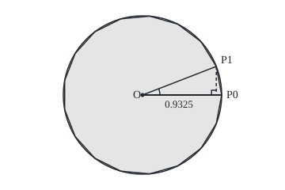
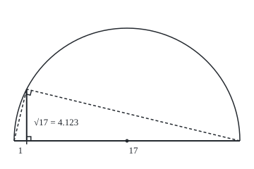

# Ruler and compass: what can be built, and the three ancient problems that cannot

[Syllabus](../../../SYLLABUS.md) → [Geometry and trig](../README.md) → [Beyond Euclid](../README.md#s06) → Ruler and compass

---

## General Overview

A **ruler** here is an unmarked straightedge: it draws the line through two known points. A **compass** draws the circle about one known point through another. New points are crossings. A figure reached this way in finitely many steps is **constructible**.

A regular 17-gon, seventeen equal sides round a circle, is constructible; Gauss found how in 1796. A regular 7-gon is proved not to be. Pierre Wantzel's 1837 proof also ends two ancient Greek problems, cutting any angle in three and building a cube of twice a given volume; the third, a square of a given circle's area, fell in 1882.

Each crossing solves an equation of degree at most two, so adds at most one square root. On a circle of radius 1, drop a perpendicular from the 17-gon's first corner to the starting radius: its foot lies 0.932472 from the centre, four square roots deep. The 7-gon's foot lies 0.623490 out, a root of a **cubic** (an equation whose highest power is the cube) that no chain of square roots reaches.

**Ruler and compass build exactly the numbers reachable from 1 by adding, subtracting, multiplying, dividing and taking square roots; a length that solves a cubic with fraction coefficients and no fraction root, such as the 7-gon's, can never be built.**

**What kind of fact this is:** a theorem, proved on this card in Why it works, except π's case, Lindemann's 1882 theorem, stated without proof.

### The picture: the 17-gon's first corner

<p align="center"></p>

To scale, 1 = 100 units. The arc at O marks 360°/17. The foot of P1 lies 0.9325 from O; P1 sits at (273.2, 83.9).

---

## The formula

Write $n$ for the number of sides and $c$ for the cosine of 360°/n: on a circle of radius 1, the distance from the centre to the foot of the first corner. Drawing $c$ is the whole job: the perpendicular there meets the circle at the first corner, and the compass steps off the rest.

A **field** is a set of numbers closed under adding, subtracting, multiplying and dividing by anything but zero ([Fields](../../03-Algebra/09-Rings%20and%20Fields/02-fields.md)); $F$ is the field of numbers built so far, starting with the fractions.

One construction step can only do this:

$$\text{new number} = p + q\sqrt{k}, \qquad p,\ q,\ k \text{ in } F$$

**Read it aloud:** each step makes an old number plus an old number times the square root of an old number.

For the 17-gon, four such steps suffice, each a quadratic whose coefficients come from the step before:

$$A,\ B = \frac{-1 \pm \sqrt{17}}{2}, \qquad A_1 = \frac{A + \sqrt{A^2 + 4}}{2}, \qquad B_1 = \frac{B + \sqrt{B^2 + 4}}{2}, \qquad 2c = \frac{A_1 + \sqrt{A_1^2 - 4B_1}}{2}$$

**Read it aloud:** the square root of 17, two more roots built on it, one last root, and half the result is the 17-gon's cosine.

| Symbol | Plain meaning | In our example | Push it up and the answer… |
| --- | --- | --- | --- |
| $n$ | number of equal sides | 17, and 7 | corners closer together |
| $c$ | cosine of 360°/n, on a unit circle | 0.932472 for 17; 0.623490 for 7 | corner nearer the start |
| $F$ | the field of numbers built so far | fractions, then with √17 added | more in reach |
| $p$, $q$, $k$ | numbers already in $F$; $k$ goes under the new root | $k$ = 17 at the first step | — |
| $A$, $B$ | each twice a sum of four cosines | 1.561553 and −2.561553 | — |
| $A_1$, $B_1$ | each twice a sum of two cosines | 2.049481 and 0.344151 | — |
| $x$ | the unknown in a cubic | cos 20°, or the cube root of 2 | — |

The full test, from Gauss and Wantzel: an n-gon can be built exactly when n is a power of 2 times distinct **Fermat primes**, primes of the form 2^(2^j) + 1 for a whole number j, such as 3, 5 and 17. From 3 to 20 that allows 3, 4, 5, 6, 8, 10, 12, 15, 16, 17 and 20, and rules out 7, 9, 11, 13, 14, 18 and 19.

### When it holds

- **An unmarked ruler.** Two marks on the edge, slid into place, let Archimedes trisect any angle.
- **Finitely many exact steps.** Doubled polygons approach π but never reach it; a 7-gon drawn 0.20% off is not a construction.
- **"Any angle", not "some angle".** 180° splits into three 60° corners; no recipe works for every angle, and 60° is the witness.

---

## Why it works

### Step 0: every step solves a quadratic at worst

Put the page on a grid, known points at coordinates in $F$; lines and circles through them have equations with coefficients in $F$. Two lines cross where two linear equations agree, inside $F$. A line meets a circle where a quadratic is zero, and the quadratic formula ([The quadratic formula](../../03-Algebra/02-Polynomials/03-quadratic-formula.md)) gives $p + q\sqrt{k}$. Subtracting two circles' equations cancels the squared terms and leaves a line, so two circles are the line-and-circle case again.

### Step 1: the tools reach every field operation and every square root

Adding is laying lengths end to end. Multiplying uses parallel lines ([Angles](../01-Angles%2C%20Triangles%20and%20Congruence/01-angles-and-parallel-lines.md)): mark 1 and b on one arm of an angle and a on the other, join 1 to a, and the parallel through b meets the second arm at ab, by similar triangles ([Similar triangles](../01-Angles%2C%20Triangles%20and%20Congruence/04-similar-triangles-and-scale.md)).

For a square root, lay 1 and 17 end to end, draw the half-circle on the whole 18, and raise a perpendicular at the join. Its top sees the diameter at a right angle ([Angles at a circle](../02-Circles%20and%20Solids/03-angles-in-a-circle.md)), so the two small triangles are similar and the height h has h × h = 1 × 17.

<p align="center"></p>

To scale, the base of 18 spans 320 units: the join sits at x = 37.8, the top at y = 126.7.

Halving: circles about each end of a segment, through the other end, cross twice, and the line through both crossings meets the segment at its midpoint. To halve an angle, mark equal distances on both arms and halve the segment between them.

### Step 2: the 17-gon splits into halves, four times

Write c1 to c8 for the cosines of 1, 2, …, 8 times 360°/17. For any odd n, the cosines of the first (n − 1)/2 multiples of 360°/n add to −1/2.

<details>
<summary>The algebra behind this, if you want it</summary>

Let t = 360°/n. By 2 sin(t/2) cos(jt) = sin((j + 1/2)t) − sin((j − 1/2)t) ([Trig identities](../03-Trigonometry/03-trig-identities.md)), the sum over j = 1 to (n − 1)/2 collapses to sin(nt/2) − sin(t/2) = sin 180° − sin(t/2). Divide by 2 sin(t/2): −1/2.

</details>

Gauss grouped them: A = 2(c1 + c2 + c4 + c8) and B = 2(c3 + c5 + c6 + c7). The sum rule gives A + B = −1.

Multiplying out with 2 cos u × 2 cos v = 2 cos(u + v) + 2 cos(u − v) gives 32 terms, each cosine four times, so A × B = −4. Numbers with sum −1 and product −4 solve y^2 + y − 4 = 0: one square root of 17.

Halve again. A1 = 2(c1 + c4) and its partner 2(c2 + c8) add to A and multiply to −1; B1 = 2(c3 + c5) and its partner likewise with B. Last, 2c1 and 2c4 add to A1 and multiply to 2c5 + 2c3 = B1. Four quadratics, and c1 is the 17-gon's $c$. It works because 17 − 1 = 16 halves four times.

### Step 3: the 7-gon leaves a cubic

7 − 1 = 6 has a factor 3, so halving stalls. The sum rule gives 1 + 2(c + cos 2t + cos 3t) = 0 with t = 360°/7; with cos 2t = 2c^2 − 1 and cos 3t = 4c^3 − 3c:

8c^3 + 4c^2 − 4c − 1 = 0.

If a fraction p/q in lowest terms were a root, multiplying through by q^3 shows p divides 1 and q divides 8 ([Roots and factors](../../03-Algebra/02-Polynomials/05-roots-and-the-factor-theorem.md)). The candidates ±1, ±1/2, ±1/4, ±1/8 all fail. And a cubic with fraction coefficients and no fraction root has no root that square roots reach.

<details>
<summary>Detailed proof: square roots never reach a root of such a cubic</summary>

Take the first field $F$ in the tower (the chain of fields, each the one below plus one new square root) that holds a root: $p + q\sqrt{k}$, with $p$, $q$, $k$ in the field below, $q$ not zero, $\sqrt{k}$ not below. Substituting gives X + Y√k = 0 with X, Y below; Y must be 0, or √k = −X/Y would lie below, so X = 0 too.

Then $p - q\sqrt{k}$ gives X − Y√k = 0: a second root. A cubic's three roots add to minus its x^2 coefficient over its x^3 one, here −1/2, so the third is −1/2 − 2p, in the field below, against the choice of $F$. Descending ends at a fraction root, which the candidates excluded.

</details>

### Step 4: the three ancient problems

- **Trisecting 60°.** The target x = cos 20° solves 4x^3 − 3x = cos 60° = 1/2, so 8x^3 − 6x − 1 = 0. No candidate works: 20°, 0.939693 as a cosine, is out of reach from 60°.
- **Doubling the cube.** The side x of a cube of volume 2 solves x^3 − 2 = 0; ±1 and ±2 fail. The side, 1.259921, is out of reach.
- **Squaring the circle.** A unit circle has area π, so the square needs side √π = 1.772454. Lindemann proved in 1882 that π solves no polynomial with fraction coefficients at all.

Every built length solves such a polynomial, found by squaring away its roots one at a time, so √π cannot be built. The route by field degrees, which proves the full n-gon test, is Straightedge and compass.

---

## Worked numbers, by hand

| Step | Arithmetic | Value |
| --- | --- | --- |
| square root of 17 | half-circle on 1 + 17 | 4.123106 |
| A, B | (−1 ± 4.123106) ÷ 2 | 1.561553 and −2.561553 |
| A1 | (1.561553 + √(1.561553^2 + 4)) ÷ 2 | 2.049481 |
| B1 | (−2.561553 + √(2.561553^2 + 4)) ÷ 2 | 0.344151 |
| c | (2.049481 + √(2.049481^2 − 4 × 0.344151)) ÷ 4 | **0.932472** |
| check | bisection on the sum of eight cosines | **0.932472** |

A perpendicular at 0.932472 of the radius, then sixteen compass steps, complete the polygon.

### What breaks if you drop a piece

| Mistake | Comes out at | What went wrong |
| --- | --- | --- |
| Smaller root at the last step | 0.092268 | That is c4, the corner four steps round |
| Cutting the 60° chord in three equal parts | 19.107°, 21.787°, 19.107° | Equal chord pieces are not equal angles |
| Near-miss 7-gon side of √3/2 | 0.866025 against 0.867767 | 0.20% short: close, not exact |

The code prints all three.

---

## Code, from first principles, and it actually runs

Nothing is imported. The 17-gon's cosine is reached by two roads sharing no step: the tower of four square roots, and bisection on the sum-of-cosines rule, whose cosines then test Gauss's pairing. Bisection halves a bracket, an interval where the sum changes sign, until it pins the root. Cubics are hunted for fraction roots; the 180° control must find some.

### Python

```python
# Ruler and compass -- the check behind the card.  Nothing is imported.  cos(360/17 deg) by four square
# roots and by bisection on the cosine sum; the cubics that block the 7-gon hunted for rational roots.
def sqrt(a):                              # Newton's method, written out here
    x = max(a, 1.0)
    for _ in range(80): x = (x + a / x) / 2
    return x
def cheb(c, k):                           # cos(k t) from c = cos t: cos((k+1)t) = 2c cos(kt) - cos((k-1)t)
    lo, hi = 1.0, c
    for _ in range(k - 1): lo, hi = hi, 2 * c * hi - lo
    return hi if k else 1.0
def bisect(f, lo, hi):                    # a root between lo and hi, where f changes sign
    for _ in range(200): lo, hi = (m, hi) if (f(lo) > 0) == (f(m := (lo + hi) / 2) > 0) else (lo, m)
    return (lo + hi) / 2
def rational_roots(a):                    # a = [a0, a1, a2, a3], a0 not 0: every p/q with p | a0, q | a3
    ds = lambda m: [d for d in range(1, abs(m) + 1) if m % d == 0]
    return [f"{s * p}" if q == 1 else f"{s * p}/{q}" for p in ds(a[0]) for q in ds(a[3]) for s in (-1, 1)
            if sum(a[i] * (s * p) ** i * q ** (3 - i) for i in range(4)) == 0 and all(p % d or q % d for d in range(2, q + 1))]
def buildable(n):                         # 2^k times distinct primes p with p - 1 a power of 2
    while n % 2 == 0: n //= 2
    for p in range(3, n + 1):
        if n % p == 0 and all(p % d for d in range(2, p)):
            n //= p
            if n % p == 0 or (p - 1) & (p - 2): return False
    return True

r17 = sqrt(17)
A, B = (-1 + r17) / 2, (-1 - r17) / 2                            # t^2 + t - 4 = 0
A1, B1 = (A + sqrt(A * A + 4)) / 2, (B + sqrt(B * B + 4)) / 2    # t^2 - A t - 1 = 0 and t^2 - B t - 1 = 0
tower, small = (A1 + sqrt(A1 * A1 - 4 * B1)) / 4, (A1 - sqrt(A1 * A1 - 4 * B1)) / 4   # t^2 - A1 t + B1 = 0, t = 2c
c17, c7 = [bisect(lambda c: 1 + 2 * sum(cheb(c, k) for k in range(1, m)), lo, 0.99) for m, lo in ((9, 0.8), (4, 0.3))]
ck = [cheb(c17, k) for k in range(9)]
A2, B2 = 2 * (ck[1] + ck[2] + ck[4] + ck[8]), 2 * (ck[3] + ck[5] + ck[6] + ck[7])
cubics = [("8c^3 + 4c^2 - 4c - 1 (7-gon)", [-1, -4, 4, 8]), ("8x^3 - 6x - 1 (trisect 60 deg)", [-1, -6, 0, 8]),
          ("x^3 - 2 (double the cube)", [-2, 0, 0, 1]), ("4x^3 - 3x + 1 (trisect 180 deg)", [1, -3, 0, 4])]
c20, cube2 = bisect(lambda x: 8 * x ** 3 - 6 * x - 1, 0.5, 1.0), bisect(lambda x: x ** 3 - 2, 1.0, 2.0)
s = 1.0                                   # Archimedes: side of a 6 x 2^k-gon in a unit circle
for _ in range(30): s = s / sqrt(2 + sqrt(4 - s * s))
pi, fact = 3 * 2 ** 30 * s, lambda m: 1 if m < 2 else m * fact(m - 1)
cosd = lambda d: sum((-1) ** j * (d * pi / 180) ** (2 * j) / fact(2 * j) for j in range(30))   # own cosine
t1, t2 = [bisect(lambda d: cosd(d) - x / sqrt(x * x + y * y), 0.0, 90.0) for x, y in ((5 / 6, sqrt(3) / 6), (2 / 3, sqrt(3) / 3))]
print(f"17-gon, road one, four square roots: cos(360/17 deg) = {tower:.12f}")
print(f"17-gon, road two, bisection on the cosine sum: {c17:.12f}")
print(f"tower: sqrt 17 = {r17:.6f}, A = {A:.6f}, B = {B:.6f}, A1 = {A1:.6f}, B1 = {B1:.6f}")
print(f"road two's cosines: A + B = {A2 + B2:.6f}, A x B = {A2 * B2:.6f}, 17 turns give cos = {cheb(c17, 17):.6f}")
print(f"7-gon: cos(360/7 deg) = {c7:.12f}, 7 turns give cos = {cheb(c7, 7):.6f}")
for name, a in cubics: print(f"rational roots of {name}: {', '.join(rational_roots(a)) or 'none'}")
print(f"cos 20 deg = {c20:.6f}, own cosine of 20 deg = {cosd(20):.6f}, cube root of 2 = {cube2:.6f}, "
      f"pi by Archimedes = {pi:.6f}, square side for a unit circle sqrt(pi) = {sqrt(pi):.6f}")
print(f"buildable n-gons, n = 3 to 20: {[n for n in range(3, 21) if buildable(n)]}; "
      f"not buildable: {[n for n in range(3, 21) if not buildable(n)]}")
print(f"mistake, smaller root at the last step: {small:.6f} = cos(4 x 360/17 deg) = {ck[4]:.6f}")
print(f"mistake, chord of 60 deg cut in three: angles {t1:.3f}, {t2 - t1:.3f}, {60 - t2:.3f} deg")
print(f"mistake, near-miss 7-gon side sqrt(3)/2 = {sqrt(3) / 2:.6f}, true {sqrt(2 - 2 * c7):.6f}, short by {100 * (1 - sqrt(3) / 2 / sqrt(2 - 2 * c7)):.2f}%")
print(f"figure, 17-gon: centre (180, 120), radius 100, P1 ({180 + 100 * c17:.1f}, {120 - 100 * sqrt(1 - c17 * c17):.1f})")
print(f"figure, root: base (20, 200) to (340, 200), foot x {20 + 320 / 18:.1f}, top y {200 - 320 / 18 * r17:.1f}")
assert abs(tower - c17) < 1e-12 and abs(small - ck[4]) < 1e-12            # two roads, both roots
assert abs(A2 + B2 + 1) < 1e-9 and abs(A2 * B2 + 4) < 1e-9                 # the first pairing, checked by road two
assert [rational_roots(a) for _, a in cubics] == [[], [], [], ["-1", "1/2"]]  # the control finds its roots
assert abs(cheb(c7, 7) - 1) < 1e-9 and abs(cosd(20) - c20) < 1e-9          # 7 turns close; the cubic gives cos 20
print("ALL CHECKS PASS")
```

**Ran 2026-09-24 on macOS, Python 3.14.6, standard library only. All checks passed. Output, pasted from the run:**

```
17-gon, road one, four square roots: cos(360/17 deg) = 0.932472229404
17-gon, road two, bisection on the cosine sum: 0.932472229404
tower: sqrt 17 = 4.123106, A = 1.561553, B = -2.561553, A1 = 2.049481, B1 = 0.344151
road two's cosines: A + B = -1.000000, A x B = -4.000000, 17 turns give cos = 1.000000
7-gon: cos(360/7 deg) = 0.623489801859, 7 turns give cos = 1.000000
rational roots of 8c^3 + 4c^2 - 4c - 1 (7-gon): none
rational roots of 8x^3 - 6x - 1 (trisect 60 deg): none
rational roots of x^3 - 2 (double the cube): none
rational roots of 4x^3 - 3x + 1 (trisect 180 deg): -1, 1/2
cos 20 deg = 0.939693, own cosine of 20 deg = 0.939693, cube root of 2 = 1.259921, pi by Archimedes = 3.141593, square side for a unit circle sqrt(pi) = 1.772454
buildable n-gons, n = 3 to 20: [3, 4, 5, 6, 8, 10, 12, 15, 16, 17, 20]; not buildable: [7, 9, 11, 13, 14, 18, 19]
mistake, smaller root at the last step: 0.092268 = cos(4 x 360/17 deg) = 0.092268
mistake, chord of 60 deg cut in three: angles 19.107, 21.787, 19.107 deg
mistake, near-miss 7-gon side sqrt(3)/2 = 0.866025, true 0.867767, short by 0.20%
figure, 17-gon: centre (180, 120), radius 100, P1 (273.2, 83.9)
figure, root: base (20, 200) to (340, 200), foot x 37.8, top y 126.7
ALL CHECKS PASS
```

### Rust

Same numbers, same labels, built with `rustc --edition 2021 -O`.

```rust
// Ruler and compass -- the same check as the Python, in Rust.  No crates.  cos(360/17 deg) by four square
// roots and by bisection on the cosine sum; the cubics that block the 7-gon hunted for rational roots.
fn sqrt(a: f64) -> f64 {                          // Newton's method, written out here
    let mut x = a.max(1.0); for _ in 0..80 { x = (x + a / x) / 2.0 }
    x
}
fn cheb(c: f64, k: usize) -> f64 {                // cos(k t) from c = cos t
    if k == 0 { return 1.0 }
    let (mut lo, mut hi) = (1.0, c);
    for _ in 1..k { (lo, hi) = (hi, 2.0 * c * hi - lo) }
    hi
}
fn bisect(f: &dyn Fn(f64) -> f64, mut lo: f64, mut hi: f64) -> f64 {   // a root where f changes sign
    for _ in 0..200 { let m = (lo + hi) / 2.0; if (f(lo) > 0.0) == (f(m) > 0.0) { lo = m } else { hi = m } }
    (lo + hi) / 2.0
}
fn rational_roots(a: [i64; 4]) -> Vec<String> {   // every p/q with p | a0 and q | a3, in lowest terms
    let ds = |m: i64| (1..=m.abs()).filter(|d| m % d == 0).collect::<Vec<i64>>();
    let mut out = Vec::new();
    for p in ds(a[0]) { for q in ds(a[3]) { for s in [-1, 1] {
        let v: i64 = (0..4).map(|i| a[i] * (s * p).pow(i as u32) * q.pow(3 - i as u32)).sum();
        if v == 0 && (2..=q).all(|d| p % d != 0 || q % d != 0) {
            out.push(if q == 1 { format!("{}", s * p) } else { format!("{}/{}", s * p, q) })
        }
    } } }
    out
}
fn buildable(mut n: u64) -> bool {                // 2^k times distinct primes p with p - 1 a power of 2
    while n % 2 == 0 { n /= 2 }
    for p in 3..=n {
        if n % p == 0 && (2..p).all(|d| p % d != 0) {
            n /= p; if n % p == 0 || (p - 1) & (p - 2) != 0 { return false }
        }
    }
    true
}
fn main() {
    let r17 = sqrt(17.0);
    let (a, b) = ((-1.0 + r17) / 2.0, (-1.0 - r17) / 2.0);
    let (a1, b1) = ((a + sqrt(a * a + 4.0)) / 2.0, (b + sqrt(b * b + 4.0)) / 2.0);
    let (tower, small) = ((a1 + sqrt(a1 * a1 - 4.0 * b1)) / 4.0, (a1 - sqrt(a1 * a1 - 4.0 * b1)) / 4.0);
    let sum_root = |m: usize, lo: f64| bisect(&|c| 1.0 + 2.0 * (1..m).map(|k| cheb(c, k)).sum::<f64>(), lo, 0.99);
    let (c17, c7) = (sum_root(9, 0.8), sum_root(4, 0.3));
    let ck: Vec<f64> = (0..9).map(|k| cheb(c17, k)).collect();
    let (a2, b2) = (2.0 * (ck[1] + ck[2] + ck[4] + ck[8]), 2.0 * (ck[3] + ck[5] + ck[6] + ck[7]));
    let cubics = [("8c^3 + 4c^2 - 4c - 1 (7-gon)", [-1, -4, 4, 8]), ("8x^3 - 6x - 1 (trisect 60 deg)", [-1, -6, 0, 8]),
                  ("x^3 - 2 (double the cube)", [-2, 0, 0, 1]), ("4x^3 - 3x + 1 (trisect 180 deg)", [1, -3, 0, 4])];
    let (c20, cube2) = (bisect(&|x| 8.0 * x * x * x - 6.0 * x - 1.0, 0.5, 1.0), bisect(&|x| x * x * x - 2.0, 1.0, 2.0));
    let mut s = 1.0;                              // Archimedes: side of a 6 x 2^k-gon in a unit circle
    for _ in 0..30 { s = s / sqrt(2.0 + sqrt(4.0 - s * s)) }
    let pi = 3.0 * 2f64.powi(30) * s;
    let cosd = |d: f64| { let (x, mut term, mut sum) = (d * pi / 180.0, 1.0, 0.0);   // own cosine
        for j in 0..30 { sum += term; term *= -x * x / (((2 * j + 1) * (2 * j + 2)) as f64) } sum };
    let ang = |x: f64, y: f64| bisect(&|d| cosd(d) - x / sqrt(x * x + y * y), 0.0, 90.0);
    let (t1, t2) = (ang(5.0 / 6.0, sqrt(3.0) / 6.0), ang(2.0 / 3.0, sqrt(3.0) / 3.0));
    let (yes, no): (Vec<u64>, Vec<u64>) = (3..21).partition(|&n| buildable(n));
    println!("17-gon, road one, four square roots: cos(360/17 deg) = {:.12}", tower);
    println!("17-gon, road two, bisection on the cosine sum: {:.12}", c17);
    println!("tower: sqrt 17 = {:.6}, A = {:.6}, B = {:.6}, A1 = {:.6}, B1 = {:.6}", r17, a, b, a1, b1);
    println!("road two's cosines: A + B = {:.6}, A x B = {:.6}, 17 turns give cos = {:.6}", a2 + b2, a2 * b2, cheb(c17, 17));
    println!("7-gon: cos(360/7 deg) = {:.12}, 7 turns give cos = {:.6}", c7, cheb(c7, 7));
    for (name, c) in &cubics { let r = rational_roots(*c);
        println!("rational roots of {}: {}", name, if r.is_empty() { "none".to_string() } else { r.join(", ") }) }
    println!("cos 20 deg = {:.6}, own cosine of 20 deg = {:.6}, cube root of 2 = {:.6}, pi by Archimedes = {:.6}, square side for a unit circle sqrt(pi) = {:.6}", c20, cosd(20.0), cube2, pi, sqrt(pi));
    println!("buildable n-gons, n = 3 to 20: {:?}; not buildable: {:?}", yes, no);
    println!("mistake, smaller root at the last step: {:.6} = cos(4 x 360/17 deg) = {:.6}", small, ck[4]);
    println!("mistake, chord of 60 deg cut in three: angles {:.3}, {:.3}, {:.3} deg", t1, t2 - t1, 60.0 - t2);
    let (near, side7) = (sqrt(3.0) / 2.0, sqrt(2.0 - 2.0 * c7));
    println!("mistake, near-miss 7-gon side sqrt(3)/2 = {:.6}, true {:.6}, short by {:.2}%", near, side7, 100.0 * (1.0 - near / side7));
    println!("figure, 17-gon: centre (180, 120), radius 100, P1 ({:.1}, {:.1})", 180.0 + 100.0 * c17, 120.0 - 100.0 * sqrt(1.0 - c17 * c17));
    println!("figure, root: base (20, 200) to (340, 200), foot x {:.1}, top y {:.1}", 20.0 + 320.0 / 18.0, 200.0 - 320.0 / 18.0 * r17);
    assert!((tower - c17).abs() < 1e-12 && (small - ck[4]).abs() < 1e-12);       // two roads, both roots
    assert!((a2 + b2 + 1.0).abs() < 1e-9 && (a2 * b2 + 4.0).abs() < 1e-9);         // the first pairing, by road two
    let found: Vec<Vec<String>> = cubics.iter().map(|(_, c)| rational_roots(*c)).collect();
    assert!(found == vec![vec![], vec![], vec![], vec!["-1".to_string(), "1/2".to_string()]]);  // control finds its roots
    assert!((cheb(c7, 7) - 1.0).abs() < 1e-9 && (cosd(20.0) - c20).abs() < 1e-9);  // 7 turns close; cubic gives cos 20
    println!("ALL CHECKS PASS");
}
```

**Ran 2026-09-24 on macOS, rustc 1.98.1, no crates. All checks passed. Output, pasted from the run:**

```
17-gon, road one, four square roots: cos(360/17 deg) = 0.932472229404
17-gon, road two, bisection on the cosine sum: 0.932472229404
tower: sqrt 17 = 4.123106, A = 1.561553, B = -2.561553, A1 = 2.049481, B1 = 0.344151
road two's cosines: A + B = -1.000000, A x B = -4.000000, 17 turns give cos = 1.000000
7-gon: cos(360/7 deg) = 0.623489801859, 7 turns give cos = 1.000000
rational roots of 8c^3 + 4c^2 - 4c - 1 (7-gon): none
rational roots of 8x^3 - 6x - 1 (trisect 60 deg): none
rational roots of x^3 - 2 (double the cube): none
rational roots of 4x^3 - 3x + 1 (trisect 180 deg): -1, 1/2
cos 20 deg = 0.939693, own cosine of 20 deg = 0.939693, cube root of 2 = 1.259921, pi by Archimedes = 3.141593, square side for a unit circle sqrt(pi) = 1.772454
buildable n-gons, n = 3 to 20: [3, 4, 5, 6, 8, 10, 12, 15, 16, 17, 20]; not buildable: [7, 9, 11, 13, 14, 18, 19]
mistake, smaller root at the last step: 0.092268 = cos(4 x 360/17 deg) = 0.092268
mistake, chord of 60 deg cut in three: angles 19.107, 21.787, 19.107 deg
mistake, near-miss 7-gon side sqrt(3)/2 = 0.866025, true 0.867767, short by 0.20%
figure, 17-gon: centre (180, 120), radius 100, P1 (273.2, 83.9)
figure, root: base (20, 200) to (340, 200), foot x 37.8, top y 126.7
ALL CHECKS PASS
```

The outputs match line for line.

### Lean

Lean starts from two points, 0 and 1, and proves these facts for every length and every such cubic.

- Ruler and compass build exactly the lengths reachable from 1 by adding, subtracting, multiplying, dividing and taking square roots.
- A length that solves a cubic with fraction coefficients and no fraction root can never be built.
- None of these can be built: the 7-gon's cosine, cos 20° for trisecting 60°, and the cube root of 2.
- No candidate fraction is a root of the 7-gon, 60° or cube cubics. The 180° control has the roots −1 and 1/2.
- Gauss's first pairing holds: A + B = −1 and A × B = −4. And 3, 5, 17 and 257 are Fermat primes.

The 17-gon's tower of square roots, the decimal values, the n-gon list, the mistakes and the figures are left to the Python and Rust checks.

```lean
-- Ruler and compass: the points built from 0 and 1 by ruler and compass give exactly the real lengths reachable from 1 by the four operations and square roots, so a real root of a fraction-coefficient cubic with no fraction root, such as the 7-gon's cosine, cos 20° or the cube root of 2, can never be built.
import Mathlib.LinearAlgebra.AffineSpace.AffineSubspace.Defs
import Mathlib.Analysis.Complex.Basic
import Mathlib.Analysis.SpecialFunctions.Pow.Real
import Mathlib.Analysis.SpecialFunctions.Trigonometric.Basic
import Mathlib.Tactic.NormNum.Prime
import Mathlib.LinearAlgebra.AffineSpace.AffineSubspace.Basic
import Mathlib.Algebra.Field.Subfield.Basic
import Mathlib.RingTheory.Coprime.Lemmas
import Mathlib.Tactic.IntervalCases

open Real

/-- The points of the plane (the complex numbers) that ruler and compass build from the two
starting points 0 and 1 in finitely many steps. The ruler draws the line through two different
known points; the compass draws the circle about one known point through another. A new point is
a crossing of two different lines, of a line and a circle, or of two different circles. -/
inductive Constructible : ℂ → Prop
  | zero : Constructible 0
  | one : Constructible 1
  | lineLine {a b c d z : ℂ} : Constructible a → Constructible b → Constructible c →
      Constructible d → a ≠ b → c ≠ d → line[ℝ, a, b] ≠ line[ℝ, c, d] →
      z ∈ line[ℝ, a, b] → z ∈ line[ℝ, c, d] → Constructible z
  | lineCircle {a b c d z : ℂ} : Constructible a → Constructible b → Constructible c →
      Constructible d → a ≠ b → z ∈ line[ℝ, a, b] → dist z c = dist d c → Constructible z
  | circleCircle {a b c d z : ℂ} : Constructible a → Constructible b → Constructible c →
      Constructible d → (a, dist b a) ≠ (c, dist d c) →
      dist z a = dist b a → dist z c = dist d c → Constructible z

/-- The real numbers reachable from 1 by adding, subtracting, multiplying, dividing by anything
but zero, and taking the square root of a number that is not negative. -/
inductive SqrtReachable : ℝ → Prop
  | one : SqrtReachable 1
  | add {x y : ℝ} : SqrtReachable x → SqrtReachable y → SqrtReachable (x + y)
  | sub {x y : ℝ} : SqrtReachable x → SqrtReachable y → SqrtReachable (x - y)
  | mul {x y : ℝ} : SqrtReachable x → SqrtReachable y → SqrtReachable (x * y)
  | div {x y : ℝ} : SqrtReachable x → SqrtReachable y → y ≠ 0 → SqrtReachable (x / y)
  | sqrt {x : ℝ} : SqrtReachable x → 0 ≤ x → SqrtReachable (Real.sqrt x)

namespace RCHelp

theorem sr_zero : SqrtReachable 0 := by
  have := SqrtReachable.sub SqrtReachable.one SqrtReachable.one
  simpa using this

theorem sr_neg {x : ℝ} (h : SqrtReachable x) : SqrtReachable (-x) := by
  have := SqrtReachable.sub sr_zero h
  simpa using this

theorem sr_div' {x y : ℝ} (hx : SqrtReachable x) (hy : SqrtReachable y) :
    SqrtReachable (x / y) := by
  by_cases h : y = 0
  · subst h; simpa using sr_zero
  · exact SqrtReachable.div hx hy h

theorem sr_two : SqrtReachable 2 := by
  have := SqrtReachable.add SqrtReachable.one SqrtReachable.one
  norm_num at this; exact this

/-- A real root of a quadratic with reachable coefficients is reachable. -/
theorem sr_quad {A B C t : ℝ} (hA : SqrtReachable A) (hB : SqrtReachable B)
    (hC : SqrtReachable C) (hA0 : A ≠ 0) (h : A * t ^ 2 + 2 * B * t + C = 0) :
    SqrtReachable t := by
  have hsq : (A * t + B) ^ 2 = B ^ 2 - A * C := by linear_combination A * h
  have hD : SqrtReachable (B ^ 2 - A * C) :=
    SqrtReachable.sub (by simpa [pow_two] using SqrtReachable.mul hB hB) (SqrtReachable.mul hA hC)
  have hs : SqrtReachable (Real.sqrt (B ^ 2 - A * C)) :=
    SqrtReachable.sqrt hD (by rw [← hsq]; positivity)
  have habs : |A * t + B| = Real.sqrt (B ^ 2 - A * C) := by
    rw [← hsq, Real.sqrt_sq_eq_abs]
  have hlin : SqrtReachable (A * t + B) := by
    rcases abs_choice (A * t + B) with h1 | h1
    · rw [← h1, habs]; exact hs
    · have : A * t + B = -|A * t + B| := by linarith
      rw [this, habs]; exact sr_neg hs
  have : t = ((A * t + B) - B) / A := by field_simp; ring
  rw [this]
  exact sr_div' (SqrtReachable.sub hlin hB) hA

/-- A crossing of a line and a circle, in coordinates, case e1 ≠ 0. -/
theorem sr_lc_aux {e1 e2 h p1 p2 R x y : ℝ} (he1 : SqrtReachable e1) (he2 : SqrtReachable e2)
    (hh : SqrtReachable h) (hp1 : SqrtReachable p1) (hp2 : SqrtReachable p2)
    (hR : SqrtReachable R) (h0 : e1 ≠ 0) (hl : x * e1 + y * e2 = h)
    (hc : (x - p1) ^ 2 + (y - p2) ^ 2 = R) : SqrtReachable x ∧ SqrtReachable y := by
  have hx : x = (h - y * e2) / e1 := by field_simp; linarith
  have hy : SqrtReachable y := by
    refine sr_quad (A := e1 ^ 2 + e2 ^ 2) (B := -e2 * (h - p1 * e1) - e1 ^ 2 * p2)
      (C := (h - p1 * e1) ^ 2 + e1 ^ 2 * p2 ^ 2 - R * e1 ^ 2) ?_ ?_ ?_ ?_ ?_
    · simp only [pow_two]
      exact SqrtReachable.add (SqrtReachable.mul he1 he1) (SqrtReachable.mul he2 he2)
    · simp only [pow_two]
      exact SqrtReachable.sub (SqrtReachable.mul (sr_neg he2)
        (SqrtReachable.sub hh (SqrtReachable.mul hp1 he1)))
        (SqrtReachable.mul (SqrtReachable.mul he1 he1) hp2)
    · simp only [pow_two]
      have hq := SqrtReachable.sub hh (SqrtReachable.mul hp1 he1)
      exact SqrtReachable.sub (SqrtReachable.add (SqrtReachable.mul hq hq)
        (SqrtReachable.mul (SqrtReachable.mul he1 he1) (SqrtReachable.mul hp2 hp2)))
        (SqrtReachable.mul hR (SqrtReachable.mul he1 he1))
    · positivity
    · rw [hx] at hc
      field_simp at hc
      linear_combination hc
  refine ⟨?_, hy⟩
  rw [hx]
  exact sr_div' (SqrtReachable.sub hh (SqrtReachable.mul hy he2)) he1

theorem sr_lc {e1 e2 h p1 p2 R x y : ℝ} (he1 : SqrtReachable e1) (he2 : SqrtReachable e2)
    (hh : SqrtReachable h) (hp1 : SqrtReachable p1) (hp2 : SqrtReachable p2)
    (hR : SqrtReachable R) (h0 : e1 ≠ 0 ∨ e2 ≠ 0) (hl : x * e1 + y * e2 = h)
    (hc : (x - p1) ^ 2 + (y - p2) ^ 2 = R) : SqrtReachable x ∧ SqrtReachable y := by
  rcases h0 with h0 | h0
  · exact sr_lc_aux he1 he2 hh hp1 hp2 hR h0 hl hc
  · have := sr_lc_aux (x := y) (y := x) he2 he1 hh hp2 hp1 hR h0 (by linarith) (by linarith)
    exact ⟨this.2, this.1⟩

theorem sr_sq {x : ℝ} (h : SqrtReachable x) : SqrtReachable (x ^ 2) := by
  simpa [pow_two] using SqrtReachable.mul h h

macro "sr_tac" : tactic => `(tactic| (repeat (first | assumption | exact SqrtReachable.one | exact sr_zero | exact sr_two | apply SqrtReachable.add | apply SqrtReachable.sub | apply sr_div' | apply SqrtReachable.mul | apply sr_neg | apply sr_sq)))

theorem ne_coords {a b : ℂ} (h : a ≠ b) : b.re - a.re ≠ 0 ∨ b.im - a.im ≠ 0 := by
  by_contra h'
  push Not at h'
  apply h
  apply Complex.ext <;> linarith [h'.1, h'.2]

theorem mem_line_of {a b z : ℂ} (t : ℝ) (h : z = a + t * (b - a)) : z ∈ line[ℝ, a, b] := by
  rw [mem_affineSpan_pair_iff_exists_lineMap_eq]
  refine ⟨t, ?_⟩
  rw [AffineMap.lineMap_apply_module', h, Complex.real_smul]; ring

theorem mem_line_iff {a b z : ℂ} (hab : a ≠ b) : z ∈ line[ℝ, a, b] ↔
    (z.re - a.re) * (b.im - a.im) = (z.im - a.im) * (b.re - a.re) := by
  constructor
  · intro h
    rw [mem_affineSpan_pair_iff_exists_lineMap_eq] at h
    obtain ⟨t, rfl⟩ := h
    simp [AffineMap.lineMap_apply_module', Complex.real_smul]
    ring
  · intro h
    have hw : (b.re - a.re) ^ 2 + (b.im - a.im) ^ 2 ≠ 0 := by
      intro h0
      apply hab
      have h1 : b.re - a.re = 0 := by nlinarith [sq_nonneg (b.re - a.re), sq_nonneg (b.im - a.im)]
      have h2 : b.im - a.im = 0 := by nlinarith [sq_nonneg (b.re - a.re), sq_nonneg (b.im - a.im)]
      apply Complex.ext <;> linarith
    apply mem_line_of (((z.re - a.re) * (b.re - a.re) + (z.im - a.im) * (b.im - a.im)) /
      ((b.re - a.re) ^ 2 + (b.im - a.im) ^ 2))
    apply Complex.ext
    · simp only [Complex.add_re, Complex.mul_re, Complex.ofReal_re, Complex.ofReal_im,
        Complex.sub_re, Complex.sub_im, zero_mul, sub_zero]
      field_simp
      linear_combination (b.im - a.im) * h
    · simp only [Complex.add_im, Complex.mul_im, Complex.ofReal_re, Complex.ofReal_im,
        Complex.sub_re, Complex.sub_im, zero_mul, add_zero]
      field_simp
      linear_combination -(b.re - a.re) * h

theorem dist_sq_eq {z c d : ℂ} (h : dist z c = dist d c) :
    (z.re - c.re) ^ 2 + (z.im - c.im) ^ 2 = (d.re - c.re) ^ 2 + (d.im - c.im) ^ 2 := by
  have h2 : dist z c ^ 2 = dist d c ^ 2 := by rw [h]
  simp only [Complex.dist_eq, Complex.sq_norm, Complex.normSq_apply, Complex.sub_re,
    Complex.sub_im] at h2
  linear_combination h2

/-- Every point that ruler and compass build has reachable coordinates. -/
theorem constructible_coords {z : ℂ} (h : Constructible z) :
    SqrtReachable z.re ∧ SqrtReachable z.im := by
  induction h with
  | zero => simpa using sr_zero
  | one => simpa using ⟨SqrtReachable.one, sr_zero⟩
  | @lineLine a b c d z _ _ _ _ hab hcd hne hz1 hz2 iha ihb ihc ihd =>
    rw [mem_line_iff hab] at hz1
    rw [mem_line_iff hcd] at hz2
    obtain ⟨ar, ai⟩ := iha
    obtain ⟨br, bi⟩ := ihb
    obtain ⟨cr, ci⟩ := ihc
    obtain ⟨dr, di⟩ := ihd
    set w1 := b.re - a.re with hw1
    set w2 := b.im - a.im with hw2
    set v1 := d.re - c.re with hv1
    set v2 := d.im - c.im with hv2
    by_cases hD : w1 * v2 - w2 * v1 = 0
    · exfalso
      apply hne
      have hX1 : ((z.re - c.re) * w2 - (z.im - c.im) * w1) * v1 = 0 := by
        linear_combination w1 * hz2 - (z.re - c.re) * hD
      have hX2 : ((z.re - c.re) * w2 - (z.im - c.im) * w1) * v2 = 0 := by
        linear_combination w2 * hz2 - (z.im - c.im) * hD
      have hX : (z.re - c.re) * w2 - (z.im - c.im) * w1 = 0 := by
        rcases ne_coords hcd with h | h
        · exact (mul_eq_zero.mp hX1).resolve_right h
        · exact (mul_eq_zero.mp hX2).resolve_right h
      have hc : c ∈ line[ℝ, a, b] := by
        rw [mem_line_iff hab]
        linear_combination hz1 - hX
      have hd : d ∈ line[ℝ, a, b] := by
        rw [mem_line_iff hab]
        rw [mem_line_iff hab] at hc
        linear_combination hc - hD
      exact (affineSpan_pair_eq_of_mem_of_mem_of_ne hc hd hcd).symm
    · have e1 : z.re = (w1 * (c.re * v2 - c.im * v1) - v1 * (a.re * w2 - a.im * w1)) /
          (w1 * v2 - w2 * v1) := by
        rw [eq_div_iff hD]
        linear_combination (-v1) * hz1 + w1 * hz2
      have e2 : z.im = (w2 * (c.re * v2 - c.im * v1) - v2 * (a.re * w2 - a.im * w1)) /
          (w1 * v2 - w2 * v1) := by
        rw [eq_div_iff hD]
        linear_combination (-v2) * hz1 + w2 * hz2
      rw [e1, e2]
      constructor <;> sr_tac
  | @lineCircle a b c d z _ _ _ _ hab hz1 hz2 iha ihb ihc ihd =>
    rw [mem_line_iff hab] at hz1
    have hc := dist_sq_eq hz2
    obtain ⟨ar, ai⟩ := iha
    obtain ⟨br, bi⟩ := ihb
    obtain ⟨cr, ci⟩ := ihc
    obtain ⟨dr, di⟩ := ihd
    refine sr_lc (e1 := b.im - a.im) (e2 := -(b.re - a.re))
      (h := a.re * (b.im - a.im) - a.im * (b.re - a.re)) (by sr_tac) (by sr_tac) (by sr_tac)
      cr ci (by sr_tac) ?_ (by linear_combination hz1) hc
    rcases ne_coords hab with h | h
    · exact Or.inr (neg_ne_zero.mpr h)
    · exact Or.inl h
  | @circleCircle a b c d z _ _ _ _ hne hz1 hz2 iha ihb ihc ihd =>
    obtain ⟨ar, ai⟩ := iha
    obtain ⟨br, bi⟩ := ihb
    obtain ⟨cr, ci⟩ := ihc
    obtain ⟨dr, di⟩ := ihd
    have hac : a ≠ c := by
      rintro rfl
      apply hne
      rw [← hz1, ← hz2]
    have h1 := dist_sq_eq hz1
    have h2 := dist_sq_eq hz2
    refine sr_lc (e1 := 2 * (c.re - a.re)) (e2 := 2 * (c.im - a.im))
      (h := ((b.re - a.re) ^ 2 + (b.im - a.im) ^ 2) - ((d.re - c.re) ^ 2 + (d.im - c.im) ^ 2)
        + c.re ^ 2 - a.re ^ 2 + c.im ^ 2 - a.im ^ 2) (by sr_tac) (by sr_tac) (by sr_tac)
      ar ai (by sr_tac) ?_ (by linear_combination h1 - h2) h1
    rcases ne_coords hac with h | h
    · exact Or.inl (mul_ne_zero two_ne_zero h)
    · exact Or.inr (mul_ne_zero two_ne_zero h)

end RCHelp

open RCHelp

#print axioms sr_zero
#print axioms sr_neg
#print axioms sr_div'
#print axioms sr_two
#print axioms sr_quad
#print axioms sr_lc_aux
#print axioms sr_lc
#print axioms sr_sq
#print axioms ne_coords
#print axioms mem_line_of
#print axioms mem_line_iff
#print axioms dist_sq_eq
#print axioms constructible_coords

namespace RCHelp

/-- Fields reached from the fractions by adjoining square roots one at a time. -/
inductive Tower : Subfield ℝ → Prop
  | base : Tower (Rat.castHom ℝ).fieldRange
  | step {K : Subfield ℝ} {s : ℝ} : Tower K → s * s ∈ K →
      Tower (Subfield.closure (insert s (K : Set ℝ)))

theorem adjoin_repr {K : Subfield ℝ} {s x : ℝ} (hs : s * s ∈ K)
    (hx : x ∈ Subfield.closure (insert s (K : Set ℝ))) :
    ∃ p ∈ K, ∃ q ∈ K, x = p + q * s := by
  induction hx using Subfield.closure_induction with
  | mem x hx =>
    rcases hx with rfl | hx
    · exact ⟨0, zero_mem _, 1, one_mem _, by ring⟩
    · exact ⟨x, hx, 0, zero_mem _, by ring⟩
  | one => exact ⟨1, one_mem _, 0, zero_mem _, by ring⟩
  | add x y _ _ ihx ihy =>
    obtain ⟨p, hp, q, hq, rfl⟩ := ihx
    obtain ⟨p', hp', q', hq', rfl⟩ := ihy
    exact ⟨p + p', add_mem hp hp', q + q', add_mem hq hq', by ring⟩
  | neg x _ ihx =>
    obtain ⟨p, hp, q, hq, rfl⟩ := ihx
    exact ⟨-p, neg_mem hp, -q, neg_mem hq, by ring⟩
  | mul x y _ _ ihx ihy =>
    obtain ⟨p, hp, q, hq, rfl⟩ := ihx
    obtain ⟨p', hp', q', hq', rfl⟩ := ihy
    refine ⟨p * p' + q * q' * (s * s), add_mem (mul_mem hp hp') (mul_mem (mul_mem hq hq') hs),
      p * q' + q * p', add_mem (mul_mem hp hq') (mul_mem hq hp'), by ring⟩
  | inv x _ ihx =>
    obtain ⟨p, hp, q, hq, rfl⟩ := ihx
    by_cases hD : p * p - q * q * (s * s) = 0
    · by_cases hq0 : q = 0
      · subst hq0
        have : p = 0 := by simpa [mul_self_eq_zero] using hD
        subst this
        exact ⟨0, zero_mem _, 0, zero_mem _, by simp⟩
      · by_cases hps : p + q * s = 0
        · exact ⟨0, zero_mem _, 0, zero_mem _, by rw [hps]; simp⟩
        · have hfac : (p + q * s) * (p - q * s) = 0 := by linear_combination hD
          have hm : p - q * s = 0 := (mul_eq_zero.mp hfac).resolve_left hps
          have hsK : s ∈ K := by
            have : s = p / q := by field_simp; linarith
            rw [this]; exact div_mem hp hq
          exact ⟨(p + q * s)⁻¹, inv_mem (add_mem hp (mul_mem hq hsK)), 0, zero_mem _, by ring⟩
    · refine ⟨p / (p * p - q * q * (s * s)), div_mem hp ?_, -q / (p * p - q * q * (s * s)),
        div_mem (neg_mem hq) ?_, ?_⟩
      · exact sub_mem (mul_mem hp hp) (mul_mem (mul_mem hq hq) hs)
      · exact sub_mem (mul_mem hp hp) (mul_mem (mul_mem hq hq) hs)
      · have hps : p + q * s ≠ 0 := by
          intro h0
          apply hD
          have : p = -(q * s) := by linarith
          rw [this]; ring
        have hD2 : p * p - q * q * (s * s) = (p + q * s) * (p - q * s) := by ring
        rw [hD2] at hD ⊢
        have hm : p - q * s ≠ 0 := fun h0 => hD (by rw [h0, mul_zero])
        field_simp
        ring

theorem tower_merge {K1 K2 : Subfield ℝ} (h1 : Tower K1) (h2 : Tower K2) :
    ∃ K, Tower K ∧ K1 ≤ K ∧ K2 ≤ K := by
  induction h2 with
  | base =>
    refine ⟨K1, h1, le_rfl, ?_⟩
    rintro _ ⟨q, rfl⟩
    exact SubfieldClass.ratCast_mem K1 q
  | @step K2 s _ hs ih =>
    obtain ⟨K, hK, h1K, h2K⟩ := ih
    refine ⟨Subfield.closure (insert s (K : Set ℝ)), Tower.step hK (h2K hs), ?_, ?_⟩
    · exact le_trans h1K (fun x hx => Subfield.subset_closure (Set.mem_insert_of_mem _ hx))
    · exact Subfield.closure_mono (Set.insert_subset_insert h2K)

theorem sr_tower {x : ℝ} (h : SqrtReachable x) : ∃ K, Tower K ∧ x ∈ K := by
  induction h with
  | one => exact ⟨_, Tower.base, one_mem _⟩
  | add _ _ ihx ihy =>
    obtain ⟨K1, h1, hx⟩ := ihx
    obtain ⟨K2, h2, hy⟩ := ihy
    obtain ⟨K, hK, l1, l2⟩ := tower_merge h1 h2
    exact ⟨K, hK, add_mem (l1 hx) (l2 hy)⟩
  | sub _ _ ihx ihy =>
    obtain ⟨K1, h1, hx⟩ := ihx
    obtain ⟨K2, h2, hy⟩ := ihy
    obtain ⟨K, hK, l1, l2⟩ := tower_merge h1 h2
    exact ⟨K, hK, sub_mem (l1 hx) (l2 hy)⟩
  | mul _ _ ihx ihy =>
    obtain ⟨K1, h1, hx⟩ := ihx
    obtain ⟨K2, h2, hy⟩ := ihy
    obtain ⟨K, hK, l1, l2⟩ := tower_merge h1 h2
    exact ⟨K, hK, mul_mem (l1 hx) (l2 hy)⟩
  | div _ _ _ ihx ihy =>
    obtain ⟨K1, h1, hx⟩ := ihx
    obtain ⟨K2, h2, hy⟩ := ihy
    obtain ⟨K, hK, l1, l2⟩ := tower_merge h1 h2
    exact ⟨K, hK, div_mem (l1 hx) (l2 hy)⟩
  | @sqrt x _ hx0 ihx =>
    obtain ⟨K, hK, hx⟩ := ihx
    refine ⟨_, Tower.step (s := Real.sqrt x) hK ?_, Subfield.subset_closure (Set.mem_insert _ _)⟩
    rw [Real.mul_self_sqrt hx0]; exact hx

/-- If a cubic has two different roots, the third root (from the sum of the roots) is a root. -/
theorem third_root {a b c d x1 x2 : ℝ} (ha : a ≠ 0) (hne : x1 ≠ x2)
    (h1 : a * x1 ^ 3 + b * x1 ^ 2 + c * x1 + d = 0) (h2 : a * x2 ^ 3 + b * x2 ^ 2 + c * x2 + d = 0) :
    a * (-b / a - x1 - x2) ^ 3 + b * (-b / a - x1 - x2) ^ 2 + c * (-b / a - x1 - x2) + d = 0 := by
  have he : a * (x1 ^ 2 + x1 * x2 + x2 ^ 2) + b * (x1 + x2) + c = 0 := by
    have : (x1 - x2) * (a * (x1 ^ 2 + x1 * x2 + x2 ^ 2) + b * (x1 + x2) + c) = 0 := by
      linear_combination h1 - h2
    exact (mul_eq_zero.mp this).resolve_left (sub_ne_zero.mpr hne)
  set r := -b / a - x1 - x2 with hr_def
  have hr : a * (r + x1 + x2) + b = 0 := by rw [hr_def]; field_simp; ring
  linear_combination h1 + (r - x1) * he + (r - x1) * (r - x2) * hr

theorem cubic_descend {K : Subfield ℝ} {s : ℝ} (hs : s * s ∈ K) {a b c d : ℝ} (ha0 : a ≠ 0)
    (ha : a ∈ K) (hb : b ∈ K) (hc : c ∈ K) (hd : d ∈ K) {x : ℝ}
    (hx : x ∈ Subfield.closure (insert s (K : Set ℝ)))
    (hf : a * x ^ 3 + b * x ^ 2 + c * x + d = 0) :
    ∃ y ∈ K, a * y ^ 3 + b * y ^ 2 + c * y + d = 0 := by
  obtain ⟨p, hp, q, hq, rfl⟩ := adjoin_repr hs hx
  by_cases hsK : s ∈ K
  · exact ⟨p + q * s, add_mem hp (mul_mem hq hsK), hf⟩
  by_cases hq0 : q = 0
  · subst hq0
    exact ⟨p, hp, by simpa using hf⟩
  set t := s * s with ht
  set A := a * (p ^ 3 + 3 * p * q ^ 2 * t) + b * (p ^ 2 + q ^ 2 * t) + c * p + d with hA
  set B := a * (3 * p ^ 2 * q + q ^ 3 * t) + b * (2 * p * q) + c * q with hB
  have hAK : A ∈ K := by
    rw [hA]
    have h3 : (3 : ℝ) ∈ K := by simp
    simp only [pow_succ, pow_zero, one_mul]
    repeat (first | assumption | apply add_mem | apply mul_mem)
  have hBK : B ∈ K := by
    rw [hB]
    have h3 : (3 : ℝ) ∈ K := by simp
    have h2 : (2 : ℝ) ∈ K := by simp
    simp only [pow_succ, pow_zero, one_mul]
    repeat (first | assumption | apply add_mem | apply mul_mem)
  have hsplit : a * (p + q * s) ^ 3 + b * (p + q * s) ^ 2 + c * (p + q * s) + d = A + B * s := by
    rw [hA, hB, ht]; ring
  have hB0 : B = 0 := by
    by_contra hB0
    apply hsK
    have hAB : A + B * s = 0 := hsplit ▸ hf
    have : s = -A / B := by
      rw [eq_div_iff hB0]
      linear_combination hAB
    rw [this]; exact div_mem (neg_mem hAK) hBK
  have hA0 : A = 0 := by rw [hsplit, hB0] at hf; simpa using hf
  have hconj : a * (p - q * s) ^ 3 + b * (p - q * s) ^ 2 + c * (p - q * s) + d = 0 := by
    have : a * (p - q * s) ^ 3 + b * (p - q * s) ^ 2 + c * (p - q * s) + d = A - B * s := by
      rw [hA, hB, ht]; ring
    rw [this, hA0, hB0]; ring
  have hs0 : s ≠ 0 := by
    rintro rfl; exact hsK (zero_mem _)
  have hne : p + q * s ≠ p - q * s := by
    intro h
    have : q * s = 0 := by linarith
    rcases mul_eq_zero.mp this with h' | h'
    · exact hq0 h'
    · exact hs0 h'
  refine ⟨-b / a - (p + q * s) - (p - q * s), ?_, third_root ha0 hne hf hconj⟩
  have : -b / a - (p + q * s) - (p - q * s) = -b / a - (p + p) := by ring
  rw [this]
  exact sub_mem (div_mem (neg_mem hb) ha) (add_mem hp hp)

theorem tower_cubic {K : Subfield ℝ} (hK : Tower K) (a b c d : ℚ) (ha : a ≠ 0) :
    ∀ x ∈ K, (a : ℝ) * x ^ 3 + (b : ℝ) * x ^ 2 + (c : ℝ) * x + (d : ℝ) = 0 →
      ∃ q : ℚ, a * q ^ 3 + b * q ^ 2 + c * q + d = 0 := by
  induction hK with
  | base =>
    rintro _ ⟨q, rfl⟩ hx
    refine ⟨q, ?_⟩
    have : ((a * q ^ 3 + b * q ^ 2 + c * q + d : ℚ) : ℝ) = 0 := by
      simpa using hx
    exact_mod_cast this
  | @step K s _ hs ih =>
    intro x hx hf
    obtain ⟨y, hy, hfy⟩ := cubic_descend hs (by exact_mod_cast ha)
      (SubfieldClass.ratCast_mem K a) (SubfieldClass.ratCast_mem K b)
      (SubfieldClass.ratCast_mem K c) (SubfieldClass.ratCast_mem K d) hx hf
    exact ih y hy hfy

end RCHelp

open RCHelp

#print axioms Tower
#print axioms adjoin_repr
#print axioms tower_merge
#print axioms sr_tower
#print axioms third_root
#print axioms cubic_descend
#print axioms tower_cubic

namespace RCHelp

theorem dist_of_sq {z c d : ℂ}
    (h : (z.re - c.re) ^ 2 + (z.im - c.im) ^ 2 = (d.re - c.re) ^ 2 + (d.im - c.im) ^ 2) :
    dist z c = dist d c := by
  rw [← sq_eq_sq₀ dist_nonneg dist_nonneg]
  simp only [Complex.dist_eq, Complex.sq_norm, Complex.normSq_apply, Complex.sub_re,
    Complex.sub_im]
  linear_combination h

theorem c_neg {w : ℂ} (hw : Constructible w) : Constructible (-w) := by
  by_cases h0 : w = 0
  · subst h0; simpa using Constructible.zero
  refine Constructible.lineCircle (a := 0) (b := w) (c := 0) (d := w) Constructible.zero hw
    Constructible.zero hw (Ne.symm h0) (mem_line_of (-1) (by push_cast; ring)) ?_
  simp [dist_zero_right]

theorem c_double {w : ℂ} (hw : Constructible w) : Constructible (2 * w) := by
  by_cases h0 : w = 0
  · subst h0; simpa using Constructible.zero
  refine Constructible.lineCircle (a := 0) (b := w) (c := w) (d := 0) Constructible.zero hw
    hw Constructible.zero (Ne.symm h0) (mem_line_of 2 (by push_cast; ring)) ?_
  apply dist_of_sq
  simp
  ring

/-- The two points that the circles about u through v and about v through u share. -/
noncomputable def eqv (u v : ℂ) (σ : ℝ) : ℂ :=
  (u + v) / 2 + Complex.I * ((σ * Real.sqrt 3 / 2 : ℝ) : ℂ) * (v - u)

theorem eqv_re (u v : ℂ) (σ : ℝ) :
    (eqv u v σ).re = (u.re + v.re) / 2 - σ * Real.sqrt 3 / 2 * (v.im - u.im) := by
  simp [eqv]; ring

theorem eqv_im (u v : ℂ) (σ : ℝ) :
    (eqv u v σ).im = (u.im + v.im) / 2 + σ * Real.sqrt 3 / 2 * (v.re - u.re) := by
  simp [eqv]

theorem c_eqv {u v : ℂ} (hu : Constructible u) (hv : Constructible v) (hne : u ≠ v) (σ : ℝ)
    (hσ : σ = 1 ∨ σ = -1) : Constructible (eqv u v σ) := by
  have h3 : Real.sqrt 3 ^ 2 = 3 := Real.sq_sqrt (by norm_num)
  have hσ2 : σ ^ 2 = 1 := by rcases hσ with rfl | rfl <;> norm_num
  refine Constructible.circleCircle (a := u) (b := v) (c := v) (d := u) hu hv hv hu ?_ ?_ ?_
  · intro h; exact hne (Prod.ext_iff.mp h).1
  · apply dist_of_sq
    rw [eqv_re, eqv_im]
    linear_combination (3 / 4 * (v.im - u.im) ^ 2 + 3 / 4 * (v.re - u.re) ^ 2) * hσ2
      + (σ ^ 2 / 4 * (v.im - u.im) ^ 2 + σ ^ 2 / 4 * (v.re - u.re) ^ 2) * h3
  · apply dist_of_sq
    rw [eqv_re, eqv_im]
    linear_combination (3 / 4 * (v.im - u.im) ^ 2 + 3 / 4 * (v.re - u.re) ^ 2) * hσ2
      + (σ ^ 2 / 4 * (v.im - u.im) ^ 2 + σ ^ 2 / 4 * (v.re - u.re) ^ 2) * h3

theorem c_mid {u v : ℂ} (hu : Constructible u) (hv : Constructible v) (hne : u ≠ v) :
    Constructible ((u + v) / 2) := by
  have h3 : Real.sqrt 3 ^ 2 = 3 := Real.sq_sqrt (by norm_num)
  have h3p : 0 < Real.sqrt 3 := by positivity
  have hw : (v.re - u.re) ^ 2 + (v.im - u.im) ^ 2 ≠ 0 := by
    rcases ne_coords hne with h | h
    · have := pow_pos (abs_pos.mpr h) 2
      rw [sq_abs] at this
      positivity
    · have := pow_pos (abs_pos.mpr h) 2
      rw [sq_abs] at this
      positivity
  have hP := c_eqv hu hv hne 1 (Or.inl rfl)
  have hQ := c_eqv hu hv hne (-1) (Or.inr rfl)
  have hPQ : eqv u v 1 ≠ eqv u v (-1) := by
    intro h
    have h1 := congrArg Complex.re h
    have h2 := congrArg Complex.im h
    rw [eqv_re, eqv_re] at h1
    rw [eqv_im, eqv_im] at h2
    apply hw
    have e1 : Real.sqrt 3 * (v.im - u.im) = 0 := by linarith
    have e2 : Real.sqrt 3 * (v.re - u.re) = 0 := by linarith
    have f1 : v.im - u.im = 0 := (mul_eq_zero.mp e1).resolve_left h3p.ne'
    have f2 : v.re - u.re = 0 := (mul_eq_zero.mp e2).resolve_left h3p.ne'
    rw [f1, f2]; ring
  refine Constructible.lineLine (a := u) (b := v) (c := eqv u v 1) (d := eqv u v (-1))
    hu hv hP hQ hne hPQ ?_ (mem_line_of (1 / 2) (by push_cast; ring)) ?_
  · intro h
    have hm : eqv u v 1 ∈ line[ℝ, u, v] := by
      rw [h]; exact left_mem_affineSpan_pair _ _ _
    rw [mem_line_iff hne, eqv_re, eqv_im] at hm
    apply hw
    have : Real.sqrt 3 * ((v.re - u.re) ^ 2 + (v.im - u.im) ^ 2) = 0 := by
      linear_combination -2 * hm
    exact (mul_eq_zero.mp this).resolve_left h3p.ne'
  · apply mem_line_of (1 / 2)
    simp only [eqv]
    push_cast
    ring

theorem c_add {u v : ℂ} (hu : Constructible u) (hv : Constructible v) :
    Constructible (u + v) := by
  by_cases h : u = v
  · subst h
    have := c_double hu
    rwa [two_mul] at this
  · have := c_double (c_mid hu hv h)
    rwa [mul_div_cancel₀ _ two_ne_zero] at this

theorem c_sub {u v : ℂ} (hu : Constructible u) (hv : Constructible v) :
    Constructible (u - v) := by
  rw [sub_eq_add_neg]; exact c_add hu (c_neg hv)

theorem c_mulI {w : ℂ} (hw : Constructible w) : Constructible (Complex.I * w) := by
  by_cases h0 : w = 0
  · subst h0; simpa using Constructible.zero
  have h3 : Real.sqrt 3 ^ 2 = 3 := Real.sq_sqrt (by norm_num)
  have h3p : 0 < Real.sqrt 3 := by positivity
  have hn : -w ≠ w := by
    intro h; apply h0
    have : (2 : ℂ) * w = 0 := by linear_combination -h
    simpa using this
  have hP := c_eqv (c_neg hw) hw hn 1 (Or.inl rfl)
  have hQ := c_eqv (c_neg hw) hw hn (-1) (Or.inr rfl)
  have hPQ : eqv (-w) w 1 ≠ eqv (-w) w (-1) := by
    intro h
    have h1 := congrArg Complex.re h
    have h2 := congrArg Complex.im h
    rw [eqv_re, eqv_re] at h1
    rw [eqv_im, eqv_im] at h2
    apply h0
    simp at h1 h2
    have hi : w.im = 0 := h1.resolve_left (by intro h; linarith)
    have hr : w.re = 0 := h2.resolve_left (by intro h; linarith)
    apply Complex.ext <;> simp [hi, hr]
  refine Constructible.lineCircle (a := eqv (-w) w 1) (b := eqv (-w) w (-1)) (c := 0) (d := w)
    hP hQ Constructible.zero hw hPQ ?_ ?_
  · rw [mem_line_iff hPQ, eqv_re, eqv_re, eqv_im, eqv_im]
    simp
    ring
  · apply dist_of_sq
    simp
    ring

theorem c_ofI {t : ℝ} (h : Constructible (Complex.I * t)) : Constructible (t : ℂ) := by
  refine Constructible.lineCircle (a := 0) (b := 1) (c := 0) (d := Complex.I * t)
    Constructible.zero Constructible.one Constructible.zero h zero_ne_one
    (mem_line_of t (by ring)) ?_
  apply dist_of_sq
  simp

theorem c_mul_real {x y : ℝ} (hx : Constructible (x : ℂ)) (hy : Constructible (y : ℂ)) :
    Constructible ((x * y : ℝ) : ℂ) := by
  by_cases hy0 : y = 0
  · subst hy0; simpa using Constructible.zero
  have hI : Constructible Complex.I := by simpa using c_mulI Constructible.one
  have hP : Constructible (1 + Complex.I * x) := c_add Constructible.one (c_mulI hx)
  have hQ : Constructible (y + Complex.I) := c_add hy hI
  have h0P : (0 : ℂ) ≠ 1 + Complex.I * x := by
    intro h; have := congrArg Complex.re h; simp at this
  have hyQ : (y : ℂ) ≠ y + Complex.I := by
    intro h; have := congrArg Complex.im h; simp at this
  have hz : Constructible (y + Complex.I * ((x * y : ℝ) : ℂ)) := by
    refine Constructible.lineLine (a := 0) (b := 1 + Complex.I * x) (c := y)
      (d := y + Complex.I) Constructible.zero hP hy hQ h0P hyQ ?_
      (mem_line_of y (by push_cast; ring)) (mem_line_of (x * y) (by push_cast; ring))
    intro h
    have hm : (0 : ℂ) ∈ line[ℝ, (y : ℂ), y + Complex.I] := by
      rw [← h]; exact left_mem_affineSpan_pair _ _ _
    rw [mem_line_iff hyQ] at hm
    simp at hm
    exact hy0 hm
  apply c_ofI
  have := c_sub hz hy
  simpa using this

theorem c_div_real {x y : ℝ} (hx : Constructible (x : ℂ)) (hy : Constructible (y : ℂ)) :
    Constructible ((x / y : ℝ) : ℂ) := by
  by_cases hy0 : y = 0
  · subst hy0; simpa using Constructible.zero
  have hI : Constructible Complex.I := by simpa using c_mulI Constructible.one
  have hP : Constructible (y + Complex.I * x) := c_add hy (c_mulI hx)
  have hQ : Constructible (1 + Complex.I) := c_add Constructible.one hI
  have h0P : (0 : ℂ) ≠ y + Complex.I * x := by
    intro h; have := congrArg Complex.re h; simp at this; exact hy0 this.symm
  have h1Q : (1 : ℂ) ≠ 1 + Complex.I := by
    intro h; have := congrArg Complex.im h; simp at this
  have hyc : (y : ℂ) ≠ 0 := by exact_mod_cast hy0
  have hz : Constructible (1 + Complex.I * ((x / y : ℝ) : ℂ)) := by
    refine Constructible.lineLine (a := 0) (b := y + Complex.I * x) (c := 1)
      (d := 1 + Complex.I) Constructible.zero hP Constructible.one hQ h0P h1Q ?_
      (mem_line_of (1 / y) (by push_cast; field_simp; ring)) (mem_line_of (x / y) (by push_cast; ring))
    intro h
    have hm : (0 : ℂ) ∈ line[ℝ, (1 : ℂ), 1 + Complex.I] := by
      rw [← h]; exact left_mem_affineSpan_pair _ _ _
    rw [mem_line_iff h1Q] at hm
    simp at hm
  apply c_ofI
  have := c_sub hz Constructible.one
  simpa using this

theorem c_sqrt_real {x : ℝ} (hx : Constructible (x : ℂ)) (hx0 : 0 ≤ x) :
    Constructible ((Real.sqrt x : ℝ) : ℂ) := by
  have hI : Constructible Complex.I := by simpa using c_mulI Constructible.one
  have h2 : Constructible ((2 : ℝ) : ℂ) := by
    have := c_add Constructible.one Constructible.one
    norm_num at this; exact_mod_cast this
  have hm : Constructible (((x - 1) / 2 : ℝ) : ℂ) := by
    apply c_div_real _ h2
    have := c_sub hx Constructible.one
    exact_mod_cast this
  have hs : Real.sqrt x ^ 2 = x := Real.sq_sqrt hx0
  apply c_ofI
  refine Constructible.lineCircle (a := 0) (b := Complex.I) (c := (((x - 1) / 2 : ℝ) : ℂ))
    (d := x) Constructible.zero hI hm hx Complex.I_ne_zero.symm (mem_line_of (Real.sqrt x) (by ring)) ?_
  apply dist_of_sq
  simp
  linear_combination hs

theorem sr_constructible {x : ℝ} (h : SqrtReachable x) : Constructible (x : ℂ) := by
  induction h with
  | one => simpa using Constructible.one
  | add _ _ ihx ihy => push_cast; exact c_add ihx ihy
  | sub _ _ ihx ihy => push_cast; exact c_sub ihx ihy
  | mul _ _ ihx ihy => exact c_mul_real ihx ihy
  | div _ _ _ ihx ihy => exact c_div_real ihx ihy
  | sqrt _ hx0 ihx => exact c_sqrt_real ihx hx0

end RCHelp

open RCHelp

#print axioms dist_of_sq
#print axioms c_neg
#print axioms c_double
#print axioms eqv
#print axioms eqv_re
#print axioms eqv_im
#print axioms c_eqv
#print axioms c_mid
#print axioms c_add
#print axioms c_sub
#print axioms c_mulI
#print axioms c_ofI
#print axioms c_mul_real
#print axioms c_div_real
#print axioms c_sqrt_real
#print axioms sr_constructible

namespace RCHelp

/-- Rational root test for a cubic with whole-number coefficients. -/
theorem rat_root {a3 a2 a1 a0 : ℤ} (q : ℚ)
    (h : (a3 : ℚ) * q ^ 3 + (a2 : ℚ) * q ^ 2 + (a1 : ℚ) * q + (a0 : ℚ) = 0) :
    q.num ∣ a0 ∧ (q.den : ℤ) ∣ a3 := by
  have hd : (q.den : ℚ) ≠ 0 := by exact_mod_cast q.den_nz
  have key : a3 * q.num ^ 3 + a2 * q.num ^ 2 * q.den + a1 * q.num * q.den ^ 2
      + a0 * (q.den : ℤ) ^ 3 = 0 := by
    have hq := Rat.num_div_den q
    rw [← hq] at h
    field_simp at h
    exact_mod_cast (by linear_combination h :
      (a3 : ℚ) * q.num ^ 3 + a2 * q.num ^ 2 * q.den + a1 * q.num * q.den ^ 2
        + a0 * (q.den : ℚ) ^ 3 = 0)
  have cop : IsCoprime q.num (q.den : ℤ) := Rat.isCoprime_num_den q
  constructor
  · apply (cop.pow_right (n := 3)).dvd_of_dvd_mul_right
    exact ⟨-(a3 * q.num ^ 2 + a2 * q.num * q.den + a1 * q.den ^ 2), by linear_combination key⟩
  · apply (cop.symm.pow_right (n := 3)).dvd_of_dvd_mul_right
    exact ⟨-(a2 * q.num ^ 2 + a1 * q.num * q.den + a0 * q.den ^ 2), by linear_combination key⟩

theorem num_unit {q : ℚ} (h : q.num ∣ -1) : q.num = 1 ∨ q.num = -1 := by
  have : IsUnit q.num := isUnit_of_dvd_one (by simpa using h)
  exact Int.isUnit_iff.mp this

theorem no_rat_root_seven (q : ℚ) : (8 : ℚ) * q ^ 3 + 4 * q ^ 2 + (-4) * q + (-1) ≠ 0 := by
  intro h
  obtain ⟨hn, hd⟩ := rat_root (a3 := 8) (a2 := 4) (a1 := -4) (a0 := -1) q (by push_cast; linarith)
  have hn' := num_unit hn
  have hd' : q.den ∣ 8 := by exact_mod_cast hd
  have hdle : q.den ≤ 8 := Nat.le_of_dvd (by norm_num) hd'
  have hpos := q.den_pos
  rw [← Rat.num_div_den q] at h
  generalize q.num = N at h hn'
  generalize q.den = D at h hd' hdle hpos
  interval_cases D <;> rcases hn' with rfl | rfl <;> norm_num at h

theorem no_rat_root_nine (q : ℚ) : (8 : ℚ) * q ^ 3 + 0 * q ^ 2 + (-6) * q + (-1) ≠ 0 := by
  intro h
  obtain ⟨hn, hd⟩ := rat_root (a3 := 8) (a2 := 0) (a1 := -6) (a0 := -1) q (by push_cast; linarith)
  have hn' := num_unit hn
  have hd' : q.den ∣ 8 := by exact_mod_cast hd
  have hdle : q.den ≤ 8 := Nat.le_of_dvd (by norm_num) hd'
  have hpos := q.den_pos
  rw [← Rat.num_div_den q] at h
  generalize q.num = N at h hn'
  generalize q.den = D at h hd' hdle hpos
  interval_cases D <;> rcases hn' with rfl | rfl <;> norm_num at h

theorem no_rat_root_cube (q : ℚ) : (1 : ℚ) * q ^ 3 + 0 * q ^ 2 + 0 * q + (-2) ≠ 0 := by
  intro h
  obtain ⟨hn, hd⟩ := rat_root (a3 := 1) (a2 := 0) (a1 := 0) (a0 := -2) q (by push_cast; linarith)
  have hd' : q.den ∣ 1 := by exact_mod_cast hd
  have hd1 : q.den = 1 := Nat.dvd_one.mp hd'
  have hq : q = (q.num : ℚ) := by
    rw [← Rat.num_div_den q, hd1]; simp
  rw [hq] at h
  have hz : q.num ^ 3 = 2 := by
    have : ((q.num ^ 3 : ℤ) : ℚ) = ((2 : ℤ) : ℚ) := by push_cast; linarith
    exact_mod_cast this
  generalize q.num = N at hz
  have hle : N ≤ 1 := by
    by_contra hc; push Not at hc
    nlinarith [sq_nonneg N]
  have hge : -1 ≤ N := by
    by_contra hc; push Not at hc
    nlinarith [sq_nonneg N]
  interval_cases N <;> norm_num at hz

theorem cos_seven_cubic :
    (8 : ℝ) * Real.cos (2 * π / 7) ^ 3 + 4 * Real.cos (2 * π / 7) ^ 2
      + (-4) * Real.cos (2 * π / 7) + (-1) = 0 := by
  set θ := 2 * π / 7 with hθ
  have h43 : Real.cos (2 * (2 * θ)) = Real.cos (3 * θ) := by
    have : 2 * (2 * θ) = 2 * π - 3 * θ := by rw [hθ]; ring
    rw [this, Real.cos_two_pi_sub]
  rw [Real.cos_two_mul, Real.cos_two_mul, Real.cos_three_mul] at h43
  have hlt : Real.cos θ < 1 := by
    have := Real.cos_lt_cos_of_nonneg_of_le_pi (x := 0) (y := θ) le_rfl
      (by rw [hθ]; linarith [Real.pi_pos]) (by rw [hθ]; positivity)
    simpa using this
  have hfac : (Real.cos θ - 1) * (8 * Real.cos θ ^ 3 + 4 * Real.cos θ ^ 2 - 4 * Real.cos θ - 1)
      = 0 := by linear_combination h43
  have := (mul_eq_zero.mp hfac).resolve_left (by linarith)
  linear_combination this

theorem cos_nine_cubic :
    (8 : ℝ) * Real.cos (π / 9) ^ 3 + 0 * Real.cos (π / 9) ^ 2
      + (-6) * Real.cos (π / 9) + (-1) = 0 := by
  have h := Real.cos_three_mul (π / 9)
  have : 3 * (π / 9) = π / 3 := by ring
  rw [this, Real.cos_pi_div_three] at h
  linear_combination -2 * h

theorem cube_root_two_cubic :
    (1 : ℝ) * ((2 : ℝ) ^ ((1 : ℝ) / 3)) ^ 3 + 0 * ((2 : ℝ) ^ ((1 : ℝ) / 3)) ^ 2
      + 0 * ((2 : ℝ) ^ ((1 : ℝ) / 3)) + (-2) = 0 := by
  have : ((2 : ℝ) ^ ((1 : ℝ) / 3)) ^ 3 = 2 := by
    rw [← Real.rpow_natCast, ← Real.rpow_mul (by norm_num)]
    norm_num
  rw [this]; ring

end RCHelp

open RCHelp

#print axioms rat_root
#print axioms num_unit
#print axioms no_rat_root_seven
#print axioms no_rat_root_nine
#print axioms no_rat_root_cube
#print axioms cos_seven_cubic
#print axioms cos_nine_cubic
#print axioms cube_root_two_cubic

/-- A length that solves a cubic a x³ + b x² + c x + d = 0 with fraction coefficients
(a not zero) and no fraction root can never be built with ruler and compass. -/
theorem cubic_root_without_fraction_root_not_constructible (a b c d : ℚ) (ha : a ≠ 0)
    (hno : ∀ q : ℚ, a * q ^ 3 + b * q ^ 2 + c * q + d ≠ 0)
    (x : ℝ) (hx : (a : ℝ) * x ^ 3 + (b : ℝ) * x ^ 2 + (c : ℝ) * x + (d : ℝ) = 0) :
    ¬ Constructible (x : ℂ) := by
  intro hC
  have hx' : SqrtReachable x := by simpa using (RCHelp.constructible_coords hC).1
  obtain ⟨K, hK, hxK⟩ := RCHelp.sr_tower hx'
  obtain ⟨q, hq⟩ := RCHelp.tower_cubic hK a b c d ha x hxK hx
  exact hno q hq

/-- Ruler and compass build exactly the real numbers reachable from 1 by adding, subtracting,
multiplying, dividing and taking square roots. -/
theorem constructible_iff_sqrt_reachable (x : ℝ) : Constructible (x : ℂ) ↔ SqrtReachable x := by
  exact ⟨fun h => by simpa using (RCHelp.constructible_coords h).1, RCHelp.sr_constructible⟩

/-- The ancient problems that cannot be solved: the regular 7-gon's cosine cos(360°/7), the
cosine of 20° that trisecting 60° needs, and the side of a cube of volume 2 (the cube root of 2)
can none of them be built with ruler and compass. -/
theorem seven_gon_trisection_and_cube_doubling_impossible :
    ¬ Constructible (Real.cos (2 * π / 7) : ℂ) ∧ ¬ Constructible (Real.cos (π / 9) : ℂ) ∧
      ¬ Constructible (((2 : ℝ) ^ ((1 : ℝ) / 3) : ℝ) : ℂ) := by
  refine ⟨?_, ?_, ?_⟩
  · exact cubic_root_without_fraction_root_not_constructible 8 4 (-4) (-1) (by norm_num)
      RCHelp.no_rat_root_seven _ (by push_cast; exact RCHelp.cos_seven_cubic)
  · exact cubic_root_without_fraction_root_not_constructible 8 0 (-6) (-1) (by norm_num)
      RCHelp.no_rat_root_nine _ (by push_cast; exact RCHelp.cos_nine_cubic)
  · exact cubic_root_without_fraction_root_not_constructible 1 0 0 (-2) (by norm_num)
      RCHelp.no_rat_root_cube _ (by push_cast; exact RCHelp.cube_root_two_cubic)

-- The 7-gon's cubic 8c³ + 4c² − 4c − 1 = 0: none of the candidates ±1, ±1/2, ±1/4, ±1/8 is a root.
example : ∀ q ∈ ({1, -1, 1/2, -1/2, 1/4, -1/4, 1/8, -1/8} : Finset ℚ),
    8 * q ^ 3 + 4 * q ^ 2 - 4 * q - 1 ≠ 0 := by
  norm_num
-- Trisecting 60°: 8x³ − 6x − 1 = 0 has none of the same candidates as a root.
example : ∀ q ∈ ({1, -1, 1/2, -1/2, 1/4, -1/4, 1/8, -1/8} : Finset ℚ),
    8 * q ^ 3 - 6 * q - 1 ≠ 0 := by
  norm_num
-- Doubling the cube: x³ − 2 = 0 has none of ±1, ±2 as a root.
example : ∀ q ∈ ({1, -1, 2, -2} : Finset ℚ), q ^ 3 - 2 ≠ 0 := by
  norm_num
-- The 180° control: 4x³ − 3x + 1 = 0 does have the fraction roots −1 and 1/2.
example : 4 * (-1 : ℚ) ^ 3 - 3 * (-1) + 1 = 0 ∧ 4 * (1/2 : ℚ) ^ 3 - 3 * (1/2) + 1 = 0 := by
  norm_num
-- Gauss's first pairing: A, B = (−1 ± √17)/2 add to −1 and multiply to −4.
example : (-1 + Real.sqrt 17) / 2 + (-1 - Real.sqrt 17) / 2 = -1 ∧
    (-1 + Real.sqrt 17) / 2 * ((-1 - Real.sqrt 17) / 2) = -4 := by
  constructor
  · ring
  · ring_nf
    norm_num
-- Fermat primes 2^(2^j) + 1: 3, 5, 17 and 257 are prime; 17 − 1 = 16 halves four times.
example : 2 ^ (2 ^ 0) + 1 = 3 ∧ 2 ^ (2 ^ 1) + 1 = 5 ∧ 2 ^ (2 ^ 2) + 1 = 17 ∧ 2 ^ (2 ^ 3) + 1 = 257 := by
  norm_num
example : Nat.Prime 3 ∧ Nat.Prime 5 ∧ Nat.Prime 17 ∧ Nat.Prime 257 := by
  norm_num
example : 17 - 1 = 2 ^ 4 ∧ 7 - 1 = 2 * 3 := by
  norm_num

#print axioms cubic_root_without_fraction_root_not_constructible
#print axioms constructible_iff_sqrt_reachable
#print axioms seven_gon_trisection_and_cube_doubling_impossible
```

**Checked 2026-11-11 on macOS, Lean 4.36.0-rc2, Mathlib v4.36.0-rc2. Every proof is complete and uses only Lean's standard axioms. Output, pasted from the run:**

```
'RCHelp.sr_zero' depends on axioms: [propext, Classical.choice, Quot.sound]
'RCHelp.sr_neg' depends on axioms: [propext, Classical.choice, Quot.sound]
'RCHelp.sr_div'' depends on axioms: [propext, Classical.choice, Quot.sound]
'RCHelp.sr_two' depends on axioms: [propext, Classical.choice, Quot.sound]
'RCHelp.sr_quad' depends on axioms: [propext, Classical.choice, Quot.sound]
'RCHelp.sr_lc_aux' depends on axioms: [propext, Classical.choice, Quot.sound]
'RCHelp.sr_lc' depends on axioms: [propext, Classical.choice, Quot.sound]
'RCHelp.sr_sq' depends on axioms: [propext, Classical.choice, Quot.sound]
'RCHelp.ne_coords' depends on axioms: [propext, Classical.choice, Quot.sound]
'RCHelp.mem_line_of' depends on axioms: [propext, Classical.choice, Quot.sound]
'RCHelp.mem_line_iff' depends on axioms: [propext, Classical.choice, Quot.sound]
'RCHelp.dist_sq_eq' depends on axioms: [propext, Classical.choice, Quot.sound]
'RCHelp.constructible_coords' depends on axioms: [propext, Classical.choice, Quot.sound]
'RCHelp.Tower' depends on axioms: [propext, Classical.choice, Quot.sound]
'RCHelp.adjoin_repr' depends on axioms: [propext, Classical.choice, Quot.sound]
'RCHelp.tower_merge' depends on axioms: [propext, Classical.choice, Quot.sound]
'RCHelp.sr_tower' depends on axioms: [propext, Classical.choice, Quot.sound]
'RCHelp.third_root' depends on axioms: [propext, Classical.choice, Quot.sound]
'RCHelp.cubic_descend' depends on axioms: [propext, Classical.choice, Quot.sound]
'RCHelp.tower_cubic' depends on axioms: [propext, Classical.choice, Quot.sound]
'RCHelp.dist_of_sq' depends on axioms: [propext, Classical.choice, Quot.sound]
'RCHelp.c_neg' depends on axioms: [propext, Classical.choice, Quot.sound]
'RCHelp.c_double' depends on axioms: [propext, Classical.choice, Quot.sound]
'RCHelp.eqv' depends on axioms: [propext, Classical.choice, Quot.sound]
'RCHelp.eqv_re' depends on axioms: [propext, Classical.choice, Quot.sound]
'RCHelp.eqv_im' depends on axioms: [propext, Classical.choice, Quot.sound]
'RCHelp.c_eqv' depends on axioms: [propext, Classical.choice, Quot.sound]
'RCHelp.c_mid' depends on axioms: [propext, Classical.choice, Quot.sound]
'RCHelp.c_add' depends on axioms: [propext, Classical.choice, Quot.sound]
'RCHelp.c_sub' depends on axioms: [propext, Classical.choice, Quot.sound]
'RCHelp.c_mulI' depends on axioms: [propext, Classical.choice, Quot.sound]
'RCHelp.c_ofI' depends on axioms: [propext, Classical.choice, Quot.sound]
'RCHelp.c_mul_real' depends on axioms: [propext, Classical.choice, Quot.sound]
'RCHelp.c_div_real' depends on axioms: [propext, Classical.choice, Quot.sound]
'RCHelp.c_sqrt_real' depends on axioms: [propext, Classical.choice, Quot.sound]
'RCHelp.sr_constructible' depends on axioms: [propext, Classical.choice, Quot.sound]
'RCHelp.rat_root' depends on axioms: [propext, Classical.choice, Quot.sound]
'RCHelp.num_unit' depends on axioms: [propext, Classical.choice, Quot.sound]
'RCHelp.no_rat_root_seven' depends on axioms: [propext, Classical.choice, Quot.sound]
'RCHelp.no_rat_root_nine' depends on axioms: [propext, Classical.choice, Quot.sound]
'RCHelp.no_rat_root_cube' depends on axioms: [propext, Classical.choice, Quot.sound]
'RCHelp.cos_seven_cubic' depends on axioms: [propext, Classical.choice, Quot.sound]
'RCHelp.cos_nine_cubic' depends on axioms: [propext, Classical.choice, Quot.sound]
'RCHelp.cube_root_two_cubic' depends on axioms: [propext, Classical.choice, Quot.sound]
'cubic_root_without_fraction_root_not_constructible' depends on axioms: [propext, Classical.choice, Quot.sound]
'constructible_iff_sqrt_reachable' depends on axioms: [propext, Classical.choice, Quot.sound]
'seven_gon_trisection_and_cube_doubling_impossible' depends on axioms: [propext, Classical.choice, Quot.sound]
```

> [!TIP]
> **Try changing**
> Guess first, then run the Python.
> - **Widen road two's bracket.** Change `(9, 0.8)` to `(9, 0.5)`. Bisection lands on 0.739009, the second corner's cosine, and the first assert stops the run.
> - **An eightfold cube.** Change `[-2, 0, 0, 1]` to `[-8, 0, 0, 1]`. The hunt finds the root 2, a buildable side, and the third assert stops the run.
> - **Further Fermat primes.** Change both `range(3, 21)` to `range(3, 258)`. The buildable list ends 240, 255, 256, 257; 257 is the next Fermat prime.

---

## The usual mistake

> [!warning]
> **Reading "cannot be constructed" as "not found yet".** Constructions make only stacked square roots, and the 7-gon, the trisected 60° and the doubled cube lie outside that set. Searching harder cannot help; a close drawing, like the 7-gon side 0.20% short, is still not one.

---

## Where you meet it in real life

- **Drafting.** Hexagons, octagons and 12-gons are set out exactly with compass and straightedge; a seven-sided outline, such as the UK 50p coin's, needs computed coordinates.
- **Tilings.** Which regular polygons tile a floor is on [Symmetry](04-symmetry-and-tilings.md).
- **Impossibility proofs.** Find what every allowed move preserves and show the target lacks it; the proof that no root formula solves every degree-5 equation works the same way.

> **Say it back**
> Ruler and compass make points where lines and circles cross, each crossing solves at worst a quadratic, so every length built is reached by square roots. The 17-gon's cosine, 0.932472, is four roots deep, because 17 − 1 = 16 halves four times. The 7-gon's cosine solves a cubic with no fraction root, which square roots never reach. Trisecting 60° and doubling the cube fail the same way; squaring the circle fails because π solves no polynomial at all.

---

## What this builds on

- [Angles](../01-Angles%2C%20Triangles%20and%20Congruence/01-angles-and-parallel-lines.md): the parallel lines that multiply and divide lengths.
- [Fields](../../03-Algebra/09-Rings%20and%20Fields/02-fields.md): the closed set of numbers each step extends.

## Where this goes next

- Straightedge and compass: field degrees, the full n-gon test, and π out of reach.

The cubic argument settles 7 but not why Fermat primes always work; field degrees answer that next.

---

## Sources

Verified 2026-09-24: every link below resolves to the publisher's page.

- Wantzel, Pierre Laurent. "Recherches sur les moyens de reconnaître si un Problème de Géométrie peut se résoudre avec la règle et le compas." *Journal de Mathématiques Pures et Appliquées*, series 1, vol. 2 (1837), 366–372. [Numdam](http://www.numdam.org/item/JMPA_1837_1_2__366_0/). The original impossibility proofs.
- Hartshorne, Robin. *Geometry: Euclid and Beyond*. Springer, 2000. [Publisher page](https://link.springer.com/book/10.1007/978-0-387-22676-7). From Euclid's rules to fields and the 17-gon.
- O'Connor, J. J., and E. F. Robertson. "Johann Carl Friedrich Gauss." MacTutor Archive, University of St Andrews. [Biography](https://mathshistory.st-andrews.ac.uk/Biographies/Gauss/). The 17-gon and its publication.
