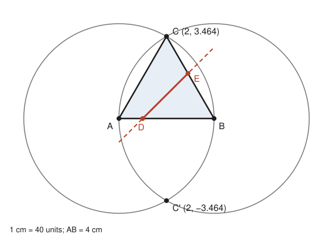

# Hilbert's axioms: the betweenness and continuity rules Euclid used without writing down

[Syllabus](../../../SYLLABUS.md) → [Geometry and trig](../README.md) → [Beyond Euclid](../README.md#s06) → Hilbert's axioms

---

## General Overview

Euclid's *Elements* opens with a construction. Draw a segment AB, 4 cm long. Draw a circle of radius 4 cm about A and another about B. Where they cross, mark C. Then AC, BC and AB are all 4 cm, so ABC is an equilateral triangle (all three sides equal).

Put A at (0, 0) and B at (4, 0) on squared paper. The circles cross at C = (2, 3.464), and again at C′ = (2, −3.464) below the line. But none of Euclid's five postulates (his starting rules) says two circles must meet. On a plane that holds only points with fraction coordinates, they do not: the height there would be the square root of 12, which is no fraction.

In 1899 David Hilbert rewrote the starting rules so that every step of Euclid's proofs follows from them, in five groups. Two of them supply what Euclid read off the picture: **order**, which point lies between which, and **continuity**, which in 1900 gained **completeness**: a line has no gaps.

**Hilbert's axioms list every rule Euclid's geometry needs in five groups (connection, order, parallels, congruence, continuity); order and continuity supply what Euclid took from the picture, such as circles crossing and a line leaving a triangle.**

**What kind of fact this is:** the axioms are rules taken without proof. That the circles miss in the fraction plane is a theorem, proved in Why it works, as is the key step in splitting the plane in two.

### The picture: Euclid's first construction, and a line through the triangle

<p align="center"></p>

Drawn to scale, 1 cm = 40 units: A at (200, 200), B at (360, 200), C at (280.0, 61.4), E at (316.1, 123.9).

---

## The formula

Place one circle's centre at A = (0, 0) and the other's at B = (d, 0), with $`d > 0`$. Both have radius $`r \ge 0`$. A point (x, y) on both obeys $`x^2 + y^2 = r^2`$ and $`(x - d)^2 + y^2 = r^2`$. Subtracting the second from the first cancels $`y^2`$ and leaves $`x = d/2`$:

```math
x = \frac{d}{2}, \qquad y = \pm\sqrt{r^2 - \frac{d^2}{4}}
```

**Read it aloud:** the crossings sit halfway between the centres, at a height whose square is the radius squared minus a quarter of the gap squared.

With r = d = 4: x = 2 and $`y^2 = 16 - 4 = 12`$, so $`y = \pm 3.464`$. The square root of 12 must exist as a point on the line; completeness promises it.

Pasch's axiom, the order rule this card uses, for a triangle ABC and a line $`\ell`$ in its plane that passes through none of the corners:

```math
\ell \text{ meets segment } AB \implies \ell \text{ meets segment } BC \text{ or segment } CA
```

**Read it aloud:** a line that enters a triangle through one side leaves through one of the other two.

| Symbol | Plain meaning | In our example | Push it up and the answer… |
| --- | --- | --- | --- |
| $`r`$ | radius of each circle | 4 cm | the crossing rises |
| $`d`$ | gap between the centres | 4 cm | the crossing drops; past 2r the circles miss |
| $`x`$, $`y`$ | coordinates of a crossing, in cm | 2 and ±3.464 | — |
| $`A`$, $`B`$; $`C`$, $`C'`$ | the centres, also the base's ends; the two crossings | (0, 0), (4, 0); (2, ±3.464) | — |
| $`\ell`$, $`D`$, $`E`$ | a line in the triangle's plane; where it enters and leaves | heading 1 right for 1 up; D (1, 0), E (2.902, 1.902) | — |
| $`p`$, $`q`$, $`k`$ | whole numbers: a fraction p/q in lowest terms, and k = p/3 | closest: 97/28 | — |
| $`P`$, $`Q`$, $`R`$, $`s`$ | test points; s is the position along BC, 0 at B, 1 at C | s = 11.196 | — |
| $`\implies`$ | "forces": if the left holds, so does the right | — | — |

### When it holds

- **Distinct centres no more than 2r apart ($`0 < d \le 2r`$, with $`r \ge 0`$).** With centres 9 cm apart, $`y^2 = 16 - 20.25 = -4.25`$: no crossing at all.
- **A line with no gaps.** In the fraction plane the same circles share no point, since 12 is not the square of a fraction.
- **The line lies in the triangle's plane.** In space, a line through D straight out of the page touches the triangle only at D.
- **The line misses the corners.** The line x = 2 enters through (2, 0) on AB and leaves through corner C, on two sides at once; Pasch's axiom sets this case aside.

---

## Why it works

### Step 0: a missing rule shows up as a world where the proof fails

An **axiom** is a rule a proof may use without proving it. To show a rule is missing, build a world where all the written rules hold but the claimed result fails. Then no proof from the written rules can exist.

The **fraction plane** is such a world: the points of squared paper whose coordinates are both fractions (whole number over whole number). Lines and circles still exist there, so Euclid's drawing rules hold. In I.1 only the crossing is missing, but others are too: the circle about A meets the line y = x at no fraction point.

### Step 1: Hilbert's five groups

Hilbert's 1899 *Foundations of Geometry*, in its 1902 English translation, lists 20 axioms in five groups. A **segment** AB is the points between A and B, with A and B as its ends.

| Group | What it governs | Axioms | One of them | What Euclid took from the picture |
| --- | --- | --- | --- | --- |
| I Connection | which points lie on which lines and planes | 7 | two distinct points lie on exactly one line | — |
| II Order | which of three points on a line is between the others | 5 | Pasch's axiom, II 5 | a line entering a triangle leaves it |
| III Parallels | lines that never meet | 1 | through a point off a line, exactly one parallel | — (Euclid stated his own version) |
| IV Congruence | equal segments and equal angles | 6 | the SAS step, IV 6 | sliding one triangle onto another |
| V Continuity | how far repeated lengths reach; no gaps | 1, plus a remark | Archimedes: repeat a short length often enough and you pass any point | two circles crossing, by completeness |

A remark from the 1900 French edition adds **completeness**: no new points, lines or planes can join without breaking an axiom. Later editions number it V 2, with congruence third and parallels fourth. The fraction plane obeys Archimedes' axiom, so that alone cannot make the circles meet; completeness can.

### Step 2: the continuity gap in Euclid I.1

Suppose the height were a fraction p/q in lowest terms. Then $`p^2 = 12q^2`$, so 3 divides $`p^2`$, and so 3 divides p. Write p = 3k. Then $`9k^2 = 12q^2`$, so $`3k^2 = 4q^2`$, and 3 divides q too. Both divisible by 3 contradicts lowest terms. So the circles meet at no fraction point.

Completeness closes the gap. Slide a point P along circle A's upper arc, from (0, 4) down to (4, 0). At the start, P is outside circle B; at the end, P sits at the centre B, inside. With no gaps in the arc, some point between is exactly 4 from B. That point is C.

<details>
<summary>Why "no gaps" forces the crossing</summary>

Hilbert's Archimedes and completeness axioms together make every line a copy of the real numbers, the numbers with no gaps. So as P moves along the arc, its distance from B takes every value between its first and last values.

It starts above 4 and ends below 4, so somewhere it equals 4 exactly. Bisection finds that point: halve the stretch of arc, keep the half where the distance still crosses 4, and repeat. After 60 halvings the code lands on (2, 3.464102).

</details>

### Step 3: the betweenness gap, and Pasch's axiom

Euclid read betweenness off the picture. The proof on [Triangles](../01-Angles%2C%20Triangles%20and%20Congruence/02-triangle-angle-sum-and-inequality.md) that two sides beat the third says "A lies between B and D, so the ray CA runs inside angle BCD". No postulate of Euclid's mentions "between". Moritz Pasch noticed this in 1882, and Hilbert made Pasch's rule axiom II 5.

Pasch's axiom is the key step in proving that a line splits the plane into two **sides**: two points are on the same side when the segment joining them misses the line.

Suppose P and Q lie on one side of $`\ell`$, and Q and R do too. Off one line, if segment PR crossed $`\ell`$, Pasch's axiom forces $`\ell`$ through PQ or QR; both miss $`\ell`$, so PR misses it too: "same side" passes along.

On one line, order axioms settle it: two distinct lines meet at most once.

On squared paper, a line's equation gives a **sign test**. The red line is y = x − 1, so y − x + 1 is zero on it, positive on one side and negative on the other. For line AB, the x-axis, the test is the sign of y: + at C, − at C′. So Euclid's construction has two answers, one on each side of AB.

The red line enters through D = (1, 0), heading 1 right for each 1 up. Its sign is + at A, − at B, + at C. Only B is on its own, so the line crosses AB and BC, and leaves through BC at E = (2.902, 1.902).

### Step 4: congruence and parallels

The congruence group holds the SAS step: two sides and the angle between them fix a triangle. Euclid proved it by sliding one triangle onto another, a move his postulates never allow. Hilbert made it axiom IV 6, and [Congruent triangles](../01-Angles%2C%20Triangles%20and%20Congruence/03-congruent-triangles.md) proves SSS, ASA and RHS from it.

The parallels group is one axiom. Dropping it leaves [Neutral geometry](07-neutral-geometry-and-saccheri-legendre.md), the next card.

---

## Worked numbers, by hand

| Step | Arithmetic | Value |
| --- | --- | --- |
| subtract the circle equations | $`x^2 - (x - 4)^2 = 8x - 16 = 0`$ | x = 2 |
| put x = 2 back | $`y^2 = 16 - 4`$ | 12 |
| take the root | $`\sqrt{12} = 2\sqrt{3}`$ | **3.464102** |
| hunt for a fraction | $`p^2 = 12q^2`$ for q up to 1000 | 0 found |
| closest fraction, q up to 30 | 97/28 = 3.464286, squared | 12.001276 |
| control: radius 5, centres 6 apart | $`y^2 = 25 - 9`$ | 16, crossing (3, 4) |
| Pasch, heading 1 right for 1 up | signs at A, B, C: +, −, + | **leaves through BC at (2.902, 1.902)** |
| Pasch, heading 1 left for 2 up | signs at A, B, C: +, −, − | leaves through CA at (0.536, 0.928) |

The crossing exists only because the line has no gaps; the control circles meet even in the fraction plane.

### What breaks if you drop a piece

| Mistake | Comes out at | What went wrong |
| --- | --- | --- |
| "Any two circles meet", centres 9 apart | $`y^2 = 16 - 20.25 = -4.25`$ | Circles meet only when d is at most 2r |
| Working in fractions only | 0 crossings; 97/28 squares to 12.001276 | The fraction line has gaps |
| Exit assumed on BC, heading 1 left for 2 up | line BC met at (−18.392, 38.785), s = 11.196 | Pasch says one of two sides, not which |

---

## Code, from first principles, and it actually runs

Nothing is imported. Two roads find the crossing: subtracting the circle equations, and bisection along circle A's arc. The fraction plane is searched in whole numbers, with a control that must find (3, 4). Each Pasch exit is found by solving for where the line meets each side, and by the sign test.

Mathlib, Lean's maths library, has no axiom system for Hilbert's geometry. So the Lean section works on squared paper, with coordinates.

### Python

```python
# Hilbert's axioms -- the check behind the card.  Nothing is imported.
# Euclid I.1: A = (0, 0), B = (4, 0), a circle of radius 4 cm about each.
# The crossing is found by subtracting the circle equations and by bisection
# along circle A's arc; the rational plane is searched; Pasch is tested twice.
R, D, A, B = 4.0, (1.0, 0.0), (0.0, 0.0), (4.0, 0.0)

def dist(p, q):
    return ((p[0] - q[0]) ** 2 + (p[1] - q[1]) ** 2) ** 0.5

def bisect(r, d):                  # P on circle A's upper arc, from (0, r) to (r, 0)
    lo, hi = 0.0, r                # P starts outside circle B and ends inside it
    for _ in range(60):
        mid = (lo + hi) / 2
        if dist((mid, (r * r - mid * mid) ** 0.5), (d, 0.0)) > r: lo = mid
        else: hi = mid
    return lo, (r * r - lo * lo) ** 0.5

def hits(n, qmax):                 # whole p, q with p * p == n * q * q
    return [(p, q) for q in range(1, qmax + 1) for p in [round((n * q * q) ** 0.5)] if p * p == n * q * q]

def meet(u, p0, p1):               # line D + t u against segment p0 + s (p1 - p0)
    ex, ey, bx, by = p1[0] - p0[0], p1[1] - p0[1], p0[0] - D[0], p0[1] - D[1]
    det = ex * u[1] - u[0] * ey
    t, s = (ex * by - bx * ey) / det, (u[0] * by - u[1] * bx) / det
    return s, (D[0] + t * u[0], D[1] + t * u[1])

x1, yy = R / 2, R * R - (R / 2) ** 2               # road one: x = d/2, y*y = r*r - x*x
y1, (x2, y2) = yy ** 0.5, bisect(R, 4.0)           # road two: bisection
C = (x1, y1)
print(f"Hilbert's groups: connection 7, order 5, parallels 1, congruence 6, continuity 1, total {7 + 5 + 1 + 6 + 1}")
print(f"road one, subtract the equations: x = {x1:.6f}, y = {y1:.6f}, y*y = {yy:.6f}")
print(f"road two, bisection along circle A's arc: x = {x2:.6f}, y = {y2:.6f}")
print(f"rational plane, whole p, q up to 1000 with p*p = 12*q*q: {len(hits(12, 1000))} found")
q = min(range(1, 31), key=lambda q: abs(round(q * y1) ** 2 - 12 * q * q) / (q * q))
p = round(q * y1)
print(f"closest fraction with q up to 30: {p}/{q} = {p / q:.6f}, squared {p * p / (q * q):.6f}")
ctl = hits(16, 5)[0]                               # radius 5, centres 6 apart: y*y = 25 - 9
print(f"control, radius 5, centres 6 apart: y*y = {25 - 9}, rational crossing (3, {ctl[0] // ctl[1]})")
sides = {"AB": (A, B), "BC": (B, C), "CA": (C, A)}
exits = []
for u in [(1, 1), (-1, 2)]:
    out = {n: meet(u, *e) for n, e in sides.items() if n != "AB"}
    leave = [n for n, (s, _) in out.items() if 0 < s < 1]
    side = lambda v: u[0] * (v[1] - D[1]) - u[1] * (v[0] - D[0])   # the sign test; zero on the line
    sgn = {n: side(v) > 0 for n, v in zip("ABC", (A, B, C))}
    by_sign = [n for n in ("BC", "CA") if sgn[n[0]] != sgn[n[1]]]
    pt, (p0, p1) = out[leave[0]][1], sides[leave[0]]
    exits.append(pt)
    print(f"line through D (1, 0) heading {u}: leaves through {leave[0]} at ({pt[0]:.3f}, {pt[1]:.3f});"
          f" signs at A, B, C: {''.join('+' if sgn[n] else '-' for n in 'ABC')}")
    assert leave == by_sign and abs(dist(p0, pt) + dist(pt, p1) - dist(p0, p1)) < 1e-9 and abs(side(pt)) < 1e-9
s, far = meet((-1, 2), B, C)
print(f"mistake, exit assumed on BC for heading (-1, 2): line BC met at ({far[0]:.3f}, {far[1]:.3f}), s = {s:.3f}")
print(f"mistake, centres 9 apart: y*y = 16 - {4.5 ** 2} = {16 - 4.5 ** 2}, no crossing")
print(f"other crossing (2, {-y1:.6f}); signs of y at C and C': {'+' if y1 > 0 else '-'}, {'+' if -y1 > 0 else '-'}")
print(f"figure, A (200, 200), B (360, 200), C ({200 + 40 * x1:.1f}, {200 - 40 * y1:.1f}), "
      f"D (240, 200), E ({200 + 40 * exits[0][0]:.1f}, {200 - 40 * exits[0][1]:.1f}), C' ({200 + 40 * x1:.1f}, {200 + 40 * y1:.1f})")
assert abs(x2 - x1) < 1e-9 and abs(y2 - y1) < 1e-9 and abs(dist(C, B) - R) < 1e-9
assert hits(12, 1000) == [] and ctl == (4, 1) and s > 1
print("ALL CHECKS PASS")
```

**Ran 2026-11-23 on macOS, Python 3.14.10, standard library only. All checks passed. Output, pasted from the run:**

```
Hilbert's groups: connection 7, order 5, parallels 1, congruence 6, continuity 1, total 20
road one, subtract the equations: x = 2.000000, y = 3.464102, y*y = 12.000000
road two, bisection along circle A's arc: x = 2.000000, y = 3.464102
rational plane, whole p, q up to 1000 with p*p = 12*q*q: 0 found
closest fraction with q up to 30: 97/28 = 3.464286, squared 12.001276
control, radius 5, centres 6 apart: y*y = 16, rational crossing (3, 4)
line through D (1, 0) heading (1, 1): leaves through BC at (2.902, 1.902); signs at A, B, C: +-+
line through D (1, 0) heading (-1, 2): leaves through CA at (0.536, 0.928); signs at A, B, C: +--
mistake, exit assumed on BC for heading (-1, 2): line BC met at (-18.392, 38.785), s = 11.196
mistake, centres 9 apart: y*y = 16 - 20.25 = -4.25, no crossing
other crossing (2, -3.464102); signs of y at C and C': +, -
figure, A (200, 200), B (360, 200), C (280.0, 61.4), D (240, 200), E (316.1, 123.9), C' (280.0, 338.6)
ALL CHECKS PASS
```

### Rust

Same numbers, same labels, built with `rustc --edition 2021 -O`.

```rust
// Hilbert's axioms -- the same check as the Python, in Rust.  No crates.
// Euclid I.1: A = (0, 0), B = (4, 0), a circle of radius 4 cm about each.
// The crossing is found by subtracting the circle equations and by bisection
// along circle A's arc; the rational plane is searched; Pasch is tested twice.
type P = (f64, f64);
const R: f64 = 4.0;
const D: P = (1.0, 0.0);

fn dist(p: P, q: P) -> f64 { ((p.0 - q.0).powi(2) + (p.1 - q.1).powi(2)).sqrt() }

fn bisect(r: f64, d: f64) -> P {      // P on circle A's upper arc, from (0, r) to (r, 0)
    let (mut lo, mut hi) = (0.0, r);  // P starts outside circle B and ends inside it
    for _ in 0..60 {
        let mid = (lo + hi) / 2.0;
        if dist((mid, (r * r - mid * mid).sqrt()), (d, 0.0)) > r { lo = mid } else { hi = mid }
    }
    (lo, (r * r - lo * lo).sqrt())
}

fn hits(n: i64, qmax: i64) -> Vec<(i64, i64)> {   // whole p, q with p * p == n * q * q
    (1..=qmax).map(|q| (((n * q * q) as f64).sqrt().round() as i64, q))
        .filter(|&(p, q)| p * p == n * q * q).collect()
}

fn meet(u: P, p0: P, p1: P) -> (f64, P) {        // line D + t u against segment p0 + s (p1 - p0)
    let (ex, ey, bx, by) = (p1.0 - p0.0, p1.1 - p0.1, p0.0 - D.0, p0.1 - D.1);
    let det = ex * u.1 - u.0 * ey;
    let (t, s) = ((ex * by - bx * ey) / det, (u.0 * by - u.1 * bx) / det);
    (s, (D.0 + t * u.0, D.1 + t * u.1))
}

fn sign(b: bool) -> &'static str { if b { "+" } else { "-" } }

fn main() {
    let (a, b): (P, P) = ((0.0, 0.0), (4.0, 0.0));
    let (x1, yy) = (R / 2.0, R * R - (R / 2.0) * (R / 2.0));   // road one
    let y1 = yy.sqrt();
    let (x2, y2) = bisect(R, 4.0);                              // road two: bisection
    let c: P = (x1, y1);
    println!("Hilbert's groups: connection 7, order 5, parallels 1, congruence 6, continuity 1, total {}", 7 + 5 + 1 + 6 + 1);
    println!("road one, subtract the equations: x = {:.6}, y = {:.6}, y*y = {:.6}", x1, y1, yy);
    println!("road two, bisection along circle A's arc: x = {:.6}, y = {:.6}", x2, y2);
    println!("rational plane, whole p, q up to 1000 with p*p = 12*q*q: {} found", hits(12, 1000).len());
    let err = |q: i64| { let p = (q as f64 * y1).round() as i64; (p * p - 12 * q * q).abs() as f64 / (q * q) as f64 };
    let q = (1..31).fold(1, |best, q| if err(q) < err(best) { q } else { best });
    let p = (q as f64 * y1).round() as i64;
    println!("closest fraction with q up to 30: {}/{} = {:.6}, squared {:.6}", p, q, p as f64 / q as f64, (p * p) as f64 / (q * q) as f64);
    let ctl = hits(16, 5)[0];
    println!("control, radius 5, centres 6 apart: y*y = {}, rational crossing (3, {})", 25 - 9, ctl.0 / ctl.1);
    let sides = [("BC", b, c), ("CA", c, a)];
    let mut exits: Vec<P> = Vec::new();
    for u in [(1.0, 1.0), (-1.0, 2.0)] {
        let leave: Vec<(&str, P, P, P)> = sides.iter().map(|&(n, p0, p1)| (n, meet(u, p0, p1), p0, p1))
            .filter(|(_, (s, _), _, _)| 0.0 < *s && *s < 1.0).map(|(n, (_, pt), p0, p1)| (n, pt, p0, p1)).collect();
        let side = |v: P| u.0 * (v.1 - D.1) - u.1 * (v.0 - D.0);  // the sign test; zero on the line
        let sg = |v: P| side(v) > 0.0;
        let by_sign: Vec<&str> = sides.iter().filter(|(_, p0, p1)| sg(*p0) != sg(*p1)).map(|s| s.0).collect();
        let (n, pt, p0, p1) = leave[0];
        exits.push(pt);
        println!("line through D (1, 0) heading ({}, {}): leaves through {} at ({:.3}, {:.3}); signs at A, B, C: {}{}{}",
                 u.0, u.1, n, pt.0, pt.1, sign(sg(a)), sign(sg(b)), sign(sg(c)));
        assert!(leave.len() == 1 && by_sign == vec![n] && (dist(p0, pt) + dist(pt, p1) - dist(p0, p1)).abs() < 1e-9
                && side(pt).abs() < 1e-9);
    }
    let (s, far) = meet((-1.0, 2.0), b, c);
    println!("mistake, exit assumed on BC for heading (-1, 2): line BC met at ({:.3}, {:.3}), s = {:.3}", far.0, far.1, s);
    println!("mistake, centres 9 apart: y*y = 16 - {} = {}, no crossing", 4.5f64 * 4.5, 16.0 - 4.5f64 * 4.5);
    println!("other crossing (2, {:.6}); signs of y at C and C': {}, {}", -y1, sign(y1 > 0.0), sign(-y1 > 0.0));
    println!("figure, A (200, 200), B (360, 200), C ({:.1}, {:.1}), D (240, 200), E ({:.1}, {:.1}), C' ({:.1}, {:.1})",
             200.0 + 40.0 * x1, 200.0 - 40.0 * y1, 200.0 + 40.0 * exits[0].0, 200.0 - 40.0 * exits[0].1,
             200.0 + 40.0 * x1, 200.0 + 40.0 * y1);
    assert!((x2 - x1).abs() < 1e-9 && (y2 - y1).abs() < 1e-9 && (dist(c, b) - R).abs() < 1e-9);
    assert!(hits(12, 1000).is_empty() && ctl == (4, 1) && s > 1.0);
    println!("ALL CHECKS PASS");
}
```

**Ran 2026-11-23 on macOS, rustc 1.98.1, no crates. All checks passed. Output, pasted from the run:**

```
Hilbert's groups: connection 7, order 5, parallels 1, congruence 6, continuity 1, total 20
road one, subtract the equations: x = 2.000000, y = 3.464102, y*y = 12.000000
road two, bisection along circle A's arc: x = 2.000000, y = 3.464102
rational plane, whole p, q up to 1000 with p*p = 12*q*q: 0 found
closest fraction with q up to 30: 97/28 = 3.464286, squared 12.001276
control, radius 5, centres 6 apart: y*y = 16, rational crossing (3, 4)
line through D (1, 0) heading (1, 1): leaves through BC at (2.902, 1.902); signs at A, B, C: +-+
line through D (1, 0) heading (-1, 2): leaves through CA at (0.536, 0.928); signs at A, B, C: +--
mistake, exit assumed on BC for heading (-1, 2): line BC met at (-18.392, 38.785), s = 11.196
mistake, centres 9 apart: y*y = 16 - 20.25 = -4.25, no crossing
other crossing (2, -3.464102); signs of y at C and C': +, -
figure, A (200, 200), B (360, 200), C (280.0, 61.4), D (240, 200), E (316.1, 123.9), C' (280.0, 338.6)
ALL CHECKS PASS
```

### Lean

Lean proves the crossing formula, the fraction-plane gap and Pasch's rule, on a plane with no gaps.

- Take two circles of radius $`r \ge 0`$, with centres d apart and d above 0. Then they meet exactly when d is at most 2r.
- Suppose a point lies on both circles. Then $`x = d/2`$ and $`y^2 = r^2 - d^2/4`$, and every such point lies on both.
- In the fraction plane, the 4 cm circles about A and B share no point.
- Take a triangle ABC and a line in its plane that misses the corners. Then if the line meets segment AB, it meets BC or CA.
- Lean also checks the hand arithmetic: $`y^2 = 12`$, the control crossing (3, 4), and the miss for centres 9 apart.

The bisection, the fraction search up to q = 1000, and the exit points E are left to the Python and Rust checks.

```lean
-- Hilbert's axioms: two equal circles in the real plane cross exactly when their centres are at most two radii apart, Euclid's two 4 cm circles share no point with fraction coordinates, and Pasch's rule holds in the real plane.
import Mathlib.Analysis.Convex.Between
import Mathlib.Analysis.InnerProductSpace.PiL2
import Mathlib.Tactic

/-- Helper: if `a` and `b` have opposite signs, some `t ∈ [0, 1]` makes `(1 - t) a + t b = 0`. -/
theorem hilbert_pasch_zero_between (a b : ℝ) (h : a * b < 0) :
    ∃ t ∈ Set.Icc (0 : ℝ) 1, (1 - t) * a + t * b = 0 := by
  rcases lt_or_gt_of_ne (show a ≠ 0 by rintro rfl; simp at h) with ha | ha
  · have hb : 0 < b := by nlinarith
    have hab : a - b < 0 := by linarith
    have hne : a - b ≠ 0 := hab.ne
    refine ⟨a / (a - b), ⟨div_nonneg_of_nonpos ha.le hab.le, ?_⟩, ?_⟩
    · rw [div_le_one_of_neg hab]; linarith
    · field_simp; ring
  · have hb : b < 0 := by nlinarith
    have hab : 0 < a - b := by linarith
    have hne : a - b ≠ 0 := hab.ne'
    refine ⟨a / (a - b), ⟨div_nonneg ha.le hab.le, ?_⟩, ?_⟩
    · rw [div_le_one hab]; linarith
    · field_simp; ring

/-- The formula and its condition. Two circles of radius r ≥ 0, centred at A = (0, 0) and
B = (d, 0) with gap d > 0, share a point of the real plane exactly when d ≤ 2r. Every shared
point (x, y) sits halfway between the centres, x = d/2, at a height with y² = r² − d²/4. -/
theorem circles_cross_iff_gap_le_two_radii (r d : ℝ) (hr : 0 ≤ r) (hd : 0 < d) :
    ((∃ x y : ℝ, x ^ 2 + y ^ 2 = r ^ 2 ∧ (x - d) ^ 2 + y ^ 2 = r ^ 2) ↔ d ≤ 2 * r) ∧
      ∀ x y : ℝ, (x ^ 2 + y ^ 2 = r ^ 2 ∧ (x - d) ^ 2 + y ^ 2 = r ^ 2) ↔
        (x = d / 2 ∧ y ^ 2 = r ^ 2 - d ^ 2 / 4) := by
  have key : ∀ x y : ℝ, (x ^ 2 + y ^ 2 = r ^ 2 ∧ (x - d) ^ 2 + y ^ 2 = r ^ 2) ↔
      (x = d / 2 ∧ y ^ 2 = r ^ 2 - d ^ 2 / 4) := by
    intro x y
    constructor
    · rintro ⟨h1, h2⟩
      have hx : x = d / 2 := by
        have h3 : d * (2 * x - d) = 0 := by linear_combination h1 - h2
        rcases mul_eq_zero.1 h3 with h | h
        · linarith
        · linarith
      refine ⟨hx, ?_⟩
      subst hx
      linear_combination h1
    · rintro ⟨hx, hy⟩
      subst hx
      constructor
      · linear_combination hy
      · linear_combination hy
  refine ⟨⟨?_, ?_⟩, key⟩
  · rintro ⟨x, y, h⟩
    obtain ⟨-, hy⟩ := (key x y).1 h
    by_contra hc
    push Not at hc
    nlinarith [sq_nonneg y]
  · intro h
    have hnn : 0 ≤ r ^ 2 - d ^ 2 / 4 := by nlinarith
    exact ⟨d / 2, Real.sqrt (r ^ 2 - d ^ 2 / 4), (key _ _).2 ⟨rfl, Real.sq_sqrt hnn⟩⟩

/-- Step 2, the continuity gap in Euclid I.1. In the fraction plane (both coordinates
rational), the circles of radius 4 about A = (0, 0) and B = (4, 0) share no point: the
crossing would need y² = 12, and 12 is not the square of a fraction. -/
theorem fraction_plane_euclid_circles_do_not_meet :
    ¬ ∃ x y : ℚ, x ^ 2 + y ^ 2 = 4 ^ 2 ∧ (x - 4) ^ 2 + y ^ 2 = 4 ^ 2 := by
  rintro ⟨x, y, h1, h2⟩
  have hx : x = 2 := by linear_combination (h1 - h2) / 8
  subst hx
  have hy : y * y = 12 := by linear_combination h1
  have h := (Rat.exists_mul_self 12).1 ⟨y, hy⟩
  rw [Rat.sqrt] at h
  norm_num at h

/-- Pasch's rule in the real plane. For a triangle ABC (three points not on one line) and a
line ℓ in its plane that passes through none of the corners: if ℓ meets segment AB, then ℓ
meets segment BC or segment CA. -/
theorem pasch_real_plane (A B C : EuclideanSpace ℝ (Fin 2))
    (hABC : AffineIndependent ℝ ![A, B, C])
    (ℓ : AffineSubspace ℝ (EuclideanSpace ℝ (Fin 2))) (hℓ : Module.finrank ℝ ℓ.direction = 1)
    (hA : A ∉ ℓ) (hB : B ∉ ℓ) (hC : C ∉ ℓ)
    (hAB : ∃ D ∈ ℓ, Wbtw ℝ A D B) :
    (∃ E ∈ ℓ, Wbtw ℝ B E C) ∨ (∃ E ∈ ℓ, Wbtw ℝ C E A) := by
  obtain ⟨D, hDl, hD⟩ := hAB
  obtain ⟨v, hv0, -⟩ := finrank_eq_one_iff'.1 hℓ
  set u : EuclideanSpace ℝ (Fin 2) := (v : EuclideanSpace ℝ (Fin 2)) with hu
  have hu0 : u ≠ 0 := by
    intro h; apply hv0; ext1; simpa [hu] using h
  have humem : u ∈ ℓ.direction := v.2
  let f : EuclideanSpace ℝ (Fin 2) → ℝ := fun p => u 1 * (p 0 - D 0) - u 0 * (p 1 - D 1)
  have hf_line : ∀ p q : EuclideanSpace ℝ (Fin 2), ∀ t : ℝ,
      f (AffineMap.lineMap p q t) = (1 - t) * f p + t * f q := by
    intro p q t
    simp only [f, AffineMap.lineMap_apply_module, PiLp.add_apply, PiLp.smul_apply, smul_eq_mul]
    ring
  have hf_mem : ∀ p, f p = 0 → p ∈ ℓ := by
    intro p hp
    rw [← AffineSubspace.vsub_right_mem_direction_iff_mem hDl p]
    have hw : p -ᵥ D = (p 0 - D 0) • (u 0)⁻¹ • u ∨ p -ᵥ D = (p 1 - D 1) • (u 1)⁻¹ • u := by
      by_cases h0 : u 0 = 0
      · have h1 : u 1 ≠ 0 := by
          intro h1; apply hu0; ext i; fin_cases i <;> simp [h0, h1]
        right
        ext i; fin_cases i
        · simp only [f, h0] at hp
          simp [vsub_eq_sub, h0]
          have : p 0 - D 0 = 0 := by
            rcases mul_eq_zero.1 (by linarith : u 1 * (p 0 - D 0) = 0) with h | h
            · exact absurd h h1
            · exact h
          linarith
        · simp [vsub_eq_sub]; field_simp
      · left
        ext i; fin_cases i
        · simp [vsub_eq_sub]; field_simp
        · simp [vsub_eq_sub]
          simp only [f] at hp
          field_simp
          linear_combination -hp
    rcases hw with hw | hw <;> rw [hw] <;>
      exact ℓ.direction.smul_mem _ (ℓ.direction.smul_mem _ humem)
  have hfA : f A ≠ 0 := fun h => hA (hf_mem A h)
  have hfB : f B ≠ 0 := fun h => hB (hf_mem B h)
  have hfC : f C ≠ 0 := fun h => hC (hf_mem C h)
  obtain ⟨t, ⟨ht0, ht1⟩, hDt⟩ := hD
  have heq : (1 - t) * f A + t * f B = 0 := by
    rw [← hf_line, hDt]
    simp [f]
  have hAB' : f A * f B < 0 := by
    by_contra hc
    push Not at hc
    rcases eq_or_lt_of_le ht1 with h1 | h1
    · subst h1
      simp at heq
      exact hfB heq
    · have hpos : 0 < (1 - t) * f A ^ 2 := mul_pos (by linarith) (by positivity)
      have h2 : ((1 - t) * f A + t * f B) * f A = 0 := by rw [heq]; ring
      nlinarith [mul_nonneg ht0 hc]
  by_cases hBC : f B * f C < 0
  · left
    obtain ⟨s, hs, hs0⟩ := hilbert_pasch_zero_between (f B) (f C) hBC
    exact ⟨AffineMap.lineMap B C s, hf_mem _ (by rw [hf_line]; exact hs0), s, hs, rfl⟩
  · right
    have hBC' : 0 < f B * f C := lt_of_le_of_ne (not_lt.1 hBC) (mul_ne_zero hfB hfC).symm
    have hprod := mul_neg_of_neg_of_pos hAB' hBC'
    have hCA : f C * f A < 0 := by
      by_contra hc
      push Not at hc
      nlinarith [mul_nonneg hc (sq_nonneg (f B))]
    obtain ⟨s, hs, hs0⟩ := hilbert_pasch_zero_between (f C) (f A) hCA
    exact ⟨AffineMap.lineMap C A s, hf_mem _ (by rw [hf_line]; exact hs0), s, hs, rfl⟩

-- Hilbert's five groups: connection 7, order 5, parallels 1, congruence 6, continuity 1.
example : 7 + 5 + 1 + 6 + 1 = 20 := by decide
-- r = d = 4: subtracting the circle equations gives 8x − 16 = 0, so x = 2, and y² = 16 − 4 = 12.
example : (8 : ℚ) * 2 - 16 = 0 := by norm_num
example : (4 : ℚ) ^ 2 - 4 ^ 2 / 4 = 12 := by norm_num
-- The closest fraction with q up to 30 is 97/28: 97² = 12 · 28² + 1, close to 12 but not equal.
example : (97 : ℤ) ^ 2 = 12 * 28 ^ 2 + 1 := by norm_num
-- Control: radius 5, centres 6 apart, y² = 25 − 9 = 16, crossing at the fraction point (3, 4).
example : (3 : ℚ) ^ 2 + 4 ^ 2 = 5 ^ 2 ∧ ((3 : ℚ) - 6) ^ 2 + 4 ^ 2 = 5 ^ 2 := by norm_num
-- Centres 9 apart with radius 4: y² = 16 − 81/4 = −17/4 < 0, no crossing.
example : (4 : ℚ) ^ 2 - 9 ^ 2 / 4 = -17 / 4 := by norm_num
example : ¬ ((9 : ℚ) ≤ 2 * 4) := by norm_num

#print axioms hilbert_pasch_zero_between
#print axioms circles_cross_iff_gap_le_two_radii
#print axioms fraction_plane_euclid_circles_do_not_meet
#print axioms pasch_real_plane
```

**Checked 2026-11-23 on macOS, Lean 4.36.0-rc2, Mathlib v4.36.0-rc2. Every proof is complete and uses only Lean's standard axioms. Output, pasted from the run:**

```
'hilbert_pasch_zero_between' depends on axioms: [propext, Classical.choice, Quot.sound]
'circles_cross_iff_gap_le_two_radii' depends on axioms: [propext, Classical.choice, Quot.sound]
'fraction_plane_euclid_circles_do_not_meet' depends on axioms: [propext, Classical.choice, Quot.sound]
'pasch_real_plane' depends on axioms: [propext, Classical.choice, Quot.sound]
```

> [!TIP]
> **Try changing**
> - **Guess first: where does a steeper line leave?** Change `(1, 1)` in the `for u in` line to `(1, 3)`. It still leaves through BC, now at (2.098, 3.294); signs +, −, +.
> - **Guess first: and a line straight up from D?** Change `(1, 1)` to `(0, 1)`. Now only A is on its own: the line leaves through CA at (1.000, 1.732).
> - **Guess first: does bisection find a crossing for centres 9 apart?** Change `bisect(R, 4.0)` to `bisect(R, 9.0)`. The point runs to the arc's end, and an assert stops the run.

---

## The usual mistake

> [!warning]
> **Trusting the picture.** A drawing shows the circles crossing, so it feels proved. But the fraction plane obeys the drawing rules and has no crossing. Every step needs a written rule; Hilbert's list supplies them.
>
> - **Thinking any two circles meet.** Centres 9 cm apart with radius 4 give $`y^2 = -4.25`$: no crossing.
> - **Assuming which of the other two sides the line leaves by.** Heading 1 left for 2 up from D, the line leaves through CA; line BC is met only at s = 11.196, far outside.
> - **Taking the fraction plane as nearly right.** 97/28 squares to 12.001276: close to 12, never equal.

---

## Where you meet it in real life

- **Geometry software.** Fraction coordinates place line crossings exactly, but circle crossings need square roots, so exact geometry libraries add them to their numbers.
- **Inside-or-outside tests.** Software uses the sign test above to decide which side of a fence a point lies on; [Inside or outside](../07-Points%2C%20Convexity%20and%20Fractals/03-point-in-polygon-and-segment-tests.md) builds on it.
- **Computer-checked proofs.** A proof checker accepts no step taken from a picture, so formal geometry libraries start from axiom lists like Hilbert's.

> **Say it back**
> Euclid's first construction crosses two circles of radius 4 cm, 4 cm apart, at (2, 3.464), but his postulates never promise it. Among fraction points it does not exist: 12 is no fraction squared. Hilbert listed 20 axioms in five groups: connection, order, parallels, congruence and continuity. Completeness makes the circles meet. Pasch's order axiom makes a line that enters a triangle leave by another side, and splits the plane in two.

---

## What this builds on

- [Congruent triangles](../01-Angles%2C%20Triangles%20and%20Congruence/03-congruent-triangles.md): the SAS step, which Hilbert took as axiom IV 6.
- [Triangles](../01-Angles%2C%20Triangles%20and%20Congruence/02-triangle-angle-sum-and-inequality.md): a proof that reads betweenness off the picture.
- [Angles](../01-Angles%2C%20Triangles%20and%20Congruence/01-angles-and-parallel-lines.md): Euclid's parallel postulate, which group III restates.
- [Ruler and compass](03-ruler-and-compass-constructions.md): constructions as crossings of lines and circles, which completeness guarantees.

## Where this goes next

- [Neutral geometry](07-neutral-geometry-and-saccheri-legendre.md): keeps every group but parallels and proves what survives.

Which theorems still hold once the parallels axiom is dropped is the question this card leaves open.

---

## Sources

Verified 2026-11-23: every link below resolves to the publisher's page.

- Euclid, *Elements*, Book I, Proposition 1, ed. David E. Joyce, Clark University. [Proposition 1](https://mathcs.clarku.edu/~djoyce/elements/bookI/propI1.html). The construction, with a note that the circles' crossing is never justified.
- Hilbert, David. *The Foundations of Geometry*, trans. E. J. Townsend. [Project Gutenberg](https://www.gutenberg.org/ebooks/17384). The five groups, Pasch's axiom as II 5 and the SAS step as IV 6.
- Pasch, Moritz. *Vorlesungen über die neuere Geometrie*. Springer. [doi:10.1007/978-3-642-65611-8](https://doi.org/10.1007/978-3-642-65611-8). The lectures whose 1882 first edition set out the order axioms; Hilbert credits group II to them.
- Hartshorne, Robin. *Geometry: Euclid and Beyond*. Springer, 2000. [Publisher page](https://link.springer.com/book/10.1007/978-0-387-22676-7). Euclid's gaps, and Hilbert's axioms worked through for the plane.
