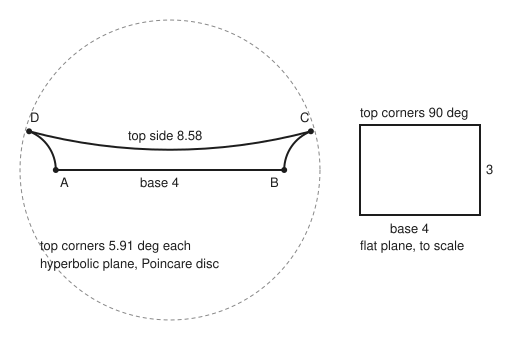

# Neutral geometry: what survives without the parallel postulate, and why a triangle's angles can never top 180 degrees

[Syllabus](../../../SYLLABUS.md) → [Geometry and trig](../README.md) → [Beyond Euclid](../README.md#s06) → Neutral geometry

---

## General Overview

Suppose someone claims a triangle with angles 60°, 60° and 61°, adding to 181°. Can it be ruled out without using parallel lines?

Yes. In about 1794 Adrien-Marie Legendre found a move that rebuilds a triangle with the same angle sum and one angle at most half as big. Six moves take the 60° corner down to at most 0.9375°. The other two corners must then hold at least 180.0625°. But a theorem that never uses parallels says two angles of a triangle add to less than 180°. So the triangle cannot exist.

The second example is a four-sided figure that Girolamo Saccheri studied in 1733. Take a base 4 long, stand a leg 3 long at each end at right angles, and join the tops. Without parallels the two top corners are still equal and at most 90°. In Euclid's flat plane they are exactly 90°. In the hyperbolic plane (the geometry on [Three geometries](02-spherical-and-hyperbolic-geometry.md) where a point off a line has infinitely many parallels) they are 5.91° each, with lengths in its natural unit.

The geometry built from [Hilbert's axioms](06-hilberts-axioms.md) with the parallel axiom left out is **neutral geometry**, also called absolute geometry. Every theorem proved in it holds in both the flat and the hyperbolic plane.

**Without the parallel postulate a triangle's angles can still never add to more than 180°, because Legendre's move keeps the sum while halving an angle, and two angles of a triangle always stay under 180°.**

**What kind of fact this is:** theorems of neutral geometry, proved in Why it works. The 5.91° corner is a hyperbolic formula from Greenberg's chapter 10, checked by coordinates, not proved here. The postulate's equivalents are proved one way and cited the other.

### The picture: one quadrilateral, two planes

<p align="center"></p>

Left: the hyperbolic version in the Poincaré disc (the circle map of the hyperbolic plane), rim radius 150 units, A (55.8, 170.0), B (284.2, 170.0), C (310.9, 131.3), D (29.1, 131.3). Right: the flat 4 by 3 rectangle.

---

## The formula

Name a triangle's corners A, B and C, each letter also naming the angle there.

```math
A + B + C \le 180^\circ
```

**Read it aloud:** in neutral geometry, a triangle's three angles add to at most a half-turn.

This is the **Saccheri–Legendre theorem**. If the angle sum is $`S = 180^\circ + p`$ with an excess $`p`$ above zero, Legendre's move repeated $`n`$ times leaves an angle of at most $`A/2^n`$. Pick $`n`$ so that

```math
\frac{A}{2^n} < p
```

**Read it aloud:** halve the angle until it is smaller than the claimed excess. For 60° and 1°, six halvings give 0.9375°.

For the quadrilateral, neutral geometry gives top corners $`\theta \le 90^\circ`$. The hyperbolic plane, measured in its natural unit (curvature −1), pins $`\theta`$ down exactly:

```math
\tan\theta = \frac{1}{\sinh a \, \tanh(b/2)}
```

**Read it aloud:** the tangent of the top corner is one over the hyperbolic sine of the leg times the hyperbolic tangent of half the base. With $`a`$ = 3 and $`b`$ = 4 this gives 5.9117°.

| Symbol | Plain meaning | In our example | Push it up and the answer… |
| --- | --- | --- | --- |
| $`A`$, $`B`$, $`C`$ | a triangle's corner angles | 60°, 60°, 61° (claimed) | the sum grows, and past 180° the triangle cannot exist |
| $`S`$ | the angle sum, $`A + B + C`$ | 181° claimed; 177.775814° for a real hyperbolic triangle | — |
| $`p`$ | the excess, $`S - 180^\circ`$ | 1° | fewer halvings needed |
| $`n`$ | how many times Legendre's move is applied | 6 | the smallest angle halves again |
| $`a`$, $`b`$ | the quadrilateral's leg and base | 3 and 4 | hyperbolic top corners shrink |
| $`\theta`$ | each top corner of the quadrilateral | 90° flat, 5.9117° hyperbolic | — |
| $`\sinh`$, $`\tanh`$ | hyperbolic sine, $`\sinh u = (e^u - e^{-u})/2`$, and hyperbolic tangent, $`\tanh u = \sinh u / \cosh u`$, where $`\cosh u = (e^u + e^{-u})/2`$, $`e`$ is Euler's number and $`u`$ is any length | sinh 3 = 10.0179, tanh 2 = 0.9640 | both grow with $`u`$ |
| $`t`$, $`x`$, $`y`$ | a point's coordinates on the hyperboloid, where the code stores the hyperbolic plane | the origin is (1, 0, 0) | — |

### When it holds

- **Every Hilbert axiom except the parallel one.** Without the congruence axioms the copied triangle in Legendre's move need not match the original.
- **Archimedes' axiom.** It says enough copies of a small length exceed any long one, and in angle form it lets halving beat any excess. Max Dehn built a geometry without it in 1900 whose triangles add to more than 180°.
- **Lines that never close and two points on one line only.** A sphere breaks this. Its octant triangle, one-eighth of the globe, has three right angles, 270°, and two of its angles already make 180°.
- **A triangle, not a curved patch.** The sides must be lines of the geometry; curved sides can enclose any angles.

---

## Why it works

### Step 0: keep the sum, shrink one angle

Repeat Legendre's move until one corner is tiny. Then "two angles stay under 180°" forces the sum to 180° or less.

### Step 1: two angles of a triangle add to less than 180°, with no parallels

This is Euclid I.16, the **exterior angle theorem**: extend BC past C, and the outside angle at C beats each of A and B.

Mark M, the midpoint of AC. Extend BM past M to E, with ME = BM. Triangles AMB and CME match side-angle-side (the crossing angles at M are equal), so angle MCE equals A. Point E lies inside the outside angle at C, by plane separation from [Hilbert's axioms](06-hilberts-axioms.md): M is between B and E, so E is across line AC from B, like the extension past C; and ray BM meets line BC only at B, so E is on A's side of it. So that outside angle beats A. On a sphere this fails, as great circles BM and BC meet twice: in the octant triangle E is the point opposite B, and the outside angle at C only equals A.

The outside angle at C is 180° − C, so 180° − C > A, which says A + C < 180°. No step used parallels.

### Step 2: Legendre's move

Start with triangle ABC, where A is its smallest angle. Mark D, the midpoint of BC. Extend AD past D to E, with DE = AD.

Triangles ABD and ECD are congruent, side-angle-side, as in Step 1. The new triangle AEC has these angles:

| Corner of AEC | Equals | Why |
| --- | --- | --- |
| at A | the part of A beside AC | it is the same angle |
| at E | the part of A beside AB | copied by the congruence |
| at C | old C plus old B | the angle ECD is a copy of B |

The three still add to A + B + C. The two parts of A add to A, so one of them is at most A/2. Take that corner as the new A.

<details>
<summary>Detailed proof: why the sum is unchanged</summary>

In triangle AEC the angle at A is angle DAC, the angle at E is angle AED, and the angle at C is angle ACD + angle DCE.

From the congruence of ABD and ECD: angle AED = angle BAD and angle DCE = angle ABD = B. So the sum is

$`\displaystyle \angle DAC + \angle BAD + C + B = A + B + C.`$

Ray AD runs inside angle BAC, because D lies between B and C. So angle DAC + angle BAD = A, and the smaller of the two is at most A/2.

</details>

### Step 3: six moves rule out 181°

On the claimed triangle, the corner of 60° falls to at most 30, 15, 7.5, 3.75, 1.875 and 0.9375 degrees. The sum is still 181°, so the other two corners hold at least 180.0625°. Step 1 forbids that.

The code runs the move on a hyperbolic triangle with two sides 0.3 long at 60°. Its angles are 60°, 58.8879° and 58.8879°, sum 177.775814°. Through six moves the halved corner goes 60, 30, 10.7420, 4.1016, 1.3947, 0.4184, 0.0889 degrees, and the sum never moves.

### Step 4: Saccheri's top corners are equal and at most 90°

Call the base AB and the legs AD and BC, with right angles at A and B.

1. Triangles DAB and CBA share AB, with equal legs and right angles between, so they are congruent and diagonals DB and CA are equal.
2. Triangles ADC and BCD then have three equal sides, so the top corners at D and C are equal.
3. Diagonal DB cuts the figure into two triangles. Each adds to at most 180°, so the four corners add to at most 360°. The base corners take 180°, so the two equal top corners share at most 180°: each is at most 90°.

Flat geometry gives 90° and a top side of 4. The hyperbolic plane gives 5.9117° and a top side of 8.5821. Shrink the shape a thousand times and the corners become 89.99966°: small hyperbolic figures look flat.

### Step 5: statements that are the parallel postulate in disguise

Given the other axioms and Archimedes', each of these is **equivalent** to the parallel postulate.

| Statement | Flat plane | Hyperbolic plane |
| --- | --- | --- |
| Playfair: through a point off a line runs exactly one parallel | true | infinitely many |
| some triangle has angle sum exactly 180° | every one does | every one falls short |
| a rectangle (four right angles) exists | yes | no: Saccheri's top corners stay under 90° |
| two triangles exist with equal angles but different sizes | yes | no: equal angles force equal size |

One chain shows how they connect. Playfair gives the 180° sum, by the proof on [Triangles](../01-Angles%2C%20Triangles%20and%20Congruence/02-triangle-angle-sum-and-inequality.md). A 180° sum in both halves of Step 4 makes Saccheri's corners 90°, which builds a rectangle. The way back, from a rectangle to Playfair, is proved in Greenberg's chapters 4 and 5.

---

## Worked numbers, by hand

| Step | Arithmetic | Value |
| --- | --- | --- |
| claimed excess | 181 − 180 | 1° |
| halvings needed | 60/32 = 1.875 is not below 1; 60/64 = 0.9375 is | 6 |
| other two corners | 181 − 0.9375 | **180.0625°: impossible** |
| Saccheri, flat | right angles everywhere | 90° |
| Saccheri, hyperbolic | tan θ = 1/(10.0179 × 0.9640) | **5.9117°** |

### What breaks if you drop a piece

| Mistake | Comes out at | What went wrong |
| --- | --- | --- |
| Stop at 5 halvings | smallest 1.875°, others 179.125°: no clash | the halved angle must fall below the excess |
| Assume Saccheri's top corners are 90° | 90°, against 5.9117° in the hyperbolic plane | that assumption is the parallel postulate itself |
| Treat a sphere as neutral | octant triangle 270°, two angles already 180° | great circles close, so the axioms fail |

---

## Code, from first principles, and it actually runs

Three roads, each checked a second way. Halvings are counted in a loop and by logarithms. The move runs on a hyperbolic triangle stored on the hyperboloid, the surface $`t^2 - x^2 - y^2 = 1`$ that carries the hyperbolic plane; its angles are checked against the hyperbolic law of cosines. Saccheri's corners are measured from coordinates and checked against the formula.

Mathlib, the maths library of the proof checker Lean, has no axiom system for neutral geometry, so Lean takes Steps 1 and 2 as given. The flat case is also on [Triangles](../01-Angles%2C%20Triangles%20and%20Congruence/02-triangle-angle-sum-and-inequality.md).

### Python

```python
# Neutral geometry: Legendre's halving and Saccheri's quadrilateral.  math gives
# cosh, sinh, tanh, acos, atan, acosh, log2 and degrees, nothing more.  Hyperbolic
# points sit on the surface t^2 - x^2 - y^2 = 1 (the hyperboloid), curvature -1.
import math
H = lambda p, q: p[0] * q[0] - p[1] * q[1] - p[2] * q[2]     # the hyperboloid's dot

def ang(p, q, r):                       # angle at p between the lines to q and to r
    u = [a - H(p, q) * b for a, b in zip(q, p)]
    v = [a - H(p, r) * b for a, b in zip(r, p)]
    return math.degrees(math.acos(-H(u, v) / math.sqrt(H(u, u) * H(v, v))))

def pt(d, th):                          # the point d from the origin, heading th
    return (math.cosh(d), math.sinh(d) * math.cos(th), math.sinh(d) * math.sin(th))

s, small, n, steps = 181.0, 60.0, 0, ["60"]       # road 1: Legendre's bookkeeping
while small >= s - 180:
    small, n = small / 2, n + 1
    steps.append(f"{small:g}")
print(f"suppose angles 60, 60, 61 sum to {s:g}: halve the 60 deg angle {n} times")
print("smallest angle after each halving: " + " -> ".join(steps))
print(f"other two then sum to at least {s - small} > 180: impossible")
print(f"stop at 5 halvings: smallest {60 / 32:g}, others {s - 60 / 32:g}, no clash")
assert n == math.ceil(math.log2(60 / (s - 180))) and small == 60 / 2 ** n   # count and value match logs
tri, sums, halved = [pt(0, 0), pt(0.3, 0), pt(0.3, math.pi / 3)], [], []
for step in range(7):                               # road 2: a real hyperbolic triangle
    A, B, C = tri
    sums.append(ang(A, B, C) + ang(B, C, A) + ang(C, A, B)); halved.append(ang(A, B, C))
    m = [x + y for x, y in zip(B, C)]
    D = [x / math.sqrt(H(m, m)) for x in m]         # the midpoint of BC
    E = [2 * H(A, D) * x - y for x, y in zip(D, A)]  # A's mirror image through D
    tri = [A, E, C] if ang(A, E, C) <= ang(E, A, C) else [E, A, C]
ch, sh = math.cosh(0.3), math.sinh(0.3)             # hyperbolic law of cosines
cos_a = ch * ch - sh * sh / 2
law_B = math.degrees(math.acos((cos_a * ch - ch) / (math.sqrt(cos_a ** 2 - 1) * sh)))
print(f"hyperbolic triangle, sides 0.3 and 0.3 at 60 deg: angles 60, {law_B:.4f}, {law_B:.4f}")
print("Legendre steps, the angle being halved: " + ", ".join(f"{x:.4f}" for x in halved))
print(f"angle sum at all 7 stages: {min(sums):.6f} to {max(sums):.6f}, short by {180 - sums[0]:.6f}")
assert abs(sums[0] - (60 + 2 * law_B)) < 1e-9       # coordinates agree with the law
assert max(sums) - min(sums) < 1e-6 and sums[0] < 180      # the sum never moves
assert all(halved[i + 1] <= halved[i] / 2 + 1e-9 for i in range(6))
a, b = 3.0, 4.0                                     # Saccheri: legs 3, base 4
A, B = pt(b / 2, math.pi), pt(b / 2, 0)
D, C = [(math.cosh(a) * P[0], math.cosh(a) * P[1], math.sinh(a)) for P in (A, B)]
tops = ang(D, A, C), ang(C, B, D)
formula = math.degrees(math.atan(1 / (math.sinh(a) * math.tanh(b / 2))))
top = math.acosh(H(D, C))
print(f"Saccheri base {b:g}, legs {a:g}: base corners {ang(A, B, D):.4f}, {ang(B, C, A):.4f}")
print(f"formula pieces: sinh {a:g} = {math.sinh(a):.4f}, tanh {b / 2:g} = {math.tanh(b / 2):.4f}")
print(f"top corners by coordinates {tops[0]:.4f}, {tops[1]:.4f}; by formula {formula:.4f}")
u, v = (0.0, -a), (b, 0.0)                          # flat: from the top-left corner
flat = math.degrees(math.acos((u[0] * v[0] + u[1] * v[1]) / (a * b)))
print(f"flat top corners {flat:g}; top side flat {b:g}, hyperbolic {top:.4f}")
assert abs(tops[0] - tops[1]) < 1e-9 and abs(tops[0] - formula) < 1e-9
assert tops[0] < 90 and top > b                     # neutral: at most 90, top >= base
small_top = math.degrees(math.atan(1 / (math.sinh(a / 1000) * math.tanh(b / 2000))))
print(f"same shape shrunk 1000 times: top corners {small_top:.5f}")
print("sphere, octant triangle: 90 + 90 + 90 = 270, two angles alone reach 180")
P = lambda Q: (round(170 + 150 * Q[1] / (1 + Q[0]), 1), round(170 - 150 * Q[2] / (1 + Q[0]), 1))
print(f"figure, disc radius 150 at (170, 170): A {P(A)}, B {P(B)}, C {P(C)}, D {P(D)}")
print("ALL CHECKS PASS")
```

**Ran 2026-11-23 on macOS, Python 3.14.10, standard library only. All checks passed. Output, pasted from the run:**

```
suppose angles 60, 60, 61 sum to 181: halve the 60 deg angle 6 times
smallest angle after each halving: 60 -> 30 -> 15 -> 7.5 -> 3.75 -> 1.875 -> 0.9375
other two then sum to at least 180.0625 > 180: impossible
stop at 5 halvings: smallest 1.875, others 179.125, no clash
hyperbolic triangle, sides 0.3 and 0.3 at 60 deg: angles 60, 58.8879, 58.8879
Legendre steps, the angle being halved: 60.0000, 30.0000, 10.7420, 4.1016, 1.3947, 0.4184, 0.0889
angle sum at all 7 stages: 177.775814 to 177.775814, short by 2.224186
Saccheri base 4, legs 3: base corners 90.0000, 90.0000
formula pieces: sinh 3 = 10.0179, tanh 2 = 0.9640
top corners by coordinates 5.9117, 5.9117; by formula 5.9117
flat top corners 90; top side flat 4, hyperbolic 8.5821
same shape shrunk 1000 times: top corners 89.99966
sphere, octant triangle: 90 + 90 + 90 = 270, two angles alone reach 180
figure, disc radius 150 at (170, 170): A (55.8, 170.0), B (284.2, 170.0), C (310.9, 131.3), D (29.1, 131.3)
ALL CHECKS PASS
```

### Rust

Same numbers, same labels, built with `rustc --edition 2021 -O`.

```rust
// Neutral geometry: Legendre's halving and Saccheri's quadrilateral, in Rust, no
// crates.  Hyperbolic points sit on the surface t^2 - x^2 - y^2 = 1 (the
// hyperboloid), curvature -1.  Same numbers and labels as the Python.
type P = [f64; 3];
fn h(p: &P, q: &P) -> f64 { p[0] * q[0] - p[1] * q[1] - p[2] * q[2] } // the hyperboloid's dot

fn ang(p: &P, q: &P, r: &P) -> f64 {    // angle at p between the lines to q and to r
    let (hq, hr) = (h(p, q), h(p, r));
    let u: P = [q[0] - hq * p[0], q[1] - hq * p[1], q[2] - hq * p[2]];
    let v: P = [r[0] - hr * p[0], r[1] - hr * p[1], r[2] - hr * p[2]];
    (-h(&u, &v) / (h(&u, &u) * h(&v, &v)).sqrt()).acos().to_degrees()
}

fn pt(d: f64, th: f64) -> P { [d.cosh(), d.sinh() * th.cos(), d.sinh() * th.sin()] }

fn main() {
    let (s, mut small, mut n, mut steps) = (181.0_f64, 60.0_f64, 0, vec!["60".to_string()]);
    while small >= s - 180.0 { small /= 2.0; n += 1; steps.push(format!("{}", small)); }
    println!("suppose angles 60, 60, 61 sum to {}: halve the 60 deg angle {} times", s, n);
    println!("smallest angle after each halving: {}", steps.join(" -> "));
    println!("other two then sum to at least {} > 180: impossible", s - small);
    println!("stop at 5 halvings: smallest {}, others {}, no clash", 60.0 / 32.0, s - 60.0 / 32.0);
    assert!(n == (60.0 / (s - 180.0)).log2().ceil() as i32 && small == 60.0 / 2f64.powi(n)); // count and value match logs
    let mut tri = [pt(0.0, 0.0), pt(0.3, 0.0), pt(0.3, std::f64::consts::PI / 3.0)];
    let (mut sums, mut halved) = (vec![], vec![]);
    for _ in 0..7 {                                               // road 2: a real hyperbolic triangle
        let [a, b, c] = tri;
        sums.push(ang(&a, &b, &c) + ang(&b, &c, &a) + ang(&c, &a, &b));
        halved.push(ang(&a, &b, &c));
        let m: P = [b[0] + c[0], b[1] + c[1], b[2] + c[2]];
        let k = h(&m, &m).sqrt();
        let d: P = [m[0] / k, m[1] / k, m[2] / k];                 // the midpoint of BC
        let t = 2.0 * h(&a, &d);
        let e: P = [t * d[0] - a[0], t * d[1] - a[1], t * d[2] - a[2]]; // A's mirror image through D
        tri = if ang(&a, &e, &c) <= ang(&e, &a, &c) { [a, e, c] } else { [e, a, c] };
    }
    let (ch, sh) = (0.3_f64.cosh(), 0.3_f64.sinh());              // hyperbolic law of cosines
    let cos_a = ch * ch - sh * sh / 2.0;
    let law_b = ((cos_a * ch - ch) / ((cos_a * cos_a - 1.0).sqrt() * sh)).acos().to_degrees();
    println!("hyperbolic triangle, sides 0.3 and 0.3 at 60 deg: angles 60, {:.4}, {:.4}", law_b, law_b);
    let hs: Vec<String> = halved.iter().map(|x| format!("{:.4}", x)).collect();
    println!("Legendre steps, the angle being halved: {}", hs.join(", "));
    let lo = sums.iter().cloned().fold(f64::MAX, f64::min);
    let hi = sums.iter().cloned().fold(f64::MIN, f64::max);
    println!("angle sum at all 7 stages: {:.6} to {:.6}, short by {:.6}", lo, hi, 180.0 - sums[0]);
    assert!((sums[0] - (60.0 + 2.0 * law_b)).abs() < 1e-9);       // coordinates agree with the law
    assert!(hi - lo < 1e-6 && sums[0] < 180.0);                   // the sum never moves
    assert!((0..6).all(|i| halved[i + 1] <= halved[i] / 2.0 + 1e-9));
    let (a, b) = (3.0_f64, 4.0_f64);                              // Saccheri: legs 3, base 4
    let (pa, pb) = (pt(b / 2.0, std::f64::consts::PI), pt(b / 2.0, 0.0));
    let pd: P = [a.cosh() * pa[0], a.cosh() * pa[1], a.sinh()];
    let pc: P = [a.cosh() * pb[0], a.cosh() * pb[1], a.sinh()];
    let tops = (ang(&pd, &pa, &pc), ang(&pc, &pb, &pd));
    let formula = (1.0 / (a.sinh() * (b / 2.0).tanh())).atan().to_degrees();
    let top = h(&pd, &pc).acosh();
    println!("Saccheri base {}, legs {}: base corners {:.4}, {:.4}", b, a, ang(&pa, &pb, &pd), ang(&pb, &pc, &pa));
    println!("formula pieces: sinh {} = {:.4}, tanh {} = {:.4}", a, a.sinh(), b / 2.0, (b / 2.0).tanh());
    println!("top corners by coordinates {:.4}, {:.4}; by formula {:.4}", tops.0, tops.1, formula);
    let (u, v) = ([0.0, -a], [b, 0.0]);                           // flat: from the top-left corner
    let flat = ((u[0] * v[0] + u[1] * v[1]) / (a * b)).acos().to_degrees();
    println!("flat top corners {}; top side flat {}, hyperbolic {:.4}", flat, b, top);
    assert!((tops.0 - tops.1).abs() < 1e-9 && (tops.0 - formula).abs() < 1e-9);
    assert!(tops.0 < 90.0 && top > b);                            // neutral: at most 90, top >= base
    let small_top = (1.0 / ((a / 1000.0).sinh() * (b / 2000.0).tanh())).atan().to_degrees();
    println!("same shape shrunk 1000 times: top corners {:.5}", small_top);
    println!("sphere, octant triangle: 90 + 90 + 90 = 270, two angles alone reach 180");
    let f = |q: &P| format!("({:.1}, {:.1})", 170.0 + 150.0 * q[1] / (1.0 + q[0]), 170.0 - 150.0 * q[2] / (1.0 + q[0]));
    println!("figure, disc radius 150 at (170, 170): A {}, B {}, C {}, D {}", f(&pa), f(&pb), f(&pc), f(&pd));
    println!("ALL CHECKS PASS");
}
```

**Ran 2026-11-23 on macOS, rustc 1.98.1, no crates. All checks passed. Output, pasted from the run:**

```
suppose angles 60, 60, 61 sum to 181: halve the 60 deg angle 6 times
smallest angle after each halving: 60 -> 30 -> 15 -> 7.5 -> 3.75 -> 1.875 -> 0.9375
other two then sum to at least 180.0625 > 180: impossible
stop at 5 halvings: smallest 1.875, others 179.125, no clash
hyperbolic triangle, sides 0.3 and 0.3 at 60 deg: angles 60, 58.8879, 58.8879
Legendre steps, the angle being halved: 60.0000, 30.0000, 10.7420, 4.1016, 1.3947, 0.4184, 0.0889
angle sum at all 7 stages: 177.775814 to 177.775814, short by 2.224186
Saccheri base 4, legs 3: base corners 90.0000, 90.0000
formula pieces: sinh 3 = 10.0179, tanh 2 = 0.9640
top corners by coordinates 5.9117, 5.9117; by formula 5.9117
flat top corners 90; top side flat 4, hyperbolic 8.5821
same shape shrunk 1000 times: top corners 89.99966
sphere, octant triangle: 90 + 90 + 90 = 270, two angles alone reach 180
figure, disc radius 150 at (170, 170): A (55.8, 170.0), B (284.2, 170.0), C (310.9, 131.3), D (29.1, 131.3)
ALL CHECKS PASS
```

### Lean

Lean proves Legendre's counting for any triangles that obey Steps 1 and 2, and the flat-plane case.

- Suppose corners B and C of every triangle add to less than 180°. Suppose also Legendre's move keeps the sum and at least halves A. Then every triangle's angles add to at most 180°.
- Take any angle $`A`$ and any excess $`p`$ above zero. Then some number $`n`$ of halvings gives $`A/2^n < p`$.
- Take a triangle in Euclid's flat plane. Then its angles add to at most a half-turn, 180°.
- Six halvings take 60° below the 1° excess, but five do not. A claimed 180.5° needs seven.

Lean takes Steps 1 and 2 as given; the Python and Rust checks test the move and Saccheri's corners on real hyperbolic shapes.

```lean
-- Neutral geometry: if two angles of every triangle add to less than 180 degrees and Legendre's move keeps the angle sum while halving an angle, then no triangle's angles add to more than 180 degrees.
import Mathlib.Algebra.Order.Archimedean.Basic
import Mathlib.Algebra.Order.Archimedean.Real.Basic
import Mathlib.Geometry.Euclidean.Triangle

/-
Mathlib has no axiom system for neutral (absolute) geometry, so the
Saccheri-Legendre theorem cannot be stated there with the parallel postulate
left out. This file states the logical core of the card's proof instead.
The triangles are any type `T`; `A t`, `B t`, `C t` are a triangle's corner
angles in degrees. The two hypotheses are exactly the two neutral facts the
card proves without parallels (Step 1 and Step 2), and the real numbers supply
Archimedes' axiom. The flat (Euclidean) case is stated with Mathlib's own
`EuclideanGeometry.angle`.
-/

open EuclideanGeometry

/-- Helper: halving beats any positive excess (same as `exists_halving_lt_excess`). -/
theorem exists_halving_lt_excess_aux (a p : ℝ) (hp : 0 < p) :
    ∃ n : ℕ, a / 2 ^ n < p := by
  obtain ⟨n, hn⟩ := exists_nat_gt (a / p)
  refine ⟨n, ?_⟩
  have h2 : (0 : ℝ) < 2 ^ n := by positivity
  have hle : (n : ℝ) < 2 ^ n := by exact_mod_cast Nat.lt_two_pow_self
  rw [div_lt_iff₀ h2]
  rw [div_lt_iff₀ hp] at hn
  nlinarith

#print axioms exists_halving_lt_excess_aux

/-- **Saccheri-Legendre, the card's argument.** Suppose that in every triangle
the two corners other than `A` add to less than 180 degrees (the exterior angle
theorem, Step 1), and that Legendre's move turns any triangle into one with the
same angle sum whose corner `A` is at most half the old one (Step 2). Then every
triangle's three angles add to at most 180 degrees. -/
theorem angle_sum_le_180_of_legendre_move {T : Type*} (A B C : T → ℝ)
    (two_angles_lt : ∀ t, B t + C t < 180)
    (legendre_move : ∀ t, ∃ t', A t' + B t' + C t' = A t + B t + C t ∧ A t' ≤ A t / 2) :
    ∀ t, A t + B t + C t ≤ 180 := by
  intro t
  have iter : ∀ n : ℕ, ∃ t', A t' + B t' + C t' = A t + B t + C t ∧ A t' ≤ A t / 2 ^ n := by
    intro n
    induction n with
    | zero => exact ⟨t, rfl, by simp⟩
    | succ n ih =>
      obtain ⟨t₁, hs₁, ha₁⟩ := ih
      obtain ⟨t₂, hs₂, ha₂⟩ := legendre_move t₁
      refine ⟨t₂, hs₂.trans hs₁, ?_⟩
      calc A t₂ ≤ A t₁ / 2 := ha₂
        _ ≤ (A t / 2 ^ n) / 2 := by linarith
        _ = A t / 2 ^ (n + 1) := by rw [pow_succ, div_div]
  by_contra hgt
  rw [not_le] at hgt
  have hp : 0 < A t + B t + C t - 180 := by linarith
  obtain ⟨n, hn⟩ := exists_halving_lt_excess_aux (A t) _ hp
  obtain ⟨t', hs, ha⟩ := iter n
  have := two_angles_lt t'
  linarith

/-- **Halving beats any excess (Archimedes' axiom, Step 3).** However large an
angle `a` and however small a positive excess `p`, some number `n` of halvings
brings `a / 2 ^ n` below `p`. -/
theorem exists_halving_lt_excess (a p : ℝ) (hp : 0 < p) :
    ∃ n : ℕ, a / 2 ^ n < p := by
  obtain ⟨n, hn⟩ := exists_nat_gt (a / p)
  refine ⟨n, ?_⟩
  have h2 : (0 : ℝ) < 2 ^ n := by positivity
  have hle : (n : ℝ) < 2 ^ n := by exact_mod_cast Nat.lt_two_pow_self
  rw [div_lt_iff₀ h2]
  rw [div_lt_iff₀ hp] at hn
  nlinarith

/-- **The flat case.** In Euclid's plane (any real inner product space), a
triangle's angles add to at most a half-turn, `π` radians, as neutral geometry
promises; here two distinct corners are enough. -/
theorem euclidean_angle_sum_le_pi {V P : Type*} [NormedAddCommGroup V]
    [InnerProductSpace ℝ V] [MetricSpace P] [NormedAddTorsor V P]
    (p₁ p₂ p₃ : P) (h : p₂ ≠ p₁) :
    ∠ p₁ p₂ p₃ + ∠ p₂ p₃ p₁ + ∠ p₃ p₁ p₂ ≤ Real.pi := by
  exact (angle_add_angle_add_angle_eq_pi p₃ h).le

-- The card's worked numbers: a claimed 181-degree triangle with a 60-degree corner.
-- Six halvings of 60 get below the 1-degree excess: 60/64 = 15/16 < 1.
example : (60 : ℚ) / 2 ^ 6 = 15 / 16 := by norm_num
example : (60 : ℚ) / 2 ^ 6 < 1 := by norm_num
-- Five halvings are not enough: 60/32 = 1.875 is not below 1.
example : ¬ ((60 : ℚ) / 2 ^ 5 < 1) := by norm_num
-- The whole-number form: 2^5 ≤ 60 < 2^6, so exactly 6 halvings are needed.
example : 2 ^ 5 ≤ 60 ∧ 60 < 2 ^ 6 := by decide
-- After six halvings the other two corners hold 181 - 15/16 = 180 + 1/16 > 180.
example : (181 : ℚ) - 60 / 2 ^ 6 = 180 + 1 / 16 := by norm_num
example : (181 : ℚ) - 60 / 2 ^ 6 > 180 := by norm_num
-- Stopping at five halvings leaves 181 - 60/32 = 179.125 < 180: no clash.
example : (181 : ℚ) - 60 / 2 ^ 5 < 180 := by norm_num
-- Try changing: a claimed 180.5 degrees needs 7 halvings (60/128 < 1/2 but 60/64 is not).
example : (60 : ℚ) / 2 ^ 7 < 1 / 2 ∧ ¬ ((60 : ℚ) / 2 ^ 6 < 1 / 2) := by norm_num
example : (361 / 2 : ℚ) - 60 / 2 ^ 7 = 180 + 1 / 32 := by norm_num

#print axioms angle_sum_le_180_of_legendre_move
#print axioms exists_halving_lt_excess
#print axioms euclidean_angle_sum_le_pi
```

**Checked 2026-11-23 on macOS, Lean 4.36.0-rc2, Mathlib v4.36.0-rc2. Every proof is complete and uses only Lean's standard axioms. Output, pasted from the run:**

```
'exists_halving_lt_excess_aux' depends on axioms: [propext, Classical.choice, Quot.sound]
'angle_sum_le_180_of_legendre_move' depends on axioms: [propext, Classical.choice, Quot.sound]
'exists_halving_lt_excess' depends on axioms: [propext, Classical.choice, Quot.sound]
'euclidean_angle_sum_le_pi' depends on axioms: [propext, Classical.choice, Quot.sound]
```

> [!TIP]
> **Try changing**
> - **A smaller claimed excess.** Guess first: how many halvings rule out 180.5°? Set `s` to `180.5`. Answer: 7, leaving 0.46875° and 180.03125° for the other two.
> - **Shorter legs.** Guess first: what happens to the top corners? Set `a, b = 1.0, 4.0`. Answer: 41.4339° each, nearer 90°, and the top side shrinks to 4.8464.
> - **Keep the bigger piece.** Change `<=` to `>=` in the line that picks the next triangle. Answer: the halved corner only falls to 8.8767° after six moves, and the halving assert stops the run.

---

## The usual mistake

> [!warning]
> **Thinking a globe triangle disproves the theorem.** London, New York and the North Pole make a triangle of 196.76° ([Triangles on a sphere](01-triangles-on-a-sphere.md)). That is no counterexample: on a sphere great circles close and opposite points share infinitely many lines, so the sphere breaks neutral axioms other than the parallel one.
>
> - **Reading "at most 180°" as "exactly 180°".** Neutral geometry allows less: the code's hyperbolic triangle has 177.775814°.

---

## Where you meet it in real life

- **Checking whether a surface is flat.** Measure a big triangle's angles. A sum above 180° means the surface is not a neutral plane at all, as with great-circle routes on the globe.
- **The history of the parallel postulate.** Saccheri and Legendre tried to prove it; their partial results became the first hyperbolic theorems.

> **Say it back**
> Neutral geometry is Hilbert's geometry with the parallel axiom removed. In it, two angles of a triangle always add to less than 180°. Legendre's move keeps a triangle's angle sum and halves one corner, so a sum above 180° would force two corners past 180°. So no triangle tops 180°, and Saccheri's quadrilateral has equal top corners of at most 90°. Saying "exactly 180°" or "exactly 90°" is the parallel postulate itself.

---

## What this builds on

- [Hilbert's axioms](06-hilberts-axioms.md): the axiom list this card uses with the parallel axiom removed.
- [Triangles](../01-Angles%2C%20Triangles%20and%20Congruence/02-triangle-angle-sum-and-inequality.md): the flat 180° proof, which is where the parallel postulate enters.
- [Three geometries](02-spherical-and-hyperbolic-geometry.md): the hyperbolic plane, where the top corners fall to 5.91°.

## Where this goes next

- [Three maps of one hyperbolic plane](09-hyperbolic-plane-models.md): the disc and the hyperboloid used by the code, and how they match.
- [Hyperbolic trigonometry](10-hyperbolic-trigonometry.md): the hyperbolic law of cosines used in the code's check.

Neutral geometry says the angle sum is at most 180°, not how far short it falls; that the shortfall equals the triangle's area is stated on Hyperbolic trigonometry and proved in wing 23.

---

## Sources

Verified 2026-11-23: every link below resolves to the publisher's page.

- Greenberg, Marvin J. *Euclidean and Non-Euclidean Geometries*, 4th ed. W. H. Freeman, 2008. [Publisher page](https://www.macmillanlearning.com/college/us/product/Euclidean-and-Non-Euclidean-Geometries/p/0716799480). Chapter 4 proves the exterior angle and Saccheri–Legendre theorems in neutral geometry; chapter 5 lists the equivalents of the postulate; chapter 10, the hyperbolic Saccheri quadrilateral.
- Hartshorne, Robin. *Geometry: Euclid and Beyond*. Springer, 2000. [DOI](https://doi.org/10.1007/978-0-387-22676-7). Hilbert's axioms, Archimedes' axiom, and neutral geometry with and without it.
- O'Connor, J. J., and E. F. Robertson. "Giovanni Girolamo Saccheri." MacTutor, University of St Andrews. [Biography](https://mathshistory.st-andrews.ac.uk/Biographies/Saccheri/). The 1733 book and the quadrilateral's three hypotheses.
