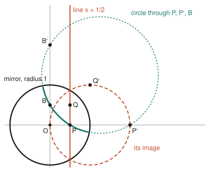

# Inversion in a circle: turn the plane inside out, so lines and circles swap and angles survive

[Syllabus](../../../SYLLABUS.md) → [Geometry and trig](../README.md) → [Beyond Euclid](../README.md#s06) → Inversion in a circle

---

## General Overview

On the [Three geometries](02-spherical-and-hyperbolic-geometry.md) card, a curved side in the Poincaré disc had to pass through (2, 0), called there "A's mirror in the rim" for A = (1/2, 0). This card names that mirror.

Take the unit circle: centre O = (0, 0), radius 1. Move each point P along its ray from O to the point P′ whose distance from O, times P's, is 1. So (1/2, 0) goes to (2, 0), since 1/2 × 2 = 1, and (1/2, 1/2) goes to (1, 1). Inside swaps with outside; the circle stays put.

This swap is **inversion in a circle**. It bends the line x = 1/2 into the circle with centre (1, 0) and radius 1. It keeps every angle. A circle that crosses the mirror at right angles comes back as itself, and so does each line through O; inside the disc, these are its straight lines.

**Inversion sends each point along its ray to where the two distances from the centre multiply to the radius squared; it turns lines and circles into lines and circles, keeps angles, and leaves in place the mirror, the lines through the centre, and exactly the circles that cross it at right angles.**

**What kind of fact this is:** inversion is a definition; that it sends lines and circles to lines and circles, keeps angles, and fixes the right-angle circles are theorems, proved on this card in Why it works.

### The picture: one line, its image, and a circle that stays put

<p align="center"></p>

To scale: O at (100, 250), 1 unit = 80. Black: the mirror. Orange: the line x = 1/2 and, dashed, its image. Green: the circle through P, P′ and B; its thick part is a straight line of the disc.

---

## The formula

The mirror is a circle with centre $`O`$ and radius $`r > 0`$. A point $`P`$, other than $`O`$, goes to the point $`P'`$ (read "P prime") on the ray from $`O`$ through $`P`$ with

```math
OP \times OP' = r^2, \qquad\text{so}\qquad P' = \frac{r^2}{OP^2}\,P
```

**Read it aloud:** a point's and its image's distances from the centre multiply to the radius squared.

Written with complex numbers, a point (x, y) is $`z = x + iy`$, and $`\bar z = x - iy`$ is its **conjugate**, its mirror image in the x-axis ([Conjugate and modulus](../../07-Complex%20analysis/01-Complex%20Numbers%20and%20the%20Plane/02-conjugate-and-modulus.md)). Then

```math
z' = \frac{r^2}{\bar z}
```

**Read it aloud:** the image is the radius squared divided by the point's conjugate. For Q = (1/2, 1/2), with $`i`$ the square root of −1: $`1 / (1/2 - i/2) = 1 + i`$, the point (1, 1).

Two rules follow, proved below. Gaps between images:

```math
P'Q' = \frac{r^2 \times PQ}{OP \times OQ}
```

**Read it aloud:** the images' gap is the radius squared times the old gap, over both distances from the centre.

A circle other than the mirror, with centre $`C`$ and radius $`\rho`$ (rho), is its own image exactly when the **power** of $`O`$ for it, $`\mathrm{pow}(O) = OC^2 - \rho^2`$ ([Power of a point](../02-Circles%20and%20Solids/07-power-of-a-point.md)), equals $`r^2`$: when it crosses the mirror at right angles.

| Symbol | Plain meaning | In our example | Push it up and the answer… |
| --- | --- | --- | --- |
| $`O`$, $`r`$ | the mirror circle's centre and radius | (0, 0) and 1 | images move out in proportion to $`r^2`$ |
| $`P`$, $`Q`$, $`B`$ and $`P'`$, $`Q'`$, $`B'`$ | points and their images | (1/2, 0), (1/2, 1/2), (0, 1/2) go to (2, 0), (1, 1), (0, 2) | — |
| $`OP`$, $`OP'`$, $`PQ`$, $`P'Q'`$ | distances: from $`O`$, and between two points | 1/2 and 2; 0.5 and 1.414214 | push $`OP`$ up and $`OP'`$ falls |
| $`z`$, $`\bar z`$, $`i`$ | a point as $`x + iy`$; its conjugate $`x - iy`$; the square root of −1 | $`1/2 + i/2`$ and $`1/2 - i/2`$ | — |
| $`F`$, $`F'`$, $`a`$ | a line's nearest point to $`O`$, its image, and its distance from $`O`$ | (1/2, 0), (2, 0), 1/2 | image circle shrinks, diameter $`r^2 / a`$ |
| $`T`$ | where the line square to $`OP`$ meets the mirror | on the mirror, straight above P | — |
| $`C`$, $`\rho`$; $`C'`$, $`\rho'`$ | a circle's centre and radius; those of its image | (1.5, 0) and 0.5 go to (0.75, 0) and 0.25 | — |
| $`X`$, $`Y`$; $`\mathrm{pow}(O)`$ | where a line through $`O`$ cuts that circle; $`OC^2 - \rho^2`$ | 2 here; 3.125 − 2.125 = 1 for the circle through P, P′, B | above or below $`r^2`$: the circle moves |

### When it holds

- **Any point but the centre.** $`O`$ has no ray, so no image. Adding one **point at infinity** as its partner makes the pairing complete.
- **A line through $`O`$ stays a line.** Only a line missing $`O`$ becomes a circle, through $`O`$.
- **Angles keep their size, not their turning sense.** A clockwise 45° turn comes out anticlockwise, as in any mirror.
- **Flat ground.** The proofs use flat-plane facts such as Thales' theorem; in space the mirror is a sphere.

---

## Why it works

### Step 0: near swaps with far, and doing it twice changes nothing

Along each ray, 1/2 becomes 2 and 2 becomes 1/2. So inversion undoes itself; only points on the mirror stay put one by one.

### Step 1: three ways to find the image

- **Scaling.** $`P'`$ lies on the ray, at distance $`r^2 / OP`$, so $`P' = (r^2 / OP^2)\,P`$.
- **Complex numbers.** $`z \bar z = x^2 + y^2 = OP^2`$, so $`r^2 / \bar z = r^2 z / OP^2`$: the same scaling.
- **Construction** ([Ruler and compass](03-ruler-and-compass-constructions.md)). For $`0 < OP < r`$, go square to $`OP`$ to the mirror at $`T`$; the tangent at $`T`$ meets the ray at $`P'`$. Right triangles $`OPT`$ and $`OTP'`$ share the angle at $`O`$, so $`OP \times OP' = OT^2 = r^2`$. For $`OP > r`$, reverse it: draw a tangent from $`P`$ to $`T`$ on the mirror and drop a perpendicular to $`OP`$.

### Step 2: two points and their images make similar triangles

Since $`OP \times OP' = OQ \times OQ'`$, the ratio $`OP / OQ`$ equals $`OQ' / OP'`$. Triangles $`OPQ`$ and $`OQ'P'`$ share the angle at $`O`$ and have the sides beside it in one ratio, so they are similar ([Similar triangles](../01-Angles%2C%20Triangles%20and%20Congruence/04-similar-triangles-and-scale.md)).

Matching sides give the distance rule: $`P'Q' = 1 \times 0.5 / (0.5 \times 0.707107) = 1.414214`$, the gap from (2, 0) to (1, 1). Matching angles give $`\angle OPQ = \angle OQ'P'`$.

### Step 3: a line missing O becomes a circle through O

The line x = 1/2 has **foot** $`F`$ = (1/2, 0), its nearest point to $`O`$, with image $`F'`$ = (2, 0). For any $`Q`$ on the line, angle $`OFQ`$ is a right angle, so by Step 2 angle $`OQ'F'`$ is too.

By Thales' theorem ([Angles at a circle](../02-Circles%20and%20Solids/03-angles-in-a-circle.md)), every $`Q'`$ lies on the circle with diameter $`OF'`$: centre (1, 0), radius 1. A line at distance $`a`$ from $`O`$ gives diameter $`r^2 / a`$, here 2. Run backwards, a circle through $`O`$ becomes a line.

### Step 4: a circle missing O becomes a circle missing O

With $`O`$ outside, a ray from $`O`$ cuts the circle at $`X`$ and $`Y`$ with $`OX \times OY = \mathrm{pow}(O)`$ (power of a point), so $`X'`$ is $`Y`$ scaled from $`O`$ by $`r^2 / \mathrm{pow}(O)`$.

With $`O`$ inside, $`\mathrm{pow}(O) < 0`$ and a line through $`O`$ cuts it on opposite sides; the same scaling applies with negative factor $`r^2 / \mathrm{pow}(O)`$ and radius $`\lvert r^2 / \mathrm{pow}(O)\rvert \times \rho`$. For centre (1.5, 0), radius 0.5, the power is 2, so $`C'`$ = (0.75, 0) and $`\rho'`$ = 0.25.

### Step 5: angles survive

The lines x = 1/2 and y = x − 1/2 cross at $`P`$ at 45°. Their images, the circles with centres (1, 0) and (1, −1), radii 1 and 1.414214, cross at $`P'`$ at 45° too.

In words: a line's image circle has its tangent at $`O`$ parallel to the line. A chord makes equal angles with the tangents at its two ends. So each image circle meets the ray at $`P'`$ at its line's angle, mirrored.

<details>
<summary>Detailed proof: the chord OP′ and its two tangents</summary>

Let a line cross the ray $`OP`$ at $`P`$ at 45°. By Step 3 its image is a circle through $`O`$ and $`P'`$, centred on $`OF'`$, which is square to the line. A tangent is square to the radius ([Angles at a circle](../02-Circles%20and%20Solids/03-angles-in-a-circle.md)), so the tangent at $`O`$ is parallel to the line and meets the chord $`OP'`$ at 45°.

The centre, $`O`$ and $`P'`$ make a triangle with two radii as sides, so its angles at $`O`$ and $`P'`$ are equal. Hence the tangents there, square to those radii, meet the chord at equal angles, on opposite turns. So the circle meets $`OP'`$ at $`P'`$ at 45°, turned the other way. Do this for two lines: the angle between the image circles equals the angle between the lines.

</details>

### Step 6: a circle stays put exactly when it crosses the mirror square on

Take a circle with $`\mathrm{pow}(O) = r^2`$. Any ray from $`O`$ cuts it at $`X`$ and $`Y`$ with $`OX \times OY = r^2`$, so $`Y`$ is the image of $`X`$: the circle goes to itself.

The power is also the tangent length from $`O`$, squared. So that tangent has length $`r`$ and ends on the mirror, where the mirror's radius touches the circle: a right-angle crossing. The steps run both ways. Exception: the mirror itself, fixed point by point, with power $`-r^2`$.

The circle through P, P′ and B has centre (1.25, 1.25), radius 1.457738, and power $`3.125 - 2.125 = 1 = r^2`$. It crosses the mirror at (0.983095, −0.183095) at 90°. Every circle through $`P`$ and $`P'`$ has power $`OP \times OP' = r^2`$, so all of them cross square on.

---

## Worked numbers, by hand

| Step | Arithmetic | Value |
| --- | --- | --- |
| P's image | 1 ÷ (1/2) = 2, along the x-axis | (2, 0) |
| Q's distance, squared | 1/4 + 1/4 | 1/2 |
| Q's image | (1/2, 1/2) × 1 ÷ (1/2) | (1, 1) |
| line x = 1/2 | foot (1/2, 0) goes to (2, 0); circle on diameter O to (2, 0) | centre (1, 0), radius 1 |
| gap P′Q′ | 1 × 0.5 ÷ (0.5 × 0.707107) | 1.414214 |
| circle through P, P′, B | centre (1.25, 1.25), radius 1.457738 | power 3.125 − 2.125 |
| power of O | compare with r² = 1 | **1: the circle is its own image** |

The circle through P and P′ is its own image: a straight line of the disc.

### What breaks if you drop a piece

| Mistake | Comes out at | What went wrong |
| --- | --- | --- |
| Inverting the centre of the circle centre (1.5, 0), radius 0.5 | centre (0.666667, 0), not (0.75, 0) | Centres are not carried to centres |
| Sending the line x = 1/2 to the line x = 2 | Q′ = (1, 1) lies 1 off it | A line missing O becomes a circle |
| Using 1/z for 1/z̄ | Q goes to (1, −1) | 1/z also flips in the x-axis |

---

## Code, from first principles, and it actually runs

Each image is found three ways: scaling, complex division by the conjugate, and the tangent construction. Each claim then gets a second road: 2001 images of the line against the Thales circle, the angle by tiny steps and by radii, the circle's image by scaling and by three points, and 2000 inverted points of the fixed circle.

After them, Lean, a program that checks proofs, proves the three rules for every mirror.

### Python

```python
# Inversion in a circle -- the check behind the card.  Standard library only.
# Mirror: the unit circle, centre O = (0, 0), radius r = 1.  P goes to P' on the
# ray from O through P, with OP x OP' = r^2.  Images are reached by separate roads:
# the coordinate rule, the complex rule r^2/conj(z), the tangent construction,
# a circle through three image points, and brute force over thousands of points.
from math import sqrt, hypot, atan2, degrees, cos, sin, pi
R = 1.0
def inv(p): s = p[0] ** 2 + p[1] ** 2; return (R * R * p[0] / s, R * R * p[1] / s)  # road 1
def inv_c(p): w = R * R / complex(p[0], -p[1]); return (w.real, w.imag)             # road 2
def inv_t(p):                   # road 3: square up from P to T on the mirror; the tangent at T meets the ray
    d = hypot(*p); u = (p[0] / d, p[1] / d); h = sqrt(R * R - d * d)
    t = (d * u[0] - h * u[1], d * u[1] + h * u[0])
    k = (t[0] ** 2 + t[1] ** 2) / (t[0] * u[0] + t[1] * u[1]); return (k * u[0], k * u[1])
def dist(a, b): return hypot(a[0] - b[0], a[1] - b[1])
def circle3(a, b, c):           # the circle through three points: centre, radius
    (ax, ay), (bx, by), (cx, cy) = a, b, c; sa, sb, sc = ax*ax + ay*ay, bx*bx + by*by, cx*cx + cy*cy
    dd = 2 * (ax * (by - cy) + bx * (cy - ay) + cx * (ay - by))
    o = ((sa * (by - cy) + sb * (cy - ay) + sc * (ay - by)) / dd, (sa * (cx - bx) + sb * (ax - cx) + sc * (bx - ax)) / dd)
    return o, dist(o, a)
def angle(u, v): return abs(degrees(atan2(u[0] * v[1] - u[1] * v[0], u[0] * v[0] + u[1] * v[1])))
def img_dir(p, e, h=1e-6):      # direction of an image curve at P', by a tiny step either side of P
    a, b = inv((p[0] + h * e[0], p[1] + h * e[1])), inv((p[0] - h * e[0], p[1] - h * e[1])); return (a[0] - b[0], a[1] - b[1])
def worst(pts, c, rad): return max(abs(dist(q, c) - rad) for q in pts)
def f(p): return f"({p[0]:.6f}, {p[1]:.6f})"
P, Q, B, Pi = (0.5, 0.0), (0.5, 0.5), (0.0, 0.5), inv((0.5, 0.0))
for n, p in (("P", P), ("Q", Q)):
    print(f"{n} ({p[0]:.1f}, {p[1]:.1f}) -> {f(inv(p))} rule, {f(inv_c(p))} 1/conj(z), {f(inv_t(p))} tangent; product {hypot(*p) * hypot(*inv(p)):.6f}")
Fi = inv(P); c1, r1 = (Fi[0] / 2, Fi[1] / 2), hypot(*Fi) / 2                          # Thales: diameter O to F'
line_pts = [inv((0.5, y / 20)) for y in range(-1000, 1001) if y != 0] + [Pi]
print(f"line x = 0.5 -> circle centre {f(c1)}, radius {r1:.6f}; 2001 image points, worst miss {worst(line_pts, c1, r1):.9f}")
F2 = inv((0.25, -0.25)); c2, r2 = (F2[0] / 2, F2[1] / 2), hypot(*F2) / 2               # line y = x - 0.5
perp = lambda c: (-(Pi[1] - c[1]), Pi[0] - c[0])
a0, a1, a2 = angle((0, 1), (1, 1)), angle(img_dir(P, (0, 1)), img_dir(P, (1, 1))), angle(perp(c1), perp(c2))
print(f"line y = x - 0.5 -> circle centre {f(c2)}, radius {r2:.6f}")
print(f"angle at P {a0:.6f}; at P' by tiny steps {a1:.6f}, by the two image circles {a2:.6f}")
pq, rule = dist(inv(P), inv(Q)), R * R * dist(P, Q) / (hypot(*P) * hypot(*Q))
print(f"P'Q' measured {pq:.6f}; by r^2 PQ / (OP OQ) = 0.5 / (0.5 x {hypot(*Q):.6f}) = {rule:.6f}")
g, rg = circle3(P, Pi, B); pw = g[0] ** 2 + g[1] ** 2 - rg * rg
s = (g[0] ** 2 + g[1] ** 2 + R * R - rg * rg) / 2; m = sqrt(R * R - s * s / (g[0] ** 2 + g[1] ** 2))
X = (s * g[0] / (g[0] ** 2 + g[1] ** 2) + m * g[1] / hypot(*g), s * g[1] / (g[0] ** 2 + g[1] ** 2) - m * g[0] / hypot(*g))
cross = angle(X, (X[0] - g[0], X[1] - g[1]))
ring = [inv((g[0] + rg * cos(pi * k / 1000), g[1] + rg * sin(pi * k / 1000))) for k in range(2000)]
print(f"circle through P, P', B: centre {f(g)}, radius {rg:.6f}; power of O {g[0] ** 2 + g[1] ** 2:.6f} - {rg * rg:.6f} = {pw:.6f}")
print(f"it crosses the mirror at {f(X)} at {cross:.6f} degrees; B' = {f(inv(B))}, miss {abs(dist(inv(B), g) - rg):.9f}")
print(f"2000 points of it inverted: worst miss {worst(ring, g, rg):.9f}")
k_, pw3 = (1.5, 0.0), 1.5 ** 2 - 0.5 ** 2; c3, r3 = (R * R * 1.5 / pw3, 0.0), R * R * 0.5 / pw3
c4, r4 = circle3(inv((1.0, 0.0)), inv((2.0, 0.0)), inv((1.5, 0.5)))
print(f"circle centre (1.5, 0), radius 0.5: power {pw3:.6f}; image by scaling {f(c3)} r {r3:.6f}, by 3 points {f(c4)} r {r4:.6f}")
wz = 1 / complex(*Q)
print(f"mistake 1, inverted centre {f(inv(k_))} is not the image centre {f(c3)}")
print(f"mistake 2, x = 0.5 sent to the line x = 2: Q' = {f(inv(Q))} is {abs(inv(Q)[0] - 2):.6f} off it")
print(f"mistake 3, 1/z for 1/conj(z): Q goes to {f((wz.real, wz.imag))}, the flip of Q'")
sc = lambda p: f"({100 + 80 * p[0]:.1f}, {250 - 80 * p[1]:.1f})"
print("figure, O (100, 250), 1 = 80 units; P", sc(P), "P'", sc(Pi), "Q", sc(Q), "Q'", sc(inv(Q)), "B", sc(B), "B'", sc(inv(B)),
      "circles", sc(c1), f"r {80 * r1:.1f};", sc(g), f"r {80 * rg:.1f}; crossings", sc(X), sc((X[1], X[0])))
assert all(dist(inv(p), inv_c(p)) < 1e-12 and dist(inv(p), inv_t(p)) < 1e-12 for p in (P, Q, B))   # three roads
assert worst(line_pts, c1, r1) < 1e-9 and worst(ring, g, rg) < 1e-9 and abs(pw - R * R) < 1e-12  # line -> circle; fixed
assert abs(a1 - a0) < 1e-6 and abs(a2 - a0) < 1e-9 and abs(cross - 90) < 1e-9 and abs(pq - rule) < 1e-12
assert dist(c3, c4) < 1e-12 and abs(r3 - r4) < 1e-12 and dist(inv(k_), c3) > 0.08            # circle -> circle
print("ALL CHECKS PASS")
```

**Ran 2026-11-23 on macOS, Python 3.14.10, standard library only. All checks passed. Output, pasted from the run:**

```
P (0.5, 0.0) -> (2.000000, 0.000000) rule, (2.000000, 0.000000) 1/conj(z), (2.000000, 0.000000) tangent; product 1.000000
Q (0.5, 0.5) -> (1.000000, 1.000000) rule, (1.000000, 1.000000) 1/conj(z), (1.000000, 1.000000) tangent; product 1.000000
line x = 0.5 -> circle centre (1.000000, 0.000000), radius 1.000000; 2001 image points, worst miss 0.000000000
line y = x - 0.5 -> circle centre (1.000000, -1.000000), radius 1.414214
angle at P 45.000000; at P' by tiny steps 45.000000, by the two image circles 45.000000
P'Q' measured 1.414214; by r^2 PQ / (OP OQ) = 0.5 / (0.5 x 0.707107) = 1.414214
circle through P, P', B: centre (1.250000, 1.250000), radius 1.457738; power of O 3.125000 - 2.125000 = 1.000000
it crosses the mirror at (0.983095, -0.183095) at 90.000000 degrees; B' = (0.000000, 2.000000), miss 0.000000000
2000 points of it inverted: worst miss 0.000000000
circle centre (1.5, 0), radius 0.5: power 2.000000; image by scaling (0.750000, 0.000000) r 0.250000, by 3 points (0.750000, 0.000000) r 0.250000
mistake 1, inverted centre (0.666667, 0.000000) is not the image centre (0.750000, 0.000000)
mistake 2, x = 0.5 sent to the line x = 2: Q' = (1.000000, 1.000000) is 1.000000 off it
mistake 3, 1/z for 1/conj(z): Q goes to (1.000000, -1.000000), the flip of Q'
figure, O (100, 250), 1 = 80 units; P (140.0, 250.0) P' (260.0, 250.0) Q (140.0, 210.0) Q' (180.0, 170.0) B (100.0, 210.0) B' (100.0, 90.0) circles (180.0, 250.0) r 80.0; (200.0, 150.0) r 116.6; crossings (178.6, 264.6) (85.4, 171.4)
ALL CHECKS PASS
```

### Rust

Same numbers, same labels, built with `rustc --edition 2021 -O`.

```rust
// Inversion in a circle -- the same check as the Python, in Rust.  No crates.
// Mirror: the unit circle, centre O = (0, 0), radius r = 1.  P goes to P' on the
// ray from O through P, with OP x OP' = r^2.  Images are reached by separate roads:
// the coordinate rule, the complex rule r^2/conj(z), the tangent construction,
// a circle through three image points, and brute force over thousands of points.
use std::f64::consts::PI;
type V = (f64, f64);
const R: f64 = 1.0;
fn inv(p: V) -> V { let s = p.0 * p.0 + p.1 * p.1; (R * R * p.0 / s, R * R * p.1 / s) }   // road 1
fn inv_c(p: V) -> V {                // road 2: r^2 / conj(z), conj(z) = x - iy, complex division by hand
    let (a, b) = (p.0, -p.1); let n = a * a + b * b; (R * R * a / n, -R * R * b / n)
}
fn inv_t(p: V) -> V {                // road 3: square up from P to T on the mirror; the tangent at T meets the ray
    let d = p.0.hypot(p.1); let u = (p.0 / d, p.1 / d); let h = (R * R - d * d).sqrt();
    let t = (d * u.0 - h * u.1, d * u.1 + h * u.0);
    let k = (t.0 * t.0 + t.1 * t.1) / (t.0 * u.0 + t.1 * u.1); (k * u.0, k * u.1)
}
fn dist(a: V, b: V) -> f64 { (a.0 - b.0).hypot(a.1 - b.1) }
fn circle3(a: V, b: V, c: V) -> (V, f64) {   // the circle through three points: centre, radius
    let (sa, sb, sc) = (a.0 * a.0 + a.1 * a.1, b.0 * b.0 + b.1 * b.1, c.0 * c.0 + c.1 * c.1);
    let dd = 2.0 * (a.0 * (b.1 - c.1) + b.0 * (c.1 - a.1) + c.0 * (a.1 - b.1));
    let o = ((sa * (b.1 - c.1) + sb * (c.1 - a.1) + sc * (a.1 - b.1)) / dd, (sa * (c.0 - b.0) + sb * (a.0 - c.0) + sc * (b.0 - a.0)) / dd);
    (o, dist(o, a))
}
fn angle(u: V, v: V) -> f64 { (u.0 * v.1 - u.1 * v.0).atan2(u.0 * v.0 + u.1 * v.1).to_degrees().abs() }
fn img_dir(p: V, e: V) -> V {        // direction of an image curve at P', by a tiny step either side of P
    let h = 1e-6; let (a, b) = (inv((p.0 + h * e.0, p.1 + h * e.1)), inv((p.0 - h * e.0, p.1 - h * e.1))); (a.0 - b.0, a.1 - b.1)
}
fn worst(pts: &[V], c: V, rad: f64) -> f64 { pts.iter().map(|&q| (dist(q, c) - rad).abs()).fold(0.0, f64::max) }
fn f(p: V) -> String { format!("({:.6}, {:.6})", p.0, p.1) }
fn sc(p: V) -> String { format!("({:.1}, {:.1})", 100.0 + 80.0 * p.0, 250.0 - 80.0 * p.1) }
fn main() {
    let (p, q, b) = ((0.5, 0.0), (0.5, 0.5), (0.0, 0.5)); let pi_ = inv(p);
    for (n, x) in [("P", p), ("Q", q)] {
        println!("{} ({:.1}, {:.1}) -> {} rule, {} 1/conj(z), {} tangent; product {:.6}", n, x.0, x.1, f(inv(x)), f(inv_c(x)), f(inv_t(x)), x.0.hypot(x.1) * inv(x).0.hypot(inv(x).1));
    }
    let fi = inv(p); let (c1, r1) = ((fi.0 / 2.0, fi.1 / 2.0), fi.0.hypot(fi.1) / 2.0);   // Thales: diameter O to F'
    let mut line_pts: Vec<V> = (-1000..=1000).filter(|&y| y != 0).map(|y| inv((0.5, y as f64 / 20.0))).collect();
    line_pts.push(pi_);
    println!("line x = 0.5 -> circle centre {}, radius {:.6}; 2001 image points, worst miss {:.9}", f(c1), r1, worst(&line_pts, c1, r1));
    let f2 = inv((0.25, -0.25)); let (c2, r2) = ((f2.0 / 2.0, f2.1 / 2.0), f2.0.hypot(f2.1) / 2.0);   // line y = x - 0.5
    let perp = |c: V| (-(pi_.1 - c.1), pi_.0 - c.0);
    let (a0, a1, a2) = (angle((0.0, 1.0), (1.0, 1.0)), angle(img_dir(p, (0.0, 1.0)), img_dir(p, (1.0, 1.0))), angle(perp(c1), perp(c2)));
    println!("line y = x - 0.5 -> circle centre {}, radius {:.6}", f(c2), r2);
    println!("angle at P {:.6}; at P' by tiny steps {:.6}, by the two image circles {:.6}", a0, a1, a2);
    let (pq, rule) = (dist(inv(p), inv(q)), R * R * dist(p, q) / (p.0.hypot(p.1) * q.0.hypot(q.1)));
    println!("P'Q' measured {:.6}; by r^2 PQ / (OP OQ) = 0.5 / (0.5 x {:.6}) = {:.6}", pq, q.0.hypot(q.1), rule);
    let (g, rg) = circle3(p, pi_, b); let gg = g.0 * g.0 + g.1 * g.1; let pw = gg - rg * rg;
    let s = (gg + R * R - rg * rg) / 2.0; let m = (R * R - s * s / gg).sqrt();
    let x = (s * g.0 / gg + m * g.1 / g.0.hypot(g.1), s * g.1 / gg - m * g.0 / g.0.hypot(g.1));
    let cross = angle(x, (x.0 - g.0, x.1 - g.1));
    let ring: Vec<V> = (0..2000).map(|k| { let t = PI * k as f64 / 1000.0; inv((g.0 + rg * t.cos(), g.1 + rg * t.sin())) }).collect();
    println!("circle through P, P', B: centre {}, radius {:.6}; power of O {:.6} - {:.6} = {:.6}", f(g), rg, gg, rg * rg, pw);
    println!("it crosses the mirror at {} at {:.6} degrees; B' = {}, miss {:.9}", f(x), cross, f(inv(b)), (dist(inv(b), g) - rg).abs());
    println!("2000 points of it inverted: worst miss {:.9}", worst(&ring, g, rg));
    let (k_, pw3) = ((1.5, 0.0), 1.5f64 * 1.5 - 0.5 * 0.5); let (c3, r3) = ((R * R * 1.5 / pw3, 0.0), R * R * 0.5 / pw3);
    let (c4, r4) = circle3(inv((1.0, 0.0)), inv((2.0, 0.0)), inv((1.5, 0.5)));
    println!("circle centre (1.5, 0), radius 0.5: power {:.6}; image by scaling {} r {:.6}, by 3 points {} r {:.6}", pw3, f(c3), r3, f(c4), r4);
    let nz = q.0 * q.0 + q.1 * q.1; let wz = (q.0 / nz, -q.1 / nz);        // 1/z, not 1/conj(z)
    println!("mistake 1, inverted centre {} is not the image centre {}", f(inv(k_)), f(c3));
    println!("mistake 2, x = 0.5 sent to the line x = 2: Q' = {} is {:.6} off it", f(inv(q)), (inv(q).0 - 2.0).abs());
    println!("mistake 3, 1/z for 1/conj(z): Q goes to {}, the flip of Q'", f(wz));
    println!("figure, O (100, 250), 1 = 80 units; P {} P' {} Q {} Q' {} B {} B' {} circles {} r {:.1}; {} r {:.1}; crossings {} {}",
             sc(p), sc(pi_), sc(q), sc(inv(q)), sc(b), sc(inv(b)), sc(c1), 80.0 * r1, sc(g), 80.0 * rg, sc(x), sc((x.1, x.0)));
    assert!([p, q, b].iter().all(|&z| dist(inv(z), inv_c(z)) < 1e-12 && dist(inv(z), inv_t(z)) < 1e-12));   // three roads
    assert!(worst(&line_pts, c1, r1) < 1e-9 && worst(&ring, g, rg) < 1e-9 && (pw - R * R).abs() < 1e-12); // line -> circle; fixed
    assert!((a1 - a0).abs() < 1e-6 && (a2 - a0).abs() < 1e-9 && (cross - 90.0).abs() < 1e-9 && (pq - rule).abs() < 1e-12);
    assert!(dist(c3, c4) < 1e-12 && (r3 - r4).abs() < 1e-12 && dist(inv(k_), c3) > 0.08);            // circle -> circle
    println!("ALL CHECKS PASS");
}
```

**Ran 2026-11-23 on macOS, rustc 1.98.1, no crates. All checks passed. Output, pasted from the run:**

```
P (0.5, 0.0) -> (2.000000, 0.000000) rule, (2.000000, 0.000000) 1/conj(z), (2.000000, 0.000000) tangent; product 1.000000
Q (0.5, 0.5) -> (1.000000, 1.000000) rule, (1.000000, 1.000000) 1/conj(z), (1.000000, 1.000000) tangent; product 1.000000
line x = 0.5 -> circle centre (1.000000, 0.000000), radius 1.000000; 2001 image points, worst miss 0.000000000
line y = x - 0.5 -> circle centre (1.000000, -1.000000), radius 1.414214
angle at P 45.000000; at P' by tiny steps 45.000000, by the two image circles 45.000000
P'Q' measured 1.414214; by r^2 PQ / (OP OQ) = 0.5 / (0.5 x 0.707107) = 1.414214
circle through P, P', B: centre (1.250000, 1.250000), radius 1.457738; power of O 3.125000 - 2.125000 = 1.000000
it crosses the mirror at (0.983095, -0.183095) at 90.000000 degrees; B' = (0.000000, 2.000000), miss 0.000000000
2000 points of it inverted: worst miss 0.000000000
circle centre (1.5, 0), radius 0.5: power 2.000000; image by scaling (0.750000, 0.000000) r 0.250000, by 3 points (0.750000, 0.000000) r 0.250000
mistake 1, inverted centre (0.666667, 0.000000) is not the image centre (0.750000, 0.000000)
mistake 2, x = 0.5 sent to the line x = 2: Q' = (1.000000, 1.000000) is 1.000000 off it
mistake 3, 1/z for 1/conj(z): Q goes to (1.000000, -1.000000), the flip of Q'
figure, O (100, 250), 1 = 80 units; P (140.0, 250.0) P' (260.0, 250.0) Q (140.0, 210.0) Q' (180.0, 170.0) B (100.0, 210.0) B' (100.0, 90.0) circles (180.0, 250.0) r 80.0; (200.0, 150.0) r 116.6; crossings (178.6, 264.6) (85.4, 171.4)
ALL CHECKS PASS
```

### Lean

Lean proves the three rules for any mirror with radius above 0, and checks the worked numbers in the unit circle.

- A line or a circle, with O left out, goes to a line or a circle, again with O left out.
- At any point but O, inversion keeps the size of the angle between any two directions.
- Take a circle other than the mirror. Then it is its own image exactly when $`\mathrm{pow}(O) = r^2`$.
- In the unit circle, P goes to (2, 0) and Q goes to (1, 1).
- The hand sums hold: the circle through P′ and Q′, the power 1, and the image centre (0.75, 0).

The gap rule, the tangent construction, the 90° crossing and the decimals are left to the Python and Rust checks.

```lean
-- Inversion in a circle: inversion in a circle of the plane sends lines and circles to lines and circles, keeps angles, and fixes a circle exactly when the power of the centre equals the radius squared.
import Mathlib.Geometry.Euclidean.Inversion.ImageHyperplane
import Mathlib.Geometry.Euclidean.Inversion.Calculus
import Mathlib.Geometry.Euclidean.Angle.Unoriented.Basic
import Mathlib.Analysis.InnerProductSpace.PiL2
import Mathlib.Geometry.Euclidean.Projection

open EuclideanGeometry

local notation "ℝ²" => EuclideanSpace ℝ (Fin 2)

/-- Squared distance from the image of `x` to a point `O + λ • (C - O)`. -/
theorem inversion_dist_sq_aux (O C x : ℝ²) (r l : ℝ) (hx : x ≠ O) :
    dist (inversion O r x) (O + l • (C - O)) ^ 2 * ‖x - O‖ ^ 2 =
      r ^ 4 - 2 * r ^ 2 * l * inner ℝ (x - O) (C - O) + l ^ 2 * ‖C - O‖ ^ 2 * ‖x - O‖ ^ 2 := by
  have hs : ‖x - O‖ ≠ 0 := by simpa [sub_eq_zero] using hx
  have h1 : inversion O r x - (O + l • (C - O)) = (r / ‖x - O‖) ^ 2 • (x - O) - l • (C - O) := by
    rw [inversion, dist_eq_norm, vsub_eq_sub, vadd_eq_add]; abel
  rw [dist_eq_norm, h1, @norm_sub_sq_real, norm_smul, norm_smul, inner_smul_left, inner_smul_right]
  simp only [Real.norm_eq_abs, conj_trivial]
  rw [abs_of_nonneg (by positivity)]
  rw [mul_pow, mul_pow, sq_abs]
  field_simp

/-- Points of the sphere `C ρ` other than `O`: relation between the old and new data. -/
theorem sphere_inner_aux (O C x : ℝ²) (ρ : ℝ) (hx : x ∈ Metric.sphere C ρ) :
    2 * inner ℝ (x - O) (C - O) = ‖x - O‖ ^ 2 + (dist O C ^ 2 - ρ ^ 2) := by
  rw [Metric.mem_sphere, dist_eq_norm] at hx
  have : x - C = (x - O) - (C - O) := by abel
  rw [this] at hx
  have h2 : ‖x - O - (C - O)‖ ^ 2 = ρ ^ 2 := by rw [hx]
  rw [norm_sub_sq_real] at h2
  rw [dist_comm, dist_eq_norm]
  linarith

theorem exists_perp_aux (w : ℝ²) : ∃ f : ℝ², f ≠ 0 ∧ inner ℝ w f = 0 := by
  have h1 := Submodule.finrank_add_finrank_orthogonal (ℝ ∙ w)
  have h2 : Module.finrank ℝ (ℝ ∙ w) ≤ 1 := by simpa using finrank_span_le_card ({w} : Set ℝ²)
  rw [finrank_euclideanSpace_fin] at h1
  have h3 : (ℝ ∙ w)ᗮ ≠ ⊥ := by
    intro h
    rw [h, finrank_bot] at h1
    omega
  obtain ⟨f, hf, hf0⟩ := Submodule.exists_mem_ne_zero_of_ne_bot h3
  exact ⟨f, hf0, Submodule.mem_orthogonal_singleton_iff_inner_right.1 hf⟩

theorem inversion_mem_sphere_aux (O C x : ℝ²) (r ρ : ℝ) (hρ : 0 ≤ ρ)
    (hp : dist O C ^ 2 - ρ ^ 2 ≠ 0) (hx : x ∈ Metric.sphere C ρ) (hxO : x ≠ O) :
    inversion O r x ∈ Metric.sphere (O + (r ^ 2 / (dist O C ^ 2 - ρ ^ 2)) • (C - O))
      (|r ^ 2 / (dist O C ^ 2 - ρ ^ 2)| * ρ) := by
  set p := dist O C ^ 2 - ρ ^ 2 with hp_def
  set l := r ^ 2 / p with hl
  have h1 := inversion_dist_sq_aux O C x r l hxO
  have h2 := sphere_inner_aux O C x ρ hx
  have hs : ‖x - O‖ ≠ 0 := by simpa [sub_eq_zero] using hxO
  have hd : ‖C - O‖ = dist O C := by rw [dist_comm, dist_eq_norm]
  have hlp : l * p = r ^ 2 := by rw [hl]; field_simp
  have h3 : dist (inversion O r x) (O + l • (C - O)) ^ 2 = (|l| * ρ) ^ 2 := by
    apply mul_right_cancel₀ (pow_ne_zero 2 hs)
    rw [h1, mul_pow, sq_abs, hd]
    have : 2 * r ^ 2 * l * inner ℝ (x - O) (C - O) = r ^ 2 * l * (‖x - O‖ ^ 2 + p) := by
      rw [← h2]; ring
    rw [this]
    linear_combination (‖x - O‖ ^ 2 * l - r ^ 2) * hlp
  rw [Metric.mem_sphere]
  exact (sq_eq_sq₀ dist_nonneg (by positivity)).1 h3

theorem finrank_dir_aux (v : ℝ²) (hv : v ≠ 0) : Module.finrank ℝ (ℝ ∙ v)ᗮ = 1 := by
  have : Fact (Module.finrank ℝ ℝ² = 1 + 1) := ⟨by simp⟩
  exact Submodule.finrank_orthogonal_span_singleton hv

theorem perpBisector_eq_line_aux (p₁ p₂ : ℝ²) (h : p₁ ≠ p₂) :
    ∃ A B : ℝ², A ≠ B ∧ (AffineSubspace.perpBisector p₁ p₂ : Set ℝ²) = line[ℝ, A, B] := by
  have hv : p₂ -ᵥ p₁ ≠ 0 := by simpa [vsub_eq_sub, sub_eq_zero] using h.symm
  obtain ⟨f, hf0, hf⟩ := exists_perp_aux (p₂ -ᵥ p₁)
  have hfD : f ∈ (AffineSubspace.perpBisector p₁ p₂).direction := by
    rw [AffineSubspace.direction_perpBisector]
    exact Submodule.mem_orthogonal_singleton_iff_inner_right.2 hf
  have hA := AffineSubspace.midpoint_mem_perpBisector p₁ p₂
  have hB := AffineSubspace.vadd_mem_of_mem_direction hfD hA
  refine ⟨midpoint ℝ p₁ p₂, f +ᵥ midpoint ℝ p₁ p₂, ?_, ?_⟩
  · intro hAB
    apply hf0
    simpa [vadd_eq_add] using hAB.symm
  · have hle := affineSpan_pair_le_of_mem_of_mem hA hB
    have hdir : (line[ℝ, midpoint ℝ p₁ p₂, f +ᵥ midpoint ℝ p₁ p₂]).direction =
        (AffineSubspace.perpBisector p₁ p₂).direction := by
      apply Submodule.eq_of_le_of_finrank_eq (AffineSubspace.direction_le hle)
      rw [AffineSubspace.direction_perpBisector, finrank_dir_aux _ hv, direction_affineSpan,
        vectorSpan_pair, finrank_span_singleton]
      simpa [vsub_eq_sub] using hf0
    rw [AffineSubspace.eq_of_direction_eq_of_nonempty_of_le hdir
      ((AffineSubspace.nonempty_iff_ne_bot _).2 (by
        intro hb; have := left_mem_affineSpan_pair ℝ (midpoint ℝ p₁ p₂) (f +ᵥ midpoint ℝ p₁ p₂)
        rw [hb] at this; exact this)) hle]

theorem line_eq_perpBisector_aux (O A B : ℝ²) (hAB : A ≠ B) (hO : O ∉ line[ℝ, A, B]) :
    ∃ y : ℝ², y ≠ O ∧ (line[ℝ, A, B] : Set ℝ²) = AffineSubspace.perpBisector O y := by
  have : Nonempty (line[ℝ, A, B]) := ⟨⟨A, left_mem_affineSpan_pair ℝ A B⟩⟩
  refine ⟨EuclideanGeometry.reflection line[ℝ, A, B] O, ?_, ?_⟩
  · rw [Ne, EuclideanGeometry.reflection_eq_self_iff]
    exact hO
  · have hle : line[ℝ, A, B] ≤ AffineSubspace.perpBisector O
        (EuclideanGeometry.reflection line[ℝ, A, B] O) := by
      intro p hp
      rw [AffineSubspace.mem_perpBisector_iff_dist_eq,
        EuclideanGeometry.dist_reflection_eq_of_mem _ hp]
    have hv : EuclideanGeometry.reflection line[ℝ, A, B] O -ᵥ O ≠ 0 := by
      rw [Ne, vsub_eq_zero_iff_eq, EuclideanGeometry.reflection_eq_self_iff]
      exact hO
    have hdir : (line[ℝ, A, B]).direction = (AffineSubspace.perpBisector O
        (EuclideanGeometry.reflection line[ℝ, A, B] O)).direction := by
      apply Submodule.eq_of_le_of_finrank_eq (AffineSubspace.direction_le hle)
      rw [AffineSubspace.direction_perpBisector, finrank_dir_aux _ hv, direction_affineSpan,
        vectorSpan_pair, finrank_span_singleton]
      simpa [vsub_eq_sub, sub_eq_zero] using hAB
    exact congrArg (fun s : AffineSubspace ℝ ℝ² => (s : Set ℝ²))
      (AffineSubspace.eq_of_direction_eq_of_nonempty_of_le hdir
      ((AffineSubspace.nonempty_iff_ne_bot _).2 (by
        intro hb; have := left_mem_affineSpan_pair ℝ A B
        rw [hb] at this; exact this)) hle)

#print axioms inversion_dist_sq_aux
#print axioms sphere_inner_aux
#print axioms exists_perp_aux
#print axioms inversion_mem_sphere_aux
#print axioms finrank_dir_aux
#print axioms perpBisector_eq_line_aux
#print axioms line_eq_perpBisector_aux

/-- Inversion in a circle with centre `O` and radius `r > 0` turns lines and circles into lines
and circles: leaving out the centre `O` (which has no image), the image of a line or a circle
is a line or a circle, again with `O` left out. -/
theorem inversion_maps_lines_and_circles_to_lines_and_circles
    (O : ℝ²) (r : ℝ) (hr : 0 < r) (S : Set ℝ²)
    (hS : (∃ A B : ℝ², A ≠ B ∧ S = (line[ℝ, A, B] : Set ℝ²)) ∨
      (∃ (C : ℝ²) (ρ : ℝ), 0 < ρ ∧ S = Metric.sphere C ρ)) :
    ∃ T : Set ℝ²,
      ((∃ A B : ℝ², A ≠ B ∧ T = (line[ℝ, A, B] : Set ℝ²)) ∨
        (∃ (C : ℝ²) (ρ : ℝ), 0 < ρ ∧ T = Metric.sphere C ρ)) ∧
      inversion O r '' (S \ {O}) = T \ {O} := by
  have hr0 : r ≠ 0 := hr.ne'
  have hinj := inversion_injective O hr0
  rcases hS with ⟨A, B, hAB, rfl⟩ | ⟨C, ρ, hρ, rfl⟩
  · by_cases hO : O ∈ line[ℝ, A, B]
    · refine ⟨_, Or.inl ⟨A, B, hAB, rfl⟩, ?_⟩
      rw [Set.image_sdiff hinj, Set.image_singleton, inversion_self,
        image_inversion_affineSubspace_of_mem hr0 hO]
    · obtain ⟨y, hyO, hy⟩ := line_eq_perpBisector_aux O A B hAB hO
      have hyc : y ≠ O := hyO
      refine ⟨Metric.sphere (inversion O r y) (r ^ 2 / dist y O),
        Or.inr ⟨_, _, by have := dist_pos.2 hyc; positivity, rfl⟩, ?_⟩
      rw [Set.sdiff_singleton_eq_self (by simpa using hO), hy,
        image_inversion_perpBisector hr0 hyc]
  · by_cases hOS : dist O C = ρ
    · have hC : C ≠ O := by
        rintro rfl; rw [dist_self] at hOS; exact hρ.ne hOS
      have hiC : O ≠ inversion O r C := by
        rw [Ne, center_eq_inversion hr0]; exact hC
      obtain ⟨A, B, hAB, hP⟩ := perpBisector_eq_line_aux O (inversion O r C) hiC
      refine ⟨_, Or.inl ⟨A, B, hAB, hP⟩, ?_⟩
      rw [Set.image_sdiff hinj, Set.image_singleton, inversion_self, ← hOS, dist_comm,
        image_inversion_sphere_dist_center hr0 hC, Set.insert_sdiff_of_mem _ rfl]
    · set p := dist O C ^ 2 - ρ ^ 2 with hp_def
      have hp0 : p ≠ 0 := by
        intro h
        apply hOS
        have : (dist O C - ρ) * (dist O C + ρ) = 0 := by rw [← h, hp_def]; ring
        rcases mul_eq_zero.1 this with h1 | h1
        · linarith
        · linarith [dist_nonneg (x := O) (y := C)]
      set l := r ^ 2 / p with hl
      have hl0 : l ≠ 0 := div_ne_zero (pow_ne_zero 2 hr0) hp0
      have hOn : O ∉ Metric.sphere C ρ := by
        rw [Metric.mem_sphere]; exact hOS
      set C' := O + l • (C - O) with hC'
      have hdC' : dist O C' = |l| * dist O C := by
        rw [hC', dist_comm, dist_eq_norm, add_sub_cancel_left, norm_smul, Real.norm_eq_abs,
          dist_comm, dist_eq_norm]
      have hOn' : O ∉ Metric.sphere C' (|l| * ρ) := by
        rw [Metric.mem_sphere, hdC']
        intro h
        exact hOS (mul_left_cancel₀ (abs_ne_zero.2 hl0) h)
      refine ⟨Metric.sphere C' (|l| * ρ), Or.inr ⟨_, _, by positivity, rfl⟩, ?_⟩
      rw [Set.sdiff_singleton_eq_self hOn, Set.sdiff_singleton_eq_self hOn']
      apply Set.Subset.antisymm
      · rintro _ ⟨x, hx, rfl⟩
        exact inversion_mem_sphere_aux O C x r ρ hρ.le hp0 hx (fun h => hOn (h ▸ hx))
      · intro y hy
        have hyO : y ≠ O := fun h => hOn' (h ▸ hy)
        have hp' : dist O C' ^ 2 - (|l| * ρ) ^ 2 = l ^ 2 * p := by
          rw [hdC', hp_def, mul_pow, mul_pow, sq_abs]; ring
        have hp'0 : dist O C' ^ 2 - (|l| * ρ) ^ 2 ≠ 0 := by
          rw [hp']; exact mul_ne_zero (pow_ne_zero 2 hl0) hp0
        have key := inversion_mem_sphere_aux O C' y r (|l| * ρ) (by positivity) hp'0 hy hyO
        have hk : r ^ 2 / (l ^ 2 * p) * l = 1 := by
          rw [hl]; field_simp
        rw [hp', hC', add_sub_cancel_left, smul_smul, hk, one_smul, add_sub_cancel, ← mul_assoc,
          ← abs_mul, hk, abs_one, one_mul] at key
        exact ⟨_, key, inversion_inversion O hr0 y⟩

/-- Inversion keeps angles: at any point `x` other than the centre, the derivative of the
inversion sends any two directions `u`, `v` to two directions meeting at the same angle. -/
theorem inversion_preserves_angles (O x : ℝ²) (r : ℝ) (hr : 0 < r) (hx : x ≠ O) (u v : ℝ²) :
    InnerProductGeometry.angle (fderiv ℝ (inversion O r) x u) (fderiv ℝ (inversion O r) x v) =
      InnerProductGeometry.angle u v := by
  rw [fderiv_inversion]
  have hk : (r / dist x O) ^ 2 ≠ 0 := by
    have : dist x O ≠ 0 := dist_ne_zero.2 hx
    positivity
  rw [smul_apply, smul_apply, InnerProductGeometry.angle_smul_smul hk]
  exact (Submodule.reflection _).toLinearIsometry.angle_map u v


/-- A circle with centre `C` and radius `ρ`, other than the mirror itself, is its own image under
inversion in the circle with centre `O` and radius `r` exactly when the power of `O` for it,
`OC² - ρ²`, equals `r²`: exactly when it crosses the mirror at right angles. -/
theorem inversion_fixes_circle_iff_power_eq_radius_sq
    (O C : ℝ²) (r ρ : ℝ) (hr : 0 < r) (hρ : 0 < ρ) (hmirror : ¬ (C = O ∧ ρ = r)) :
    inversion O r '' Metric.sphere C ρ = Metric.sphere C ρ ↔ dist O C ^ 2 - ρ ^ 2 = r ^ 2 := by
  have hr0 : r ≠ 0 := hr.ne'
  constructor
  · intro himg
    by_contra hp
    -- every point of the circle other than `O` is at distance `r` from `O`
    have key : ∀ x ∈ Metric.sphere C ρ, x ≠ O → ‖x - O‖ ^ 2 = r ^ 2 := by
      intro x hx hxO
      have hix : inversion O r x ∈ Metric.sphere C ρ := himg ▸ Set.mem_image_of_mem _ hx
      have h1 := inversion_dist_sq_aux O C x r 1 hxO
      have h2 := sphere_inner_aux O C x ρ hx
      rw [one_smul, add_sub_cancel, Metric.mem_sphere.1 hix] at h1
      have hd : ‖C - O‖ = dist O C := by rw [dist_comm, dist_eq_norm]
      rw [hd] at h1
      have : (‖x - O‖ ^ 2 - r ^ 2) * (dist O C ^ 2 - ρ ^ 2 - r ^ 2) = 0 := by
        linear_combination (-1 : ℝ) * h1 + r ^ 2 * h2
      rcases mul_eq_zero.1 this with h | h
      · linarith
      · exact absurd (by linarith) hp
    set w := C - O with hw
    have hd : ‖w‖ = dist O C := by rw [hw, dist_comm, dist_eq_norm]
    obtain ⟨f, hf0, hwf⟩ := exists_perp_aux w
    have hfn : ‖f‖ ≠ 0 := norm_ne_zero_iff.2 hf0
    -- a point of the circle in the direction `f`
    have hx2 : C + (ρ / ‖f‖) • f ∈ Metric.sphere C ρ := by
      rw [Metric.mem_sphere, dist_eq_norm, add_sub_cancel_left, norm_smul, Real.norm_eq_abs,
        abs_of_pos (by positivity)]
      field_simp
    have hn2 : ‖C + (ρ / ‖f‖) • f - O‖ ^ 2 = ‖w‖ ^ 2 + ρ ^ 2 := by
      have : C + (ρ / ‖f‖) • f - O = w + (ρ / ‖f‖) • f := by rw [hw]; abel
      rw [this, norm_add_sq_real, inner_smul_right, hwf, norm_smul, Real.norm_eq_abs,
        abs_of_pos (by positivity)]
      field_simp
      ring
    have hx2O : C + (ρ / ‖f‖) • f ≠ O := by
      intro h
      rw [h, sub_self, norm_zero] at hn2
      nlinarith [sq_nonneg ‖w‖]
    have e2 := key _ hx2 hx2O
    rw [hn2] at e2
    by_cases hw0 : w = 0
    · apply hmirror
      refine ⟨sub_eq_zero.1 hw0, ?_⟩
      rw [hw0, norm_zero] at e2
      nlinarith
    · have hwn : ‖w‖ ≠ 0 := norm_ne_zero_iff.2 hw0
      have hx1 : C + (ρ / ‖w‖) • w ∈ Metric.sphere C ρ := by
        rw [Metric.mem_sphere, dist_eq_norm, add_sub_cancel_left, norm_smul, Real.norm_eq_abs,
          abs_of_pos (by positivity)]
        field_simp
      have hn1 : ‖C + (ρ / ‖w‖) • w - O‖ = ‖w‖ + ρ := by
        have : C + (ρ / ‖w‖) • w - O = (1 + ρ / ‖w‖) • w := by rw [hw, add_smul, one_smul]; abel
        rw [this, norm_smul, Real.norm_eq_abs, abs_of_pos (by positivity)]
        field_simp
      have hx1O : C + (ρ / ‖w‖) • w ≠ O := by
        intro h
        rw [h, sub_self, norm_zero] at hn1
        linarith [norm_nonneg w]
      have e1 := key _ hx1 hx1O
      rw [hn1] at e1
      have : 0 < ‖w‖ * ρ := by positivity
      nlinarith
  · intro hp
    have hp0 : dist O C ^ 2 - ρ ^ 2 ≠ 0 := by rw [hp]; positivity
    have hsub : ∀ x ∈ Metric.sphere C ρ, inversion O r x ∈ Metric.sphere C ρ := by
      intro x hx
      have hxO : x ≠ O := by
        rintro rfl
        rw [Metric.mem_sphere] at hx
        rw [hx, sub_self] at hp
        exact absurd hp.symm (by positivity)
      have := inversion_mem_sphere_aux O C x r ρ hρ.le hp0 hx hxO
      rwa [hp, div_self (by positivity), one_smul, add_sub_cancel, abs_one, one_mul] at this
    apply Set.Subset.antisymm
    · rintro _ ⟨x, hx, rfl⟩
      exact hsub x hx
    · intro y hy
      exact ⟨inversion O r y, hsub y hy, inversion_inversion O hr0 y⟩


-- In the unit circle, P = (1/2, 0) goes to P' = (2, 0) and Q = (1/2, 1/2) goes to Q' = (1, 1).
example : inversion (0 : ℝ²) 1 !₂[1/2, 0] = !₂[2, 0] := by
  have h : dist (!₂[1/2, 0] : ℝ²) 0 = 1/2 := by
    rw [EuclideanSpace.dist_eq]
    simp [Fin.sum_univ_two]
  rw [inversion, h]
  ext i; fin_cases i <;> norm_num

example : inversion (0 : ℝ²) 1 !₂[1/2, 1/2] = !₂[1, 1] := by
  have h : dist (!₂[1/2, 1/2] : ℝ²) 0 ^ 2 = 1/2 := by
    rw [EuclideanSpace.dist_eq, Real.sq_sqrt (by positivity)]
    simp [Fin.sum_univ_two]; norm_num
  rw [inversion, div_pow, h]
  ext i; fin_cases i <;> norm_num


-- The distances from the centre multiply to the radius squared: 1/2 × 2 = 1.
example : (1 / 2 : ℚ) * 2 = 1 := by norm_num

-- Q' = (1, 1) and P' = (2, 0) lie on the circle with centre (1, 0) and radius 1.
example : ((1 : ℚ) - 1) ^ 2 + (1 - 0) ^ 2 = 1 ^ 2 := by norm_num
example : ((2 : ℚ) - 1) ^ 2 + (0 - 0) ^ 2 = 1 ^ 2 := by norm_num

-- The circle through P = (1/2, 0), P' = (2, 0) and B = (0, 1/2) has centre (5/4, 5/4)
-- and radius squared 17/8 (= 2.125); the power of O is 25/8 - 17/8 = 1 = r².
example : ((1 / 2 : ℚ) - 5 / 4) ^ 2 + (0 - 5 / 4) ^ 2 = 17 / 8 := by norm_num
example : ((2 : ℚ) - 5 / 4) ^ 2 + (0 - 5 / 4) ^ 2 = 17 / 8 := by norm_num
example : ((0 : ℚ) - 5 / 4) ^ 2 + (1 / 2 - 5 / 4) ^ 2 = 17 / 8 := by norm_num
example : ((5 / 4 : ℚ) ^ 2 + (5 / 4) ^ 2) - 17 / 8 = 1 := by norm_num

-- The circle with centre (3/2, 0) and radius 1/2: power 2, image centre 3/4, image radius 1/4.
example : (3 / 2 : ℚ) ^ 2 - (1 / 2) ^ 2 = 2 := by norm_num
example : (1 : ℚ) * (3 / 2) / 2 = 3 / 4 ∧ (1 : ℚ) * (1 / 2) / 2 = 1 / 4 := by norm_num

#print axioms inversion_maps_lines_and_circles_to_lines_and_circles
#print axioms inversion_preserves_angles
#print axioms inversion_fixes_circle_iff_power_eq_radius_sq
```

**Checked 2026-11-23 on macOS, Lean 4.36.0-rc2, Mathlib v4.36.0-rc2. Every proof is complete and uses only Lean's standard axioms. Output, pasted from the run:**

```
'inversion_dist_sq_aux' depends on axioms: [propext, Classical.choice, Quot.sound]
'sphere_inner_aux' depends on axioms: [propext, Classical.choice, Quot.sound]
'exists_perp_aux' depends on axioms: [propext, Classical.choice, Quot.sound]
'inversion_mem_sphere_aux' depends on axioms: [propext, Classical.choice, Quot.sound]
'finrank_dir_aux' depends on axioms: [propext, Classical.choice, Quot.sound]
'perpBisector_eq_line_aux' depends on axioms: [propext, Classical.choice, Quot.sound]
'line_eq_perpBisector_aux' depends on axioms: [propext, Classical.choice, Quot.sound]
'inversion_maps_lines_and_circles_to_lines_and_circles' depends on axioms: [propext, Classical.choice, Quot.sound]
'inversion_preserves_angles' depends on axioms: [propext, Classical.choice, Quot.sound]
'inversion_fixes_circle_iff_power_eq_radius_sq' depends on axioms: [propext, Classical.choice, Quot.sound]
```

> [!TIP]
> **Try changing**
> Guess first, then run it.
> - **A bigger mirror.** Set `R = 2.0`. P lands at (8, 0), since 1/2 × 8 = 4, and the circle through P, P′ and B is still fixed.
> - **Another circle through P and P′.** Change B to `(0.0, 0.25)`. It stays put: centre (1.25, 2.125), power 1.
> - **Drop the conjugate.** In `inv_c`, change `-p[1]` to `p[1]`. Q goes to (1, −1) and the first assert stops the run.

---

## The usual mistake

> [!warning]
> **Inversion is not a reflection at equal distance.** The point (1/2, 0) does not go to half a unit outside the circle. It goes to (2, 0): the distances from the centre multiply to 1; they do not add.
>
> - Inverting a circle's centre to find the image's centre: (0.666667, 0) instead of (0.75, 0).
> - Keeping a line a line: x = 1/2 sent to x = 2 misses Q′ = (1, 1) by 1.
> - Dropping the conjugate: Q goes to (1, −1), not (1, 1).

---

## Where you meet it in real life

- **Straight-line linkages.** The Peaucellier–Lipkin linkage uses seven hinged bars to hold $`OP \times OP'`$ fixed. Swing P round a circle through O, and P′ traces an exact straight line.
- **Charge near a metal ball.** Kelvin's method of images puts an opposite charge at the inverse point inside an earthed sphere.
- **Polar flight charts.** Stereographic projection, an inversion in a sphere applied to the globe, draws great circles such as the London to New York route as circle arcs or lines, and keeps angles.
- **Escher's disc pictures.** Reflecting in a line of the Poincaré disc is inverting in its circle. Pairs of such reflections, which never mirror, carry fish onto fish in *Circle Limit III*.

> **Say it back**
> Inversion moves each point along its ray so that its distance from the centre, times the image's, is the radius squared. In the unit circle, (1/2, 0) goes to (2, 0). Similar triangles turn the line x = 1/2 into the circle with centre (1, 0), radius 1. Angles keep their size and flip their turning sense. Besides the mirror, only lines through the centre and circles crossing it at right angles are their own images.

---

## What this builds on

- [Power of a point](../02-Circles%20and%20Solids/07-power-of-a-point.md): the fixed product that maps circles to circles and finds the fixed ones.
- [Angles at a circle](../02-Circles%20and%20Solids/03-angles-in-a-circle.md): Thales' theorem and the tangent rules.
- [Similar triangles](../01-Angles%2C%20Triangles%20and%20Congruence/04-similar-triangles-and-scale.md): the triangles OPQ and OQ′P′ behind every proof here.
- [Three geometries](02-spherical-and-hyperbolic-geometry.md): the Poincaré disc, whose lines are the circles and diameters inversion fixes.

## Where this goes next

- [Three maps of one hyperbolic plane](09-hyperbolic-plane-models.md): inversions carry the disc to the half-plane and act as reflections.
- [Mobius transformations](../../07-Complex%20analysis/07-Conformal%20Maps%20and%20Harmonic%20Functions/02-mobius-transformations-and-the-point-at-infinity.md): an inversion then a flip in the x-axis gives $`z \mapsto 1/z`$, which keeps circles and angles without the flip.

Next, [Three maps of one hyperbolic plane](09-hyperbolic-plane-models.md) uses one inversion to map the Poincaré disc onto the upper half-plane; [Mobius transformations](../../07-Complex%20analysis/07-Conformal%20Maps%20and%20Harmonic%20Functions/02-mobius-transformations-and-the-point-at-infinity.md) asks which plane maps send every circle to a circle.

---

## Sources

Verified 2026-11-23: every link below resolves to the publisher's page.

- Coxeter, H. S. M. *Introduction to Geometry*, 2nd ed. Wiley, 1969. [Publisher page](https://www.wiley.com/en-us/Introduction+to+Geometry%2C+2nd+Edition-p-9780471504580). Chapter 6: inversion and orthogonal circles.
- Brannan, D. A., M. F. Esplen and J. J. Gray. *Geometry*, 2nd ed. Cambridge University Press, 2011. [DOI](https://doi.org/10.1017/CBO9781139003001). Inversive geometry with complex numbers.
- Coxeter, H. S. M. and S. L. Greitzer. *Geometry Revisited*. Mathematical Association of America, 1967. [DOI](https://doi.org/10.5948/UPO9780883859346). Inversion in elementary geometry.
