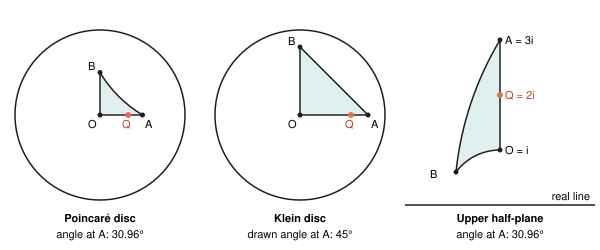

# Three maps of one hyperbolic plane: the disc, the half-plane and the Klein disc, and the distance each one uses

[Syllabus](../../../SYLLABUS.md) → [Geometry and trig](../README.md) → [Beyond Euclid](../README.md#s06) → Three maps of one hyperbolic plane

---

## General Overview

No flat chart of the Earth gets everything right. A Mercator chart keeps angles true but draws the great-circle route from London to New York as a curve. A gnomonic chart draws that route straight but bends angles.

The hyperbolic plane of [Three geometries](02-spherical-and-hyperbolic-geometry.md), where infinitely many parallels pass through one point, has the same trade. Its three standard maps are called **models**:

- the **Poincaré disc**: angles true, lines drawn as circle arcs;
- the **upper half-plane**: angles true, lines drawn as vertical lines and half-circles standing on the bottom edge;
- the **Klein disc**: lines drawn straight, angles bent.

Each model has its own **ruler**: a rule turning drawn length into true length. Two half-plane points, one and two units up, are 1 apart on paper but ln 2 = 0.693147 apart in truth. The Poincaré disc draws them at 0 and 1/3, the Klein disc at 0 and 0.6. Both rulers give 0.693147 again.

**The Poincaré disc, the half-plane and the Klein disc are three drawings of one hyperbolic plane: maps carry points between them without changing any true distance; the first two keep angles true and draw lines as arcs, and the Klein disc draws lines straight at the price of false angles.**

**What kind of fact this is:** each ruler is a definition. That the models are one plane, the distance formula and Klein's straight lines are theorems, proved in Why it works.

### The picture: one triangle in three models

<p align="center"></p>

The triangle of [Three geometries](02-spherical-and-hyperbolic-geometry.md): O at the disc's centre, A at 0.5 right, B at 0.5 up. Q lies ln 2 from O along OA. To scale: rim radius 1 = 85 units; in the half-plane 1 unit = 55 units.

---

## The formula

A half-plane point is written $`z = x + iy`$: $`x`$ across, $`y`$ up, $`y`$ above 0. So $`i`$ is the point (0, 1) and $`2i`$ is (0, 2), as in [Complex numbers](../../07-Complex%20analysis/01-Complex%20Numbers%20and%20the%20Plane/01-complex-numbers.md). The ruler counts a short piece at height $`y`$ as $`1/y`$ times its drawn length.

New here: $`\cosh t = (e^t + e^{-t})/2`$, the **hyperbolic cosine** ([Hyperbolic functions](../../06-Calculus%20and%20analysis/02-Derivatives/07-hyperbolic-functions.md)). The true distance $`d`$ between two half-plane points is

```math
\cosh d = 1 + \frac{\lvert z - w\rvert^2}{2\, y_1 y_2}
```

**Read it aloud:** the hyperbolic cosine of the true distance is one plus the squared drawn gap over twice the two heights multiplied.

The **Cayley map** sends a Poincaré disc point $`p`$ to the half-plane. The **Klein map** moves a disc point at drawn distance $`r`$ from the centre along its radius:

```math
z = i\,\frac{1+p}{1-p}, \qquad s = \frac{2r}{1+r^2}
```

**Read it aloud:** the half-plane point is i times one plus the disc point, over one minus it; the Klein point lies on the same radius at twice r over one plus r squared.

For $`p = 1/3`$: i × (4/3)/(2/3) = $`2i`$. For $`r = 1/3`$: (2/3)/(10/9) = 0.6. Back: p = (z − i)/(z + i) and r = s/(1 + √(1 − s²)) take $`2i`$ and 0.6 to 1/3.

| Symbol | Plain meaning | In our example | Push it up and the answer… |
| --- | --- | --- | --- |
| $`z`$, $`w`$, $`i`$ | two half-plane points, written $`x + iy`$; $`i`$ is the point one unit up | $`i`$ and $`2i`$ | — |
| $`x`$, $`y`$; $`y_1`$, $`y_2`$ | a point's distance across and up; the heights of $`z`$ and $`w`$ | 0 and 1 for $`i`$; 1 and 2 | heights, gap fixed: the true distance shrinks |
| $`\lvert z - w\rvert`$ | the drawn straight-line gap | 1 | the true distance grows |
| $`d`$ | true distance, measured with the model's ruler | ln 2 = 0.693147 | — |
| $`\cosh`$, $`\ln`$, $`e`$ | hyperbolic cosine; natural log; 2.718… | cosh(ln 2) = 1.25 | cosh only grows for $`t`$ above 0 |
| $`p`$, $`r`$; $`\bar p`$ | a Poincaré disc point and its drawn distance from the centre; $`p`$ mirrored in the real line | 1/3 | $`p`$ toward 1: its half-plane image climbs without limit |
| $`s`$ | the same point's drawn distance in the Klein disc | 0.6 | it nears the rim faster than $`r`$ |
| $`a`$, $`b`$; $`c`$, $`k`$; O, A, B, Q | in Why it works: two heights; a disc line's centre distance from O and radius; the points in the picture | 1 and 2; —; Q at 1/3 | — |

### When it holds

- **Points strictly inside each model.** Half-plane: $`y > 0`$ ($`y = 0`$ divides by zero). Discs: $`\lvert p\rvert < 1`$, $`0 \le r < 1`$, $`0 \le s < 1`$ (the rim is infinitely far, $`p = 1`$ divides by zero, and $`s > 1`$ breaks $`\sqrt{1 - s^2}`$).
- **Each ruler on its own map.** Klein's 0.6 in the disc's formula ln((1 + r)/(1 − r)) gives ln 4 = 1.386294, double the truth.
- **Angles only in conformal models.** A **conformal** model keeps angles: the Poincaré disc and the half-plane are, the Klein disc is not.
- **One scale.** All rulers match the disc ruler 2/(1 − r²) of [Three geometries](02-spherical-and-hyperbolic-geometry.md). Halve a ruler and every distance halves.

---

## Why it works

### Step 0: one plane, three rulers

A model is a drawing plus a ruler. Two models show one plane when a map carries one ruler to the other, so every short piece measures the same. Then distances agree, and lines (shortest paths) go to lines.

### Step 1: the Cayley map is an inversion and a mirror

[Inversion in a circle](08-inversion-in-a-circle.md) keeps angles and sends circles to circles or lines. Invert in the circle with centre 1, radius √2, then mirror in the line y = −x: 1/3 goes to −2, then to $`2i`$. The code checks this matches the Cayley fraction at 49 disc points.

So the Cayley map keeps angles. The rim passes through the centre 1, so the inversion makes it the line through ±i, which the mirror turns into the real line. Disc lines meet the rim square, so they become vertical lines and half-circles meeting the real line square.

### Step 2: the half-plane ruler is the disc's ruler

On the horizontal diameter, drawn distance $`r`$ goes to height y = (1 + r)/(1 − r). Near any disc point $`p`$, the map stretches every short piece by 2/|1 − p|² (the gap rule of [Inversion in a circle](08-inversion-in-a-circle.md), radius squared 2). The image's height is the real part of (1 + p)/(1 − p); with $`\bar p`$ for $`p`$ mirrored in the real line,

```math
\frac{1 + p}{1 - p} = \frac{(1 + p)(1 - \bar p)}{\lvert 1 - p\rvert^2} = \frac{1 - \lvert p\rvert^2}{\lvert 1 - p\rvert^2} + \frac{p - \bar p}{\lvert 1 - p\rvert^2}
```

and the last part points straight up. Stretch over height gives 2/(1 − |p|²), the disc's ruler.

### Step 3: distance straight up

From $`i`$ to $`2i`$, each thin slice counts its rise over its height. The slices add to ln 2 − ln 1 = ln 2 ([Logarithms](../../01-Foundations/03-Powers%2C%20Roots%20and%20Logarithms/05-logarithms.md)). Sideways travel adds length and no height, so every other path is longer. From height $`a`$ to $`b`$ ($`0 < a \le b`$) the distance is $`\ln(b/a)`$; in either order, $`\lvert\ln(b/a)\rvert`$.

The formula agrees: cosh(ln(b/a)) = (b/a + a/b)/2 = (a² + b²)/(2ab) = 1 + (b − a)²/(2ab).

### Step 4: every other pair

Three moves keep the half-plane, its ruler and the ratio $`|z - w|^2/(y_1 y_2)`$: a sideways slide, a scaling from a real point, and an inversion in a circle centred on the real line. Inverting about one end of a half-circle straightens it into a vertical line. So any pair moves onto one vertical line, where Step 3 holds.

For $`i`$ and $`1 + i`$: cosh d = 1 + 1/2 = 1.5, so d = 0.962424. Thin slices along the half-circle joining them agree.

<details>
<summary>Detailed proof: inversion keeps the ruler and the ratio</summary>

Invert in the unit circle centred at 0. A point goes to $`z' = z/|z|^2`$, still above the real line, at height $`y' = y/|z|^2`$. The drawn gap becomes

$`\displaystyle |z' - w'| = \frac{|z - w|}{|z|\,|w|}`$

so the ratio is unchanged:

$`\displaystyle \frac{|z' - w'|^2}{y_1' y_2'} = \frac{|z - w|^2}{|z|^2 |w|^2} \cdot \frac{|z|^2 |w|^2}{y_1 y_2} = \frac{|z - w|^2}{y_1 y_2}`$

For a short piece, length and height both shrink by $`|z|^2`$, so the ruler's count is unchanged. Slides and scalings change neither ratio, and any inversion centred on the real line is a slide, a scaling and this inversion.

</details>

### Step 5: the Klein disc draws lines straight

Diameters stay straight because the Klein map only slides each point along its radius. For any other disc line, turn the disc so its circle has its centre on the x-axis, at distance $`c`$ from O, with radius $`k`$. Meeting the rim square means c² = 1 + k² ([Three geometries](02-spherical-and-hyperbolic-geometry.md), Step 4).

A point (x, y) at drawn distance $`r`$ lies on the circle when (x − c)² + y² = k², that is r² − 2cx + 1 = 0. So x = (1 + r²)/(2c).

The Klein map scales the point by s/r = 2/(1 + r²), so its new x is 1/c for every point of the arc. The arc lands on the line x = 1/c: the chord joining its two rim ends. Side AB lands on the chord x + y = 0.8.

### Step 6: the Klein disc bends angles

The disc and half-plane rulers stretch every direction at a point equally, so angles survive.

The Klein ruler does not. At drawn distance $`s`$ from O it counts a short piece

```math
\frac{1}{1 - s^2} \text{ times along the radius}, \qquad \frac{1}{\sqrt{1 - s^2}} \text{ times across it}
```

The Klein map carries the disc ruler onto it. Along: its slices from O add to ½ ln((1 + s)/(1 − s)), the disc's ln((1 + r)/(1 − r)), as the first ratio is the second squared. Across: a small turn about O moves the point r times the turn in the disc, s times in Klein, and s/√(1 − s²) = 2r/(1 − r²), as √(1 − s²) = (1 − r²)/(1 + r²).

So an angle from the radius has true tangent = drawn tangent × √(1 − s²). At A, s = 0.8: side AB leaves the radius at a drawn 45°, true tangent 1 × √(1 − 0.8²) = 0.6, so 30.963757°. The drawn angles add to 180°, the true ones to 151.927513°.

---

## Worked numbers, by hand

| Step | Arithmetic | Value |
| --- | --- | --- |
| half-plane, $`i`$ to $`2i`$ | 1 + 1²/(2 × 1 × 2) | 1.25 |
| check | cosh(ln 2) = (2 + 1/2)/2 | 1.25 |
| true distance | d = ln 2 | **0.693147** |
| back to the disc | (1 + r)/(1 − r) = 2 gives r | 1/3 |
| disc ruler, 0 to 1/3 | ln((4/3)/(2/3)) = ln 2 | 0.693147 |
| Klein point | (2/3)/(1 + 1/9) | 0.6 |
| Klein ruler, 0 to 0.6 | ½ ln(1.6/0.4) = ½ ln 4 | **0.693147** |
| angle at A, disc and half-plane | tangent 3/5 | 30.963757° |
| angle at A, Klein drawing | chord to O against chord to B | 45° |

All three rulers put Q at 0.693147 from O, drawn at 2i, 1/3 and 0.6.

### What breaks if you drop a piece

| Mistake | Comes out at | What went wrong |
| --- | --- | --- |
| Drawn gap $`\lvert 2i - i\rvert`$ taken as true | 1.000000 | The ruler 1/y was ignored |
| Klein's 0.6 in the disc's distance formula | 1.386294 | Each model needs its own ruler |
| One ruler reading, at the middle height 1.5 | 0.666667 | The ruler changes along the path |
| Straight across from $`i`$ to $`1 + i`$ | 1.000000, not 0.962424 | Half-plane lines are half-circles |

---

## Code, from first principles, and it actually runs

Each distance comes from its model's formula and from 100,000 thin ruler slices; the disc and Klein formulas, not derived here, are checks: Klein's is half the log of a ratio of gaps to the chord's rim ends. The pair $`i`$, $`1 + i`$ gets four roads: three formulas and slices along the half-circle. Angles on each drawing are checked against atan(3/5). Five asserts compare the roads.

### Python

```python
# Three maps of one hyperbolic plane -- the check behind the card.  Standard library only.
# The same points in the half-plane, the Poincare disc and the Klein disc.  Each distance comes from
# a formula and from thin slices of the map's ruler; each angle is measured on the drawing itself.
from math import log, sqrt, atan, pi; from cmath import phase, rect
DEG, N, EPS = 180 / pi, 100000, 1e-5
def acosh(c): return log(c + sqrt(c * c - 1))
def half_d(z, w): return acosh(1 + abs(z - w) ** 2 / (2 * z.imag * w.imag))   # half-plane formula
def disc_d(p, q): return acosh(1 + 2 * abs(p - q) ** 2 / ((1 - abs(p) ** 2) * (1 - abs(q) ** 2)))
def klein_d(a, b):                       # half the log of the cross-ratio with the chord's two rim ends
    u = b - a; A, B, C = abs(u) ** 2, 2 * (a.conjugate() * u).real, abs(a) ** 2 - 1
    t1, t2 = (-B - sqrt(B * B - 4 * A * C)) / (2 * A), (-B + sqrt(B * B - 4 * A * C)) / (2 * A)
    return 0.5 * log((1 - t1) * t2 / (-t1 * (t2 - 1)))
def to_half(p): return 1j * (1 + p) / (1 - p)            # Cayley map, disc -> half-plane
def to_disc(z): return (z - 1j) / (z + 1j)               # and back
def to_klein(p): return 2 * p / (1 + abs(p) ** 2)         # same ray, radius r -> 2r/(1 + r^2)
def from_klein(k): return k / (1 + sqrt(1 - abs(k) ** 2))
def inv_mirror(p): q = 1 + 2 / (p.conjugate() - 1); return complex(-q.imag, -q.real)   # invert, then mirror in y = -x
def slices(path, ruler, a, b):           # add up ruler x drawn length over N thin pieces of a path
    pts = [path(a + (b - a) * i / N) for i in range(N + 1)]; return sum(abs(q - p) * ruler((p + q) / 2) for p, q in zip(pts, pts[1:]))
xy = lambda z, k=6: f"({z.real + 0.0:.{k}f}, {z.imag + 0.0:.{k}f})"; yn = lambda claim: "yes" if claim else "no"
def px(z, o, s): return f"({o[0] + s * z.real:.1f}, {o[1] - s * z.imag:.1f})"
d12, up = half_d(1j, 2j), slices(lambda t: 1j * t, lambda z: 1 / z.imag, 1, 2)   # straight up, ruler dy/y
disc_up, klein_up = (slices(lambda t: t, lambda p: 2 / (1 - abs(p) ** 2), 0, 1 / 3),      # disc ruler 2/(1 - r^2)
                     slices(lambda t: t, lambda k: 1 / (1 - abs(k) ** 2), 0, 0.6))      # Klein ruler, along a radius
two_roads = all(abs(inv_mirror(rect(0.02 * j, j)) - to_half(rect(0.02 * j, j))) < 1e-12 for j in range(49))
rim = max(abs(to_half(rect(1, t / DEG)).imag) for t in range(5, 360, 5))
print(f"half-plane i to 2i: 1 + 1/(2 x 1 x 2) = {1 + 1 / 4:.6f}, cosh(ln 2) = {(2 + 1 / 2) / 2:.6f}, d = {d12:.6f}")
print(f"half-plane i to 2i, {N} thin slices of dy/y: {up:.6f}; ln 2 = {log(2):.6f}")
print(f"Cayley: disc 0 -> {xy(to_half(0))}, 1/3 -> {xy(to_half(1 / 3))}, 0.5 -> {xy(to_half(0.5))}, rim i -> {xy(to_half(1j))}")
print(f"Cayley: 71 rim points, every 5 degrees, all land on the real line (height under 1e-9): {yn(rim < 1e-9)}")
print(f"inversion in the circle centre 1, radius sqrt 2, sends 1/3 to {1 + 2 / (1 / 3 - 1):.6f}; the mirror in y = -x then gives {xy(inv_mirror(1 / 3 + 0j))}")
print(f"inversion then mirror agrees with Cayley at 49 disc points: {yn(two_roads)}")
print(f"disc 0 to 1/3: formula {disc_d(0, 1 / 3):.6f}, slices {disc_up:.6f}\nKlein: disc 1/3 -> {to_klein(1 / 3):.6f}, back {from_klein(0.6):.6f}; 0 to 0.6: "
      f"chord formula {klein_d(0j, 0.6 + 0j):.6f}, slices {klein_up:.6f}")
z, w = 1j, 1 + 1j; p, q = to_disc(z), to_disc(w); kq = to_klein(q)            # a pair off one vertical line
arc = slices(lambda t: 0.5 + rect(sqrt(1.25), t), lambda z: 1 / z.imag, phase(w - 0.5), phase(z - 0.5))
pair = [half_d(z, w), disc_d(p, q), klein_d(to_klein(p), kq), arc]
print(f"pair i, 1 + i: cosh d = 1 + 1/2 = {1 + abs(w - z) ** 2 / 2:.6f}; disc 0 and {xy(q)}, Klein 0 and {xy(kq)}\n  half-plane {pair[0]:.6f} | disc {pair[1]:.6f} | Klein {pair[2]:.6f} | slices on the arc {pair[3]:.6f}")
A, B, c = 0.5 + 0j, 0.5j, 1.25 + 1.25j; k = abs(A - c); fA = phase(A - c)    # card 02's triangle O, A, B
on_arc = lambda t: c + rect(k, t)                                            # side AB, by its angle at c
def angle_at_A(f):                        # angle between the image of side AO and the image of side AB
    return abs(phase((f(on_arc(fA - EPS)) - f(on_arc(fA + EPS))) / (f(A - EPS) - f(A + EPS)))) * DEG
ang = [angle_at_A(f) for f in (lambda p: p, to_half, to_klein)]
side = [on_arc(fA - j * 0.01) for j in range(49)]                           # 49 points along side AB
miss_k, miss_h = max(abs(to_klein(s).real + to_klein(s).imag - 0.8) for s in side), max(abs(abs(to_half(s) - 5) - sqrt(34)) for s in side)
print(f"triangle: half-plane B {xy(to_half(B), 1)}; Klein A {to_klein(A).real:.1f}, B {to_klein(B).imag:.1f}i; disc arc radius {k:.6f}")
print(f"angle at A: disc {ang[0]:.6f} | half-plane {ang[1]:.6f} | atan(3/5) {atan(0.6) * DEG:.6f} | Klein drawn {ang[2]:.6f}"
      f"\ntriangle sum: true {90 + 2 * ang[0]:.6f} | Klein drawn {90 + 2 * ang[2]:.6f}")
print(f"side AB, 49 points: on the Klein chord x + y = 0.8: {yn(miss_k < 1e-9)}; on the half-plane circle centre 5, radius {sqrt(34):.6f}: {yn(miss_h < 1e-9)}")
print(f"figure, disc R 85 at (100, 115): A {px(A, (100, 115), 85)} B {px(B, (100, 115), 85)} Q {px(1 / 3 + 0j, (100, 115), 85)} arc r {85 * k:.1f}; "
      f"Klein: A {px(to_klein(A), (300, 115), 85)} B {px(to_klein(B), (300, 115), 85)} Q {px(0.6 + 0j, (300, 115), 85)}; "
      f"half-plane x55 at (500, 205): O {px(1j, (500, 205), 55)} A {px(3j, (500, 205), 55)} B {px(to_half(B), (500, 205), 55)} Q {px(2j, (500, 205), 55)} arc r {55 * sqrt(34):.1f}")
print(f"mistakes: drawn gap |2i - i| {abs(2j - 1j):.6f}; Klein 0.6 in the disc's formula {log(1.6 / 0.4):.6f}; "
      f"one ruler reading at height 1.5 {1 / 1.5:.6f}; straight across i to 1 + i {slices(lambda t: t + 1j, lambda z: 1 / z.imag, 0, 1):.6f}")
assert abs(d12 - log(2)) < 1e-12 and abs(up - log(2)) < 1e-9                # formula against slices
assert abs(disc_up - log(2)) < 1e-9 and abs(klein_up - log(2)) < 1e-9        # the same gap in the two discs
assert max(pair) - min(pair) < 1e-9 and abs(to_disc(to_half(0.3 - 0.4j)) - (0.3 - 0.4j)) < 1e-12
assert abs(ang[0] - atan(0.6) * DEG) < 1e-6 and abs(ang[1] - ang[0]) < 1e-6 and abs(ang[2] - 45) < 1e-6
assert miss_k < 1e-9 and miss_h < 1e-9 and rim < 1e-9 and two_roads and abs(from_klein(to_klein(0.3 - 0.4j)) - (0.3 - 0.4j)) < 1e-12
print("ALL CHECKS PASS")
```

**Ran 2026-11-23 on macOS, Python 3.14.10, standard library only. All checks passed. Output, pasted from the run:**

```
half-plane i to 2i: 1 + 1/(2 x 1 x 2) = 1.250000, cosh(ln 2) = 1.250000, d = 0.693147
half-plane i to 2i, 100000 thin slices of dy/y: 0.693147; ln 2 = 0.693147
Cayley: disc 0 -> (0.000000, 1.000000), 1/3 -> (0.000000, 2.000000), 0.5 -> (0.000000, 3.000000), rim i -> (-1.000000, 0.000000)
Cayley: 71 rim points, every 5 degrees, all land on the real line (height under 1e-9): yes
inversion in the circle centre 1, radius sqrt 2, sends 1/3 to -2.000000; the mirror in y = -x then gives (0.000000, 2.000000)
inversion then mirror agrees with Cayley at 49 disc points: yes
disc 0 to 1/3: formula 0.693147, slices 0.693147
Klein: disc 1/3 -> 0.600000, back 0.333333; 0 to 0.6: chord formula 0.693147, slices 0.693147
pair i, 1 + i: cosh d = 1 + 1/2 = 1.500000; disc 0 and (0.200000, -0.400000), Klein 0 and (0.333333, -0.666667)
  half-plane 0.962424 | disc 0.962424 | Klein 0.962424 | slices on the arc 0.962424
triangle: half-plane B (-0.8, 0.6); Klein A 0.8, B 0.8i; disc arc radius 1.457738
angle at A: disc 30.963757 | half-plane 30.963757 | atan(3/5) 30.963757 | Klein drawn 45.000000
triangle sum: true 151.927513 | Klein drawn 180.000000
side AB, 49 points: on the Klein chord x + y = 0.8: yes; on the half-plane circle centre 5, radius 5.830952: yes
figure, disc R 85 at (100, 115): A (142.5, 115.0) B (100.0, 72.5) Q (128.3, 115.0) arc r 123.9; Klein: A (368.0, 115.0) B (300.0, 47.0) Q (351.0, 115.0); half-plane x55 at (500, 205): O (500.0, 150.0) A (500.0, 40.0) B (456.0, 172.0) Q (500.0, 95.0) arc r 320.7
mistakes: drawn gap |2i - i| 1.000000; Klein 0.6 in the disc's formula 1.386294; one ruler reading at height 1.5 0.666667; straight across i to 1 + i 1.000000
ALL CHECKS PASS
```

### Rust

Built with `rustc --edition 2021 -O`.

```rust
// Three maps of one hyperbolic plane -- the same check as the Python, in Rust.  No crates.
// The same points in the half-plane, the Poincare disc and the Klein disc.  Each distance comes from
// a formula and from thin slices of the map's ruler; each angle is measured on the drawing itself.
use std::f64::consts::PI;
use std::ops::{Add, Div, Mul, Sub};
const DEG: f64 = 180.0 / PI;
const N: usize = 100000; const EPS: f64 = 1e-5;
#[derive(Clone, Copy)]
struct C(f64, f64);                                              // x + iy, written out by hand
impl Add for C { type Output = C; fn add(self, o: C) -> C { C(self.0 + o.0, self.1 + o.1) } }
impl Sub for C { type Output = C; fn sub(self, o: C) -> C { C(self.0 - o.0, self.1 - o.1) } }
impl Mul for C { type Output = C; fn mul(self, o: C) -> C { C(self.0 * o.0 - self.1 * o.1, self.0 * o.1 + self.1 * o.0) } }
impl Div for C { type Output = C; fn div(self, o: C) -> C { let d = o.0 * o.0 + o.1 * o.1;
    C((self.0 * o.0 + self.1 * o.1) / d, (self.1 * o.0 - self.0 * o.1) / d) } }
fn r(x: f64) -> C { C(x, 0.0) }  fn ab(z: C) -> f64 { z.0.hypot(z.1) }
fn phase(z: C) -> f64 { z.1.atan2(z.0) }
fn rect(m: f64, t: f64) -> C { C(m * t.cos(), m * t.sin()) }
fn acosh(c: f64) -> f64 { (c + (c * c - 1.0).sqrt()).ln() }
fn half_d(z: C, w: C) -> f64 { acosh(1.0 + ab(z - w).powi(2) / (2.0 * z.1 * w.1)) }  // half-plane formula
fn disc_d(p: C, q: C) -> f64 { acosh(1.0 + 2.0 * ab(p - q).powi(2) / ((1.0 - ab(p).powi(2)) * (1.0 - ab(q).powi(2)))) }
fn klein_d(a: C, b: C) -> f64 {                                  // half the log of the cross-ratio with the chord's rim ends
    let u = b - a; let (aa, bb, cc) = (ab(u).powi(2), 2.0 * (a.0 * u.0 + a.1 * u.1), ab(a).powi(2) - 1.0);
    let s = (bb * bb - 4.0 * aa * cc).sqrt(); let (t1, t2) = ((-bb - s) / (2.0 * aa), (-bb + s) / (2.0 * aa));
    0.5 * ((1.0 - t1) * t2 / (-t1 * (t2 - 1.0))).ln()
}
fn to_half(p: C) -> C { C(0.0, 1.0) * (r(1.0) + p) / (r(1.0) - p) }   // Cayley map, disc -> half-plane
fn to_disc(z: C) -> C { (z - C(0.0, 1.0)) / (z + C(0.0, 1.0)) }        // and back
fn to_klein(p: C) -> C { let f = 2.0 / (1.0 + ab(p).powi(2)); C(f * p.0, f * p.1) }   // radius r -> 2r/(1 + r^2)
fn from_klein(k: C) -> C { let f = 1.0 / (1.0 + (1.0 - ab(k).powi(2)).sqrt()); C(f * k.0, f * k.1) }
fn inv_mirror(p: C) -> C { let q = r(1.0) + r(2.0) / (C(p.0, -p.1) - r(1.0)); C(-q.1, -q.0) }   // invert, then mirror in y = -x
fn slices(path: &dyn Fn(f64) -> C, ruler: &dyn Fn(C) -> f64, a: f64, b: f64) -> f64 {   // ruler x drawn length, N pieces
    let pts: Vec<C> = (0..=N).map(|i| path(a + (b - a) * i as f64 / N as f64)).collect();
    pts.windows(2).map(|w| ab(w[1] - w[0]) * ruler(C((w[0].0 + w[1].0) / 2.0, (w[0].1 + w[1].1) / 2.0))).sum()
}
fn xy(z: C, k: usize) -> String { format!("({:.*}, {:.*})", k, z.0 + 0.0, k, z.1 + 0.0) }
fn yn(claim: bool) -> &'static str { if claim { "yes" } else { "no" } }
fn px(z: C, o: (f64, f64), s: f64) -> String { format!("({:.1}, {:.1})", o.0 + s * z.0, o.1 - s * z.1) }
fn main() {
    let (d12, up) = (half_d(C(0.0, 1.0), C(0.0, 2.0)), slices(&|t| C(0.0, t), &|z| 1.0 / z.1, 1.0, 2.0));
    let disc_up = slices(&|t| r(t), &|p| 2.0 / (1.0 - ab(p).powi(2)), 0.0, 1.0 / 3.0);
    let klein_up = slices(&|t| r(t), &|k| 1.0 / (1.0 - ab(k).powi(2)), 0.0, 0.6);
    let two_roads = (0..49).all(|j| ab(inv_mirror(rect(0.02 * j as f64, j as f64)) - to_half(rect(0.02 * j as f64, j as f64))) < 1e-12);
    let rim = (1..72).map(|t| to_half(rect(1.0, 5.0 * t as f64 / DEG)).1.abs()).fold(0.0, f64::max);
    println!("half-plane i to 2i: 1 + 1/(2 x 1 x 2) = {:.6}, cosh(ln 2) = {:.6}, d = {:.6}", 1.0 + 1.0 / 4.0, (2.0 + 1.0 / 2.0) / 2.0, d12);
    println!("half-plane i to 2i, {} thin slices of dy/y: {:.6}; ln 2 = {:.6}", N, up, 2f64.ln());
    println!("Cayley: disc 0 -> {}, 1/3 -> {}, 0.5 -> {}, rim i -> {}", xy(to_half(r(0.0)), 6), xy(to_half(r(1.0 / 3.0)), 6), xy(to_half(r(0.5)), 6), xy(to_half(C(0.0, 1.0)), 6));
    println!("Cayley: 71 rim points, every 5 degrees, all land on the real line (height under 1e-9): {}", yn(rim < 1e-9));
    println!("inversion in the circle centre 1, radius sqrt 2, sends 1/3 to {:.6}; the mirror in y = -x then gives {}", 1.0 + 2.0 / (1.0 / 3.0 - 1.0), xy(inv_mirror(r(1.0 / 3.0)), 6));
    println!("inversion then mirror agrees with Cayley at 49 disc points: {}", yn(two_roads));
    println!("disc 0 to 1/3: formula {:.6}, slices {:.6}", disc_d(r(0.0), r(1.0 / 3.0)), disc_up);
    println!("Klein: disc 1/3 -> {:.6}, back {:.6}; 0 to 0.6: chord formula {:.6}, slices {:.6}", to_klein(r(1.0 / 3.0)).0, from_klein(r(0.6)).0, klein_d(r(0.0), r(0.6)), klein_up);
    let (z, w) = (C(0.0, 1.0), C(1.0, 1.0)); let (p, q) = (to_disc(z), to_disc(w)); let kq = to_klein(q);
    let arc = slices(&|t| r(0.5) + rect(1.25f64.sqrt(), t), &|z| 1.0 / z.1, phase(w - r(0.5)), phase(z - r(0.5)));
    let pair = [half_d(z, w), disc_d(p, q), klein_d(to_klein(p), kq), arc];
    println!("pair i, 1 + i: cosh d = 1 + 1/2 = {:.6}; disc 0 and {}, Klein 0 and {}\n  half-plane {:.6} | disc {:.6} | Klein {:.6} | slices on the arc {:.6}",
        1.0 + ab(w - z).powi(2) / 2.0, xy(q, 6), xy(kq, 6), pair[0], pair[1], pair[2], pair[3]);
    let (a, b, c) = (r(0.5), C(0.0, 0.5), C(1.25, 1.25)); let (k, fa) = (ab(a - c), phase(a - c)); let on_arc = |t: f64| c + rect(k, t);   // card 02's triangle; side AB
    let angle_at_a = |f: &dyn Fn(C) -> C| phase((f(on_arc(fa - EPS)) - f(on_arc(fa + EPS))) / (f(a - r(EPS)) - f(a + r(EPS)))).abs() * DEG;
    let ang = [angle_at_a(&|p| p), angle_at_a(&to_half), angle_at_a(&to_klein)];
    let side: Vec<C> = (0..49).map(|j| on_arc(fa - j as f64 * 0.01)).collect();                     // 49 points along side AB
    let miss_k = side.iter().map(|&s| (to_klein(s).0 + to_klein(s).1 - 0.8).abs()).fold(0.0, f64::max);
    let miss_h = side.iter().map(|&s| (ab(to_half(s) - r(5.0)) - 34f64.sqrt()).abs()).fold(0.0, f64::max);
    println!("triangle: half-plane B {}; Klein A {:.1}, B {:.1}i; disc arc radius {:.6}", xy(to_half(b), 1), to_klein(a).0, to_klein(b).1, k);
    println!("angle at A: disc {:.6} | half-plane {:.6} | atan(3/5) {:.6} | Klein drawn {:.6}\ntriangle sum: true {:.6} | Klein drawn {:.6}",
        ang[0], ang[1], 0.6f64.atan() * DEG, ang[2], 90.0 + 2.0 * ang[0], 90.0 + 2.0 * ang[2]);
    println!("side AB, 49 points: on the Klein chord x + y = 0.8: {}; on the half-plane circle centre 5, radius {:.6}: {}", yn(miss_k < 1e-9), 34f64.sqrt(), yn(miss_h < 1e-9));
    let (dc, hc) = ((100.0, 115.0), (500.0, 205.0));
    println!("figure, disc R 85 at (100, 115): A {} B {} Q {} arc r {:.1}; Klein: A {} B {} Q {}; half-plane x55 at (500, 205): O {} A {} B {} Q {} arc r {:.1}",
        px(a, dc, 85.0), px(b, dc, 85.0), px(r(1.0 / 3.0), dc, 85.0), 85.0 * k, px(to_klein(a), (300.0, 115.0), 85.0), px(to_klein(b), (300.0, 115.0), 85.0),
        px(r(0.6), (300.0, 115.0), 85.0), px(C(0.0, 1.0), hc, 55.0), px(C(0.0, 3.0), hc, 55.0), px(to_half(b), hc, 55.0), px(C(0.0, 2.0), hc, 55.0), 55.0 * 34f64.sqrt());
    println!("mistakes: drawn gap |2i - i| {:.6}; Klein 0.6 in the disc's formula {:.6}; one ruler reading at height 1.5 {:.6}; straight across i to 1 + i {:.6}",
        ab(C(0.0, 2.0) - C(0.0, 1.0)), (1.6f64 / 0.4).ln(), 1.0 / 1.5, slices(&|t| C(t, 1.0), &|z| 1.0 / z.1, 0.0, 1.0));
    let (t0, ln2) = (C(0.3, -0.4), 2f64.ln());
    assert!((d12 - ln2).abs() < 1e-12 && (up - ln2).abs() < 1e-9);                       // formula against slices
    assert!((disc_up - ln2).abs() < 1e-9 && (klein_up - ln2).abs() < 1e-9);               // the same gap in the two discs
    assert!(pair.iter().cloned().fold(f64::MIN, f64::max) - pair.iter().cloned().fold(f64::MAX, f64::min) < 1e-9 && ab(to_disc(to_half(t0)) - t0) < 1e-12);
    assert!((ang[0] - 0.6f64.atan() * DEG).abs() < 1e-6 && (ang[1] - ang[0]).abs() < 1e-6 && (ang[2] - 45.0).abs() < 1e-6);
    assert!(miss_k < 1e-9 && miss_h < 1e-9 && rim < 1e-9 && two_roads && ab(from_klein(to_klein(t0)) - t0) < 1e-12);
    println!("ALL CHECKS PASS");
}
```

**Ran 2026-11-23 on macOS, rustc 1.98.1, no crates. All checks passed. Output, pasted from the run:**

```
half-plane i to 2i: 1 + 1/(2 x 1 x 2) = 1.250000, cosh(ln 2) = 1.250000, d = 0.693147
half-plane i to 2i, 100000 thin slices of dy/y: 0.693147; ln 2 = 0.693147
Cayley: disc 0 -> (0.000000, 1.000000), 1/3 -> (0.000000, 2.000000), 0.5 -> (0.000000, 3.000000), rim i -> (-1.000000, 0.000000)
Cayley: 71 rim points, every 5 degrees, all land on the real line (height under 1e-9): yes
inversion in the circle centre 1, radius sqrt 2, sends 1/3 to -2.000000; the mirror in y = -x then gives (0.000000, 2.000000)
inversion then mirror agrees with Cayley at 49 disc points: yes
disc 0 to 1/3: formula 0.693147, slices 0.693147
Klein: disc 1/3 -> 0.600000, back 0.333333; 0 to 0.6: chord formula 0.693147, slices 0.693147
pair i, 1 + i: cosh d = 1 + 1/2 = 1.500000; disc 0 and (0.200000, -0.400000), Klein 0 and (0.333333, -0.666667)
  half-plane 0.962424 | disc 0.962424 | Klein 0.962424 | slices on the arc 0.962424
triangle: half-plane B (-0.8, 0.6); Klein A 0.8, B 0.8i; disc arc radius 1.457738
angle at A: disc 30.963757 | half-plane 30.963757 | atan(3/5) 30.963757 | Klein drawn 45.000000
triangle sum: true 151.927513 | Klein drawn 180.000000
side AB, 49 points: on the Klein chord x + y = 0.8: yes; on the half-plane circle centre 5, radius 5.830952: yes
figure, disc R 85 at (100, 115): A (142.5, 115.0) B (100.0, 72.5) Q (128.3, 115.0) arc r 123.9; Klein: A (368.0, 115.0) B (300.0, 47.0) Q (351.0, 115.0); half-plane x55 at (500, 205): O (500.0, 150.0) A (500.0, 40.0) B (456.0, 172.0) Q (500.0, 95.0) arc r 320.7
mistakes: drawn gap |2i - i| 1.000000; Klein 0.6 in the disc's formula 1.386294; one ruler reading at height 1.5 0.666667; straight across i to 1 + i 1.000000
ALL CHECKS PASS
```

### Lean

Lean proves the half-plane distance formula for every pair, and the Cayley and Klein claims for every disc point and disc line.

- Take any two half-plane points $`z`$ and $`w`$, strictly above the edge. Then the distance formula above gives their true distance exactly.
- Take a disc point $`p`$ strictly inside the rim, at drawn distance $`r`$ from the centre. Then the Cayley map puts it strictly above the real line, at true distance ln((1 + r)/(1 − r)) from $`i`$. That is the disc ruler's distance from the centre to $`p`$.
- For that same $`r`$, take the Klein point at $`s = 2r/(1 + r^2)`$. Then ½ ln((1 + s)/(1 − s)) equals ln((1 + r)/(1 − r)), so the Klein ruler agrees.
- Take the same $`p`$. Then near $`p`$ the Cayley map multiplies every short piece by one complex number, $`2i/(1 - p)^2`$. Its size, over the image's height, is the disc ruler $`2/(1 - r^2)`$.
- Take a disc line's circle, centred on the x-axis at distance $`c`$ from O, with radius $`k`$ and $`c^2 = 1 + k^2`$. Then the Klein map sends every point of it onto the chord x = 1/c.
- The exact fractions behind the worked numbers hold: 1.25, 2i, 1/3, 0.6, 1.5 and the tangent 3/5.

Decimals, thin slices, disc and Klein distances not starting at the centre, and all angles are left to the Python and Rust checks.

```lean
-- Three maps of one hyperbolic plane: the Cayley map carries the Poincaré disc onto the upper half-plane with the same ruler and the same distances, the Klein map keeps distances from the centre and turns disc lines into straight chords, and the half-plane distance obeys the cosh formula.
import Mathlib.Analysis.Complex.UpperHalfPlane.Metric
import Mathlib.Analysis.SpecialFunctions.Log.Basic
import Mathlib.Analysis.Calculus.Deriv.Inv
import Mathlib.Analysis.SpecialFunctions.Trigonometric.DerivHyp

open UpperHalfPlane

theorem cayley_im (p : ℂ) :
    (Complex.I * (1 + p) / (1 - p)).im = (1 - ‖p‖ ^ 2) / ‖1 - p‖ ^ 2 := by
  rw [Complex.sq_norm, Complex.sq_norm, Complex.div_im]
  simp only [Complex.mul_re, Complex.mul_im, Complex.I_re, Complex.I_im, Complex.add_re,
    Complex.add_im, Complex.sub_re, Complex.sub_im, Complex.one_re, Complex.one_im,
    Complex.normSq_apply]
  ring

theorem cayley_sub_I_norm_sq (p : ℂ) (hp1 : p ≠ 1) :
    ‖Complex.I * (1 + p) / (1 - p) - Complex.I‖ ^ 2 = 4 * ‖p‖ ^ 2 / ‖1 - p‖ ^ 2 := by
  have h : (1 - p) ≠ 0 := sub_ne_zero.mpr (Ne.symm hp1)
  have : Complex.I * (1 + p) / (1 - p) - Complex.I = 2 * Complex.I * p / (1 - p) := by
    field_simp; ring
  rw [this, norm_div, norm_mul, norm_mul, Complex.norm_I]
  simp; ring

theorem cosh_log_ratio (r : ℝ) (h0 : 0 ≤ r) (h1 : r < 1) :
    Real.cosh (Real.log ((1 + r) / (1 - r))) = (1 + r ^ 2) / (1 - r ^ 2) := by
  have hpos : 0 < (1 + r) / (1 - r) := by apply div_pos <;> linarith
  rw [Real.cosh_eq, Real.exp_neg, Real.exp_log hpos]
  have : 1 - r ≠ 0 := by linarith
  have : 1 + r ≠ 0 := by linarith
  have : 1 - r ^ 2 ≠ 0 := by nlinarith
  field_simp
  ring

theorem klein_part (r : ℝ) (h1 : r < 1) :
    (1 / 2) * Real.log ((1 + 2 * r / (1 + r ^ 2)) / (1 - 2 * r / (1 + r ^ 2)))
          = Real.log ((1 + r) / (1 - r)) := by
  have h2 : 0 < 1 + r ^ 2 := by positivity
  have : (1 + 2 * r / (1 + r ^ 2)) / (1 - 2 * r / (1 + r ^ 2)) = ((1 + r) / (1 - r)) ^ 2 := by
    have : 1 - r ≠ 0 := by linarith
    have : (1 + r ^ 2) - 2 * r ≠ 0 := by nlinarith
    field_simp
    ring
  rw [this, Real.log_pow]
  push_cast; ring

#print axioms cayley_im
#print axioms cayley_sub_I_norm_sq
#print axioms cosh_log_ratio
#print axioms klein_part

/-- The disc, the half-plane and the Klein disc are one plane. Take a Poincaré disc point `p`
strictly inside the rim, at drawn distance `r = ‖p‖` from the centre. The Cayley map sends it to
`z = i (1 + p) / (1 - p)`, which lies strictly above the real line; its true half-plane distance
from `i` (the image of the centre) is the disc ruler's `ln ((1 + r) / (1 - r))`; the Klein point
at drawn distance `s = 2r / (1 + r²)` has the same true distance `½ ln ((1 + s) / (1 - s))`; and
the Cayley map stretches every short piece at `p` by `|2i / (1 - p)²|` (one complex derivative,
so the same in every direction and angles are kept), which over the height of `z` is the disc
ruler `2 / (1 - r²)`. -/
theorem three_models_one_plane (p : ℂ) (hp : ‖p‖ < 1) :
    ∃ hz : 0 < (Complex.I * (1 + p) / (1 - p)).im,
      dist (⟨Complex.I * (1 + p) / (1 - p), hz⟩ : ℍ) UpperHalfPlane.I
          = Real.log ((1 + ‖p‖) / (1 - ‖p‖)) ∧
      (1 / 2) * Real.log ((1 + 2 * ‖p‖ / (1 + ‖p‖ ^ 2)) / (1 - 2 * ‖p‖ / (1 + ‖p‖ ^ 2)))
          = Real.log ((1 + ‖p‖) / (1 - ‖p‖)) ∧
      HasDerivAt (fun q : ℂ => Complex.I * (1 + q) / (1 - q))
          (2 * Complex.I / (1 - p) ^ 2) p ∧
      ‖2 * Complex.I / (1 - p) ^ 2‖ / (Complex.I * (1 + p) / (1 - p)).im
          = 2 / (1 - ‖p‖ ^ 2) := by
  have hp1 : p ≠ 1 := by rintro rfl; simp at hp
  have h1p : (1 - p) ≠ 0 := sub_ne_zero.mpr (Ne.symm hp1)
  have hn : 0 < ‖1 - p‖ := norm_pos_iff.mpr h1p
  have hr0 : 0 ≤ ‖p‖ := norm_nonneg p
  have hr2 : 0 < 1 - ‖p‖ ^ 2 := by nlinarith
  have him := cayley_im p
  have hz : 0 < (Complex.I * (1 + p) / (1 - p)).im := by rw [him]; positivity
  refine ⟨hz, ?_, klein_part _ hp, ?_, ?_⟩
  · set z : ℍ := ⟨Complex.I * (1 + p) / (1 - p), hz⟩
    have hc := UpperHalfPlane.cosh_dist z UpperHalfPlane.I
    have hzc : (z : ℂ) = Complex.I * (1 + p) / (1 - p) := rfl
    have hzi : z.im = (1 - ‖p‖ ^ 2) / ‖1 - p‖ ^ 2 := him
    rw [Complex.dist_eq, hzc, UpperHalfPlane.coe_I, cayley_sub_I_norm_sq p hp1, hzi,
      UpperHalfPlane.I_im] at hc
    have hc' : Real.cosh (dist z UpperHalfPlane.I)
        = Real.cosh (Real.log ((1 + ‖p‖) / (1 - ‖p‖))) := by
      rw [hc, cosh_log_ratio _ hr0 hp]
      field_simp
      ring
    have hL : 0 ≤ Real.log ((1 + ‖p‖) / (1 - ‖p‖)) := by
      apply Real.log_nonneg
      rw [le_div_iff₀ (by linarith)]; linarith
    have habs : |dist z UpperHalfPlane.I| = |Real.log ((1 + ‖p‖) / (1 - ‖p‖))| :=
      le_antisymm (Real.cosh_le_cosh.mp hc'.le) (Real.cosh_le_cosh.mp hc'.ge)
    rwa [abs_of_nonneg dist_nonneg, abs_of_nonneg hL] at habs
  · have hc : HasDerivAt (fun q : ℂ => Complex.I * (1 + q)) (Complex.I * 1) p :=
      ((hasDerivAt_id p).const_add 1).const_mul Complex.I
    have hd : HasDerivAt (fun q : ℂ => 1 - q) (-1) p := (hasDerivAt_id p).const_sub 1
    convert hc.div hd h1p using 1
    ring
  · rw [him, norm_div, norm_mul, norm_pow, Complex.norm_I, Complex.norm_ofNat]
    field_simp

/-- The half-plane distance formula: for two points `z`, `w` strictly above the real line, the
hyperbolic cosine of their true distance is one plus the squared drawn gap over twice the two
heights multiplied. -/
theorem half_plane_cosh_dist (z w : ℍ) :
    Real.cosh (dist z w) = 1 + ‖(z : ℂ) - w‖ ^ 2 / (2 * z.im * w.im) := by
  rw [UpperHalfPlane.cosh_dist, Complex.dist_eq]

/-- The Klein disc draws lines straight. A disc line is an arc of a circle with centre on the
x-axis at distance `c` from the centre O and radius `k`, meeting the rim square, so
`c² = 1 + k²`. The Klein map scales a point at drawn distance `r` by `2 / (1 + r²)`, and every
point `(x, y)` of the circle lands with first coordinate `1 / c`: on the chord `x = 1 / c`. -/
theorem klein_map_sends_disc_line_to_chord (c k x y : ℝ) (hc : c ^ 2 = 1 + k ^ 2)
    (hxy : (x - c) ^ 2 + y ^ 2 = k ^ 2) :
    2 / (1 + (x ^ 2 + y ^ 2)) * x = 1 / c := by
  have hsum : 1 + (x ^ 2 + y ^ 2) = 2 * c * x := by nlinarith
  have hc0 : c ≠ 0 := by rintro rfl; nlinarith
  have hx0 : x ≠ 0 := by rintro rfl; nlinarith
  rw [hsum]
  field_simp

-- Half-plane, i to 2i: cosh d = 1 + 1² / (2 × 1 × 2) = 5/4, and cosh (ln 2) = (2 + 1/2) / 2 = 5/4.
example : (1 : ℚ) + 1 ^ 2 / (2 * 1 * 2) = 5 / 4 := by norm_num
example : ((2 : ℚ) + 1 / 2) / 2 = 5 / 4 := by norm_num
-- Cayley map: the disc point 1/3 goes to 2i, and back: (2i - i) / (2i + i) = 1/3.
example : Complex.I * (1 + 1 / 3) / (1 - 1 / 3) = 2 * Complex.I := by
  field_simp; ring
example : (2 * Complex.I - Complex.I) / (2 * Complex.I + Complex.I) = 1 / 3 := by
  field_simp; ring
-- Disc ruler, 0 to 1/3: (1 + 1/3) / (1 - 1/3) = 2, so the distance is ln 2.
example : ((1 : ℚ) + 1 / 3) / (1 - 1 / 3) = 2 := by norm_num
-- Klein point: (2/3) / (1 + 1/9) = 3/5; Klein ruler 0 to 3/5: (1 + 3/5) / (1 - 3/5) = 4 = 2².
example : (2 * (1 / 3 : ℚ)) / (1 + (1 / 3) ^ 2) = 3 / 5 := by norm_num
example : ((1 : ℚ) + 3 / 5) / (1 - 3 / 5) = 2 ^ 2 := by norm_num
-- Back from Klein: 1 - (3/5)² = (4/5)², and (3/5) / (1 + 4/5) = 1/3.
example : (1 : ℚ) - (3 / 5) ^ 2 = (4 / 5) ^ 2 := by norm_num
example : (3 / 5 : ℚ) / (1 + 4 / 5) = 1 / 3 := by norm_num
-- Pair i, 1 + i: cosh d = 1 + 1² / (2 × 1 × 1) = 3/2.
example : (1 : ℚ) + 1 ^ 2 / (2 * 1 * 1) = 3 / 2 := by norm_num
-- Angle at A in the Klein drawing, s = 4/5: true tangent 1 × √(1 - (4/5)²) = 3/5.
example : (1 : ℚ) - (4 / 5) ^ 2 = (3 / 5) ^ 2 := by norm_num

#print axioms three_models_one_plane
#print axioms half_plane_cosh_dist
#print axioms klein_map_sends_disc_line_to_chord
```

**Checked 2026-11-23 on macOS, Lean 4.36.0-rc2, Mathlib v4.36.0-rc2. Every proof is complete and uses only Lean's standard axioms. Output, pasted from the run:**

```
'cayley_im' depends on axioms: [propext, Classical.choice, Quot.sound]
'cayley_sub_I_norm_sq' depends on axioms: [propext, Classical.choice, Quot.sound]
'cosh_log_ratio' depends on axioms: [propext, Classical.choice, Quot.sound]
'klein_part' depends on axioms: [propext, Classical.choice, Quot.sound]
'three_models_one_plane' depends on axioms: [propext, Classical.choice, Quot.sound]
'half_plane_cosh_dist' depends on axioms: [propext, Classical.choice, Quot.sound]
'klein_map_sends_disc_line_to_chord' depends on axioms: [propext, Classical.choice, Quot.sound]
```

> [!TIP]
> **Try changing**
> - Guess first: slide the pair. Change `half_d(1j, 2j)` to `half_d(3 + 1j, 3 + 2j)`. The distance stays 0.693147: slides keep the ruler.
> - Guess first: use the Poincaré drawing as Klein's. Make `to_klein` return `p`. The angle at A reads 30.963757, side AB leaves the chord, the Klein distance for i, 1 + i gives 0.481212, and an assert stops the run.
> - Guess first: coarser slices. Set `N` to 100. The slices give 0.693144, and the first assert stops the run.

---

## The usual mistake

> [!warning]
> **Reading angles off the Klein drawing.** Its straight lines look like ordinary geometry. The angle at A reads 45° but is 30.963757°; the drawn 180° is really 151.927513°. Measure angles in a conformal model.
>
> - **Drawn gap as distance.** From $`i`$ to $`2i`$: 1 on paper, 0.693147 true.
> - **One ruler reading.** Height 1.5 for the whole path gives 0.666667.
> - **Straight across.** From $`i`$ to $`1 + i`$: 1.000000 against 0.962424 on the half-circle.

---

## Where you meet it in real life

- **Sea charts.** The Klein disc is projected from a centre like the gnomonic chart, so lines come out straight. Navigators draw the London to New York great circle on a gnomonic chart, then copy it onto a Mercator chart to steer.
- **Special relativity.** Velocities, as fractions of light speed, fill a Klein disc. A speed of 0.6 sits at drawn distance 0.6; its true distance, 0.693147, is the **rapidity**. Along one line, rapidities add; speeds do not.
- **Escher's Circle Limit prints.** Equal tiles in the Poincaré disc, which keeps their angles ([Symmetry](04-symmetry-and-tilings.md)).

> **Say it back**
> The hyperbolic plane has three standard maps. The Poincaré disc and the half-plane keep angles and draw lines as arcs. The Klein disc draws lines straight and bends angles. In the half-plane, i and 2i are ln 2 apart. The Cayley map and the rule 2r/(1 + r²) carry points between models without changing distance.

---

## What this builds on

- [Inversion in a circle](08-inversion-in-a-circle.md): inversion keeps angles and turns circles into circles or lines; the Cayley map is one inversion and a mirror.
- [Three geometries](02-spherical-and-hyperbolic-geometry.md): the Poincaré disc, its ruler 2/(1 − r²), its lines, and the triangle O, A, B redrawn here.

## Where this goes next

- [Hyperbolic trigonometry](10-hyperbolic-trigonometry.md): the cosh distance formula grows into a hyperbolic Pythagoras and law of cosines.
- [Mobius transformations](../../07-Complex%20analysis/07-Conformal%20Maps%20and%20Harmonic%20Functions/02-mobius-transformations-and-the-point-at-infinity.md): the Cayley map as one fraction (az + b)/(cz + d) among many.
- [Sphere, plane and hyperbolic space](../../23-Differential%20geometry%20and%20Lie%20groups/05-Riemannian%20Geometry/05-model-spaces-of-constant-curvature.md): the three rulers as one metric of constant curvature −1.

Next, [Hyperbolic trigonometry](10-hyperbolic-trigonometry.md) turns the half-plane formula into hyperbolic Pythagoras, the laws of cosines and sines, and the angle of parallelism; [Sphere, plane and hyperbolic space](../../23-Differential%20geometry%20and%20Lie%20groups/05-Riemannian%20Geometry/05-model-spaces-of-constant-curvature.md) shows which other rulers give the same plane.

---

## Sources

Verified 2026-11-23: every link below resolves to the publisher's page.

- Anderson, James W. *Hyperbolic Geometry*, 2nd ed. Springer, 2005. [DOI](https://doi.org/10.1007/1-84628-220-9). The half-plane ruler and its cosh distance formula.
- Stillwell, John. *The Four Pillars of Geometry*. Springer, 2005. [DOI](https://doi.org/10.1007/0-387-29052-4). Chapter 8: the half-plane model and its lines.
- Hartshorne, Robin. *Geometry: Euclid and Beyond*. Springer, 2000. [DOI](https://doi.org/10.1007/978-0-387-22676-7). Chapter 7: circle inversion and the Poincaré model built from it.
- Cannon, James W., William J. Floyd, Richard Kenyon and Walter R. Parry. "Hyperbolic Geometry." In *Flavors of Geometry*, MSRI Publications 31, 1997. [Chapter PDF](https://library.slmath.org/books/Book31/files/cannon.pdf). Five models side by side, with the maps between them.
