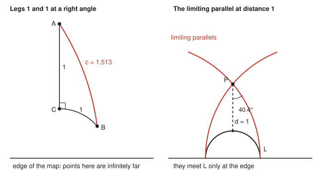

# Hyperbolic trigonometry: Pythagoras becomes cosh c = cosh a cosh b, and every distance has an angle of parallelism

[Syllabus](../../../SYLLABUS.md) → [Geometry and trig](../README.md) → [Beyond Euclid](../README.md#s06) → Hyperbolic trigonometry

---

## General Overview

Draw a right triangle with both short sides 1 unit long. On flat paper the long side is √2 = 1.414214 and the other corners are 45°. In the hyperbolic plane, where a triangle's angles add to less than 180° ([Three geometries](02-spherical-and-hyperbolic-geometry.md)), the long side is 1.513374 and the corners 32.95°.

In special relativity, each speed stands for a length in this plane: 0.761594 of light speed stands for length 1. A ship at that speed fires a probe sideways at the same speed, measured on board. Flat Pythagoras says 1.077057 times light speed, which is impossible. The hyperbolic triangle says 0.907536, exactly what Einstein's rule for adding speeds gives.

Parallels change too. Swing a line about a point 1 unit from a given line. On flat ground it meets the given line at every tilt from the perpendicular below 90°. Here it stops meeting it at 40.40°: the **angle of parallelism**.

**In the hyperbolic plane the sphere's laws of cosines and sines hold with cosh and sinh of the sides in place of cos and sin, and one sign flipped; Pythagoras becomes cosh c = cosh a cosh b, and a point at distance d from a line sees it only within the angle Π(d), where tan(Π/2) = e^(−d).**

**What kind of fact this is:** theorems, proved on this card in Why it works from the half-plane distance formula, proved on [Three maps of one hyperbolic plane](09-hyperbolic-plane-models.md); that relativity's speeds obey this geometry is a physical law, confirmed by experiment.

### The picture: the triangle and the parallel in the half-plane map

<p align="center"></p>

To scale, in the half-plane map. Left: C at (0, 1), A at (0, 2.718282), B at (0.761594, 0.648054). Right: P at (0, 1); L is a half-circle of radius 0.367879.

---

## The formula

Corners are capital letters; each side takes the small letter of the corner it faces. Lengths are in the plane's own unit, the one the half-plane distance formula uses.

Three functions of a number t do the work. The **hyperbolic sine** sinh comes from [Three geometries](02-spherical-and-hyperbolic-geometry.md), the **hyperbolic cosine** cosh from [Three maps of one hyperbolic plane](09-hyperbolic-plane-models.md); $`e`$ is 2.718282. New here is the **hyperbolic tangent** tanh:

```math
\sinh t = \frac{e^{t} - e^{-t}}{2}, \qquad \cosh t = \frac{e^{t} + e^{-t}}{2}, \qquad \tanh t = \frac{\sinh t}{\cosh t}, \qquad \cosh^2 t - \sinh^2 t = 1
```

**Read it aloud:** sinh and cosh are half the difference and half the sum of e to the t and e to the minus t; tanh is sinh over cosh; cosh squared minus sinh squared is one.

The law of cosines, with Pythagoras as its right-angle case:

```math
\cosh c = \cosh a\cosh b - \sinh a\sinh b\cos C, \qquad C = 90^\circ:\ \cosh c = \cosh a\cosh b
```

**Read it aloud:** the third side's cosh is the other two sides' coshes multiplied, minus their sinhs multiplied times the cosine of the angle between them.

The law of sines:

```math
\frac{\sin A}{\sinh a} = \frac{\sin B}{\sinh b} = \frac{\sin C}{\sinh c}
```

**Read it aloud:** each corner's sine over the sinh of the side facing it gives one shared number.

The angle of parallelism:

```math
\tan\frac{\Pi(d)}{2} = e^{-d}, \qquad \text{equivalently} \qquad \cos\Pi(d) = \tanh d
```

**Read it aloud:** the tangent of half the cut-off angle is e to the minus distance.

| Symbol | Plain meaning | In our example | Push it up and the answer… |
| --- | --- | --- | --- |
| $`a`$, $`b`$ | two sides: the right triangle's legs | 1 and 1 | the third side grows |
| $`C`$ | the angle between them | 90° (also 60°) | the third side grows |
| $`c`$ | the third side | 1.513374 (1.116327 at 60°) | — |
| $`A`$, $`B`$ | the other two corners | 32.95° each (48.30° at 60°) | — |
| $`e`$; $`\cosh t`$, $`\sinh t`$, $`\tanh t`$ | 2.718282; hyperbolic cosine, sine, tangent of a number $`t`$ | cosh 1 = 1.543081, sinh 1 = 1.175201, tanh 1 = 0.761594 | all grow; tanh stays below 1 |
| $`d`$; $`\theta`$; P, L | a point's distance from a line; a line's tilt from the perpendicular; P, 1 unit above line L | 1; meets below 40.40° | $`d`$: the angle of parallelism shrinks |
| $`\Pi(d)`$ | the angle of parallelism: the cut-off tilt | 40.40° | — |
| $`x`$, $`y`$; $`k`$ | a point's place in the half-plane map ($`x_1, y_1`$ and $`x_2, y_2`$ for two), $`y`$ its height; $`k`$ an arc's centre on the edge | B at (0.761594, 0.648054) | — |

### When it holds

- **Sides are the plane's straight lines.** In the half-plane map these are vertical lines and half-circles centred on the edge. A drawn straight chord is not one.
- **Lengths in the plane's own unit.** A plane that bends more gently has a larger natural unit; sides in any other unit give wrong answers.
- **The minus sign.** The sphere's law has a plus ([Triangles on a sphere](01-triangles-on-a-sphere.md)). Used here at 60°, it gives 1.787744 instead of 1.116327.
- **Corners inside the plane.** A corner on the map's edge is infinitely far away; the laws fail there, and the angle of parallelism takes over.
- **Distinct corners and a point off the line.** The law of sines needs $`a, b, c > 0`$ (no $`\sinh 0`$), and the angle of parallelism needs $`d > 0`$.

---

## Why it works

### Step 0: one good placement proves every case

The half-plane map gives distance as a formula in coordinates ([Three maps of one hyperbolic plane](09-hyperbolic-plane-models.md)). For points $`(x_1, y_1)`$ and $`(x_2, y_2)`$ with $`y`$ above 0:

```math
\cosh(\text{distance}) = 1 + \frac{(x_1 - x_2)^2 + (y_1 - y_2)^2}{2\,y_1 y_2}
```

Maps that keep distances can move any point anywhere and turn it. So put C at (0, 1) with side b straight up, and one computation covers every triangle. The map keeps angles, so drawn angles are true angles.

### Step 1: place two corners

Put A at $`(0, e^{b})`$. The formula gives $`\cosh = 1 + (e^b - 1)^2/(2e^b) = (e^b + e^{-b})/2`$, so CA really has length b. For b = 1, A sits at height 2.718282.

Put B at $`(x, y)`$, at distance a from C. The formula, cleared of fractions, says:

```math
x^2 + y^2 + 1 = 2y\cosh a
```

### Step 2: measure the third side

The distance from B to A, using that equation, simplifies to:

```math
\cosh c = \frac{x^2 + y^2 + e^{2b}}{2y\,e^{b}} = \cosh a\, e^{-b} + \frac{\sinh b}{y}
```

### Step 3: the angle at C fixes the height

Side CB is an arc of a circle centred on the edge. Its direction at C, compared with straight up toward A, gives:

```math
\frac{1}{y} = \cosh a - \sinh a\cos C
```

For the right triangle, $`y = 1/\cosh 1`$ = 0.648054, the height the code measures for B.

<details>
<summary>Detailed proof: the height of B from the angle at C</summary>

Put B at $`x > 0`$ ($`0^\circ < C < 180^\circ`$); at $`x = 0`$, $`y = e^{\pm a}`$ directly. The arc through C and B is centred at (k, 0). Equal radii give $`k^2 + 1 = (x - k)^2 + y^2`$, so with Step 1:

$`\displaystyle k = \frac{x^2 + y^2 - 1}{2x} = \frac{y\cosh a - 1}{x}.`$

The arc leaves C along (1, k), square to the radius (−k, 1). Against straight up, cos C is $`k/\sqrt{1 + k^2}`$. By Step 1, $`x^2(1 + k^2) = x^2 + (y\cosh a - 1)^2 = y^2(\cosh^2 a - 1) = y^2\sinh^2 a`$. So:

$`\displaystyle \cos C = \frac{y\cosh a - 1}{y\sinh a}, \qquad \frac{1}{y} = \cosh a - \sinh a\cos C.`$

</details>

### Step 4: the law of cosines

Put Step 3 into Step 2:

```math
\cosh c = \cosh a\,(e^{-b} + \sinh b) - \sinh a\sinh b\cos C = \cosh a\cosh b - \sinh a\sinh b\cos C
```

The last move uses $`e^{-b} + \sinh b = \cosh b`$. At C = 90°, cos C = 0 and Pythagoras is left: cosh c = 1.543081 × 1.543081 = 2.381098.

### Step 5: the law of sines

Solve the law of cosines for cos C, then compute $`\sin^2 C = 1 - \cos^2 C`$. Divided by $`\sinh^2 c`$, the result treats a, b and c alike, so every corner gives the same ratio: 0.462763 here.

<details>
<summary>Detailed proof: the ratio is the same at every corner</summary>

From the law of cosines, $`\cos C = (\cosh a\cosh b - \cosh c)/(\sinh a\sinh b)`$. So:

$`\displaystyle \sin^2 C = \frac{\sinh^2 a\,\sinh^2 b - (\cosh a\cosh b - \cosh c)^2}{\sinh^2 a\,\sinh^2 b}.`$

Write each $`\sinh^2`$ as $`\cosh^2 - 1`$ and expand. The top becomes

$`\displaystyle 1 - \cosh^2 a - \cosh^2 b - \cosh^2 c + 2\cosh a\cosh b\cosh c,`$

the same for any order of a, b, c. So $`\sin^2 C/\sinh^2 c`$ is that top over $`\sinh^2 a\,\sinh^2 b\,\sinh^2 c`$, the same at every corner. All sines and sinhs are positive, so the ratios match too.

</details>

### Step 6: the angle of parallelism

Put P at (0, 1) and let L be the half-circle of radius $`e^{-d}`$ centred at 0. The vertical through P meets L square at height $`e^{-d}`$, distance d below P.

A line through P tilted θ from straight down is an arc centred at $`k = -\cot\theta`$ (cot is cos over sin) with radius $`1/\sin\theta`$. Its right foot on the edge is at $`(1 - \cos\theta)/\sin\theta = \tan(\theta/2)`$. Its left foot lies left of L, so, as half-circles on the edge cross exactly when their feet alternate, it crosses L exactly when its right foot lands inside L.

The cut-off is $`\tan(\Pi/2) = e^{-d}`$. At d = 1 this is 2 × atan(0.367879) = 40.3951° (atan: the angle with that tangent).

A second road: a right triangle with leg 1 from P to L and a second leg along L. As that leg grows to 1, 2, 5, 10, the angle at P climbs to the cut-off: 32.95°, 39.36°, 40.39°, 40.40°.

### Step 7: small triangles look flat

For small t, $`\cosh t \approx 1 + t^2/2`$ and $`\sinh t \approx t`$, and both laws turn into the flat ones. Legs of 0.01 give 0.01414225 against the flat 0.01414214. As d shrinks, Π(d) climbs to 90°.

---

## Worked numbers, by hand

| Step | Arithmetic | Value |
| --- | --- | --- |
| cosh 1 | (2.718282 + 0.367879)/2 | 1.543081 |
| Pythagoras | 1.543081 × 1.543081 | cosh c = 2.381098 |
| third side | c = ln(e^c) = ln(cosh c + sinh c) = ln(2.381098 + 2.160932) | **c = 1.513374** |
| a corner | sin A = sinh 1 / sinh c = 1.175201 / 2.160932 | A = 32.95° |
| angle sum | 90 + 32.945 + 32.945 (unrounded) | 155.89°, short of 180° by 24.11° |
| at 60° | cosh 1 × cosh 1 − sinh 1 × sinh 1 × cos 60° | cosh c = 1.690549, c = 1.116327 |
| angle of parallelism | 2 × atan(e^(−1)) = 2 × atan(0.367879) | **Π(1) = 40.3951°** |
| two speeds of tanh 1 = 0.761594, at right angles | tanh c | 0.907536 of light speed |

The long side beats the flat 1.414214, and from 1 unit away the line fills only 40.40° each side of the perpendicular.

### What breaks if you drop a piece

| Mistake | Comes out at | What went wrong |
| --- | --- | --- |
| Flat Pythagoras on the legs | 1.414214 | Hyperbolic lines spread apart: 1.513374 |
| Flat corners | 45.00° | The angles fall short: 32.95° |
| Speeds added by flat Pythagoras | 1.077057 of light speed | Faster than light; truth 0.907536 |
| The sphere's plus sign, at 60° | 1.787744 | Truth 1.116327 |

---

## Code, from first principles, and it actually runs

The code takes independent roads to each answer.

- **Sides and corners:** the laws, against the triangle built in the half-plane by turning the map about C, then measured with the distance formula and the arcs' directions.
- **Relativity:** the triangle against Einstein's rule for adding square-on speeds, which uses no geometry.
- **The angle of parallelism:** the formula; a bisection that swings a line about P until it just misses L; and right triangles with a growing leg.

### Python

```python
# Hyperbolic trigonometry -- the check behind the card.  Standard library only.
# Triangles with legs 1 and 1, at 90 and at 60 degrees, and the angle of parallelism at
# distance 1: each solved by the laws, then built in the half-plane map and measured there.
from math import sinh, cosh, tanh, acosh, asin, acos, atan, atan2, exp, sqrt, sin, cos, degrees, radians
def dist(p, q):                         # half-plane distance between points (x, y)
    return acosh(1 + ((p[0] - q[0])**2 + (p[1] - q[1])**2) / (2 * p[1] * q[1]))
def turn(z, t):                         # turn the whole half-plane by angle t about the point i
    return (cos(t / 2) * z + sin(t / 2)) / (-sin(t / 2) * z + cos(t / 2))
def tangent(p, q):                      # direction leaving p along the line to q
    if abs(p[0] - q[0]) < 1e-12: return (0.0, q[1] - p[1])
    m = (q[0]**2 + q[1]**2 - p[0]**2 - p[1]**2) / (2 * (q[0] - p[0]))   # the arc's centre
    t = (-p[1], p[0] - m)
    return t if t[0] * (q[0] - p[0]) > 0 else (-t[0], -t[1])
def corner(p, q, r):                    # the drawn angle, which is the true angle
    u, v = tangent(p, q), tangent(p, r)
    return atan2(abs(u[0] * v[1] - u[1] * v[0]), u[0] * v[0] + u[1] * v[1])
def solve(a, b, C):                     # road one: the law of cosines, then solved for corners
    c = acosh(cosh(a) * cosh(b) - sinh(a) * sinh(b) * cos(C))
    A = acos((cosh(b) * cosh(c) - cosh(a)) / (sinh(b) * sinh(c)))
    return c, A, acos((cosh(a) * cosh(c) - cosh(b)) / (sinh(a) * sinh(c)))
def build(a, b, C):                     # road two: C at i, A straight up, B turned by C
    z = turn(1j * exp(a), -C)
    return (0.0, exp(b)), (z.real, z.imag), (0.0, 1.0)
f, deg = lambda x: f"{x:.6f}", lambda x: f"{degrees(x):.2f}"
for Cd in (90, 60):
    C = radians(Cd); c, A, B = solve(1, 1, C); PA, PB, PC = build(1, 1, C)
    side, ang = [dist(PA, PB), dist(PB, PC), dist(PC, PA)], [corner(PA, PB, PC), corner(PB, PC, PA), corner(PC, PA, PB)]
    print(f"legs 1, 1 at {Cd} deg: cosh c = {f(cosh(c))}, c = {f(c)}; flat {f(sqrt(2 - 2 * cos(C)))}")
    print(f"  built: A (0, {exp(1):.6f}), B ({PB[0]:.6f}, {PB[1]:.6f}), C (0, 1); measured sides {', '.join(map(f, side))}")
    print(f"  corners A, B, C by the laws {deg(A)}, {deg(B)}, {deg(C)}; measured {', '.join(map(deg, ang))}; sum {deg(A + B + C)}")
    sines = [sin(A) / sinh(1), sin(B) / sinh(1), sin(C) / sinh(c)]
    assert max(abs(x - y) for x, y in zip(side + ang, [c, 1, 1, A, B, C])) < 1e-9          # two roads agree
    assert max(sines) - min(sines) < 1e-12 and abs(sin(A) - sinh(1) / sinh(c) * sin(C)) < 1e-12  # sine law
    if Cd == 90: c90, A90, s90 = c, A, sines[0]
print(f"right triangle: sinh 1 = {f(sinh(1))}, sinh c = {f(sinh(c90))}, sine law ratio {f(s90)}; shortfall {deg(radians(90) - 2 * A90)} deg = {f(radians(90) - 2 * A90)} rad")
u = tanh(1)                             # rapidity 1: a speed, as a fraction of light's
einstein = sqrt(u * u + u * u * (1 - u * u))   # perpendicular velocity addition, no geometry
print(f"two boosts of rapidity 1 at right angles: speed {f(u)} c each, gamma {f(cosh(1))}; combined gamma {f(cosh(c90))}, speed {f(tanh(c90))} c; Einstein's rule {f(einstein)} c")
assert abs(einstein - tanh(c90)) < 1e-12
Pi = 2 * atan(exp(-1))                  # angle of parallelism at distance 1
lo, hi = 0.0, 1.5                       # road two: swing a line about i until it just misses L
for _ in range(60):
    mid = (lo + hi) / 2
    if turn(0j, mid).real < exp(-1): lo = mid    # its foot still lands inside L: it meets L
    else: hi = mid
far = [deg(solve(x, 1, radians(90))[1]) for x in (1, 2, 5, 10)]
print(f"angle of parallelism at d = 1: e^-1 = {f(exp(-1))}, 2 atan(e^-1) = {degrees(Pi):.4f} deg; cos = {f(cos(Pi))} = tanh 1; swung line {degrees(lo):.4f} deg")
print(f"right triangles, legs 1 and x, angle at P for x = 1, 2, 5, 10: {', '.join(far)} deg")
assert abs(lo - Pi) < 1e-12 and abs(cos(Pi) - tanh(1)) < 1e-12 and abs(solve(10, 1, radians(90))[1] - Pi) < 1e-6
cs = solve(0.01, 0.01, radians(90))[0]
print(f"small: legs 0.01 give c = {cs:.8f}, flat {sqrt(2) * 0.01:.8f}, ratio {cs / (sqrt(2) * 0.01):.7f}")
assert abs(cs / (sqrt(2) * 0.01) - 1) < 1e-4 and c90 > sqrt(2)
plus = acosh(cosh(1)**2 + sinh(1)**2 * cos(radians(60)))
print(f"mistakes: flat Pythagoras {f(sqrt(2))}; flat corners 45.00 deg; speeds by flat Pythagoras {f(sqrt(2) * u)} c; sphere's plus sign at 60 deg {f(plus)}")
X = lambda x: 120 + 100 * x; Y = lambda y: 320 - 100 * y
m = (1 - exp(2)) / (2 * build(1, 1, radians(90))[1][0])
B9 = build(1, 1, radians(90))[1]
print(f"figure, left 100 = 1: A {X(0):.1f},{Y(exp(1)):.1f} B {X(B9[0]):.1f},{Y(B9[1]):.1f} C {X(0):.1f},{Y(1):.1f} arc AB centre {X(m):.1f} radius {100 * sqrt(m * m + exp(2)):.1f}")
print(f"figure, right 150 = 1 from 470,320: P 470.0,170.0 L radius {150 * exp(-1):.1f} parallel centre {470 - 150 * sinh(1):.1f} radius {150 * cosh(1):.1f}")
print("ALL CHECKS PASS")
```

**Ran 2026-11-23 on macOS, Python 3.14.10, standard library only. All checks passed. Output, pasted from the run:**

```
legs 1, 1 at 90 deg: cosh c = 2.381098, c = 1.513374; flat 1.414214
  built: A (0, 2.718282), B (0.761594, 0.648054), C (0, 1); measured sides 1.513374, 1.000000, 1.000000
  corners A, B, C by the laws 32.95, 32.95, 90.00; measured 32.95, 32.95, 90.00; sum 155.89
legs 1, 1 at 60 deg: cosh c = 1.690549, c = 1.116327; flat 1.000000
  built: A (0, 2.718282), B (1.065176, 1.046594), C (0, 1); measured sides 1.116327, 1.000000, 1.000000
  corners A, B, C by the laws 48.30, 48.30, 60.00; measured 48.30, 48.30, 60.00; sum 156.60
right triangle: sinh 1 = 1.175201, sinh c = 2.160932, sine law ratio 0.462763; shortfall 24.11 deg = 0.420784 rad
two boosts of rapidity 1 at right angles: speed 0.761594 c each, gamma 1.543081; combined gamma 2.381098, speed 0.907536 c; Einstein's rule 0.907536 c
angle of parallelism at d = 1: e^-1 = 0.367879, 2 atan(e^-1) = 40.3951 deg; cos = 0.761594 = tanh 1; swung line 40.3951 deg
right triangles, legs 1 and x, angle at P for x = 1, 2, 5, 10: 32.95, 39.36, 40.39, 40.40 deg
small: legs 0.01 give c = 0.01414225, flat 0.01414214, ratio 1.0000083
mistakes: flat Pythagoras 1.414214; flat corners 45.00 deg; speeds by flat Pythagoras 1.077057 c; sphere's plus sign at 60 deg 1.787744
figure, left 100 = 1: A 120.0,48.2 B 196.2,255.2 C 120.0,220.0 arc AB centre -299.5 radius 499.8
figure, right 150 = 1 from 470,320: P 470.0,170.0 L radius 55.2 parallel centre 293.7 radius 231.5
ALL CHECKS PASS
```

### Rust

```rust
// Hyperbolic trigonometry -- the same check as the Python, in Rust.  No crates.
// Triangles with legs 1 and 1, at 90 and at 60 degrees, and the angle of parallelism at
// distance 1: each solved by the laws, then built in the half-plane map and measured there.
type P = (f64, f64);
fn dist(p: P, q: P) -> f64 { (1.0 + ((p.0 - q.0).powi(2) + (p.1 - q.1).powi(2)) / (2.0 * p.1 * q.1)).acosh() } // half-plane distance
fn turn(z: P, t: f64) -> P {            // turn the whole half-plane by angle t about the point i
    let (c, s) = ((t / 2.0).cos(), (t / 2.0).sin());
    let (n, d) = ((c * z.0 + s, c * z.1), (c - s * z.0, -s * z.1));  // a fraction of two complex numbers
    let dd = d.0 * d.0 + d.1 * d.1;
    ((n.0 * d.0 + n.1 * d.1) / dd, (n.1 * d.0 - n.0 * d.1) / dd)
}
fn tangent(p: P, q: P) -> P {           // direction leaving p along the line to q
    if (p.0 - q.0).abs() < 1e-12 { return (0.0, q.1 - p.1); }
    let m = (q.0 * q.0 + q.1 * q.1 - p.0 * p.0 - p.1 * p.1) / (2.0 * (q.0 - p.0)); // the arc's centre
    let t = (-p.1, p.0 - m);
    if t.0 * (q.0 - p.0) > 0.0 { t } else { (-t.0, -t.1) }
}
fn corner(p: P, q: P, r: P) -> f64 {    // the drawn angle, which is the true angle
    let (u, v) = (tangent(p, q), tangent(p, r));
    (u.0 * v.1 - u.1 * v.0).abs().atan2(u.0 * v.0 + u.1 * v.1)
}
fn solve(a: f64, b: f64, cc: f64) -> (f64, f64, f64) {  // road one: the law of cosines
    let c = (a.cosh() * b.cosh() - a.sinh() * b.sinh() * cc.cos()).acosh();
    let aa = ((b.cosh() * c.cosh() - a.cosh()) / (b.sinh() * c.sinh())).acos();
    (c, aa, ((a.cosh() * c.cosh() - b.cosh()) / (a.sinh() * c.sinh())).acos())
}
fn build(a: f64, b: f64, cc: f64) -> (P, P, P) {        // road two: C at i, A up, B turned by C
    ((0.0, b.exp()), turn((0.0, a.exp()), -cc), (0.0, 1.0))
}
fn f(x: f64) -> String { format!("{:.6}", x) }
fn deg(x: f64) -> String { format!("{:.2}", x.to_degrees()) }
fn join(v: &[f64], g: fn(f64) -> String) -> String { v.iter().map(|&x| g(x)).collect::<Vec<_>>().join(", ") }
fn main() {
    let (mut c90, mut a90, mut s90) = (0.0, 0.0, 0.0);
    for cd in [90.0f64, 60.0] {
        let cc = cd.to_radians();
        let ((c, a, b), (pa, pb, pc)) = (solve(1.0, 1.0, cc), build(1.0, 1.0, cc));
        let side = [dist(pa, pb), dist(pb, pc), dist(pc, pa)];
        let ang = [corner(pa, pb, pc), corner(pb, pc, pa), corner(pc, pa, pb)];
        println!("legs 1, 1 at {} deg: cosh c = {}, c = {}; flat {}", cd, f(c.cosh()), f(c), f((2.0 - 2.0 * cc.cos()).sqrt()));
        println!("  built: A (0, {:.6}), B ({:.6}, {:.6}), C (0, 1); measured sides {}", 1f64.exp(), pb.0, pb.1, join(&side, f));
        println!("  corners A, B, C by the laws {}, {}, {}; measured {}; sum {}", deg(a), deg(b), deg(cc), join(&ang, deg), deg(a + b + cc));
        let (sines, want) = ([a.sin() / 1f64.sinh(), b.sin() / 1f64.sinh(), cc.sin() / c.sinh()], [c, 1.0, 1.0, a, b, cc]);
        assert!((0..3).all(|i| (side[i] - want[i]).abs() < 1e-9 && (ang[i] - want[3 + i]).abs() < 1e-9));
        let (hi, lo) = sines.iter().fold((f64::MIN, f64::MAX), |(h, l), &x| (h.max(x), l.min(x)));
        assert!(hi - lo < 1e-12 && (a.sin() - 1f64.sinh() / c.sinh() * cc.sin()).abs() < 1e-12);
        if cd == 90.0 { c90 = c; a90 = a; s90 = sines[0]; }
    }
    let short = 90f64.to_radians() - 2.0 * a90;
    println!("right triangle: sinh 1 = {}, sinh c = {}, sine law ratio {}; shortfall {} deg = {} rad", f(1f64.sinh()), f(c90.sinh()), f(s90), deg(short), f(short));
    let u = 1f64.tanh();                // rapidity 1: a speed, as a fraction of light's
    let einstein = (u * u + u * u * (1.0 - u * u)).sqrt();  // perpendicular velocity addition
    println!("two boosts of rapidity 1 at right angles: speed {} c each, gamma {}; combined gamma {}, speed {} c; Einstein's rule {} c",
             f(u), f(1f64.cosh()), f(c90.cosh()), f(c90.tanh()), f(einstein));
    assert!((einstein - c90.tanh()).abs() < 1e-12);
    let pi_d = 2.0 * (-1f64).exp().atan();     // angle of parallelism at distance 1
    let (mut lo, mut hi) = (0.0f64, 1.5f64);   // road two: swing a line about i until it misses L
    for _ in 0..60 {
        let mid = (lo + hi) / 2.0;
        if turn((0.0, 0.0), mid).0 < (-1f64).exp() { lo = mid } else { hi = mid }
    }
    let far: Vec<f64> = [1.0, 2.0, 5.0, 10.0].iter().map(|&x| solve(x, 1.0, 90f64.to_radians()).1).collect();
    println!("angle of parallelism at d = 1: e^-1 = {}, 2 atan(e^-1) = {:.4} deg; cos = {} = tanh 1; swung line {:.4} deg", f((-1f64).exp()), pi_d.to_degrees(), f(pi_d.cos()), lo.to_degrees());
    println!("right triangles, legs 1 and x, angle at P for x = 1, 2, 5, 10: {} deg", join(&far, deg));
    assert!((lo - pi_d).abs() < 1e-12 && (pi_d.cos() - 1f64.tanh()).abs() < 1e-12 && (far[3] - pi_d).abs() < 1e-6);
    let (cs, fl) = (solve(0.01, 0.01, 90f64.to_radians()).0, 2f64.sqrt() * 0.01);
    println!("small: legs 0.01 give c = {:.8}, flat {:.8}, ratio {:.7}", cs, fl, cs / fl);
    assert!((cs / fl - 1.0).abs() < 1e-4 && c90 > 2f64.sqrt());
    let plus = (1f64.cosh().powi(2) + 1f64.sinh().powi(2) * 60f64.to_radians().cos()).acosh();
    println!("mistakes: flat Pythagoras {}; flat corners 45.00 deg; speeds by flat Pythagoras {} c; sphere's plus sign at 60 deg {}", f(2f64.sqrt()), f(2f64.sqrt() * u), f(plus));
    let (x, y) = (|v: f64| 120.0 + 100.0 * v, |v: f64| 320.0 - 100.0 * v);
    let b9 = build(1.0, 1.0, 90f64.to_radians()).1;
    let m = (1.0 - 2f64.exp()) / (2.0 * b9.0);                  // centre of the arc through A and B
    println!("figure, left 100 = 1: A {:.1},{:.1} B {:.1},{:.1} C {:.1},{:.1} arc AB centre {:.1} radius {:.1}",
             x(0.0), y(1f64.exp()), x(b9.0), y(b9.1), x(0.0), y(1.0), x(m), 100.0 * (m * m + 2f64.exp()).sqrt());
    println!("figure, right 150 = 1 from 470,320: P 470.0,170.0 L radius {:.1} parallel centre {:.1} radius {:.1}",
             150.0 * (-1f64).exp(), 470.0 - 150.0 * 1f64.sinh(), 150.0 * 1f64.cosh());
    println!("ALL CHECKS PASS");
}
```

**Ran 2026-11-23 on macOS, rustc 1.98.1, no crates. All checks passed. Output, pasted from the run:**

```
legs 1, 1 at 90 deg: cosh c = 2.381098, c = 1.513374; flat 1.414214
  built: A (0, 2.718282), B (0.761594, 0.648054), C (0, 1); measured sides 1.513374, 1.000000, 1.000000
  corners A, B, C by the laws 32.95, 32.95, 90.00; measured 32.95, 32.95, 90.00; sum 155.89
legs 1, 1 at 60 deg: cosh c = 1.690549, c = 1.116327; flat 1.000000
  built: A (0, 2.718282), B (1.065176, 1.046594), C (0, 1); measured sides 1.116327, 1.000000, 1.000000
  corners A, B, C by the laws 48.30, 48.30, 60.00; measured 48.30, 48.30, 60.00; sum 156.60
right triangle: sinh 1 = 1.175201, sinh c = 2.160932, sine law ratio 0.462763; shortfall 24.11 deg = 0.420784 rad
two boosts of rapidity 1 at right angles: speed 0.761594 c each, gamma 1.543081; combined gamma 2.381098, speed 0.907536 c; Einstein's rule 0.907536 c
angle of parallelism at d = 1: e^-1 = 0.367879, 2 atan(e^-1) = 40.3951 deg; cos = 0.761594 = tanh 1; swung line 40.3951 deg
right triangles, legs 1 and x, angle at P for x = 1, 2, 5, 10: 32.95, 39.36, 40.39, 40.40 deg
small: legs 0.01 give c = 0.01414225, flat 0.01414214, ratio 1.0000083
mistakes: flat Pythagoras 1.414214; flat corners 45.00 deg; speeds by flat Pythagoras 1.077057 c; sphere's plus sign at 60 deg 1.787744
figure, left 100 = 1: A 120.0,48.2 B 196.2,255.2 C 120.0,220.0 arc AB centre -299.5 radius 499.8
figure, right 150 = 1 from 470,320: P 470.0,170.0 L radius 55.2 parallel centre 293.7 radius 231.5
ALL CHECKS PASS
```

### Lean

Lean proves both laws for every triangle in the half-plane map, and the cut-off for every distance d above 0.

- Take any three corners A, B and C in the half-plane map. Then cosh c = cosh a cosh b − sinh a sinh b cos C.
- Suppose C = 90°. Then cos C = 0, and the law of cosines becomes Pythagoras, cosh c = cosh a cosh b.
- Take three different corners. Then sin A / sinh a = sin B / sinh b = sin C / sinh c.
- Take d above 0, with P at (0, 1) and L as in Step 6. Then the vertical from P meets L at distance d.
- Take a tilt θ above 0° and at most 90°. Then the line through P tilted θ from straight down meets L exactly when θ < Π(d).
- The cut-off also obeys cos Π(d) = tanh d.

Decimals, relativity speeds, the swung line, growing right triangles and small triangles looking flat are left to the Python and Rust checks.

```lean
-- Hyperbolic trigonometry: in the half-plane model every triangle obeys the hyperbolic laws of cosines and sines, and a line through a point at distance d from a line meets it exactly when its tilt is below the angle of parallelism Π(d), where tan(Π/2) = e^(−d).
import Mathlib.Analysis.Complex.UpperHalfPlane.Metric
import Mathlib.Geometry.Euclidean.Angle.Unoriented.Basic
import Mathlib.Analysis.SpecialFunctions.Trigonometric.Arctan

open UpperHalfPlane Real

/-- The direction in which the hyperbolic straight line from `w` to `z` leaves `w`, drawn in
the half-plane map as a vector in ℂ. The line is a vertical line or a half-circle centred on
the edge; this vector is square to the radius at `w` and points along the arc toward `z`
(for `w = i` it is `(2x, x² + y² − 1)`, the card's `(1, k)` scaled by `2x`). It is `0` only
when `z = w`. -/
def tangentAt (w z : ℍ) : ℂ :=
  ⟨2 * w.im * (z.re - w.re), (z.re - w.re) ^ 2 + z.im ^ 2 - w.im ^ 2⟩

/-- The angle at corner `C` between the hyperbolic straight lines to `A` and to `B`. The
half-plane map keeps angles, so it is the flat angle between the two drawn directions. -/
noncomputable def cornerAngle (C A B : ℍ) : ℝ :=
  InnerProductGeometry.angle (tangentAt C A) (tangentAt C B)


lemma cosh_dist_eq_aux (z w : ℍ) :
    cosh (dist z w) = ((z.re - w.re) ^ 2 + z.im ^ 2 + w.im ^ 2) / (2 * z.im * w.im) := by
  rw [cosh_dist, Complex.dist_eq_re_im, Real.sq_sqrt (by positivity)]
  have hz := z.im_pos
  have hw := w.im_pos
  simp only [coe_re, coe_im]
  field_simp
  ring

lemma norm_tangentAt_aux (w z : ℍ) :
    ‖tangentAt w z‖ = 2 * w.im * z.im * sinh (dist w z) := by
  have hz := z.im_pos
  have hw := w.im_pos
  have hs : 0 ≤ sinh (dist w z) := Real.sinh_nonneg_iff.mpr dist_nonneg
  have h1 : 0 ≤ 2 * w.im * z.im * sinh (dist w z) := by positivity
  rw [Complex.norm_def, Real.sqrt_eq_iff_eq_sq (Complex.normSq_nonneg _) h1, mul_pow,
    Real.sinh_sq, cosh_dist_eq_aux, Complex.normSq_apply]
  simp only [tangentAt]
  field_simp
  ring

lemma law_of_sines_aux (x a b c : ℝ) (ha : 0 < a) (hb : 0 < b) (hc : 0 < c) (hx : 0 ≤ sin x)
    (h : cosh c = cosh a * cosh b - sinh a * sinh b * cos x) :
    sin x / sinh c = √(1 - cosh a ^ 2 - cosh b ^ 2 - cosh c ^ 2 + 2 * cosh a * cosh b * cosh c)
      / (sinh a * sinh b * sinh c) := by
  have sa := Real.sinh_pos_iff.mpr ha
  have sb := Real.sinh_pos_iff.mpr hb
  have sc := Real.sinh_pos_iff.mpr hc
  have key : 1 - cosh a ^ 2 - cosh b ^ 2 - cosh c ^ 2 + 2 * cosh a * cosh b * cosh c
      = (sinh a * sinh b * sin x) ^ 2 := by
    rw [h]
    have e1 := Real.cosh_sq a
    have e2 := Real.cosh_sq b
    have e3 := Real.sin_sq_add_cos_sq x
    linear_combination (cosh b ^ 2 - 1) * e1 + sinh a ^ 2 * e2 - sinh a ^ 2 * sinh b ^ 2 * e3
  rw [key, Real.sqrt_sq (by positivity)]
  field_simp

#print axioms cosh_dist_eq_aux
#print axioms norm_tangentAt_aux
#print axioms law_of_sines_aux

/-- The hyperbolic law of cosines: for any three corners A, B, C of the hyperbolic plane
(the upper half-plane with its own distance), with sides a = BC, b = CA, c = AB and angle C
at corner C, cosh c = cosh a cosh b − sinh a sinh b cos C. At C = 90° this is the hyperbolic
Pythagoras, cosh c = cosh a cosh b. -/
theorem hyperbolic_law_of_cosines (A B C : ℍ) :
    cosh (dist A B) =
      cosh (dist B C) * cosh (dist C A)
        - sinh (dist B C) * sinh (dist C A) * cos (cornerAngle C B A) := by
  have hA := A.im_pos
  have hB := B.im_pos
  have hC := C.im_pos
  have hI : sinh (dist B C) * sinh (dist C A) * cos (cornerAngle C B A)
      = inner ℝ (tangentAt C B) (tangentAt C A) / (4 * C.im ^ 2 * B.im * A.im) := by
    unfold cornerAngle
    rw [InnerProductGeometry.cos_angle]
    rcases eq_or_ne (sinh (dist B C)) 0 with h | h
    · have : tangentAt C B = 0 := by
        rw [← norm_eq_zero, norm_tangentAt_aux, dist_comm, h]; ring
      simp [this, h]
    rcases eq_or_ne (sinh (dist C A)) 0 with h' | h'
    · have : tangentAt C A = 0 := by
        rw [← norm_eq_zero, norm_tangentAt_aux, h']; ring
      simp [this, h']
    rw [norm_tangentAt_aux, norm_tangentAt_aux, dist_comm C B]
    field_simp
    ring
  rw [hI, Complex.inner, cosh_dist_eq_aux, cosh_dist_eq_aux, cosh_dist_eq_aux]
  simp only [tangentAt, Complex.mul_re, Complex.conj_re, Complex.conj_im]
  field_simp
  ring

/-- The hyperbolic law of sines: in a triangle with three different corners A, B, C,
sin A / sinh a = sin B / sinh b = sin C / sinh c, where each side is the one facing the
corner of the same letter. -/
theorem hyperbolic_law_of_sines (A B C : ℍ) (hAB : A ≠ B) (hBC : B ≠ C) (hCA : C ≠ A) :
    sin (cornerAngle A B C) / sinh (dist B C) = sin (cornerAngle B C A) / sinh (dist C A) ∧
      sin (cornerAngle B C A) / sinh (dist C A) = sin (cornerAngle C A B) / sinh (dist A B) := by
  have ha : 0 < dist B C := dist_pos.mpr hBC
  have hb : 0 < dist C A := dist_pos.mpr hCA
  have hc : 0 < dist A B := dist_pos.mpr hAB
  have sinA : 0 ≤ sin (cornerAngle A B C) := Real.sin_nonneg_of_nonneg_of_le_pi
    (InnerProductGeometry.angle_nonneg _ _) (InnerProductGeometry.angle_le_pi _ _)
  have sinB : 0 ≤ sin (cornerAngle B C A) := Real.sin_nonneg_of_nonneg_of_le_pi
    (InnerProductGeometry.angle_nonneg _ _) (InnerProductGeometry.angle_le_pi _ _)
  have sinC : 0 ≤ sin (cornerAngle C A B) := Real.sin_nonneg_of_nonneg_of_le_pi
    (InnerProductGeometry.angle_nonneg _ _) (InnerProductGeometry.angle_le_pi _ _)
  have h1 := hyperbolic_law_of_cosines C B A
  have h2 := hyperbolic_law_of_cosines A C B
  have h3 := hyperbolic_law_of_cosines B A C
  simp only [dist_comm B A, dist_comm A C, dist_comm C B] at h1 h2 h3
  rw [law_of_sines_aux _ _ _ _ hc hb ha sinA h1, law_of_sines_aux _ _ _ _ ha hc hb sinB h2,
    law_of_sines_aux _ _ _ _ hb ha hc sinC h3]
  constructor <;> ring_nf

/-- The angle of parallelism. Put P at i and let L be the half-circle of radius e^(−d)
centred at 0, which the vertical through P meets square at distance d below P. The line
through P tilted θ from straight down (0 < θ ≤ 90°) is the half-circle centred at
−cos θ / sin θ with radius 1 / sin θ. It meets L exactly when θ < Π(d), where
tan(Π(d)/2) = e^(−d); equivalently cos Π(d) = tanh d. -/
theorem angle_of_parallelism (d θ : ℝ) (hd : 0 < d) (hθ : 0 < θ) (hθ' : θ ≤ π / 2) :
    dist UpperHalfPlane.I (⟨⟨0, exp (-d)⟩, exp_pos (-d)⟩ : ℍ) = d ∧
      ((∃ z : ℍ, ‖(z : ℂ)‖ = exp (-d) ∧ ‖(z : ℂ) + (cos θ / sin θ : ℝ)‖ = 1 / sin θ) ↔
        θ < 2 * arctan (exp (-d))) ∧
      cos (2 * arctan (exp (-d))) = tanh d := by
  set r := exp (-d) with hr_def
  have hr0 : 0 < r := exp_pos _
  have hr1 : r < 1 := Real.exp_lt_one_iff.mpr (by linarith)
  have hs : 0 < sin θ := Real.sin_pos_of_pos_of_lt_pi hθ (by linarith [Real.pi_pos])
  have hc : 0 ≤ cos θ := Real.cos_nonneg_of_neg_pi_div_two_le_of_le (by linarith) hθ'
  have hsc := Real.sin_sq_add_cos_sq θ
  have hsq : 0 < 1 + r ^ 2 := by positivity
  have hcosφ : cos (2 * arctan r) = (1 - r ^ 2) / (1 + r ^ 2) := by
    rw [Real.cos_two_mul, Real.cos_sq_arctan]
    field_simp
    ring
  have hsinφ : sin (2 * arctan r) = 2 * r / (1 + r ^ 2) := by
    rw [Real.sin_two_mul, Real.sin_arctan, Real.cos_arctan]
    have h1 : √(1 + r ^ 2) ^ 2 = 1 + r ^ 2 := Real.sq_sqrt hsq.le
    have h2 : 0 < √(1 + r ^ 2) := Real.sqrt_pos.mpr hsq
    field_simp
    exact h1.symm
  -- the angle condition in algebraic form
  have claimA : θ < 2 * arctan r ↔ (1 - r ^ 2) * sin θ < 2 * r * cos θ := by
    have hφ0 : 0 < arctan r := Real.arctan_pos.mpr hr0
    have hφ1 : arctan r < π / 2 := Real.arctan_lt_pi_div_two r
    have hsin : sin (θ - 2 * arctan r) = ((1 - r ^ 2) * sin θ - 2 * r * cos θ) / (1 + r ^ 2) := by
      rw [Real.sin_sub, hcosφ, hsinφ]
      field_simp
    constructor
    · intro h
      have : sin (θ - 2 * arctan r) < 0 :=
        Real.sin_neg_of_neg_of_neg_pi_lt (by linarith) (by linarith)
      rw [hsin, div_neg_iff] at this
      rcases this with ⟨_, h'⟩ | ⟨h', _⟩
      · linarith
      · linarith
    · intro h
      by_contra hn
      replace hn := not_lt.mp hn
      have : 0 ≤ sin (θ - 2 * arctan r) :=
        Real.sin_nonneg_of_nonneg_of_le_pi (by linarith) (by linarith)
      rw [hsin] at this
      have := div_nonneg_iff.mp this
      rcases this with ⟨h', _⟩ | ⟨_, h'⟩
      · linarith
      · linarith
  -- the intersection condition in algebraic form
  have claimB : (∃ z : ℍ, ‖(z : ℂ)‖ = r ∧ ‖(z : ℂ) + (cos θ / sin θ : ℝ)‖ = 1 / sin θ) ↔
      (1 - r ^ 2) * sin θ < 2 * r * cos θ := by
    constructor
    · rintro ⟨z, h1, h2⟩
      have hy := z.im_pos
      have e1 : (z : ℂ).re * (z : ℂ).re + (z : ℂ).im * (z : ℂ).im = r ^ 2 := by
        rw [← Complex.normSq_apply, ← Complex.sq_norm, h1]
      have e2 : ((z : ℂ).re + cos θ / sin θ) * ((z : ℂ).re + cos θ / sin θ)
          + (z : ℂ).im * (z : ℂ).im = (1 / sin θ) ^ 2 := by
        rw [← h2, Complex.sq_norm, Complex.normSq_apply]
        simp only [Complex.add_re, Complex.add_im, Complex.ofReal_re, Complex.ofReal_im, add_zero]
      simp only [coe_re, coe_im] at e1 e2
      set x := z.re
      set y := z.im
      set s := sin θ
      set c := cos θ
      have e2' : (x * s + c) ^ 2 + y ^ 2 * s ^ 2 = 1 := by
        field_simp at e2
        linear_combination e2
      have e3 : s * (2 * x * c - s * (1 - r ^ 2)) = 0 := by
        linear_combination e2' - s ^ 2 * e1 - hsc
      have e4 : 2 * x * c = s * (1 - r ^ 2) := by
        rcases mul_eq_zero.mp e3 with h | h
        · linarith
        · linarith
      have hpos : 0 < s * (1 - r ^ 2) := mul_pos hs (by nlinarith)
      have hc' : 0 < c := by
        rcases hc.lt_or_eq with h | h
        · exact h
        · rw [← h] at e4; linarith
      have hx : 0 < x := by nlinarith
      have hxr : x < r := by nlinarith
      nlinarith [mul_lt_mul_of_pos_left hxr hc']
    · intro h
      set s := sin θ
      set c := cos θ
      have hpos : 0 < s * (1 - r ^ 2) := mul_pos hs (by nlinarith)
      have hc' : 0 < c := by
        rcases hc.lt_or_eq with h' | h'
        · exact h'
        · rw [← h'] at h; nlinarith
      set x := s * (1 - r ^ 2) / (2 * c) with hx_def
      have hx : 0 < x := by positivity
      have hxr : x < r := by
        rw [hx_def, div_lt_iff₀ (by positivity)]
        linarith
      have hyy : 0 < r ^ 2 - x ^ 2 := by nlinarith
      set y := √(r ^ 2 - x ^ 2) with hy_def
      have hy : 0 < y := Real.sqrt_pos.mpr hyy
      have hyy' : y * y = r ^ 2 - x ^ 2 := Real.mul_self_sqrt hyy.le
      refine ⟨UpperHalfPlane.mk ⟨x, y⟩ hy, ?_, ?_⟩
      · rw [Complex.norm_def, Real.sqrt_eq_iff_eq_sq (Complex.normSq_nonneg _) hr0.le,
          Complex.normSq_apply]
        simp only []
        linear_combination hyy'
      · rw [Complex.norm_def, Real.sqrt_eq_iff_eq_sq (Complex.normSq_nonneg _) (by positivity),
          Complex.normSq_apply]
        simp only [ Complex.add_re, Complex.add_im, Complex.ofReal_re,
          Complex.ofReal_im, add_zero]
        rw [hyy', hx_def]
        field_simp
        linear_combination 4 * c ^ 2 * hsc
  refine ⟨?_, claimB.trans claimA.symm, ?_⟩
  · rw [dist_of_re_eq (by simp)]
    simp [Real.dist_eq]
    linarith
  · rw [hcosφ, Real.tanh_eq_sinh_div_cosh, Real.sinh_eq, Real.cosh_eq, hr_def, Real.exp_neg]
    have := exp_pos d
    field_simp

#print axioms hyperbolic_law_of_cosines
#print axioms hyperbolic_law_of_sines
#print axioms angle_of_parallelism
```

**Checked 2026-11-23 on macOS, Lean 4.36.0-rc2, Mathlib v4.36.0-rc2. Every proof is complete and uses only Lean's standard axioms. Output, pasted from the run:**

```
'cosh_dist_eq_aux' depends on axioms: [propext, Classical.choice, Quot.sound]
'norm_tangentAt_aux' depends on axioms: [propext, Classical.choice, Quot.sound]
'law_of_sines_aux' depends on axioms: [propext, Classical.choice, Quot.sound]
'hyperbolic_law_of_cosines' depends on axioms: [propext, Classical.choice, Quot.sound]
'hyperbolic_law_of_sines' depends on axioms: [propext, Classical.choice, Quot.sound]
'angle_of_parallelism' depends on axioms: [propext, Classical.choice, Quot.sound]
```

> [!TIP]
> **Try changing**
> Guess first, then run it.
> - **An obtuse triangle.** Change `(90, 60)` to `(90, 120)`. Longer than flat √3? Yes: 1.787744, and the run passes.
> - **Flip the sign.** Make the `-` in the law of cosines a `+`. At 90° nothing changes; at 60° the built triangle disagrees and an assert stops the run.
> - **Move farther away.** Change `exp(-1)` in the `Pi` line and in the swing loop to `exp(-2)`. The window narrows to 15.4146°; the right triangles still use distance 1, so an assert stops the run.
> - **Add speeds flat.** Change Einstein's rule to `sqrt(u * u + u * u)`: 1.077057, faster than light, and an assert stops the run.

---

## The usual mistake

> [!warning]
> **Doing flat trigonometry on hyperbolic lengths.** Flat Pythagoras on legs of 1 gives 1.414214; the true side is 1.513374. The same mistake with speeds near light's gives 1.077057 of light speed, which nothing reaches; the truth is 0.907536.
>
> - **The sphere's sign.** A plus in the law of cosines gives 1.787744 at 60°, not 1.116327.
> - **Flat parallels.** The cut-off is not 90°: at distance 1, lines tilted past 40.40° never meet.
> - **A sine names two angles.** sin A = 1.175201 / 2.160932 fits 32.95° and 180° minus it; the law of cosines, solved for the angle, picks one.

---

## Where you meet it in real life

- **Particle physics.** A speed is the tanh of its **rapidity**, a hyperbolic distance, and the Lorentz factor, which scales energy and time, is its cosh. Two speeds at right angles combine by cosh c = cosh a cosh b: Lorentz factors of 1.543081 each give 2.381098.
- **Light from fast sources.** Light a source sends square to its motion, in its own frame, reaches us 40.40° from its direction of motion when it moves at 0.761594 of light speed: the angle of parallelism of its rapidity. This beaming helps make jets from black holes look brighter when pointed at us.

> **Say it back**
> In the hyperbolic plane the sphere's laws of cosines and sines hold with cosh and sinh in place of cos and sin, and one sign flipped. Pythagoras becomes cosh c = cosh a cosh b, so legs of 1 give 1.513374, not 1.414214. A point at distance d meets a line only within the angle Π(d), where tan(Π/2) = e^(−d): 40.40° at distance 1. Speeds in relativity add the same way.

---

## What this builds on

- [Three maps of one hyperbolic plane](09-hyperbolic-plane-models.md): the half-plane map, its distances and lines.
- [Law of cosines](../03-Trigonometry/06-law-of-cosines.md): the flat law, which small triangles recover.
- [Law of sines](../03-Trigonometry/07-law-of-sines-and-the-ambiguous-case.md): the flat law, and why a sine cannot pick an angle.
- [Triangles on a sphere](01-triangles-on-a-sphere.md): the same laws on a sphere, with a plus sign.

## Where this goes next

- [Shoelace formula](../07-Points%2C%20Convexity%20and%20Fractals/01-polygon-area-and-orientation.md): first card of the next shelf, turning back to flat computational geometry.
- [Sphere, plane and hyperbolic space](../../23-Differential%20geometry%20and%20Lie%20groups/05-Riemannian%20Geometry/05-model-spaces-of-constant-curvature.md): the three laws of cosines as one family set by curvature, and the proof that the angle shortfall is the area.

This finishes Beyond Euclid; the next shelf starts with [Shoelace formula](../07-Points%2C%20Convexity%20and%20Fractals/01-polygon-area-and-orientation.md). Why the right triangle's 0.420784-radian shortfall equals its area is answered on [Sphere, plane and hyperbolic space](../../23-Differential%20geometry%20and%20Lie%20groups/05-Riemannian%20Geometry/05-model-spaces-of-constant-curvature.md).

---

## Sources

Verified 2026-11-23: every link below resolves to the publisher's page.

- Anderson, James W. *Hyperbolic Geometry*, 2nd ed. Springer, 2005. [DOI 10.1007/1-84628-220-9](https://doi.org/10.1007/1-84628-220-9). Its chapter "Convexity, Area, and Trigonometry" derives both laws.
- Hartshorne, Robin. *Geometry: Euclid and Beyond*. Springer, 2000. [DOI 10.1007/978-0-387-22676-7](https://doi.org/10.1007/978-0-387-22676-7). Its chapter "Non-Euclidean Geometry": the angle of parallelism.
- Stillwell, John. *The Four Pillars of Geometry*. Springer, 2005. [DOI 10.1007/0-387-29052-4](https://doi.org/10.1007/0-387-29052-4). Its chapter "Non-Euclidean geometry": the half-plane and its distance.
