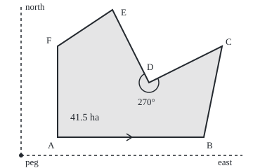

# Shoelace formula: area of any polygon from its corners, with a sign that says which way round

[Syllabus](../../../SYLLABUS.md) → [Geometry and trig](../README.md) → [Points, Convexity and Fractals](../README.md#s07) → Shoelace formula

---

## General Overview

A surveyor walks a field's boundary and records six corner posts, A to F, as grid positions from a survey peg: hundreds of metres east, then north. A (2, 1), B (10, 1), C (11, 6), D (7, 4), E (5, 8), F (2, 6). One grid square, 100 m by 100 m, is one hectare.

At D the fence bends into the field: a **reflex corner**, with an inside angle over 180 degrees; here 270, as fences DC and DE meet at a right angle. There is no width times height to multiply.

The shoelace formula needs only the list. For each fence it makes one cross-multiplication of neighbouring posts, adds the six results and halves: 41.5 hectares. The written layout criss-crosses two columns like laces, hence the name.

The sum carries a sign. Walked A to F, anticlockwise, it is +41.5; walked backwards, −41.5. On three posts alone, the sign says whether the walk turns left or right. At D it turns right, which is how a program finds the reflex corner.

**Half the sum of the cross products of consecutive corners is the polygon's area, plus for an anticlockwise walk and minus for a clockwise one; on three points, the same sign tells a left turn from a right turn.**

**What kind of fact this is:** a theorem, proved on this card in Why it works; the turn test is a method built on it.

### The picture: the survey polygon, to scale

<p align="center"></p>

Drawn to scale, 100 m = 26 units, north up: peg (30, 222), A (82, 196), B (290, 196), C (316, 66), D (212, 118), E (160, 14), F (82, 66). The arrow on AB shows the anticlockwise walk; the arc marks D's reflex angle, 270 degrees.

---

## The formula

Notation first, in words. Corners are numbered 1 to $n$ in walking order; corner $i$ sits at $(x_i, y_i)$, east then north. The corner after the last is the first again, so the fence F to A counts. The capital sigma, Σ, means "add the bracket for every $i$ from 1 to $n$". A reminder from [Cross product](../05-Vectors%20in%20Space/01-cross-product-and-oriented-area.md): for two arrows in the plane, $u \times v$ is east of u times north of v, minus north of u times east of v. It is the signed area of the parallelogram they span, positive when v lies anticlockwise from u.

$$S = \frac{1}{2}\sum_{i=1}^{n}\left(x_i\,y_{i+1} - y_i\,x_{i+1}\right), \qquad x_{n+1} = x_1,\ \ y_{n+1} = y_1$$

**Read it aloud:** for each fence, this post's east times the next post's north, minus this post's north times the next post's east; add them all and halve.

Each bracket is $P_i \times P_{i+1}$, the cross product of two position arrows from the peg. The field's area is $\lvert S\rvert$, the size of $S$ without its sign. The turn test applies the same cross product to three points:

$$\mathrm{turn}(a, b, c) = (b_x - a_x)(c_y - a_y) - (b_y - a_y)(c_x - a_x)$$

**Read it aloud:** the arrow from a to b crossed with the arrow from a to c; positive means walking a, b, c turns left at b, negative right, zero a straight line.

| Symbol | Plain meaning | In our example | Push it up and the answer… |
| --- | --- | --- | --- |
| $n$ | number of corners | 6 | one more term |
| $i$ | a corner's place in the walk | 1 for A, 6 for F | — |
| $x_i$, $y_i$ | corner $i$'s east and north, in hundreds of metres | D is (7, 4) | a post moved outward grows the area |
| $P_i$ | corner $i$ as an arrow from the peg | D is (7, 4) | — |
| $u \times v$ | cross product: signed parallelogram area | $P_1 \times P_2 = -8$ | flips sign when u and v swap |
| $S$ | signed area, hectares | +41.5 | reversing the walk gives −41.5 |
| $\lvert S\rvert$ | the area, sign dropped | 41.5 ha, 415,000 square metres | — |
| $a$, $b$, $c$ | three points for the turn test | C, D, E gives −20 | positive left, negative right |

### When it holds

- **Corners in walking order.** Swap B and C in the list and the fence crosses itself; the sum gives 12.5.
- **A simple boundary**, one loop that never crosses itself. A crossing splits the field into lobes, pieces walked in opposite directions, and they subtract.
- **Straight fences on a flat grid.** A creek needs more posts; latitude and longitude must first be projected to metres.
- **Equal units, north up.** Screen coordinates grow downward and flip every sign.
- **One loop.** A pond is a second loop walked the other way, so its area comes off.

---

## Why it works

### Step 0: sweep every fence from the peg

Each fence, with the peg, makes a triangle: plus when the fence runs anticlockwise as seen from the peg, minus when clockwise. Round the loop, ground outside is swept once each way and cancels; ground inside is swept once, net.

### Step 1: one fence gives one signed triangle

Fence AB is the arrow pair $P_1 = (2, 1)$ and $P_2 = (10, 1)$. Their cross product is 2 × 1 − 1 × 10 = −8, negative because B lies clockwise from A as seen from the peg. The triangle peg-A-B is half that parallelogram. Every bracket in the formula is twice one such signed triangle.

### Step 2: a triangle's area from its three fences

A triangle a, b, c, anywhere relative to the peg, has signed area half its turn test. The cross product multiplies out like ordinary brackets, flips sign when its arrows swap, and is 0 for an arrow with itself. Multiplying out:

$$\mathrm{turn}(a, b, c) = a \times b + b \times c + c \times a$$

That is the shoelace sum for three corners, so the formula holds for every triangle, wherever the peg sits.

<details>
<summary>The algebra behind this</summary>

$(b - a) \times (c - a) = b \times c - b \times a - a \times c + a \times a$. The last term is 0, and swapping arrows flips sign, so $-b \times a = a \times b$ and $-a \times c = c \times a$.

</details>

### Step 3: cut the field into triangles; inside cuts cancel

A diagonal is a segment joining two corners. Diagonals from D to F, A and B cut the field into triangles DEF, DFA, DAB, DBC, of 8.0, 12.5, 12.0 and 9.0 hectares: total 41.5. Write each as its three-fence sum from Step 2, all walked anticlockwise. Diagonal DF appears as $D \times F$ in one triangle and $F \times D$ in the next, and they cancel; so does every inside diagonal. Only the six outer fences survive, in walking order: the shoelace sum.

This rests on one fact: every simple polygon splits into triangles by inside diagonals. With a reflex corner, some diagonals leave the field, so it needs proof.

<details>
<summary>Detailed proof: every simple polygon splits into triangles</summary>

Induction on the number of corners. A triangle is one already. With four or more, take the lowest corner v (leftmost if tied). Everything lies on or above it, so its inside angle is under 180 degrees. Call its neighbours u and w.

If segment uw stays inside, it is a diagonal. Otherwise some corner lies in triangle uvw; take the one farthest from line uw, z. A fence crossing segment vz would need an end in the triangle still farther from uw than z, so none does, and vz is a diagonal.

Either diagonal cuts the polygon into two simple polygons with fewer corners, which split by induction. O'Rourke's first chapter gives this argument; Meisters proved every such polygon has an "ear", a corner whose neighbours a diagonal joins.

</details>

### Step 4: direction, turns, and the peg

Walk backwards and each $P_i \times P_{i+1}$ becomes $P_{i+1} \times P_i$: same size, opposite sign. So −41.5.

An anticlockwise walk keeps the inside on its left. Ordinary corners turn left; a reflex corner turns right. The turn tests at A to F are 40, 40, 18, −20, 16, 15: one right turn, at D. The −20 is twice triangle CDE, the notch at D; filling it adds 10 hectares.

The peg's place changes the terms, not the total. With the peg on A the terms are 0, 40, 2, 26, 15, 0, still 83. Shifting every corner by one arrow adds that arrow crossed with each fence arrow; the fence arrows of a closed loop add to zero, so the extras do too.

Slice a curved boundary ever finer and the same boundary sum becomes [Green's theorem](../../06-Calculus%20and%20analysis/09-Vector%20Calculus/06-greens-theorem.md); this card is its straight-edged case.

---

## Worked numbers, by hand

| Step | Arithmetic | Value |
| --- | --- | --- |
| fence AB | 2 × 1 − 1 × 10 = 2 − 10 | −8 |
| fence BC | 10 × 6 − 1 × 11 = 60 − 11 | 49 |
| fence CD | 11 × 4 − 6 × 7 = 44 − 42 | 2 |
| fence DE | 7 × 8 − 4 × 5 = 56 − 20 | 36 |
| fence EF | 5 × 6 − 8 × 2 = 30 − 16 | 14 |
| fence FA, the closing one | 2 × 1 − 6 × 2 = 2 − 12 | −10 |
| add the six | −8 + 49 + 2 + 36 + 14 − 10 | 83 |
| halve | 83 ÷ 2 | **41.5 ha** |
| in square metres | 41.5 × 10,000 | 415,000 |
| turn at D | (7 − 11)(8 − 6) − (4 − 6)(5 − 11) = −8 − 12 | −20, a right turn |

The field holds 41.5 hectares, and D is its one corner where the fence bends inward.

### What breaks if you drop a piece

| Mistake | Comes out at | What went wrong |
| --- | --- | --- |
| Closing fence FA left out | 46.5 ha | Open loop: outside ground stops cancelling |
| No halving | 83 ha | Parallelograms counted, not triangles |
| Each term made positive | 59.5 ha | Cancelling destroyed |
| B and C swapped | 12.5 ha | Fence crosses itself; lobes covering 29.64 ha subtract |

---

## Code, from first principles, and it actually runs

Nothing is imported. Road one is the shoelace sum. Road two forms no cross product: it cuts the field into 9000 upright strips, finds where each strip's middle line meets the fences, and adds width times inside height. Four asserts: the roads agree; walking backwards flips the sign and moving the peg changes nothing; D is the only right turn; the notch the strips measure is half the turn test at D.

### Python

```python
# Shoelace formula: the check behind the card. Standard library only.
# The survey polygon, corners A to F in hundreds of metres from a survey peg,
# so one grid square is one hectare. Road one is the shoelace sum of cross
# products. Road two slices the field into thin upright strips and adds their
# heights; it never forms a cross product.
POLY = [(2, 1), (10, 1), (11, 6), (7, 4), (5, 8), (2, 6)]      # A B C D E F
NAMES = "ABCDEF"

def cross(p, q): return p[0] * q[1] - p[1] * q[0]
def terms(P): return [cross(P[i], P[(i + 1) % len(P)]) for i in range(len(P))]
def shoelace(P): return sum(terms(P)) / 2
def turn(a, b, c): return cross((b[0] - a[0], b[1] - a[1]), (c[0] - a[0], c[1] - a[1]))

def slices(P, n=9000):             # road two: n strips across x = 2..11
    lo, hi = min(p[0] for p in P), max(p[0] for p in P)
    w, total = (hi - lo) / n, 0.0
    for k in range(n):
        x = lo + (k + 0.5) * w     # the strip's middle line
        ys = []
        for i in range(len(P)):
            (x1, y1), (x2, y2) = P[i], P[(i + 1) % len(P)]
            if (x1 <= x < x2) or (x2 <= x < x1):
                ys.append(y1 + (y2 - y1) * (x - x1) / (x2 - x1))
        ys.sort()                  # boundary crossings, bottom to top
        total += w * sum(ys[j + 1] - ys[j] for j in range(0, len(ys), 2))
    return total

t = terms(POLY)
area, strip = shoelace(POLY), slices(POLY)
back = shoelace(POLY[::-1])
turns = [turn(POLY[i - 1], POLY[i], POLY[(i + 1) % 6]) for i in range(6)]
no_d = POLY[:3] + POLY[4:]                             # cut the notch off at D
notch = slices(no_d) - strip
moved = [(x - 2, y - 1) for x, y in POLY]              # peg moved onto corner A
swapped = [POLY[i] for i in (0, 2, 1, 3, 4, 5)]        # B and C copied in the wrong order
print("corners:", ", ".join(f"{n} ({x}, {y})" for n, (x, y) in zip(NAMES, POLY)))
print("edge products:", ", ".join(f"{p[0] * q[1]} - {p[1] * q[0]}" for p, q in zip(POLY, POLY[1:] + POLY[:1])))
print("figure, 1 unit = 26 svg units: peg (30, 222),", ", ".join(f"{n} ({30 + 26 * x}, {222 - 26 * y})" for n, (x, y) in zip(NAMES, POLY)))
print("edge terms AB BC CD DE EF FA:", ", ".join(str(v) for v in t), "; sum", sum(t))
print(f"road one, shoelace: {area:.1f} ha = {area * 10000:,.0f} m^2")
print(f"road two, 9000 upright strips: {strip:.6f} ha")
print(f"walked backwards, A F E D C B: {back:.1f} ha")
print("turn test at A B C D E F:", ", ".join(str(v) for v in turns))
fan = [turn(POLY[3], POLY[k], POLY[(k + 1) % 6]) / 2 for k in (4, 5, 0, 1)]   # D with EF, FA, AB, BC
print("fan from D, triangles DEF DFA DAB DBC:", ", ".join(f"{v:.1f}" for v in fan), "ha")
print(f"cut the notch at D, by strips: {notch:.6f} ha more; half of -(turn at D): {-turns[3] / 2:.1f}")
print(f"peg moved onto A: terms {', '.join(str(v) for v in terms(moved))}; area {shoelace(moved):.1f} ha")
print(f"what breaks: closing edge FA left out: {sum(t[:-1]) / 2:.1f} ha")
print(f"what breaks: no halving: {sum(t):.1f}")
print(f"what breaks: each term made positive: {sum(abs(v) for v in t) / 2:.1f} ha")
print(f"what breaks: B and C swapped: shoelace {shoelace(swapped):.1f} ha, ground covered {slices(swapped):.2f} ha")
assert abs(area - strip) < 1e-6                        # two roads, one area
assert back == -area and shoelace(moved) == area       # direction flips the sign; the peg does not matter
assert [v < 0 for v in turns] == [False, False, False, True, False, False]
assert abs(notch - (-turns[3] / 2)) < 1e-6             # the right turn's triangle is the notch
print("ALL CHECKS PASS")
```

**Ran 2026-11-11 on macOS, Python 3.14.10, standard library only. All checks passed. Output, pasted from the run:**

```
corners: A (2, 1), B (10, 1), C (11, 6), D (7, 4), E (5, 8), F (2, 6)
edge products: 2 - 10, 60 - 11, 44 - 42, 56 - 20, 30 - 16, 2 - 12
figure, 1 unit = 26 svg units: peg (30, 222), A (82, 196), B (290, 196), C (316, 66), D (212, 118), E (160, 14), F (82, 66)
edge terms AB BC CD DE EF FA: -8, 49, 2, 36, 14, -10 ; sum 83
road one, shoelace: 41.5 ha = 415,000 m^2
road two, 9000 upright strips: 41.500000 ha
walked backwards, A F E D C B: -41.5 ha
turn test at A B C D E F: 40, 40, 18, -20, 16, 15
fan from D, triangles DEF DFA DAB DBC: 8.0, 12.5, 12.0, 9.0 ha
cut the notch at D, by strips: 10.000000 ha more; half of -(turn at D): 10.0
peg moved onto A: terms 0, 40, 2, 26, 15, 0; area 41.5 ha
what breaks: closing edge FA left out: 46.5 ha
what breaks: no halving: 83.0
what breaks: each term made positive: 59.5 ha
what breaks: B and C swapped: shoelace 12.5 ha, ground covered 29.64 ha
ALL CHECKS PASS
```

### Rust

```rust
// Shoelace formula: the check behind the card. std only.
// The survey polygon, corners A to F in hundreds of metres from a survey peg,
// so one grid square is one hectare. Road one is the shoelace sum of cross
// products. Road two slices the field into thin upright strips and adds their
// heights; it never forms a cross product.
type P = (i64, i64);
const POLY: [P; 6] = [(2, 1), (10, 1), (11, 6), (7, 4), (5, 8), (2, 6)]; // A B C D E F

fn cross(p: P, q: P) -> i64 { p.0 * q.1 - p.1 * q.0 }
fn terms(p: &[P]) -> Vec<i64> { (0..p.len()).map(|i| cross(p[i], p[(i + 1) % p.len()])).collect() }
fn shoelace(p: &[P]) -> f64 { terms(p).iter().sum::<i64>() as f64 / 2.0 }
fn turn(a: P, b: P, c: P) -> i64 { cross((b.0 - a.0, b.1 - a.1), (c.0 - a.0, c.1 - a.1)) }

fn slices(p: &[P], n: usize) -> f64 { // road two: n strips across x = 2..11
    let lo = p.iter().map(|q| q.0).min().unwrap() as f64;
    let hi = p.iter().map(|q| q.0).max().unwrap() as f64;
    let (w, mut total) = ((hi - lo) / n as f64, 0.0);
    for k in 0..n {
        let x = lo + (k as f64 + 0.5) * w; // the strip's middle line
        let mut ys: Vec<f64> = Vec::new();
        for i in 0..p.len() {
            let ((x1, y1), (x2, y2)) = (p[i], p[(i + 1) % p.len()]);
            let (x1, y1, x2, y2) = (x1 as f64, y1 as f64, x2 as f64, y2 as f64);
            if (x1 <= x && x < x2) || (x2 <= x && x < x1) {
                ys.push(y1 + (y2 - y1) * (x - x1) / (x2 - x1));
            }
        }
        ys.sort_by(|a, b| a.partial_cmp(b).unwrap()); // boundary crossings, bottom to top
        total += w * (0..ys.len()).step_by(2).map(|j| ys[j + 1] - ys[j]).sum::<f64>();
    }
    total
}

fn join(v: &[i64]) -> String { v.iter().map(|x| x.to_string()).collect::<Vec<_>>().join(", ") }

fn main() {
    let names = ["A", "B", "C", "D", "E", "F"];
    let t = terms(&POLY);
    let (area, strip) = (shoelace(&POLY), slices(&POLY, 9000));
    let rev: Vec<P> = POLY.iter().rev().copied().collect();
    let back = shoelace(&rev);
    let turns: Vec<i64> = (0..6).map(|i| turn(POLY[(i + 5) % 6], POLY[i], POLY[(i + 1) % 6])).collect();
    let no_d: Vec<P> = vec![POLY[0], POLY[1], POLY[2], POLY[4], POLY[5]]; // cut the notch off at D
    let notch = slices(&no_d, 9000) - strip;
    let moved: Vec<P> = POLY.iter().map(|&(x, y)| (x - 2, y - 1)).collect(); // peg moved onto corner A
    let swapped: Vec<P> = [0, 2, 1, 3, 4, 5].iter().map(|&i| POLY[i]).collect(); // B and C copied in the wrong order
    let fig: Vec<String> = (0..6).map(|i| format!("{} ({}, {})", names[i], 30 + 26 * POLY[i].0, 222 - 26 * POLY[i].1)).collect();
    let cs: Vec<String> = (0..6).map(|i| format!("{} ({}, {})", names[i], POLY[i].0, POLY[i].1)).collect();
    println!("corners: {}", cs.join(", "));
    let pr: Vec<String> = (0..6).map(|i| { let (p, q) = (POLY[i], POLY[(i + 1) % 6]); format!("{} - {}", p.0 * q.1, p.1 * q.0) }).collect();
    println!("edge products: {}", pr.join(", "));
    println!("figure, 1 unit = 26 svg units: peg (30, 222), {}", fig.join(", "));
    let sum: i64 = t.iter().sum();
    println!("edge terms AB BC CD DE EF FA: {} ; sum {}", join(&t), sum);
    let m2 = (area * 10000.0) as i64;
    println!("road one, shoelace: {:.1} ha = {},{:03} m^2", area, m2 / 1000, m2 % 1000);
    println!("road two, 9000 upright strips: {:.6} ha", strip);
    println!("walked backwards, A F E D C B: {:.1} ha", back);
    println!("turn test at A B C D E F: {}", join(&turns));
    let fan: Vec<String> = [4, 5, 0, 1].iter().map(|&k| format!("{:.1}", turn(POLY[3], POLY[k], POLY[(k + 1) % 6]) as f64 / 2.0)).collect(); // D with EF, FA, AB, BC
    println!("fan from D, triangles DEF DFA DAB DBC: {} ha", fan.join(", "));
    println!("cut the notch at D, by strips: {:.6} ha more; half of -(turn at D): {:.1}", notch, -turns[3] as f64 / 2.0);
    println!("peg moved onto A: terms {}; area {:.1} ha", join(&terms(&moved)), shoelace(&moved));
    println!("what breaks: closing edge FA left out: {:.1} ha", t[..5].iter().sum::<i64>() as f64 / 2.0);
    println!("what breaks: no halving: {:.1}", sum as f64);
    println!("what breaks: each term made positive: {:.1} ha", t.iter().map(|v| v.abs()).sum::<i64>() as f64 / 2.0);
    println!("what breaks: B and C swapped: shoelace {:.1} ha, ground covered {:.2} ha", shoelace(&swapped), slices(&swapped, 9000));
    assert!((area - strip).abs() < 1e-6); // two roads, one area
    assert!(back == -area && shoelace(&moved) == area); // direction flips the sign; the peg does not matter
    assert!(turns.iter().map(|&v| v < 0).collect::<Vec<_>>() == vec![false, false, false, true, false, false]);
    assert!((notch - (-turns[3] as f64 / 2.0)).abs() < 1e-6); // the right turn's triangle is the notch
    println!("ALL CHECKS PASS");
}
```

**Ran 2026-11-11 on macOS, rustc 1.98.1, no crates. All checks passed. Output, pasted from the run:**

```
corners: A (2, 1), B (10, 1), C (11, 6), D (7, 4), E (5, 8), F (2, 6)
edge products: 2 - 10, 60 - 11, 44 - 42, 56 - 20, 30 - 16, 2 - 12
figure, 1 unit = 26 svg units: peg (30, 222), A (82, 196), B (290, 196), C (316, 66), D (212, 118), E (160, 14), F (82, 66)
edge terms AB BC CD DE EF FA: -8, 49, 2, 36, 14, -10 ; sum 83
road one, shoelace: 41.5 ha = 415,000 m^2
road two, 9000 upright strips: 41.500000 ha
walked backwards, A F E D C B: -41.5 ha
turn test at A B C D E F: 40, 40, 18, -20, 16, 15
fan from D, triangles DEF DFA DAB DBC: 8.0, 12.5, 12.0, 9.0 ha
cut the notch at D, by strips: 10.000000 ha more; half of -(turn at D): 10.0
peg moved onto A: terms 0, 40, 2, 26, 15, 0; area 41.5 ha
what breaks: closing edge FA left out: 46.5 ha
what breaks: no halving: 83.0
what breaks: each term made positive: 59.5 ha
what breaks: B and C swapped: shoelace 12.5 ha, ground covered 29.64 ha
ALL CHECKS PASS
```

The two outputs are identical line for line.

### Lean

Lean proves the shoelace formula for every polygon with a simple boundary, the backwards and three-point rules for any corners, and the field's numbers.

- Take at least three different corners in walking order, joined by straight fences into one loop that never crosses itself. The area inside is $\lvert S\rvert$.
- If the walk is anticlockwise, keeping the inside on its left, then $S$ is the area.
- If the walk is clockwise, keeping the inside on its right, then $S$ is minus the area.
- For any list of corners, walking backwards turns $S$ into $-S$.
- For any three points, $\mathrm{turn}(a, b, c) = a \times b + b \times c + c \times a$, twice the shoelace sum for triangle a, b, c.
- The field's six terms are −8, 49, 2, 36, 14, −10, and $S$ is 41.5 forwards and −41.5 backwards.
- With the peg on A, $S$ is still 41.5; with B and C swapped, it reads 12.5.
- The turn tests at A to F are 40, 40, 18, −20, 16, 15: one right turn, at D.
- The fan from D gives triangles of 8.0, 12.5, 12.0 and 9.0 hectares, total 41.5.

Road two's strips, the notch at D, the crossed lobes and the table of what breaks are left to the Python and Rust checks.

<details>
<summary>The Lean proof, 1774 lines</summary>

```lean
-- Shoelace formula: for a polygon whose fences never cross, half the sum of the cross products of consecutive corners is its area, plus when the inside lies to the left of the walk and minus when it lies to the right; walking backwards flips the sign, and on three corners the sum is half the turn test.
import Mathlib.MeasureTheory.Measure.Lebesgue.Basic
import Mathlib.MeasureTheory.Constructions.BorelSpace.Real
import Mathlib.Analysis.Convex.Segment
import Mathlib.Topology.Connected.Clopen
import Mathlib.Algebra.BigOperators.Fin
import Mathlib.Tactic.NormNum
import Mathlib.Tactic.FinCases
import Mathlib

open MeasureTheory

noncomputable section

namespace Shoelace

/-- The cross product of two arrows in the plane: east of `u` times north of `v`, minus north
of `u` times east of `v`. -/
def cross (u v : ℝ × ℝ) : ℝ := u.1 * v.2 - u.2 * v.1

/-- The shoelace sum `S`: half the sum, over every corner `i`, of corner `i` crossed with the
next corner. Corners are numbered in `Fin n`, where `i + 1` wraps from the last corner back to
the first, so the closing fence counts. -/
def shoelace {n : ℕ} [NeZero n] (P : Fin n → ℝ × ℝ) : ℝ :=
  (1 / 2) * ∑ i, cross (P i) (P (i + 1))

/-- The turn test: the arrow from `a` to `b` crossed with the arrow from `a` to `c`. -/
def turn (a b c : ℝ × ℝ) : ℝ := cross (b - a) (c - a)

/-- Fence `i`: the straight segment from corner `i` to the next corner. -/
def fence {n : ℕ} [NeZero n] (P : Fin n → ℝ × ℝ) (i : Fin n) : Set (ℝ × ℝ) :=
  segment ℝ (P i) (P (i + 1))

/-- The boundary: all the fences together. -/
def boundary {n : ℕ} [NeZero n] (P : Fin n → ℝ × ℝ) : Set (ℝ × ℝ) := ⋃ i, fence P i

/-- A simple polygon: at least three corners, all different, and one loop that never crosses
itself. Neighbouring fences meet only at their shared corner; all other pairs of fences never
meet. -/
def IsSimple {n : ℕ} [NeZero n] (P : Fin n → ℝ × ℝ) : Prop :=
  3 ≤ n ∧ Function.Injective P ∧
    ∀ i j : Fin n, i ≠ j →
      fence P i ∩ fence P j =
        if j = i + 1 then {P j} else if i = j + 1 then {P i} else ∅

/-- The inside of the polygon: the points off the boundary that cannot escape to infinity
without crossing a fence, that is, whose piece of the plane with the boundary removed is
bounded. -/
def inside {n : ℕ} [NeZero n] (P : Fin n → ℝ × ℝ) : Set (ℝ × ℝ) :=
  {p | p ∉ boundary P ∧ Bornology.IsBounded (connectedComponentIn (boundary P)ᶜ p)}

/-- The arrow `d` turned a quarter turn to the left (anticlockwise). -/
def leftOf (d : ℝ × ℝ) : ℝ × ℝ := (-d.2, d.1)

/-- An anticlockwise walk: the inside lies on the left of every fence. Stepping a little to
the left from the middle of any fence lands inside. -/
def InsideOnLeft {n : ℕ} [NeZero n] (P : Fin n → ℝ × ℝ) : Prop :=
  ∀ i : Fin n, ∃ ε > 0, ∀ t ∈ Set.Ioo (0 : ℝ) ε,
    midpoint ℝ (P i) (P (i + 1)) + t • leftOf (P (i + 1) - P i) ∈ inside P

/-- A clockwise walk: the inside lies on the right of every fence. -/
def InsideOnRight {n : ℕ} [NeZero n] (P : Fin n → ℝ × ℝ) : Prop :=
  ∀ i : Fin n, ∃ ε > 0, ∀ t ∈ Set.Ioo (0 : ℝ) ε,
    midpoint ℝ (P i) (P (i + 1)) - t • leftOf (P (i + 1) - P i) ∈ inside P

-- Helper material for the proof of `shoelace_eq_signed_area`.
open Real

def dot (u v : ℝ × ℝ) : ℝ := u.1 * v.1 + u.2 * v.2

def toC (x : ℝ × ℝ) : ℂ := ⟨x.1, x.2⟩

def zf (a b p : ℝ × ℝ) : ℂ := ⟨dot (a - p) (b - p), cross (a - p) (b - p)⟩

def ang (a b p : ℝ × ℝ) : ℝ := Complex.arg (zf a b p)

def wsum {n : ℕ} [NeZero n] (P : Fin n → ℝ × ℝ) (p : ℝ × ℝ) : ℝ :=
  ∑ i, ang (P i) (P (i + 1)) p

lemma zf_eq (a b p : ℝ × ℝ) : zf a b p = toC (b - p) * (starRingEnd ℂ) (toC (a - p)) := by
  apply Complex.ext <;> simp [zf, toC, dot, cross] <;> ring

lemma zf_mem_slitPlane {a b p : ℝ × ℝ} (h : p ∉ segment ℝ a b) : zf a b p ∈ Complex.slitPlane := by
  rw [Complex.mem_slitPlane_iff]
  by_contra hc
  push Not at hc
  obtain ⟨hre, him⟩ := hc
  simp only [zf, dot, cross, Prod.fst_sub, Prod.snd_sub] at hre him
  apply h
  by_cases hu : a - p = 0
  · have : p = a := (sub_eq_zero.1 hu).symm
    rw [this]; exact left_mem_segment ℝ a b
  · have hN : 0 < (a.1 - p.1) ^ 2 + (a.2 - p.2) ^ 2 := by
      by_contra hN
      push Not at hN
      have h1 : a.1 - p.1 = 0 := by nlinarith [sq_nonneg (a.1 - p.1), sq_nonneg (a.2 - p.2)]
      have h2 : a.2 - p.2 = 0 := by nlinarith [sq_nonneg (a.1 - p.1), sq_nonneg (a.2 - p.2)]
      exact hu (Prod.ext h1 h2)
    have hND : 0 < (a.1 - p.1) ^ 2 + (a.2 - p.2) ^ 2 -
        ((a.1 - p.1) * (b.1 - p.1) + (a.2 - p.2) * (b.2 - p.2)) := by linarith
    refine ⟨-((a.1 - p.1) * (b.1 - p.1) + (a.2 - p.2) * (b.2 - p.2)) /
        ((a.1 - p.1) ^ 2 + (a.2 - p.2) ^ 2 -
        ((a.1 - p.1) * (b.1 - p.1) + (a.2 - p.2) * (b.2 - p.2))),
      ((a.1 - p.1) ^ 2 + (a.2 - p.2) ^ 2) / ((a.1 - p.1) ^ 2 + (a.2 - p.2) ^ 2 -
        ((a.1 - p.1) * (b.1 - p.1) + (a.2 - p.2) * (b.2 - p.2))),
      by apply div_nonneg <;> linarith, by apply div_nonneg <;> linarith,
      by field_simp; ring, ?_⟩
    ext
    · simp only [Prod.fst_add, Prod.smul_fst, smul_eq_mul]
      field_simp
      linear_combination (-(a.2 - p.2)) * him
    · simp only [Prod.snd_add, Prod.smul_snd, smul_eq_mul]
      field_simp
      linear_combination (a.1 - p.1) * him

lemma wsum_int {n : ℕ} [NeZero n] (P : Fin n → ℝ × ℝ) (p : ℝ × ℝ) (hp : p ∉ boundary P) :
    ∃ k : ℤ, wsum P p = 2 * π * k := by
  have hz : ∀ i, zf (P i) (P (i+1)) p ≠ 0 := fun i =>
    Complex.slitPlane_ne_zero (zf_mem_slitPlane (fun h => hp (Set.mem_iUnion.2 ⟨i, h⟩)))
  have hprod : ∏ i, zf (P i) (P (i+1)) p = ((Complex.normSq (∏ i, toC (P i - p)) : ℝ) : ℂ) := by
    simp_rw [zf_eq, Finset.prod_mul_distrib, ← Complex.mul_conj, map_prod]
    congr 1
    exact Fintype.prod_equiv (Equiv.addRight 1) _ _ (fun i => rfl)
  set E := Complex.exp (↑(wsum P p) * Complex.I) with hEdef
  have hE : ∏ i, zf (P i) (P (i+1)) p = (↑(∏ i, ‖zf (P i) (P (i+1)) p‖) : ℂ) * E := by
    simp only [E, wsum, ang, Complex.ofReal_sum, Finset.sum_mul, Complex.exp_sum,
      Complex.ofReal_prod, ← Finset.prod_mul_distrib, Complex.norm_mul_exp_arg_mul_I]
  have hpos : 0 < ∏ i, ‖zf (P i) (P (i+1)) p‖ :=
    Finset.prod_pos (fun i _ => norm_pos_iff.2 (hz i))
  set r := Complex.normSq (∏ i, toC (P i - p))
  have hE2 : E = ((r / ∏ i, ‖zf (P i) (P (i+1)) p‖ : ℝ) : ℂ) := by
    rw [hprod] at hE
    rw [Complex.ofReal_div, hE, mul_div_cancel_left₀ _ (Complex.ofReal_ne_zero.2 hpos.ne')]
  have hnorm : ‖E‖ = 1 := by
    rw [hEdef]; exact Complex.norm_exp_ofReal_mul_I _
  have hr : 0 ≤ r := Complex.normSq_nonneg _
  have hE1 : E = 1 := by
    rw [hE2] at hnorm ⊢
    rw [Complex.norm_real, Real.norm_eq_abs, abs_of_nonneg (div_nonneg hr hpos.le)] at hnorm
    rw [hnorm]; simp
  obtain ⟨k, hk⟩ := Complex.exp_eq_one_iff.1 hE1
  refine ⟨k, ?_⟩
  have := congrArg Complex.im hk
  simp at this
  linarith

lemma zf_eq' (a b p : ℝ × ℝ) :
    zf a b p = (dot (a - p) (b - p) : ℂ) + (cross (a - p) (b - p) : ℂ) * Complex.I := by
  apply Complex.ext <;> simp [zf]

lemma continuous_zf (a b : ℝ × ℝ) : Continuous (zf a b) := by
  have : zf a b = fun p => (dot (a - p) (b - p) : ℂ) + (cross (a - p) (b - p) : ℂ) * Complex.I := by
    funext p; exact zf_eq' a b p
  rw [this]
  simp only [dot, cross, Prod.fst_sub, Prod.snd_sub]
  fun_prop

lemma continuousAt_ang {a b p : ℝ × ℝ} (h : p ∉ segment ℝ a b) : ContinuousAt (ang a b) p :=
  (Complex.continuousAt_arg (zf_mem_slitPlane h)).comp (continuous_zf a b).continuousAt

lemma isCompact_seg (a b : ℝ × ℝ) : IsCompact (segment ℝ a b) := by
  rw [segment_eq_image']
  exact isCompact_Icc.image (by fun_prop)

lemma isCompact_boundary {n : ℕ} [NeZero n] (P : Fin n → ℝ × ℝ) : IsCompact (boundary P) :=
  isCompact_iUnion (fun i => isCompact_seg _ _)

lemma isOpen_compl_boundary {n : ℕ} [NeZero n] (P : Fin n → ℝ × ℝ) : IsOpen (boundary P)ᶜ :=
  (isCompact_boundary P).isClosed.isOpen_compl

lemma continuousAt_wsum {n : ℕ} [NeZero n] (P : Fin n → ℝ × ℝ) {p : ℝ × ℝ}
    (hp : p ∉ boundary P) : ContinuousAt (wsum P) p := by
  have : ∀ i ∈ (Finset.univ : Finset (Fin n)), ContinuousAt (ang (P i) (P (i + 1))) p :=
    fun i _ => continuousAt_ang (fun h => hp (Set.mem_iUnion.2 ⟨i, h⟩))
  exact tendsto_finsetSum _ this

lemma wsum_eventually {n : ℕ} [NeZero n] (P : Fin n → ℝ × ℝ) {p : ℝ × ℝ}
    (hp : p ∉ boundary P) : ∀ᶠ q in nhds p, wsum P q = wsum P p := by
  have h1 : ∀ᶠ q in nhds p, q ∈ (boundary P)ᶜ := (isOpen_compl_boundary P).mem_nhds hp
  have h2 : ∀ᶠ q in nhds p, dist (wsum P q) (wsum P p) < π :=
    Metric.tendsto_nhds.1 (continuousAt_wsum P hp) π Real.pi_pos
  filter_upwards [h1, h2] with q hq1 hq2
  obtain ⟨k, hk⟩ := wsum_int P q hq1
  obtain ⟨m, hm⟩ := wsum_int P p hp
  rw [hk, hm] at hq2 ⊢
  rw [Real.dist_eq, ← mul_sub, abs_mul, abs_of_pos (by positivity : (0:ℝ) < 2 * π)] at hq2
  have hlt : |((k - m : ℤ) : ℝ)| < 1 := by
    push_cast
    nlinarith [Real.pi_pos, abs_nonneg ((k:ℝ) - m)]
  rw [abs_lt] at hlt
  have : k - m = 0 := by
    have a1 : ((k - m : ℤ) : ℝ) < ((1 : ℤ) : ℝ) := by simpa using hlt.2
    have a2 : ((-1 : ℤ) : ℝ) < ((k - m : ℤ) : ℝ) := by simpa using hlt.1
    have := Int.cast_lt.1 a1
    have := Int.cast_lt.1 a2
    omega
  have : k = m := by omega
  rw [this]

lemma wsum_const_comp {n : ℕ} [NeZero n] (P : Fin n → ℝ × ℝ) {x y : ℝ × ℝ}
    (hy : y ∈ connectedComponentIn (boundary P)ᶜ x) : wsum P y = wsum P x := by
  have hx : x ∈ (boundary P)ᶜ := by
    by_contra h
    rw [connectedComponentIn_eq_empty h] at hy
    exact hy
  set C := connectedComponentIn (boundary P)ᶜ x
  have hCU : C ⊆ (boundary P)ᶜ := connectedComponentIn_subset _ _
  let f : ℝ × ℝ → ℤ := fun q => round (wsum P q / (2 * π))
  have hf : ContinuousOn f C := by
    intro q hq
    apply ContinuousAt.continuousWithinAt
    have := wsum_eventually P (hCU hq)
    exact (continuousAt_const : ContinuousAt (fun _ => f q) q).congr (by
      filter_upwards [this] with z hz
      simp only [f, hz])
  have := (isPreconnected_connectedComponentIn).constant hf hy (mem_connectedComponentIn hx)
  simp only [f] at this
  obtain ⟨k, hk⟩ := wsum_int P y (hCU hy)
  obtain ⟨m, hm⟩ := wsum_int P x hx
  have hpi : (2 * π) ≠ 0 := by positivity
  rw [hk, hm, mul_div_cancel_left₀ _ hpi, mul_div_cancel_left₀ _ hpi, round_intCast,
    round_intCast] at this
  rw [hk, hm, this]

lemma zf_im (a b p : ℝ × ℝ) : (zf a b p).im = cross (a - p) (b - p) := rfl
lemma zf_re (a b p : ℝ × ℝ) : (zf a b p).re = dot (a - p) (b - p) := rfl

lemma arg_lt_pi_of_slit {z : ℂ} (h : z ∈ Complex.slitPlane) : Complex.arg z < π := by
  refine lt_of_le_of_ne (Complex.arg_le_pi z) (fun he => ?_)
  rw [Complex.arg_eq_pi_iff] at he
  rw [Complex.mem_slitPlane_iff] at h
  rcases h with h | h
  · linarith [he.1]
  · exact h he.2

lemma arg_nonpos_of_slit {z : ℂ} (h : z ∈ Complex.slitPlane) (him : z.im ≤ 0) :
    Complex.arg z ≤ 0 := by
  rcases lt_or_eq_of_le him with h1 | h1
  · exact (Complex.arg_neg_iff.2 h1).le
  · rw [Complex.mem_slitPlane_iff] at h
    have hre : 0 < z.re := by rcases h with h | h; exact h; exact absurd h1 h
    exact (Complex.arg_eq_zero_iff.2 ⟨hre.le, h1⟩).le

lemma arg_pos_of_im_pos {z : ℂ} (him : 0 < z.im) : 0 < Complex.arg z := by
  refine lt_of_le_of_ne (Complex.arg_nonneg_iff.2 him.le) (fun he => ?_)
  have := (Complex.arg_eq_zero_iff.1 he.symm).2
  linarith

lemma ang_swap (a b p : ℝ × ℝ) (h : p ∉ segment ℝ a b) : ang b a p = - ang a b p := by
  have hz : zf b a p = (starRingEnd ℂ) (zf a b p) := by
    apply Complex.ext <;> simp [zf, dot, cross] <;> ring
  have hs := zf_mem_slitPlane h
  simp only [ang, hz, Complex.arg_conj, (arg_lt_pi_of_slit hs).ne, ite_false]

def Tpos (a b : ℝ × ℝ) : Set (ℝ × ℝ) :=
  {p | 0 < cross (0 - p) (a - p) ∧ 0 < cross (a - p) (b - p) ∧ 0 < cross (b - p) (0 - p)}

def tw (a b p : ℝ × ℝ) : ℝ := ang 0 a p + ang a b p + ang b 0 p

lemma int_eq_of_lt {k m : ℤ} (h1 : (k : ℝ) < m + 1) (h2 : (m : ℝ) - 1 < k) : k = m := by
  have a1 : k < m + 1 := by exact_mod_cast h1
  have a2 : m - 1 < k := by exact_mod_cast h2
  omega

lemma tw_val (a b p : ℝ × ℝ) (h1 : p ∉ segment ℝ 0 a) (h2 : p ∉ segment ℝ a b)
    (h3 : p ∉ segment ℝ b 0) :
    tw a b p = 2 * π * ((Tpos a b).indicator 1 p - (Tpos b a).indicator 1 p) := by
  have hb : p ∉ boundary ![0, a, b] := by
    intro h
    rcases Set.mem_iUnion.1 h with ⟨i, hi⟩
    fin_cases i <;> simp [fence] at hi
    · exact h1 hi
    · exact h2 hi
    · exact h3 hi
  obtain ⟨k, hk⟩ := wsum_int ![0, a, b] p hb
  have hw : wsum ![0, a, b] p = tw a b p := by
    simp [wsum, tw, Fin.sum_univ_three]
  rw [hw] at hk
  have s1 := zf_mem_slitPlane h1
  have s2 := zf_mem_slitPlane h2
  have s3 := zf_mem_slitPlane h3
  have u1 := arg_lt_pi_of_slit s1
  have u2 := arg_lt_pi_of_slit s2
  have u3 := arg_lt_pi_of_slit s3
  have l1 := Complex.neg_pi_lt_arg (zf 0 a p)
  have l2 := Complex.neg_pi_lt_arg (zf a b p)
  have l3 := Complex.neg_pi_lt_arg (zf b 0 p)
  simp only [tw, ang] at hk ⊢
  have hpi := Real.pi_pos
  have e1 : cross (0 - p) (b - p) = - cross (b - p) (0 - p) := by simp only [cross]; ring
  have e2 : cross (b - p) (a - p) = - cross (a - p) (b - p) := by simp only [cross]; ring
  have e3 : cross (a - p) (0 - p) = - cross (0 - p) (a - p) := by simp only [cross]; ring
  by_cases hpos : p ∈ Tpos a b
  · obtain ⟨c1, c2, c3⟩ := hpos
    have g1 := arg_pos_of_im_pos (z := zf 0 a p) c1
    have g2 := arg_pos_of_im_pos (z := zf a b p) c2
    have g3 := arg_pos_of_im_pos (z := zf b 0 p) c3
    have hn : p ∉ Tpos b a := by
      rintro ⟨d1, d2, d3⟩; rw [e1] at d1; linarith
    rw [Set.indicator_of_mem (show p ∈ Tpos a b from ⟨c1, c2, c3⟩), Set.indicator_of_notMem hn, hk]
    have : k = 1 := int_eq_of_lt (by push_cast; nlinarith) (by push_cast; nlinarith)
    rw [this]; simp only [Pi.one_apply]; push_cast; ring
  by_cases hneg : p ∈ Tpos b a
  · obtain ⟨c1, c2, c3⟩ := hneg
    rw [e1] at c1; rw [e2] at c2; rw [e3] at c3
    have g1 := (Complex.arg_neg_iff (z := zf 0 a p)).2 (by rw [zf_im]; linarith)
    have g2 := (Complex.arg_neg_iff (z := zf a b p)).2 (by rw [zf_im]; linarith)
    have g3 := (Complex.arg_neg_iff (z := zf b 0 p)).2 (by rw [zf_im]; linarith)
    rw [Set.indicator_of_notMem hpos, Set.indicator_of_mem (show p ∈ Tpos b a from ⟨by rw [e1]; linarith, by rw [e2]; linarith, by rw [e3]; linarith⟩), hk]
    have : k = -1 := int_eq_of_lt (by push_cast; nlinarith) (by push_cast; nlinarith)
    rw [this]; simp only [Pi.one_apply]; push_cast; ring
  · rw [Set.indicator_of_notMem hpos, Set.indicator_of_notMem hneg, hk]
    have hlo : 2 * π * k < 2 * π := by
      have : cross (0 - p) (a - p) ≤ 0 ∨ cross (a - p) (b - p) ≤ 0 ∨ cross (b - p) (0 - p) ≤ 0 := by
        by_contra hc; push Not at hc; exact hpos ⟨hc.1, hc.2.1, hc.2.2⟩
      rcases this with c | c | c
      · have := arg_nonpos_of_slit s1 c; linarith
      · have := arg_nonpos_of_slit s2 c; linarith
      · have := arg_nonpos_of_slit s3 c; linarith
    have hhi : -(2 * π) < 2 * π * k := by
      have : 0 ≤ cross (0 - p) (a - p) ∨ 0 ≤ cross (a - p) (b - p) ∨ 0 ≤ cross (b - p) (0 - p) := by
        by_contra hc; push Not at hc
        exact hneg ⟨by rw [e1]; linarith, by rw [e2]; linarith, by rw [e3]; linarith⟩
      rcases this with c | c | c
      · have := (Complex.arg_nonneg_iff (z := zf 0 a p)).2 c; linarith
      · have := (Complex.arg_nonneg_iff (z := zf a b p)).2 c; linarith
      · have := (Complex.arg_nonneg_iff (z := zf b 0 p)).2 c; linarith
    have : k = 0 := int_eq_of_lt (by push_cast; nlinarith) (by push_cast; nlinarith)
    rw [this]; simp

lemma wsum_eq_sum_tw {n : ℕ} [NeZero n] (P : Fin n → ℝ × ℝ) (p : ℝ × ℝ)
    (h0 : ∀ i, p ∉ segment ℝ 0 (P i)) :
    wsum P p = ∑ i, tw (P i) (P (i + 1)) p := by
  simp only [tw, Finset.sum_add_distrib, wsum]
  have : ∑ i, ang (P (i + 1)) 0 p = - ∑ i, ang 0 (P i) p := by
    rw [← Finset.sum_neg_distrib]
    rw [show ∑ i, ang (P (i + 1)) 0 p = ∑ i, ang (P i) 0 p from
      Fintype.sum_equiv (Equiv.addRight 1) _ _ (fun i => rfl)]
    apply Finset.sum_congr rfl
    intro i _
    exact ang_swap _ _ _ (h0 i)
  rw [this]; ring

def simplex : Set (ℝ × ℝ) := {q | 0 < q.1 ∧ 0 < q.2 ∧ q.1 + q.2 < 1}

lemma volume_simplex : volume simplex = ENNReal.ofReal (1 / 2) := by
  have hs : simplex = regionBetween (fun _ => (0:ℝ)) (fun x => 1 - x) (Set.Ioo 0 1) := by
    ext q
    simp only [simplex, regionBetween, Set.mem_ofPred_eq, Set.mem_Ioo]
    constructor
    · rintro ⟨h1, h2, h3⟩; exact ⟨⟨h1, by linarith⟩, h2, by linarith⟩
    · rintro ⟨⟨h1, _⟩, h2, h3⟩; exact ⟨h1, h2, by linarith⟩
  have key := volume_regionBetween_eq_integral (μ := volume) (f := fun _ => (0:ℝ))
    (g := fun x => 1 - x) (s := Set.Ioo 0 1)
    (continuous_const.integrableOn_Icc.mono_set Set.Ioo_subset_Icc_self)
    ((by fun_prop : Continuous fun x : ℝ => 1 - x).integrableOn_Icc.mono_set
      Set.Ioo_subset_Icc_self)
    measurableSet_Ioo (fun x hx => show (0:ℝ) ≤ 1 - x by linarith [hx.2])
  rw [hs, Measure.volume_eq_prod, key]
  congr 1
  rw [← integral_Ioc_eq_integral_Ioo, ← intervalIntegral.integral_of_le zero_le_one]
  simp only [Pi.sub_apply, sub_zero]
  rw [intervalIntegral.integral_sub intervalIntegrable_const intervalIntegral.intervalIntegrable_id]
  simp [integral_id]
  norm_num

def linM (a b : ℝ × ℝ) : (ℝ × ℝ) →ₗ[ℝ] (ℝ × ℝ) :=
  Matrix.toLin (Module.Basis.finTwoProd ℝ) (Module.Basis.finTwoProd ℝ) !![a.1, b.1; a.2, b.2]

lemma cross_sum3 (a b p : ℝ × ℝ) :
    cross (0 - p) (a - p) + cross (a - p) (b - p) + cross (b - p) (0 - p) = cross a b := by
  simp only [cross, Prod.fst_sub, Prod.snd_sub, Prod.fst_zero, Prod.snd_zero]; ring

lemma Tpos_eq (a b : ℝ × ℝ) (hD : 0 < cross a b) : Tpos a b = linM a b '' simplex := by
  ext p
  constructor
  · rintro ⟨c1, c2, c3⟩
    have hs := cross_sum3 a b p
    simp only [cross, Prod.fst_sub, Prod.snd_sub, Prod.fst_zero, Prod.snd_zero] at c1 c2 c3 hs hD
    refine ⟨((p.1 * b.2 - p.2 * b.1) / (a.1 * b.2 - a.2 * b.1),
      (a.1 * p.2 - a.2 * p.1) / (a.1 * b.2 - a.2 * b.1)), ⟨?_, ?_, ?_⟩, ?_⟩
    · apply div_pos _ hD; linarith
    · apply div_pos _ hD; linarith
    · rw [← add_div, div_lt_one hD]; linarith
    · simp only [linM, Matrix.toLin_finTwoProd_apply]
      ext <;> simp only <;> rw [mul_div_assoc', mul_div_assoc', ← add_div, div_eq_iff hD.ne'] <;> ring
  · rintro ⟨q, ⟨h1, h2, h3⟩, rfl⟩
    simp only [linM, Matrix.toLin_finTwoProd_apply, Tpos, Set.mem_ofPred_eq, cross,
      Prod.fst_sub, Prod.snd_sub, Prod.fst_zero, Prod.snd_zero]
    simp only [cross] at hD
    refine ⟨?_, ?_, ?_⟩
    · nlinarith [mul_pos h2 hD]
    · nlinarith [mul_pos (show 0 < 1 - q.1 - q.2 by linarith) hD]
    · nlinarith [mul_pos h1 hD]

lemma Tpos_empty (a b : ℝ × ℝ) (hD : cross a b ≤ 0) : Tpos a b = ∅ := by
  ext p
  simp only [Set.mem_empty_iff_false, iff_false]
  rintro ⟨c1, c2, c3⟩
  have := cross_sum3 a b p
  linarith

lemma volume_Tpos (a b : ℝ × ℝ) : volume (Tpos a b) = ENNReal.ofReal (max (cross a b) 0 / 2) := by
  rcases lt_or_ge 0 (cross a b) with hD | hD
  · rw [Tpos_eq a b hD, Measure.addHaar_image_linearMap, volume_simplex, linM,
      LinearMap.det_toLin, Matrix.det_fin_two_of, ← ENNReal.ofReal_mul (abs_nonneg _),
      max_eq_left hD.le]
    congr 1
    simp only [cross] at hD ⊢
    rw [abs_of_pos (by linarith)]; ring
  · rw [Tpos_empty a b hD, max_eq_right hD]; simp

lemma isOpen_Tpos (a b : ℝ × ℝ) : IsOpen (Tpos a b) := by
  simp only [Tpos, cross, Prod.fst_sub, Prod.snd_sub, Set.ofPred_and]
  refine (isOpen_lt continuous_const (by fun_prop)).inter
    ((isOpen_lt continuous_const (by fun_prop)).inter (isOpen_lt continuous_const (by fun_prop)))

lemma volume_segment (a b : ℝ × ℝ) : volume (segment ℝ a b) = 0 := by
  apply measure_mono_null _ (Measure.addHaar_affineSubspace volume (affineSpan ℝ {a, b}) ?_)
  · exact (AffineSubspace.convex _).segment_subset (subset_affineSpan ℝ _ (by simp))
      (subset_affineSpan ℝ _ (by simp))
  · intro h
    have := congrArg AffineSubspace.direction h
    rw [direction_affineSpan, AffineSubspace.direction_top, vectorSpan_pair] at this
    have h1 := finrank_span_le_card (R := ℝ) ({a -ᵥ b} : Set (ℝ × ℝ))
    rw [this, finrank_top] at h1
    simp at h1

def Wn {n : ℕ} [NeZero n] (P : Fin n → ℝ × ℝ) (p : ℝ × ℝ) : ℝ := wsum P p / (2 * π)

def triF (a b : ℝ × ℝ) (p : ℝ × ℝ) : ℝ := (Tpos a b).indicator 1 p - (Tpos b a).indicator 1 p

lemma volume_boundary {n : ℕ} [NeZero n] (P : Fin n → ℝ × ℝ) : volume (boundary P) = 0 :=
  measure_iUnion_null (fun _ => volume_segment _ _)

lemma Wn_ae {n : ℕ} [NeZero n] (P : Fin n → ℝ × ℝ) :
    Wn P =ᵐ[volume] fun p => ∑ i, triF (P i) (P (i + 1)) p := by
  have hnull : volume (boundary P ∪ ⋃ i, segment ℝ 0 (P i)) = 0 :=
    measure_union_null (volume_boundary P) (measure_iUnion_null (fun _ => volume_segment _ _))
  filter_upwards [measure_eq_zero_iff_ae_notMem.1 hnull] with p hp
  simp only [boundary, fence, Set.mem_union, Set.mem_iUnion, not_or, not_exists] at hp
  obtain ⟨hb, h0⟩ := hp
  rw [Wn, wsum_eq_sum_tw P p h0, Finset.sum_div]
  apply Finset.sum_congr rfl
  intro i _
  rw [tw_val _ _ _ (h0 i) (hb i) (by rw [segment_symm]; exact h0 (i + 1)), triF]
  field_simp

lemma volume_Tpos_ne_top (a b : ℝ × ℝ) : volume (Tpos a b) ≠ ⊤ := by
  rw [volume_Tpos]; exact ENNReal.ofReal_ne_top

lemma integrable_ind_Tpos (a b : ℝ × ℝ) : Integrable ((Tpos a b).indicator (1 : ℝ × ℝ → ℝ)) :=
  (integrable_indicator_iff (isOpen_Tpos a b).measurableSet).2
    (integrableOn_const (volume_Tpos_ne_top a b))

lemma integrable_triF (a b : ℝ × ℝ) : Integrable (triF a b) :=
  (integrable_ind_Tpos a b).sub (integrable_ind_Tpos b a)

lemma integral_triF (a b : ℝ × ℝ) : ∫ p, triF a b p = cross a b / 2 := by
  unfold triF
  rw [integral_sub (integrable_ind_Tpos a b) (integrable_ind_Tpos b a),
    integral_indicator_one (isOpen_Tpos a b).measurableSet,
    integral_indicator_one (isOpen_Tpos b a).measurableSet, measureReal_def, measureReal_def,
    volume_Tpos, volume_Tpos]
  have h : cross b a = - cross a b := by simp only [cross]; ring
  rw [h]
  rcases le_total 0 (cross a b) with hD | hD
  · rw [max_eq_left hD, max_eq_right (by linarith),
      ENNReal.toReal_ofReal (show 0 ≤ cross a b / 2 by linarith)]; simp
  · rw [max_eq_right hD, max_eq_left (by linarith),
      ENNReal.toReal_ofReal (show 0 ≤ -cross a b / 2 by linarith)]; simp; ring

lemma integrable_Wn {n : ℕ} [NeZero n] (P : Fin n → ℝ × ℝ) : Integrable (Wn P) :=
  (integrable_finsetSum _ (fun i _ => integrable_triF (P i) (P (i + 1)))).congr (Wn_ae P).symm

lemma integral_Wn {n : ℕ} [NeZero n] (P : Fin n → ℝ × ℝ) : ∫ p, Wn P p = shoelace P := by
  rw [integral_congr_ae (Wn_ae P), integral_finsetSum _ (fun i _ => integrable_triF _ _), shoelace,
    Finset.mul_sum]
  apply Finset.sum_congr rfl
  intro i _
  rw [integral_triF]; ring

lemma fin_succ_ne {n : ℕ} [NeZero n] (hn : 2 ≤ n) (i : Fin n) : i + 1 ≠ i := by
  intro h
  have h1 : (1 : Fin n) = 0 := by
    have := congrArg (· - i) h
    simpa using this
  have h2 := congrArg Fin.val h1
  rw [Fin.val_one', Fin.val_zero, Nat.mod_eq_of_lt (by omega)] at h2
  omega

lemma fin_succ_succ_ne {n : ℕ} [NeZero n] (hn : 3 ≤ n) (i : Fin n) : i + 1 + 1 ≠ i := by
  intro h
  have h1 : (1 + 1 : Fin n) = 0 := by
    have := congrArg (· - i) h
    simpa [add_assoc] using this
  have h2 := congrArg Fin.val h1
  rw [Fin.val_add, Fin.val_one', Fin.val_zero, Nat.mod_eq_of_lt (by omega : 1 < n),
    Nat.mod_eq_of_lt (by omega : 1 + 1 < n)] at h2
  omega

lemma fence_inter {n : ℕ} [NeZero n] {P : Fin n → ℝ × ℝ} (hP : IsSimple P) {i j : Fin n}
    (hij : i ≠ j) {x : ℝ × ℝ} (hx : x ∈ fence P i) (hy : x ∈ fence P j) :
    (j = i + 1 ∧ x = P j) ∨ (i = j + 1 ∧ x = P i) := by
  have h := hP.2.2 i j hij
  have hm : x ∈ fence P i ∩ fence P j := ⟨hx, hy⟩
  rw [h] at hm
  split_ifs at hm with h1 h2
  · exact Or.inl ⟨h1, hm⟩
  · exact Or.inr ⟨h2, hm⟩
  · exact absurd hm (Set.notMem_empty x)

lemma P_succ_ne {n : ℕ} [NeZero n] {P : Fin n → ℝ × ℝ} (hP : IsSimple P) (i : Fin n) :
    P (i + 1) - P i ≠ 0 := by
  intro h
  exact fin_succ_ne (by linarith [hP.1]) i (hP.2.1 (sub_eq_zero.1 h))

lemma mem_segment_iff' {a b x : ℝ × ℝ} : x ∈ segment ℝ a b ↔ ∃ θ ∈ Set.Icc (0:ℝ) 1, x = a + θ • (b - a) := by
  rw [segment_eq_image']
  constructor
  · rintro ⟨θ, hθ, rfl⟩; exact ⟨θ, hθ, rfl⟩
  · rintro ⟨θ, hθ, rfl⟩; exact ⟨θ, hθ, rfl⟩

lemma cross_of_mem_segment {a b x : ℝ × ℝ} (h : x ∈ segment ℝ a b) : cross (b - a) (x - a) = 0 := by
  obtain ⟨θ, _, rfl⟩ := mem_segment_iff'.1 h
  simp only [cross, Prod.fst_sub, Prod.snd_sub, Prod.fst_add, Prod.snd_add, Prod.smul_fst,
    Prod.smul_snd, smul_eq_mul]
  ring

lemma normsq_pos {d : ℝ × ℝ} (hd : d ≠ 0) : 0 < d.1 ^ 2 + d.2 ^ 2 := by
  by_contra h
  push Not at h
  have h1 : d.1 = 0 := by nlinarith [sq_nonneg d.1, sq_nonneg d.2]
  have h2 : d.2 = 0 := by nlinarith [sq_nonneg d.1, sq_nonneg d.2]
  exact hd (Prod.ext h1 h2)

/-- points of the open part of a fence lie on no other fence -/
lemma inner_notMem {n : ℕ} [NeZero n] {P : Fin n → ℝ × ℝ} (hP : IsSimple P) (i j : Fin n)
    (hij : j ≠ i) {s : ℝ} (hs0 : 0 < s) (hs1 : s < 1) :
    P i + s • (P (i + 1) - P i) ∉ fence P j := by
  intro hj
  have hi : P i + s • (P (i + 1) - P i) ∈ fence P i :=
    mem_segment_iff'.2 ⟨s, ⟨hs0.le, hs1.le⟩, rfl⟩
  have hd := P_succ_ne hP i
  rcases fence_inter hP (Ne.symm hij) hi hj with ⟨h1, h2⟩ | ⟨h1, h2⟩
  · rw [h1] at h2
    have h3 : s • (P (i + 1) - P i) = P (i + 1) - P i := by
      have := congrArg (· - P i) h2; simpa using this
    have : (s - 1) • (P (i + 1) - P i) = 0 := by
      rw [sub_smul, one_smul, h3, sub_self]
    rcases smul_eq_zero.1 this with h | h
    · linarith [sub_eq_zero.1 h]
    · exact hd h
  · have : s • (P (i + 1) - P i) = 0 := by
      have := congrArg (· - P i) h2; simpa using this
    rcases smul_eq_zero.1 this with h | h
    · linarith
    · exact hd h

lemma cc_of_param {α : Type*} [TopologicalSpace α] {U : Set (ℝ × ℝ)} {S : Set α}
    (hS : IsPreconnected S) {f : α → ℝ × ℝ} (hf : ContinuousOn f S) (hU : ∀ a ∈ S, f a ∈ U)
    {a b : α} (ha : a ∈ S) (hb : b ∈ S) : f b ∈ connectedComponentIn U (f a) :=
  (hS.image f hf).subset_connectedComponentIn (Set.mem_image_of_mem f ha)
    (by rintro _ ⟨c, hc, rfl⟩; exact hU c hc) (Set.mem_image_of_mem f hb)

lemma cc_trans {U : Set (ℝ × ℝ)} {x y z : ℝ × ℝ} (hy : y ∈ connectedComponentIn U x)
    (hz : z ∈ connectedComponentIn U y) : z ∈ connectedComponentIn U x := by
  rw [connectedComponentIn_eq hy]; exact hz

lemma mem_of_cc {U : Set (ℝ × ℝ)} {x y : ℝ × ℝ} (hy : y ∈ connectedComponentIn U x) : x ∈ U := by
  by_contra h
  rw [connectedComponentIn_eq_empty h] at hy
  exact hy

lemma cc_symm {U : Set (ℝ × ℝ)} {x y : ℝ × ℝ} (hy : y ∈ connectedComponentIn U x) :
    x ∈ connectedComponentIn U y := by
  rw [← connectedComponentIn_eq hy]; exact mem_connectedComponentIn (mem_of_cc hy)

lemma cross_left (d : ℝ × ℝ) (s t : ℝ) : cross d (s • d + t • leftOf d) = t * (d.1 ^ 2 + d.2 ^ 2) := by
  simp only [cross, leftOf, Prod.fst_add, Prod.snd_add, Prod.smul_fst, Prod.smul_snd, smul_eq_mul]
  ring

lemma strip {n : ℕ} [NeZero n] {P : Fin n → ℝ × ℝ} (hP : IsSimple P) (i : Fin n) {s1 s2 : ℝ}
    (h1 : 0 < s1) (h2 : s2 < 1) :
    ∃ δ > 0, ∀ s ∈ Set.Icc s1 s2, ∀ t : ℝ, |t| < δ → t ≠ 0 →
      P i + s • (P (i + 1) - P i) + t • leftOf (P (i + 1) - P i) ∉ boundary P := by
  set d := P (i + 1) - P i with hd_def
  have hd : d ≠ 0 := P_succ_ne hP i
  set K := (fun s : ℝ => P i + s • d) '' Set.Icc s1 s2
  have hK : IsCompact K := isCompact_Icc.image (by fun_prop)
  set V := (⋃ j : {j : Fin n // j ≠ i}, fence P j)ᶜ
  have hV : IsOpen V := (isCompact_iUnion (fun j => isCompact_seg _ _)).isClosed.isOpen_compl
  have hKV : K ⊆ V := by
    rintro _ ⟨s, hs, rfl⟩
    simp only [V, Set.mem_compl_iff, Set.mem_iUnion, not_exists]
    intro j
    exact inner_notMem hP i j j.2 (by linarith [hs.1]) (by linarith [hs.2])
  obtain ⟨δ0, hδ0, hth⟩ := hK.exists_thickening_subset_open hV hKV
  refine ⟨δ0 / (‖leftOf d‖ + 1), by positivity, ?_⟩
  intro s hs t ht ht0
  simp only [boundary, Set.mem_iUnion, not_exists]
  intro j hj
  by_cases hji : j = i
  · subst hji
    have := cross_of_mem_segment hj
    rw [← hd_def, show P j + s • d + t • leftOf d - P j = s • d + t • leftOf d by abel,
      cross_left] at this
    have := normsq_pos hd
    rcases mul_eq_zero.1 ‹t * _ = 0› with h | h
    · exact ht0 h
    · linarith
  · have hx : P i + s • d + t • leftOf d ∈ Metric.thickening δ0 K := by
      rw [Metric.mem_thickening_iff]
      refine ⟨P i + s • d, ⟨s, hs, rfl⟩, ?_⟩
      rw [dist_eq_norm, add_sub_cancel_left, norm_smul, Real.norm_eq_abs]
      have hL : 0 ≤ ‖leftOf d‖ := norm_nonneg _
      calc |t| * ‖leftOf d‖ ≤ |t| * (‖leftOf d‖ + 1) := by nlinarith [abs_nonneg t]
        _ < δ0 / (‖leftOf d‖ + 1) * (‖leftOf d‖ + 1) := by
          apply mul_lt_mul_of_pos_right ht; positivity
        _ = δ0 := by field_simp
    have := hth hx
    simp only [V, Set.mem_compl_iff, Set.mem_iUnion, not_exists] at this
    exact this ⟨j, hji⟩ hj

def Germ {n : ℕ} [NeZero n] (P : Fin n → ℝ × ℝ) (i : Fin n) (σ : ℝ) (x : ℝ × ℝ) : Prop :=
  ∃ s ∈ Set.Ioo (0:ℝ) 1, ∃ t > 0,
    x = P i + s • (P (i + 1) - P i) + (σ * t) • leftOf (P (i + 1) - P i) ∧
    ∀ t' ∈ Set.Ioc 0 t, P i + s • (P (i + 1) - P i) + (σ * t') • leftOf (P (i + 1) - P i) ∉ boundary P

lemma abs_sig {σ t : ℝ} (hσ : σ = 1 ∨ σ = -1) : |σ * t| = |t| := by
  rcases hσ with rfl | rfl <;> simp

lemma germ_exists {n : ℕ} [NeZero n] {P : Fin n → ℝ × ℝ} (hP : IsSimple P) (i : Fin n) {σ : ℝ}
    (hσ : σ = 1 ∨ σ = -1) {s : ℝ} (hs : s ∈ Set.Ioo (0:ℝ) 1) :
    ∃ t0 > 0, ∀ t ∈ Set.Ioc 0 t0,
      Germ P i σ (P i + s • (P (i + 1) - P i) + (σ * t) • leftOf (P (i + 1) - P i)) := by
  obtain ⟨δ, hδ, hst⟩ := strip hP i hs.1 hs.2
  refine ⟨δ / 2, by positivity, fun t ht => ⟨s, hs, t, ht.1, rfl, fun t' ht' => ?_⟩⟩
  apply hst s ⟨le_rfl, le_rfl⟩
  · rw [abs_sig hσ, abs_of_pos ht'.1]; linarith [ht'.2, ht.2]
  · rcases hσ with rfl | rfl <;> simp <;> linarith [ht'.1]

lemma germ_cc {n : ℕ} [NeZero n] {P : Fin n → ℝ × ℝ} (hP : IsSimple P) (i : Fin n) {σ : ℝ}
    (hσ : σ = 1 ∨ σ = -1) {x y : ℝ × ℝ} (hx : Germ P i σ x) (hy : Germ P i σ y) :
    y ∈ connectedComponentIn (boundary P)ᶜ x := by
  obtain ⟨s, hs, t, ht, rfl, hxg⟩ := hx
  obtain ⟨s', hs', t', ht', rfl, hyg⟩ := hy
  set d := P (i + 1) - P i
  obtain ⟨δ, hδ, hst⟩ := strip hP i (lt_min hs.1 hs'.1) (max_lt hs.2 hs'.2)
  set τ := min (min t t') (δ / 2)
  have hτ : 0 < τ := lt_min (lt_min ht ht') (by positivity)
  have hτt : τ ≤ t := (min_le_left _ _).trans (min_le_left _ _)
  have hτt' : τ ≤ t' := (min_le_left _ _).trans (min_le_right _ _)
  have hτδ : τ < δ := lt_of_le_of_lt (min_le_right _ _) (by linarith)
  -- x ~ x'
  have e1 : P i + s • d + (σ * τ) • leftOf d ∈
      connectedComponentIn (boundary P)ᶜ (P i + s • d + (σ * t) • leftOf d) :=
    cc_of_param (f := fun u : ℝ => P i + s • d + (σ * u) • leftOf d) isPreconnected_Icc
      (by fun_prop) (fun u hu => hxg u ⟨by linarith [hu.1], hu.2⟩)
      (Set.right_mem_Icc.2 hτt) (Set.left_mem_Icc.2 hτt)
  have e3 : P i + s' • d + (σ * τ) • leftOf d ∈
      connectedComponentIn (boundary P)ᶜ (P i + s' • d + (σ * t') • leftOf d) :=
    cc_of_param (f := fun u : ℝ => P i + s' • d + (σ * u) • leftOf d) isPreconnected_Icc
      (by fun_prop) (fun u hu => hyg u ⟨by linarith [hu.1], hu.2⟩)
      (Set.right_mem_Icc.2 hτt') (Set.left_mem_Icc.2 hτt')
  have hne : σ * τ ≠ 0 := by rcases hσ with rfl | rfl <;> simp <;> linarith
  have habs : |σ * τ| < δ := by rw [abs_sig hσ, abs_of_pos hτ]; exact hτδ
  have e2 : P i + s' • d + (σ * τ) • leftOf d ∈
      connectedComponentIn (boundary P)ᶜ (P i + s • d + (σ * τ) • leftOf d) :=
    cc_of_param (f := fun u : ℝ => P i + u • d + (σ * τ) • leftOf d)
      (isPreconnected_Icc (a := min s s') (b := max s s'))
      (by fun_prop) (fun u hu => hst u hu _ habs hne)
      ⟨min_le_left _ _, le_max_left _ _⟩ ⟨min_le_right _ _, le_max_right _ _⟩
  exact cc_trans (cc_trans e1 e2) (cc_symm e3)

def SL (d1 d2 : ℝ × ℝ) : Set (ℝ × ℝ) :=
  {y | if 0 ≤ cross d1 d2 then (0 < cross d1 y ∧ 0 < cross d2 y)
    else (0 < cross d1 y ∨ 0 < cross d2 y)}

def ray (d : ℝ × ℝ) : Set (ℝ × ℝ) := {y | cross d y = 0 ∧ dot d y ≤ 0}

lemma cross_neg_left (d y : ℝ × ℝ) : cross (-d) y = - cross d y := by
  simp only [cross, Prod.fst_neg, Prod.snd_neg]; ring
lemma cross_neg_right (d y : ℝ × ℝ) : cross d (-y) = - cross d y := by
  simp only [cross, Prod.fst_neg, Prod.snd_neg]; ring
lemma dot_neg_left (d y : ℝ × ℝ) : dot (-d) y = - dot d y := by
  simp only [dot, Prod.fst_neg, Prod.snd_neg]; ring

lemma idI1 (d1 d2 y : ℝ × ℝ) : (d1.1 ^ 2 + d1.2 ^ 2) * cross d2 y =
    - dot d1 y * cross d1 d2 + cross d1 y * dot d1 d2 := by
  simp only [cross, dot]; ring
lemma idI2 (d1 d2 y : ℝ × ℝ) : (d2.1 ^ 2 + d2.2 ^ 2) * cross d1 y =
    dot d2 y * cross d1 d2 + cross d2 y * dot d1 d2 := by
  simp only [cross, dot]; ring
lemma idI3 (d1 d2 y : ℝ × ℝ) : (d1.1 ^ 2 + d1.2 ^ 2) * dot d2 y =
    dot d1 y * dot d1 d2 + cross d1 y * cross d1 d2 := by
  simp only [cross, dot]; ring

lemma SL_not_ray (d1 d2 : ℝ × ℝ) (hd1 : d1 ≠ 0) (hd2 : d2 ≠ 0) {y : ℝ × ℝ} (hy : y ∈ SL d1 d2) :
    y ∉ ray d1 ∧ y ∉ ray (-d2) := by
  have N1 := normsq_pos hd1
  have N2 := normsq_pos hd2
  have i1 := idI1 d1 d2 y
  have i2 := idI2 d1 d2 y
  simp only [SL, Set.mem_ofPred_eq] at hy
  simp only [ray, Set.mem_ofPred_eq, cross_neg_left, dot_neg_left, neg_eq_zero, neg_nonpos]
  constructor
  · rintro ⟨c1, e1⟩
    split_ifs at hy with hk
    · linarith [hy.1]
    · rcases hy with h | h
      · linarith
      · rw [c1] at i1; nlinarith
  · rintro ⟨c2, e2⟩
    split_ifs at hy with hk
    · linarith [hy.2]
    · rcases hy with h | h
      · rw [c2] at i2; nlinarith
      · linarith

lemma SL_cover (d1 d2 : ℝ × ℝ) (hd1 : d1 ≠ 0) (hd2 : d2 ≠ 0)
    (hk : cross d1 d2 ≠ 0 ∨ 0 < dot d1 d2) {y : ℝ × ℝ} (h1 : y ∉ ray d1) (h2 : y ∉ ray (-d2)) :
    y ∈ SL d1 d2 ∨ y ∈ SL (-d2) (-d1) := by
  have N1 := normsq_pos hd1
  have N2 := normsq_pos hd2
  have i1 := idI1 d1 d2 y
  have i2 := idI2 d1 d2 y
  have i3 := idI3 d1 d2 y
  simp only [ray, Set.mem_ofPred_eq, cross_neg_left, dot_neg_left, neg_eq_zero, neg_nonpos,
    not_and, not_le] at h1 h2
  have hk' : cross d2 d1 = - cross d1 d2 := by simp only [cross]; ring
  simp only [SL, Set.mem_ofPred_eq, cross_neg_left, cross_neg_right, neg_neg, hk']
  rcases lt_trichotomy (cross d1 d2) 0 with hκ | hκ | hκ
  · rw [if_neg (by linarith), if_pos (by linarith)]
    by_contra hc
    push Not at hc
    obtain ⟨⟨a1, a2⟩, a3⟩ := hc
    rcases lt_or_eq_of_le a1 with b1 | b1
    · rcases lt_or_eq_of_le a2 with b2 | b2
      · exact absurd (a3 (by linarith)) (by linarith)
      · have := h2 b2; rw [b2] at i2; nlinarith
    · have := h1 b1; rw [b1] at i1; nlinarith
  · rw [if_pos (by linarith), if_pos (by linarith)]
    have hD : 0 < dot d1 d2 := by rcases hk with h | h; exact absurd hκ h; exact h
    rw [hκ] at i1 i2 i3
    by_contra hc
    push Not at hc
    obtain ⟨a1, a2⟩ := hc
    rcases lt_trichotomy (cross d1 y) 0 with b1 | b1 | b1
    · have : cross d2 y < 0 := by nlinarith
      exact absurd (a2 (by linarith)) (by linarith)
    · have e1 := h1 b1
      have : cross d2 y = 0 := by rw [b1] at i1; nlinarith
      have e2 := h2 this
      rw [b1] at i3; nlinarith
    · have : 0 < cross d2 y := by nlinarith
      exact absurd (a1 b1) (by linarith)
  · rw [if_pos (by linarith), if_neg (by linarith)]
    by_contra hc
    push Not at hc
    obtain ⟨a1, ⟨a2, a3⟩⟩ := hc
    have c2 : 0 ≤ cross d2 y := by linarith
    have c1 : 0 ≤ cross d1 y := by linarith
    rcases lt_or_eq_of_le c2 with b2 | b2
    · rcases lt_or_eq_of_le c1 with b3 | b3
      · exact absurd (a1 b3) (by linarith)
      · have := h1 b3.symm; rw [← b3] at i1; nlinarith
    · have := h2 b2.symm; rw [← b2] at i2; nlinarith

lemma convex_cross_pos (d : ℝ × ℝ) : Convex ℝ {y : ℝ × ℝ | 0 < cross d y} := by
  intro x hx y hy a b ha hb hab
  simp only [Set.mem_ofPred_eq, cross, Prod.fst_add, Prod.snd_add, Prod.smul_fst, Prod.smul_snd,
    smul_eq_mul] at hx hy ⊢
  rcases lt_or_eq_of_le ha with ha' | ha'
  · nlinarith [mul_pos ha' hx, mul_nonneg hb hy.le]
  · subst ha'; simp at hab; subst hab; nlinarith

lemma SL_preconnected (d1 d2 : ℝ × ℝ) {ρ : ℝ} (hρ : 0 < ρ) :
    IsPreconnected (SL d1 d2 ∩ Metric.ball 0 ρ) := by
  by_cases hk : 0 ≤ cross d1 d2
  · have : SL d1 d2 = {y | 0 < cross d1 y} ∩ {y | 0 < cross d2 y} := by
      ext y; simp [SL, hk]
    rw [this]
    exact (((convex_cross_pos d1).inter (convex_cross_pos d2)).inter
      (convex_ball _ _)).isPreconnected
  · have : SL d1 d2 ∩ Metric.ball 0 ρ = ({y | 0 < cross d1 y} ∩ Metric.ball 0 ρ) ∪
        ({y | 0 < cross d2 y} ∩ Metric.ball 0 ρ) := by
      ext y; simp only [SL, hk, ite_false, Set.mem_inter_iff, Set.mem_union, Set.mem_ofPred_eq]
      tauto
    rw [this]
    push Not at hk
    set c := ρ / (2 * (‖d1 - d2‖ + 1))
    have hc : 0 < c := by positivity
    have hcb : c • (d1 - d2) ∈ Metric.ball (0 : ℝ × ℝ) ρ := by
      rw [mem_ball_zero_iff, norm_smul, Real.norm_of_nonneg hc.le]
      have : c * ‖d1 - d2‖ < ρ := by
        have h0 := norm_nonneg (d1 - d2)
        calc c * ‖d1 - d2‖ ≤ c * (‖d1 - d2‖ + 1) := by nlinarith
          _ = ρ / 2 := by simp only [c]; field_simp
          _ < ρ := by linarith
      exact this
    have e1 : cross d1 (c • (d1 - d2)) = c * (- cross d1 d2) := by
      simp only [cross, Prod.smul_fst, Prod.smul_snd, Prod.fst_sub, Prod.snd_sub, smul_eq_mul]; ring
    have e2 : cross d2 (c • (d1 - d2)) = c * (- cross d1 d2) := by
      simp only [cross, Prod.smul_fst, Prod.smul_snd, Prod.fst_sub, Prod.snd_sub, smul_eq_mul]; ring
    apply IsPreconnected.union (c • (d1 - d2))
    · exact ⟨by simp only [Set.mem_ofPred_eq, e1]; nlinarith, hcb⟩
    · exact ⟨by simp only [Set.mem_ofPred_eq, e2]; nlinarith, hcb⟩
    · exact ((convex_cross_pos d1).inter (convex_ball _ _)).isPreconnected
    · exact ((convex_cross_pos d2).inter (convex_ball _ _)).isPreconnected

lemma sector_param (u w : ℝ × ℝ) (k D : ℝ) {ρ : ℝ} (hρ : 0 < ρ) :
    ∃ l ∈ Set.Ioo (0:ℝ) 1, ∃ t > (0:ℝ), ∀ t' ∈ Set.Ioc 0 t,
      ‖l • u + t' • w‖ < ρ ∧ (0 < k → 0 < l * k + t' * D) := by
  set l := min (1 / 2) (ρ / (2 * (‖u‖ + 1)))
  have hl : 0 < l := lt_min (by norm_num) (by positivity)
  have hl1 : l < 1 := lt_of_le_of_lt (min_le_left _ _) (by norm_num)
  have hlu : l * ‖u‖ < ρ / 2 := by
    have h0 := norm_nonneg u
    calc l * ‖u‖ ≤ ρ / (2 * (‖u‖ + 1)) * ‖u‖ := by
          apply mul_le_mul_of_nonneg_right (min_le_right _ _) h0
      _ < ρ / (2 * (‖u‖ + 1)) * (‖u‖ + 1) := by
          apply mul_lt_mul_of_pos_left (by linarith) (by positivity)
      _ = ρ / 2 := by field_simp
  set tc := if 0 < k then l * k / (2 * (|D| + 1)) else 1
  have htc : 0 < tc := by
    simp only [tc]; split_ifs with h
    · positivity
    · norm_num
  set t := min tc (ρ / (2 * (‖w‖ + 1)))
  have ht : 0 < t := lt_min htc (by positivity)
  refine ⟨l, ⟨hl, hl1⟩, t, ht, fun t' ht' => ⟨?_, ?_⟩⟩
  · have h0 := norm_nonneg w
    have htw : t' * ‖w‖ < ρ / 2 := by
      calc t' * ‖w‖ ≤ ρ / (2 * (‖w‖ + 1)) * ‖w‖ := by
            apply mul_le_mul_of_nonneg_right (ht'.2.trans (min_le_right _ _)) h0
        _ < ρ / (2 * (‖w‖ + 1)) * (‖w‖ + 1) := by
            apply mul_lt_mul_of_pos_left (by linarith) (by positivity)
        _ = ρ / 2 := by field_simp
    calc ‖l • u + t' • w‖ ≤ ‖l • u‖ + ‖t' • w‖ := norm_add_le _ _
      _ = l * ‖u‖ + t' * ‖w‖ := by
          rw [norm_smul, norm_smul, Real.norm_of_nonneg hl.le, Real.norm_of_nonneg ht'.1.le]
      _ < ρ := by linarith
  · intro hk
    have h1 : t' ≤ l * k / (2 * (|D| + 1)) := by
      have := ht'.2.trans (min_le_left _ _)
      simpa [tc, hk] using this
    have h2 : t' * |D| ≤ l * k / 2 := by
      calc t' * |D| ≤ l * k / (2 * (|D| + 1)) * |D| :=
            mul_le_mul_of_nonneg_right h1 (abs_nonneg _)
        _ ≤ l * k / (2 * (|D| + 1)) * (|D| + 1) := by
            apply mul_le_mul_of_nonneg_left (by linarith) (by positivity)
        _ = l * k / 2 := by field_simp
    have h3 : -(t' * |D|) ≤ t' * D := by
      have := neg_abs_le D
      nlinarith [ht'.1]
    nlinarith [mul_pos hl hk]

lemma SL_germ1 (d1 d2 : ℝ × ℝ) (hd1 : d1 ≠ 0) (hk : cross d1 d2 ≠ 0 ∨ 0 < dot d1 d2) {ρ : ℝ}
    (hρ : 0 < ρ) : ∃ l ∈ Set.Ioo (0:ℝ) 1, ∃ t > (0:ℝ), ∀ t' ∈ Set.Ioc 0 t,
      -l • d1 + t' • leftOf d1 ∈ SL d1 d2 ∩ Metric.ball 0 ρ := by
  obtain ⟨l, hl, t, ht, H⟩ := sector_param (-d1) (leftOf d1) (cross d1 d2) (dot d1 d2) hρ
  refine ⟨l, hl, t, ht, fun t' ht' => ⟨?_, ?_⟩⟩
  · have e1 : cross d1 (-l • d1 + t' • leftOf d1) = t' * (d1.1 ^ 2 + d1.2 ^ 2) := by
      rw [neg_smul, ← neg_smul]; exact cross_left d1 _ _
    have e2 : cross d2 (-l • d1 + t' • leftOf d1) = l * cross d1 d2 + t' * dot d1 d2 := by
      simp only [cross, dot, leftOf, Prod.fst_add, Prod.snd_add, Prod.smul_fst, Prod.smul_snd,
        smul_eq_mul, Prod.fst_neg, Prod.snd_neg]; ring
    have N1 := normsq_pos hd1
    have p1 : 0 < cross d1 (-l • d1 + t' • leftOf d1) := by rw [e1]; exact mul_pos ht'.1 N1
    simp only [SL, Set.mem_ofPred_eq]
    split_ifs with h
    · refine ⟨p1, ?_⟩
      rw [e2]
      rcases lt_or_eq_of_le h with h' | h'
      · exact (H t' ht').2 h'
      · rw [← h']
        have : 0 < dot d1 d2 := by rcases hk with hk | hk; exact absurd h'.symm hk; exact hk
        nlinarith [ht'.1]
    · exact Or.inl p1
  · rw [mem_ball_zero_iff, neg_smul, ← smul_neg]; exact (H t' ht').1

lemma SL_germ2 (d1 d2 : ℝ × ℝ) (hd2 : d2 ≠ 0) (hk : cross d1 d2 ≠ 0 ∨ 0 < dot d1 d2) {ρ : ℝ}
    (hρ : 0 < ρ) : ∃ l ∈ Set.Ioo (0:ℝ) 1, ∃ t > (0:ℝ), ∀ t' ∈ Set.Ioc 0 t,
      l • d2 + t' • leftOf d2 ∈ SL d1 d2 ∩ Metric.ball 0 ρ := by
  obtain ⟨l, hl, t, ht, H⟩ := sector_param d2 (leftOf d2) (cross d1 d2) (dot d1 d2) hρ
  refine ⟨l, hl, t, ht, fun t' ht' => ⟨?_, ?_⟩⟩
  · have e2 : cross d2 (l • d2 + t' • leftOf d2) = t' * (d2.1 ^ 2 + d2.2 ^ 2) := cross_left d2 _ _
    have e1 : cross d1 (l • d2 + t' • leftOf d2) = l * cross d1 d2 + t' * dot d1 d2 := by
      simp only [cross, dot, leftOf, Prod.fst_add, Prod.snd_add, Prod.smul_fst, Prod.smul_snd,
        smul_eq_mul]; ring
    have N2 := normsq_pos hd2
    have p2 : 0 < cross d2 (l • d2 + t' • leftOf d2) := by rw [e2]; exact mul_pos ht'.1 N2
    simp only [SL, Set.mem_ofPred_eq]
    split_ifs with h
    · refine ⟨?_, p2⟩
      rw [e1]
      rcases lt_or_eq_of_le h with h' | h'
      · exact (H t' ht').2 h'
      · rw [← h']
        have : 0 < dot d1 d2 := by rcases hk with hk | hk; exact absurd h'.symm hk; exact hk
        nlinarith [ht'.1]
    · exact Or.inr p2
  · rw [mem_ball_zero_iff]; exact (H t' ht').1

lemma leftOf_neg (d : ℝ × ℝ) : leftOf (-d) = - leftOf d := by
  simp [leftOf]

lemma decomp (d y : ℝ × ℝ) (hd : d ≠ 0) :
    y = (dot d y / (d.1 ^ 2 + d.2 ^ 2)) • d + (cross d y / (d.1 ^ 2 + d.2 ^ 2)) • leftOf d := by
  have N := normsq_pos hd
  ext <;> simp only [dot, cross, leftOf, Prod.fst_add, Prod.snd_add, Prod.smul_fst, Prod.smul_snd,
    smul_eq_mul] <;> field_simp <;> ring

lemma vertex_ok {n : ℕ} [NeZero n] {P : Fin n → ℝ × ℝ} (hP : IsSimple P) (i : Fin n) :
    cross (P (i + 1) - P i) (P (i + 1 + 1) - P (i + 1)) ≠ 0 ∨
      0 < dot (P (i + 1) - P i) (P (i + 1 + 1) - P (i + 1)) := by
  set d1 := P (i + 1) - P i with hd1def
  set d2 := P (i + 1 + 1) - P (i + 1) with hd2def
  have hd1 : d1 ≠ 0 := P_succ_ne hP i
  have hd2 : d2 ≠ 0 := P_succ_ne hP (i + 1)
  by_contra hc
  push Not at hc
  obtain ⟨hκ, hD⟩ := hc
  have N1 := normsq_pos hd1
  have dec := decomp d1 d2 hd1
  rw [hκ, zero_div, zero_smul, add_zero] at dec
  rcases lt_or_eq_of_le hD with hD | hD
  swap
  · rw [hD, zero_div, zero_smul] at dec; exact hd2 dec
  set ε := min 1 (- dot d1 d2 / (d1.1 ^ 2 + d1.2 ^ 2))
  have hε : 0 < ε := lt_min one_pos (div_pos (by linarith) N1)
  have hε1 : ε ≤ 1 := min_le_left _ _
  set μ := ε * (d1.1 ^ 2 + d1.2 ^ 2) / (- dot d1 d2)
  have hμ0 : 0 ≤ μ := div_nonneg (by positivity) (by linarith)
  have hμ1 : μ ≤ 1 := by
    rw [div_le_one (by linarith)]
    have := min_le_right 1 (- dot d1 d2 / (d1.1 ^ 2 + d1.2 ^ 2))
    rw [le_div_iff₀ N1] at this
    linarith
  set x := P (i + 1) - ε • d1
  have hx1 : x ∈ fence P i := by
    refine mem_segment_iff'.2 ⟨1 - ε, ⟨by linarith, by linarith⟩, ?_⟩
    simp only [x, hd1def]; module
  have hx2 : x ∈ fence P (i + 1) := by
    refine mem_segment_iff'.2 ⟨μ, ⟨hμ0, hμ1⟩, ?_⟩
    simp only [x]
    rw [← hd2def]
    conv_rhs => rw [dec]
    rw [smul_smul]
    have : μ * (dot d1 d2 / (d1.1 ^ 2 + d1.2 ^ 2)) = -ε := by
      have hDne : dot d1 d2 ≠ 0 := hD.ne
      simp only [μ]; field_simp
    rw [this, neg_smul, sub_eq_add_neg]
  rcases fence_inter hP (fin_succ_ne (by linarith [hP.1]) i).symm hx1 hx2 with ⟨_, h⟩ | ⟨h, _⟩
  · have : ε • d1 = 0 := by
      have := congrArg (P (i + 1) - ·) h; simpa [x] using this
    rcases smul_eq_zero.1 this with h | h
    · linarith
    · exact hd1 h
  · exact fin_succ_succ_ne (by linarith [hP.1]) i h.symm

lemma vertex_not_other {n : ℕ} [NeZero n] {P : Fin n → ℝ × ℝ} (hP : IsSimple P) (i j : Fin n)
    (h1 : j ≠ i) (h2 : j ≠ i + 1) : P (i + 1) ∉ fence P j := by
  intro hj
  have hi : P (i + 1) ∈ fence P i := right_mem_segment ℝ _ _
  rcases fence_inter hP (Ne.symm h1) hi hj with ⟨h, _⟩ | ⟨_, h⟩
  · exact h2 h
  · exact fin_succ_ne (by linarith [hP.1]) i (hP.2.1 h)

lemma vertex {n : ℕ} [NeZero n] {P : Fin n → ℝ × ℝ} (hP : IsSimple P) (i : Fin n) :
    ∃ r > 0,
      (∀ z ∈ Metric.ball (P (i + 1)) r, z ∉ boundary P → ∃ σ : ℝ, (σ = 1 ∨ σ = -1) ∧
        ∃ g, Germ P i σ g ∧ g ∈ connectedComponentIn (boundary P)ᶜ z) ∧
      (∀ σ : ℝ, (σ = 1 ∨ σ = -1) → ∃ g g', Germ P i σ g ∧ Germ P (i + 1) σ g' ∧
        g' ∈ connectedComponentIn (boundary P)ᶜ g) := by
  set v := P (i + 1) with hv
  set d1 := P (i + 1) - P i with hd1def
  set d2 := P (i + 1 + 1) - P (i + 1) with hd2def
  have hd1 : d1 ≠ 0 := P_succ_ne hP i
  have hd2 : d2 ≠ 0 := P_succ_ne hP (i + 1)
  have hk := vertex_ok hP i
  have hk2 : cross (-d2) (-d1) ≠ 0 ∨ 0 < dot (-d2) (-d1) := by
    have e1 : cross (-d2) (-d1) = - cross d1 d2 := by simp only [cross, Prod.fst_neg, Prod.snd_neg]; ring
    have e2 : dot (-d2) (-d1) = dot d1 d2 := by simp only [dot, Prod.fst_neg, Prod.snd_neg]; ring
    rw [e1, e2, neg_ne_zero]; exact hk
  -- radius
  set V := (⋃ j : {j : Fin n // j ≠ i ∧ j ≠ i + 1}, fence P j)ᶜ
  have hV : IsOpen V := (isCompact_iUnion (fun j => isCompact_seg _ _)).isClosed.isOpen_compl
  have hvV : v ∈ V := by
    simp only [V, Set.mem_compl_iff, Set.mem_iUnion, not_exists]
    intro j; exact vertex_not_other hP i j j.2.1 j.2.2
  obtain ⟨r0, hr0, hball⟩ := Metric.isOpen_iff.1 hV v hvV
  set r := min r0 (min ‖d1‖ ‖d2‖)
  have hr : 0 < r := lt_min hr0 (lt_min (norm_pos_iff.2 hd1) (norm_pos_iff.2 hd2))
  have hrd1 : r ≤ ‖d1‖ := (min_le_right _ _).trans (min_le_left _ _)
  have hrd2 : r ≤ ‖d2‖ := (min_le_right _ _).trans (min_le_right _ _)
  have N1 := normsq_pos hd1
  have N2 := normsq_pos hd2
  -- membership facts
  have fi : ∀ y, v + y ∈ fence P i → y ∈ ray d1 := by
    intro y hy
    obtain ⟨θ, hθ, he⟩ := mem_segment_iff'.1 hy
    have : y = (θ - 1) • d1 := by
      have := congrArg (· - v) he; simp only [hv, add_sub_cancel_left] at this
      rw [this]; simp only [hd1def]; module
    rw [this]
    refine ⟨?_, ?_⟩
    · simp only [cross, Prod.smul_fst, Prod.smul_snd, smul_eq_mul]; ring
    · simp only [dot, Prod.smul_fst, Prod.smul_snd, smul_eq_mul]; nlinarith [hθ.2]
  have fi1 : ∀ y, v + y ∈ fence P (i + 1) → y ∈ ray (-d2) := by
    intro y hy
    obtain ⟨θ, hθ, he⟩ := mem_segment_iff'.1 hy
    have : y = θ • d2 := by
      have := congrArg (· - v) he; simp only [hv, add_sub_cancel_left] at this
      exact this
    rw [this]
    refine ⟨?_, ?_⟩
    · simp only [cross, Prod.smul_fst, Prod.smul_snd, smul_eq_mul, Prod.fst_neg, Prod.snd_neg]; ring
    · simp only [dot, Prod.smul_fst, Prod.smul_snd, smul_eq_mul, Prod.fst_neg, Prod.snd_neg]
      nlinarith [hθ.1]
  have bnd : ∀ y ∈ Metric.ball (0 : ℝ × ℝ) r, y ∉ ray d1 → y ∉ ray (-d2) → v + y ∉ boundary P := by
    intro y hy h1 h2 hb
    simp only [boundary, Set.mem_iUnion] at hb
    obtain ⟨j, hj⟩ := hb
    by_cases hji : j = i
    · subst hji; exact h1 (fi y hj)
    by_cases hji1 : j = i + 1
    · subst hji1; exact h2 (fi1 y hj)
    have : v + y ∈ Metric.ball v r0 := by
      rw [mem_ball_iff_norm, add_sub_cancel_left]
      rw [mem_ball_zero_iff] at hy
      exact lt_of_lt_of_le hy (min_le_left _ _)
    have := hball this
    simp only [V, Set.mem_compl_iff, Set.mem_iUnion, not_exists] at this
    exact this ⟨j, hji, hji1⟩ hj
  have rayfi : ∀ y ∈ Metric.ball (0 : ℝ × ℝ) r, y ∈ ray d1 → v + y ∈ boundary P := by
    intro y hy hr1
    obtain ⟨c, dd⟩ := hr1
    have dec := decomp d1 y hd1
    rw [c, zero_div, zero_smul, add_zero] at dec
    set μ := dot d1 y / (d1.1 ^ 2 + d1.2 ^ 2)
    have hμ : μ ≤ 0 := div_nonpos_of_nonpos_of_nonneg dd N1.le
    have hμ1 : -1 < μ := by
      rw [mem_ball_zero_iff, dec, norm_smul, Real.norm_eq_abs, abs_of_nonpos hμ] at hy
      have := norm_pos_iff.2 hd1
      nlinarith
    refine Set.mem_iUnion.2 ⟨i, mem_segment_iff'.2 ⟨1 + μ, ⟨by linarith, by linarith⟩, ?_⟩⟩
    rw [dec]; simp only [hv, hd1def]; module
  have rayfi1 : ∀ y ∈ Metric.ball (0 : ℝ × ℝ) r, y ∈ ray (-d2) → v + y ∈ boundary P := by
    intro y hy hr1
    obtain ⟨c, dd⟩ := hr1
    rw [cross_neg_left, neg_eq_zero] at c
    rw [dot_neg_left, neg_nonpos] at dd
    have dec := decomp d2 y hd2
    rw [c, zero_div, zero_smul, add_zero] at dec
    set μ := dot d2 y / (d2.1 ^ 2 + d2.2 ^ 2)
    have hμ : 0 ≤ μ := div_nonneg dd N2.le
    have hμ1 : μ < 1 := by
      rw [mem_ball_zero_iff, dec, norm_smul, Real.norm_eq_abs, abs_of_nonneg hμ] at hy
      have := norm_pos_iff.2 hd2
      nlinarith
    refine Set.mem_iUnion.2 ⟨i + 1, mem_segment_iff'.2 ⟨μ, ⟨hμ, hμ1.le⟩, ?_⟩⟩
    rw [dec]
  -- regions
  have region : ∀ S : Set (ℝ × ℝ), (∀ y ∈ S, y ∉ ray d1 ∧ y ∉ ray (-d2)) →
      IsPreconnected (S ∩ Metric.ball 0 r) → ∀ y1 ∈ S ∩ Metric.ball 0 r,
      ∀ y2 ∈ S ∩ Metric.ball 0 r, v + y2 ∈ connectedComponentIn (boundary P)ᶜ (v + y1) := by
    intro S hS hpc y1 hy1 y2 hy2
    exact cc_of_param (f := fun y => v + y) hpc (by fun_prop)
      (fun y hy => bnd y hy.2 (hS y hy.1).1 (hS y hy.1).2) hy1 hy2
  have hS1 : ∀ y ∈ SL d1 d2, y ∉ ray d1 ∧ y ∉ ray (-d2) := fun y hy => SL_not_ray d1 d2 hd1 hd2 hy
  have hS2 : ∀ y ∈ SL (-d2) (-d1), y ∉ ray d1 ∧ y ∉ ray (-d2) := by
    intro y hy
    have := SL_not_ray (-d2) (-d1) (neg_ne_zero.2 hd2) (neg_ne_zero.2 hd1) hy
    rw [neg_neg] at this
    exact ⟨this.2, this.1⟩
  have pc1 := SL_preconnected d1 d2 hr
  have pc2 := SL_preconnected (-d2) (-d1) hr
  -- germs in sector 1
  obtain ⟨l1, hl1, t1, ht1, H1⟩ := SL_germ1 d1 d2 hd1 hk hr
  obtain ⟨l2, hl2, t2, ht2, H2⟩ := SL_germ2 d1 d2 hd2 hk hr
  obtain ⟨l3, hl3, t3, ht3, H3⟩ := SL_germ1 (-d2) (-d1) (neg_ne_zero.2 hd2) hk2 hr
  obtain ⟨l4, hl4, t4, ht4, H4⟩ := SL_germ2 (-d2) (-d1) (neg_ne_zero.2 hd1) hk2 hr
  have e1 : ∀ t : ℝ, P i + (1 - l1) • d1 + (1 * t) • leftOf d1 = v + (-l1 • d1 + t • leftOf d1) := by
    intro t; simp only [hv, hd1def]; module
  have e2 : ∀ t : ℝ, P (i + 1) + l2 • d2 + (1 * t) • leftOf d2 = v + (l2 • d2 + t • leftOf d2) := by
    intro t; simp only [hv]; module
  have e3 : ∀ t : ℝ, P (i + 1) + l3 • d2 + (-1 * t) • leftOf d2 =
      v + (-l3 • -d2 + t • leftOf (-d2)) := by
    intro t; rw [leftOf_neg]; simp only [hv]; module
  have e4 : ∀ t : ℝ, P i + (1 - l4) • d1 + (-1 * t) • leftOf d1 =
      v + (l4 • -d1 + t • leftOf (-d1)) := by
    intro t; rw [leftOf_neg]; simp only [hv, hd1def]; module
  have G1 : Germ P i 1 (v + (-l1 • d1 + t1 • leftOf d1)) :=
    ⟨1 - l1, ⟨by linarith [hl1.2], by linarith [hl1.1]⟩, t1, ht1, (e1 t1).symm, fun t' ht' => by
      rw [← hd1def, e1]; exact bnd _ (H1 t' ht').2 (hS1 _ (H1 t' ht').1).1 (hS1 _ (H1 t' ht').1).2⟩
  have G2 : Germ P (i + 1) 1 (v + (l2 • d2 + t2 • leftOf d2)) :=
    ⟨l2, hl2, t2, ht2, (e2 t2).symm, fun t' ht' => by
      rw [← hd2def, e2]; exact bnd _ (H2 t' ht').2 (hS1 _ (H2 t' ht').1).1 (hS1 _ (H2 t' ht').1).2⟩
  have G3 : Germ P (i + 1) (-1) (v + (-l3 • -d2 + t3 • leftOf (-d2))) :=
    ⟨l3, hl3, t3, ht3, (e3 t3).symm, fun t' ht' => by
      rw [← hd2def, e3]; exact bnd _ (H3 t' ht').2 (hS2 _ (H3 t' ht').1).1 (hS2 _ (H3 t' ht').1).2⟩
  have G4 : Germ P i (-1) (v + (l4 • -d1 + t4 • leftOf (-d1))) :=
    ⟨1 - l4, ⟨by linarith [hl4.2], by linarith [hl4.1]⟩, t4, ht4, (e4 t4).symm, fun t' ht' => by
      rw [← hd1def, e4]; exact bnd _ (H4 t' ht').2 (hS2 _ (H4 t' ht').1).1 (hS2 _ (H4 t' ht').1).2⟩
  have m1 := H1 t1 ⟨ht1, le_rfl⟩
  have m2 := H2 t2 ⟨ht2, le_rfl⟩
  have m3 := H3 t3 ⟨ht3, le_rfl⟩
  have m4 := H4 t4 ⟨ht4, le_rfl⟩
  refine ⟨r, hr, ?_, ?_⟩
  · intro z hz hzb
    have hy : z - v ∈ Metric.ball (0 : ℝ × ℝ) r := by
      rw [mem_ball_zero_iff, ← dist_eq_norm]; exact hz
    have hzv : z = v + (z - v) := by abel
    have h1 : z - v ∉ ray d1 := fun h => hzb (hzv ▸ rayfi _ hy h)
    have h2 : z - v ∉ ray (-d2) := fun h => hzb (hzv ▸ rayfi1 _ hy h)
    rcases SL_cover d1 d2 hd1 hd2 hk h1 h2 with hs | hs
    · refine ⟨1, Or.inl rfl, _, G1, ?_⟩
      have := region _ hS1 pc1 _ ⟨hs, hy⟩ _ m1
      rwa [← hzv] at this
    · refine ⟨-1, Or.inr rfl, _, G4, ?_⟩
      have := region _ hS2 pc2 _ ⟨hs, hy⟩ _ m4
      rwa [← hzv] at this
  · intro σ hσ
    rcases hσ with rfl | rfl
    · exact ⟨_, _, G1, G2, region _ hS1 pc1 _ m1 _ m2⟩
    · exact ⟨_, _, G4, G3, region _ hS2 pc2 _ m4 _ m3⟩

lemma classify {n : ℕ} [NeZero n] {P : Fin n → ℝ × ℝ} (hP : IsSimple P) {p : ℝ × ℝ}
    (hp : p ∉ boundary P) : ∃ (i : Fin n) (σ : ℝ), (σ = 1 ∨ σ = -1) ∧
      ∃ g, Germ P i σ g ∧ g ∈ connectedComponentIn (boundary P)ᶜ p := by
  have hne : (boundary P).Nonempty := ⟨P 0, Set.mem_iUnion.2 ⟨0, left_mem_segment ℝ _ _⟩⟩
  obtain ⟨q, hqB, hq⟩ := (isCompact_boundary P).exists_infDist_eq_dist hne p
  have hpq : p ≠ q := fun h => hp (h ▸ hqB)
  have hD : 0 < dist p q := dist_pos.2 hpq
  have seg : ∀ l ∈ Set.Ioc (0:ℝ) 1, q + l • (p - q) ∉ boundary P := by
    intro l hl hb
    have h1 := Metric.infDist_le_dist_of_mem hb (x := p)
    have h2 : dist p (q + l • (p - q)) = (1 - l) * dist p q := by
      rw [dist_eq_norm, dist_eq_norm, show p - (q + l • (p - q)) = (1 - l) • (p - q) by module,
        norm_smul, Real.norm_of_nonneg (by linarith [hl.2])]
    rw [hq, h2] at h1
    nlinarith [hl.1]
  have segcc : ∀ l ∈ Set.Ioc (0:ℝ) 1, q + l • (p - q) ∈ connectedComponentIn (boundary P)ᶜ p := by
    intro l hl
    have := cc_of_param (U := (boundary P)ᶜ) (f := fun u : ℝ => q + u • (p - q)) (isPreconnected_Icc (a := l) (b := 1))
      (by fun_prop) (fun u hu => seg u ⟨by linarith [hl.1, hu.1], hu.2⟩)
      (Set.right_mem_Icc.2 hl.2) (Set.left_mem_Icc.2 hl.2)
    simpa using this
  have vcase : ∀ j : Fin n, q = P (j + 1) → ∃ (i : Fin n) (σ : ℝ), (σ = 1 ∨ σ = -1) ∧
      ∃ g, Germ P i σ g ∧ g ∈ connectedComponentIn (boundary P)ᶜ p := by
    intro j hqj
    obtain ⟨r, hr, H1, _⟩ := vertex hP j
    set l := min 1 (r / (2 * (dist p q + 1)))
    have hl : 0 < l := lt_min one_pos (by positivity)
    have hl1 : l ≤ 1 := min_le_left _ _
    have hz : q + l • (p - q) ∈ Metric.ball (P (j + 1)) r := by
      rw [← hqj, mem_ball_iff_norm, add_sub_cancel_left, norm_smul, Real.norm_of_nonneg hl.le,
        ← dist_eq_norm]
      calc l * dist p q ≤ r / (2 * (dist p q + 1)) * dist p q :=
            mul_le_mul_of_nonneg_right (min_le_right _ _) hD.le
        _ < r / (2 * (dist p q + 1)) * (dist p q + 1) := by
            apply mul_lt_mul_of_pos_left (by linarith) (by positivity)
        _ = r / 2 := by field_simp
        _ < r := by linarith
    obtain ⟨σ, hσ, g, hg, hgc⟩ := H1 _ hz (seg l ⟨hl, hl1⟩)
    exact ⟨j, σ, hσ, g, hg, cc_trans (segcc l ⟨hl, hl1⟩) hgc⟩
  obtain ⟨i, hi⟩ := Set.mem_iUnion.1 hqB
  obtain ⟨θ, hθ, hqθ⟩ := mem_segment_iff'.1 hi
  rcases eq_or_lt_of_le hθ.1 with h0 | h0
  · exact vcase (i - 1) (by rw [sub_add_cancel, hqθ, ← h0]; simp)
  rcases eq_or_lt_of_le hθ.2 with h1 | h1
  · exact vcase i (by rw [hqθ, h1]; simp)
  -- interior case
  set d := P (i + 1) - P i with hd_def
  have hd : d ≠ 0 := P_succ_ne hP i
  set w := p - q
  set α := dot d w / (d.1 ^ 2 + d.2 ^ 2)
  set β := cross d w / (d.1 ^ 2 + d.2 ^ 2)
  have dec : w = α • d + β • leftOf d := decomp d w hd
  have hβ : β ≠ 0 := by
    intro hβ
    rw [hβ, zero_smul, add_zero] at dec
    set l := min 1 (min θ (1 - θ) / (|α| + 1))
    have hm : 0 < min θ (1 - θ) := lt_min h0 (by linarith)
    have hl : 0 < l := lt_min one_pos (by positivity)
    have hl1 : l ≤ 1 := min_le_left _ _
    have hla : l * |α| < min θ (1 - θ) := by
      calc l * |α| ≤ min θ (1 - θ) / (|α| + 1) * |α| :=
            mul_le_mul_of_nonneg_right (min_le_right _ _) (abs_nonneg _)
        _ < min θ (1 - θ) / (|α| + 1) * (|α| + 1) := by
            apply mul_lt_mul_of_pos_left (by linarith) (by positivity)
        _ = min θ (1 - θ) := by field_simp
    have hla' := abs_lt.1 (show |l * α| < min θ (1 - θ) by rw [abs_mul, abs_of_pos hl]; exact hla)
    have m1 := min_le_left θ (1 - θ)
    have m2 := min_le_right θ (1 - θ)
    apply seg l ⟨hl, hl1⟩
    refine Set.mem_iUnion.2 ⟨i, mem_segment_iff'.2 ⟨θ + l * α, ⟨by linarith, by linarith⟩, ?_⟩⟩
    rw [dec, hqθ, ← hd_def]; module
  set σ : ℝ := if 0 < β then 1 else -1
  have hσ : σ = 1 ∨ σ = -1 := by simp only [σ]; split_ifs <;> simp
  have hsb : σ * |β| = β := by
    simp only [σ]; split_ifs with h
    · rw [abs_of_pos h, one_mul]
    · rw [abs_of_nonpos (not_lt.1 h)]; ring
  have hβa : 0 < |β| := abs_pos.2 hβ
  obtain ⟨δ, hδ, hst⟩ := strip hP i (s1 := θ / 2) (s2 := (1 + θ) / 2) (by linarith) (by linarith)
  set c := min (min (θ / 2) ((1 - θ) / 2)) δ
  have hc : 0 < c := lt_min (lt_min (by linarith) (by linarith)) hδ
  set l := min 1 (c / (2 * (|α| + |β| + 1)))
  have hl : 0 < l := lt_min one_pos (by positivity)
  have hl1 : l ≤ 1 := min_le_left _ _
  have hlb : l * (|α| + |β| + 1) ≤ c / 2 := by
    calc l * (|α| + |β| + 1) ≤ c / (2 * (|α| + |β| + 1)) * (|α| + |β| + 1) :=
          mul_le_mul_of_nonneg_right (min_le_right _ _) (by positivity)
      _ = c / 2 := by field_simp
  have c1 := min_le_left (min (θ / 2) ((1 - θ) / 2)) δ
  have c2 := min_le_right (min (θ / 2) ((1 - θ) / 2)) δ
  have c3 := min_le_left (θ / 2) ((1 - θ) / 2)
  have c4 := min_le_right (θ / 2) ((1 - θ) / 2)
  have hla : |l * α| < c := by
    rw [abs_mul, abs_of_pos hl]; nlinarith [abs_nonneg α, abs_nonneg β]
  have hlb' : l * |β| < c := by nlinarith [abs_nonneg α, abs_nonneg β]
  have hla' := abs_lt.1 hla
  have hs : θ + l * α ∈ Set.Icc (θ / 2) ((1 + θ) / 2) := ⟨by linarith, by linarith⟩
  refine ⟨i, σ, hσ, q + l • w, ⟨θ + l * α, ⟨by linarith, by linarith⟩, l * |β|, by positivity,
    ?_, fun t' ht' => ?_⟩, segcc l ⟨hl, hl1⟩⟩
  · rw [show σ * (l * |β|) = l * β from (by ring : σ * (l * |β|) = l * (σ * |β|)).trans (by rw [hsb]),
      hqθ, dec, ← hd_def]; module
  · apply hst _ hs
    · rw [abs_sig hσ, abs_of_pos ht'.1]; linarith [ht'.2]
    · rcases hσ with h | h <;> rw [h] <;> simp <;> linarith [ht'.1]

open Fin.NatCast in
lemma germ_all {n : ℕ} [NeZero n] {P : Fin n → ℝ × ℝ} (hP : IsSimple P) {σ : ℝ}
    (hσ : σ = 1 ∨ σ = -1) {g0 : ℝ × ℝ} (hg0 : Germ P 0 σ g0) :
    ∀ i g, Germ P i σ g → g ∈ connectedComponentIn (boundary P)ᶜ g0 := by
  have key : ∀ k : ℕ, ∀ g, Germ P (k : Fin n) σ g → g ∈ connectedComponentIn (boundary P)ᶜ g0 := by
    intro k
    induction k with
    | zero => intro g hg; simp only [Nat.cast_zero] at hg; exact germ_cc hP 0 hσ hg0 hg
    | succ k ih =>
      intro g hg
      obtain ⟨_, _, _, H2⟩ := vertex hP (k : Fin n)
      obtain ⟨h, h', hh, hh', hc⟩ := H2 σ hσ
      have e : ((k + 1 : ℕ) : Fin n) = (k : Fin n) + 1 := by push_cast; rfl
      rw [e] at hg
      exact cc_trans (cc_trans (ih h hh) hc) (germ_cc hP _ hσ hh' hg)
  intro i g hg
  exact key i.val g (by simpa using hg)

lemma cover {n : ℕ} [NeZero n] {P : Fin n → ℝ × ℝ} (hP : IsSimple P) {gL gR : ℝ × ℝ}
    (hL : Germ P 0 1 gL) (hR : Germ P 0 (-1) gR) {p : ℝ × ℝ} (hp : p ∉ boundary P) :
    p ∈ connectedComponentIn (boundary P)ᶜ gL ∨ p ∈ connectedComponentIn (boundary P)ᶜ gR := by
  obtain ⟨i, σ, hσ, g, hg, hgc⟩ := classify hP hp
  rcases hσ with rfl | rfl
  · exact Or.inl (cc_trans (germ_all hP (Or.inl rfl) hL i g hg) (cc_symm hgc))
  · exact Or.inr (cc_trans (germ_all hP (Or.inr rfl) hR i g hg) (cc_symm hgc))

lemma germ_notMem {n : ℕ} [NeZero n] {P : Fin n → ℝ × ℝ} {i : Fin n} {σ : ℝ} {x : ℝ × ℝ}
    (h : Germ P i σ x) : x ∉ boundary P := by
  obtain ⟨s, _, t, ht, rfl, H⟩ := h
  exact H t ⟨ht, le_rfl⟩

lemma arg_gt_of_re_neg {z : ℂ} (hre : z.re < 0) (him : 0 < z.im) : π / 2 < Complex.arg z := by
  have h1 : ¬ |Complex.arg z| ≤ π / 2 := fun h => by linarith [Complex.abs_arg_le_pi_div_two_iff.1 h]
  have h2 := arg_pos_of_im_pos him
  rw [abs_of_pos h2] at h1
  linarith

lemma arg_lt_of_re_neg {z : ℂ} (hre : z.re < 0) (him : z.im < 0) : Complex.arg z < -(π / 2) := by
  have h1 : ¬ |Complex.arg z| ≤ π / 2 := fun h => by linarith [Complex.abs_arg_le_pi_div_two_iff.1 h]
  have h2 := Complex.arg_neg_iff.2 him
  rw [abs_of_neg h2] at h1
  linarith

lemma zf_mid (a b : ℝ × ℝ) (t : ℝ) :
    zf a b (a + (1 / 2 : ℝ) • (b - a) + t • leftOf (b - a)) =
      ⟨((b - a).1 ^ 2 + (b - a).2 ^ 2) * (t ^ 2 - 1 / 4), ((b - a).1 ^ 2 + (b - a).2 ^ 2) * t⟩ := by
  apply Complex.ext <;>
  simp only [zf, dot, cross, leftOf, Prod.fst_add, Prod.snd_add, Prod.fst_sub, Prod.snd_sub,
    Prod.smul_fst, Prod.smul_snd, smul_eq_mul] <;> ring

lemma jump {n : ℕ} [NeZero n] {P : Fin n → ℝ × ℝ} (hP : IsSimple P) {gL gR : ℝ × ℝ}
    (hL : Germ P 0 1 gL) (hR : Germ P 0 (-1) gR) : wsum P gL = wsum P gR + 2 * π := by
  set d := P (0 + 1) - P 0 with hd_def
  have hd : d ≠ 0 := P_succ_ne hP 0
  have N := normsq_pos hd
  set q := P 0 + (1 / 2 : ℝ) • d
  obtain ⟨t1, ht1, hG1⟩ := germ_exists hP 0 (Or.inl rfl) (s := 1 / 2) ⟨by norm_num, by norm_num⟩
  obtain ⟨t2, ht2, hG2⟩ := germ_exists hP 0 (Or.inr rfl) (s := 1 / 2) ⟨by norm_num, by norm_num⟩
  set F : ℝ × ℝ → ℝ := fun p => ∑ j ∈ Finset.univ.erase 0, ang (P j) (P (j + 1)) p
  have hsplit : ∀ p, wsum P p = ang (P 0) (P (0 + 1)) p + F p := by
    intro p
    exact (Finset.add_sum_erase Finset.univ (fun j => ang (P j) (P (j + 1)) p)
      (Finset.mem_univ 0)).symm
  have hFc : ContinuousAt F q := by
    apply tendsto_finsetSum
    intro j hj
    exact continuousAt_ang (inner_notMem hP 0 j (Finset.ne_of_mem_erase hj) (by norm_num)
      (by norm_num))
  have c1 : ContinuousAt (fun t : ℝ => F (q + (1 * t) • leftOf d)) 0 :=
    ContinuousAt.comp_of_eq (g := F) (f := fun t : ℝ => q + (1 * t) • leftOf d) hFc
      (by fun_prop) (by simp)
  have c2 : ContinuousAt (fun t : ℝ => F (q + (-1 * t) • leftOf d)) 0 :=
    ContinuousAt.comp_of_eq (g := F) (f := fun t : ℝ => q + (-1 * t) • leftOf d) hFc
      (by fun_prop) (by simp)
  have e1 := Metric.tendsto_nhds.1 c1 (π / 4) (by positivity)
  have e2 := Metric.tendsto_nhds.1 c2 (π / 4) (by positivity)
  have e3 : ∀ᶠ t in nhdsWithin (0:ℝ) (Set.Ioi 0), t ∈ Set.Ioo 0 (min (min t1 t2) (1 / 4)) :=
    Ioo_mem_nhdsGT (by positivity)
  obtain ⟨t, ht1', ht2', ht3⟩ := ((e1.filter_mono nhdsWithin_le_nhds).and
    ((e2.filter_mono nhdsWithin_le_nhds).and e3)).exists
  simp only at ht1' ht2'
  rw [show (1 : ℝ) * 0 = 0 by ring, zero_smul, add_zero] at ht1'
  rw [show (-1 : ℝ) * 0 = 0 by ring, zero_smul, add_zero] at ht2'
  rw [Real.dist_eq] at ht1' ht2'
  have tpos : 0 < t := ht3.1
  have tl1 : t ≤ t1 := le_of_lt (lt_of_lt_of_le ht3.2 ((min_le_left _ _).trans (min_le_left _ _)))
  have tl2 : t ≤ t2 := le_of_lt (lt_of_lt_of_le ht3.2 ((min_le_left _ _).trans (min_le_right _ _)))
  have tq : t < 1 / 4 := lt_of_lt_of_le ht3.2 (min_le_right _ _)
  have g1 := hG1 t ⟨tpos, tl1⟩
  have g2 := hG2 t ⟨tpos, tl2⟩
  have w1 : wsum P (q + (1 * t) • leftOf d) = wsum P gL :=
    wsum_const_comp P (germ_cc hP 0 (Or.inl rfl) hL g1)
  have w2 : wsum P (q + (-1 * t) • leftOf d) = wsum P gR :=
    wsum_const_comp P (germ_cc hP 0 (Or.inr rfl) hR g2)
  -- angle of edge 0
  have z1 := zf_mid (P 0) (P (0 + 1)) (1 * t)
  have z2 := zf_mid (P 0) (P (0 + 1)) (-1 * t)
  rw [← hd_def] at z1 z2
  have tt1 : (1 * t) ^ 2 - 1 / 4 < 0 := by nlinarith
  have tt2 : (-1 * t) ^ 2 - 1 / 4 < 0 := by nlinarith
  have a1 : π / 2 < ang (P 0) (P (0 + 1)) (q + (1 * t) • leftOf d) := by
    simp only [ang, q]; rw [z1]
    exact arg_gt_of_re_neg (mul_neg_of_pos_of_neg N tt1) (mul_pos N (by linarith))
  have a2 : ang (P 0) (P (0 + 1)) (q + (-1 * t) • leftOf d) < -(π / 2) := by
    simp only [ang, q]; rw [z2]
    exact arg_lt_of_re_neg (mul_neg_of_pos_of_neg N tt2) (mul_neg_of_pos_of_neg N (by linarith))
  have a3 := Complex.arg_le_pi (zf (P 0) (P (0 + 1)) (q + (1 * t) • leftOf d))
  have a4 := Complex.neg_pi_lt_arg (zf (P 0) (P (0 + 1)) (q + (-1 * t) • leftOf d))
  have s1 := hsplit (q + (1 * t) • leftOf d)
  have s2 := hsplit (q + (-1 * t) • leftOf d)
  simp only [ang] at a1 a2 s1 s2
  obtain ⟨kL, hkL⟩ := wsum_int P gL (germ_notMem hL)
  obtain ⟨kR, hkR⟩ := wsum_int P gR (germ_notMem hR)
  have hab1 := abs_lt.1 ht1'
  have hab2 := abs_lt.1 ht2'
  have hpi := Real.pi_pos
  have key1 : 2 * π * kL - 2 * π * kR < 5 * π / 2 := by
    rw [← hkL, ← hkR, ← w1, ← w2, s1, s2]; linarith
  have key2 : π / 2 < 2 * π * kL - 2 * π * kR := by
    rw [← hkL, ← hkR, ← w1, ← w2, s1, s2]; linarith
  have k1 : ((kL : ℝ) - kR) < 5 / 4 := by
    have : 2 * π * ((kL : ℝ) - kR) < 2 * π * (5 / 4) := by linarith
    exact lt_of_mul_lt_mul_left this (by positivity)
  have k2 : (1 / 4 : ℝ) < ((kL : ℝ) - kR) := by
    have : 2 * π * (1 / 4) < 2 * π * ((kL : ℝ) - kR) := by linarith
    exact lt_of_mul_lt_mul_left this (by positivity)
  have : kL = kR + 1 := by
    apply int_eq_of_lt
    · push_cast; linarith
    · push_cast; linarith
  rw [hkL, hkR, this]; push_cast; ring

def farSet (R : ℝ) : Set (ℝ × ℝ) :=
  (({p | R < p.1} ∪ {p | R < p.2}) ∪ {p | p.1 < -R}) ∪ {p | p.2 < -R}

lemma farSet_preconnected (R : ℝ) (hR : 0 ≤ R) : IsPreconnected (farSet R) := by
  have c1 : IsPreconnected {p : ℝ × ℝ | R < p.1} :=
    ((convex_Ioi R).linear_preimage (LinearMap.fst ℝ ℝ ℝ)).isPreconnected
  have c2 : IsPreconnected {p : ℝ × ℝ | R < p.2} :=
    ((convex_Ioi R).linear_preimage (LinearMap.snd ℝ ℝ ℝ)).isPreconnected
  have c3 : IsPreconnected {p : ℝ × ℝ | p.1 < -R} :=
    ((convex_Iio (-R)).linear_preimage (LinearMap.fst ℝ ℝ ℝ)).isPreconnected
  have c4 : IsPreconnected {p : ℝ × ℝ | p.2 < -R} :=
    ((convex_Iio (-R)).linear_preimage (LinearMap.snd ℝ ℝ ℝ)).isPreconnected
  have u1 := IsPreconnected.union (R + 1, R + 1) (by simp) (by simp) c1 c2
  have u2 := IsPreconnected.union (-R - 1, R + 1)
    (Or.inr (by simp)) (by simp only [Set.mem_ofPred_eq]; linarith) u1 c3
  exact IsPreconnected.union (R + 1, -R - 1) (Or.inl (Or.inl (by simp)))
    (by simp only [Set.mem_ofPred_eq]; linarith) u2 c4

lemma tendsto_ang_far (a b : ℝ × ℝ) :
    Filter.Tendsto (fun t : ℝ => ang a b (t, 0)) Filter.atTop (nhds 0) := by
  set G : ℝ → ℂ := fun s => ((((a.1 * s - 1) * (b.1 * s - 1) + a.2 * b.2 * s ^ 2 : ℝ)) : ℂ) +
    (((a.1 * s - 1) * b.2 * s - a.2 * (b.1 * s - 1) * s : ℝ) : ℂ) * Complex.I
  have hG : Continuous G := by fun_prop
  have h1 : Filter.Tendsto (fun t : ℝ => G t⁻¹) Filter.atTop (nhds 1) := by
    rw [show (1:ℂ) = G 0 by simp [G]]
    exact (hG.tendsto 0).comp tendsto_inv_atTop_zero
  have h2 : Filter.Tendsto (fun t : ℝ => Complex.arg (G t⁻¹)) Filter.atTop (nhds 0) := by
    rw [← Complex.arg_one]
    exact (Complex.continuousAt_arg Complex.one_mem_slitPlane).tendsto.comp h1
  apply h2.congr'
  filter_upwards [Filter.eventually_gt_atTop 0] with t ht
  show Complex.arg (G t⁻¹) = ang a b (t, 0)
  rw [ang, ← Complex.arg_real_mul (zf a b (t, 0)) (by positivity : 0 < (t ^ 2)⁻¹)]
  congr 1
  have htc : (t : ℂ) ≠ 0 := Complex.ofReal_ne_zero.2 ht.ne'
  rw [zf_eq']
  simp only [G, dot, cross, Prod.fst_sub, Prod.snd_sub]
  push_cast
  field_simp
  ring

lemma tendsto_wsum_far {n : ℕ} [NeZero n] (P : Fin n → ℝ × ℝ) :
    Filter.Tendsto (fun t : ℝ => wsum P (t, 0)) Filter.atTop (nhds 0) := by
  have := tendsto_finsetSum (Finset.univ : Finset (Fin n))
    (fun i _ => tendsto_ang_far (P i) (P (i + 1)))
  simpa only [wsum, Finset.sum_const_zero] using this

lemma far_facts {n : ℕ} [NeZero n] (P : Fin n → ℝ × ℝ) : ∃ R > 0,
    farSet R ⊆ (boundary P)ᶜ ∧ (∀ p ∈ farSet R, wsum P p = 0) ∧
    Bornology.IsBounded (farSet R)ᶜ ∧ ¬ Bornology.IsBounded (farSet R) := by
  set R := 1 + ∑ i, ‖P i‖
  have hR : 0 < R := by positivity
  have hB : boundary P ⊆ Metric.closedBall 0 (R - 1) := by
    intro x hx
    obtain ⟨i, hi⟩ := Set.mem_iUnion.1 hx
    have hle : ∀ j, P j ∈ Metric.closedBall (0 : ℝ × ℝ) (R - 1) := by
      intro j
      rw [mem_closedBall_zero_iff]
      have := Finset.single_le_sum (f := fun i => ‖P i‖) (fun i _ => norm_nonneg _)
        (Finset.mem_univ j)
      simp only [R]; linarith
    exact (convex_closedBall _ _).segment_subset (hle _) (hle _) hi
  have hfar : ∀ p ∈ farSet R, R < ‖p‖ := by
    intro p hp
    have a1 := norm_fst_le p
    have a2 := norm_snd_le p
    rw [Real.norm_eq_abs] at a1 a2
    simp only [farSet, Set.mem_union, Set.mem_ofPred_eq] at hp
    rcases hp with ((h | h) | h) | h
    · linarith [le_abs_self p.1]
    · linarith [le_abs_self p.2]
    · linarith [neg_abs_le p.1]
    · linarith [neg_abs_le p.2]
  have hU : farSet R ⊆ (boundary P)ᶜ := by
    intro p hp hb
    have := hB hb
    rw [mem_closedBall_zero_iff] at this
    linarith [hfar p hp]
  refine ⟨R, hR, hU, ?_, ?_, ?_⟩
  · intro p hp
    have hpc := farSet_preconnected R hR.le
    have ev : ∀ᶠ t in Filter.atTop, wsum P (t, 0) = wsum P p := by
      filter_upwards [Filter.eventually_gt_atTop R] with t ht
      have hmem : (t, 0) ∈ farSet R := Or.inl (Or.inl (Or.inl ht))
      exact wsum_const_comp P (hpc.subset_connectedComponentIn hp hU hmem)
    exact tendsto_nhds_unique (tendsto_const_nhds.congr' (ev.mono fun t h => h.symm))
      (tendsto_wsum_far P)
  · apply (Metric.isBounded_closedBall (x := (0 : ℝ × ℝ)) (r := R)).subset
    intro p hp
    simp only [farSet, Set.mem_compl_iff, Set.mem_union, Set.mem_ofPred_eq, not_or, not_lt] at hp
    rw [mem_closedBall_zero_iff, norm_prod_le_iff, Real.norm_eq_abs, Real.norm_eq_abs,
      abs_le, abs_le]
    obtain ⟨⟨⟨h1, h2⟩, h3⟩, h4⟩ := hp
    exact ⟨⟨by linarith, h1⟩, ⟨by linarith, h2⟩⟩
  · intro hb
    obtain ⟨C, hC⟩ := isBounded_iff_forall_norm_le.1 hb
    have hmem : (max C R + 1, (0:ℝ)) ∈ farSet R :=
      Or.inl (Or.inl (Or.inl (by simp only [Set.mem_ofPred_eq]; linarith [le_max_right C R])))
    have := hC _ hmem
    have h2 := norm_fst_le (max C R + 1, (0:ℝ))
    simp only [Real.norm_eq_abs] at h2
    linarith [le_abs_self (max C R + 1), le_max_left C R]

lemma final_case {n : ℕ} [NeZero n] {P : Fin n → ℝ × ℝ} {gI gO : ℝ × ℝ} (ε : ℝ)
    (hε : ε = 1 ∨ ε = -1)
    (hcov : ∀ p ∉ boundary P, p ∈ connectedComponentIn (boundary P)ᶜ gI ∨
      p ∈ connectedComponentIn (boundary P)ᶜ gO)
    (hI : wsum P gI = 2 * π * ε) (hO : wsum P gO = 0) {Far : Set (ℝ × ℝ)}
    (hFarO : Far ⊆ connectedComponentIn (boundary P)ᶜ gO)
    (hFar0 : ∀ p ∈ Far, wsum P p = 0) (hFarUnb : ¬ Bornology.IsBounded Far)
    (hBox : Bornology.IsBounded Farᶜ) :
    inside P = connectedComponentIn (boundary P)ᶜ gI ∧
      shoelace P = ε * (volume (inside P)).toReal ∧ volume (inside P) ≠ ⊤ := by
  set U := (boundary P)ᶜ
  have hε0 : ε ≠ 0 := by rcases hε with h | h <;> rw [h] <;> norm_num
  have hpi := Real.pi_pos
  have wI : ∀ p ∈ connectedComponentIn U gI, wsum P p = 2 * π * ε := fun p hp =>
    (wsum_const_comp P hp).trans hI
  have wO : ∀ p ∈ connectedComponentIn U gO, wsum P p = 0 := fun p hp =>
    (wsum_const_comp P hp).trans hO
  have hdisj : ∀ p ∈ connectedComponentIn U gI, p ∉ connectedComponentIn U gO := by
    intro p h1 h2
    have := (wI p h1).symm.trans (wO p h2)
    have : 2 * π * ε ≠ 0 := by positivity
    contradiction
  have hIbdd : Bornology.IsBounded (connectedComponentIn U gI) := by
    apply hBox.subset
    intro p hp hpF
    have := (wI p hp).symm.trans (hFar0 p hpF)
    have : 2 * π * ε ≠ 0 := by positivity
    contradiction
  have hins : inside P = connectedComponentIn U gI := by
    ext p
    constructor
    · rintro ⟨hp, hb⟩
      rcases hcov p hp with h | h
      · exact h
      · exfalso
        rw [← connectedComponentIn_eq h] at hb
        exact hFarUnb (hb.subset hFarO)
    · intro hp
      refine ⟨connectedComponentIn_subset _ _ hp, ?_⟩
      rw [← connectedComponentIn_eq hp]
      exact hIbdd
  have hopen : IsOpen (connectedComponentIn U gI) :=
    (isOpen_compl_boundary P).connectedComponentIn
  have hfin : volume (inside P) ≠ ⊤ := by
    rw [hins]; exact (hIbdd.measure_lt_top).ne
  refine ⟨hins, ?_, hfin⟩
  have hae : Wn P =ᵐ[volume] fun p => ε * (inside P).indicator 1 p := by
    filter_upwards [measure_eq_zero_iff_ae_notMem.1 (volume_boundary P)] with p hp
    rw [Wn, hins]
    rcases hcov p hp with h | h
    · rw [wI p h, Set.indicator_of_mem h]; field_simp; simp
    · rw [wO p h, Set.indicator_of_notMem (fun h' => hdisj p h' h)]; simp
  rw [← integral_Wn P, integral_congr_ae hae, integral_const_mul,
    integral_indicator_one (by rw [hins]; exact hopen.measurableSet), measureReal_def]

/-- The shoelace formula. Take a polygon with corners listed in walking order, straight fences
on a flat grid, and one loop that never crosses itself. Then the area inside it is the size of
the shoelace sum `S`, its sign dropped. The sign says which way round the walk goes: `S` equals
the area when the walk is anticlockwise (inside on the left), and minus the area when it is
clockwise (inside on the right). -/
theorem shoelace_eq_signed_area {n : ℕ} [NeZero n] (P : Fin n → ℝ × ℝ) (hP : IsSimple P) :
    volume (inside P) = ENNReal.ofReal |shoelace P| ∧
      (InsideOnLeft P → shoelace P = (volume (inside P)).toReal) ∧
      (InsideOnRight P → shoelace P = -(volume (inside P)).toReal) := by
  obtain ⟨t1, ht1, hG1⟩ := germ_exists hP 0 (Or.inl rfl) (s := 1 / 2) ⟨by norm_num, by norm_num⟩
  obtain ⟨t2, ht2, hG2⟩ := germ_exists hP 0 (Or.inr rfl) (s := 1 / 2) ⟨by norm_num, by norm_num⟩
  have hL := hG1 t1 ⟨ht1, le_rfl⟩
  have hR := hG2 t2 ⟨ht2, le_rfl⟩
  have hj := jump hP hL hR
  have hcov := fun p (hp : p ∉ boundary P) => cover hP hL hR hp
  obtain ⟨R, hRpos, hFU, hF0, hFbox, hFunb⟩ := far_facts P
  have hpc := farSet_preconnected R hRpos.le
  have pF : (R + 1, (0:ℝ)) ∈ farSet R :=
    Or.inl (Or.inl (Or.inl (by simp only [Set.mem_ofPred_eq]; linarith)))
  have hpi := Real.pi_pos
  have mid : ∀ σ t : ℝ, midpoint ℝ (P 0) (P (0 + 1)) + (σ * t) • leftOf (P (0 + 1) - P 0) =
      P 0 + (1 / 2 : ℝ) • (P (0 + 1) - P 0) + (σ * t) • leftOf (P (0 + 1) - P 0) := by
    intro σ t; rw [midpoint_eq_smul_add, invOf_eq_inv]; module
  have leftIn : InsideOnLeft P → ∃ x, x ∈ inside P ∧
      x ∈ connectedComponentIn (boundary P)ᶜ (P 0 + (1 / 2 : ℝ) • (P (0 + 1) - P 0) +
        (1 * t1) • leftOf (P (0 + 1) - P 0)) := by
    intro h
    obtain ⟨ε, hε, H⟩ := h 0
    set t := min ε t1 / 2
    have ht : 0 < t := by positivity
    have hte : t < ε := by have := min_le_left ε t1; simp only [t]; linarith
    have htt : t ≤ t1 := by have := min_le_right ε t1; simp only [t]; linarith
    refine ⟨_, H t ⟨ht, hte⟩, ?_⟩
    have := germ_cc hP 0 (Or.inl rfl) hL (hG1 t ⟨ht, htt⟩)
    have e : midpoint ℝ (P 0) (P (0 + 1)) + t • leftOf (P (0 + 1) - P 0) =
        P 0 + (1 / 2 : ℝ) • (P (0 + 1) - P 0) + (1 * t) • leftOf (P (0 + 1) - P 0) := by
      rw [← mid 1 t, one_mul]
    rw [e]; exact this
  have rightIn : InsideOnRight P → ∃ x, x ∈ inside P ∧
      x ∈ connectedComponentIn (boundary P)ᶜ (P 0 + (1 / 2 : ℝ) • (P (0 + 1) - P 0) +
        (-1 * t2) • leftOf (P (0 + 1) - P 0)) := by
    intro h
    obtain ⟨ε, hε, H⟩ := h 0
    set t := min ε t2 / 2
    have ht : 0 < t := by positivity
    have hte : t < ε := by have := min_le_left ε t2; simp only [t]; linarith
    have htt : t ≤ t2 := by have := min_le_right ε t2; simp only [t]; linarith
    refine ⟨_, H t ⟨ht, hte⟩, ?_⟩
    have := germ_cc hP 0 (Or.inr rfl) hR (hG2 t ⟨ht, htt⟩)
    have e : midpoint ℝ (P 0) (P (0 + 1)) - t • leftOf (P (0 + 1) - P 0) =
        P 0 + (1 / 2 : ℝ) • (P (0 + 1) - P 0) + (-1 * t) • leftOf (P (0 + 1) - P 0) := by
      rw [← mid (-1) t, neg_one_mul, neg_smul, sub_eq_add_neg]
    rw [e]; exact this
  rcases hcov _ (hFU pF) with hFL | hFR
  · -- the far region lies with the left germ: inside is the right side
    have hO : wsum P (P 0 + (1 / 2 : ℝ) • (P (0 + 1) - P 0) +
        (1 * t1) • leftOf (P (0 + 1) - P 0)) = 0 := (wsum_const_comp P hFL).symm.trans (hF0 _ pF)
    have hFarO := hpc.subset_connectedComponentIn pF hFU
    rw [← connectedComponentIn_eq hFL] at hFarO
    obtain ⟨hins, hS, hfin⟩ := final_case (-1) (Or.inr rfl) (fun p hp => (hcov p hp).symm)
      (by rw [hO] at hj; linarith) hO hFarO hF0 hFunb hFbox
    have hnn := ENNReal.toReal_nonneg (a := volume (inside P))
    refine ⟨?_, ?_, ?_⟩
    · rw [hS, show -1 * (volume (inside P)).toReal = -(volume (inside P)).toReal by ring, abs_neg,
        abs_of_nonneg hnn, ENNReal.ofReal_toReal hfin]
    · intro h
      exfalso
      obtain ⟨x, hx, hxc⟩ := leftIn h
      rw [hins] at hx
      have e1 := wsum_const_comp P hx
      have e2 := wsum_const_comp P hxc
      rw [hO] at e2
      rw [hO] at hj
      linarith
    · intro _; rw [hS]; ring
  · -- the far region lies with the right germ: inside is the left side
    have hO : wsum P (P 0 + (1 / 2 : ℝ) • (P (0 + 1) - P 0) +
        (-1 * t2) • leftOf (P (0 + 1) - P 0)) = 0 := (wsum_const_comp P hFR).symm.trans (hF0 _ pF)
    have hFarO := hpc.subset_connectedComponentIn pF hFU
    rw [← connectedComponentIn_eq hFR] at hFarO
    obtain ⟨hins, hS, hfin⟩ := final_case 1 (Or.inl rfl) hcov
      (by rw [hO] at hj; linarith) hO hFarO hF0 hFunb hFbox
    have hnn := ENNReal.toReal_nonneg (a := volume (inside P))
    refine ⟨?_, ?_, ?_⟩
    · rw [hS, one_mul, abs_of_nonneg hnn, ENNReal.ofReal_toReal hfin]
    · intro _; rw [hS, one_mul]
    · intro h
      exfalso
      obtain ⟨x, hx, hxc⟩ := rightIn h
      rw [hins] at hx
      have e1 := wsum_const_comp P hx
      have e2 := wsum_const_comp P hxc
      rw [hO] at e2
      rw [hO] at hj
      linarith

/-- Walking backwards flips the sign. Listing the same corners in reverse order turns every
term `Pᵢ × Pᵢ₊₁` into `Pᵢ₊₁ × Pᵢ`, so the shoelace sum becomes its negative. This holds for any
list of corners. -/
theorem shoelace_reverse {n : ℕ} [NeZero n] (P : Fin n → ℝ × ℝ) :
    shoelace (fun i => P (Fin.rev i)) = -shoelace P := by
  unfold shoelace
  have h1 : ∑ i, cross (P (Fin.rev i)) (P (Fin.rev (i + 1))) = ∑ j, cross (P j) (P (j - 1)) := by
    refine Fintype.sum_equiv Fin.revPerm _ _ (fun i => ?_)
    simp [Fin.revPerm_apply, Fin.rev_add]
  have h2 : ∑ j, cross (P j) (P (j - 1)) = ∑ k, cross (P (k + 1)) (P k) := by
    refine (Fintype.sum_equiv (Equiv.addRight 1) _ _ (fun k => ?_)).symm
    simp
  have h3 : ∀ u v, cross u v = - cross v u := by intro u v; simp [cross]; ring
  rw [h1, h2]
  simp_rw [h3 (P (_ + 1))]
  rw [Finset.sum_neg_distrib]; ring

/-- On three points the shoelace sum is half the turn test: `turn(a, b, c) = a × b + b × c + c × a`.
So the turn test has the same sign as the triangle's signed area, positive for a left turn
at `b` and negative for a right turn. -/
theorem turn_eq_two_mul_shoelace_triangle (a b c : ℝ × ℝ) :
    turn a b c = 2 * shoelace ![a, b, c] := by
  simp [turn, shoelace, cross, Fin.sum_univ_succ]
  ring

/-- The survey polygon A to F, in hundreds of metres from the peg. -/
def field : Fin 6 → ℝ × ℝ := ![(2, 1), (10, 1), (11, 6), (7, 4), (5, 8), (2, 6)]

-- The six fence terms AB, BC, CD, DE, EF, FA are -8, 49, 2, 36, 14, -10; they add to 83.
example : cross (2, 1) (10, 1) = -8 ∧ cross (10, 1) (11, 6) = 49 ∧ cross (11, 6) (7, 4) = 2 ∧
    cross (7, 4) (5, 8) = 36 ∧ cross (5, 8) (2, 6) = 14 ∧ cross (2, 6) (2, 1) = -10 := by
  simp only [cross]; norm_num

-- The shoelace sum for the field is 83 / 2 = 41.5 hectares.
example : shoelace field = 83 / 2 := by
  simp [shoelace, field, cross, Fin.sum_univ_succ]; norm_num

-- Walked backwards, A F E D C B, it is -41.5.
example : shoelace ![(2, 6), (5, 8), (7, 4), (11, 6), (10, 1), ((2 : ℝ), (1 : ℝ))] = -83 / 2 := by
  simp [shoelace, cross, Fin.sum_univ_succ]; norm_num

-- With the peg moved onto A, the area is still 41.5.
example : shoelace ![(0, 0), (8, 0), (9, 5), (5, 3), (3, 7), ((0 : ℝ), (5 : ℝ))] = 83 / 2 := by
  simp [shoelace, cross, Fin.sum_univ_succ]; norm_num

-- B and C swapped, the fence crosses itself and the sum reads 12.5.
example : shoelace ![(2, 1), (11, 6), (10, 1), (7, 4), (5, 8), ((2 : ℝ), (6 : ℝ))] = 25 / 2 := by
  simp [shoelace, cross, Fin.sum_univ_succ]; norm_num

-- The turn tests at A to F are 40, 40, 18, -20, 16, 15: one right turn, at D.
example : turn (2, 6) (2, 1) (10, 1) = 40 ∧ turn (2, 1) (10, 1) (11, 6) = 40 ∧
    turn (10, 1) (11, 6) (7, 4) = 18 ∧ turn (11, 6) (7, 4) (5, 8) = -20 ∧
    turn (7, 4) (5, 8) (2, 6) = 16 ∧ turn (5, 8) (2, 6) (2, 1) = 15 := by
  simp only [turn, cross, Prod.fst_sub, Prod.snd_sub]; norm_num

-- The fan from D: triangles DEF, DFA, DAB, DBC are 8.0, 12.5, 12.0 and 9.0 hectares, total 41.5.
example : turn (7, 4) (5, 8) (2, 6) / 2 = 8 ∧ turn (7, 4) (2, 6) (2, 1) / 2 = 25 / 2 ∧
    turn (7, 4) (2, 1) (10, 1) / 2 = 12 ∧ turn (7, 4) (10, 1) (11, 6) / 2 = 9 ∧
    (8 : ℝ) + 25 / 2 + 12 + 9 = 83 / 2 := by
  simp only [turn, cross, Prod.fst_sub, Prod.snd_sub]; norm_num

end Shoelace

end

open Shoelace

#print axioms shoelace_eq_signed_area
#print axioms shoelace_reverse
#print axioms turn_eq_two_mul_shoelace_triangle
#print axioms zf_eq
#print axioms zf_mem_slitPlane
#print axioms wsum_int
#print axioms zf_eq'
#print axioms continuous_zf
#print axioms continuousAt_ang
#print axioms isCompact_seg
#print axioms isCompact_boundary
#print axioms isOpen_compl_boundary
#print axioms continuousAt_wsum
#print axioms wsum_eventually
#print axioms wsum_const_comp
#print axioms zf_im
#print axioms zf_re
#print axioms arg_lt_pi_of_slit
#print axioms arg_nonpos_of_slit
#print axioms arg_pos_of_im_pos
#print axioms ang_swap
#print axioms int_eq_of_lt
#print axioms tw_val
#print axioms wsum_eq_sum_tw
#print axioms volume_simplex
#print axioms cross_sum3
#print axioms Tpos_eq
#print axioms Tpos_empty
#print axioms volume_Tpos
#print axioms isOpen_Tpos
#print axioms volume_segment
#print axioms volume_boundary
#print axioms Wn_ae
#print axioms volume_Tpos_ne_top
#print axioms integrable_ind_Tpos
#print axioms integrable_triF
#print axioms integral_triF
#print axioms integrable_Wn
#print axioms integral_Wn
#print axioms fin_succ_ne
#print axioms fin_succ_succ_ne
#print axioms fence_inter
#print axioms P_succ_ne
#print axioms mem_segment_iff'
#print axioms cross_of_mem_segment
#print axioms normsq_pos
#print axioms inner_notMem
#print axioms cc_of_param
#print axioms cc_trans
#print axioms mem_of_cc
#print axioms cc_symm
#print axioms cross_left
#print axioms strip
#print axioms abs_sig
#print axioms germ_exists
#print axioms germ_cc
#print axioms cross_neg_left
#print axioms cross_neg_right
#print axioms dot_neg_left
#print axioms idI1
#print axioms idI2
#print axioms idI3
#print axioms SL_not_ray
#print axioms SL_cover
#print axioms convex_cross_pos
#print axioms SL_preconnected
#print axioms sector_param
#print axioms SL_germ1
#print axioms SL_germ2
#print axioms leftOf_neg
#print axioms decomp
#print axioms vertex_ok
#print axioms vertex_not_other
#print axioms vertex
#print axioms classify
#print axioms germ_all
#print axioms cover
#print axioms germ_notMem
#print axioms arg_gt_of_re_neg
#print axioms arg_lt_of_re_neg
#print axioms zf_mid
#print axioms jump
#print axioms farSet_preconnected
#print axioms tendsto_ang_far
#print axioms tendsto_wsum_far
#print axioms far_facts
#print axioms final_case
```

</details>

**Checked 2026-11-11 on macOS, Lean 4.36.0-rc2, Mathlib v4.36.0-rc2. Every proof is complete and uses only Lean's standard axioms. Output, pasted from the run:**

```
'Shoelace.shoelace_eq_signed_area' depends on axioms: [propext, Classical.choice, Quot.sound]
'Shoelace.shoelace_reverse' depends on axioms: [propext, Classical.choice, Quot.sound]
'Shoelace.turn_eq_two_mul_shoelace_triangle' depends on axioms: [propext, Classical.choice, Quot.sound]
'Shoelace.zf_eq' depends on axioms: [propext, Classical.choice, Quot.sound]
'Shoelace.zf_mem_slitPlane' depends on axioms: [propext, Classical.choice, Quot.sound]
'Shoelace.wsum_int' depends on axioms: [propext, Classical.choice, Quot.sound]
'Shoelace.zf_eq'' depends on axioms: [propext, Classical.choice, Quot.sound]
'Shoelace.continuous_zf' depends on axioms: [propext, Classical.choice, Quot.sound]
'Shoelace.continuousAt_ang' depends on axioms: [propext, Classical.choice, Quot.sound]
'Shoelace.isCompact_seg' depends on axioms: [propext, Classical.choice, Quot.sound]
'Shoelace.isCompact_boundary' depends on axioms: [propext, Classical.choice, Quot.sound]
'Shoelace.isOpen_compl_boundary' depends on axioms: [propext, Classical.choice, Quot.sound]
'Shoelace.continuousAt_wsum' depends on axioms: [propext, Classical.choice, Quot.sound]
'Shoelace.wsum_eventually' depends on axioms: [propext, Classical.choice, Quot.sound]
'Shoelace.wsum_const_comp' depends on axioms: [propext, Classical.choice, Quot.sound]
'Shoelace.zf_im' depends on axioms: [propext, Classical.choice, Quot.sound]
'Shoelace.zf_re' depends on axioms: [propext, Classical.choice, Quot.sound]
'Shoelace.arg_lt_pi_of_slit' depends on axioms: [propext, Classical.choice, Quot.sound]
'Shoelace.arg_nonpos_of_slit' depends on axioms: [propext, Classical.choice, Quot.sound]
'Shoelace.arg_pos_of_im_pos' depends on axioms: [propext, Classical.choice, Quot.sound]
'Shoelace.ang_swap' depends on axioms: [propext, Classical.choice, Quot.sound]
'Shoelace.int_eq_of_lt' depends on axioms: [propext, Classical.choice, Quot.sound]
'Shoelace.tw_val' depends on axioms: [propext, Classical.choice, Quot.sound]
'Shoelace.wsum_eq_sum_tw' depends on axioms: [propext, Classical.choice, Quot.sound]
'Shoelace.volume_simplex' depends on axioms: [propext, Classical.choice, Quot.sound]
'Shoelace.cross_sum3' depends on axioms: [propext, Classical.choice, Quot.sound]
'Shoelace.Tpos_eq' depends on axioms: [propext, Classical.choice, Quot.sound]
'Shoelace.Tpos_empty' depends on axioms: [propext, Classical.choice, Quot.sound]
'Shoelace.volume_Tpos' depends on axioms: [propext, Classical.choice, Quot.sound]
'Shoelace.isOpen_Tpos' depends on axioms: [propext, Classical.choice, Quot.sound]
'Shoelace.volume_segment' depends on axioms: [propext, Classical.choice, Quot.sound]
'Shoelace.volume_boundary' depends on axioms: [propext, Classical.choice, Quot.sound]
'Shoelace.Wn_ae' depends on axioms: [propext, Classical.choice, Quot.sound]
'Shoelace.volume_Tpos_ne_top' depends on axioms: [propext, Classical.choice, Quot.sound]
'Shoelace.integrable_ind_Tpos' depends on axioms: [propext, Classical.choice, Quot.sound]
'Shoelace.integrable_triF' depends on axioms: [propext, Classical.choice, Quot.sound]
'Shoelace.integral_triF' depends on axioms: [propext, Classical.choice, Quot.sound]
'Shoelace.integrable_Wn' depends on axioms: [propext, Classical.choice, Quot.sound]
'Shoelace.integral_Wn' depends on axioms: [propext, Classical.choice, Quot.sound]
'Shoelace.fin_succ_ne' depends on axioms: [propext, Quot.sound]
'Shoelace.fin_succ_succ_ne' depends on axioms: [propext, Quot.sound]
'Shoelace.fence_inter' depends on axioms: [propext, Classical.choice, Quot.sound]
'Shoelace.P_succ_ne' depends on axioms: [propext, Classical.choice, Quot.sound]
'Shoelace.mem_segment_iff'' depends on axioms: [propext, Classical.choice, Quot.sound]
'Shoelace.cross_of_mem_segment' depends on axioms: [propext, Classical.choice, Quot.sound]
'Shoelace.normsq_pos' depends on axioms: [propext, Classical.choice, Quot.sound]
'Shoelace.inner_notMem' depends on axioms: [propext, Classical.choice, Quot.sound]
'Shoelace.cc_of_param' depends on axioms: [propext, Classical.choice, Quot.sound]
'Shoelace.cc_trans' depends on axioms: [propext, Classical.choice, Quot.sound]
'Shoelace.mem_of_cc' depends on axioms: [propext, Classical.choice, Quot.sound]
'Shoelace.cc_symm' depends on axioms: [propext, Classical.choice, Quot.sound]
'Shoelace.cross_left' depends on axioms: [propext, Classical.choice, Quot.sound]
'Shoelace.strip' depends on axioms: [propext, Classical.choice, Quot.sound]
'Shoelace.abs_sig' depends on axioms: [propext, Classical.choice, Quot.sound]
'Shoelace.germ_exists' depends on axioms: [propext, Classical.choice, Quot.sound]
'Shoelace.germ_cc' depends on axioms: [propext, Classical.choice, Quot.sound]
'Shoelace.cross_neg_left' depends on axioms: [propext, Classical.choice, Quot.sound]
'Shoelace.cross_neg_right' depends on axioms: [propext, Classical.choice, Quot.sound]
'Shoelace.dot_neg_left' depends on axioms: [propext, Classical.choice, Quot.sound]
'Shoelace.idI1' depends on axioms: [propext, Classical.choice, Quot.sound]
'Shoelace.idI2' depends on axioms: [propext, Classical.choice, Quot.sound]
'Shoelace.idI3' depends on axioms: [propext, Classical.choice, Quot.sound]
'Shoelace.SL_not_ray' depends on axioms: [propext, Classical.choice, Quot.sound]
'Shoelace.SL_cover' depends on axioms: [propext, Classical.choice, Quot.sound]
'Shoelace.convex_cross_pos' depends on axioms: [propext, Classical.choice, Quot.sound]
'Shoelace.SL_preconnected' depends on axioms: [propext, Classical.choice, Quot.sound]
'Shoelace.sector_param' depends on axioms: [propext, Classical.choice, Quot.sound]
'Shoelace.SL_germ1' depends on axioms: [propext, Classical.choice, Quot.sound]
'Shoelace.SL_germ2' depends on axioms: [propext, Classical.choice, Quot.sound]
'Shoelace.leftOf_neg' depends on axioms: [propext, Classical.choice, Quot.sound]
'Shoelace.decomp' depends on axioms: [propext, Classical.choice, Quot.sound]
'Shoelace.vertex_ok' depends on axioms: [propext, Classical.choice, Quot.sound]
'Shoelace.vertex_not_other' depends on axioms: [propext, Classical.choice, Quot.sound]
'Shoelace.vertex' depends on axioms: [propext, Classical.choice, Quot.sound]
'Shoelace.classify' depends on axioms: [propext, Classical.choice, Quot.sound]
'Shoelace.germ_all' depends on axioms: [propext, Classical.choice, Quot.sound]
'Shoelace.cover' depends on axioms: [propext, Classical.choice, Quot.sound]
'Shoelace.germ_notMem' depends on axioms: [propext, Classical.choice, Quot.sound]
'Shoelace.arg_gt_of_re_neg' depends on axioms: [propext, Classical.choice, Quot.sound]
'Shoelace.arg_lt_of_re_neg' depends on axioms: [propext, Classical.choice, Quot.sound]
'Shoelace.zf_mid' depends on axioms: [propext, Classical.choice, Quot.sound]
'Shoelace.jump' depends on axioms: [propext, Classical.choice, Quot.sound]
'Shoelace.farSet_preconnected' depends on axioms: [propext, Classical.choice, Quot.sound]
'Shoelace.tendsto_ang_far' depends on axioms: [propext, Classical.choice, Quot.sound]
'Shoelace.tendsto_wsum_far' depends on axioms: [propext, Classical.choice, Quot.sound]
'Shoelace.far_facts' depends on axioms: [propext, Classical.choice, Quot.sound]
'Shoelace.final_case' depends on axioms: [propext, Classical.choice, Quot.sound]
```

> [!TIP]
> **Try changing**
> - **Reverse POLY.** Guess first: which assert fails? The first: the shoelace gives −41.5, the strips still 41.5.
> - **Swap B and C in POLY.** Guess first. The first fails: shoelace 12.5, strips 29.64.
> - **Set the strip count to 9.** Guess first. Still exact, since strip edges land on the corners' east positions; at 7 the first assert fails.
> - **Add 100 to every coordinate.** Guess first. The terms grow; the area stays 41.5.

---

## The usual mistake

> [!warning]
> **Treating the six points as the field.** The formula measures a walk, not a set of posts. Swap B and C and the same posts make a fence that crosses itself, and the sum reads 12.5. Check the list goes round the boundary in order.
>
> - **Screen coordinates.** The second number grows downward, so an anticlockwise-looking shape comes out negative.

---

## Where you meet it in real life

- **Land survey.** Parcel areas come from the coordinates of corner marks: the surveyor's area formula, older than computers.
- **Mapping data.** The GeoJSON standard, RFC 7946, wants outer rings anticlockwise and holes clockwise; software checks this sum's sign.
- **Computer graphics.** A triangle whose screen corners wind the wrong way faces away and is skipped (back-face culling): the turn test, millions of times a frame.

> **Say it back**
> Each fence, seen from a peg, makes a triangle whose signed area is half a cross product. Round the loop, outside ground cancels and inside ground remains. The field's six terms add to 83: 41.5 hectares. Walked backwards the answer is negative. On three posts the same sign tells left from right, and the one right turn is at D, the reflex corner.

---

## What this builds on

- [Cross product](../05-Vectors%20in%20Space/01-cross-product-and-oriented-area.md): the cross product as the signed area of a parallelogram, the brick every term is made of.

## Where this goes next

- [Convex sets](02-convex-sets-and-convex-hulls.md): the turn test picks out the outer boundary of a scattered set of points.
- [Inside or outside](03-point-in-polygon-and-segment-tests.md): turn signs decide whether two fences cross and whether a point is inside.
- [Fractals](05-self-similarity-and-fractal-dimension.md): polygons whose area settles while their perimeter grows without end.
- [Green's theorem](../../06-Calculus%20and%20analysis/09-Vector%20Calculus/06-greens-theorem.md): the boundary sum for curved boundaries.

The question this card leaves open: how do you find the area inside a curved boundary, where there are no corners to list?

---

## Sources

Verified 2026-11-11: every link below resolves to the publisher's page.

- Braden, Bart. "The Surveyor's Area Formula." *The College Mathematics Journal* 17(4), 1986. [Publisher page](https://doi.org/10.1080/07468342.1986.11972974). Surveying use, with proofs.
- Meisters, G. H. "Polygons Have Ears." *The American Mathematical Monthly* 82(6), 1975. [Publisher page](https://doi.org/10.1080/00029890.1975.11993898). The triangle-splitting fact behind Step 3.
- O'Rourke, Joseph. *Computational Geometry in C*, 2nd ed. Cambridge University Press, 1998. [Publisher page](https://doi.org/10.1017/CBO9780511804120). Chapter 1: triangulation, signed area, the left-turn test.
- Kritchevsky, Alex. "Oriented Areas and the Shoelace Formula," 2018. [Article](https://alexkritchevsky.com/2018/08/06/oriented-area.html). Signed areas and cancelling lobes, illustrated.
