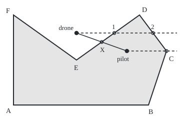

# Inside or outside: ray casting, and whether two segments cross

[Syllabus](../../../SYLLABUS.md) → [Geometry and trig](../README.md) → [Points, Convexity and Fractals](../README.md#s07) → Inside or outside

---

## General Overview

A paddock is fenced on six straight runs. Five corners point outward. The sixth, E, points inward, a reflex corner (more than 180° inside): the fence bends in round a dam, leaving a V-shaped notch in the north side. A spraying drone hovers 70 m east and 80 m north of the south-west corner. Is it over the paddock or over the dam?

The drone lies within the paddock's east–west and north–south spans, so a box drawn round the paddock says yes. The answer is no: the drone hangs in the notch. The pilot stands at 126 m east, 60 m north. Does the line from pilot to drone cross a fence, and which?

One small calculation answers both: which side of a line a point lies on. Send a ray (a half-line running forever one way) due east from the point and count the fences it meets. The drone's meets two: outside. The pilot's meets one: inside. The flight line crosses fence D–E at 98 m east, 70 m north.

**A point is inside a fence that does not cross itself exactly when a ray from it meets the fence an odd number of times; and two straight segments cross exactly when each one's ends lie on opposite sides of the other.**

**What kind of fact this is:** a method; the facts it rests on are theorems, proved on this card in Why it works for straight-sided fences, with the general curve in Jordan curve theorem.

### The picture: the paddock, the drone and the pilot

<p align="center"></p>

Drawn at 1 m = 1.8 units, corner A at the bottom left. The drone's dashed ray meets fences D–E and C–D, marked 1 and 2: even, so outside. The pilot's ray passes exactly through corner C and counts once. The solid flight line crosses D–E at X.

---

## The formula

Positions are grid coordinates in metres, east then north ([Distance and midpoint](../04-Coordinates%20and%20Curves/01-distance-and-midpoint.md)). For a point $a$, $a_x$ is its east coordinate and $a_y$ its north coordinate; the small letter below, a subscript, names the part.

The corners, in order round the fence, are A (0, 0), B (150, 0), C (170, 60), D (140, 100), E (70, 50) and F (0, 100).

The one tool is the orientation of three points, from [Shoelace formula](01-polygon-area-and-orientation.md):

$$\operatorname{orient}(a, b, c) = (b_x - a_x)(c_y - a_y) - (b_y - a_y)(c_x - a_x)$$

**Read it aloud:** walking from $a$ towards $b$, the number is positive if $c$ lies on the left, negative if on the right, zero if all three are in line.

It is the cross product of the arrows from $a$ to $b$ and from $a$ to $c$; only its sign is used here.

**Inside or outside.** A fence edge from corner $a$ to corner $b$ counts as a crossing of the eastward ray from $p$ when

$$(a_y > p_y) \ne (b_y > p_y) \quad\text{and}\quad \operatorname{orient}(a, b, p)\,(b_y - a_y) > 0$$

**Read it aloud:** exactly one end of the edge lies strictly north of the point, and the point lies west of the edge.

The point is inside when the count $n$ of such edges is odd, outside when it is even.

**Two segments.** The segment from $p$ to $q$ and the segment from $r$ to $s$ cross when

$$\operatorname{orient}(p, q, r)\,\operatorname{orient}(p, q, s) < 0 \quad\text{and}\quad \operatorname{orient}(r, s, p)\,\operatorname{orient}(r, s, q) < 0$$

**Read it aloud:** each segment's two ends lie on opposite sides of the other segment's line. A product is negative exactly when the two signs differ.

| Symbol | Plain meaning | In our example | Push it up and the answer… |
| --- | --- | --- | --- |
| $p$ | the point tested; in the crossing test, one end of the flight line | drone (70, 80), pilot (126, 60) | — |
| $a$, $b$, $c$ | points fed to orient; $a$, $b$ also a fence edge's ends | D (140, 100), E (70, 50) | — |
| $a_x$, $a_y$, $p_x$, $p_y$ | east and north coordinates, in metres | E: 70 east, 50 north | — |
| $\operatorname{orient}$ | twice a triangle's signed area; its sign says left or right | orient(D, E, drone) = −2100 | larger size: further from the line |
| $n$ | edges met by the eastward ray | 2 for the drone, 1 for the pilot | each extra crossing flips the verdict |
| $q$, $r$, $s$ | segment ends in the crossing test | $p$ the pilot, $q$ the drone; $r$, $s$ = D, E | — |
| $t$, $u$ | where the lines meet, as a fraction along each segment | 0.5 and 0.6 | outside 0 to 1: off the segment |
| $w$ | winding angle: total turn of the sight line from $p$ to a runner circling the fence | 0° drone, 360° pilot | — |

### When it holds

- **A fence that does not cross itself.** A figure-eight breaks "odd means inside".
- **The strict "north of".** Loosen it to "north or level" and a corner at the point's height counts twice.
- **A point not on a fence.** On one, that edge's orientation is zero and a separate on-the-line test decides.
- **Exact arithmetic.** Whole-metre coordinates make every sign exact; with rounded decimals a point a hair from a line can get the wrong one.
- **Proper crossings.** A segment ending on another gives orientation zero; touching needs an extra between-the-ends check.

---

## Why it works

### Step 0: every crossing flips the side

Far enough east a ray is clear of the paddock: outside. Walking back to the point, each fence crossed flips the side, so only the count's parity (odd or even) matters.

### Step 1: an edge crosses the ray east of the point

An edge meets the horizontal line through $p$ only if one end is north of $p$ and the other is not: the rule's first half.

For an edge running north, the crossing is east of $p$ exactly when $p$ is on the walk's left, orientation positive; running south, the sides swap. Multiplying by $b_y - a_y$, positive going north and negative going south, folds both into one sign. For the drone on D–E, orientation −2100 and the drop from 100 m to 50 m are both negative: the product is positive, and the crossing counts, at 112 m east. The decision never divides.

### Step 2: a corner on the ray counts once or not at all

The pilot's ray passes exactly through corner C, at (170, 60), where the fence runs on north: one crossing. Edge B–C has neither end strictly north of 60 m, so it does not count; C–D does. The pilot gets $n$ = 1, inside.

So a corner at the ray's height counts as if just south of it (the half-open rule): passed through, it counts once; touched and turned back from, twice or not at all. Parity is right either way.

### Step 3: two segments cross when each straddles the other

If flight and fence cross, each straddles the other's line. Conversely, if D and E straddle the flight line, the fence segment meets that line; if pilot and drone straddle the fence line, the flight segment meets it. Two lines that are not parallel meet once, so that point is on both segments. Here orient(D, E, pilot) = 2100 against −2100 for the drone, and orient(pilot, drone, D) = −2520 against 1680 for E.

<details>
<summary>Detailed proof: the fence has exactly two sides</summary>

Move $p$ along a path that never touches the fence. Its count changes only when a corner passes through the ray's height, and the half-open rule makes that change 0 or 2. So parity is constant along the path.

Two points close together either side of one edge, away from corners, have rays meeting the same edges except that one: their parities differ.

Far away the count is 0. So points joined to far away without touching the fence are even, points just across an edge are odd, and no path joins the two without crossing the fence. That is the two-sided split for straight-run fences; for any closed curve that does not cross itself it is the Jordan curve theorem.

</details>

A second road needs no counting. Watch a runner go once round the fence: from inside, the sight line turns a full 360°; from outside it swings and returns, 0° in all. That total is the winding angle $w$, computed in the code from the inverse tangent ([Inverse trig](../03-Trigonometry/05-inverse-trig-and-solving-equations.md)). The segment test is checked by solving the two lines' equations for $t$ and $u$.


---

## Worked numbers, by hand

| Step | Arithmetic | Value |
| --- | --- | --- |
| E is reflex | orient(D, E, F) = (−70)(0) − (−50)(−140) | −7000, a right turn |
| drone, fence D–E | D (100 m) north of 80 m, E (50 m) not; (−70)(−20) − (−50)(−70), fence runs south | −2100: counts, at 112 m |
| drone, fence C–D | (−30)(20) − (40)(−100), fence runs north | 3400: counts, at 155 m |
| drone's count | no other fence qualifies | **2, outside** |
| pilot's count | C–D counts, B–C does not | **1, inside** |
| flight line against D–E | 2100 and −2100; −2520 and 1680 | **signs differ twice: crosses** |
| where | t = 0.5, u = 0.6 | **(98, 70)** |

The drone is over the dam; flying out to it from the pilot crosses fence D–E.

As a cross-check, 127 of 180 grid points 10 m apart test inside by both roads: about 12700 square metres, against the shoelace formula's exact 12300.

### What breaks if you drop a piece

| Mistake | Comes out at | What went wrong |
| --- | --- | --- |
| Box test on the paddock's extremes | drone inside | The notch is inside the box, outside the fence |
| A corner on the ray counted on both its edges | pilot count 2, outside | Corner C is one crossing, not two |
| Only fence B–C's ends checked against the flight line | orient 2880 and −880, "crosses" | The lines meet behind the pilot, t = −0.7021 |

The code prints all three.

---

## Code, from first principles, and it actually runs

Two roads each. Inside or outside: crossing counts against the winding angle, on the drone, the pilot and the grid. Crossing: the straddle test on every fence against solving for $t$ and $u$ by Cramer's rule (a ratio of two determinants). The distance formula then confirms the meeting point lies on both segments.

### Python

```python
# Inside or outside -- the check behind the card.  Standard library only.  A paddock
# of six corners, reflex at E; a drone at (70, 80), its pilot at (126, 60).  Each verdict
# is reached twice: ray crossings against winding angle, straddle test against solving.
import math
P = {"A": (0, 0), "B": (150, 0), "C": (170, 60), "D": (140, 100), "E": (70, 50), "F": (0, 100)}
fence = list(P.values())
edges = [(fence[i], fence[(i + 1) % 6]) for i in range(6)]
drone, pilot, B, C, D, E = (70, 80), (126, 60), P["B"], P["C"], P["D"], P["E"]
def orient(a, b, c):                   # twice the signed area of triangle a, b, c
    return (b[0] - a[0]) * (c[1] - a[1]) - (b[1] - a[1]) * (c[0] - a[0])
def crossings(p, half_open=True):      # road one: x of each fence the ray going right meets
    hits = []
    for a, b in edges:
        closed = a[1] != b[1] and min(a[1], b[1]) <= p[1] <= max(a[1], b[1])
        if ((a[1] > p[1]) != (b[1] > p[1]) if half_open else closed) and orient(a, b, p) * (b[1] - a[1]) > 0:
            hits.append(a[0] + (p[1] - a[1]) * (b[0] - a[0]) / (b[1] - a[1]))
    return sorted(hits)
def winding(p):                        # road two: total turn of the sight line, in degrees
    total = 0.0
    for a, b in edges:
        d = math.atan2(b[1] - p[1], b[0] - p[0]) - math.atan2(a[1] - p[1], a[0] - p[0])
        total += (d + math.pi) % (2 * math.pi) - math.pi
    return abs(math.degrees(total))
def straddle(p, q, r, s):              # road one: each segment's ends on opposite sides of the other
    return orient(p, q, r) * orient(p, q, s) < 0 and orient(r, s, p) * orient(r, s, q) < 0
def solve(p, q, r, s):                 # road two: p + t(q - p) = r + u(s - r), by Cramer's rule
    dx, dy, ex, ey, fx, fy = q[0] - p[0], q[1] - p[1], s[0] - r[0], s[1] - r[1], r[0] - p[0], r[1] - p[1]
    det = ex * dy - dx * ey
    return (ex * fy - ey * fx) / det, (dx * fy - dy * fx) / det

side = lambda k: "inside" if k else "outside"
svg = lambda x, y: (round(27 + 1.8 * x, 1), round(210 - 1.8 * y, 1))
dist = lambda a, b: math.sqrt((b[0] - a[0]) ** 2 + (b[1] - a[1]) ** 2)
print(f"reflex corner E: orient(D, E, F) = {orient(D, E, P['F'])}; area by shoelace {sum(orient((0, 0), a, b) for a, b in edges) / 2} m2")
for name, p in (("drone", drone), ("pilot", pilot)):
    h = crossings(p)
    print(f"{name} {p}: ray meets fences at x = {h}, count {len(h)} -> {side(len(h) % 2)}; winding {winding(p):.2f} deg")
print(f"orient(D, E, pilot) = {orient(D, E, pilot)}, orient(D, E, drone) = {orient(D, E, drone)}\n"
      f"orient(pilot, drone, D) = {orient(pilot, drone, D)}, orient(pilot, drone, E) = {orient(pilot, drone, E)}")
t, u = solve(pilot, drone, D, E)
X = (pilot[0] + t * (drone[0] - pilot[0]), pilot[1] + t * (drone[1] - pilot[1]))
print(f"flight line meets fence D-E at t = {t}, u = {u}, point ({X[0]:g}, {X[1]:g})")
by_straddle = [straddle(pilot, drone, a, b) for a, b in edges]
by_solving = [0 < v < 1 and 0 < w < 1 for v, w in [solve(pilot, drone, a, b) for a, b in edges]]
print(f"fences crossed by the flight line: straddle test {sum(by_straddle)}, solving {sum(by_solving)}")
grid = [(4 + 10 * i, 3 + 10 * j) for i in range(18) for j in range(10)]
ray_in, wind_in = [len(crossings(g)) % 2 == 1 for g in grid], [round(winding(g)) == 360 for g in grid]
print(f"grid of {len(grid)} points 10 m apart: inside by ray {sum(ray_in)}, by winding {sum(wind_in)}; x 100 m2 = {100 * sum(ray_in)} m2")
print(f"mistake 1, bounding box 0..170 by 0..100 says the drone is {side(0 <= drone[0] <= 170 and 0 <= drone[1] <= 100)}")
bad, (t2, u2) = crossings(pilot, half_open=False), solve(pilot, drone, B, C)
print(f"mistake 2, corner C counted on both its fences: pilot count {len(bad)} -> {side(len(bad) % 2)}")
print(f"mistake 3, fence B-C ends only: orient(pilot, drone, B) = {orient(pilot, drone, B)}, C = {orient(pilot, drone, C)} -> 'crosses'\n"
      f"  but orient(B, C, pilot) = {orient(B, C, pilot)}, orient(B, C, drone) = {orient(B, C, drone)}; t = {t2:.4f}, u = {u2:.4f}")
print(f"figure, corners {[svg(*c) for c in fence]}")
print(f"figure, drone {svg(*drone)}, pilot {svg(*pilot)}, meet {svg(*X)}, ray hits {[svg(x, drone[1]) for x in crossings(drone)]}, {svg(*C)}")
assert ray_in == wind_in and [len(crossings(p)) % 2 for p in (drone, pilot)] == [0, 1]
assert by_straddle == by_solving and by_straddle.index(True) == 3        # fence D-E, both roads
assert abs(dist(pilot, X) + dist(X, drone) - dist(pilot, drone)) < 1e-9 and abs(dist(D, X) - u * dist(D, E)) + abs(dist(X, E) - (1 - u) * dist(D, E)) < 1e-9
assert len(bad) % 2 != len(crossings(pilot)) % 2 and not 0 < t2 < 1
print("ALL CHECKS PASS")
```

**Ran 2026-09-24 on macOS, Python 3.14.6, standard library only. All checks passed. Output, pasted from the run:**

```
reflex corner E: orient(D, E, F) = -7000; area by shoelace 12300.0 m2
drone (70, 80): ray meets fences at x = [112.0, 155.0], count 2 -> outside; winding 0.00 deg
pilot (126, 60): ray meets fences at x = [170.0], count 1 -> inside; winding 360.00 deg
orient(D, E, pilot) = 2100, orient(D, E, drone) = -2100
orient(pilot, drone, D) = -2520, orient(pilot, drone, E) = 1680
flight line meets fence D-E at t = 0.5, u = 0.6, point (98, 70)
fences crossed by the flight line: straddle test 1, solving 1
grid of 180 points 10 m apart: inside by ray 127, by winding 127; x 100 m2 = 12700 m2
mistake 1, bounding box 0..170 by 0..100 says the drone is inside
mistake 2, corner C counted on both its fences: pilot count 2 -> outside
mistake 3, fence B-C ends only: orient(pilot, drone, B) = 2880, C = -880 -> 'crosses'
  but orient(B, C, pilot) = 2640, orient(B, C, drone) = 6400; t = -0.7021, u = 0.7660
figure, corners [(27.0, 210.0), (297.0, 210.0), (333.0, 102.0), (279.0, 30.0), (153.0, 120.0), (27.0, 30.0)]
figure, drone (153.0, 66.0), pilot (253.8, 102.0), meet (203.4, 84.0), ray hits [(228.6, 66.0), (306.0, 66.0)], (333.0, 102.0)
ALL CHECKS PASS
```

### Rust

Same numbers, same labels, built with `rustc --edition 2021 -O`.

```rust
// Inside or outside -- the same check as the Python, in Rust.  No crates.  A paddock
// of six corners, reflex at E; a drone at (70, 80), its pilot at (126, 60).  Each verdict
// is reached twice: ray crossings against winding angle, straddle test against solving.
type Pt = (f64, f64);
const FENCE: [Pt; 6] = [(0.0, 0.0), (150.0, 0.0), (170.0, 60.0), (140.0, 100.0), (70.0, 50.0), (0.0, 100.0)];
fn edges() -> Vec<(Pt, Pt)> { (0..6).map(|i| (FENCE[i], FENCE[(i + 1) % 6])).collect() }
fn orient(a: Pt, b: Pt, c: Pt) -> f64 { (b.0 - a.0) * (c.1 - a.1) - (b.1 - a.1) * (c.0 - a.0) }
fn crossings(p: Pt, half_open: bool) -> Vec<f64> {   // road one: x of each fence the ray going right meets
    let mut hits = Vec::new();
    for (a, b) in edges() {
        let closed = a.1 != b.1 && a.1.min(b.1) <= p.1 && p.1 <= a.1.max(b.1);
        let spans = if half_open { (a.1 > p.1) != (b.1 > p.1) } else { closed };
        if spans && orient(a, b, p) * (b.1 - a.1) > 0.0 { hits.push(a.0 + (p.1 - a.1) * (b.0 - a.0) / (b.1 - a.1)) }
    }
    hits.sort_by(|x, y| x.partial_cmp(y).unwrap());
    hits
}
fn winding(p: Pt) -> f64 {                           // road two: total turn of the sight line, in degrees
    let pi = std::f64::consts::PI;
    let mut total = 0.0;
    for (a, b) in edges() {
        let d = (b.1 - p.1).atan2(b.0 - p.0) - (a.1 - p.1).atan2(a.0 - p.0);
        total += (d + pi).rem_euclid(2.0 * pi) - pi;
    }
    total.to_degrees().abs()
}
fn straddle(p: Pt, q: Pt, r: Pt, s: Pt) -> bool {   // road one: each segment's ends on opposite sides of the other
    orient(p, q, r) * orient(p, q, s) < 0.0 && orient(r, s, p) * orient(r, s, q) < 0.0
}
fn solve(p: Pt, q: Pt, r: Pt, s: Pt) -> (f64, f64) { // road two: p + t(q - p) = r + u(s - r), by Cramer's rule
    let (dx, dy, ex, ey, fx, fy) = (q.0 - p.0, q.1 - p.1, s.0 - r.0, s.1 - r.1, r.0 - p.0, r.1 - p.1);
    let det = ex * dy - dx * ey;
    ((ex * fy - ey * fx) / det, (dx * fy - dy * fx) / det)
}
fn side(k: bool) -> &'static str { if k { "inside" } else { "outside" } }
fn svg(p: Pt) -> Pt { (((27.0 + 1.8 * p.0) * 10.0).round() / 10.0, ((210.0 - 1.8 * p.1) * 10.0).round() / 10.0) }
fn dist(a: Pt, b: Pt) -> f64 { ((b.0 - a.0).powi(2) + (b.1 - a.1).powi(2)).sqrt() }
fn g(x: f64) -> String { if x.fract() == 0.0 { format!("{}", x as i64) } else { format!("{}", x) } }
fn pi(p: Pt) -> String { format!("({}, {})", g(p.0), g(p.1)) }
fn main() {
    let (drone, pilot) = ((70.0, 80.0), (126.0, 60.0));
    let (b, c, d, e) = (FENCE[1], FENCE[2], FENCE[3], FENCE[4]);
    let area: f64 = edges().iter().map(|&(a, b)| orient((0.0, 0.0), a, b)).sum::<f64>() / 2.0;
    println!("reflex corner E: orient(D, E, F) = {}; area by shoelace {:?} m2", g(orient(d, e, FENCE[5])), area);
    for (name, p) in [("drone", drone), ("pilot", pilot)] {
        let h = crossings(p, true);
        println!("{} {}: ray meets fences at x = {:?}, count {} -> {}; winding {:.2} deg", name, pi(p), h, h.len(), side(h.len() % 2 == 1), winding(p));
    }
    println!("orient(D, E, pilot) = {}, orient(D, E, drone) = {}", g(orient(d, e, pilot)), g(orient(d, e, drone)));
    println!("orient(pilot, drone, D) = {}, orient(pilot, drone, E) = {}", g(orient(pilot, drone, d)), g(orient(pilot, drone, e)));
    let (t, u) = solve(pilot, drone, d, e);
    let x = (pilot.0 + t * (drone.0 - pilot.0), pilot.1 + t * (drone.1 - pilot.1));
    println!("flight line meets fence D-E at t = {:?}, u = {:?}, point {}", t, u, pi(x));
    let by_straddle: Vec<bool> = edges().iter().map(|&(a, b)| straddle(pilot, drone, a, b)).collect();
    let by_solving: Vec<bool> = edges().iter().map(|&(a, b)| { let (v, w) = solve(pilot, drone, a, b); 0.0 < v && v < 1.0 && 0.0 < w && w < 1.0 }).collect();
    let count = |v: &Vec<bool>| v.iter().filter(|&&k| k).count();
    println!("fences crossed by the flight line: straddle test {}, solving {}", count(&by_straddle), count(&by_solving));
    let grid: Vec<Pt> = (0..18).flat_map(|i| (0..10).map(move |j| (4.0 + 10.0 * i as f64, 3.0 + 10.0 * j as f64))).collect();
    let ray_in: Vec<bool> = grid.iter().map(|&q| crossings(q, true).len() % 2 == 1).collect();
    let wind_in: Vec<bool> = grid.iter().map(|&q| winding(q).round() == 360.0).collect();
    println!("grid of {} points 10 m apart: inside by ray {}, by winding {}; x 100 m2 = {} m2", grid.len(), count(&ray_in), count(&wind_in), 100 * count(&ray_in));
    println!("mistake 1, bounding box 0..170 by 0..100 says the drone is {}", side(0.0 <= drone.0 && drone.0 <= 170.0 && 0.0 <= drone.1 && drone.1 <= 100.0));
    let (bad, (t2, u2)) = (crossings(pilot, false), solve(pilot, drone, b, c));
    println!("mistake 2, corner C counted on both its fences: pilot count {} -> {}", bad.len(), side(bad.len() % 2 == 1));
    println!("mistake 3, fence B-C ends only: orient(pilot, drone, B) = {}, C = {} -> 'crosses'", g(orient(pilot, drone, b)), g(orient(pilot, drone, c)));
    println!("  but orient(B, C, pilot) = {}, orient(B, C, drone) = {}; t = {:.4}, u = {:.4}", g(orient(b, c, pilot)), g(orient(b, c, drone)), t2, u2);
    println!("figure, corners {:?}", FENCE.iter().map(|&q| svg(q)).collect::<Vec<Pt>>());
    let hits: Vec<Pt> = crossings(drone, true).iter().map(|&h| svg((h, drone.1))).collect();
    println!("figure, drone {:?}, pilot {:?}, meet {:?}, ray hits {:?}, {:?}", svg(drone), svg(pilot), svg(x), hits, svg(c));
    assert!(ray_in == wind_in && crossings(drone, true).len() % 2 == 0 && crossings(pilot, true).len() % 2 == 1);
    assert!(by_straddle == by_solving && by_straddle.iter().position(|&k| k) == Some(3)); // fence D-E, both roads
    assert!((dist(pilot, x) + dist(x, drone) - dist(pilot, drone)).abs() < 1e-9 && (dist(d, x) - u * dist(d, e)).abs() + (dist(x, e) - (1.0 - u) * dist(d, e)).abs() < 1e-9);
    assert!(bad.len() % 2 != crossings(pilot, true).len() % 2 && !(0.0 < t2 && t2 < 1.0));
    println!("ALL CHECKS PASS");
}
```

**Ran 2026-09-24 on macOS, rustc 1.98.1, no crates. All checks passed. Output, pasted from the run:**

```
reflex corner E: orient(D, E, F) = -7000; area by shoelace 12300.0 m2
drone (70, 80): ray meets fences at x = [112.0, 155.0], count 2 -> outside; winding 0.00 deg
pilot (126, 60): ray meets fences at x = [170.0], count 1 -> inside; winding 360.00 deg
orient(D, E, pilot) = 2100, orient(D, E, drone) = -2100
orient(pilot, drone, D) = -2520, orient(pilot, drone, E) = 1680
flight line meets fence D-E at t = 0.5, u = 0.6, point (98, 70)
fences crossed by the flight line: straddle test 1, solving 1
grid of 180 points 10 m apart: inside by ray 127, by winding 127; x 100 m2 = 12700 m2
mistake 1, bounding box 0..170 by 0..100 says the drone is inside
mistake 2, corner C counted on both its fences: pilot count 2 -> outside
mistake 3, fence B-C ends only: orient(pilot, drone, B) = 2880, C = -880 -> 'crosses'
  but orient(B, C, pilot) = 2640, orient(B, C, drone) = 6400; t = -0.7021, u = 0.7660
figure, corners [(27.0, 210.0), (297.0, 210.0), (333.0, 102.0), (279.0, 30.0), (153.0, 120.0), (27.0, 30.0)]
figure, drone (153.0, 66.0), pilot (253.8, 102.0), meet (203.4, 84.0), ray hits [(228.6, 66.0), (306.0, 66.0)], (333.0, 102.0)
ALL CHECKS PASS
```

The two outputs match line for line.

### Lean

Lean proves both tests for any straight-run fence and any two segments, under the card's conditions, and checks the paddock's numbers.

- Take any fence of straight runs that does not cross itself, and a point not on it. The point is inside exactly when its eastward ray meets the fence an odd number of times. The count uses the card's strict "north of" rule. Inside means the point's piece of ground, walled off by the fence, does not run on forever.
- Take two segments where no end lies on the other's line. They cross exactly when each one's ends lie on opposite sides of the other's line.
- The hand numbers hold: orient(D, E, F) = −7000, counts 2 for the drone and 1 for the pilot, and the D–E and B–C orientations.

The winding angle, where each ray meets a fence, the crossing at (98, 70) and the grid are left to the Python and Rust checks.

```lean
-- Inside or outside: a point off a fence that does not cross itself is inside exactly when its eastward ray meets the fence an odd number of times, and two segments with no three ends in line cross exactly when each one's ends lie on opposite sides of the other.
import Mathlib.Analysis.Convex.Segment
import Mathlib.Topology.Connected.Basic
import Mathlib.Topology.MetricSpace.Bounded
import Mathlib.Analysis.Normed.Group.Basic
import Mathlib.Algebra.Order.Field.Basic
import Mathlib.Data.Fintype.Card
import Mathlib.Tactic.NormNum
import Mathlib.Tactic.FinCases
import Mathlib

/-- The orientation of three points a, b, c in the plane: twice the signed area of the
triangle a b c. Positive when c lies on the left of the walk from a to b, negative when on
the right, zero when the three are in line. -/
def orient (a b c : ℝ × ℝ) : ℝ :=
  (b.1 - a.1) * (c.2 - a.2) - (b.2 - a.2) * (c.1 - a.1)

/-- The fence with corners `v 0, v 1, …, v (n-1)` in order: the union of its straight runs
from each corner to the next, the last run going back to `v 0`. -/
def fence {n : ℕ} [NeZero n] (v : Fin n → ℝ × ℝ) : Set (ℝ × ℝ) :=
  ⋃ i : Fin n, segment ℝ (v i) (v (i + 1))

/-- The fence does not cross itself: two different runs share no point, except that a run and
the next one share the corner between them. -/
def NoSelfCrossing {n : ℕ} [NeZero n] (v : Fin n → ℝ × ℝ) : Prop :=
  ∀ i j : Fin n, i ≠ j →
    segment ℝ (v i) (v (i + 1)) ∩ segment ℝ (v j) (v (j + 1)) ⊆
      {x | (j = i + 1 ∧ x = v j) ∨ (i = j + 1 ∧ x = v i)}

/-- The card's crossing count for the eastward ray from `p`: the number of runs from `a` to `b`
with exactly one end strictly north of `p` and `orient a b p * (b_y - a_y) > 0`. -/
noncomputable def crossCount {n : ℕ} [NeZero n] (v : Fin n → ℝ × ℝ) (p : ℝ × ℝ) : ℕ :=
  (Finset.univ.filter fun i : Fin n =>
    ((v i).2 > p.2 ↔ ¬ (v (i + 1)).2 > p.2) ∧
      orient (v i) (v (i + 1)) p * ((v (i + 1)).2 - (v i).2) > 0).card

lemma mem_segment_coords {a b x : ℝ × ℝ} :
    x ∈ segment ℝ a b ↔ ∃ t : ℝ, 0 ≤ t ∧ t ≤ 1 ∧
      x.1 = a.1 + t * (b.1 - a.1) ∧ x.2 = a.2 + t * (b.2 - a.2) := by
  rw [segment_eq_image']
  constructor
  · rintro ⟨t, ⟨h0, h1⟩, rfl⟩
    exact ⟨t, h0, h1, by simp, by simp⟩
  · rintro ⟨t, h0, h1, hx1, hx2⟩
    refine ⟨t, ⟨h0, h1⟩, ?_⟩
    ext <;> simp [hx1, hx2]

lemma orient_cyc (a b q : ℝ × ℝ) :
    orient a b q = (a.1 - q.1) * (b.2 - q.2) - (a.2 - q.2) * (b.1 - q.1) := by
  simp only [orient]; ring

lemma orient_swap (a b q : ℝ × ℝ) : orient b a q = - orient a b q := by
  simp only [orient]; ring

lemma orient_eq_zero_of_mem {a b x : ℝ × ℝ} (h : x ∈ segment ℝ a b) : orient a b x = 0 := by
  obtain ⟨t, -, -, h1, h2⟩ := mem_segment_coords.1 h
  simp only [orient]; rw [h1, h2]; ring

lemma isClosed_segment' (a b : ℝ × ℝ) : IsClosed (segment ℝ a b) := by
  rw [segment_eq_image']
  exact (isCompact_Icc.image (by fun_prop)).isClosed

lemma isClosed_edges {n : ℕ} [NeZero n] (v : Fin n → ℝ × ℝ) (P : Fin n → Prop) :
    IsClosed (⋃ j : {j : Fin n // P j}, segment ℝ (v j.1) (v (j.1 + 1))) :=
  isClosed_iUnion_of_finite fun _ => isClosed_segment' _ _

lemma isClosed_fence {n : ℕ} [NeZero n] (v : Fin n → ℝ × ℝ) : IsClosed (fence v) :=
  isClosed_iUnion_of_finite fun _ => isClosed_segment' _ _

lemma exists_ball_avoid {F : Set (ℝ × ℝ)} (hF : IsClosed F) {x : ℝ × ℝ} (hx : x ∉ F) :
    ∃ ρ > 0, ∀ y, dist y x < ρ → y ∉ F := by
  obtain ⟨ρ, hρ, h⟩ := Metric.isOpen_iff.1 hF.isOpen_compl x hx
  exact ⟨ρ, hρ, fun y hy => h (Metric.mem_ball.2 hy)⟩

lemma seg_of_y {a b q : ℝ × ℝ} (hab : a.2 ≠ b.2)
    (hq : (a.2 ≤ q.2 ∧ q.2 ≤ b.2) ∨ (b.2 ≤ q.2 ∧ q.2 ≤ a.2)) (ho : orient a b q = 0) :
    q ∈ segment ℝ a b := by
  have hd : b.2 - a.2 ≠ 0 := sub_ne_zero.2 (Ne.symm hab)
  refine mem_segment_coords.2 ⟨(q.2 - a.2) / (b.2 - a.2), ?_, ?_, ?_, ?_⟩
  · rcases hq with h | h
    · exact div_nonneg (by linarith) (by linarith [lt_of_le_of_ne (h.1.trans h.2) hab])
    · apply div_nonneg_of_nonpos <;> [linarith; linarith]
  · rcases hq with h | h
    · rw [div_le_one (by linarith [lt_of_le_of_ne (h.1.trans h.2) hab])]; linarith
    · rw [div_le_one_of_neg (by linarith [lt_of_le_of_ne (h.1.trans h.2) (Ne.symm hab)])]; linarith
  · simp only [orient] at ho
    field_simp
    linarith
  · field_simp; ring

lemma seg_of_x {a b q : ℝ × ℝ} (hab : a.1 ≠ b.1)
    (hq : (a.1 ≤ q.1 ∧ q.1 ≤ b.1) ∨ (b.1 ≤ q.1 ∧ q.1 ≤ a.1)) (ho : orient a b q = 0) :
    q ∈ segment ℝ a b := by
  have hd : b.1 - a.1 ≠ 0 := sub_ne_zero.2 (Ne.symm hab)
  refine mem_segment_coords.2 ⟨(q.1 - a.1) / (b.1 - a.1), ?_, ?_, ?_, ?_⟩
  · rcases hq with h | h
    · exact div_nonneg (by linarith) (by linarith [lt_of_le_of_ne (h.1.trans h.2) hab])
    · apply div_nonneg_of_nonpos <;> [linarith; linarith]
  · rcases hq with h | h
    · rw [div_le_one (by linarith [lt_of_le_of_ne (h.1.trans h.2) hab])]; linarith
    · rw [div_le_one_of_neg (by linarith [lt_of_le_of_ne (h.1.trans h.2) (Ne.symm hab)])]; linarith
  · field_simp; ring
  · simp only [orient] at ho
    field_simp
    linarith

def cr (a b p : ℝ × ℝ) : Prop := (a.2 > p.2 ↔ ¬ b.2 > p.2) ∧ orient a b p * (b.2 - a.2) > 0

def Ev (w q : ℝ × ℝ) : Prop := w.2 = q.2 ∧ q.1 < w.1

lemma cr_symm (a b p : ℝ × ℝ) : cr b a p ↔ cr a b p := by
  unfold cr
  rw [orient_swap]
  constructor
  · rintro ⟨h1, h2⟩; exact ⟨by tauto, by nlinarith⟩
  · rintro ⟨h1, h2⟩; exact ⟨by tauto, by nlinarith⟩

lemma above_iff_of_abs {w q q' : ℝ × ℝ} (hw : w.2 ≠ q.2) (h : |q'.2 - q.2| < |w.2 - q.2|) :
    (w.2 > q'.2 ↔ w.2 > q.2) := by
  rw [abs_sub_lt_iff] at h
  rcases lt_or_gt_of_ne hw with hw | hw
  · rw [abs_of_neg (by linarith)] at h
    constructor <;> intro <;> linarith [h.1, h.2]
  · rw [abs_of_pos (by linarith)] at h
    constructor <;> intro <;> linarith [h.1, h.2]

lemma sign_transfer {O O' d : ℝ} (h : 0 < O' * O) : (O' * d > 0 ↔ O * d > 0) := by
  constructor
  · intro h1
    by_contra h2; push Not at h2
    nlinarith [sq_nonneg O', mul_pos h1 h]
  · intro h1
    by_contra h2; push Not at h2
    nlinarith [sq_nonneg O, mul_pos h1 h]

lemma pe_main {a b q q' : ℝ × ℝ} (hq : q ∉ segment ℝ a b) (hb2 : b.2 ≠ q.2)
    (ha : a.2 ≠ q.2 → |q'.2 - q.2| < |a.2 - q.2|) (hb : |q'.2 - q.2| < |b.2 - q.2|)
    (ho : orient a b q ≠ 0 → 0 < orient a b q' * orient a b q) :
    cr a b q' ↔ (cr a b q ↔ ¬ (q'.2 < q.2 ∧ (Ev a q ↔ ¬ Ev b q))) := by
  have hbB := above_iff_of_abs hb2 hb
  have hEb : ¬ Ev b q := fun h => hb2 h.1
  by_cases ha2 : a.2 = q.2
  · have ha1 : a.1 ≠ q.1 := by
      intro h1
      apply hq
      have : q = a := Prod.ext h1.symm ha2.symm
      rw [this]; exact left_mem_segment ℝ a b
    have hO : orient a b q = (a.1 - q.1) * (b.2 - q.2) := by
      rw [orient_cyc, ha2]; ring
    have hO0 : orient a b q ≠ 0 := by
      rw [hO]; exact mul_ne_zero (sub_ne_zero.2 ha1) (sub_ne_zero.2 hb2)
    have hdy : b.2 - a.2 = b.2 - q.2 := by rw [ha2]
    have key : orient a b q * (b.2 - a.2) > 0 ↔ q.1 < a.1 := by
      rw [hO, hdy]
      have hp : 0 < (b.2 - q.2) ^ 2 := by
        have : b.2 - q.2 ≠ 0 := sub_ne_zero.2 hb2
        positivity
      constructor
      · intro h; by_contra h'; push Not at h'
        nlinarith [mul_nonneg (sub_nonneg.2 h') hp.le]
      · intro h; nlinarith [mul_pos (sub_pos.2 h) hp]
    have key' := (sign_transfer (d := b.2 - a.2) (ho hO0)).trans key
    have hEa : Ev a q ↔ q.1 < a.1 := ⟨fun h => h.2, fun h => ⟨ha2, h⟩⟩
    have haA : a.2 > q'.2 ↔ q'.2 < q.2 := by rw [ha2]
    have haq : ¬ a.2 > q.2 := by rw [ha2]; exact lt_irrefl _
    unfold cr
    rw [haA, hEa, key, key']
    by_cases hP : q'.2 < q.2 <;> by_cases hB : b.2 > q.2 <;> by_cases hK : q.1 < a.1 <;>
      simp [hP, hB, hK, haq, hEb, hbB]
  · have haA := above_iff_of_abs ha2 (ha ha2)
    have hEa : ¬ Ev a q := fun h => ha2 h.1
    unfold cr
    by_cases hx : (a.2 > q.2 ↔ ¬ b.2 > q.2)
    · have hO0 : orient a b q ≠ 0 := by
        intro h0
        apply hq
        apply seg_of_y _ _ h0
        · intro h; rw [h] at hx; exact iff_not_self hx
        · rcases lt_or_gt_of_ne ha2 with h1 | h1 <;> rcases lt_or_gt_of_ne hb2 with h2 | h2
          · exact absurd (hx.2 (not_lt.2 h2.le)) (not_lt.2 h1.le)
          · left; constructor <;> linarith
          · right; constructor <;> linarith
          · exact absurd h2 (hx.1 h1)
      have key' := sign_transfer (d := b.2 - a.2) (ho hO0)
      rw [haA, hbB, key']
      simp [hEa, hEb]
    · rw [haA, hbB]
      have h3 : ¬ (q'.2 < q.2 ∧ (Ev a q ↔ ¬ Ev b q)) := fun h => hEa (h.2.2 hEb)
      exact iff_of_false (fun h => hx h.1) (fun h => (fun h2 : _ => hx h2.1) (h.2 h3))

lemma pe_level {a b q q' : ℝ × ℝ} (hq : q ∉ segment ℝ a b) (ha2 : a.2 = q.2) (hb2 : b.2 = q.2) :
    cr a b q' ↔ (cr a b q ↔ ¬ (q'.2 < q.2 ∧ (Ev a q ↔ ¬ Ev b q))) := by
  have hd : b.2 - a.2 = 0 := by rw [ha2, hb2]; ring
  have h1 : ¬ cr a b q' := by unfold cr; rw [hd]; simp
  have h2 : ¬ cr a b q := by unfold cr; rw [hd]; simp
  have h3 : (Ev a q ↔ Ev b q) := by
    simp only [Ev, ha2, hb2, true_and]
    have ha1 : a.1 ≠ q.1 := by
      intro h1
      apply hq
      have : q = a := Prod.ext h1.symm ha2.symm
      rw [this]; exact left_mem_segment ℝ a b
    have hb1 : b.1 ≠ q.1 := by
      intro h1
      apply hq
      have : q = b := Prod.ext h1.symm hb2.symm
      rw [this]; exact right_mem_segment ℝ a b
    have ho : orient a b q = 0 := by rw [orient_cyc, ha2, hb2]; ring
    constructor
    · intro h; by_contra h'; push Not at h'
      exact hq (seg_of_x (by intro e; linarith) (Or.inr ⟨h', h.le⟩) ho)
    · intro h; by_contra h'; push Not at h'
      exact hq (seg_of_x (by intro e; linarith) (Or.inl ⟨h', h.le⟩) ho)
  tauto

lemma pe {a b q q' : ℝ × ℝ} (hq : q ∉ segment ℝ a b)
    (ha : a.2 ≠ q.2 → |q'.2 - q.2| < |a.2 - q.2|) (hb : b.2 ≠ q.2 → |q'.2 - q.2| < |b.2 - q.2|)
    (ho : orient a b q ≠ 0 → 0 < orient a b q' * orient a b q) :
    cr a b q' ↔ (cr a b q ↔ ¬ (q'.2 < q.2 ∧ (Ev a q ↔ ¬ Ev b q))) := by
  by_cases hb2 : b.2 = q.2
  · by_cases ha2 : a.2 = q.2
    · exact pe_level hq ha2 hb2
    · have := pe_main (a := b) (b := a) (q := q) (q' := q') (by rwa [segment_symm]) ha2 hb (ha ha2)
        (by
          rw [orient_swap a b q, orient_swap a b q']
          intro h
          have := ho (by intro e; exact h (by rw [e]; simp))
          nlinarith)
      rw [cr_symm a b q', cr_symm a b q] at this
      rw [this]
      by_cases h1 : Ev a q <;> by_cases h2 : Ev b q <;> simp [h1, h2]
  · exact pe_main hq hb2 ha (hb hb2) ho

noncomputable def ind (P : Prop) : ZMod 2 := by classical exact if P then 1 else 0

lemma ind_pos {P : Prop} (h : P) : ind P = 1 := by unfold ind; simp [h]
lemma ind_neg {P : Prop} (h : ¬ P) : ind P = 0 := by unfold ind; simp [h]

lemma ind_xor (P Q R S T : Prop) (h : P ↔ (Q ↔ ¬ (R ∧ (S ↔ ¬ T)))) :
    ind P = ind Q + ind R * (ind S + ind T) := by
  by_cases hQ : Q <;> by_cases hR : R <;> by_cases hS : S <;> by_cases hT : T <;>
    simp only [hQ, hR, hS, hT, iff_true, iff_false,
      not_true, not_false_eq_true, and_true, and_false] at h <;>
    simp only [ind_pos, ind_neg, h, hQ, hR, hS, hT, not_false_eq_true] <;> decide

lemma two_mul_zmod2 (x : ZMod 2) : x + x = 0 := by
  fin_cases x <;> decide

lemma crossCount_cast {n : ℕ} [NeZero n] (v : Fin n → ℝ × ℝ) (p : ℝ × ℝ) :
    (crossCount v p : ZMod 2) = ∑ i, ind (cr (v i) (v (i + 1)) p) := by
  unfold crossCount
  rw [Finset.card_filter]
  push_cast
  refine Finset.sum_congr rfl fun i _ => ?_
  split_ifs with h
  · exact (ind_pos h).symm
  · exact (ind_neg h).symm

lemma continuous_orient (a b : ℝ × ℝ) : Continuous fun x => orient a b x := by
  unfold orient; fun_prop

lemma sum_shift {n : ℕ} [NeZero n] (v : Fin n → ℝ × ℝ) (g : ℝ × ℝ → ZMod 2) :
    ∑ i, g (v (i + 1)) = ∑ i, g (v i) :=
  Fintype.sum_equiv (Equiv.addRight (1 : Fin n)) _ _ (fun _ => rfl)

lemma locConst {n : ℕ} [NeZero n] (v : Fin n → ℝ × ℝ) {q : ℝ × ℝ} (hq : q ∉ fence v) :
    ∀ᶠ q' in nhds q, crossCount v q' % 2 = crossCount v q % 2 := by
  have h1 : ∀ i, ∀ᶠ q' in nhds q, (v i).2 ≠ q.2 → |q'.2 - q.2| < |(v i).2 - q.2| := by
    intro i
    by_cases h : (v i).2 = q.2
    · exact Filter.Eventually.of_forall fun _ h' => absurd h h'
    · have hc : ContinuousAt (fun q' : ℝ × ℝ => |q'.2 - q.2|) q := by fun_prop
      have := hc.eventually_lt (continuousAt_const (y := |(v i).2 - q.2|))
        (by simp [abs_pos, sub_ne_zero.2 h])
      filter_upwards [this] with q' hq' _ using hq'
  have h2 : ∀ i, ∀ᶠ q' in nhds q, orient (v i) (v (i + 1)) q ≠ 0 →
      0 < orient (v i) (v (i + 1)) q' * orient (v i) (v (i + 1)) q := by
    intro i
    by_cases h : orient (v i) (v (i + 1)) q = 0
    · exact Filter.Eventually.of_forall fun _ h' => absurd h h'
    · have hc : ContinuousAt (fun q' : ℝ × ℝ =>
          orient (v i) (v (i + 1)) q' * orient (v i) (v (i + 1)) q) q :=
        ((continuous_orient _ _).mul continuous_const).continuousAt
      have := (continuousAt_const (y := (0:ℝ))).eventually_lt hc (by
        exact mul_self_pos.2 h)
      filter_upwards [this] with q' hq' _ using hq'
  filter_upwards [Filter.eventually_all.2 h1, Filter.eventually_all.2 h2] with q' hq1 hq2
  rw [← ZMod.natCast_eq_natCast_iff', crossCount_cast, crossCount_cast]
  have hE : ∀ i : Fin n, ind (cr (v i) (v (i + 1)) q') = ind (cr (v i) (v (i + 1)) q) +
      ind (q'.2 < q.2) * (ind (Ev (v i) q) + ind (Ev (v (i + 1)) q)) := by
    intro i
    apply ind_xor
    exact pe (fun h => hq (Set.mem_iUnion.2 ⟨i, h⟩)) (hq1 i) (hq1 (i + 1)) (hq2 i)
  simp only [hE, Finset.sum_add_distrib, ← Finset.mul_sum]
  rw [sum_shift v (fun w => ind (Ev w q)), two_mul_zmod2, mul_zero, add_zero]

lemma parity_const {n : ℕ} [NeZero n] (v : Fin n → ℝ × ℝ) {x y : ℝ × ℝ}
    (hx : x ∈ (fence v)ᶜ) (hy : y ∈ connectedComponentIn (fence v)ᶜ x) :
    crossCount v y % 2 = crossCount v x % 2 := by
  have hcont : ContinuousOn (fun q => crossCount v q % 2) (connectedComponentIn (fence v)ᶜ x) := by
    intro z hz
    have hzU := connectedComponentIn_subset _ _ hz
    exact (Filter.EventuallyEq.continuousAt (y := crossCount v z % 2) (locConst v hzU)).continuousWithinAt
  exact isPreconnected_connectedComponentIn.constant hcont hy (mem_connectedComponentIn hx)

lemma cc_zero_of_above {n : ℕ} [NeZero n] (v : Fin n → ℝ × ℝ) {q : ℝ × ℝ}
    (h : ∀ i, (v i).2 ≤ q.2) : crossCount v q = 0 := by
  simp only [crossCount, Finset.card_eq_zero, Finset.filter_eq_empty_iff]
  intro i _ ⟨hx, _⟩
  exact not_lt.2 (h i) (hx.2 (not_lt.2 (h (i + 1))))

lemma cc_zero_of_below {n : ℕ} [NeZero n] (v : Fin n → ℝ × ℝ) {q : ℝ × ℝ}
    (h : ∀ i, q.2 < (v i).2) : crossCount v q = 0 := by
  simp only [crossCount, Finset.card_eq_zero, Finset.filter_eq_empty_iff]
  intro i _ ⟨hx, _⟩
  exact hx.1 (h i) (h (i + 1))

lemma cc_zero_of_west {n : ℕ} [NeZero n] (v : Fin n → ℝ × ℝ) {q : ℝ × ℝ}
    (h : ∀ i, (v i).1 < q.1) : crossCount v q = 0 := by
  simp only [crossCount, Finset.card_eq_zero, Finset.filter_eq_empty_iff]
  intro i _ ⟨hx, ho⟩
  rw [orient_cyc] at ho
  have ha := h i
  have hb := h (i + 1)
  by_cases hA : (v i).2 > q.2
  · have hB := hx.1 hA
    push Not at hB
    nlinarith [mul_nonneg (sub_nonneg.2 hB) (sub_pos.2 hb).le, mul_pos (sub_pos.2 hA) (sub_pos.2 hb),
      mul_nonneg (sub_nonneg.2 hB) (sub_pos.2 ha).le]
  · have hB : (v (i + 1)).2 > q.2 := by by_contra hc; exact hA (hx.2 hc)
    push Not at hA
    nlinarith [mul_nonneg (sub_nonneg.2 hA) (sub_pos.2 hb).le, mul_pos (sub_pos.2 hB) (sub_pos.2 ha),
      mul_nonneg (sub_nonneg.2 hA) (sub_pos.2 ha).le]

lemma ind_iff_not (P Q : Prop) : ind (P ↔ ¬ Q) = ind P + ind Q := by
  by_cases hP : P <;> by_cases hQ : Q <;> simp [ind_pos, ind_neg, hP, hQ] <;> decide

lemma cc_even_of_east {n : ℕ} [NeZero n] (v : Fin n → ℝ × ℝ) {q : ℝ × ℝ}
    (h : ∀ i, q.1 < (v i).1) : Even (crossCount v q) := by
  rw [← ZMod.natCast_eq_zero_iff_even, crossCount_cast]
  have hE : ∀ i : Fin n, ind (cr (v i) (v (i + 1)) q) =
      ind ((v i).2 > q.2) + ind ((v (i + 1)).2 > q.2) := by
    intro i
    rw [← ind_iff_not]
    refine congrArg ind (propext ?_)
    unfold cr
    refine and_iff_left_of_imp fun hx => ?_
    rw [orient_cyc]
    have ha := h i
    have hb := h (i + 1)
    by_cases hA : (v i).2 > q.2
    · have hB := hx.1 hA
      push Not at hB
      nlinarith [mul_nonneg (sub_nonneg.2 hB) (sub_pos.2 hb).le, mul_pos (sub_pos.2 hA) (sub_pos.2 hb),
        mul_nonneg (sub_nonneg.2 hB) (sub_pos.2 ha).le]
    · have hB : (v (i + 1)).2 > q.2 := by by_contra hc; exact hA (hx.2 hc)
      push Not at hA
      nlinarith [mul_nonneg (sub_nonneg.2 hA) (sub_pos.2 hb).le, mul_pos (sub_pos.2 hB) (sub_pos.2 ha),
        mul_nonneg (sub_nonneg.2 hA) (sub_pos.2 ha).le]
  simp only [hE, Finset.sum_add_distrib]
  rw [sum_shift v (fun w => ind (w.2 > q.2)), two_mul_zmod2]

noncomputable def bnd {n : ℕ} (v : Fin n → ℝ × ℝ) : ℝ := ∑ i, (|(v i).1| + |(v i).2|)

lemma le_bnd {n : ℕ} (v : Fin n → ℝ × ℝ) (i : Fin n) : |(v i).1| ≤ bnd v ∧ |(v i).2| ≤ bnd v := by
  have h := Finset.single_le_sum (f := fun i => |(v i).1| + |(v i).2|)
    (fun j _ => add_nonneg (abs_nonneg _) (abs_nonneg _)) (Finset.mem_univ i)
  unfold bnd
  exact ⟨by linarith [abs_nonneg (v i).2], by linarith [abs_nonneg (v i).1]⟩

lemma odd_norm_le {n : ℕ} [NeZero n] (v : Fin n → ℝ × ℝ) {q : ℝ × ℝ}
    (h : Odd (crossCount v q)) : ‖q‖ ≤ bnd v := by
  rw [Prod.norm_def, Real.norm_eq_abs, Real.norm_eq_abs]
  have hne : ∀ k : ℕ, k = 0 → ¬ Odd k := by rintro k rfl; decide
  refine max_le ?_ ?_
  · rw [abs_le]; constructor
    · by_contra hc; push Not at hc
      exact (Nat.not_even_iff_odd.2 h) (cc_even_of_east v fun i => by
        linarith [neg_abs_le (v i).1, (le_bnd v i).1])
    · by_contra hc; push Not at hc
      exact hne _ (cc_zero_of_west v fun i => by linarith [le_abs_self (v i).1, (le_bnd v i).1]) h
  · rw [abs_le]; constructor
    · by_contra hc; push Not at hc
      exact hne _ (cc_zero_of_below v fun i => by linarith [neg_abs_le (v i).2, (le_bnd v i).2]) h
    · by_contra hc; push Not at hc
      exact hne _ (cc_zero_of_above v fun i => by linarith [le_abs_self (v i).2, (le_bnd v i).2]) h

lemma dist_le_coords {x z : ℝ × ℝ} {r : ℝ} (h1 : |x.1 - z.1| ≤ r) (h2 : |x.2 - z.2| ≤ r) :
    dist x z ≤ r := by
  rw [Prod.dist_eq, Real.dist_eq, Real.dist_eq]; exact max_le h1 h2

lemma coords_le_dist (x z : ℝ × ℝ) : |x.1 - z.1| ≤ dist x z ∧ |x.2 - z.2| ≤ dist x z := by
  rw [Prod.dist_eq, Real.dist_eq, Real.dist_eq]; exact ⟨le_max_left _ _, le_max_right _ _⟩

def Lc (a b : ℝ × ℝ) : ℝ := |b.1 - a.1| + |b.2 - a.2|
def Qd (a b : ℝ × ℝ) : ℝ := (b.1 - a.1) ^ 2 + (b.2 - a.2) ^ 2

lemma Lc_nonneg (a b : ℝ × ℝ) : 0 ≤ Lc a b := add_nonneg (abs_nonneg _) (abs_nonneg _)

lemma Qd_pos {a b : ℝ × ℝ} (h : a ≠ b) : 0 < Qd a b := by
  unfold Qd
  by_contra hc; push Not at hc
  apply h
  have h1 : (b.1 - a.1) ^ 2 = 0 := by nlinarith [sq_nonneg (b.1 - a.1), sq_nonneg (b.2 - a.2)]
  have h2 : (b.2 - a.2) ^ 2 = 0 := by nlinarith [sq_nonneg (b.1 - a.1), sq_nonneg (b.2 - a.2)]
  have := pow_eq_zero_iff (n := 2) (by norm_num) |>.1 h1
  have := pow_eq_zero_iff (n := 2) (by norm_num) |>.1 h2
  ext <;> linarith

lemma orient_lip (a b x z : ℝ × ℝ) :
    |orient a b x - orient a b z| ≤ Lc a b * dist x z := by
  have e : orient a b x - orient a b z = (b.1 - a.1) * (x.2 - z.2) - (b.2 - a.2) * (x.1 - z.1) := by
    simp only [orient]; ring
  rw [e]
  obtain ⟨h1, h2⟩ := coords_le_dist x z
  have k1 : |(b.1 - a.1) * (x.2 - z.2)| ≤ |b.1 - a.1| * dist x z := by
    rw [abs_mul]; exact mul_le_mul_of_nonneg_left h2 (abs_nonneg _)
  have k2 : |(b.2 - a.2) * (x.1 - z.1)| ≤ |b.2 - a.2| * dist x z := by
    rw [abs_mul]; exact mul_le_mul_of_nonneg_left h1 (abs_nonneg _)
  unfold Lc
  rw [abs_le] at k1 k2 ⊢
  constructor <;> nlinarith [k1.1, k1.2, k2.1, k2.2]

lemma orient_affine (a b x y : ℝ × ℝ) (s t : ℝ) (hst : s + t = 1) :
    orient a b (s • x + t • y) = s * orient a b x + t * orient a b y := by
  simp only [orient, Prod.fst_add, Prod.snd_add, Prod.smul_fst, Prod.smul_snd, smul_eq_mul]
  rw [show t = 1 - s by linarith]; ring

lemma convex_half (σ : ℝ) (a b : ℝ × ℝ) : Convex ℝ {x | 0 < σ * orient a b x} := by
  intro x hx y hy s t hs ht hst
  simp only [Set.mem_setOf_eq] at hx hy ⊢
  rw [orient_affine a b x y s t hst]
  rcases eq_or_lt_of_le hs with h | h
  · subst h; simp at hst; subst hst; simpa using hy
  · nlinarith [mul_pos h hx, mul_nonneg ht hy.le]

def pt (a b : ℝ × ℝ) (t : ℝ) : ℝ × ℝ := (a.1 + t * (b.1 - a.1), a.2 + t * (b.2 - a.2))

def off (a b : ℝ × ℝ) (t η : ℝ) : ℝ × ℝ :=
  (a.1 + t * (b.1 - a.1) - η * (b.2 - a.2), a.2 + t * (b.2 - a.2) + η * (b.1 - a.1))

lemma orient_off (a b : ℝ × ℝ) (t η : ℝ) : orient a b (off a b t η) = η * Qd a b := by
  simp only [orient, off, Qd]; ring

lemma orient_pt (a b : ℝ × ℝ) (t : ℝ) : orient a b (pt a b t) = 0 := by
  simp only [orient, pt]; ring

lemma dist_off (a b : ℝ × ℝ) (t η : ℝ) : dist (off a b t η) (pt a b t) ≤ |η| * Lc a b := by
  apply dist_le_coords
  · simp only [off, pt, Lc]
    rw [show a.1 + t * (b.1 - a.1) - η * (b.2 - a.2) - (a.1 + t * (b.1 - a.1)) = -(η * (b.2 - a.2))
      by ring, abs_neg, abs_mul]
    nlinarith [abs_nonneg η, abs_nonneg (b.1 - a.1)]
  · simp only [off, pt, Lc]
    rw [show a.2 + t * (b.2 - a.2) + η * (b.1 - a.1) - (a.2 + t * (b.2 - a.2)) = η * (b.1 - a.1)
      by ring, abs_mul]
    nlinarith [abs_nonneg η, abs_nonneg (b.2 - a.2)]

lemma pt_mem {a b : ℝ × ℝ} {t : ℝ} (h0 : 0 ≤ t) (h1 : t ≤ 1) : pt a b t ∈ segment ℝ a b :=
  mem_segment_coords.2 ⟨t, h0, h1, rfl, rfl⟩

lemma pt_ne_left {a b : ℝ × ℝ} {t : ℝ} (hab : a ≠ b) (ht : 0 < t) : pt a b t ≠ a := by
  intro h
  apply hab
  have h1 := congrArg Prod.fst h
  have h2 := congrArg Prod.snd h
  simp only [pt] at h1 h2
  have e1 : t * (b.1 - a.1) = 0 := by linarith
  have e2 : t * (b.2 - a.2) = 0 := by linarith
  rcases mul_eq_zero.1 e1 with h | h
  · linarith
  rcases mul_eq_zero.1 e2 with h' | h'
  · linarith
  ext <;> linarith

lemma pt_ne_right {a b : ℝ × ℝ} {t : ℝ} (hab : a ≠ b) (ht : t < 1) : pt a b t ≠ b := by
  intro h
  apply hab
  have h1 := congrArg Prod.fst h
  have h2 := congrArg Prod.snd h
  simp only [pt] at h1 h2
  have e1 : (1 - t) * (b.1 - a.1) = 0 := by linarith
  have e2 : (1 - t) * (b.2 - a.2) = 0 := by linarith
  rcases mul_eq_zero.1 e1 with h | h
  · linarith
  rcases mul_eq_zero.1 e2 with h' | h'
  · linarith
  ext <;> linarith

lemma pt_not_other {n : ℕ} [NeZero n] {v : Fin n → ℝ × ℝ} (hs : NoSelfCrossing v)
    (hnd : ∀ i, v i ≠ v (i + 1)) {i j : Fin n} (hij : j ≠ i) {t : ℝ} (h0 : 0 < t) (h1 : t < 1) :
    pt (v i) (v (i + 1)) t ∉ segment ℝ (v j) (v (j + 1)) := by
  intro h
  rcases hs i j (Ne.symm hij) ⟨pt_mem h0.le h1.le, h⟩ with ⟨e, he⟩ | ⟨_, he⟩
  · rw [e] at he; exact pt_ne_right (hnd i) h1 he
  · exact pt_ne_left (hnd i) h0 he

lemma join {F R : Set (ℝ × ℝ)} {y c : ℝ × ℝ} (hR : IsPreconnected R) (hRF : R ⊆ F) (hy : y ∈ R)
    (hyc : y ∈ connectedComponentIn F c) : R ⊆ connectedComponentIn F c := by
  rw [connectedComponentIn_eq hyc]; exact hR.subset_connectedComponentIn hy hRF

lemma ev_pos (A B : ℝ) (hA : 0 < A) : ∀ᶠ η in nhdsWithin (0 : ℝ) (Set.Ioi 0), 0 < A + B * η := by
  apply eventually_nhdsWithin_of_eventually_nhds
  have hc : ContinuousAt (fun η : ℝ => A + B * η) 0 := by fun_prop
  have := (continuousAt_const (y := (0:ℝ))).eventually_lt hc (by simpa using hA)
  exact this

lemma ev_self : ∀ᶠ η in nhdsWithin (0 : ℝ) (Set.Ioi 0), 0 < η := self_mem_nhdsWithin

def SideIn {n : ℕ} [NeZero n] (v : Fin n → ℝ × ℝ) (σ : ℝ) (i : Fin n) (t : ℝ) (c : ℝ × ℝ) : Prop :=
  ∃ ρ > 0, ∀ x, dist x (pt (v i) (v (i + 1)) t) < ρ → 0 < σ * orient (v i) (v (i + 1)) x →
    x ∈ connectedComponentIn (fence v)ᶜ c

lemma not_fence_of {n : ℕ} [NeZero n] {v : Fin n → ℝ × ℝ} {i : Fin n} {x : ℝ × ℝ}
    (h1 : x ∉ ⋃ j : {j : Fin n // j ≠ i}, segment ℝ (v j.1) (v (j.1 + 1)))
    (h2 : orient (v i) (v (i + 1)) x ≠ 0) : x ∈ (fence v)ᶜ := by
  intro hx
  obtain ⟨j, hj⟩ := Set.mem_iUnion.1 hx
  by_cases e : j = i
  · subst e; exact h2 (orient_eq_zero_of_mem hj)
  · exact h1 (Set.mem_iUnion.2 ⟨⟨j, e⟩, hj⟩)

lemma sigma_sq {σ : ℝ} (hσ : σ = 1 ∨ σ = -1) : σ * σ = 1 := by
  rcases hσ with rfl | rfl <;> norm_num

lemma side_base {n : ℕ} [NeZero n] {v : Fin n → ℝ × ℝ} (hs : NoSelfCrossing v)
    (hnd : ∀ i, v i ≠ v (i + 1)) (σ : ℝ) (hσ : σ = 1 ∨ σ = -1) (i : Fin n) {t : ℝ}
    (h0 : 0 < t) (h1 : t < 1) : ∃ c, c ∈ (fence v)ᶜ ∧ SideIn v σ i t c := by
  set a := v i
  set b := v (i + 1)
  have hz : pt a b t ∉ ⋃ j : {j : Fin n // j ≠ i}, segment ℝ (v j.1) (v (j.1 + 1)) := by
    intro h
    obtain ⟨j, hj⟩ := Set.mem_iUnion.1 h
    exact pt_not_other hs hnd j.2 h0 h1 hj
  obtain ⟨ρ, hρ, hball⟩ := exists_ball_avoid (isClosed_edges v (· ≠ i)) hz
  set R := Metric.ball (pt a b t) ρ ∩ {x | 0 < σ * orient a b x}
  have hRU : R ⊆ (fence v)ᶜ := fun x hx =>
    not_fence_of (hball x hx.1) (fun e => by have := hx.2; simp only [Set.mem_setOf_eq] at this; rw [e] at this; simp at this)
  have hRc : IsPreconnected R := ((convex_ball _ _).inter (convex_half σ a b)).isPreconnected
  have hL := Lc_nonneg a b
  set η := σ * (ρ / (2 * (Lc a b + 1)))
  have hη : |η| = ρ / (2 * (Lc a b + 1)) := by
    have : |σ| = 1 := by rcases hσ with rfl | rfl <;> norm_num
    simp only [η]; rw [abs_mul, this, one_mul, abs_of_pos (by positivity)]
  have hcR : off a b t η ∈ R := by
    refine ⟨?_, ?_⟩
    · rw [Metric.mem_ball]
      refine lt_of_le_of_lt (dist_off a b t η) ?_
      rw [hη]
      rw [div_mul_eq_mul_div, div_lt_iff₀ (by positivity)]
      nlinarith
    · simp only [Set.mem_setOf_eq]
      rw [orient_off]
      have := Qd_pos (hnd i)
      have hs2 := sigma_sq hσ
      simp only [η]
      have : σ * (σ * (ρ / (2 * (Lc a b + 1))) * Qd a b) = (σ * σ) * (ρ / (2 * (Lc a b + 1))) * Qd a b := by ring
      rw [this, hs2]; positivity
  refine ⟨off a b t η, hRU hcR, ρ, hρ, fun x hx hpos => ?_⟩
  exact hRc.subset_connectedComponentIn hcR hRU ⟨Metric.mem_ball.2 hx, hpos⟩

lemma off_good {a b : ℝ × ℝ} (hab : a ≠ b) {σ : ℝ} (hσ : σ = 1 ∨ σ = -1) (t : ℝ) {m : ℝ}
    (hm : 0 < m) : ∃ η, dist (off a b t η) (pt a b t) < m ∧ 0 < σ * orient a b (off a b t η) := by
  have hL := Lc_nonneg a b
  refine ⟨σ * (m / (2 * (Lc a b + 1))), ?_, ?_⟩
  · refine lt_of_le_of_lt (dist_off a b t _) ?_
    have : |σ| = 1 := by rcases hσ with rfl | rfl <;> norm_num
    rw [abs_mul, this, one_mul, abs_of_pos (by positivity), div_mul_eq_mul_div,
      div_lt_iff₀ (by positivity)]
    nlinarith
  · rw [orient_off]
    have := Qd_pos hab
    have hs2 := sigma_sq hσ
    have e : σ * (σ * (m / (2 * (Lc a b + 1))) * Qd a b) =
        (σ * σ) * (m / (2 * (Lc a b + 1))) * Qd a b := by ring
    rw [e, hs2]; positivity

lemma pt_eq_of_mem_seg {a b y : ℝ × ℝ} {t t' : ℝ} (h0 : 0 < t) (h1 : t < 1) (h0' : 0 < t')
    (h1' : t' < 1) (hy : y ∈ segment ℝ (pt a b t) (pt a b t')) :
    ∃ s, 0 < s ∧ s < 1 ∧ y = pt a b s := by
  obtain ⟨u, hu0, hu1, e1, e2⟩ := mem_segment_coords.1 hy
  have e : t + u * (t' - t) = (1 - u) * t + u * t' := by ring
  refine ⟨t + u * (t' - t), ?_, ?_, ?_⟩
  · rw [e]; rcases eq_or_lt_of_le hu0 with h | h
    · rw [← h]; linarith
    · nlinarith [mul_pos h h0', mul_nonneg (sub_nonneg.2 hu1) h0.le]
  · rw [e]; rcases eq_or_lt_of_le hu0 with h | h
    · rw [← h]; linarith
    · nlinarith [mul_lt_mul_of_pos_left h1' h, mul_le_mul_of_nonneg_left h1.le (sub_nonneg.2 hu1)]
  ext
  · rw [e1]; simp only [pt]; ring
  · rw [e2]; simp only [pt]; ring

lemma side_along {n : ℕ} [NeZero n] {v : Fin n → ℝ × ℝ} (hs : NoSelfCrossing v)
    (hnd : ∀ i, v i ≠ v (i + 1)) {σ : ℝ} (hσ : σ = 1 ∨ σ = -1) {i : Fin n} {t t' : ℝ}
    (h0 : 0 < t) (h1 : t < 1) (h0' : 0 < t') (h1' : t' < 1) {c : ℝ × ℝ}
    (h : SideIn v σ i t c) : SideIn v σ i t' c := by
  set a := v i
  set b := v (i + 1)
  set K := segment ℝ (pt a b t) (pt a b t')
  have hK : IsCompact K := by
    simp only [K]; rw [segment_eq_image']; exact isCompact_Icc.image (by fun_prop)
  have hKO : K ⊆ (⋃ j : {j : Fin n // j ≠ i}, segment ℝ (v j.1) (v (j.1 + 1)))ᶜ := by
    intro y hy hyO
    obtain ⟨s, hs0, hs1, rfl⟩ := pt_eq_of_mem_seg h0 h1 h0' h1' hy
    obtain ⟨j, hj⟩ := Set.mem_iUnion.1 hyO
    exact pt_not_other hs hnd j.2 hs0 hs1 hj
  obtain ⟨δ, hδ, hth⟩ := hK.exists_thickening_subset_open
    (isClosed_edges v (· ≠ i)).isOpen_compl hKO
  set R := Metric.thickening δ K ∩ {x | 0 < σ * orient a b x}
  have hRc : IsPreconnected R :=
    (((convex_segment _ _).thickening δ).inter (convex_half σ a b)).isPreconnected
  have hRU : R ⊆ (fence v)ᶜ := fun x hx =>
    not_fence_of (hth hx.1) (fun e => by
      have := hx.2; simp only [Set.mem_setOf_eq] at this; rw [e] at this; simp at this)
  obtain ⟨ρ, hρ, hside⟩ := h
  obtain ⟨η, hd, hpos⟩ := off_good (hnd i) hσ t (lt_min hρ hδ)
  have hyR : off a b t η ∈ R :=
    ⟨Metric.mem_thickening_iff.2 ⟨pt a b t, left_mem_segment ℝ _ _, lt_of_lt_of_le hd (min_le_right _ _)⟩,
      hpos⟩
  have hyc := hside _ (lt_of_lt_of_le hd (min_le_left _ _)) hpos
  have hsub := join hRc hRU hyR hyc
  exact ⟨δ, hδ, fun x hx hp => hsub ⟨Metric.mem_thickening_iff.2 ⟨pt a b t', right_mem_segment ℝ _ _, hx⟩, hp⟩⟩

def dotv (a b c : ℝ × ℝ) : ℝ := (b.1 - a.1) * (c.1 - b.1) + (b.2 - a.2) * (c.2 - b.2)

lemma orient_seg_left {a b c x : ℝ × ℝ} (hx : x ∈ segment ℝ a b) :
    ∃ s, 0 ≤ s ∧ s ≤ 1 ∧ orient b c x = (1 - s) * orient a b c := by
  obtain ⟨s, h0, h1, e1, e2⟩ := mem_segment_coords.1 hx
  exact ⟨s, h0, h1, by simp only [orient]; rw [e1, e2]; ring⟩

lemma orient_seg_right {a b c x : ℝ × ℝ} (hx : x ∈ segment ℝ b c) :
    ∃ s, 0 ≤ s ∧ s ≤ 1 ∧ orient a b x = s * orient a b c := by
  obtain ⟨s, h0, h1, e1, e2⟩ := mem_segment_coords.1 hx
  exact ⟨s, h0, h1, by simp only [orient]; rw [e1, e2]; ring⟩

lemma orient_off_vertex (a b c : ℝ × ℝ) (l η : ℝ) :
    orient b c (off a b (1 - l) η) = l * orient a b c + η * dotv a b c := by
  simp only [orient, off, dotv]; ring

lemma orient_pt_vertex (a b c : ℝ × ℝ) (t : ℝ) : orient a b (pt b c t) = t * orient a b c := by
  simp only [orient, pt]; ring

lemma dist_pt_left (a b : ℝ × ℝ) {t : ℝ} (ht : 0 ≤ t) : dist (pt a b t) a ≤ t * Lc a b := by
  apply dist_le_coords
  · simp only [pt, Lc]
    rw [show a.1 + t * (b.1 - a.1) - a.1 = t * (b.1 - a.1) by ring, abs_mul, abs_of_nonneg ht]
    nlinarith [abs_nonneg (b.2 - a.2)]
  · simp only [pt, Lc]
    rw [show a.2 + t * (b.2 - a.2) - a.2 = t * (b.2 - a.2) by ring, abs_mul, abs_of_nonneg ht]
    nlinarith [abs_nonneg (b.1 - a.1)]

lemma dist_pt_right (a b : ℝ × ℝ) {l : ℝ} (hl : 0 ≤ l) : dist (pt a b (1 - l)) b ≤ l * Lc a b := by
  apply dist_le_coords
  · simp only [pt, Lc]
    rw [show a.1 + (1 - l) * (b.1 - a.1) - b.1 = -(l * (b.1 - a.1)) by ring, abs_neg, abs_mul,
      abs_of_nonneg hl]
    nlinarith [abs_nonneg (b.2 - a.2)]
  · simp only [pt, Lc]
    rw [show a.2 + (1 - l) * (b.2 - a.2) - b.2 = -(l * (b.2 - a.2)) by ring, abs_neg, abs_mul,
      abs_of_nonneg hl]
    nlinarith [abs_nonneg (b.1 - a.1)]

lemma sigma_ge {σ : ℝ} (hσ : σ = 1 ∨ σ = -1) (w : ℝ) : -|w| ≤ σ * w := by
  rcases hσ with rfl | rfl
  · simp [neg_abs_le]
  · simp [le_abs_self]

lemma fold_back {n : ℕ} [NeZero n] {v : Fin n → ℝ × ℝ} (hs : NoSelfCrossing v)
    (hnd : ∀ i, v i ≠ v (i + 1)) (i : Fin n)
    (hk : orient (v i) (v (i + 1)) (v (i + 1 + 1)) = 0) :
    0 < dotv (v i) (v (i + 1)) (v (i + 1 + 1)) := by
  set a := v i
  set b := v (i + 1)
  set c := v (i + 1 + 1)
  by_contra hc; push Not at hc
  have hQ := Qd_pos (hnd i)
  have hQ2 := Qd_pos (hnd (i + 1))
  set l := - dotv a b c / Qd a b
  have hl0 : 0 ≤ l := by
    simp only [l]; apply div_nonneg (by linarith) hQ.le
  have hk' : (b.1 - a.1) * (c.2 - b.2) - (b.2 - a.2) * (c.1 - b.1) = 0 := by
    rw [← hk]; simp only [orient]; ring
  have e1 : c.1 - b.1 = -l * (b.1 - a.1) := by
    rw [show -l * (b.1 - a.1) = dotv a b c * (b.1 - a.1) / Qd a b by simp only [l]; ring,
      eq_div_iff hQ.ne']
    simp only [dotv, Qd]
    first | linear_combination (b.2 - a.2) * hk' | linear_combination (-(b.2 - a.2)) * hk'
  have e2 : c.2 - b.2 = -l * (b.2 - a.2) := by
    rw [show -l * (b.2 - a.2) = dotv a b c * (b.2 - a.2) / Qd a b by simp only [l]; ring,
      eq_div_iff hQ.ne']
    simp only [dotv, Qd]
    first | linear_combination (b.1 - a.1) * hk' | linear_combination (-(b.1 - a.1)) * hk'
  have hl : 0 < l := by
    rcases eq_or_lt_of_le hl0 with h | h
    · exfalso; apply hnd (i + 1)
      rw [← h] at e1 e2
      ext <;> linarith
    · exact h
  set s := 1 / (1 + l)
  have hs0 : 0 < s := by positivity
  have hs1 : s < 1 := by rw [div_lt_one (by linarith)]; linarith
  have hsl : s * l < 1 := by
    simp only [s]; rw [div_mul_eq_mul_div, one_mul, div_lt_one (by linarith)]; linarith
  have hmem1 : pt b c s ∈ segment ℝ a b := by
    refine mem_segment_coords.2 ⟨1 - s * l, by linarith, by nlinarith, ?_, ?_⟩
    · simp only [pt]; rw [e1]; ring
    · simp only [pt]; rw [e2]; ring
  have hmem2 : pt b c s ∈ segment ℝ b c := pt_mem hs0.le hs1.le
  have hne : i ≠ i + 1 := fun h => hnd i (by rw [← h])
  rcases hs i (i + 1) hne ⟨hmem1, hmem2⟩ with ⟨_, he⟩ | ⟨_, he⟩
  · exact pt_ne_left (hnd (i + 1)) hs0 he
  · have : pt b c s = pt a b (1 - s * l) := by
      ext
      · simp only [pt]; rw [e1]; ring
      · simp only [pt]; rw [e2]; ring
    rw [this] at he
    exact pt_ne_left (hnd i) (by linarith) he

lemma small_param (r L : ℝ) (hr : 0 < r) (hL : 0 ≤ L) :
    0 < min (1/2 : ℝ) (r / (4 * (L + 1))) ∧ min (1/2 : ℝ) (r / (4 * (L + 1))) ≤ 1/2 ∧
      min (1/2 : ℝ) (r / (4 * (L + 1))) * L < r / 4 := by
  refine ⟨lt_min (by norm_num) (by positivity), min_le_left _ _, ?_⟩
  calc min (1/2 : ℝ) (r / (4 * (L + 1))) * L ≤ r / (4 * (L + 1)) * L :=
        mul_le_mul_of_nonneg_right (min_le_right _ _) hL
    _ < r / 4 := by
        rw [div_mul_eq_mul_div, div_lt_div_iff₀ (by positivity) (by norm_num)]; nlinarith

lemma abs_sigma {σ : ℝ} (hσ : σ = 1 ∨ σ = -1) : |σ| = 1 := by
  rcases hσ with rfl | rfl <;> norm_num

lemma side_vertex {n : ℕ} [NeZero n] {v : Fin n → ℝ × ℝ} (hs : NoSelfCrossing v)
    (hnd : ∀ i, v i ≠ v (i + 1)) {σ : ℝ} (hσ : σ = 1 ∨ σ = -1) (i : Fin n) {t : ℝ}
    (h0 : 0 < t) (h1 : t < 1) {c : ℝ × ℝ} (h : SideIn v σ i t c) :
    ∃ t', 0 < t' ∧ t' < 1 ∧ SideIn v σ (i + 1) t' c := by
  set a := v i with ha
  set b := v (i + 1) with hb
  set c' := v (i + 1 + 1) with hc
  set κ := orient a b c' with hκ
  have hbO : b ∉ ⋃ j : {j : Fin n // j ≠ i ∧ j ≠ i + 1}, segment ℝ (v j.1) (v (j.1 + 1)) := by
    intro hm
    obtain ⟨⟨j, hj1, hj2⟩, hj⟩ := Set.mem_iUnion.1 hm
    rcases hs i j (Ne.symm hj1) ⟨right_mem_segment ℝ _ _, hj⟩ with ⟨e, _⟩ | ⟨_, e⟩
    · exact hj2 e
    · exact hnd i e.symm
  obtain ⟨r, hr, hball⟩ := exists_ball_avoid (isClosed_edges v (fun j => j ≠ i ∧ j ≠ i + 1)) hbO
  have hU : ∀ x, dist x b < r → (x ∈ segment ℝ a b → False) → (x ∈ segment ℝ b c' → False) →
      x ∈ (fence v)ᶜ := by
    intro x hx g1 g2 hxf
    obtain ⟨j, hj⟩ := Set.mem_iUnion.1 hxf
    by_cases e1 : j = i
    · subst e1; exact g1 hj
    by_cases e2 : j = i + 1
    · subst e2; exact g2 hj
    exact hball x hx (Set.mem_iUnion.2 ⟨⟨j, e1, e2⟩, hj⟩)
  have hW : ∃ W : Set (ℝ × ℝ), IsPreconnected W ∧ W ⊆ (fence v)ᶜ ∧
      (∀ x, dist x b < r → 0 < σ * orient a b x → (0 < σ * κ → 0 < σ * orient b c' x) → x ∈ W) ∧
      (∀ x, dist x b < r → 0 < σ * orient b c' x → (0 < σ * κ → 0 < σ * orient a b x) → x ∈ W) := by
    by_cases hP : 0 < σ * κ
    · refine ⟨Metric.ball b r ∩ {x | 0 < σ * orient a b x} ∩ {x | 0 < σ * orient b c' x},
        ?_, ?_, ?_, ?_⟩
      · exact (((convex_ball _ _).inter (convex_half σ a b)).inter
          (convex_half σ b c')).isPreconnected
      · rintro x ⟨⟨hx1, hx2⟩, hx3⟩
        simp only [Set.mem_setOf_eq, Metric.mem_ball] at hx1 hx2 hx3
        apply hU x hx1
        · intro hm; rw [orient_eq_zero_of_mem hm] at hx2; simp at hx2
        · intro hm; rw [orient_eq_zero_of_mem hm] at hx3; simp at hx3
      · intro x hx g1 g2; exact ⟨⟨Metric.mem_ball.2 hx, g1⟩, g2 hP⟩
      · intro x hx g1 g2; exact ⟨⟨Metric.mem_ball.2 hx, g2 hP⟩, g1⟩
    · push Not at hP
      have hu : ∃ u : ℝ × ℝ, 0 < σ * orient a b (b + u) ∧ 0 < σ * orient b c' (b + u) := by
        by_cases hk : κ = 0
        · have hd := fold_back hs hnd i hk
          refine ⟨(σ * (-(b.2 - a.2) - (c'.2 - b.2)), σ * ((b.1 - a.1) + (c'.1 - b.1))), ?_, ?_⟩
          · have e : σ * orient a b (b + (σ * (-(b.2 - a.2) - (c'.2 - b.2)),
                σ * ((b.1 - a.1) + (c'.1 - b.1)))) = (σ * σ) * (Qd a b + dotv a b c') := by
              simp only [orient, Qd, dotv, Prod.fst_add, Prod.snd_add]; ring
            rw [e, sigma_sq hσ]; linarith [Qd_pos (hnd i)]
          · have e : σ * orient b c' (b + (σ * (-(b.2 - a.2) - (c'.2 - b.2)),
                σ * ((b.1 - a.1) + (c'.1 - b.1)))) = (σ * σ) * (dotv a b c' + Qd b c') := by
              simp only [orient, Qd, dotv, Prod.fst_add, Prod.snd_add]; ring
            rw [e, sigma_sq hσ]; linarith [Qd_pos (hnd (i + 1))]
        · have hneg : σ * κ < 0 := lt_of_le_of_ne hP (fun e => hk (by
            rcases hσ with h | h <;> rw [h] at e <;> linarith))
          refine ⟨((b.1 - a.1) - (c'.1 - b.1), (b.2 - a.2) - (c'.2 - b.2)), ?_, ?_⟩
          · have e : orient a b (b + ((b.1 - a.1) - (c'.1 - b.1), (b.2 - a.2) - (c'.2 - b.2))) =
                -κ := by simp only [hκ, orient, Prod.fst_add, Prod.snd_add]; ring
            rw [e]; linarith
          · have e : orient b c' (b + ((b.1 - a.1) - (c'.1 - b.1), (b.2 - a.2) - (c'.2 - b.2))) =
                -κ := by simp only [hκ, orient, Prod.fst_add, Prod.snd_add]; ring
            rw [e]; linarith
      obtain ⟨u, hu1, hu2⟩ := hu
      set ε := r / (2 * (‖u‖ + 1))
      have hε : 0 < ε := by positivity
      have hdε : dist (b + ε • u) b < r := by
        rw [dist_eq_norm, add_sub_cancel_left, norm_smul, Real.norm_eq_abs, abs_of_pos hε]
        simp only [ε]
        rw [div_mul_eq_mul_div, div_lt_iff₀ (by positivity)]
        nlinarith [norm_nonneg u]
      have hlin1 : orient a b (b + ε • u) = ε * orient a b (b + u) := by
        simp only [orient, Prod.fst_add, Prod.snd_add, Prod.smul_fst, Prod.smul_snd, smul_eq_mul]
        ring
      have hlin2 : orient b c' (b + ε • u) = ε * orient b c' (b + u) := by
        simp only [orient, Prod.fst_add, Prod.snd_add, Prod.smul_fst, Prod.smul_snd, smul_eq_mul]
        ring
      have hw1 : 0 < σ * orient a b (b + ε • u) := by
        rw [hlin1]; have := mul_pos hε hu1; linarith [show σ * (ε * orient a b (b + u)) =
          ε * (σ * orient a b (b + u)) by ring]
      have hw2 : 0 < σ * orient b c' (b + ε • u) := by
        rw [hlin2]; have := mul_pos hε hu2; linarith [show σ * (ε * orient b c' (b + u)) =
          ε * (σ * orient b c' (b + u)) by ring]
      refine ⟨(Metric.ball b r ∩ {x | 0 < σ * orient a b x}) ∪
          (Metric.ball b r ∩ {x | 0 < σ * orient b c' x}), ?_, ?_, ?_, ?_⟩
      · exact IsPreconnected.union (b + ε • u) ⟨Metric.mem_ball.2 hdε, hw1⟩
          ⟨Metric.mem_ball.2 hdε, hw2⟩ ((convex_ball _ _).inter (convex_half σ a b)).isPreconnected
          ((convex_ball _ _).inter (convex_half σ b c')).isPreconnected
      · rintro x (⟨hx1, hx2⟩ | ⟨hx1, hx2⟩)
        · simp only [Set.mem_setOf_eq, Metric.mem_ball] at hx1 hx2
          apply hU x hx1
          · intro hm; rw [orient_eq_zero_of_mem hm] at hx2; simp at hx2
          · intro hm
            obtain ⟨s, s0, _, e⟩ := orient_seg_right (a := a) hm
            rw [e] at hx2
            nlinarith [mul_nonneg s0 (neg_nonneg.2 hP)]
        · simp only [Set.mem_setOf_eq, Metric.mem_ball] at hx1 hx2
          apply hU x hx1
          · intro hm
            obtain ⟨s, _, s1, e⟩ := orient_seg_left (c := c') hm
            rw [e] at hx2
            nlinarith [mul_nonneg (sub_nonneg.2 s1) (neg_nonneg.2 hP)]
          · intro hm; rw [orient_eq_zero_of_mem hm] at hx2; simp at hx2
      · intro x hx g1 _; exact Or.inl ⟨Metric.mem_ball.2 hx, g1⟩
      · intro x hx g1 _; exact Or.inr ⟨Metric.mem_ball.2 hx, g1⟩
  obtain ⟨W, hWc, hWU, hW1, hW2⟩ := hW
  have hL1 := Lc_nonneg a b
  have hL2 := Lc_nonneg b c'
  obtain ⟨hl0, hl0', hl0r⟩ := small_param r (Lc a b) hr hL1
  set l0 := min (1/2 : ℝ) (r / (4 * (Lc a b + 1)))
  obtain ⟨ρ0, hρ0, hside⟩ := side_along hs hnd hσ h0 h1 (t' := 1 - l0) (by linarith) (by linarith) h
  have hev : ∀ᶠ η in nhdsWithin (0 : ℝ) (Set.Ioi 0), 0 < η ∧ 0 < ρ0 + (-Lc a b) * η ∧
      0 < r / 4 + (-Lc a b) * η ∧ (0 < σ * κ → 0 < l0 * (σ * κ) + dotv a b c' * η) := by
    refine ev_self.and ((ev_pos _ _ hρ0).and ((ev_pos _ _ (by positivity)).and ?_))
    by_cases hP : 0 < σ * κ
    · filter_upwards [ev_pos (l0 * (σ * κ)) (dotv a b c') (by positivity)] with η hη _ using hη
    · exact Filter.Eventually.of_forall fun _ g => absurd g hP
  obtain ⟨η, hη0, hη1, hη2, hη3⟩ := hev.exists
  set y := off a b (1 - l0) (σ * η)
  have hyd : dist y (pt a b (1 - l0)) ≤ η * Lc a b := by
    have := dist_off a b (1 - l0) (σ * η)
    rwa [abs_mul, abs_sigma hσ, one_mul, abs_of_pos hη0] at this
  have hyb : dist y b < r := by
    calc dist y b ≤ dist y (pt a b (1 - l0)) + dist (pt a b (1 - l0)) b := dist_triangle _ _ _
      _ ≤ η * Lc a b + l0 * Lc a b := add_le_add hyd (dist_pt_right a b hl0.le)
      _ < r := by linarith
  have hy1 : 0 < σ * orient a b y := by
    simp only [y]; rw [orient_off]
    have e : σ * (σ * η * Qd a b) = (σ * σ) * η * Qd a b := by ring
    rw [e, sigma_sq hσ]; have := Qd_pos (hnd i); positivity
  have hy2 : 0 < σ * κ → 0 < σ * orient b c' y := by
    intro hP
    simp only [y]; rw [orient_off_vertex]
    have e : σ * (l0 * orient a b c' + σ * η * dotv a b c') =
        l0 * (σ * κ) + (σ * σ) * η * dotv a b c' := by rw [hκ]; ring
    rw [e, sigma_sq hσ]; linarith [hη3 hP]
  have hyc : y ∈ connectedComponentIn (fence v)ᶜ c := hside y (by linarith) hy1
  have hWsub := join hWc hWU (hW1 y hyb hy1 hy2) hyc
  obtain ⟨ht1, ht1', ht1r⟩ := small_param r (Lc b c') hr hL2
  set t1 := min (1/2 : ℝ) (r / (4 * (Lc b c' + 1)))
  have hz1 : dist (pt b c' t1) b ≤ t1 * Lc b c' := dist_pt_left b c' ht1.le
  have hev2 : ∀ᶠ ρ in nhdsWithin (0 : ℝ) (Set.Ioi 0), 0 < ρ ∧ 0 < r / 4 + (-1) * ρ ∧
      (0 < σ * κ → 0 < t1 * (σ * κ) + (-Lc a b) * ρ) := by
    refine ev_self.and ((ev_pos _ _ (by positivity)).and ?_)
    by_cases hP : 0 < σ * κ
    · filter_upwards [ev_pos (t1 * (σ * κ)) (-Lc a b) (by positivity)] with η hη _ using hη
    · exact Filter.Eventually.of_forall fun _ g => absurd g hP
  obtain ⟨ρ1, hρ1, hρ1r, hρ1k⟩ := hev2.exists
  refine ⟨t1, ht1, by linarith, ρ1, hρ1, fun x hx hpos => hWsub (hW2 x ?_ hpos ?_)⟩
  · calc dist x b ≤ dist x (pt b c' t1) + dist (pt b c' t1) b := dist_triangle _ _ _
      _ < r := by linarith
  · intro hP
    have e : σ * orient a b x = σ * orient a b (pt b c' t1) +
        σ * (orient a b x - orient a b (pt b c' t1)) := by ring
    have g1 := sigma_ge hσ (orient a b x - orient a b (pt b c' t1))
    have g2 := orient_lip a b x (pt b c' t1)
    have g3 : Lc a b * dist x (pt b c' t1) ≤ Lc a b * ρ1 := mul_le_mul_of_nonneg_left hx.le hL1
    rw [orient_pt_vertex] at e g1 g2
    have g4 := hρ1k hP
    have e2 : σ * (t1 * orient a b c') = t1 * (σ * κ) := by rw [hκ]; ring
    linarith

open Fin.CommRing in
lemma all_side {n : ℕ} [NeZero n] {v : Fin n → ℝ × ℝ} (hs : NoSelfCrossing v)
    (hnd : ∀ i, v i ≠ v (i + 1)) {σ : ℝ} (hσ : σ = 1 ∨ σ = -1) :
    ∃ c, c ∈ (fence v)ᶜ ∧ ∀ i : Fin n, ∀ t, 0 < t → t < 1 → SideIn v σ i t c := by
  obtain ⟨c, hcU, hc⟩ := side_base hs hnd σ hσ 0 (t := 1/2) (by norm_num) (by norm_num)
  have key : ∀ k : ℕ, SideIn v σ (k : Fin n) (1/2) c := by
    intro k
    induction k with
    | zero => simpa using hc
    | succ k ih =>
      obtain ⟨t', h0, h1, h⟩ := side_vertex hs hnd hσ (k : Fin n) (by norm_num) (by norm_num) ih
      rw [Nat.cast_succ]
      exact side_along hs hnd hσ h0 h1 (by norm_num) (by norm_num) h
  refine ⟨c, hcU, fun i t h0 h1 => ?_⟩
  have := key i.val
  rw [Fin.cast_val_eq_self] at this
  exact side_along hs hnd hσ (by norm_num) (by norm_num) h0 h1 this

def xr (a b : ℝ × ℝ) (y : ℝ) : Prop := (a.2 > y ↔ ¬ b.2 > y)
noncomputable def sY (a b : ℝ × ℝ) (y : ℝ) : ℝ := (y - a.2) / (b.2 - a.2)
noncomputable def XY (a b : ℝ × ℝ) (y : ℝ) : ℝ := a.1 + sY a b y * (b.1 - a.1)

lemma xr_ne {a b : ℝ × ℝ} {y : ℝ} (hx : xr a b y) : a.2 ≠ b.2 := by
  intro h; unfold xr at hx; rw [h] at hx; exact iff_not_self hx

lemma gen_s {a b : ℝ × ℝ} {y : ℝ} (ha : a.2 ≠ y) (hb : b.2 ≠ y) (hx : xr a b y) :
    0 < sY a b y ∧ sY a b y < 1 ∧ pt a b (sY a b y) = (XY a b y, y) := by
  have hne := xr_ne hx
  have hd : b.2 - a.2 ≠ 0 := sub_ne_zero.2 (Ne.symm hne)
  unfold xr at hx
  refine ⟨?_, ?_, ?_⟩
  · unfold sY
    rcases lt_or_gt_of_ne ha with h | h
    · have : b.2 > y := by by_contra hc; exact absurd (hx.2 hc) (not_lt.2 h.le)
      exact div_pos (by linarith) (by linarith)
    · have : ¬ b.2 > y := hx.1 h
      push Not at this
      have := lt_of_le_of_ne this hb
      exact div_pos_of_neg_of_neg (by linarith) (by linarith)
  · unfold sY
    rcases lt_or_gt_of_ne ha with h | h
    · have : b.2 > y := by by_contra hc; exact absurd (hx.2 hc) (not_lt.2 h.le)
      rw [div_lt_one (by linarith)]; linarith
    · have : ¬ b.2 > y := hx.1 h
      push Not at this
      have := lt_of_le_of_ne this hb
      rw [div_lt_one_of_neg (by linarith)]; linarith
  · ext
    · simp [pt, XY]
    · simp only [pt, sY]; field_simp; ring

lemma orient_gen {a b : ℝ × ℝ} {y : ℝ} (hne : a.2 ≠ b.2) (x : ℝ) :
    orient a b (x, y) = (b.2 - a.2) * (XY a b y - x) := by
  have hd : b.2 - a.2 ≠ 0 := sub_ne_zero.2 (Ne.symm hne)
  simp only [orient, XY, sY]; field_simp; ring

lemma gen_cr {a b : ℝ × ℝ} {y : ℝ} (hx : xr a b y) (x : ℝ) :
    cr a b (x, y) ↔ x < XY a b y := by
  have hne := xr_ne hx
  have hd : b.2 - a.2 ≠ 0 := sub_ne_zero.2 (Ne.symm hne)
  have hp : 0 < (b.2 - a.2) ^ 2 := by positivity
  unfold cr
  rw [orient_gen hne]
  refine ⟨fun h => ?_, fun h => ⟨hx, ?_⟩⟩
  · have := h.2
    by_contra hc; push Not at hc
    nlinarith [mul_nonneg (sub_nonneg.2 hc) hp.le]
  · nlinarith [mul_pos (sub_pos.2 h) hp]

lemma gen_mem {a b : ℝ × ℝ} {y : ℝ} (ha : a.2 ≠ y) (hb : b.2 ≠ y) {x : ℝ}
    (h : (x, y) ∈ segment ℝ a b) : xr a b y ∧ x = XY a b y := by
  obtain ⟨s, s0, s1, e1, e2⟩ := mem_segment_coords.1 h
  simp only at e1 e2
  have hne : a.2 ≠ b.2 := by intro hh; apply ha; rw [e2, hh]; ring
  have hd : b.2 - a.2 ≠ 0 := sub_ne_zero.2 (Ne.symm hne)
  have hs : s = sY a b y := by unfold sY; rw [e2]; field_simp; ring
  have hs0 : s ≠ 0 := by intro h0; apply ha; rw [e2, h0]; ring
  have hs1 : s ≠ 1 := by intro h1; apply hb; rw [e2, h1]; ring
  have hs0' := lt_of_le_of_ne s0 (Ne.symm hs0)
  have hs1' := lt_of_le_of_ne s1 hs1
  refine ⟨?_, by rw [e1, hs]; rfl⟩
  unfold xr
  rcases lt_or_gt_of_ne hne with h | h
  · have : a.2 < y := by rw [e2]; nlinarith
    have : y < b.2 := by rw [e2]; nlinarith
    constructor
    · intro h'; linarith
    · intro h'; exact absurd (by linarith : b.2 > y) h'
  · have : y < a.2 := by rw [e2]; nlinarith
    have : b.2 < y := by rw [e2]; nlinarith
    constructor
    · intro _ h'; linarith
    · intro _; linarith

lemma gen_fence {n : ℕ} [NeZero n] {v : Fin n → ℝ × ℝ} {y : ℝ} (hg : ∀ j, (v j).2 ≠ y) {x : ℝ}
    (h : (x, y) ∈ fence v) : ∃ j, xr (v j) (v (j + 1)) y ∧ x = XY (v j) (v (j + 1)) y := by
  obtain ⟨j, hj⟩ := Set.mem_iUnion.1 h
  exact ⟨j, gen_mem (hg j) (hg (j + 1)) hj⟩

open Classical in
lemma gen_count {n : ℕ} [NeZero n] (v : Fin n → ℝ × ℝ) {y : ℝ} (x : ℝ) :
    crossCount v (x, y) = (Finset.univ.filter fun j : Fin n =>
      xr (v j) (v (j + 1)) y ∧ x < XY (v j) (v (j + 1)) y).card := by
  unfold crossCount
  congr 1
  apply Finset.filter_congr
  intro j _
  show cr (v j) (v (j + 1)) (x, y) ↔ _
  by_cases hx : xr (v j) (v (j + 1)) y
  · rw [gen_cr hx]; exact ⟨fun h => ⟨hx, h⟩, fun h => h.2⟩
  · exact ⟨fun h => absurd h.1 hx, fun h => absurd h.1 hx⟩

lemma gen_ne {n : ℕ} [NeZero n] {v : Fin n → ℝ × ℝ} (hs : NoSelfCrossing v)
    (hnd : ∀ i, v i ≠ v (i + 1)) {y : ℝ} (hg : ∀ j, (v j).2 ≠ y) {j k : Fin n} (hjk : k ≠ j)
    (hj : xr (v j) (v (j + 1)) y) (hk : xr (v k) (v (k + 1)) y) :
    XY (v j) (v (j + 1)) y ≠ XY (v k) (v (k + 1)) y := by
  intro e
  obtain ⟨h0, h1, hpt⟩ := gen_s (hg j) (hg (j + 1)) hj
  obtain ⟨h0', h1', hpt'⟩ := gen_s (hg k) (hg (k + 1)) hk
  apply pt_not_other hs hnd hjk h0 h1
  rw [hpt, e, ← hpt']
  exact pt_mem h0'.le h1'.le

lemma perturb {n : ℕ} [NeZero n] (v : Fin n → ℝ × ℝ) {p : ℝ × ℝ} (hp : p ∈ (fence v)ᶜ) :
    ∃ p', p' ∈ connectedComponentIn (fence v)ᶜ p ∧ ∀ j, (v j).2 ≠ p'.2 := by
  obtain ⟨ρ, hρ, hball⟩ := exists_ball_avoid (isClosed_fence v) hp
  have hinf := (Set.Ioo_infinite hρ).diff (Set.finite_range fun j => (v j).2 - p.2)
  obtain ⟨η, ⟨hη0, hη1⟩, hηS⟩ := hinf.nonempty
  refine ⟨(p.1, p.2 + η), ?_, fun j e => hηS ⟨j, by simp only at e ⊢; rw [e]; ring⟩⟩
  have hsub : Metric.ball p ρ ⊆ (fence v)ᶜ := fun x hx => hball x hx
  apply (convex_ball p ρ).isPreconnected.subset_connectedComponentIn (Metric.mem_ball_self hρ) hsub
  rw [Metric.mem_ball]
  calc dist (p.1, p.2 + η) p ≤ η := dist_le_coords (by simp; exact hη0.le)
        (by simp; rw [abs_of_pos hη0])
    _ < ρ := hη1

lemma convex_ray (y x0 : ℝ) : Convex ℝ {q : ℝ × ℝ | q.2 = y ∧ x0 ≤ q.1} := by
  intro a ha b hb s t hs ht hst
  simp only [Set.mem_setOf_eq, Prod.fst_add, Prod.snd_add, Prod.smul_fst, Prod.smul_snd,
    smul_eq_mul] at ha hb ⊢
  refine ⟨by rw [ha.1, hb.1, ← add_mul, hst, one_mul], ?_⟩
  have : s * x0 + t * x0 = x0 := by rw [← add_mul, hst, one_mul]
  nlinarith [mul_le_mul_of_nonneg_left ha.2 hs, mul_le_mul_of_nonneg_left hb.2 ht]

lemma not_bounded_ray {S : Set (ℝ × ℝ)} {y x0 : ℝ} (h : ∀ x, x0 ≤ x → (x, y) ∈ S) :
    ¬ Bornology.IsBounded S := by
  intro hb
  obtain ⟨R, hR⟩ := isBounded_iff_forall_norm_le.1 hb
  have := hR _ (h (max x0 (R + 1)) (le_max_left _ _))
  rw [Prod.norm_def, Real.norm_eq_abs] at this
  have h1 := le_abs_self (max x0 (R + 1))
  have h2 := le_max_right x0 (R + 1)
  have h3 := le_max_left |max x0 (R + 1)| ‖y‖
  linarith

open Classical in
lemma main_generic {n : ℕ} [NeZero n] {v : Fin n → ℝ × ℝ} (hs : NoSelfCrossing v)
    (hnd : ∀ i, v i ≠ v (i + 1)) (C : ℝ → ℝ × ℝ)
    (hC : ∀ σ : ℝ, (σ = 1 ∨ σ = -1) → C σ ∈ (fence v)ᶜ ∧
      ∀ i : Fin n, ∀ t, 0 < t → t < 1 → SideIn v σ i t (C σ))
    {px y : ℝ} (hp : (px, y) ∈ (fence v)ᶜ) (hg : ∀ j, (v j).2 ≠ y)
    (hev : crossCount v (px, y) % 2 = 0) :
    ¬ Bornology.IsBounded (connectedComponentIn (fence v)ᶜ (px, y)) := by
  set U := (fence v)ᶜ with hU
  set X : Fin n → ℝ := fun j => XY (v j) (v (j + 1)) y with hX
  set P : Fin n → Prop := fun j => xr (v j) (v (j + 1)) y with hP
  have orient_at : ∀ j, P j → ∀ x, orient (v j) (v (j + 1)) (x, y) =
      ((v (j + 1)).2 - (v j).2) * (X j - x) := fun j hj x => orient_gen (xr_ne hj) x
  by_cases hA : ∃ j, P j ∧ px < X j
  swap
  · push Not at hA
    have hray : {q : ℝ × ℝ | q.2 = y ∧ px ≤ q.1} ⊆ U := by
      rintro ⟨x, y'⟩ ⟨hy', hx⟩ hf
      simp only at hy' hx
      subst hy'
      obtain ⟨j, hj, e⟩ := gen_fence hg hf
      have h1 := hA j hj
      have : x = px := by
        have : X j = XY (v j) (v (j + 1)) y' := rfl
        linarith
      apply hp; rw [← this]; exact hf
    have hsub := (convex_ray y px).isPreconnected.subset_connectedComponentIn
      (show (px, y) ∈ {q : ℝ × ℝ | q.2 = y ∧ px ≤ q.1} from ⟨rfl, le_refl _⟩) hray
    exact not_bounded_ray (fun x hx => hsub ⟨rfl, hx⟩)
  set S' := Finset.univ.filter fun j => P j ∧ px < X j
  obtain ⟨j0, hj0, hmin⟩ := S'.exists_min_image X (by
    obtain ⟨j, hj⟩ := hA; exact ⟨j, by simp [S', hj]⟩)
  simp only [S', Finset.mem_filter, Finset.mem_univ, true_and] at hj0 hmin
  obtain ⟨hP0, hpx0⟩ := hj0
  obtain ⟨s0a, s0b, hpt0⟩ := gen_s (hg j0) (hg (j0 + 1)) hP0
  set dy0 := (v (j0 + 1)).2 - (v j0).2 with hdy0def
  have hdy0 : dy0 ≠ 0 := sub_ne_zero.2 (Ne.symm (xr_ne hP0))
  set σ0 : ℝ := if 0 < dy0 then 1 else -1 with hσ0def
  have hσ0 : σ0 = 1 ∨ σ0 = -1 := by simp only [σ0]; split_ifs <;> simp
  have hσ0' : -σ0 = 1 ∨ -σ0 = -1 := by rcases hσ0 with h | h <;> rw [h] <;> simp
  have hσ0d : 0 < σ0 * dy0 := by
    simp only [σ0]; split_ifs with h
    · linarith
    · push Not at h; have := lt_of_le_of_ne h hdy0; linarith
  obtain ⟨hC0U, hC0⟩ := hC σ0 hσ0
  obtain ⟨hC1U, hC1⟩ := hC (-σ0) hσ0'
  obtain ⟨ρa, hρa, hsa⟩ := hC0 j0 _ s0a s0b
  obtain ⟨ρb, hρb, hsb⟩ := hC1 j0 _ s0a s0b
  have near : ∀ e : ℝ, dist (X j0 + e, y) (pt (v j0) (v (j0 + 1)) (sY (v j0) (v (j0 + 1)) y)) = |e| := by
    intro e; rw [hpt0, Prod.dist_eq, Real.dist_eq, Real.dist_eq]; simp [X]
  set e1 := min (ρa / 2) (X j0 - px) with he1def
  have he1 : 0 < e1 := lt_min (by linarith) (by linarith)
  have he1a : e1 ≤ ρa / 2 := min_le_left _ _
  have he1b : e1 ≤ X j0 - px := min_le_right _ _
  have hy1c : (X j0 + -e1, y) ∈ connectedComponentIn U (C σ0) := by
    apply hsa
    · rw [near, abs_neg, abs_of_pos he1]; linarith
    · rw [orient_at j0 hP0]
      have : σ0 * (dy0 * (X j0 - (X j0 + -e1))) = (σ0 * dy0) * e1 := by ring
      rw [this]; positivity
  have hseg : segment ℝ (px, y) (X j0 + -e1, y) ⊆ U := by
    intro q hq hf
    obtain ⟨u, u0, u1, e1', e2'⟩ := mem_segment_coords.1 hq
    simp only at e1' e2'
    have hq2 : q.2 = y := by rw [e2']; ring
    have hq' : q = (q.1, y) := Prod.ext rfl hq2
    rw [hq'] at hf
    obtain ⟨k, hk, ek⟩ := gen_fence hg hf
    have hlo : px ≤ q.1 := by rw [e1']; nlinarith
    have hhi : q.1 ≤ X j0 - e1 := by rw [e1']; nlinarith
    rcases eq_or_lt_of_le hlo with h | h
    · apply hp; rw [h]; exact hf
    · have := hmin k ⟨hk, by show px < XY (v k) (v (k + 1)) y; rw [← ek]; exact h⟩
      have : X k = XY (v k) (v (k + 1)) y := rfl
      linarith
  have hy1p : (X j0 + -e1, y) ∈ connectedComponentIn U (px, y) :=
    (convex_segment _ _).isPreconnected.subset_connectedComponentIn (left_mem_segment ℝ _ _) hseg
      (right_mem_segment ℝ _ _)
  have hcomp0 : connectedComponentIn U (px, y) = connectedComponentIn U (C σ0) := by
    rw [connectedComponentIn_eq hy1p, connectedComponentIn_eq hy1c]
  have hpar0 : crossCount v (C σ0) % 2 = crossCount v (px, y) % 2 :=
    parity_const v hp (hcomp0 ▸ mem_connectedComponentIn hC0U)
  set S := Finset.univ.filter P
  obtain ⟨j1, hj1, hmax⟩ := S.exists_max_image X ⟨j0, by simp [S, hP0]⟩
  simp only [S, Finset.mem_filter, Finset.mem_univ, true_and] at hj1 hmax
  obtain ⟨s1a, s1b, hpt1⟩ := gen_s (hg j1) (hg (j1 + 1)) hj1
  set dy1 := (v (j1 + 1)).2 - (v j1).2 with hdy1def
  have hdy1 : dy1 ≠ 0 := sub_ne_zero.2 (Ne.symm (xr_ne hj1))
  set σ1 : ℝ := if 0 < dy1 then -1 else 1 with hσ1def
  have hσ1 : σ1 = 1 ∨ σ1 = -1 := by simp only [σ1]; split_ifs <;> simp
  have hσ1d : σ1 * dy1 < 0 := by
    simp only [σ1]; split_ifs with h
    · linarith
    · push Not at h; have := lt_of_le_of_ne h hdy1; linarith
  obtain ⟨hC2U, hC2⟩ := hC σ1 hσ1
  obtain ⟨ρc, hρc, hsc⟩ := hC2 j1 _ s1a s1b
  have near1 : ∀ e : ℝ, dist (X j1 + e, y) (pt (v j1) (v (j1 + 1)) (sY (v j1) (v (j1 + 1)) y)) = |e| := by
    intro e; rw [hpt1, Prod.dist_eq, Real.dist_eq, Real.dist_eq]; simp [X]
  have hy2c : (X j1 + ρc / 2, y) ∈ connectedComponentIn U (C σ1) := by
    apply hsc
    · rw [near1, abs_of_pos (by linarith)]; linarith
    · rw [orient_at j1 hj1]
      have : σ1 * (dy1 * (X j1 - (X j1 + ρc / 2))) = -(σ1 * dy1) * (ρc / 2) := by ring
      rw [this]; have : 0 < -(σ1 * dy1) := by linarith
      positivity
  have hray2 : {q : ℝ × ℝ | q.2 = y ∧ X j1 + ρc / 2 ≤ q.1} ⊆ U := by
    rintro ⟨x, y'⟩ ⟨hy', hx⟩ hf
    simp only at hy' hx
    subst hy'
    obtain ⟨k, hk, ek⟩ := gen_fence hg hf
    have := hmax k hk
    have : X k = XY (v k) (v (k + 1)) y' := rfl
    linarith
  have hsub2 := join (convex_ray y (X j1 + ρc / 2)).isPreconnected hray2 ⟨rfl, le_refl _⟩ hy2c
  have hcnt2 : crossCount v (X j1 + ρc / 2, y) = 0 := by
    rw [gen_count, Finset.card_eq_zero, Finset.filter_eq_empty_iff]
    intro k _ ⟨hk, hlt⟩
    have := hmax k hk
    have : X k = XY (v k) (v (k + 1)) y := rfl
    linarith
  have hpar1 : crossCount v (C σ1) % 2 = 0 := by
    rw [← parity_const v hC2U hy2c, hcnt2]
  have hev3 : ∀ᶠ e in nhdsWithin (0 : ℝ) (Set.Ioi 0), 0 < e ∧ 0 < ρa + (-1) * e ∧
      0 < ρb + (-1) * e ∧ ∀ k, (P k ∧ k ≠ j0) → (X j0 + -e < X k ↔ X j0 + e < X k) := by
    refine ev_self.and ((ev_pos _ _ hρa).and ((ev_pos _ _ hρb).and ?_))
    refine Filter.eventually_all.2 fun k => ?_
    by_cases hk : P k ∧ k ≠ j0
    · have hne : X j0 ≠ X k := gen_ne hs hnd hg hk.2 hP0 hk.1
      rcases lt_or_gt_of_ne hne with h | h
      · filter_upwards [ev_pos (X k - X j0) (-1) (by linarith), ev_self] with e he he' _
        exact ⟨fun _ => by linarith, fun _ => by linarith⟩
      · filter_upwards [ev_pos (X j0 - X k) (-1) (by linarith), ev_self] with e he he' _
        exact ⟨fun h' => by linarith, fun h' => by linarith⟩
    · exact Filter.Eventually.of_forall fun _ h => absurd h hk
  obtain ⟨e, he0, hea, heb, hek⟩ := hev3.exists
  have hymc : (X j0 + -e, y) ∈ connectedComponentIn U (C σ0) := by
    apply hsa
    · rw [near, abs_neg, abs_of_pos he0]; linarith
    · rw [orient_at j0 hP0]
      have : σ0 * (dy0 * (X j0 - (X j0 + -e))) = (σ0 * dy0) * e := by ring
      rw [this]; positivity
  have hypc : (X j0 + e, y) ∈ connectedComponentIn U (C (-σ0)) := by
    apply hsb
    · rw [near, abs_of_pos he0]; linarith
    · rw [orient_at j0 hP0]
      have : -σ0 * (dy0 * (X j0 - (X j0 + e))) = (σ0 * dy0) * e := by ring
      rw [this]; positivity
  have hcnt : crossCount v (X j0 + -e, y) = crossCount v (X j0 + e, y) + 1 := by
    rw [gen_count, gen_count, ← Finset.card_insert_of_notMem (a := j0)]
    · congr 1
      ext k
      simp only [Finset.mem_filter, Finset.mem_insert, Finset.mem_univ, true_and]
      by_cases hk : k = j0
      · subst hk
        exact ⟨fun _ => Or.inl rfl, fun _ => ⟨hP0, by show X k + -e < X k; linarith⟩⟩
      · constructor
        · rintro ⟨hk1, hk2⟩; exact Or.inr ⟨hk1, (hek k ⟨hk1, hk⟩).1 hk2⟩
        · rintro (h | ⟨hk1, hk2⟩)
          · exact absurd h hk
          · exact ⟨hk1, (hek k ⟨hk1, hk⟩).2 hk2⟩
    · simp only [Finset.mem_filter, Finset.mem_univ, true_and, not_and]
      intro _ h
      have : X j0 + e < X j0 := h
      linarith
  have hparm := parity_const v hC0U hymc
  have hparp := parity_const v hC1U hypc
  by_cases hEq : σ1 = σ0
  · rw [hEq] at hsub2
    exact not_bounded_ray (fun x hx => hcomp0 ▸ hsub2 ⟨rfl, hx⟩)
  · have h1 : σ1 = -σ0 := by
      rcases hσ0 with h | h <;> rcases hσ1 with h' | h'
      · exact absurd (h'.trans h.symm) hEq
      · rw [h, h']
      · rw [h, h']; norm_num
      · exact absurd (h'.trans h.symm) hEq
    rw [h1] at hpar1
    exfalso
    omega

lemma aon2 (v : Fin 2 → ℝ × ℝ) (i : Fin 2) (hi : v i = v (i + 1)) : ∀ j, v j = v 0 := by
  have : ∀ k : Fin 2, k = 0 ∨ k = 1 := by decide
  intro j
  rcases this i with rfl | rfl <;> rcases this j with rfl | rfl <;> simp_all

lemma aon3 (v : Fin 3 → ℝ × ℝ) (hs : NoSelfCrossing v) (i : Fin 3) (hi : v i = v (i + 1)) :
    ∀ j, v j = v 0 := by
  have h3 : i + 1 + 1 + 1 = i := by ext; simp only [Fin.val_add]; omega
  have hne : i + 1 ≠ i + 1 + 1 := by
    intro h; have := congrArg Fin.val h; simp only [Fin.val_add] at this; omega
  have hmem1 : v i ∈ segment ℝ (v (i + 1)) (v (i + 1 + 1)) := by
    rw [hi]; exact left_mem_segment ℝ _ _
  have hmem2 : v i ∈ segment ℝ (v (i + 1 + 1)) (v (i + 1 + 1 + 1)) := by
    rw [h3]; exact right_mem_segment ℝ _ _
  have key : v (i + 1 + 1) = v i := by
    rcases hs (i + 1) (i + 1 + 1) hne ⟨hmem1, hmem2⟩ with ⟨_, e⟩ | ⟨e, _⟩
    · exact e.symm
    · exfalso; rw [h3] at e
      have := congrArg Fin.val e; simp only [Fin.val_add] at this; omega
  have hall : ∀ j, v j = v i := by
    intro j
    have : j = i ∨ j = i + 1 ∨ j = i + 1 + 1 := by simp only [Fin.ext_iff, Fin.val_add]; omega
    rcases this with rfl | rfl | rfl
    · rfl
    · exact hi.symm
    · exact key
  intro j; rw [hall j, hall 0]

open Fin.CommRing in
lemma aon4 (m : ℕ) (v : Fin (m + 4) → ℝ × ℝ) (hs : NoSelfCrossing v) (i : Fin (m + 4))
    (hi : v i = v (i + 1)) : False := by
  have hmem1 : v i ∈ segment ℝ (v (i + 1)) (v (i + 1 + 1)) := by
    rw [hi]; exact left_mem_segment ℝ _ _
  have hmem2 : v i ∈ segment ℝ (v (i - 1)) (v (i - 1 + 1)) := by
    rw [sub_add_cancel]; exact right_mem_segment ℝ _ _
  have hne : i + 1 ≠ i - 1 := by
    intro h
    have h2 : (2 : Fin (m + 4)) = 0 := by linear_combination h
    have := congrArg Fin.val h2; simp at this; rw [Nat.mod_eq_of_lt (by omega)] at this; omega
  rcases hs (i + 1) (i - 1) hne ⟨hmem1, hmem2⟩ with ⟨e, _⟩ | ⟨e, _⟩
  · have h3 : (3 : Fin (m + 4)) = 0 := by linear_combination -e
    have := congrArg Fin.val h3; simp at this; rw [Nat.mod_eq_of_lt (by omega)] at this; omega
  · have h1 : (1 : Fin (m + 4)) = 0 := by linear_combination e
    exact one_ne_zero h1

lemma all_or_none {n : ℕ} [NeZero n] {v : Fin n → ℝ × ℝ} (hs : NoSelfCrossing v) :
    (∀ i, v i ≠ v (i + 1)) ∨ (∀ j, v j = v 0) := by
  by_cases h : ∀ i, v i ≠ v (i + 1)
  · exact Or.inl h
  right
  push Not at h
  obtain ⟨i, hi⟩ := h
  obtain _ | _ | _ | _ | m := n
  · exact i.elim0
  · intro j; rw [Fin.fin_one_eq_zero j]
  · exact aon2 v i hi
  · exact aon3 v hs i hi
  · exact (aon4 m v hs i hi).elim

lemma main_unbounded {n : ℕ} [NeZero n] {v : Fin n → ℝ × ℝ} (hs : NoSelfCrossing v)
    (hnd : ∀ i, v i ≠ v (i + 1)) {p : ℝ × ℝ} (hp : p ∈ (fence v)ᶜ)
    (hev : ¬ Odd (crossCount v p)) :
    ¬ Bornology.IsBounded (connectedComponentIn (fence v)ᶜ p) := by
  obtain ⟨c1, hc1U, hc1⟩ := all_side hs hnd (σ := 1) (Or.inl rfl)
  obtain ⟨c2, hc2U, hc2⟩ := all_side hs hnd (σ := -1) (Or.inr rfl)
  set C : ℝ → ℝ × ℝ := fun σ => if σ = 1 then c1 else c2 with hCdef
  have hC : ∀ σ : ℝ, (σ = 1 ∨ σ = -1) → C σ ∈ (fence v)ᶜ ∧
      ∀ i : Fin n, ∀ t, 0 < t → t < 1 → SideIn v σ i t (C σ) := by
    rintro σ (rfl | rfl)
    · simp only [C, if_true]; exact ⟨hc1U, hc1⟩
    · have : C (-1) = c2 := by simp only [C]; norm_num
      rw [this]; exact ⟨hc2U, hc2⟩
  obtain ⟨p', hp'c, hg⟩ := perturb v hp
  have hp'U := connectedComponentIn_subset _ _ hp'c
  rw [connectedComponentIn_eq hp'c]
  have hpar := parity_const v hp hp'c
  have hev' : crossCount v p' % 2 = 0 := by
    rw [hpar]; exact Nat.even_iff.1 (Nat.not_odd_iff_even.1 hev)
  obtain ⟨px, py⟩ := p'
  exact main_generic hs hnd C hC hp'U hg hev'

lemma degenerate_unbounded {n : ℕ} [NeZero n] {v : Fin n → ℝ × ℝ} (hall : ∀ j, v j = v 0)
    {p : ℝ × ℝ} (hp : p ∉ fence v) :
    ¬ Bornology.IsBounded (connectedComponentIn (fence v)ᶜ p) := by
  have hf : fence v = {v 0} := by
    ext x
    simp only [fence, Set.mem_iUnion, Set.mem_singleton_iff]
    constructor
    · rintro ⟨i, hi⟩
      rw [hall i, hall (i + 1), segment_same] at hi
      exact hi
    · intro h
      refine ⟨0, ?_⟩
      rw [hall (0 + 1), segment_same]
      exact h
  have hpU : p ∈ ({v 0} : Set (ℝ × ℝ))ᶜ := by rw [← hf]; exact hp
  rw [hf]
  have hrank : 1 < Module.rank ℝ (ℝ × ℝ) := by
    rw [rank_prod']; simp only [Module.rank_self]; rw [one_add_one_eq_two]; exact Cardinal.one_lt_two
  rw [(isConnected_compl_singleton_of_one_lt_rank hrank (v 0)).isPreconnected.connectedComponentIn hpU]
  intro hb
  apply NormedSpace.unbounded_univ ℝ (ℝ × ℝ)
  have := (Set.finite_singleton (v 0)).isBounded.union hb
  rwa [Set.union_compl_self] at this

#print axioms mem_segment_coords
#print axioms orient_cyc
#print axioms orient_swap
#print axioms orient_eq_zero_of_mem
#print axioms isClosed_segment'
#print axioms isClosed_edges
#print axioms isClosed_fence
#print axioms exists_ball_avoid
#print axioms seg_of_y
#print axioms seg_of_x
#print axioms cr_symm
#print axioms above_iff_of_abs
#print axioms sign_transfer
#print axioms pe_main
#print axioms pe_level
#print axioms pe
#print axioms ind_pos
#print axioms ind_neg
#print axioms ind_xor
#print axioms two_mul_zmod2
#print axioms crossCount_cast
#print axioms continuous_orient
#print axioms sum_shift
#print axioms locConst
#print axioms parity_const
#print axioms cc_zero_of_above
#print axioms cc_zero_of_below
#print axioms cc_zero_of_west
#print axioms ind_iff_not
#print axioms cc_even_of_east
#print axioms le_bnd
#print axioms odd_norm_le
#print axioms dist_le_coords
#print axioms coords_le_dist
#print axioms Lc_nonneg
#print axioms Qd_pos
#print axioms orient_lip
#print axioms orient_affine
#print axioms convex_half
#print axioms orient_off
#print axioms orient_pt
#print axioms dist_off
#print axioms pt_mem
#print axioms pt_ne_left
#print axioms pt_ne_right
#print axioms pt_not_other
#print axioms join
#print axioms ev_pos
#print axioms ev_self
#print axioms not_fence_of
#print axioms sigma_sq
#print axioms side_base
#print axioms off_good
#print axioms pt_eq_of_mem_seg
#print axioms side_along
#print axioms orient_seg_left
#print axioms orient_seg_right
#print axioms orient_off_vertex
#print axioms orient_pt_vertex
#print axioms dist_pt_left
#print axioms dist_pt_right
#print axioms sigma_ge
#print axioms fold_back
#print axioms small_param
#print axioms abs_sigma
#print axioms side_vertex
#print axioms all_side
#print axioms xr_ne
#print axioms gen_s
#print axioms orient_gen
#print axioms gen_cr
#print axioms gen_mem
#print axioms gen_fence
#print axioms gen_count
#print axioms gen_ne
#print axioms perturb
#print axioms convex_ray
#print axioms not_bounded_ray
#print axioms main_generic
#print axioms aon2
#print axioms aon3
#print axioms aon4
#print axioms all_or_none
#print axioms main_unbounded
#print axioms degenerate_unbounded

/-- Ray casting. Take a straight-sided fence that does not cross itself and a point that is not
on the fence. The point is inside (its piece of the plane, cut off by the fence, is bounded)
exactly when the eastward ray from it meets the fence an odd number of times, counted with the
strict "north of" rule so that a corner at the point's height counts once or not at all. -/
theorem inside_iff_ray_crossings_odd {n : ℕ} [NeZero n] (v : Fin n → ℝ × ℝ)
    (hsimple : NoSelfCrossing v) (p : ℝ × ℝ) (hp : p ∉ fence v) :
    Odd (crossCount v p) ↔ Bornology.IsBounded (connectedComponentIn (fence v)ᶜ p) := by
  have hpU : p ∈ (fence v)ᶜ := hp
  constructor
  · intro hodd
    rw [isBounded_iff_forall_norm_le]
    refine ⟨bnd v, fun q hq => odd_norm_le v ?_⟩
    have := parity_const v hpU hq
    rw [Nat.odd_iff] at hodd ⊢
    omega
  · intro hb
    by_contra hodd
    rcases all_or_none hsimple with hnd | hall
    · exact main_unbounded hsimple hnd hpU hodd hb
    · exact degenerate_unbounded hall hp hb

/-- The straddle test. For two segments p–q and r–s where no end lies on the other segment's
line (all four orientations nonzero: a proper crossing or none), the segments meet exactly when
each one's two ends lie on opposite sides of the other's line. -/
theorem segments_cross_iff_straddle (p q r s : ℝ × ℝ)
    (h1 : orient p q r ≠ 0) (h2 : orient p q s ≠ 0)
    (h3 : orient r s p ≠ 0) (h4 : orient r s q ≠ 0) :
    (orient p q r * orient p q s < 0 ∧ orient r s p * orient r s q < 0) ↔
      (segment ℝ p q ∩ segment ℝ r s).Nonempty := by
  constructor
  · rintro ⟨hA, hB⟩
    set A := orient r s p with hAdef
    set B := orient r s q with hBdef
    set C := orient p q r with hCdef
    set D := orient p q s with hDdef
    have hAB : A - B ≠ 0 := by
      intro h
      have : B = A := by linarith
      rw [this] at hB; nlinarith [sq_nonneg A]
    have hCD : C - D ≠ 0 := by
      intro h
      have : D = C := by linarith
      rw [this] at hA; nlinarith [sq_nonneg C]
    have hrel : A - B = -(C - D) := by
      simp only [hAdef, hBdef, hCdef, hDdef, orient]; ring
    set t := A / (A - B) with ht
    set u := C / (C - D) with hu
    have ht0 : 0 ≤ t := by
      rw [ht]
      rcases lt_or_gt_of_ne h3 with h | h
      · apply div_nonneg_of_nonpos h.le; nlinarith
      · apply div_nonneg h.le; nlinarith
    have ht1 : t ≤ 1 := by
      rw [ht]
      rcases lt_or_gt_of_ne h3 with h | h
      · rw [div_le_one_of_neg (by nlinarith)]; nlinarith
      · rw [div_le_one (by nlinarith)]; nlinarith
    have hu0 : 0 ≤ u := by
      rw [hu]
      rcases lt_or_gt_of_ne h1 with h | h
      · apply div_nonneg_of_nonpos h.le; nlinarith
      · apply div_nonneg h.le; nlinarith
    have hu1 : u ≤ 1 := by
      rw [hu]
      rcases lt_or_gt_of_ne h1 with h | h
      · rw [div_le_one_of_neg (by nlinarith)]; nlinarith
      · rw [div_le_one (by nlinarith)]; nlinarith
    refine ⟨(p.1 + t * (q.1 - p.1), p.2 + t * (q.2 - p.2)), ?_, ?_⟩
    · exact mem_segment_coords.2 ⟨t, ht0, ht1, rfl, rfl⟩
    · refine mem_segment_coords.2 ⟨u, hu0, hu1, ?_, ?_⟩
      · rw [ht, hu]
        field_simp
        simp only [hAdef, hBdef, hCdef, hDdef, orient]
        ring
      · rw [ht, hu]
        field_simp
        simp only [hAdef, hBdef, hCdef, hDdef, orient]
        ring
  · rintro ⟨x, hx1, hx2⟩
    obtain ⟨t, ht0, ht1, hxa, hxb⟩ := mem_segment_coords.1 hx1
    obtain ⟨u, hu0, hu1, hxc, hxd⟩ := mem_segment_coords.1 hx2
    have e1 : (1 - t) * orient r s p + t * orient r s q = 0 := by
      have : orient r s x = 0 := by
        simp only [orient]; rw [hxc, hxd]; ring
      rw [← this]; simp only [orient]; rw [hxa, hxb]; ring
    have e2 : (1 - u) * orient p q r + u * orient p q s = 0 := by
      have : orient p q x = 0 := by
        simp only [orient]; rw [hxa, hxb]; ring
      rw [← this]; simp only [orient]; rw [hxc, hxd]; ring
    constructor
    · by_contra hc
      push Not at hc
      have hpos : 0 < orient p q r * orient p q s := lt_of_le_of_ne hc (Ne.symm (mul_ne_zero h1 h2))
      have : 0 < orient p q r * ((1 - u) * orient p q r + u * orient p q s) := by
        rcases eq_or_lt_of_le hu1 with h | h
        · subst h; nlinarith
        · nlinarith [sq_pos_of_ne_zero h1, mul_pos (sub_pos.2 h) (sq_pos_of_ne_zero h1)]
      rw [e2] at this; simp at this
    · by_contra hc
      push Not at hc
      have hpos : 0 < orient r s p * orient r s q := lt_of_le_of_ne hc (Ne.symm (mul_ne_zero h3 h4))
      have : 0 < orient r s p * ((1 - t) * orient r s p + t * orient r s q) := by
        rcases eq_or_lt_of_le ht1 with h | h
        · subst h; nlinarith
        · nlinarith [sq_pos_of_ne_zero h3, mul_pos (sub_pos.2 h) (sq_pos_of_ne_zero h3)]
      rw [e1] at this; simp at this

/-- The card's paddock: A (0, 0), B (150, 0), C (170, 60), D (140, 100), E (70, 50), F (0, 100). -/
def paddock : Fin 6 → ℝ × ℝ := ![(0, 0), (150, 0), (170, 60), (140, 100), (70, 50), (0, 100)]

-- Corner E is reflex: orient(D, E, F) = −7000, a right turn.
example : orient (140, 100) (70, 50) (0, 100) = -7000 := by norm_num [orient]
-- The drone (70, 80) against fence D–E and fence C–D.
example : orient (140, 100) (70, 50) (70, 80) = -2100 := by norm_num [orient]
example : orient (170, 60) (140, 100) (70, 80) = 3400 := by norm_num [orient]
-- The drone's ray meets two fences (outside); the pilot's (126, 60) meets one (inside).
example : crossCount paddock (70, 80) = 2 := by
  rw [crossCount, Finset.card_filter, Fin.sum_univ_six]
  norm_num [paddock, orient]
example : crossCount paddock (126, 60) = 1 := by
  rw [crossCount, Finset.card_filter, Fin.sum_univ_six]
  norm_num [paddock, orient]
-- Flight line pilot–drone against fence D–E: signs differ twice, so they cross.
example : orient (140, 100) (70, 50) (126, 60) = 2100 := by norm_num [orient]
example : orient (126, 60) (70, 80) (140, 100) = -2520 := by norm_num [orient]
example : orient (126, 60) (70, 80) (70, 50) = 1680 := by norm_num [orient]
-- Mistake 3: fence B–C's ends straddle the flight line (2880 and −880), but pilot and drone
-- sit on one side of B–C's line (2640 and 6400).
example : orient (126, 60) (70, 80) (150, 0) = 2880 := by norm_num [orient]
example : orient (126, 60) (70, 80) (170, 60) = -880 := by norm_num [orient]
example : orient (150, 0) (170, 60) (126, 60) = 2640 := by norm_num [orient]
example : orient (150, 0) (170, 60) (70, 80) = 6400 := by norm_num [orient]

#print axioms inside_iff_ray_crossings_odd
#print axioms segments_cross_iff_straddle
```

**Checked 2026-11-11 on macOS, Lean 4.36.0-rc2, Mathlib v4.36.0-rc2. Every proof is complete and uses only Lean's standard axioms. Output, pasted from the run:**

```
'mem_segment_coords' depends on axioms: [propext, Classical.choice, Quot.sound]
'orient_cyc' depends on axioms: [propext, Classical.choice, Quot.sound]
'orient_swap' depends on axioms: [propext, Classical.choice, Quot.sound]
'orient_eq_zero_of_mem' depends on axioms: [propext, Classical.choice, Quot.sound]
'isClosed_segment'' depends on axioms: [propext, Classical.choice, Quot.sound]
'isClosed_edges' depends on axioms: [propext, Classical.choice, Quot.sound]
'isClosed_fence' depends on axioms: [propext, Classical.choice, Quot.sound]
'exists_ball_avoid' depends on axioms: [propext, Classical.choice, Quot.sound]
'seg_of_y' depends on axioms: [propext, Classical.choice, Quot.sound]
'seg_of_x' depends on axioms: [propext, Classical.choice, Quot.sound]
'cr_symm' depends on axioms: [propext, Classical.choice, Quot.sound]
'above_iff_of_abs' depends on axioms: [propext, Classical.choice, Quot.sound]
'sign_transfer' depends on axioms: [propext, Classical.choice, Quot.sound]
'pe_main' depends on axioms: [propext, Classical.choice, Quot.sound]
'pe_level' depends on axioms: [propext, Classical.choice, Quot.sound]
'pe' depends on axioms: [propext, Classical.choice, Quot.sound]
'ind_pos' depends on axioms: [propext, Classical.choice, Quot.sound]
'ind_neg' depends on axioms: [propext, Classical.choice, Quot.sound]
'ind_xor' depends on axioms: [propext, Classical.choice, Quot.sound]
'two_mul_zmod2' depends on axioms: [propext, Classical.choice, Quot.sound]
'crossCount_cast' depends on axioms: [propext, Classical.choice, Quot.sound]
'continuous_orient' depends on axioms: [propext, Classical.choice, Quot.sound]
'sum_shift' depends on axioms: [propext, Classical.choice, Quot.sound]
'locConst' depends on axioms: [propext, Classical.choice, Quot.sound]
'parity_const' depends on axioms: [propext, Classical.choice, Quot.sound]
'cc_zero_of_above' depends on axioms: [propext, Classical.choice, Quot.sound]
'cc_zero_of_below' depends on axioms: [propext, Classical.choice, Quot.sound]
'cc_zero_of_west' depends on axioms: [propext, Classical.choice, Quot.sound]
'ind_iff_not' depends on axioms: [propext, Classical.choice, Quot.sound]
'cc_even_of_east' depends on axioms: [propext, Classical.choice, Quot.sound]
'le_bnd' depends on axioms: [propext, Classical.choice, Quot.sound]
'odd_norm_le' depends on axioms: [propext, Classical.choice, Quot.sound]
'dist_le_coords' depends on axioms: [propext, Classical.choice, Quot.sound]
'coords_le_dist' depends on axioms: [propext, Classical.choice, Quot.sound]
'Lc_nonneg' depends on axioms: [propext, Classical.choice, Quot.sound]
'Qd_pos' depends on axioms: [propext, Classical.choice, Quot.sound]
'orient_lip' depends on axioms: [propext, Classical.choice, Quot.sound]
'orient_affine' depends on axioms: [propext, Classical.choice, Quot.sound]
'convex_half' depends on axioms: [propext, Classical.choice, Quot.sound]
'orient_off' depends on axioms: [propext, Classical.choice, Quot.sound]
'orient_pt' depends on axioms: [propext, Classical.choice, Quot.sound]
'dist_off' depends on axioms: [propext, Classical.choice, Quot.sound]
'pt_mem' depends on axioms: [propext, Classical.choice, Quot.sound]
'pt_ne_left' depends on axioms: [propext, Classical.choice, Quot.sound]
'pt_ne_right' depends on axioms: [propext, Classical.choice, Quot.sound]
'pt_not_other' depends on axioms: [propext, Classical.choice, Quot.sound]
'join' depends on axioms: [propext, Classical.choice, Quot.sound]
'ev_pos' depends on axioms: [propext, Classical.choice, Quot.sound]
'ev_self' depends on axioms: [propext, Classical.choice, Quot.sound]
'not_fence_of' depends on axioms: [propext, Classical.choice, Quot.sound]
'sigma_sq' depends on axioms: [propext, Classical.choice, Quot.sound]
'side_base' depends on axioms: [propext, Classical.choice, Quot.sound]
'off_good' depends on axioms: [propext, Classical.choice, Quot.sound]
'pt_eq_of_mem_seg' depends on axioms: [propext, Classical.choice, Quot.sound]
'side_along' depends on axioms: [propext, Classical.choice, Quot.sound]
'orient_seg_left' depends on axioms: [propext, Classical.choice, Quot.sound]
'orient_seg_right' depends on axioms: [propext, Classical.choice, Quot.sound]
'orient_off_vertex' depends on axioms: [propext, Classical.choice, Quot.sound]
'orient_pt_vertex' depends on axioms: [propext, Classical.choice, Quot.sound]
'dist_pt_left' depends on axioms: [propext, Classical.choice, Quot.sound]
'dist_pt_right' depends on axioms: [propext, Classical.choice, Quot.sound]
'sigma_ge' depends on axioms: [propext, Classical.choice, Quot.sound]
'fold_back' depends on axioms: [propext, Classical.choice, Quot.sound]
'small_param' depends on axioms: [propext, Classical.choice, Quot.sound]
'abs_sigma' depends on axioms: [propext, Classical.choice, Quot.sound]
'side_vertex' depends on axioms: [propext, Classical.choice, Quot.sound]
'all_side' depends on axioms: [propext, Classical.choice, Quot.sound]
'xr_ne' depends on axioms: [propext, Classical.choice, Quot.sound]
'gen_s' depends on axioms: [propext, Classical.choice, Quot.sound]
'orient_gen' depends on axioms: [propext, Classical.choice, Quot.sound]
'gen_cr' depends on axioms: [propext, Classical.choice, Quot.sound]
'gen_mem' depends on axioms: [propext, Classical.choice, Quot.sound]
'gen_fence' depends on axioms: [propext, Classical.choice, Quot.sound]
'gen_count' depends on axioms: [propext, Classical.choice, Quot.sound]
'gen_ne' depends on axioms: [propext, Classical.choice, Quot.sound]
'perturb' depends on axioms: [propext, Classical.choice, Quot.sound]
'convex_ray' depends on axioms: [propext, Classical.choice, Quot.sound]
'not_bounded_ray' depends on axioms: [propext, Classical.choice, Quot.sound]
'main_generic' depends on axioms: [propext, Classical.choice, Quot.sound]
'aon2' depends on axioms: [propext, Classical.choice, Quot.sound]
'aon3' depends on axioms: [propext, Classical.choice, Quot.sound]
'aon4' depends on axioms: [propext, Classical.choice, Quot.sound]
'all_or_none' depends on axioms: [propext, Classical.choice, Quot.sound]
'main_unbounded' depends on axioms: [propext, Classical.choice, Quot.sound]
'degenerate_unbounded' depends on axioms: [propext, Classical.choice, Quot.sound]
'inside_iff_ray_crossings_odd' depends on axioms: [propext, Classical.choice, Quot.sound]
'segments_cross_iff_straddle' depends on axioms: [propext, Classical.choice, Quot.sound]
```

> [!TIP]
> **Try changing**
> Guess first, then run it.
> - **Move the drone south of E.** Set the drone to `(70, 40)`. Guess: inside, one crossing, on B–C at 163.33 m east; winding 360°. The first assert stops the run.
> - **Count corners twice.** Change `half_open=True` to `half_open=False` in the definition of `crossings`. Guess: the pilot's count becomes 2, at 170 m twice: outside. The first assert stops the run.
> - **Check only one side.** Delete the second half of `straddle`, from `and orient(r, s, p)`. Guess: fence B–C joins D–E as "crossed", and the second assert stops the run.

---

## The usual mistake

> [!warning]
> **Reading "between the extremes" as "inside".** The drone lies within the paddock's spans of 0 to 170 m east and 0 to 100 m north, yet it is over the dam. A box holds empty ground even round the convex shapes of [Convex sets](02-convex-sets-and-convex-hulls.md); reflex corner E puts it in the middle.
>
> - **Counting a corner twice.** Corner C counted on both its edges gives the pilot 2: outside.
> - **Testing one side only.** Fence B–C's ends straddle the flight line (2880 and −880), but pilot and drone sit on one side of B–C's line (2640 and 6400); the lines meet behind the pilot, t = −0.7021.
> - **Trusting rounded decimals near a fence.** A point a hair from a fence can get the wrong sign; whole-metre coordinates avoid it here.

---

## Where you meet it in real life

- **Geofencing.** Drone controllers and phone alerts test positions against mapped boundaries this way.
- **Maps and land records.** Which parcel, district or time zone holds a point is a point-in-polygon test on surveyed boundaries.
- **Screens and fonts.** Filling a letter's outline tests pixels by the even-odd rule, the crossing count.
- **Collision checks.** Games and robot planners test moving segments against walls with the straddle test.

> **Say it back**
> Orientation says whether a point lies left or right of a line. A ray from a point meets a fence that does not cross itself an odd number of times exactly when the point is inside. A corner on the ray counts as just below it. Two segments cross exactly when each one's ends straddle the other. The drone's ray meets two fences: it is over the dam.

---

## What this builds on

- [Shoelace formula](01-polygon-area-and-orientation.md): the triangle's signed area, whose sign is the orientation test, and the shoelace area.

## Where this goes next

- Jordan curve theorem: every closed curve that does not cross itself has exactly one inside and one outside.

This card proved the two-sided split for straight-run fences; whether a curve with no straight pieces, even one too crinkled to have a length, still has a clean inside and outside is what the Jordan curve theorem answers.

---

## Sources

Verified 24 Sep 2026: every link below resolves to the publisher's page.

- de Berg, Mark, Otfried Cheong, Marc van Kreveld and Mark Overmars. *Computational Geometry: Algorithms and Applications*, 3rd ed. Springer, 2008. [Publisher page](https://link.springer.com/book/10.1007/978-3-540-77974-2). Chapter 1 builds the convex hull on the left-or-right test and treats degenerate cases and rounding.
- Cormen, Thomas H., Charles E. Leiserson, Ronald L. Rivest and Clifford Stein. *Introduction to Algorithms*, 4th ed. MIT Press, 2022. [Publisher page](https://mitpress.mit.edu/9780262046305/introduction-to-algorithms/). The computational geometry chapter gives the straddle test for segments, with the touching cases.
- Shimrat, M. "Algorithm 112: Position of point relative to polygon." *Communications of the ACM* 5, no. 8 (1962): 434. [DOI](https://doi.org/10.1145/368637.368653). An early published version of the crossing-count test.
