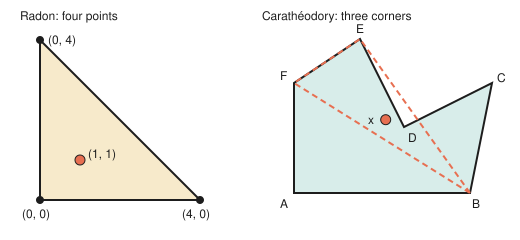

# Radon, Helly and Carathéodory: three counting facts about convex sets in the plane

[Syllabus](../../../SYLLABUS.md) → [Geometry and trig](../README.md) → [Points, Convexity and Fractals](../README.md#s07) → Radon, Helly and Carathéodory

---

## General Overview

Two crews set marker posts: one at (0, 0), (4, 0) and (0, 4), the other at (1, 1). No straight fence can part them, because (1, 1) lies inside the first crew's **hull** (the area a fence pulled tight round a group encloses). Any four points of the plane split into two groups whose hulls meet. That is **Radon's theorem**.

A survey crew of four has free windows, in hours after 8 a.m., of [0, 5], [2, 7], [4, 9] and [3, 6]. Any two overlap, so all four share a time: hours 4 to 5, noon to 1 p.m. On a line pairs are enough; in the plane, triples. That is **Helly's theorem**.

Read in metres, the survey field from [Shoelace formula](01-polygon-area-and-orientation.md) is a deck on six corner posts, A to F, one reflex (an inside angle over 180 degrees). A tank at x, the corners' average, can rest on just three posts, B, E and F. Posts only push, so their shares of its weight are a **mix** (a weighted average, weights never negative and adding to 1) that balances at x. Any point of a hull is a mix of three of the points. That is **Carathéodory's theorem**.

**In the plane, any 4 points split into two groups whose hulls meet; finitely many convex sets that meet three at a time all meet; and any point of a hull is a mix of 3 of the points, because any 4 points carry weights that add to 0 and balance.**

**What kind of fact this is:** three theorems, proved on this card in Why it works from one shared fact.

### The picture: the Radon split and the three-corner mix

<p align="center"></p>

Drawn at 40 units per grid step (left) and 22 (right).

---

## The formula

A **hull** is the convex hull from [Convex sets](02-convex-sets-and-convex-hulls.md): every mix of some points. **Convex** means the straight segment between any two points of a set stays in the set.

The shared fact is an **affine dependence**: weights on $`d + 2`$ points, not all zero, that add to zero and balance to the origin.

```math
\lambda_1 p_1 + \lambda_2 p_2 + \dots + \lambda_{d+2}\, p_{d+2} = (0, \dots, 0), \qquad \lambda_1 + \lambda_2 + \dots + \lambda_{d+2} = 0
```

**Read it aloud:** some points get positive weights and some negative, the weights cancel, and the weighted points cancel too.

In the plane, $`d = 2`$, and four points get their weights from the turn test of [Shoelace formula](01-polygon-area-and-orientation.md):

```math
\lambda = \big(\mathrm{turn}(p_2, p_3, p_4),\ -\mathrm{turn}(p_1, p_3, p_4),\ \mathrm{turn}(p_1, p_2, p_4),\ -\mathrm{turn}(p_1, p_2, p_3)\big)
```

**Read it aloud:** each point's weight is twice the signed area of the triangle the other three make, with signs alternating.

For the posts this gives 8, 4, 4 and −16. The positive weights total $`s`$, here 16, and the **Radon point** is

```math
r = \frac{1}{s} \sum_{\lambda_i > 0} \lambda_i\, p_i = \frac{8\,(0, 0) + 4\,(4, 0) + 4\,(0, 4)}{16} = (1, 1)
```

**Read it aloud:** average the positive-weight points by their weights; the negative side gives the same point.

The three theorems, with $`d`$ the number of coordinates:

| Theorem | In $`d`$ dimensions | In the plane | On a line |
| --- | --- | --- | --- |
| Radon | any $`d + 2`$ points split | 4 points | 3 points |
| Helly | if every $`d + 1`$ sets meet, all meet | triples | pairs |
| Carathéodory | a hull point mixes $`d + 1`$ points | 3 corners | 2 ends |

| Symbol | Plain meaning | In our example | Push it up and the answer… |
| --- | --- | --- | --- |
| $`d`$ | the dimension: coordinates per point | 2, the plane | every count above grows by one |
| $`p_i`$ | the points | (0, 0), (4, 0), (0, 4), (1, 1) | — |
| $`\lambda_i`$ | dependence weights: add to 0, balance to the origin | 8, 4, 4, −16 | doubling all of them changes nothing |
| $`\mathrm{turn}(a, b, c)`$ | twice the signed area of triangle a, b, c | turn((4, 0), (0, 4), (1, 1)) = 8 | — |
| $`s`$, $`r`$ | total of the positive weights; the Radon point | 16; (1, 1) | — |
| $`C_j`$, $`m`$ | the convex sets in a family; how many | four time windows; 4 | more sets, more chances to miss |
| $`x`$, $`w_i`$ | a point of the hull; its mixing weights | x = (6.167, 4.333); 0.4301, 0.2419, 0.3280 on B, E, F | — |
| $`t`$ | the trimming step | 0.0069 on the first trim | too big a step makes a weight negative |

### When it holds

- **Convex sets.** Helly fails for sets with gaps: on a line, the two-point sets {1, 2}, {2, 3} and {1, 3} meet in pairs but share nothing.
- **Finitely many sets, or compact ones.** The rays [n, ∞) for n = 1, 2, 3, … meet in every finite group but share no point.
- **The right count for the dimension.** In the plane pairs are not enough: a triangle's three sides meet in pairs but share no point. Three points are too few for Radon.
- **A hull, not the shape.** Carathéodory's triangle B, E, F crosses the notch at D, outside the field.

[Caratheodory's extension theorem](../../10-Measure%20and%20integration/02-Length%20Done%20Properly/05-caratheodory-extension-theorem.md), on measures, is a different result.

---

## Why it works

### Step 0: more points than equations forces a dependence

Weights on four plane points face three equations: the across sum, the up sum and the plain sum are zero. Four unknowns and three equations always leave a solution that is not all zero; the turn formula writes one down. If all four lie on one line, every turn is 0; instead, use three: weight −1 on the middle one and its mix weights on the outer two. In $`d`$ dimensions it is $`d + 1`$ equations against $`d + 2`$ unknowns.

<details>
<summary>Detailed proof: the turn weights add to 0 and balance</summary>

Write $`\mathrm{turn}(a, b, c)`$ as the 3-by-3 determinant with rows (1, 1, 1), the across coordinates and the up coordinates.

Stack a fourth row on top of the 3-by-4 table of the four points: a copy of the ones row, the across row or the up row. The 4-by-4 determinant has two equal rows, so it is 0.

Expanding it along the top row gives, in turn, the sum of the weights, the across balance and the up balance. All three are 0.

</details>

### Step 1: Radon, from the signs

Move the negative weights to the other side. The positive side and the negative side then hold equal weight totals, both $`s`$, and the same weighted sum.

Divide by $`s`$. One point is now a mix of the positive group and also of the negative group, so it lies in both hulls.

For the posts, a brute force over all 7 splits finds no other split whose hulls meet.

### Step 2: Helly on a line, then in the plane

On a line, convex sets are intervals. Take the largest left end and the smallest right end. Their two intervals meet, so the left end comes first, and every point between lies in all the intervals.

In the plane, take four convex sets, any three of which meet. For each set, pick a point lying in the other three. Split those four points by Radon.

Each set misses at most its own point, so it holds the whole of one group and, being convex, that group's hull. The Radon point is in both hulls, so it lies in every set.

The checks run this on the four half-planes (each one side of a straight line) that bound a 4 by 4 square. Grid points (1, −2), (5, 1), (1, 5) and (−2, 1), each outside one, give Radon point (1, 1), inside all four.

<details>
<summary>Detailed proof: Helly for any number of sets</summary>

Use induction on the number of sets, $`m`$; four sets is the case above. For larger $`m`$, every $`m - 1`$ of the sets meet, so pick $`p_j`$ in all of them except possibly $`C_j`$.

These $`m`$ points have a dependence: zero weight on all but four. Its signs split them, and each $`C_j`$ holds one whole group, its hull and the Radon point. In $`d`$ dimensions, read $`d + 1`$ and $`d + 2`$ for 3 and 4.

</details>

### Step 3: Carathéodory, by trimming a dependence

Start with $`x`$ as a mix of more than three points, all weights positive. Take any four of them and their dependence $`\lambda`$.

Replace each weight $`w_i`$ by $`w_i - t\lambda_i`$. The weights still add to 1, because the $`\lambda_i`$ add to 0. They still give $`x`$, because the $`\lambda_i p_i`$ add to the origin.

Some $`\lambda_i`$ is positive: they add to 0 and are not all 0. Raise $`t`$ from 0 until the first weight reaches 0. That is the smallest ratio $`w_i / \lambda_i`$ over the positive $`\lambda_i`$. No weight goes negative, and one point drops out. Repeat until three remain. Flipping the signs of $`\lambda`$ can leave a different three.

The survey field starts with all six corners at weight 1/6. Three trims drop C, D and A, leaving B, E and F.

---

## Worked numbers, by hand

| Step | Arithmetic | Value |
| --- | --- | --- |
| Weight on (0, 0) | turn((4, 0), (0, 4), (1, 1)) = (−4)(1) − (4)(−3) | 8 |
| Other weights | the same rule, signs alternating | 4, 4, −16 |
| Radon point | (8 (0, 0) + 4 (4, 0) + 4 (0, 4)) / 16 | **(1, 1)** |
| Crew windows | largest left end 4, smallest right end 5 | **[4, 5]**, noon to 1 p.m. |
| Corner average | ((2 + 10 + 11 + 7 + 5 + 2) / 6, (1 + 1 + 6 + 4 + 8 + 6) / 6) | x = (6.167, 4.333) |
| Trim 1 on A, B, C, D | weights 18, −2, 24, −40; smaller ratio is C's, step 0.0069 | drop C |
| Trim 2 on A, B, D, E | weights −6, −26, 56, −24; only D is positive, step 0.0079 | drop D |
| Trim 3 on A, B, E, F | weights 31, −15, 40, −56; A's ratio is smaller, step 0.0029 | drop A |
| The mix | weights left on B, E, F | **x = 0.4301 B + 0.2419 E + 0.3280 F** |

Ten of the 20 corner triangles hold x, so other triples could carry the tank too.

### What breaks if you drop a piece

| Mistake | Comes out at | What went wrong |
| --- | --- | --- |
| Pairs checked in the plane | the triangle's sides: 3 of 3 pairs meet, each corner on only 2 sides | The plane needs triples |
| Radon tried on three points | 0 of 3 corners on the line through the other two | Radon needs four points in the plane |
| Trimming by the largest ratio | smallest weight −0.0556 | The step overshoots; a weight goes negative |
| First window cut to [0, 3] | largest left end 4, smallest right end 3 | One pair misses, so Helly does not apply |

---

## Code, from first principles, and it actually runs

Nothing is imported. Each theorem takes two roads. Radon: turn-weight signs against a brute force over all 7 splits. Helly: the largest-left, smallest-right rule against a quarter-hour scan, plus the Radon proof on four half-planes. Carathéodory: trimming against turn ratios and a search of all 20 corner triangles.

### Python

```python
# Radon, Helly and Caratheodory in the plane, from one engine: weights on four points
# that add to 0 and balance to (0, 0).  Nothing imported.  Each fact meets a brute force.
def turn(a, b, c):                       # twice the signed area of triangle a, b, c
    return (b[0] - a[0]) * (c[1] - a[1]) - (b[1] - a[1]) * (c[0] - a[0])
def dep(p):                              # the dependence on four points, by turns
    return [turn(p[1], p[2], p[3]), -turn(p[0], p[2], p[3]), turn(p[0], p[1], p[3]), -turn(p[0], p[1], p[2])]
def in_tri(x, a, b, c):                  # on or inside triangle a, b, c
    s = [turn(a, b, x), turn(b, c, x), turn(c, a, x)]; return min(s) >= -1e-9 or max(s) <= 1e-9
def cross(a, b, c, d):                   # segments ab and cd meet
    return turn(a, b, c) * turn(a, b, d) <= 0 and turn(c, d, a) * turn(c, d, b) <= 0
def show(p, g):                          # a split, written with the group holding p[0] first
    h = [i for i in range(4) if i not in g]; g, h = (g, h) if 0 in g else (h, g)
    return " ".join(str(p[i]) for i in g) + " | " + " ".join(str(p[i]) for i in h)
def radon(p):                            # road one: split by the signs of the dependence
    lam = dep(p); pos = [i for i in range(4) if lam[i] > 0]; s = sum(lam[i] for i in pos)
    return lam, show(p, pos), tuple(sum(lam[i] * p[i][k] for i in pos) / s for k in (0, 1))
def splits(p):                           # road two: try all 7 splits, test the hulls
    meets = lambda g, h: cross(*[p[i] for i in g + h]) if len(g) == 2 else in_tri(p[h[0]], *[p[i] for i in g])
    return [show(p, g) for g in [[1, 2, 3], [0, 2, 3], [0, 1, 3], [0, 1, 2], [0, 1], [0, 2], [0, 3]] if meets(g, [i for i in range(4) if i not in g])]
f = lambda v: f"({v[0]:.3f}, {v[1]:.3f})"
P, Q, I = [(0, 0), (4, 0), (0, 4), (1, 1)], [(0, 0), (4, 0), (0, 4), (3, 3)], [(0, 5), (2, 7), (4, 9), (3, 6)]
(lam, split, r), (lq, sq, rq), V = radon(P), radon(Q), P[:3]
print(f"dependence on {P}: weights {lam}; sum {sum(lam)}, balance {tuple(sum(l * q[k] for l, q in zip(lam, P)) for k in (0, 1))}")
print(f"road one, by signs: {split}; Radon point {f(r)}\nroad two, all 7 splits, hulls meeting: {'; '.join(splits(P))}")
print(f"(1, 1) moved to (3, 3): weights {lq}; by signs {sq}, point {f(rq)}; brute force {'; '.join(splits(Q))}")
print(f"three points only, a corner on the line through the other two: {sum(turn(V[i - 2], V[i - 1], V[i]) == 0 for i in range(3))} of 3")
pairs = sum(max(a[0], b[0]) <= min(a[1], b[1]) for i, a in enumerate(I) for b in I[i + 1:])
lo, hi = max(a for a, b in I), min(b for a, b in I); scan = [k / 4 for k in range(37) if all(a <= k / 4 <= b for a, b in I)]
print(f"Helly on a line: {I}; pairs meeting {pairs} of 6; common part [{lo}, {hi}]; quarter-hour scan {scan[0]} to {scan[-1]}")
print(f"[0, 5] cut to [0, 3]: largest left end {lo}, smallest right end {min(3, hi)}: nothing common")
H = [((0, 0), (4, 0)), ((4, 0), (4, 4)), ((4, 4), (0, 4)), ((0, 4), (0, 0))]  # half-planes: left of each side of a square
pk = [next(g for g in [(x, y) for x in range(-2, 7) for y in range(-2, 7)] if turn(*H[j], g) < 0 and all(turn(*H[i], g) > 0 for i in range(4) if i != j)) for j in range(4)]; rh = radon(pk)[2]
print(f"Helly in the plane: 4 half-planes, inner sides of a 4 by 4 square; a grid point in each three, outside the fourth: {pk}; Radon point {f(rh)} in all four: {all(turn(*h, rh) >= 0 for h in H)}")
on = [sum(turn(V[i], V[i - 1], c) == 0 and min(V[i][0], V[i - 1][0]) <= c[0] <= max(V[i][0], V[i - 1][0]) for i in range(3)) for c in V]
print(f"the triangle's three sides: pairs meeting {sum(cross(V[i], V[i - 1], V[j], V[j - 1]) for i in range(3) for j in range(i))} of 3; sides through each corner {on}")
N, S, w, drops, bad = "ABCDEF", [(2, 1), (10, 1), (11, 6), (7, 4), (5, 8), (2, 6)], [1 / 6] * 6, [], None
x = tuple(sum(wi * s[k] for wi, s in zip(w, S)) for k in (0, 1))
print(f"Caratheodory: x = average of the 6 survey corners = {f(x)}; in the notch C D E: {in_tri(x, S[2], S[3], S[4])}")
while len(live := [i for i in range(6) if w[i] > 1e-12]) > 3:
    q = live[:4]; lam = dep([S[i] for i in q])
    t, j = min((w[i] / l, i) for i, l in zip(q, lam) if l > 0)
    if bad is None: bad = min(w[i] - max(w[i] / l for i, l in zip(q, lam) if l > 0) * l for i, l in zip(q, lam))
    for i, l in zip(q, lam): w[i] -= t * l
    w[j] = 0.0; drops.append(f"drop {N[j]}: weights {lam} on {''.join(N[i] for i in q)}, step {t:.4f}; now " + " ".join(f"{N[i]} {w[i]:.4f}" for i in range(6)))
a, b, c = live
bary = [turn(x, S[b], S[c]), turn(S[a], x, S[c]), turn(S[a], S[b], x)]
mix = [w[a] * S[a][k] + w[b] * S[b][k] + w[c] * S[c][k] for k in (0, 1)]
holds = [N[i] + N[j] + N[k] for i in range(6) for j in range(i + 1, 6) for k in range(j + 1, 6) if in_tri(x, S[i], S[j], S[k])]
print("\n".join(drops) + f"\nleaves {N[a]}{N[b]}{N[c]}, weights {w[a]:.4f}, {w[b]:.4f}, {w[c]:.4f}; mix {f(mix)}")
print(f"road two, weights as turn ratios: {', '.join(f'{v / sum(bary):.4f}' for v in bary)}\nbrute force, corner triangles holding x: {len(holds)} of 20: {' '.join(holds)}")
print(f"mistake, trimming by the largest ratio: smallest weight {bad:.4f}")
print("figure, left 40 per unit from (40, 200): " + " ".join(f"({40 + 40 * p[0]}, {200 - 40 * p[1]})" for p in P) + "; right 22 per unit from (250, 215): "
      + " ".join(f"{n} ({250 + 22 * p[0]}, {215 - 22 * p[1]})" for n, p in zip(N, S)) + f" x ({250 + 22 * x[0]:.1f}, {215 - 22 * x[1]:.1f})")
assert splits(P) == [split] and splits(Q) == [sq]                      # signs agree with brute force
assert turn(Q[0], Q[3], rq) == 0 and turn(Q[1], Q[2], rq) == 0          # (2, 2) is on both lines
assert pairs == 6 and [scan[0], scan[-1]] == [lo, hi]                  # formula agrees with the scan
assert all(turn(*h, rh) >= 0 for h in H)                               # Helly by Radon: in all four
assert N[a] + N[b] + N[c] in holds and all(abs(u / sum(bary) - v) < 1e-9 for u, v in zip(bary, [w[a], w[b], w[c]]))
assert abs(mix[0] - x[0]) < 1e-9 and abs(mix[1] - x[1]) < 1e-9 and bad < 0
print("ALL CHECKS PASS")
```

**Ran 2026-11-23 on macOS, Python 3.14.10, standard library only. All checks passed. Output, pasted from the run:**

```
dependence on [(0, 0), (4, 0), (0, 4), (1, 1)]: weights [8, 4, 4, -16]; sum 0, balance (0, 0)
road one, by signs: (0, 0) (4, 0) (0, 4) | (1, 1); Radon point (1.000, 1.000)
road two, all 7 splits, hulls meeting: (0, 0) (4, 0) (0, 4) | (1, 1)
(1, 1) moved to (3, 3): weights [-8, 12, 12, -16]; by signs (0, 0) (3, 3) | (4, 0) (0, 4), point (2.000, 2.000); brute force (0, 0) (3, 3) | (4, 0) (0, 4)
three points only, a corner on the line through the other two: 0 of 3
Helly on a line: [(0, 5), (2, 7), (4, 9), (3, 6)]; pairs meeting 6 of 6; common part [4, 5]; quarter-hour scan 4.0 to 5.0
[0, 5] cut to [0, 3]: largest left end 4, smallest right end 3: nothing common
Helly in the plane: 4 half-planes, inner sides of a 4 by 4 square; a grid point in each three, outside the fourth: [(1, -2), (5, 1), (1, 5), (-2, 1)]; Radon point (1.000, 1.000) in all four: True
the triangle's three sides: pairs meeting 3 of 3; sides through each corner [2, 2, 2]
Caratheodory: x = average of the 6 survey corners = (6.167, 4.333); in the notch C D E: False
drop C: weights [18, -2, 24, -40] on ABCD, step 0.0069; now A 0.0417 B 0.1806 C 0.0000 D 0.4444 E 0.1667 F 0.1667
drop D: weights [-6, -26, 56, -24] on ABDE, step 0.0079; now A 0.0893 B 0.3869 C 0.0000 D 0.0000 E 0.3571 F 0.1667
drop A: weights [31, -15, 40, -56] on ABEF, step 0.0029; now A 0.0000 B 0.4301 C 0.0000 D 0.0000 E 0.2419 F 0.3280
leaves BEF, weights 0.4301, 0.2419, 0.3280; mix (6.167, 4.333)
road two, weights as turn ratios: 0.4301, 0.2419, 0.3280
brute force, corner triangles holding x: 10 of 20: ABE ACE ACF ADE ADF BCF BDF BEF CDF DEF
mistake, trimming by the largest ratio: smallest weight -0.0556
figure, left 40 per unit from (40, 200): (40, 200) (200, 200) (40, 40) (80, 160); right 22 per unit from (250, 215): A (294, 193) B (470, 193) C (492, 83) D (404, 127) E (360, 39) F (294, 83) x (385.7, 119.7)
ALL CHECKS PASS
```

### Rust

Same output, built with `rustc --edition 2021 -O`.

```rust
// Radon, Helly and Caratheodory in the plane, from one engine: weights on four points
// that add to 0 and balance to (0, 0).  No crates.  Each fact meets a brute force.
type Pt = (f64, f64);
fn turn(a: Pt, b: Pt, c: Pt) -> f64 { (b.0 - a.0) * (c.1 - a.1) - (b.1 - a.1) * (c.0 - a.0) } // twice the signed area
fn dep(p: &[Pt]) -> Vec<f64> { vec![turn(p[1], p[2], p[3]), -turn(p[0], p[2], p[3]), turn(p[0], p[1], p[3]), -turn(p[0], p[1], p[2])] } // by turns
fn in_tri(x: Pt, a: Pt, b: Pt, c: Pt) -> bool { let s = [turn(a, b, x), turn(b, c, x), turn(c, a, x)]; s.iter().all(|&v| v >= -1e-9) || s.iter().all(|&v| v <= 1e-9) }
fn cross(a: Pt, b: Pt, c: Pt, d: Pt) -> bool { turn(a, b, c) * turn(a, b, d) <= 0.0 && turn(c, d, a) * turn(c, d, b) <= 0.0 }
fn pt(p: Pt) -> String { format!("({}, {})", p.0, p.1) }
fn f(p: Pt) -> String { format!("({:.3}, {:.3})", p.0, p.1) }
fn list(v: &[f64]) -> String { format!("[{}]", v.iter().map(|x| x.to_string()).collect::<Vec<_>>().join(", ")) }
fn show(p: &[Pt], g: &[usize]) -> String { // a split, written with the group holding p[0] first
    let h: Vec<usize> = (0..4).filter(|i| !g.contains(i)).collect();
    let (g, h) = if g.contains(&0) { (g.to_vec(), h) } else { (h, g.to_vec()) }; let j = |s: &[usize]| s.iter().map(|&i| pt(p[i])).collect::<Vec<_>>().join(" "); format!("{} | {}", j(&g), j(&h))
}
fn radon(p: &[Pt]) -> (Vec<f64>, String, Pt) { // road one: split by the signs of the dependence
    let lam = dep(p); let pos: Vec<usize> = (0..4).filter(|&i| lam[i] > 0.0).collect(); let s: f64 = pos.iter().map(|&i| lam[i]).sum();
    let r = (pos.iter().map(|&i| lam[i] * p[i].0).sum::<f64>() / s, pos.iter().map(|&i| lam[i] * p[i].1).sum::<f64>() / s); (lam, show(p, &pos), r)
}
fn splits(p: &[Pt]) -> Vec<String> { // road two: try all 7 splits, test the hulls
    let gs: [&[usize]; 7] = [&[1, 2, 3], &[0, 2, 3], &[0, 1, 3], &[0, 1, 2], &[0, 1], &[0, 2], &[0, 3]];
    gs.iter().filter(|g| { let h: Vec<usize> = (0..4).filter(|i| !g.contains(i)).collect();
        if g.len() == 2 { cross(p[g[0]], p[g[1]], p[h[0]], p[h[1]]) } else { in_tri(p[h[0]], p[g[0]], p[g[1]], p[g[2]]) } })
        .map(|g| show(p, g)).collect()
}
fn tf(b: bool) -> &'static str { if b { "True" } else { "False" } }
fn main() {
    let (p, q): (Vec<Pt>, Vec<Pt>) = (vec![(0.0, 0.0), (4.0, 0.0), (0.0, 4.0), (1.0, 1.0)], vec![(0.0, 0.0), (4.0, 0.0), (0.0, 4.0), (3.0, 3.0)]);
    let iv: [Pt; 4] = [(0.0, 5.0), (2.0, 7.0), (4.0, 9.0), (3.0, 6.0)];
    let ((lam, split, r), (lq, sq, rq), v) = (radon(&p), radon(&q), &p[..3]);
    let bal = (lam.iter().zip(&p).map(|(l, a)| l * a.0).sum::<f64>(), lam.iter().zip(&p).map(|(l, a)| l * a.1).sum::<f64>());
    println!("dependence on [{}]: weights {}; sum {}, balance {}", p.iter().map(|&a| pt(a)).collect::<Vec<_>>().join(", "), list(&lam), lam.iter().sum::<f64>(), pt(bal));
    println!("road one, by signs: {}; Radon point {}\nroad two, all 7 splits, hulls meeting: {}", split, f(r), splits(&p).join("; "));
    println!("(1, 1) moved to (3, 3): weights {}; by signs {}, point {}; brute force {}", list(&lq), sq, f(rq), splits(&q).join("; "));
    println!("three points only, a corner on the line through the other two: {} of 3", (0..3).filter(|&i| turn(v[(i + 1) % 3], v[(i + 2) % 3], v[i]) == 0.0).count());
    let pairs = (0..4).flat_map(|i| (i + 1..4).map(move |j| (i, j))).filter(|&(i, j)| iv[i].0.max(iv[j].0) <= iv[i].1.min(iv[j].1)).count();
    let (lo, hi) = (iv.iter().map(|a| a.0).fold(f64::MIN, f64::max), iv.iter().map(|a| a.1).fold(f64::MAX, f64::min));
    let scan: Vec<f64> = (0..37).map(|k| k as f64 / 4.0).filter(|&t| iv.iter().all(|a| a.0 <= t && t <= a.1)).collect();
    println!("Helly on a line: [{}]; pairs meeting {} of 6; common part [{}, {}]; quarter-hour scan {:?} to {:?}",
        iv.iter().map(|&a| pt(a)).collect::<Vec<_>>().join(", "), pairs, lo, hi, scan[0], scan[scan.len() - 1]);
    println!("[0, 5] cut to [0, 3]: largest left end {}, smallest right end {}: nothing common", lo, hi.min(3.0));
    let h: [(Pt, Pt); 4] = [((0.0, 0.0), (4.0, 0.0)), ((4.0, 0.0), (4.0, 4.0)), ((4.0, 4.0), (0.0, 4.0)), ((0.0, 4.0), (0.0, 0.0))]; // half-planes: left of each side of a square
    let pk: Vec<Pt> = (0..4).map(|j| (0..81).map(|k| ((k / 9 - 2) as f64, (k % 9 - 2) as f64)).find(|&g| turn(h[j].0, h[j].1, g) < 0.0 && (0..4).filter(|&i| i != j).all(|i| turn(h[i].0, h[i].1, g) > 0.0)).unwrap()).collect();
    let rh = radon(&pk).2; println!("Helly in the plane: 4 half-planes, inner sides of a 4 by 4 square; a grid point in each three, outside the fourth: [{}]; Radon point {} in all four: {}",
        pk.iter().map(|&a| pt(a)).collect::<Vec<_>>().join(", "), f(rh), tf(h.iter().all(|s| turn(s.0, s.1, rh) >= 0.0)));
    let side = |i: usize| (v[i], v[(i + 2) % 3]);
    let on: Vec<f64> = v.iter().map(|&c| (0..3).filter(|&i| { let (a, b) = side(i); turn(a, b, c) == 0.0 && a.0.min(b.0) <= c.0 && c.0 <= a.0.max(b.0) }).count() as f64).collect();
    let meet = (0..3).flat_map(|i| (0..i).map(move |j| (i, j))).filter(|&(i, j)| cross(side(i).0, side(i).1, side(j).0, side(j).1)).count();
    println!("the triangle's three sides: pairs meeting {} of 3; sides through each corner {}", meet, list(&on));
    let (nm, s, mut w): (Vec<char>, [Pt; 6], Vec<f64>) = ("ABCDEF".chars().collect(), [(2.0, 1.0), (10.0, 1.0), (11.0, 6.0), (7.0, 4.0), (5.0, 8.0), (2.0, 6.0)], vec![1.0 / 6.0; 6]);
    let x = (s.iter().zip(&w).map(|(a, wi)| wi * a.0).sum::<f64>(), s.iter().zip(&w).map(|(a, wi)| wi * a.1).sum::<f64>());
    println!("Caratheodory: x = average of the 6 survey corners = {}; in the notch C D E: {}", f(x), tf(in_tri(x, s[2], s[3], s[4])));
    let (mut drops, mut bad): (Vec<String>, Option<f64>) = (Vec::new(), None);
    let live = loop {
        let live: Vec<usize> = (0..6).filter(|&i| w[i] > 1e-12).collect();
        if live.len() <= 3 { break live }
        let qi = &live[..4]; let lam = dep(&qi.iter().map(|&i| s[i]).collect::<Vec<_>>());
        let ratios: Vec<(f64, usize)> = qi.iter().zip(&lam).filter(|(_, &l)| l > 0.0).map(|(&i, &l)| (w[i] / l, i)).collect();
        let (t, j) = ratios.iter().copied().fold((f64::MAX, 0), |m, z| if z < m { z } else { m }); let tmax = ratios.iter().map(|z| z.0).fold(f64::MIN, f64::max);
        if bad.is_none() { bad = Some(qi.iter().zip(&lam).map(|(&i, &l)| w[i] - tmax * l).fold(f64::MAX, f64::min)) }
        for (&i, &l) in qi.iter().zip(&lam) { w[i] -= t * l } w[j] = 0.0;
        drops.push(format!("drop {}: weights {} on {}, step {:.4}; now {}", nm[j], list(&lam), qi.iter().map(|&i| nm[i]).collect::<String>(), t, (0..6).map(|i| format!("{} {:.4}", nm[i], w[i])).collect::<Vec<_>>().join(" ")));
    };
    let (a, b, c) = (live[0], live[1], live[2]); let bary = [turn(x, s[b], s[c]), turn(s[a], x, s[c]), turn(s[a], s[b], x)]; let tot: f64 = bary.iter().sum();
    let mix = (w[a] * s[a].0 + w[b] * s[b].0 + w[c] * s[c].0, w[a] * s[a].1 + w[b] * s[b].1 + w[c] * s[c].1);
    let mut holds: Vec<String> = Vec::new(); for i in 0..6 { for j in i + 1..6 { for k in j + 1..6 { if in_tri(x, s[i], s[j], s[k]) { holds.push([nm[i], nm[j], nm[k]].iter().collect()) } } } }
    println!("{}\nleaves {}{}{}, weights {:.4}, {:.4}, {:.4}; mix {}", drops.join("\n"), nm[a], nm[b], nm[c], w[a], w[b], w[c], f(mix));
    println!("road two, weights as turn ratios: {:.4}, {:.4}, {:.4}\nbrute force, corner triangles holding x: {} of 20: {}", bary[0] / tot, bary[1] / tot, bary[2] / tot, holds.len(), holds.join(" "));
    println!("mistake, trimming by the largest ratio: smallest weight {:.4}", bad.unwrap());
    println!("figure, left 40 per unit from (40, 200): {}; right 22 per unit from (250, 215): {} x ({:.1}, {:.1})",
        p.iter().map(|a| pt((40.0 + 40.0 * a.0, 200.0 - 40.0 * a.1))).collect::<Vec<_>>().join(" "),
        s.iter().zip(&nm).map(|(a, n)| format!("{} {}", n, pt((250.0 + 22.0 * a.0, 215.0 - 22.0 * a.1)))).collect::<Vec<_>>().join(" "), 250.0 + 22.0 * x.0, 215.0 - 22.0 * x.1);
    assert!(splits(&p) == vec![split] && splits(&q) == vec![sq]);          // signs agree with brute force
    assert!(turn(q[0], q[3], rq) == 0.0 && turn(q[1], q[2], rq) == 0.0);    // (2, 2) is on both lines
    assert!(pairs == 6 && scan[0] == lo && scan[scan.len() - 1] == hi);     // formula agrees with the scan
    assert!(h.iter().all(|s| turn(s.0, s.1, rh) >= 0.0));                // Helly by Radon: in all four
    assert!(holds.contains(&[nm[a], nm[b], nm[c]].iter().collect::<String>()) && (0..3).all(|k| (bary[k] / tot - w[live[k]]).abs() < 1e-9));
    assert!((mix.0 - x.0).abs() < 1e-9 && (mix.1 - x.1).abs() < 1e-9 && bad.unwrap() < 0.0);
    println!("ALL CHECKS PASS");
}
```

**Ran 2026-11-23 on macOS, rustc 1.98.1, no crates. All checks passed. Output, pasted from the run:**

```
dependence on [(0, 0), (4, 0), (0, 4), (1, 1)]: weights [8, 4, 4, -16]; sum 0, balance (0, 0)
road one, by signs: (0, 0) (4, 0) (0, 4) | (1, 1); Radon point (1.000, 1.000)
road two, all 7 splits, hulls meeting: (0, 0) (4, 0) (0, 4) | (1, 1)
(1, 1) moved to (3, 3): weights [-8, 12, 12, -16]; by signs (0, 0) (3, 3) | (4, 0) (0, 4), point (2.000, 2.000); brute force (0, 0) (3, 3) | (4, 0) (0, 4)
three points only, a corner on the line through the other two: 0 of 3
Helly on a line: [(0, 5), (2, 7), (4, 9), (3, 6)]; pairs meeting 6 of 6; common part [4, 5]; quarter-hour scan 4.0 to 5.0
[0, 5] cut to [0, 3]: largest left end 4, smallest right end 3: nothing common
Helly in the plane: 4 half-planes, inner sides of a 4 by 4 square; a grid point in each three, outside the fourth: [(1, -2), (5, 1), (1, 5), (-2, 1)]; Radon point (1.000, 1.000) in all four: True
the triangle's three sides: pairs meeting 3 of 3; sides through each corner [2, 2, 2]
Caratheodory: x = average of the 6 survey corners = (6.167, 4.333); in the notch C D E: False
drop C: weights [18, -2, 24, -40] on ABCD, step 0.0069; now A 0.0417 B 0.1806 C 0.0000 D 0.4444 E 0.1667 F 0.1667
drop D: weights [-6, -26, 56, -24] on ABDE, step 0.0079; now A 0.0893 B 0.3869 C 0.0000 D 0.0000 E 0.3571 F 0.1667
drop A: weights [31, -15, 40, -56] on ABEF, step 0.0029; now A 0.0000 B 0.4301 C 0.0000 D 0.0000 E 0.2419 F 0.3280
leaves BEF, weights 0.4301, 0.2419, 0.3280; mix (6.167, 4.333)
road two, weights as turn ratios: 0.4301, 0.2419, 0.3280
brute force, corner triangles holding x: 10 of 20: ABE ACE ACF ADE ADF BCF BDF BEF CDF DEF
mistake, trimming by the largest ratio: smallest weight -0.0556
figure, left 40 per unit from (40, 200): (40, 200) (200, 200) (40, 40) (80, 160); right 22 per unit from (250, 215): A (294, 193) B (470, 193) C (492, 83) D (404, 127) E (360, 39) F (294, 83) x (385.7, 119.7)
ALL CHECKS PASS
```


### Lean

Lean proves all three theorems in the plane, for any points and any finite family of convex sets.

- Any 4 points of the plane split into two groups whose hulls meet.
- Take finitely many convex sets in the plane, where any three of them meet. Then all of them share a point.
- Take any point in the hull of a set of points in the plane. Then it is a mix of 3 of those points.
- The posts' weights 8, 4, 4 and −16 add to 0 and balance. The Radon point is (1, 1), inside the other crew's hull.
- The crew windows share exactly hours 4 to 5. The sets {1, 2}, {2, 3} and {1, 3} meet in pairs but share nothing.
- The corner average is x, and the mix on B, E and F, in exact fractions, adds to 1 and balances at x.

The turn rule for the weights, the trims, the brute-force searches and the other failure examples are left to the Python and Rust checks.

```lean
-- Radon, Helly and Carathéodory: in the plane, any 4 points split into two groups whose hulls meet, finitely many convex sets that meet three at a time all meet, and any point of a hull is a mix of 3 of the points.
import Mathlib.Analysis.Convex.Radon
import Mathlib.Analysis.Convex.Combination
import Mathlib.Data.Real.Basic
import Mathlib.Order.Interval.Set.Basic
import Mathlib.Tactic.NormNum
import Mathlib.Analysis.Convex.Caratheodory
import Mathlib.Analysis.Convex.Join
import Mathlib.Tactic

open Set

lemma finrank_plane : Module.finrank ℝ (ℝ × ℝ) = 2 := by
  simp [Module.finrank_prod]

lemma affInd_card_le_three {ι : Type*} [Fintype ι] {p : ι → ℝ × ℝ}
    (h : AffineIndependent ℝ p) : Fintype.card ι ≤ 3 := by
  have h1 := h.card_le_finrank_succ
  have h2 := Submodule.finrank_le (vectorSpan ℝ (range p))
  rw [finrank_plane] at h2
  omega

lemma mem_hull_triple {a b c x : ℝ × ℝ} (hx : x ∈ convexHull ℝ ({a, b, c} : Set (ℝ × ℝ))) :
    ∃ wa wb wc : ℝ, 0 ≤ wa ∧ 0 ≤ wb ∧ 0 ≤ wc ∧
      wa + wb + wc = 1 ∧ x = wa • a + wb • b + wc • c := by
  rw [convexHull_insert (insert_nonempty b {c}), convexHull_pair, mem_convexJoin] at hx
  obtain ⟨a', ha', y, ⟨γ, δ, hγ, hδ, hγδ, rfl⟩, α, β, hα, hβ, hαβ, rfl⟩ := hx
  rw [mem_singleton_iff] at ha'
  subst ha'
  refine ⟨α, β * γ, β * δ, hα, mul_nonneg hβ hγ, mul_nonneg hβ hδ, ?_, ?_⟩
  · linear_combination hαβ + β * hγδ
  · simp only [smul_add, mul_smul]; abel

lemma finset_le_three {t : Finset (ℝ × ℝ)} (hne : t.Nonempty) (h : t.card ≤ 3) :
    ∃ a ∈ t, ∃ b ∈ t, ∃ c ∈ t, (t : Set (ℝ × ℝ)) = {a, b, c} := by
  have h1 : 0 < t.card := hne.card_pos
  interval_cases hc : t.card
  · obtain ⟨a, rfl⟩ := Finset.card_eq_one.mp hc
    exact ⟨a, by simp, a, by simp, a, by simp, by simp⟩
  · obtain ⟨a, b, -, rfl⟩ := Finset.card_eq_two.mp hc
    exact ⟨a, by simp, b, by simp, b, by simp, by simp⟩
  · obtain ⟨a, b, c, -, -, -, rfl⟩ := Finset.card_eq_three.mp hc
    exact ⟨a, by simp, b, by simp, c, by simp, by simp⟩

#print axioms finrank_plane
#print axioms affInd_card_le_three
#print axioms mem_hull_triple
#print axioms finset_le_three

/-- **Radon's theorem in the plane.** Any 4 points of the plane split into two groups
whose hulls meet: some group `I` of the points and the rest `Iᶜ` have convex hulls
with a common point. -/
theorem radon_four_points_in_plane (p : Fin 4 → ℝ × ℝ) :
    ∃ I : Set (Fin 4), (convexHull ℝ (p '' I) ∩ convexHull ℝ (p '' Iᶜ)).Nonempty := by
  apply Convex.radon_partition
  intro h
  have := affInd_card_le_three h
  simp at this

/-- **Helly's theorem in the plane.** Finitely many convex sets in the plane that meet
three at a time (every group of at most 3 of them has a common point) all share a
common point. -/
theorem helly_triples_in_plane {ι : Type*} (C : ι → Set (ℝ × ℝ)) (s : Finset ι)
    (h_convex : ∀ j ∈ s, Convex ℝ (C j))
    (h_triples : ∀ I ⊆ s, I.card ≤ 3 → (⋂ j ∈ I, C j).Nonempty) :
    (⋂ j ∈ s, C j).Nonempty := by
  classical
  apply Convex.helly_theorem' h_convex
  intro I hI hcard
  rw [finrank_plane] at hcard
  exact h_triples I hI hcard

/-- **Carathéodory's theorem in the plane.** Any point of the hull of a set of points in
the plane is a mix of 3 of the points: weights never negative, adding to 1, on three
points of the set (repeats allowed when fewer are needed). -/
theorem caratheodory_three_points_in_plane (S : Set (ℝ × ℝ)) (x : ℝ × ℝ)
    (hx : x ∈ convexHull ℝ S) :
    ∃ a ∈ S, ∃ b ∈ S, ∃ c ∈ S, ∃ wa wb wc : ℝ, 0 ≤ wa ∧ 0 ≤ wb ∧ 0 ≤ wc ∧
      wa + wb + wc = 1 ∧ x = wa • a + wb • b + wc • c := by
  rw [convexHull_eq_union] at hx
  simp only [mem_iUnion] at hx
  obtain ⟨t, htS, hind, hxt⟩ := hx
  have hcard := affInd_card_le_three hind
  rw [Fintype.card_coe] at hcard
  have hne : t.Nonempty := by
    rw [← Finset.coe_nonempty, ← convexHull_nonempty_iff (𝕜 := ℝ)]
    exact ⟨x, hxt⟩
  obtain ⟨a, ha, b, hb, c, hc, hteq⟩ := finset_le_three hne hcard
  rw [hteq] at hxt
  exact ⟨a, htS ha, b, htS hb, c, htS hc, mem_hull_triple hxt⟩

/-! ### The card's worked examples -/

-- The turn weights 8, 4, 4, −16 on (0, 0), (4, 0), (0, 4), (1, 1) add to 0 and balance
-- to (0, 0).
example : (8 : ℤ) + 4 + 4 + (-16) = 0 ∧
    8 * 0 + 4 * 4 + 4 * 0 + (-16) * 1 = 0 ∧
    8 * 0 + 4 * 0 + 4 * 4 + (-16) * 1 = 0 := by
  norm_num

-- The Radon point: (8 (0, 0) + 4 (4, 0) + 4 (0, 4)) / 16 = (1, 1).
example : ((8 : ℚ) * 0 + 4 * 4 + 4 * 0) / 16 = 1 ∧ ((8 : ℚ) * 0 + 4 * 0 + 4 * 4) / 16 = 1 := by
  norm_num

-- The Radon split: (1, 1) lies in the hull of (0, 0), (4, 0) and (0, 4).
example : ((1 : ℝ), (1 : ℝ)) ∈
    convexHull ℝ ({((0 : ℝ), (0 : ℝ)), ((4 : ℝ), (0 : ℝ)), ((0 : ℝ), (4 : ℝ))} : Set (ℝ × ℝ)) := by
  rw [convexHull_insert (insert_nonempty _ _), convexHull_pair, mem_convexJoin]
  refine ⟨((0 : ℝ), (0 : ℝ)), mem_singleton _, ((2 : ℝ), (2 : ℝ)),
    ⟨1/2, 1/2, by norm_num, by norm_num, by norm_num, ?_⟩,
    1/2, 1/2, by norm_num, by norm_num, by norm_num, ?_⟩
  · ext <;> simp <;> norm_num
  · ext <;> simp

-- Helly on a line: the crew's windows [0, 5], [2, 7], [4, 9], [3, 6] share exactly [4, 5].
example : Icc (0 : ℝ) 5 ∩ Icc 2 7 ∩ Icc 4 9 ∩ Icc 3 6 = Icc 4 5 := by
  ext x
  simp only [mem_inter_iff, mem_Icc]
  constructor
  · rintro ⟨⟨⟨⟨_, h1⟩, _⟩, h2, _⟩, _⟩
    exact ⟨h2, h1⟩
  · rintro ⟨h1, h2⟩
    refine ⟨⟨⟨⟨?_, ?_⟩, ?_, ?_⟩, ?_, ?_⟩, ?_, ?_⟩ <;> linarith

-- Sets with gaps: {1, 2}, {2, 3}, {1, 3} meet in pairs but share nothing.
example : (({1, 2} : Finset ℕ) ∩ {2, 3}).Nonempty ∧ (({2, 3} : Finset ℕ) ∩ {1, 3}).Nonempty ∧
    (({1, 2} : Finset ℕ) ∩ {1, 3}).Nonempty ∧ ({1, 2} : Finset ℕ) ∩ {2, 3} ∩ {1, 3} = ∅ := by
  decide

-- The corner average of A (2, 1), B (10, 1), C (11, 6), D (7, 4), E (5, 8), F (2, 6)
-- is x = (37/6, 13/3).
example : ((2 : ℚ) + 10 + 11 + 7 + 5 + 2) / 6 = 37 / 6 ∧ ((1 : ℚ) + 1 + 6 + 4 + 8 + 6) / 6 = 13 / 3 := by
  norm_num

-- Carathéodory's mix: x = 40/93 B + 15/62 E + 61/186 F (about 0.4301, 0.2419, 0.3280),
-- weights never negative and adding to 1.
example : (40 / 93 : ℝ) + 15 / 62 + 61 / 186 = 1 ∧
    (40 / 93 : ℝ) • ((10 : ℝ), (1 : ℝ)) + (15 / 62 : ℝ) • ((5 : ℝ), (8 : ℝ)) +
      (61 / 186 : ℝ) • ((2 : ℝ), (6 : ℝ)) = ((37 / 6 : ℝ), (13 / 3 : ℝ)) := by
  refine ⟨by norm_num, ?_⟩
  ext <;> simp <;> norm_num

#print axioms radon_four_points_in_plane
#print axioms helly_triples_in_plane
#print axioms caratheodory_three_points_in_plane
```

**Checked 2026-11-23 on macOS, Lean 4.36.0-rc2, Mathlib v4.36.0-rc2. Every proof is complete and uses only Lean's standard axioms. Output, pasted from the run:**

```
'finrank_plane' depends on axioms: [propext, Classical.choice, Quot.sound]
'affInd_card_le_three' depends on axioms: [propext, Classical.choice, Quot.sound]
'mem_hull_triple' depends on axioms: [propext, Classical.choice, Quot.sound]
'finset_le_three' depends on axioms: [propext, Classical.choice, Quot.sound]
'radon_four_points_in_plane' depends on axioms: [propext, Classical.choice, Quot.sound]
'helly_triples_in_plane' depends on axioms: [propext, Classical.choice, Quot.sound]
'caratheodory_three_points_in_plane' depends on axioms: [propext, Classical.choice, Quot.sound]
```

> [!TIP]
> **Try changing**
> - **Move the fourth post further out.** Guess first: does the split change if (3, 3) becomes (5, 5)? No: still two against two, meeting at (2, 2).
> - **Put the fourth post on an edge.** Guess first: set (1, 1) to (1, 3). Two splits now meet, the Radon split is not unique, and the first assert stops the run.
> - **Shorten a window.** Guess first: change (0, 5) to (0, 3). The scan finds no common hour, and the run crashes.
> - **Weight one corner heavily.** Guess first: start the weights at 0.5 on A and 0.1 on the rest. Now x = (4.5, 3.0), the trims drop C, D and E, and A, B, F carry 0.2875, 0.3125, 0.4000.

---

## The usual mistake

> [!warning]
> **Checking pairs in the plane.** Pairs are enough only on a line. The sides of the posts' triangle meet in pairs, 3 of 3, yet each corner lies on only 2 sides: no common point. In the plane, check triples.
>
> - **Expecting Carathéodory's triangle inside the shape.** B, E, F holds x, but side B to E crosses the notch at D.
> - **Trimming by the largest ratio.** The step overshoots and a weight reaches −0.0556; the result is no longer a mix.
> - **Expecting the Radon split to be one point against three.** With (3, 3) in place of (1, 1), it is two against two, meeting at (2, 2).

---

## Where you meet it in real life

- **Linear programming.** Straight-line limits on two quantities with no common solution already fail on some three of them: a short proof that no plan exists.
- **Machine learning.** Label the two Radon groups of four points oppositely and no straight line separates them; three points not on one line split every way. So the VC dimension (Vapnik–Chervonenkis dimension: the most points a rule sorts every way) of straight-line classifiers is 3.
- **Blending.** Colour is two numbers on a chart, so a lamp with many coloured LEDs matches any colour in its range with just three.
- **Scheduling.** A meeting time exists when each person has one free window and every two windows overlap, as with the crew's noon slot.

> **Say it back**
> Any four points of the plane carry weights, read from triangle areas, that add to zero and balance. Splitting by sign gives Radon: two groups whose hulls meet. Splitting one point per set gives Helly: finitely many convex sets meeting three at a time all meet; on a line, pairs suffice. Trimming the weights gives Carathéodory: a hull point is a mix of three points, such as the tank's posts B, E and F.

---

## What this builds on

- [Convex sets](02-convex-sets-and-convex-hulls.md): the hull as weighted averages, and why it is convex.
- [Lines](../04-Coordinates%20and%20Curves/02-lines-slopes-and-intersections.md): solving equations together, which Step 0 does with one more unknown than equations.

## Where this goes next

- [Convex sets](../../15-Optimization/01-Convexity/02-convex-sets.md) in Optimization: the same hulls in any number of dimensions.
- [Separating hyperplanes](../../15-Optimization/01-Convexity/06-separating-hyperplanes.md): a flat wall between convex sets that miss, the companion tool to Helly.
- [Pick's theorem](07-picks-theorem.md): counting grid points instead of sets.

Left open: Helly checks triples, but how many of a family's triples must meet before some point lies in a fixed fraction of all the sets?

---

## Sources

Verified 2026-11-23: every link below resolves to the publisher's page.

- Matoušek, Jiří. *Lectures on Discrete Geometry*. Springer, Graduate Texts in Mathematics 212, 2002. [DOI](https://doi.org/10.1007/978-1-4613-0039-7). Chapter 1: Radon's lemma and Helly's theorem with the proofs used here.
- Barvinok, Alexander. *A Course in Convexity*. American Mathematical Society, Graduate Studies in Mathematics 54, 2002. [DOI](https://doi.org/10.1090/gsm/054). Chapter I: Carathéodory, Radon and Helly in $`d`$ dimensions.
- Radon, Johann. "Mengen konvexer Körper, die einen gemeinsamen Punkt enthalten." *Mathematische Annalen* 83, 1921. [DOI](https://doi.org/10.1007/BF01464231). The split, used to prove Helly.
- Carathéodory, Constantin. "Über den Variabilitätsbereich der Koeffizienten von Potenzreihen, die gegebene Werte nicht annehmen." *Mathematische Annalen* 64, 1907. [DOI](https://doi.org/10.1007/BF01449883). The mixing theorem's first appearance.
