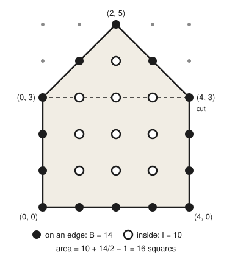

# Pick's theorem: count the dots inside and on the edge, and the area falls out

[Syllabus](../../../SYLLABUS.md) → [Geometry and trig](../README.md) → [Points, Convexity and Fractals](../README.md#s07) → Pick's theorem

---

## General Overview

An orchard is planted on a square grid: trees stand 10 m apart in rows running east and north. One plot is fenced with straight runs between five trees. Counted in grid steps from its south-west corner, they stand at (0, 0), (4, 0), (4, 3), (2, 5) and (0, 3). The plot is house-shaped: a 40 m by 30 m block with a pointed roof.

Walk the fence and 14 trees stand right on the fence line. Walk inside and there are 10 more. Those two counts alone give the area: 10 + 14/2 − 1 = 16 grid squares, or 1,600 square metres. The [Shoelace formula](01-polygon-area-and-orientation.md) on the five corners gives the same 16.

The rule also runs backwards. The shoelace formula gives the area, one greatest common divisor per fence gives the trees on the line, and Pick's theorem says 10 trees stand inside, without anyone walking the plot.

**For a simple polygon with no holes whose corners all sit on grid points, the area is the number of grid points inside plus half the number on the edges, minus one; each edge holds as many grid points past its start as the greatest common divisor of its two steps.**

**What kind of fact this is:** a theorem, proved on this card in Why it works. It holds only in the flat plane: in three dimensions it fails, as Step 5 shows.

### The picture: the plot on its grid

<p align="center"></p>

Drawn at 1 grid step = 60 units. Filled dots are on the fence, open dots inside, grey dots outside. The dashed cut is used in Why it works.

---

## The formula

A **grid point** (also called a lattice point) is a point whose two coordinates are both whole numbers. A **grid polygon** is a polygon whose corners are all grid points.

```math
A = I + \frac{B}{2} - 1
```

**Read it aloud:** the area is the grid points strictly inside, plus half the grid points on the edges, minus one.

Each edge's share of $`B`$ comes from its steps. An edge that runs $`\Delta x`$ east and $`\Delta y`$ north holds $`\gcd(\lvert\Delta x\rvert, \lvert\Delta y\rvert)`$ grid points, counting the corner it ends at but not the one it starts from ([Greatest common divisor](../../02-Number%20theory/02-Greatest%20Common%20Divisor%20and%20Euclid%27s%20Algorithm/01-gcd.md)). Adding round the loop counts every corner once:

```math
B = \sum_{\text{edges}} \gcd(\lvert\Delta x\rvert, \lvert\Delta y\rvert)
```

**Read it aloud:** for each edge, take the greatest common divisor of its east step and its north step, ignoring signs, and add them up. The sigma, Σ, means "add over every edge".

| Symbol | Plain meaning | In our example | Push it up and the answer… |
| --- | --- | --- | --- |
| $`A`$ | area, in grid squares (one square is 10 m by 10 m, 100 m²) | 16 squares, 1,600 m² | — |
| $`I`$ | grid points strictly inside | 10 trees | one more point inside adds 1 to the area |
| $`B`$ | grid points on the edges, corners included | 14 trees | one more point on the edge adds 1/2 |
| $`\Delta x`$, $`\Delta y`$ | one edge's east and north steps, in grid steps | the roof edge from (4, 3) to (2, 5): −2 and 2 | — |
| $`\gcd`$, $`g`$ | greatest common divisor: the biggest whole number dividing both; $`g`$ is one edge's | gcd(2, 2) = 2 | more points on that edge |
| $`a`$, $`b`$ | a box's width and height in grid steps (Step 2) | 4 and 3 | the box's area $`ab`$ grows |
| $`k`$ | grid points on a cut, used in the gluing proof | 5 on the cut at height 3 | — |
| $`r`$ | height of the top corner of a Reeve tetrahedron (Step 5) | 1, 2, 3 | volume grows, the count does not |

### When it holds

- **Every corner on a grid point.** A corner off the grid can slide a little, changing the area while no dot changes side.
- **One loop that never crosses itself.** A figure-eight is two lobes, and the formula's "minus one" is written for one piece.
- **No holes.** Each hole adds 1 to the right-hand side, with the hole's edge points counted in $`B`$.
- **A flat grid of equal squares.** On a grid of slanted cells, multiply the right side by one cell's area.
- **Two dimensions only.** In space the dot counts do not fix the volume (Step 5).

---

## Why it works

The proof has one idea. Give every grid polygon a score, $`I + B/2 - 1`$. The score adds up when two polygons are glued, just as area does, so it is enough to check score against area on simple pieces.

### Step 0: why an edge holds gcd points

The roof edge from (4, 3) to (2, 5) steps −2 east and 2 north. Its greatest common divisor is 2, so the smallest grid step along it is (−1, 1). It passes (3, 4) halfway and reaches (2, 5): 2 points, counting the end but not the start.

In general, divide both steps by $`g = \gcd(\lvert\Delta x\rvert, \lvert\Delta y\rvert)`$. The step $`(\Delta x/g, \Delta y/g)`$ lands on grid points. No shorter step does: a grid point partway along, at a fraction in lowest terms, needs the fraction's bottom number to divide both $`\Delta x`$ and $`\Delta y`$, so that number divides $`g`$.

The edge is $`g`$ equal steps, so it holds $`g`$ points past its start.

Round the plot the divisors add to 4 + 3 + 2 + 2 + 3 = 14 = $`B`$.

### Step 1: gluing adds the scores

Cut the plot along the dashed line at height 3. Below is a 4 by 3 box; above is the triangular roof.

- The box has $`I`$ = 6 and $`B`$ = 14: score 6 + 7 − 1 = 12.
- The roof has $`I`$ = 1, the point (2, 4), and $`B`$ = 8: score 1 + 4 − 1 = 4.
- The cut holds $`k`$ = 5 points. Glued, its 3 middle points move inside and its 2 ends stay on the edge.

So the whole plot has $`I`$ = 6 + 1 + 3 = 10 and $`B`$ = 14 + 8 − 2 × 3 − 2 = 14. Its score is 16 = 12 + 4. Area adds the same way, so if score equals area for both pieces, it does for the plot.

<details>
<summary>Detailed proof: the score adds for any cut</summary>

Glue polygons 1 and 2 along a shared cut holding $`k`$ grid points, ends included. The $`k - 2`$ middle points were on both edges and are now inside. The 2 ends were counted on both edges and are counted once now.

$`\displaystyle I = I_1 + I_2 + (k - 2), \qquad B = B_1 + B_2 - 2(k - 2) - 2`$

$`\displaystyle I + \tfrac{B}{2} - 1 = I_1 + I_2 + (k-2) + \tfrac{B_1 + B_2}{2} - (k - 2) - 1 - 1 = \left(I_1 + \tfrac{B_1}{2} - 1\right) + \left(I_2 + \tfrac{B_2}{2} - 1\right)`$

The $`k`$ cancels, so the cut's length never matters. The same count works for a cut that is a bent path, as long as the glued shape is still one loop with no hole.

</details>

### Step 2: boxes

An $`a`$ by $`b`$ box with sides along the grid has $`(a - 1)(b - 1)`$ points inside and $`2a + 2b`$ on its edges. The score is $`ab - a - b + 1 + a + b - 1 = ab`$: the area. For the 4 by 3 box, 6 + 7 − 1 = 12.

### Step 3: right triangles, then any triangle

A box's diagonal cuts it into two right triangles. A half turn about the box's centre swaps them and maps grid points to grid points, so they have equal scores. By Step 1 the two scores add to the box's $`ab`$, so each is $`ab/2`$: its area.

Any grid triangle sits in the smallest box around it: the triangle plus at most three right triangles, plus a small box when two of its corners are opposite corners of the box and the third is inside. Score and area both add and agree on every other piece, so they agree on the triangle.

The roof sits in a 4 by 2 box with two right triangles of area 2 at its top corners: 8 − 2 − 2 = 4, matching its score.

### Step 4: any polygon

Every polygon that does not cross itself cuts into triangles along inside diagonals (proved in [Shoelace formula](01-polygon-area-and-orientation.md)). Glue them back one at a time: each has score equal to area, and both totals add.

A second proof cuts the polygon into the smallest grid triangles, those with no grid points except their corners. Euler's formula for flat networks in one piece, vertices minus edges plus faces equals 2 ([Planar graphs](../../04-Combinatorics%20and%20graphs/12-Planarity%20and%20Colouring/01-planar-graphs-and-eulers-formula.md)), counts them.

Each has area 1/2: two copies form a parallelogram with no other grid points, whose copies tile the plane, one grid point per tile, so it covers one square.

### Step 5: why it fails in three dimensions

Take the tetrahedron (a solid with four triangular faces) with corners (0, 0, 0), (1, 0, 0), (0, 1, 0) and (1, 1, $`r`$). For $`r`$ = 1, 2, 3 it contains exactly 4 grid points, its corners, and none on its edges or inside. Yet six times its volume is 1, 2, 3.

Same counts, different volumes, so no formula in the counts alone can give volume in space. These are Reeve's tetrahedra (1957).

---

## Worked numbers, by hand

| Step | Arithmetic | Value |
| --- | --- | --- |
| edge steps | (4, 0), (0, 3), (−2, 2), (−2, −2), (0, −3) | — |
| their divisors | gcd of each pair | 4, 3, 2, 2, 3 |
| points on the edges | 4 + 3 + 2 + 2 + 3 | $`B`$ = 14 |
| points inside | 6 in the box, 3 on the cut, 1 in the roof | $`I`$ = 10 |
| Pick's area | 10 + 14/2 − 1 | **16 squares** |
| shoelace check | twice the area is 32; 32/2 | 16 |
| in square metres | 16 × 100 | **1,600 m²** |
| trees inside, from corners alone | 16 − 14/2 + 1 | 10 |

The plot covers 1,600 m², and 10 of its trees stand clear of the fence.

The shelf's survey field from [Shoelace formula](01-polygon-area-and-orientation.md) agrees too: its corners are grid points, $`B`$ = 19 and $`I`$ = 33, so 33 + 19/2 − 1 = 41.5, the shoelace's 41.5 hectares.

### What breaks if you drop a piece

| Mistake | Comes out at | What went wrong |
| --- | --- | --- |
| The −1 left out | 17 | Every area comes out one square too big |
| Only the 5 corners counted as $`B`$ | 11.5 | The points between corners are missed |
| gcd + 1 points per edge | 18.5 | Each corner counted twice: $`B`$ reads 19 |

---

## Code, from first principles, and it actually runs

Nothing is imported. Road one is the shoelace sum on the corners. Road two visits every grid point in the plot's box, sorts it by the turn test and ray casting from [Inside or outside](03-point-in-polygon-and-segment-tests.md), and applies Pick to the counts. The gcd edge count is checked against the point-by-point count, then every triangle in a 5 by 5 grid, the gluing step and the Reeve tetrahedra.

### Python

```python
# Pick's theorem -- the check behind the card.  Nothing is imported.  A polygon
# with corners on grid points has area I + B/2 - 1: I grid points inside, B on
# the edges.  Roads: Pick from points counted one by one, against the shoelace
# sum; the gcd edge count against a point-by-point count; every grid triangle.
HOUSE = [(0, 0), (4, 0), (4, 3), (2, 5), (0, 3)]
SURVEY = [(2, 1), (10, 1), (11, 6), (7, 4), (5, 8), (2, 6)]
RECT, ROOF = [(0, 0), (4, 0), (4, 3), (0, 3)], [(0, 3), (4, 3), (2, 5)]
DOUBLE = [(2 * x, 2 * y) for x, y in HOUSE]

def gcd(a, b):                               # Euclid's algorithm
    return abs(a) if b == 0 else gcd(b, a % b)
def edges(P):
    return [(P[i], P[(i + 1) % len(P)]) for i in range(len(P))]
def cross(a, b, p):                          # turn test: which side of a->b is p
    return (b[0] - a[0]) * (p[1] - a[1]) - (b[1] - a[1]) * (p[0] - a[0])
def twice_area(P):                           # road one: the shoelace sum
    return abs(sum(a[0] * b[1] - a[1] * b[0] for a, b in edges(P)))
def gcd_b(P):                                # B from one gcd per edge
    return sum(gcd(b[0] - a[0], b[1] - a[1]) for a, b in edges(P))

def count(P):                                # road two: visit every grid point
    i = b = 0
    for x in range(min(p[0] for p in P), max(p[0] for p in P) + 1):
        for y in range(min(p[1] for p in P), max(p[1] for p in P) + 1):
            if any(cross(a, c, (x, y)) == 0 and min(a[0], c[0]) <= x <= max(a[0], c[0])
                   and min(a[1], c[1]) <= y <= max(a[1], c[1]) for a, c in edges(P)):
                b += 1                       # on an edge
            elif sum((a[1] > y) != (c[1] > y) and cross(a, c, (x, y)) * (c[1] - a[1]) > 0
                     for a, c in edges(P)) % 2:
                i += 1                       # ray casting: odd count means inside
    return i, b, (2 * i + b - 2) / 2         # Pick's area

def vol6(a, b, c, d):                        # six times a tetrahedron's signed volume
    u, v, w = [[q[k] - a[k] for k in range(3)] for q in (b, c, d)]
    return u[0] * (v[1] * w[2] - v[2] * w[1]) - u[1] * (v[0] * w[2] - v[2] * w[0]) + u[2] * (v[0] * w[1] - v[1] * w[0])
def reeve(r):                                # grid points in tetrahedron 0, x, y, (1, 1, r)
    V, pts = [(0, 0, 0), (1, 0, 0), (0, 1, 0), (1, 1, r)], [(x, y, z) for x in (0, 1) for y in (0, 1) for z in range(r + 1)]
    inside = [p for p in pts if all(vol6(*[p if j == k else V[j] for j in range(4)]) * vol6(*V) >= 0 for k in range(4))]
    return len(inside), abs(vol6(*V))

(I, B, A), S, (ir, br, ar), (io, bo, ao) = count(HOUSE), twice_area(HOUSE), count(RECT), count(ROOF)
print("corners:", ", ".join(f"({x}, {y})" for x, y in HOUSE))
print("edge steps and gcd:", ", ".join(f"({b[0]-a[0]}, {b[1]-a[1]}) {gcd(b[0]-a[0], b[1]-a[1])}" for a, b in edges(HOUSE)), "; B =", gcd_b(HOUSE))
print(f"counted one by one: {B} on the edges, {I} inside; Pick {I} + {B}/2 - 1 = {A:g}; shoelace {S}/2 = {S / 2:g}")
print(f"at 10 m a grid step: {A:g} x 100 = {A * 100:,.0f} m^2; inside from corners alone: {S / 2:g} - {gcd_b(HOUSE)}/2 + 1 = {(S - gcd_b(HOUSE) + 2) // 2}")
print(f"cut at y = 3: box I {ir}, B {br}, Pick {ar:g}; roof I {io}, B {bo}, Pick {ao:g}; roof = 8 - 2 - 2 = {8 - 2 - 2}; cut holds {gcd(4, 0) + 1} points, {I - ir - io} move inside")
grid = [(x, y) for x in range(5) for y in range(5)]
tris = [[p, q, r] for n, p in enumerate(grid) for m, q in enumerate(grid[n + 1:], n + 1) for r in grid[m + 1:] if cross(p, q, r)]
agree = sum(2 * count(T)[2] == twice_area(T) and count(T)[1] == gcd_b(T) for T in tris)
print(f"every triangle with corners in a 5 x 5 grid: {len(tris)} checked, {agree} agree")
(si, sb, sa), (di, db, da) = count(SURVEY), count(DOUBLE)
print(f"survey field A to F: B {sb}, I {si}, Pick {sa:g}, shoelace {twice_area(SURVEY) / 2:g}; house doubled: B {db}, I {di}, area {da:g}")
R = [reeve(r) for r in (1, 2, 3)]
print("Reeve tetrahedra r = 1, 2, 3: grid points", ", ".join(str(p) for p, v in R), "; six times volume", ", ".join(str(v) for p, v in R))
print(f"what breaks: -1 left out {I + B / 2:g}; corners only as B {I + 5 / 2 - 1:g}; gcd + 1 per edge {I + (B + 5) / 2 - 1:g}")
print("figure, 1 step = 60 svg units:", ", ".join(f"({70 + 60 * x}, {340 - 60 * y})" for x, y in HOUSE))
assert B == gcd_b(HOUSE) and sb == gcd_b(SURVEY) and 2 * A == S and 2 * sa == twice_area(SURVEY)
assert ar + ao == A and I == ir + io + 3 and ar == 4 * 3 and ao == 8 - 2 - 2  # gluing adds
assert agree == len(tris) and 2 * da == twice_area(DOUBLE) and R == [(4, 1), (4, 2), (4, 3)]
print("ALL CHECKS PASS")
```

**Ran 2026-11-23 on macOS, Python 3.14.10, standard library only. All checks passed. Output, pasted from the run:**

```
corners: (0, 0), (4, 0), (4, 3), (2, 5), (0, 3)
edge steps and gcd: (4, 0) 4, (0, 3) 3, (-2, 2) 2, (-2, -2) 2, (0, -3) 3 ; B = 14
counted one by one: 14 on the edges, 10 inside; Pick 10 + 14/2 - 1 = 16; shoelace 32/2 = 16
at 10 m a grid step: 16 x 100 = 1,600 m^2; inside from corners alone: 16 - 14/2 + 1 = 10
cut at y = 3: box I 6, B 14, Pick 12; roof I 1, B 8, Pick 4; roof = 8 - 2 - 2 = 4; cut holds 5 points, 3 move inside
every triangle with corners in a 5 x 5 grid: 2148 checked, 2148 agree
survey field A to F: B 19, I 33, Pick 41.5, shoelace 41.5; house doubled: B 28, I 51, area 64
Reeve tetrahedra r = 1, 2, 3: grid points 4, 4, 4 ; six times volume 1, 2, 3
what breaks: -1 left out 17; corners only as B 11.5; gcd + 1 per edge 18.5
figure, 1 step = 60 svg units: (70, 340), (310, 340), (310, 160), (190, 40), (70, 160)
ALL CHECKS PASS
```

### Rust

Same numbers, same labels, built with `rustc --edition 2021 -O`.

```rust
// Pick's theorem -- the same check as the Python, in Rust.  No crates.  A polygon
// with corners on grid points has area I + B/2 - 1: I grid points inside, B on
// the edges.  Roads: Pick from points counted one by one, against the shoelace
// sum; the gcd edge count against a point-by-point count; every grid triangle.
type P = (i64, i64);
fn gcd(a: i64, b: i64) -> i64 { if b == 0 { a.abs() } else { gcd(b, a % b) } } // Euclid
fn edges(p: &[P]) -> Vec<(P, P)> { (0..p.len()).map(|i| (p[i], p[(i + 1) % p.len()])).collect() }
fn cross(a: P, b: P, p: P) -> i64 { (b.0 - a.0) * (p.1 - a.1) - (b.1 - a.1) * (p.0 - a.0) } // turn test
fn twice_area(p: &[P]) -> i64 { edges(p).iter().map(|&(a, b)| a.0 * b.1 - a.1 * b.0).sum::<i64>().abs() } // road one
fn gcd_b(p: &[P]) -> i64 { edges(p).iter().map(|&(a, b)| gcd(b.0 - a.0, b.1 - a.1)).sum() } // B by gcd

fn count(p: &[P]) -> (i64, i64, f64) {          // road two: visit every grid point
    let (mut i, mut b) = (0, 0);
    let (x0, x1) = (p.iter().map(|q| q.0).min().unwrap(), p.iter().map(|q| q.0).max().unwrap());
    let (y0, y1) = (p.iter().map(|q| q.1).min().unwrap(), p.iter().map(|q| q.1).max().unwrap());
    for x in x0..=x1 {
        for y in y0..=y1 {
            let e = edges(p);
            if e.iter().any(|&(a, c)| cross(a, c, (x, y)) == 0 && a.0.min(c.0) <= x && x <= a.0.max(c.0)
                && a.1.min(c.1) <= y && y <= a.1.max(c.1)) { b += 1 }      // on an edge
            else if e.iter().filter(|&&(a, c)| (a.1 > y) != (c.1 > y)
                && cross(a, c, (x, y)) * (c.1 - a.1) > 0).count() % 2 == 1 { i += 1 } // ray casting
        }
    }
    (i, b, (2 * i + b - 2) as f64 / 2.0)          // Pick's area
}

type T = (i64, i64, i64);
fn vol6(a: T, b: T, c: T, d: T) -> i64 {         // six times a tetrahedron's signed volume
    let (u, v, w) = ((b.0 - a.0, b.1 - a.1, b.2 - a.2), (c.0 - a.0, c.1 - a.1, c.2 - a.2), (d.0 - a.0, d.1 - a.1, d.2 - a.2));
    u.0 * (v.1 * w.2 - v.2 * w.1) - u.1 * (v.0 * w.2 - v.2 * w.0) + u.2 * (v.0 * w.1 - v.1 * w.0)
}
fn reeve(r: i64) -> (i64, i64) {                 // grid points in tetrahedron 0, x, y, (1, 1, r)
    let v = [(0, 0, 0), (1, 0, 0), (0, 1, 0), (1, 1, r)];
    let mut n = 0;
    for x in 0..2 { for y in 0..2 { for z in 0..=r {
        let ok = (0..4).all(|k| { let mut w = v; w[k] = (x, y, z); vol6(w[0], w[1], w[2], w[3]) * vol6(v[0], v[1], v[2], v[3]) >= 0 });
        if ok { n += 1 }
    } } }
    (n, vol6(v[0], v[1], v[2], v[3]).abs())
}

fn g(x: f64) -> String { if x.fract() == 0.0 { format!("{}", x as i64) } else { format!("{}", x) } }
fn join<I: Iterator<Item = String>>(it: I) -> String { it.collect::<Vec<_>>().join(", ") }

fn main() {
    let house: Vec<P> = vec![(0, 0), (4, 0), (4, 3), (2, 5), (0, 3)];
    let survey: Vec<P> = vec![(2, 1), (10, 1), (11, 6), (7, 4), (5, 8), (2, 6)];
    let (rect, roof): (Vec<P>, Vec<P>) = (vec![(0, 0), (4, 0), (4, 3), (0, 3)], vec![(0, 3), (4, 3), (2, 5)]);
    let double: Vec<P> = house.iter().map(|&(x, y)| (2 * x, 2 * y)).collect();
    let ((i, b, a), s, (ir, br, ar), (io, bo, ao)) = (count(&house), twice_area(&house), count(&rect), count(&roof));
    println!("corners: {}", join(house.iter().map(|q| format!("({}, {})", q.0, q.1))));
    println!("edge steps and gcd: {} ; B = {}", join(edges(&house).iter().map(|&(p, q)|
        format!("({}, {}) {}", q.0 - p.0, q.1 - p.1, gcd(q.0 - p.0, q.1 - p.1)))), gcd_b(&house));
    println!("counted one by one: {} on the edges, {} inside; Pick {} + {}/2 - 1 = {}; shoelace {}/2 = {}", b, i, i, b, g(a), s, g(s as f64 / 2.0));
    let m2 = (a * 100.0) as i64;
    println!("at 10 m a grid step: {} x 100 = {},{:03} m^2; inside from corners alone: {} - {}/2 + 1 = {}",
             g(a), m2 / 1000, m2 % 1000, g(s as f64 / 2.0), gcd_b(&house), (s - gcd_b(&house) + 2) / 2);
    println!("cut at y = 3: box I {}, B {}, Pick {}; roof I {}, B {}, Pick {}; roof = 8 - 2 - 2 = {}; cut holds {} points, {} move inside",
             ir, br, g(ar), io, bo, g(ao), 8 - 2 - 2, gcd(4, 0) + 1, i - ir - io);
    let grid: Vec<P> = (0..5).flat_map(|x| (0..5).map(move |y| (x, y))).collect();
    let mut tris: Vec<Vec<P>> = Vec::new();
    for n in 0..25 { for m in n + 1..25 { for k in m + 1..25 {
        if cross(grid[n], grid[m], grid[k]) != 0 { tris.push(vec![grid[n], grid[m], grid[k]]) }
    } } }
    let agree = tris.iter().filter(|t| { let c = count(t); 2.0 * c.2 == twice_area(t) as f64 && c.1 == gcd_b(t) }).count();
    println!("every triangle with corners in a 5 x 5 grid: {} checked, {} agree", tris.len(), agree);
    let ((si, sb, sa), (di, db, da)) = (count(&survey), count(&double));
    println!("survey field A to F: B {}, I {}, Pick {}, shoelace {}; house doubled: B {}, I {}, area {}",
             sb, si, g(sa), g(twice_area(&survey) as f64 / 2.0), db, di, g(da));
    let r: Vec<(i64, i64)> = (1..4).map(reeve).collect();
    println!("Reeve tetrahedra r = 1, 2, 3: grid points {} ; six times volume {}", join(r.iter().map(|q| q.0.to_string())), join(r.iter().map(|q| q.1.to_string())));
    println!("what breaks: -1 left out {}; corners only as B {}; gcd + 1 per edge {}",
             g(i as f64 + b as f64 / 2.0), g(i as f64 + 5.0 / 2.0 - 1.0), g(i as f64 + (b + 5) as f64 / 2.0 - 1.0));
    println!("figure, 1 step = 60 svg units: {}", join(house.iter().map(|q| format!("({}, {})", 70 + 60 * q.0, 340 - 60 * q.1))));
    assert!(b == gcd_b(&house) && sb == gcd_b(&survey) && 2.0 * a == s as f64 && 2.0 * sa == twice_area(&survey) as f64);
    assert!(ar + ao == a && i == ir + io + 3 && ar == 12.0 && ao == (8 - 2 - 2) as f64); // gluing adds
    assert!(agree == tris.len() && 2.0 * da == twice_area(&double) as f64 && r == vec![(4, 1), (4, 2), (4, 3)]);
    println!("ALL CHECKS PASS");
}
```

**Ran 2026-11-23 on macOS, rustc 1.98.1, no crates. All checks passed. Output, pasted from the run:**

```
corners: (0, 0), (4, 0), (4, 3), (2, 5), (0, 3)
edge steps and gcd: (4, 0) 4, (0, 3) 3, (-2, 2) 2, (-2, -2) 2, (0, -3) 3 ; B = 14
counted one by one: 14 on the edges, 10 inside; Pick 10 + 14/2 - 1 = 16; shoelace 32/2 = 16
at 10 m a grid step: 16 x 100 = 1,600 m^2; inside from corners alone: 16 - 14/2 + 1 = 10
cut at y = 3: box I 6, B 14, Pick 12; roof I 1, B 8, Pick 4; roof = 8 - 2 - 2 = 4; cut holds 5 points, 3 move inside
every triangle with corners in a 5 x 5 grid: 2148 checked, 2148 agree
survey field A to F: B 19, I 33, Pick 41.5, shoelace 41.5; house doubled: B 28, I 51, area 64
Reeve tetrahedra r = 1, 2, 3: grid points 4, 4, 4 ; six times volume 1, 2, 3
what breaks: -1 left out 17; corners only as B 11.5; gcd + 1 per edge 18.5
figure, 1 step = 60 svg units: (70, 340), (310, 340), (310, 160), (190, 40), (70, 160)
ALL CHECKS PASS
```

### Lean

Lean proves how many grid points sit on the edges, for every grid polygon, but not the area formula.

- Take an edge between two grid points, stepping $`\Delta x`$ east and $`\Delta y`$ north. Then it holds $`\gcd(\lvert\Delta x\rvert, \lvert\Delta y\rvert)`$ grid points, counting the end but not the start.
- Take a grid polygon with at least three corners, no corner equal to the next, and a fence that never crosses itself. Then $`B`$ is the sum of its edges' gcds.
- Lean also counts the house directly. Its five gcds add to 14, and it has 10 grid points inside and 14 on the fence.
- The card's other sums check out too: area 16, the survey field's 41.5, the doubled house's 64 and the three mistakes.

Mathlib does not yet include a built-in theorem that a fence splits the plane into inside and outside, so the Python and Rust checks carry the area formula.

```lean
-- Pick's theorem, the counting half: each straight run between grid points holds as many grid points past its start as the gcd of its two steps, and a fence that never crosses itself holds the sum of those counts. The area formula A = I + B/2 - 1 itself is not stated here.
import Mathlib.Analysis.Convex.Segment
import Mathlib.Topology.Connected.Basic
import Mathlib.Topology.Bornology.Basic
import Mathlib.MeasureTheory.Measure.Lebesgue.Basic
import Mathlib.Data.Set.Card
import Mathlib.Algebra.BigOperators.Fin
import Mathlib.Tactic.NormNum

/-- A grid point (x, y), with whole-number coordinates, as a point of the plane. -/
def toR (z : ℤ × ℤ) : ℝ × ℝ := ((z.1 : ℝ), (z.2 : ℝ))

/-- The fence with corners `v 0, v 1, …, v (n-1)` in order: the union of its straight runs
from each corner to the next, the last run going back to `v 0`. -/
def fence {n : ℕ} [NeZero n] (v : Fin n → ℝ × ℝ) : Set (ℝ × ℝ) :=
  ⋃ i : Fin n, segment ℝ (v i) (v (i + 1))

/-- The fence does not cross itself: two different runs share no point, except that a run and
the next one share the corner between them. -/
def NoSelfCrossing {n : ℕ} [NeZero n] (v : Fin n → ℝ × ℝ) : Prop :=
  ∀ i j : Fin n, i ≠ j →
    segment ℝ (v i) (v (i + 1)) ∩ segment ℝ (v j) (v (j + 1)) ⊆
      {x | (j = i + 1 ∧ x = v j) ∨ (i = j + 1 ∧ x = v i)}

/-- One straight run from grid point p to grid point q, stepping Δx east and Δy north, holds
gcd(|Δx|, |Δy|) grid points, counting the point it ends at but not the one it starts from. -/
theorem edge_grid_points_eq_gcd (p q : ℤ × ℤ) :
    {z : ℤ × ℤ | toR z ∈ segment ℝ (toR p) (toR q) ∧ z ≠ p}.ncard =
      Nat.gcd (q.1 - p.1).natAbs (q.2 - p.2).natAbs := by
  rw [segment_eq_image']
  have hgi : ((Int.gcd (q.1 - p.1) (q.2 - p.2) : ℕ) : ℤ) =
      (Nat.gcd (q.1 - p.1).natAbs (q.2 - p.2).natAbs : ℤ) := rfl
  generalize hg : Nat.gcd (q.1 - p.1).natAbs (q.2 - p.2).natAbs = g at hgi ⊢
  have key : ∀ z : ℤ × ℤ, (toR z ∈ (fun θ : ℝ => toR p + θ • (toR q - toR p)) '' Set.Icc 0 1) ↔
      ∃ t : ℝ, 0 ≤ t ∧ t ≤ 1 ∧ ((z.1 - p.1 : ℤ) : ℝ) = t * ((q.1 - p.1 : ℤ) : ℝ) ∧
        ((z.2 - p.2 : ℤ) : ℝ) = t * ((q.2 - p.2 : ℤ) : ℝ) := by
    intro z
    simp only [Set.mem_image, Set.mem_Icc, toR, Prod.ext_iff, Prod.fst_add, Prod.snd_add,
      Prod.smul_fst, Prod.smul_snd, Prod.fst_sub, Prod.snd_sub, smul_eq_mul]
    push_cast
    constructor
    · rintro ⟨t, ⟨h0, h1⟩, e1, e2⟩; exact ⟨t, h0, h1, by linarith, by linarith⟩
    · rintro ⟨t, h0, h1, e1, e2⟩; exact ⟨t, ⟨h0, h1⟩, by linarith, by linarith⟩
  rcases Nat.eq_zero_or_pos g with h0 | hpos
  · subst h0
    have := Int.gcd_eq_zero_iff.mp (by exact_mod_cast hgi)
    convert Set.ncard_empty (ℤ × ℤ) using 2
    ext z
    simp only [Set.mem_setOf_eq, key, Set.mem_empty_iff_false, iff_false, not_and]
    rintro ⟨t, -, -, e1, e2⟩ hne
    rw [this.1] at e1; rw [this.2] at e2
    simp only [Int.cast_zero, mul_zero] at e1 e2
    apply hne
    have h1 : z.1 - p.1 = 0 := by exact_mod_cast e1
    have h2 : z.2 - p.2 = 0 := by exact_mod_cast e2
    ext <;> omega
  · set a := q.1 - p.1 with ha
    set b := q.2 - p.2 with hb
    have hda : (g : ℤ) ∣ a := hgi ▸ Int.gcd_dvd_left a b
    have hdb : (g : ℤ) ∣ b := hgi ▸ Int.gcd_dvd_right a b
    obtain ⟨a', ha'⟩ := hda
    obtain ⟨b', hb'⟩ := hdb
    have hbez : (g : ℤ) = a * Int.gcdA a b + b * Int.gcdB a b := hgi ▸ Int.gcd_eq_gcd_ab a b
    have hgpos : (0 : ℤ) < g := by exact_mod_cast hpos
    have hne : a' ≠ 0 ∨ b' ≠ 0 := by
      by_contra h
      rw [not_or, not_not, not_not] at h
      rw [ha', hb', h.1, h.2] at hbez
      simp at hbez
      omega
    let f : ℤ → ℤ × ℤ := fun k => (p.1 + k * a', p.2 + k * b')
    have hset : {z : ℤ × ℤ | toR z ∈ (fun θ : ℝ => toR p + θ • (toR q - toR p)) '' Set.Icc 0 1 ∧
        z ≠ p} = ((Finset.Icc (1 : ℤ) g).image f : Set (ℤ × ℤ)) := by
      ext z
      simp only [Set.mem_setOf_eq, key, Finset.coe_image, Finset.coe_Icc, Set.mem_image,
        Set.mem_Icc]
      constructor
      · rintro ⟨⟨t, h0, h1, e1, e2⟩, hz⟩
        set m := (z.1 - p.1) * Int.gcdA a b + (z.2 - p.2) * Int.gcdB a b with hm
        have hmr : (m : ℝ) = t * g := by
          have : ((g : ℤ) : ℝ) = (a : ℝ) * Int.gcdA a b + b * Int.gcdB a b := by
            exact_mod_cast hbez
          push_cast at this
          rw [hm]; push_cast
          rw [this]
          push_cast at e1 e2
          rw [e1, e2]; ring
        have hgr : (0 : ℝ) < g := by exact_mod_cast hpos
        have em1 : z.1 - p.1 = m * a' := by
          have : ((z.1 - p.1 : ℤ) : ℝ) = ((m * a' : ℤ) : ℝ) := by
            rw [e1, ha']; push_cast; rw [hmr]; ring
          exact_mod_cast this
        have em2 : z.2 - p.2 = m * b' := by
          have : ((z.2 - p.2 : ℤ) : ℝ) = ((m * b' : ℤ) : ℝ) := by
            rw [e2, hb']; push_cast; rw [hmr]; ring
          exact_mod_cast this
        have hm0 : (0 : ℝ) ≤ m := by rw [hmr]; positivity
        have hm1 : (m : ℝ) ≤ g := by rw [hmr]; nlinarith
        have hm0' : 0 ≤ m := by exact_mod_cast hm0
        have hm1' : m ≤ g := by exact_mod_cast hm1
        have hmne : m ≠ 0 := by
          rintro h0
          apply hz
          rw [h0] at em1 em2
          ext <;> simp at em1 em2 <;> omega
        refine ⟨m, ⟨by omega, hm1'⟩, ?_⟩
        ext <;> simp only [f] <;> linarith
      · rintro ⟨k, ⟨h1, h2⟩, rfl⟩
        refine ⟨⟨(k : ℝ) / g, by positivity, ?_, ?_, ?_⟩, ?_⟩
        · rw [div_le_one (by exact_mod_cast hpos)]; exact_mod_cast h2
        · simp only [f, ha']; push_cast; field_simp; ring
        · simp only [f, hb']; push_cast; field_simp; ring
        · intro h
          simp only [f, Prod.ext_iff] at h
          have k1 : k * a' = 0 := by omega
          have k2 : k * b' = 0 := by omega
          rcases mul_eq_zero.mp k1 with hk | hk
          · omega
          rcases mul_eq_zero.mp k2 with hk' | hk'
          · omega
          tauto
    have hinj : Function.Injective f := by
      intro k l hkl
      simp only [f, Prod.ext_iff] at hkl
      rcases hne with h | h
      · exact mul_right_cancel₀ h (by linarith)
      · exact mul_right_cancel₀ h (by linarith)
    rw [hset, Set.ncard_coe_finset, Finset.card_image_of_injective _ hinj, Int.card_Icc]
    simp

/-- For a grid polygon whose corners differ from their neighbours and whose fence never crosses
itself, the number of grid points on the fence is the sum, over the runs, of the gcd of each
run's two steps. -/
theorem fence_grid_points_eq_sum_gcd {n : ℕ} [NeZero n] (hn : 3 ≤ n) (v : Fin n → ℤ × ℤ)
    (hcorners : ∀ i : Fin n, v (i + 1) ≠ v i)
    (hsimple : NoSelfCrossing (fun i => toR (v i))) :
    {z : ℤ × ℤ | toR z ∈ fence (fun i => toR (v i))}.ncard =
      ∑ i : Fin n, Nat.gcd ((v (i + 1)).1 - (v i).1).natAbs ((v (i + 1)).2 - (v i).2).natAbs := by
  classical
  set S : Fin n → Set (ℤ × ℤ) := fun i =>
    {z : ℤ × ℤ | toR z ∈ segment ℝ (toR (v i)) (toR (v (i + 1))) ∧ z ≠ v i} with hS
  have hinj : ∀ z w : ℤ × ℤ, toR z = toR w → z = w := by
    intro z w h
    simp only [toR, Prod.ext_iff, Int.cast_inj] at h
    exact Prod.ext h.1 h.2
  have hfin : ∀ i, (S i).Finite := by
    intro i
    apply Set.finite_of_ncard_ne_zero
    rw [hS]
    dsimp only
    rw [edge_grid_points_eq_gcd]
    intro h
    rw [Nat.gcd_eq_zero_iff] at h
    apply hcorners i
    ext <;> omega
  let T : Fin n → Finset (ℤ × ℤ) := fun i => (hfin i).toFinset
  have hcover : {z : ℤ × ℤ | toR z ∈ fence (fun i => toR (v i))} =
      ↑(Finset.univ.biUnion T) := by
    ext z
    simp only [Set.mem_setOf_eq, fence, Set.mem_iUnion, Finset.coe_biUnion, Finset.coe_univ,
      Set.mem_univ, T, Set.Finite.coe_toFinset, hS]
    constructor
    · rintro ⟨i, hi⟩
      by_cases hz : z = v i
      · refine ⟨i - 1, trivial, ?_, ?_⟩
        · rw [sub_add_cancel, hz]; exact right_mem_segment ℝ _ _
        · have := hcorners (i - 1); rw [sub_add_cancel] at this; rw [hz]; exact this
      · exact ⟨i, trivial, hi, hz⟩
    · rintro ⟨i, -, hi, -⟩; exact ⟨i, hi⟩
  have hdisj : ((Finset.univ : Finset (Fin n)) : Set (Fin n)).PairwiseDisjoint T := by
    intro i _ j _ hij
    rw [Function.onFun, Finset.disjoint_left]
    intro z hzi hzj
    simp only [T, Set.Finite.mem_toFinset, hS, Set.mem_setOf_eq] at hzi hzj
    rcases hsimple i j hij ⟨hzi.1, hzj.1⟩ with ⟨-, h⟩ | ⟨-, h⟩
    · exact hzj.2 (hinj _ _ h)
    · exact hzi.2 (hinj _ _ h)
  rw [hcover, Set.ncard_coe_finset, Finset.card_biUnion hdisj]
  refine Finset.sum_congr rfl fun i _ => ?_
  rw [← edge_grid_points_eq_gcd]
  exact (Set.ncard_eq_toFinset_card _ (hfin i)).symm

/-! ### The card's worked numbers -/

/-- Twice the turn of c seen from the walk a → b, on whole numbers: positive on the left. -/
def turnZ (a b c : ℤ × ℤ) : ℤ := (b.1 - a.1) * (c.2 - a.2) - (b.2 - a.2) * (c.1 - a.1)

/-- The house-shaped plot, corners anticlockwise. -/
def house : List (ℤ × ℤ) := [(0, 0), (4, 0), (4, 3), (2, 5), (0, 3)]

/-- The plot's runs, each from one corner to the next. -/
def houseRuns : List ((ℤ × ℤ) × (ℤ × ℤ)) :=
  [((0, 0), (4, 0)), ((4, 0), (4, 3)), ((4, 3), (2, 5)), ((2, 5), (0, 3)), ((0, 3), (0, 0))]

-- Edge steps (4, 0), (0, 3), (-2, 2), (-2, -2), (0, -3): divisors 4, 3, 2, 2, 3, so B = 14.
example : Nat.gcd 4 0 + Nat.gcd 0 3 + Nat.gcd 2 2 + Nat.gcd 2 2 + Nat.gcd 0 3 = 14 := by decide

-- The plot is convex, so a grid point is strictly inside when it is strictly left of every run,
-- and on the fence when it is left of or on every run and on at least one: 10 inside, 14 on it.
example : ((Finset.Icc (0 : ℤ) 4 ×ˢ Finset.Icc (0 : ℤ) 5).filter
    (fun z => houseRuns.all (fun r => decide (0 < turnZ r.1 r.2 z)))).card = 10 := by decide
example : ((Finset.Icc (0 : ℤ) 4 ×ˢ Finset.Icc (0 : ℤ) 5).filter
    (fun z => houseRuns.all (fun r => decide (0 ≤ turnZ r.1 r.2 z)) ∧
      houseRuns.any (fun r => decide (turnZ r.1 r.2 z = 0)))).card = 14 := by decide

-- Pick's area 10 + 14/2 - 1 = 16, and the shoelace sum gives twice the area as 32.
example : (10 : ℚ) + 14 / 2 - 1 = 16 := by norm_num
example : 0 * 0 - 0 * 4 + (4 * 3 - 0 * 4) + (4 * 5 - 3 * 2) + (2 * 3 - 5 * 0) + (0 * 0 - 3 * 0)
    = (32 : ℤ) := by norm_num

-- 1,600 square metres at 100 m² a square; 10 trees inside from the corners alone: 16 - 14/2 + 1.
example : (16 : ℕ) * 100 = 1600 := by norm_num
example : (16 : ℚ) - 14 / 2 + 1 = 10 := by norm_num

-- Gluing: the 4 by 3 box scores 6 + 7 - 1 = 12, the roof 1 + 4 - 1 = 4; the cut holds 5 points,
-- so I = 6 + 1 + 3 = 10 and B = 14 + 8 - 2 × 3 - 2 = 14.
example : (4 - 1) * (3 - 1) = 6 ∧ 2 * 4 + 2 * 3 = 14 ∧ 6 + 14 / 2 - 1 = 12 := by decide
example : 1 + 8 / 2 - 1 = 4 ∧ 4 * 2 - 2 - 2 = 4 ∧ 12 + 4 = 16 := by decide
example : 6 + 1 + (5 - 2) = 10 ∧ 14 + 8 - 2 * (5 - 2) - 2 = 14 := by decide

-- The survey field A to F: B = 8 + 1 + 2 + 2 + 1 + 5 = 19, I = 33, area 33 + 19/2 - 1 = 41.5,
-- and the shoelace sum gives twice the area as 83.
example : Nat.gcd 8 0 + Nat.gcd 1 5 + Nat.gcd 4 2 + Nat.gcd 2 4 + Nat.gcd 3 2 + Nat.gcd 0 5
    = 19 := by decide
example : (33 : ℚ) + 19 / 2 - 1 = 83 / 2 := by norm_num
example : (2 * 1 - 1 * 10) + (10 * 6 - 1 * 11) + (11 * 4 - 6 * 7) + (7 * 8 - 4 * 5)
    + (5 * 6 - 8 * 2) + (2 * 1 - 6 * 2) = (83 : ℤ) := by norm_num

-- The house doubled: B = 28, I = 51, area 51 + 28/2 - 1 = 64 = 4 × 16.
example : Nat.gcd 8 0 + Nat.gcd 0 6 + Nat.gcd 4 4 + Nat.gcd 4 4 + Nat.gcd 0 6 = 28 := by decide
example : (51 : ℚ) + 28 / 2 - 1 = 64 ∧ (64 : ℚ) = 4 * 16 := by norm_num

-- The usual mistakes: -1 left out gives 17, corners only as B gives 11.5, gcd + 1 per edge 18.5.
example : (10 : ℚ) + 14 / 2 = 17 ∧ (10 : ℚ) + 5 / 2 - 1 = 23 / 2 ∧
    (10 : ℚ) + (14 + 5) / 2 - 1 = 37 / 2 := by norm_num

#print axioms edge_grid_points_eq_gcd
#print axioms fence_grid_points_eq_sum_gcd
```

**Checked 2026-11-23 on macOS, Lean 4.36.0-rc2, Mathlib v4.36.0-rc2. Every proof is complete and uses only Lean's standard axioms. Output, pasted from the run:**

```
'edge_grid_points_eq_gcd' depends on axioms: [propext, Classical.choice, Quot.sound]
'fence_grid_points_eq_sum_gcd' depends on axioms: [propext, Classical.choice, Quot.sound]
```

> [!TIP]
> **Try changing**
> - **Raise the roof peak to (2, 6) in `HOUSE`.** Guess first: what are $`B`$ and $`I`$? 12 and 13, area 18: each roof edge now has gcd 1. The gluing assert fails, as `ROOF` keeps the old peak.
> - **Drop the `- 2` in `count`'s last line.** Guess first: which assert fails? The first: Pick's area no longer equals the shoelace area.
> - **Replace `r + 1` with `r` in `reeve`.** Guess first: how many grid points does the $`r`$ = 1 tetrahedron report? 3: its top corner is never visited, and the last assert fails.

---

## The usual mistake

> [!warning]
> **Counting each corner twice.** An edge from one corner to the next holds gcd + 1 grid points with both ends included. Add that for every edge and each corner is counted twice: $`B`$ reads 19, and the area comes out at 18.5 instead of 16. Count gcd per edge, which takes each corner once.
>
> - **Leaving out the −1.** The area reads 17.
> - **Counting only the corners as $`B`$.** The area reads 11.5.
> - **A corner off the grid.** The counts mean nothing; use the shoelace formula.
> - **Using it in space.** The Reeve tetrahedra all hold 4 grid points, yet six times their volume is 1, 2 and 3.

---

## Where you meet it in real life

- **Planting on a grid.** Orchards and vineyards set trees or posts on a square grid. Pick turns a plot's corner list into how many stand inside and how many on the line.
- **Pixel images.** A region traced through pixel centres gets its area from the pixels inside and on its outline.
- **Number theory.** The area 1/2 of the smallest grid triangles gives neat proofs about fractions and [Bezout's identity](../../02-Number%20theory/02-Greatest%20Common%20Divisor%20and%20Euclid%27s%20Algorithm/04-bezouts-identity.md).
- **Counting solutions.** Integer optimisation counts whole-number points in a region. Pick is the flat case of Ehrhart theory, which tracks the counts as a shape is scaled up: doubling the plot gives $`B`$ = 28 and $`I`$ = 51.

> **Say it back**
> A grid polygon's area is the dots inside plus half the dots on the edges, minus one. Each edge holds as many dots past its start as the greatest common divisor of its two steps. The house-shaped plot has 14 on the fence and 10 inside, so its area is 16 squares, 1,600 m². The proof gives each polygon a score that adds when pieces are glued, then checks boxes and triangles. In space the same counts can hide different volumes, so the rule is flat only.

---

## What this builds on

- [Shoelace formula](01-polygon-area-and-orientation.md): the area from the corners, the second road to the same 16, and the proof that every polygon cuts into triangles.
- [Inside or outside](03-point-in-polygon-and-segment-tests.md): the turn test and ray casting that the code uses to sort grid points into inside, edge and outside.
- [Greatest common divisor](../../02-Number%20theory/02-Greatest%20Common%20Divisor%20and%20Euclid%27s%20Algorithm/01-gcd.md): the largest number dividing both steps, which counts the grid points on an edge.
- [Planar graphs](../../04-Combinatorics%20and%20graphs/12-Planarity%20and%20Colouring/01-planar-graphs-and-eulers-formula.md): Euler's formula for flat networks, the base of Step 4's second proof; [Polyhedra](../02-Circles%20and%20Solids/06-polyhedra-and-eulers-formula.md) applies it to solids.

## Where this goes next

- [Triangulating a polygon, and why n/3 guards can always watch a gallery with n walls](08-polygon-triangulation-and-art-gallery.md): the cut into triangles that Step 4 relies on, built as an algorithm.

The question this card leaves open: if dot counts cannot give a solid's volume, what can be said about the dots inside a solid in space? In the plane, the next card turns Step 4's cut into triangles into an algorithm.

---

## Sources

Verified 2026-11-23: every link below resolves to the publisher's page.

- Beck, Matthias, and Sinai Robins. *Computing the Continuous Discretely*, 2nd ed. Springer, 2015. [Publisher page](https://doi.org/10.1007/978-1-4939-2969-6_2). Chapter 2, "A Gallery of Discrete Volumes": Pick's theorem and its place in Ehrhart theory.
- Aigner, Martin, and Günter M. Ziegler. *Proofs from THE BOOK*, 6th ed. Springer, 2018. [Publisher page](https://doi.org/10.1007/978-3-662-57265-8_13). Chapter "Three applications of Euler's formula": the proof of Pick's theorem through Euler's formula.
- Reeve, J. E. "On the Volume of Lattice Polyhedra." *Proceedings of the London Mathematical Society* s3-7(1), 1957. [Publisher page](https://doi.org/10.1112/plms/s3-7.1.378). The tetrahedra showing the counts fail in space.
