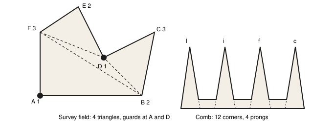

# Triangulating a polygon, and why n/3 guards can always watch a gallery with n walls

[Syllabus](../../../SYLLABUS.md) → [Geometry and trig](../README.md) → [Points, Convexity and Fractals](../README.md#s07) → Triangulating a polygon, and why n/3 guards can always watch a gallery with n walls

---

## General Overview

A farm field is fenced on six straight runs. A surveyor recorded its corner posts A to F in hundreds of metres from a survey peg: A (2, 1), B (10, 1), C (11, 6), D (7, 4), E (5, 8), F (2, 6). It is the field of [Shoelace formula](01-polygon-area-and-orientation.md): 41.5 hectares, with one **reflex corner** at D, where the fence bends inward (inside angle over 180 degrees).

The farm wants cameras on corner posts so that every spot is in some camera's straight line of sight. Treat each fence as a solid wall that blocks sight. How many cameras, and where?

Two ideas answer this for any straight-fenced field. First, clip off "ears" one corner at a time: six corners always give 6 − 2 = 4 triangles. Second, colour the corners in three colours, one of each per triangle, and put cameras on the rarest colour. Here 2 cameras do it, on A and D.

A camera is a **guard** from here on, and the field a **gallery**, as the problem was first posed for an art gallery. A comb-shaped gallery with 12 corners and 4 prongs needs 4 guards, so n/3 cannot be lowered.

**Clipping ears cuts any simple polygon with n corners into n − 2 triangles; three-colouring their corners and placing guards on the rarest colour watches the whole polygon with at most n/3 guards, rounded down, and some polygons need every one.**

**What kind of fact this is:** two theorems, the two-ears theorem and the art gallery theorem, both proved on this card in Why it works; ear clipping is a method built on the first.

### The picture: the field cut into triangles, and the comb

<p align="center"></p>

Left, 26 drawing units per 100 m: diagonals FB, BD and DF cut triangles FAB, BCD, FBD and DEF. Numbers are colours; dots are guards. Right, 18 units per metre: the comb, dashed lines marking what each tip sees.

---

## The formula

Notation first, in words. The polygon has $`n`$ corners, numbered in anticlockwise walking order. A **diagonal** is a straight segment between two corners that runs wholly inside the polygon. A **triangulation** is a set of diagonals, none crossing, that cuts the polygon into triangles.

The **turn test** from [Shoelace formula](01-polygon-area-and-orientation.md), on three points:

```math
\mathrm{turn}(a, b, c) = (b_x - a_x)(c_y - a_y) - (b_y - a_y)(c_x - a_x)
```

**Read it aloud:** walking from a to b to c, the number is positive for a left turn, negative for a right turn.

A corner $`v`$ with neighbours $`u`$ before it and $`w`$ after it is an **ear** when two things hold. The walk turns left at it, $`\mathrm{turn}(u, v, w) > 0`$. And no other corner lies inside or on the edges of triangle $`uvw`$. Then $`uw`$ is a diagonal, and cutting along it clips off triangle $`uvw`$.

```math
T = n - 2, \qquad g \le \left\lfloor \frac{n}{3} \right\rfloor
```

**Read it aloud:** any triangulation of an n-corner polygon has n minus 2 triangles, and some g guards, never more than n divided by 3 rounded down, see every point of it.

The brackets $`\lfloor\ \rfloor`$ mean "round down to a whole number". On the field: $`T = 6 - 2 = 4`$ and $`g \le \lfloor 6/3 \rfloor = 2`$. On the comb: $`T = 10`$ and $`g \le 4`$.

| Symbol | Plain meaning | In our example | Push it up and the answer… |
| --- | --- | --- | --- |
| $`n`$ | corners, also the number of walls | 6 on the field, 12 on the comb | more triangles; guard ceiling grows by 1 every 3 corners |
| $`u`$, $`v`$, $`w`$ | three corners in a row; $`v`$ is tested as an ear | F, A, B: A is an ear | — |
| $`a`$, $`b`$, $`c`$ | any three points fed to the turn test | C, D, E gives −20 | — |
| $`\mathrm{turn}`$ | twice the signed area of a triangle | $`\mathrm{turn}(C, D, E) = -20`$ | — |
| $`T`$ | triangles in the triangulation | 4 | one more per extra corner |
| $`g`$ | guards placed | 2, on A and D | — |
| $`k`$ | members of a tree, in the Step 1 fold | 4 triangles | — |
| $`\lfloor n/3 \rfloor`$ | the guard ceiling: n/3 rounded down | 2 on the field, 4 on the comb | — |

### When it holds

- **A simple polygon:** one loop that never crosses itself. A crossing loop has no clear inside.
- **No holes.** A pond is a second loop of walls, and more guards can be needed.
- **Guards see all the way round.** A camera with a narrow view cone needs its own count.
- **Corners walked in one fixed direction.** The ear test reads "left turn" as convex only for an anticlockwise walk; walked clockwise, every sign flips.

---

## Why it works

### Step 0: a clipped ear leaves a smaller polygon of the same kind

An ear's diagonal stays inside, so clipping it leaves a simple polygon with one fewer corner. Repeat until three corners remain. The proof rests on one question: does an ear always exist?

### Step 1: every polygon with four or more corners has two ears

This is the **two-ears theorem**, from Meisters (1975). In outline:

1. Every simple polygon can be cut into triangles by diagonals. [Shoelace formula](01-polygon-area-and-orientation.md) proves this in its Step 3 fold.
2. Join two triangles when they share a diagonal. This makes a **tree**: a network with no loops, since cutting any one diagonal splits the polygon in two.
3. A tree with two or more members has at least two **leaves**, members joined to only one other.
4. A leaf triangle has one side on a diagonal and two sides on the fence. Its middle corner is an ear.

On the field, FAB, BCD and DEF each meet only FBD. These leaves give ears at A, C and E.

<details>
<summary>Detailed proof: why a tree has two leaves</summary>

A tree with $`k \ge 2`$ members is connected, so every member has at least one link. It has $`k - 1`$ links in all, since each link joins a new member to those before it, and each link touches two members, giving $`2(k - 1)`$ link-ends.

If at most one member had a single link, the others would each have at least two, giving at least $`1 + 2(k - 1)`$ link-ends (or $`2k`$ if none had one). That is too many, so at least two members have one link each.

</details>

### Step 2: the count is n − 2

Each clip removes one corner and makes one triangle. From n corners down to 3 takes n − 3 clips, and the last 3 corners are one more triangle: n − 2 in all. A second road: the inside angles of an n-corner polygon add to (n − 2) × 180 degrees, and each triangle holds 180 of them.

### Step 3: three colours, one of each per triangle

This is Fisk's proof (1978). Undo the clipping, last triangle first. Give the last triangle's corners colours 1, 2 and 3. Each earlier ear brings back one corner, its tip, joined by its triangle to two corners that already have different colours. Give the tip the third colour.

On the field the clips ran A, then C, then B, leaving DEF. Colour D 1, E 2, F 3. Bring back B with F and D: B gets 2. Bring back C with B and D: C gets 3. Bring back A with F and B: A gets 1.

### Step 4: the rarest colour guards everything

The n corners split into three colours, so the smallest group holds at most n/3 corners; it is a whole number, so at most $`\lfloor n/3 \rfloor`$. Every triangle has one corner of that colour.

A triangle is convex (any two of its points see each other along a straight line inside it, [Convex sets](02-convex-sets-and-convex-hulls.md)), so a guard at its corner sees all of it. The triangles cover the polygon, so the guards see everything.

On the field, colours 1, 2 and 3 hold AD, BE and CF: each colour's pair works.

### Step 5: the comb shows the ceiling is exact

The comb is 14 m wide on a spine 1 m deep, with four triangular prongs 6 m tall. Its corners, in metres, are listed in the code; the tips are l (1, 7), i (5, 7), f (9, 7) and c (13, 7).

A tip sees a wedge between its prong's walls, extended; it widens downward, so it is widest at the floor. Tip l sees floor from 0.00 to 2.17 m, tip i from 3.83 to 6.17, tip f from 7.83 to 10.17, tip c from 11.83 to 14.00.

These strips never overlap, so no two wedges meet and no point sees two tips. Each tip needs its own guard: 4 guards, and 12/3 = 4.

---

## Worked numbers, by hand

| Step | Arithmetic | Value |
| --- | --- | --- |
| D is reflex, never an ear | turn(C, D, E) = (7 − 11)(8 − 6) − (4 − 6)(5 − 11) = −8 − 12 | −20 |
| clip A | left turn at A; D lies outside FAB | triangle FAB, 20 ha |
| clip C | B, C, D turn left; no corner inside | triangle BCD, 9 ha |
| clip B | left turn at B; E lies outside FBD | triangle FBD, 4.5 ha |
| last three | D, E, F | triangle DEF, 8 ha |
| count and area | 4 triangles; 20 + 9 + 4.5 + 8 | **4 = 6 − 2, 41.5 ha** |
| colours | D 1, E 2, F 3, then B 2, C 3, A 1 | AD, BE, CF |
| guards | rarest group, ⌊6/3⌋ | **2, at A and D** |

Two cameras, on posts A and D, watch the field; B and E, or C and F, work too.

### What breaks if you drop a piece

| Mistake | Comes out at | What went wrong |
| --- | --- | --- |
| Clip the reflex corner D first | triangles cover 61.5 ha, not 41.5 | Triangle CDE lies outside the fence |
| Guards on any two posts, B and C | 3.2 ha unseen, 7.7% | Corner D hides triangle D, E, (3.8, 7.2) from both |
| One guard per triangle | 4 guards, not 2 | A corner serves every triangle that meets it |


---

## Code, from first principles, and it actually runs

Only `atan2` and `pi` are imported. Road one clips ears, colours by undoing the clips, and takes each colour's corners as guards. Road two never colours: it keeps grid points 0.1 units apart that pass the ray test of [Inside or outside](03-point-in-polygon-and-segment-tests.md), and checks each has a sight line to a guard crossing no wall.

Road three checks the cut: every triangle turns left, the areas add to the shoelace area, and the count matches Step 2's angle sum. On the comb, road two confirms no grid point sees two tips.

### Python

```python
# Triangulating a polygon, and the art gallery theorem: the check behind the card.
# Standard library only. Road one clips ears, colours the corners in 3 colours
# and takes the rarest colour as guards. Road two never colours: it samples each
# gallery on a grid and tests every sight line against every wall.
from math import atan2, pi                                                 # for the angle road only
FIELD = [(2, 1), (10, 1), (11, 6), (7, 4), (5, 8), (2, 6)]                 # A to F
COMB = [(0, 0), (14, 0), (13, 7), (12, 1), (10, 1), (9, 7), (8, 1), (6, 1),
        (5, 7), (4, 1), (2, 1), (1, 7)]                                    # 4 prongs
def turn(a, b, c): return (b[0] - a[0]) * (c[1] - a[1]) - (b[1] - a[1]) * (c[0] - a[0])
def area(P): return sum(turn((0, 0), P[i - 1], P[i]) for i in range(len(P))) / 2
def in_tri(a, b, c, p): return turn(a, b, p) >= 0 and turn(b, c, p) >= 0 and turn(c, a, p) >= 0
def angles(P): return sum(1 - atan2(turn(P[i - 2], P[i - 1], P[i]), (P[i - 1][0] - P[i - 2][0]) * (P[i][0] - P[i - 1][0])
                           + (P[i - 1][1] - P[i - 2][1]) * (P[i][1] - P[i - 1][1])) / pi for i in range(len(P)))  # in 180s
def clip(P):                       # ear clipping: the triangles, in clipping order
    live, tris = list(range(len(P))), []
    while len(live) > 3:
        for k in range(len(live)):
            a, b, c = live[k - 1], live[k], live[(k + 1) % len(live)]
            if turn(P[a], P[b], P[c]) > 0 and not any(
                    in_tri(P[a], P[b], P[c], P[j]) for j in live if j not in (a, b, c)):
                tris.append((a, b, c)); live.pop(k); break
    return tris + [tuple(live)]
def colour(tris):                  # undo the clipping; each ear's tip takes the missing colour
    col = dict(zip(tris[-1], (1, 2, 3)))
    for a, b, c in reversed(tris[:-1]): col[b] = 6 - col[a] - col[c]
    return col
def crosses(p, q, a, b): return turn(p, q, a) * turn(p, q, b) < 0 and turn(a, b, p) * turn(a, b, q) < 0
def sees(P, g, p): return not any(crosses(g, p, P[i - 1], P[i]) for i in range(len(P)))
def inside(P, p): return sum((a[1] > p[1]) != (b[1] > p[1]) and turn(a, b, p) * (b[1] - a[1]) > 0
                             for a, b in zip(P[-1:] + P[:-1], P)) % 2 == 1
def grid(P): return [p for i in range(160) for j in range(90) if inside(P, p := ((i + 0.37) / 10, (j + 0.61) / 10))]
def gallery(P, names):             # names: one letter per corner
    tris, n, pts, ang = clip(P), len(P), grid(P), angles(P)
    col, tri_area = colour(tris), sum(abs(turn(*(P[v] for v in t))) for t in tris) / 2
    cls = ["".join(names[v] for v in range(n) if col[v] == k) for k in (1, 2, 3)]
    seen = [sum(any(sees(P, P[names.index(g)], p) for g in c) for p in pts) for c in cls]
    print(f"n = {n}: {len(tris)} triangles,", ", ".join("".join(names[v] for v in t) + f" {turn(*(P[v] for v in t)) / 2}" for t in tris))
    print(f"  triangle areas add to {tri_area}; shoelace {area(P)}; inside angles {ang:.1f} x 180 degrees; colours 1, 2, 3: {', '.join(cls)}; rarest {min(map(len, cls))}, n // 3 = {n // 3}")
    print(f"  grid points inside: {len(pts)}; seen by each colour's corners: {seen}")
    assert all(turn(*(P[v] for v in t)) > 0 for t in tris) and abs(tri_area - area(P)) < 1e-9 and abs(ang - len(tris)) < 1e-9  # road three
    assert all(len({col[v] for v in t}) == 3 for t in tris)                # one corner of each colour per triangle
    assert seen == [len(pts)] * 3                     # road two agrees: each colour guards it all
    return pts
(pts, comb), (A, B, C, D, E, F) = (gallery(FIELD, "ABCDEF"), gallery(COMB, "abcdefghijkl")), FIELD
print(f"field: turn at D {turn(C, D, E)}; D alone sees {(nd := sum(sees(FIELD, D, p) for p in pts))} points")
assert nd == len(pts) and all(turn(FIELD[i - 1], FIELD[i], D) >= 0 for i in range(6))   # D on the inner side of every fence
fl = [sorted(COMB[t][0] + (q[0] - COMB[t][0]) * COMB[t][1] / (COMB[t][1] - q[1]) for q in (COMB[t - 1], COMB[(t + 1) % 12])) for t in (11, 8, 5, 2)]  # walls meet the floor
print("comb: floor seen from each tip:", ", ".join(f"{a:.2f} to {b:.2f}" for a, b in fl))
most = max(sum(sees(COMB, COMB[t], p) for t in (11, 8, 5, 2)) for p in comb)
assert most == 1 and all(fl[k][1] < fl[k + 1][0] for k in range(3))     # strips and grid agree: no point sees two tips
print(f"comb: most tips one grid point sees: {most}, so {len(fl)} guards are needed")
s = turn(B, D, E) / (turn(B, D, E) - turn(B, D, F)); Q = (E[0] + s * (F[0] - E[0]), E[1] + s * (F[1] - E[1]))  # line BD meets EF
hid, ex = [p for p in pts if not (sees(FIELD, B, p) or sees(FIELD, C, p))], turn(D, E, Q) / 2
print(f"what breaks: clip reflex D first: triangles cover {abs(turn(C, D, E)) / 2 + area(FIELD[:3] + FIELD[4:])} ha, not {area(FIELD)}")
print(f"what breaks: guards at B and C miss triangle D, E, ({Q[0]:.1f}, {Q[1]:.1f}): {ex:.1f} ha, {100 * ex / area(FIELD):.1f}%; grid {len(hid)} of {len(pts)} points ({100 * len(hid) / len(pts):.1f}%)")
assert hid == [p for p in pts if in_tri(D, E, Q, p)] and abs(len(hid) / len(pts) - ex / area(FIELD)) < 0.01
print(f"what breaks: one guard per triangle: {len(FIELD) - 2} guards, not {len(FIELD) // 3}")
print("figure, field:", ", ".join(f"{n} ({30 + 26 * x}, {222 - 26 * y})" for n, (x, y) in zip("ABCDEF", FIELD)))
print("figure, comb:", ", ".join(f"{n} ({370 + 18 * x}, {222 - 18 * y})" for n, (x, y) in zip("abcdefghijkl", COMB)))
print("ALL CHECKS PASS")
```

**Ran 2026-11-23 on macOS, Python 3.14.10, standard library only. All checks passed. Output, pasted from the run:**

```
n = 6: 4 triangles, FAB 20.0, BCD 9.0, FBD 4.5, DEF 8.0
  triangle areas add to 41.5; shoelace 41.5; inside angles 4.0 x 180 degrees; colours 1, 2, 3: AD, BE, CF; rarest 2, n // 3 = 2
  grid points inside: 4145; seen by each colour's corners: [4145, 4145, 4145]
n = 12: 10 triangles, bcd 6.5, abd 7.0, ade 1.0, efg 6.0, aeg 1.0, agh 1.0, hij 6.0, ahj 1.0, ajk 1.0, akl 6.5
  triangle areas add to 37.0; shoelace 37.0; inside angles 10.0 x 180 degrees; colours 1, 2, 3: acfi, behk, dgjl; rarest 4, n // 3 = 4
  grid points inside: 3690; seen by each colour's corners: [3690, 3690, 3690]
field: turn at D -20; D alone sees 4145 points
comb: floor seen from each tip: 0.00 to 2.17, 3.83 to 6.17, 7.83 to 10.17, 11.83 to 14.00
comb: most tips one grid point sees: 1, so 4 guards are needed
what breaks: clip reflex D first: triangles cover 61.5 ha, not 41.5
what breaks: guards at B and C miss triangle D, E, (3.8, 7.2): 3.2 ha, 7.7%; grid 300 of 4145 points (7.2%)
what breaks: one guard per triangle: 4 guards, not 2
figure, field: A (82, 196), B (290, 196), C (316, 66), D (212, 118), E (160, 14), F (82, 66)
figure, comb: a (370, 222), b (622, 222), c (604, 96), d (586, 204), e (550, 204), f (532, 96), g (514, 204), h (478, 204), i (460, 96), j (442, 204), k (406, 204), l (388, 96)
ALL CHECKS PASS
```

### Rust

Same output, built with `rustc --edition 2021 -O`.

```rust
// Triangulating a polygon, and the art gallery theorem: the check behind the card.
// std only. Road one clips ears, colours the corners in 3 colours and takes the
// rarest colour as guards. Road two never colours: it samples each gallery on a
// grid and tests every sight line against every wall.
type P = (f64, f64);
fn pts(v: &[(i32, i32)]) -> Vec<P> { v.iter().map(|&(x, y)| (x as f64, y as f64)).collect() }
fn turn(a: P, b: P, c: P) -> f64 { (b.0 - a.0) * (c.1 - a.1) - (b.1 - a.1) * (c.0 - a.0) }
fn area(p: &[P]) -> f64 { (0..p.len()).map(|i| turn((0.0, 0.0), p[(i + p.len() - 1) % p.len()], p[i])).sum::<f64>() / 2.0 }
fn in_tri(a: P, b: P, c: P, p: P) -> bool { turn(a, b, p) >= 0.0 && turn(b, c, p) >= 0.0 && turn(c, a, p) >= 0.0 }
fn angles(p: &[P]) -> f64 { let n = p.len(); (0..n).map(|i| { let (a, b, c) = (p[(i + n - 2) % n], p[(i + n - 1) % n], p[i]); // in 180s
    1.0 - turn(a, b, c).atan2((b.0 - a.0) * (c.0 - b.0) + (b.1 - a.1) * (c.1 - b.1)) / std::f64::consts::PI }).sum() }
fn clip(p: &[P]) -> Vec<[usize; 3]> { // ear clipping: the triangles, in clipping order
    let (mut live, mut tris): (Vec<usize>, Vec<[usize; 3]>) = ((0..p.len()).collect(), vec![]);
    while live.len() > 3 {
        for k in 0..live.len() {
            let (a, b, c) = (live[(k + live.len() - 1) % live.len()], live[k], live[(k + 1) % live.len()]);
            if turn(p[a], p[b], p[c]) > 0.0
                && !live.iter().any(|&j| j != a && j != b && j != c && in_tri(p[a], p[b], p[c], p[j])) {
                tris.push([a, b, c]); live.remove(k); break;
            }
        }
    }
    tris.push([live[0], live[1], live[2]]); tris
}
fn colour(tris: &[[usize; 3]], n: usize) -> Vec<i32> { // undo the clipping; each ear's tip takes the missing colour
    let mut col = vec![0; n]; for (k, &v) in tris[tris.len() - 1].iter().enumerate() { col[v] = k as i32 + 1 }
    for t in tris[..tris.len() - 1].iter().rev() { col[t[1]] = 6 - col[t[0]] - col[t[2]] }
    col
}
fn crosses(p: P, q: P, a: P, b: P) -> bool { turn(p, q, a) * turn(p, q, b) < 0.0 && turn(a, b, p) * turn(a, b, q) < 0.0 }
fn sees(w: &[P], g: P, p: P) -> bool { !(0..w.len()).any(|i| crosses(g, p, w[(i + w.len() - 1) % w.len()], w[i])) }
fn inside(w: &[P], p: P) -> bool { (0..w.len()).filter(|&i| { let (a, b) = (w[(i + w.len() - 1) % w.len()], w[i]);
    ((a.1 > p.1) != (b.1 > p.1)) && turn(a, b, p) * (b.1 - a.1) > 0.0 }).count() % 2 == 1 }
fn grid(w: &[P]) -> Vec<P> { (0..160).flat_map(|i| (0..90).map(move |j| ((i as f64 + 0.37) / 10.0, (j as f64 + 0.61) / 10.0))).filter(|&p| inside(w, p)).collect() }
fn gallery(w: &[P], names: &str) -> Vec<P> { // names: one letter per corner
    let (tris, n, g, ang) = (clip(w), w.len(), grid(w), angles(w));
    let (nm, col): (Vec<char>, Vec<i32>) = (names.chars().collect(), colour(&tris, n));
    let tri_area = tris.iter().map(|t| turn(w[t[0]], w[t[1]], w[t[2]]).abs()).sum::<f64>() / 2.0;
    let cls: Vec<Vec<usize>> = (1..4).map(|k| (0..n).filter(|&v| col[v] == k).collect()).collect();
    let cname: Vec<String> = cls.iter().map(|c| c.iter().map(|&v| nm[v]).collect()).collect();
    let seen: Vec<usize> = cls.iter().map(|c| g.iter().filter(|&&p| c.iter().any(|&v| sees(w, w[v], p))).count()).collect();
    let rarest = cls.iter().map(|c| c.len()).min().unwrap();
    let tn: Vec<String> = tris.iter().map(|t| format!("{} {:.1}", t.iter().map(|&v| nm[v]).collect::<String>(), turn(w[t[0]], w[t[1]], w[t[2]]) / 2.0)).collect();
    println!("n = {}: {} triangles, {}", n, tris.len(), tn.join(", "));
    println!("  triangle areas add to {:.1}; shoelace {:.1}; inside angles {:.1} x 180 degrees; colours 1, 2, 3: {}; rarest {}, n // 3 = {}",
             tri_area, area(w), ang, cname.join(", "), rarest, n / 3);
    println!("  grid points inside: {}; seen by each colour's corners: {:?}", g.len(), seen);
    assert!(tris.iter().all(|t| turn(w[t[0]], w[t[1]], w[t[2]]) > 0.0) && (tri_area - area(w)).abs() < 1e-9 && (ang - tris.len() as f64).abs() < 1e-9); // road three
    assert!(tris.iter().all(|t| col[t[0]] != col[t[1]] && col[t[1]] != col[t[2]] && col[t[0]] != col[t[2]])); // one of each colour
    assert!(seen == vec![g.len(); 3]); // road two agrees: each colour guards it all
    g
}
fn main() {
    let field = pts(&[(2, 1), (10, 1), (11, 6), (7, 4), (5, 8), (2, 6)]); // A to F
    let comb = pts(&[(0, 0), (14, 0), (13, 7), (12, 1), (10, 1), (9, 7), (8, 1), (6, 1), (5, 7), (4, 1), (2, 1), (1, 7)]);
    let ((fp, cp), (b, c, d, e, f)) = ((gallery(&field, "ABCDEF"), gallery(&comb, "abcdefghijkl")), (field[1], field[2], field[3], field[4], field[5]));
    let nd = fp.iter().filter(|&&p| sees(&field, d, p)).count(); println!("field: turn at D {}; D alone sees {} points", turn(c, d, e), nd);
    assert!(nd == fp.len() && (0..6).all(|i| turn(field[(i + 5) % 6], field[i], d) >= 0.0)); // D on the inner side of every fence
    let fl: Vec<(f64, f64)> = [11usize, 8, 5, 2].iter().map(|&t| { let x = |q: P| comb[t].0 + (q.0 - comb[t].0) * comb[t].1 / (comb[t].1 - q.1);
        let (u, v) = (x(comb[t - 1]), x(comb[(t + 1) % 12])); (u.min(v), u.max(v)) }).collect(); // where each tip's two walls meet the floor
    println!("comb: floor seen from each tip: {}", fl.iter().map(|s| format!("{:.2} to {:.2}", s.0, s.1)).collect::<Vec<_>>().join(", "));
    let most = cp.iter().map(|&p| [11, 8, 5, 2].iter().filter(|&&t| sees(&comb, comb[t], p)).count()).max().unwrap();
    assert!(most == 1 && (0..3).all(|k| fl[k].1 < fl[k + 1].0)); // strips and grid agree: no point sees two tips
    println!("comb: most tips one grid point sees: {}, so {} guards are needed", most, fl.len());
    let s = turn(b, d, e) / (turn(b, d, e) - turn(b, d, f)); let q = (e.0 + s * (f.0 - e.0), e.1 + s * (f.1 - e.1)); // line BD meets EF
    let (hid, ex): (Vec<P>, f64) = (fp.iter().copied().filter(|&p| !(sees(&field, b, p) || sees(&field, c, p))).collect(), turn(d, e, q) / 2.0);
    let no_d = [field[0], field[1], field[2], field[4], field[5]];
    println!("what breaks: clip reflex D first: triangles cover {:.1} ha, not {:.1}", turn(c, d, e).abs() / 2.0 + area(&no_d), area(&field));
    println!("what breaks: guards at B and C miss triangle D, E, ({:.1}, {:.1}): {:.1} ha, {:.1}%; grid {} of {} points ({:.1}%)",
             q.0, q.1, ex, 100.0 * ex / area(&field), hid.len(), fp.len(), 100.0 * hid.len() as f64 / fp.len() as f64);
    assert!(hid == fp.iter().copied().filter(|&p| in_tri(d, e, q, p)).collect::<Vec<P>>() && (hid.len() as f64 / fp.len() as f64 - ex / area(&field)).abs() < 0.01);
    println!("what breaks: one guard per triangle: {} guards, not {}", field.len() - 2, field.len() / 3);
    let f: Vec<String> = field.iter().zip("ABCDEF".chars()).map(|(p, n)| format!("{} ({}, {})", n, 30.0 + 26.0 * p.0, 222.0 - 26.0 * p.1)).collect();
    println!("figure, field: {}", f.join(", "));
    let c: Vec<String> = comb.iter().zip("abcdefghijkl".chars()).map(|(p, n)| format!("{} ({}, {})", n, 370.0 + 18.0 * p.0, 222.0 - 18.0 * p.1)).collect();
    println!("figure, comb: {}", c.join(", "));
    println!("ALL CHECKS PASS");
}
```

**Ran 2026-11-23 on macOS, rustc 1.98.1, no crates. All checks passed. Output, pasted from the run:**

```
n = 6: 4 triangles, FAB 20.0, BCD 9.0, FBD 4.5, DEF 8.0
  triangle areas add to 41.5; shoelace 41.5; inside angles 4.0 x 180 degrees; colours 1, 2, 3: AD, BE, CF; rarest 2, n // 3 = 2
  grid points inside: 4145; seen by each colour's corners: [4145, 4145, 4145]
n = 12: 10 triangles, bcd 6.5, abd 7.0, ade 1.0, efg 6.0, aeg 1.0, agh 1.0, hij 6.0, ahj 1.0, ajk 1.0, akl 6.5
  triangle areas add to 37.0; shoelace 37.0; inside angles 10.0 x 180 degrees; colours 1, 2, 3: acfi, behk, dgjl; rarest 4, n // 3 = 4
  grid points inside: 3690; seen by each colour's corners: [3690, 3690, 3690]
field: turn at D -20; D alone sees 4145 points
comb: floor seen from each tip: 0.00 to 2.17, 3.83 to 6.17, 7.83 to 10.17, 11.83 to 14.00
comb: most tips one grid point sees: 1, so 4 guards are needed
what breaks: clip reflex D first: triangles cover 61.5 ha, not 41.5
what breaks: guards at B and C miss triangle D, E, (3.8, 7.2): 3.2 ha, 7.7%; grid 300 of 4145 points (7.2%)
what breaks: one guard per triangle: 4 guards, not 2
figure, field: A (82, 196), B (290, 196), C (316, 66), D (212, 118), E (160, 14), F (82, 66)
figure, comb: a (370, 222), b (622, 222), c (604, 96), d (586, 204), e (550, 204), f (532, 96), g (514, 204), h (478, 204), i (460, 96), j (442, 204), k (406, 204), l (388, 96)
ALL CHECKS PASS
```

### Lean

Lean proves the comb half of the main result: the 12-corner comb really needs 4 guards.

- The comb is a simple polygon: its loop never crosses itself.
- Take any set of guards, standing anywhere, that together see every point of the comb. Then there are at least 12/3 = 4 of them.
- Lean also checks the worked numbers. On the field, turn(C, D, E) = −20, and triangles FAB, BCD, FBD and DEF add to 41.5 ha.
- Take the Step 3 colours on the field's 4 triangles. Then each triangle has one corner of each colour, and the rarest colour has 2 corners.

The general results, n − 2 triangles and at most n/3 guards for every polygon, are not in Lean yet. Mathlib does not yet include built-in theorems that a polygon's loop has one clear inside, nor the two-ears theorem or the angle sum. Those general claims are left to the Python and Rust checks, which test them on the field and the comb.

```lean
-- Triangulating a polygon: the card's 12-corner comb is a simple polygon that needs 4 guards, wherever they stand, plus the card's worked numbers. The general n/3 guard bound and the n - 2 triangle count are not proved here.
import Mathlib.Analysis.Convex.Hull
import Mathlib.Analysis.Convex.Segment
import Mathlib.Topology.Algebra.Module.Basic
import Mathlib.Topology.Bornology.Basic
import Mathlib.Topology.Connected.Basic
import Mathlib.Topology.MetricSpace.Bounded
import Mathlib.Algebra.Order.Field.Basic
import Mathlib.Algebra.BigOperators.Fin
import Mathlib.Tactic.NormNum
import Mathlib.Tactic.FinCases
import Mathlib.Algebra.CharP.Invertible
import Mathlib.Basic.Real.Basic
import Mathlib.Analysis.Normed.Group.Bounded
import Mathlib.Analysis.Normed.Group.Constructions
import Mathlib.Analysis.Normed.Group.Real
import Mathlib.Analysis.Convex.PathConnected

noncomputable section

namespace ArtGallery

/-! A polygon with `n` corners is a map `P : Fin n → ℝ × ℝ`, corner `i` followed by corner
`i + 1` (wrapping from the last corner to the first). The definitions of fence, boundary,
simple polygon, inside and anticlockwise walk are those of the Shoelace card. -/

/-- The cross product of two arrows in the plane. -/
def cross (u v : ℝ × ℝ) : ℝ := u.1 * v.2 - u.2 * v.1

/-- The turn test: positive for a left turn walking `a → b → c`, negative for a right turn. -/
def turn (a b c : ℝ × ℝ) : ℝ := cross (b - a) (c - a)

/-- The shoelace sum: half the sum of each corner crossed with the next. -/
def shoelace {n : ℕ} [NeZero n] (P : Fin n → ℝ × ℝ) : ℝ :=
  (1 / 2) * ∑ i, cross (P i) (P (i + 1))

/-- Fence `i`: the straight wall from corner `i` to the next corner. -/
def fence {n : ℕ} [NeZero n] (P : Fin n → ℝ × ℝ) (i : Fin n) : Set (ℝ × ℝ) :=
  segment ℝ (P i) (P (i + 1))

/-- The boundary: all the fences together. -/
def boundary {n : ℕ} [NeZero n] (P : Fin n → ℝ × ℝ) : Set (ℝ × ℝ) := ⋃ i, fence P i

/-- A simple polygon: at least three corners, all different, and one loop that never crosses
itself (so it has no holes). Neighbouring fences meet only at their shared corner; all other
pairs of fences never meet. -/
def IsSimple {n : ℕ} [NeZero n] (P : Fin n → ℝ × ℝ) : Prop :=
  3 ≤ n ∧ Function.Injective P ∧
    ∀ i j : Fin n, i ≠ j →
      fence P i ∩ fence P j =
        if j = i + 1 then {P j} else if i = j + 1 then {P i} else ∅

/-- The inside: points off the boundary whose piece of the plane, with the boundary removed,
is bounded. -/
def inside {n : ℕ} [NeZero n] (P : Fin n → ℝ × ℝ) : Set (ℝ × ℝ) :=
  {p | p ∉ boundary P ∧ Bornology.IsBounded (connectedComponentIn (boundary P)ᶜ p)}

/-- The gallery: the inside together with its walls. -/
def gallery {n : ℕ} [NeZero n] (P : Fin n → ℝ × ℝ) : Set (ℝ × ℝ) := inside P ∪ boundary P

/-- A guard at `g` sees the point `p` when the straight line of sight from `g` to `p` stays in
the gallery: walls block sight, and a guard sees all the way round. -/
def Sees {n : ℕ} [NeZero n] (P : Fin n → ℝ × ℝ) (g p : ℝ × ℝ) : Prop :=
  segment ℝ g p ⊆ gallery P

/-- The comb from Step 5, in metres: a 14 m spine 1 m deep with four prongs 6 m tall (reaching y = 7). -/
def comb : Fin 12 → ℝ × ℝ :=
  ![(0, 0), (14, 0), (13, 7), (12, 1), (10, 1), (9, 7), (8, 1), (6, 1),
    (5, 7), (4, 1), (2, 1), (1, 7)]

/-- A point of a segment, written with one parameter. -/
lemma seg_coords {a b p : ℝ × ℝ} (hp : p ∈ segment ℝ a b) :
    ∃ s : ℝ, 0 ≤ s ∧ s ≤ 1 ∧ p.1 = (1 - s) * a.1 + s * b.1 ∧ p.2 = (1 - s) * a.2 + s * b.2 := by
  obtain ⟨u, v, hu, hv, huv, rfl⟩ := hp
  obtain rfl : u = 1 - v := by linarith
  exact ⟨v, hv, by linarith, by simp, by simp⟩

/-- An open half-plane is convex. -/
lemma convex_lin (α β c : ℝ) : Convex ℝ {p : ℝ × ℝ | α * p.1 + β * p.2 < c} := by
  intro x hx y hy a b ha hb hab
  simp only [Set.mem_ofPred_eq, Prod.fst_add, Prod.snd_add, Prod.smul_fst, Prod.smul_snd,
    smul_eq_mul] at hx hy ⊢
  have e : α * (a * x.1 + b * y.1) + β * (a * x.2 + b * y.2)
      = a * (α * x.1 + β * x.2) + b * (α * y.1 + β * y.2) := by ring
  rw [e]
  have ec : a * c + b * c = c := by rw [← add_mul, hab, one_mul]
  rcases ha.lt_or_eq with ha0 | ha0
  · nlinarith [mul_lt_mul_of_pos_left hx ha0, mul_le_mul_of_nonneg_left hy.le hb]
  · have hb0 : 0 < b := by linarith
    nlinarith [mul_lt_mul_of_pos_left hy hb0, mul_le_mul_of_nonneg_left hx.le ha]

/-- A set that reaches arbitrarily far out is not bounded. -/
lemma not_bounded_of {R : Set (ℝ × ℝ)} (h : ∀ r : ℝ, 0 ≤ r → ∃ p ∈ R, r < ‖p‖) :
    ¬ Bornology.IsBounded R := by
  intro hb
  obtain ⟨C, hC⟩ := isBounded_iff_forall_norm_le.1 hb
  obtain ⟨p, hp, hr⟩ := h |C| (abs_nonneg C)
  linarith [hC p hp, le_abs_self C]

/-- A convex, unbounded set that misses the comb's walls lies outside the comb's gallery. -/
lemma not_mem_gallery {R : Set (ℝ × ℝ)} (hc : Convex ℝ R) (hd : ∀ p ∈ boundary comb, p ∉ R)
    (hu : ¬ Bornology.IsBounded R) {q : ℝ × ℝ} (hq : q ∈ R) : q ∉ gallery comb := by
  rintro (h | h)
  · exact hu (h.2.subset
      (hc.isPreconnected.subset_connectedComponentIn hq (fun p hp hpb => hd p hpb hp)))
  · exact hd q h hq

/-- Below the spine is outside the comb. -/
lemma below_out {q : ℝ × ℝ} (hq : q.2 < 0) : q ∉ gallery comb := by
  refine not_mem_gallery (R := {p | 0 * p.1 + 1 * p.2 < 0}) (convex_lin _ _ _) ?_ ?_
    (by simpa using hq)
  · intro p hp
    obtain ⟨i, hi⟩ := Set.mem_iUnion.1 hp
    obtain ⟨s, hs0, hs1, e1, e2⟩ := seg_coords hi
    simp only [Set.mem_ofPred_eq]
    intro k
    fin_cases i <;> simp [comb] at e1 e2 <;> linarith
  · refine not_bounded_of fun r _ => ⟨(0, -(r + 1)), by simp; linarith, ?_⟩
    have h := norm_snd_le ((0 : ℝ), -(r + 1))
    simp only [Real.norm_eq_abs] at h
    linarith [neg_abs_le (-(r + 1))]

/-- The gap between two neighbouring prongs, open upwards, is outside the comb. -/
lemma gap_out (a b : ℝ) (hab : (a = 71 ∧ b = 61) ∨ (a = 47 ∧ b = 37) ∨ (a = 23 ∧ b = 13))
    {q : ℝ × ℝ} (h1 : 6 * q.1 - q.2 < a) (h2 : b < 6 * q.1 + q.2) (h3 : 1 < q.2) :
    q ∉ gallery comb := by
  refine not_mem_gallery (R := {p | 6 * p.1 + (-1) * p.2 < a} ∩ {p | (-6) * p.1 + (-1) * p.2 < -b}
    ∩ {p | 0 * p.1 + (-1) * p.2 < -1})
    (((convex_lin _ _ _).inter (convex_lin _ _ _)).inter (convex_lin _ _ _)) ?_ ?_
    ⟨⟨by simp; linarith, by simp; linarith⟩, by simp; linarith⟩
  · intro p hp
    obtain ⟨i, hi⟩ := Set.mem_iUnion.1 hp
    obtain ⟨s, hs0, hs1, e1, e2⟩ := seg_coords hi
    simp only [Set.mem_inter_iff, Set.mem_ofPred_eq]
    rintro ⟨⟨k1, k2⟩, k3⟩
    rcases hab with ⟨rfl, rfl⟩ | ⟨rfl, rfl⟩ | ⟨rfl, rfl⟩ <;>
      fin_cases i <;> simp [comb] at e1 e2 <;> linarith
  · refine not_bounded_of fun r hr => ⟨((a + b) / 12, r + 2), ⟨⟨?_, ?_⟩, ?_⟩, ?_⟩
    · simp; rcases hab with ⟨rfl, rfl⟩ | ⟨rfl, rfl⟩ | ⟨rfl, rfl⟩ <;> linarith
    · simp; rcases hab with ⟨rfl, rfl⟩ | ⟨rfl, rfl⟩ | ⟨rfl, rfl⟩ <;> linarith
    · simp; linarith
    · have h := norm_snd_le ((a + b) / 12, r + 2)
      simp only [Real.norm_eq_abs] at h
      linarith [le_abs_self (r + 2)]

/-- A point a little way from `A` towards `g`, on the segment between them. -/
lemma near_point (g A : ℝ × ℝ) : ∃ t u v : ℝ, 0 < t ∧ u = t * (g.1 - A.1) ∧ v = t * (g.2 - A.2) ∧
    |u| ≤ 1 ∧ |v| ≤ 1 ∧ (A.1 + u, A.2 + v) ∈ segment ℝ g A := by
  set D := 1 + |g.1 - A.1| + |g.2 - A.2| with hD
  have hD0 : 0 < D := by positivity
  refine ⟨1 / D, _, _, by positivity, rfl, rfl, ?_, ?_, ?_⟩
  · rw [abs_mul, abs_of_pos (by positivity : (0:ℝ) < 1 / D), one_div_mul_eq_div,
      div_le_one hD0]
    linarith [abs_nonneg (g.2 - A.2)]
  · rw [abs_mul, abs_of_pos (by positivity : (0:ℝ) < 1 / D), one_div_mul_eq_div,
      div_le_one hD0]
    linarith [abs_nonneg (g.1 - A.1)]
  · have ht1 : 1 / D ≤ 1 := by rw [div_le_one hD0]; linarith [abs_nonneg (g.1 - A.1), abs_nonneg (g.2 - A.2)]
    refine ⟨1 / D, 1 - 1 / D, by positivity, by linarith, by ring, ?_⟩
    ext <;> simp <;> ring

/-- The comb is a simple polygon. -/
lemma comb_simple : IsSimple comb := by
  refine ⟨by norm_num, ?_, ?_⟩
  · intro i j h
    fin_cases i <;> fin_cases j <;> simp [comb] at h ⊢
  · intro i j hij
    fin_cases i <;> fin_cases j <;>
      first
      | exact absurd rfl hij
      | (rw [ite_eq_left (by decide)]
         ext p
         constructor
         · rintro ⟨h1, h2⟩
           obtain ⟨s, hs0, hs1, e1, e2⟩ := seg_coords h1
           obtain ⟨t, ht0, ht1, e3, e4⟩ := seg_coords h2
           simp [comb] at e1 e2 e3 e4 ⊢
           refine Prod.ext ?_ ?_ <;> simp <;> linarith
         · intro hp
           rw [Set.mem_singleton_iff] at hp
           subst hp
           exact ⟨right_mem_segment _ _ _, left_mem_segment _ _ _⟩)
      | (rw [ite_eq_right (by decide), ite_eq_left (by decide)]
         ext p
         constructor
         · rintro ⟨h1, h2⟩
           obtain ⟨s, hs0, hs1, e1, e2⟩ := seg_coords h1
           obtain ⟨t, ht0, ht1, e3, e4⟩ := seg_coords h2
           simp [comb] at e1 e2 e3 e4 ⊢
           refine Prod.ext ?_ ?_ <;> simp <;> linarith
         · intro hp
           rw [Set.mem_singleton_iff] at hp
           subst hp
           exact ⟨left_mem_segment _ _ _, right_mem_segment _ _ _⟩)
      | (rw [ite_eq_right (by decide), ite_eq_right (by decide)]
         ext p
         simp only [Set.mem_inter_iff, Set.mem_empty_iff_false, iff_false, not_and]
         intro h1 h2
         obtain ⟨s, hs0, hs1, e1, e2⟩ := seg_coords h1
         obtain ⟨t, ht0, ht1, e3, e4⟩ := seg_coords h2
         simp [comb] at e1 e2 e3 e4
         linarith)

/-- A guard who sees the tip of the first prong stands in that prong's wedge. -/
lemma sees_tip2 {g : ℝ × ℝ} (h : Sees comb g (comb 2)) : 71 ≤ 6 * g.1 - g.2 ∧ 0 ≤ g.2 := by
  have hA : comb 2 = (13, 7) := by simp [comb]
  have hg : g ∈ gallery comb := h (left_mem_segment _ _ _)
  refine ⟨?_, ?_⟩
  · by_contra hlt
    obtain ⟨t, u, v, ht, hu, hv, hu1, hv1, hs⟩ := near_point g (comb 2)
    rw [hA] at hu hv hs
    have k : 6 * u - v = t * (6 * g.1 - g.2 - 71) := by rw [hu, hv]; ring
    have k' := mul_neg_of_pos_of_neg ht (by linarith : 6 * g.1 - g.2 - 71 < 0)
    rw [abs_le] at hu1 hv1
    exact gap_out 71 61 (Or.inl ⟨rfl, rfl⟩) (q := ((13 : ℝ) + u, (7 : ℝ) + v))
      (by simp; linarith) (by simp; linarith) (by simp; linarith) (h hs)
  · by_contra hlt
    exact below_out (by linarith) hg

/-- A guard who sees the tip of the second prong stands in that prong's wedge. -/
lemma sees_tip5 {g : ℝ × ℝ} (h : Sees comb g (comb 5)) :
    47 ≤ 6 * g.1 - g.2 ∧ 6 * g.1 + g.2 ≤ 61 ∧ 0 ≤ g.2 := by
  have hA : comb 5 = (9, 7) := by simp [comb]
  have hg : g ∈ gallery comb := h (left_mem_segment _ _ _)
  obtain ⟨t, u, v, ht, hu, hv, hu1, hv1, hs⟩ := near_point g (comb 5)
  rw [hA] at hu hv hs
  rw [abs_le] at hu1 hv1
  refine ⟨?_, ?_, ?_⟩
  · by_contra hlt
    have k : 6 * u - v = t * (6 * g.1 - g.2 - 47) := by rw [hu, hv]; ring
    have k' := mul_neg_of_pos_of_neg ht (by linarith : 6 * g.1 - g.2 - 47 < 0)
    exact gap_out 47 37 (Or.inr (Or.inl ⟨rfl, rfl⟩)) (q := ((9 : ℝ) + u, (7 : ℝ) + v))
      (by simp; linarith) (by simp; linarith) (by simp; linarith) (h hs)
  · by_contra hlt
    have k : 6 * u + v = t * (6 * g.1 + g.2 - 61) := by rw [hu, hv]; ring
    have k' := mul_pos ht (by linarith : 0 < 6 * g.1 + g.2 - 61)
    exact gap_out 71 61 (Or.inl ⟨rfl, rfl⟩) (q := ((9 : ℝ) + u, (7 : ℝ) + v))
      (by simp; linarith) (by simp; linarith) (by simp; linarith) (h hs)
  · by_contra hlt
    exact below_out (by linarith) hg

/-- A guard who sees the tip of the third prong stands in that prong's wedge. -/
lemma sees_tip8 {g : ℝ × ℝ} (h : Sees comb g (comb 8)) :
    23 ≤ 6 * g.1 - g.2 ∧ 6 * g.1 + g.2 ≤ 37 ∧ 0 ≤ g.2 := by
  have hA : comb 8 = (5, 7) := by simp [comb]
  have hg : g ∈ gallery comb := h (left_mem_segment _ _ _)
  obtain ⟨t, u, v, ht, hu, hv, hu1, hv1, hs⟩ := near_point g (comb 8)
  rw [hA] at hu hv hs
  rw [abs_le] at hu1 hv1
  refine ⟨?_, ?_, ?_⟩
  · by_contra hlt
    have k : 6 * u - v = t * (6 * g.1 - g.2 - 23) := by rw [hu, hv]; ring
    have k' := mul_neg_of_pos_of_neg ht (by linarith : 6 * g.1 - g.2 - 23 < 0)
    exact gap_out 23 13 (Or.inr (Or.inr ⟨rfl, rfl⟩)) (q := ((5 : ℝ) + u, (7 : ℝ) + v))
      (by simp; linarith) (by simp; linarith) (by simp; linarith) (h hs)
  · by_contra hlt
    have k : 6 * u + v = t * (6 * g.1 + g.2 - 37) := by rw [hu, hv]; ring
    have k' := mul_pos ht (by linarith : 0 < 6 * g.1 + g.2 - 37)
    exact gap_out 47 37 (Or.inr (Or.inl ⟨rfl, rfl⟩)) (q := ((5 : ℝ) + u, (7 : ℝ) + v))
      (by simp; linarith) (by simp; linarith) (by simp; linarith) (h hs)
  · by_contra hlt
    exact below_out (by linarith) hg

/-- A guard who sees the tip of the fourth prong stands in that prong's wedge. -/
lemma sees_tip11 {g : ℝ × ℝ} (h : Sees comb g (comb 11)) : 6 * g.1 + g.2 ≤ 13 ∧ 0 ≤ g.2 := by
  have hA : comb 11 = (1, 7) := by simp [comb]
  have hg : g ∈ gallery comb := h (left_mem_segment _ _ _)
  refine ⟨?_, ?_⟩
  · by_contra hlt
    obtain ⟨t, u, v, ht, hu, hv, hu1, hv1, hs⟩ := near_point g (comb 11)
    rw [hA] at hu hv hs
    rw [abs_le] at hu1 hv1
    have k : 6 * u + v = t * (6 * g.1 + g.2 - 13) := by rw [hu, hv]; ring
    have k' := mul_pos ht (by linarith : 0 < 6 * g.1 + g.2 - 13)
    exact gap_out 23 13 (Or.inr (Or.inr ⟨rfl, rfl⟩)) (q := ((1 : ℝ) + u, (7 : ℝ) + v))
      (by simp; linarith) (by simp; linarith) (by simp; linarith) (h hs)
  · by_contra hlt
    exact below_out (by linarith) hg


/-- The ceiling cannot be lowered. The 12-corner comb is a simple polygon, and any set of
guards, standing anywhere, that sees every point of it has at least 12 / 3 = 4 guards. -/
theorem comb_needs_four_guards :
    IsSimple comb ∧
      ∀ G : Finset (ℝ × ℝ), (∀ p ∈ gallery comb, ∃ g ∈ G, Sees comb g p) → 12 / 3 ≤ G.card := by
  refine ⟨comb_simple, fun G hG => ?_⟩
  have m : ∀ k, comb k ∈ gallery comb :=
    fun k => Or.inr (Set.mem_iUnion.2 ⟨k, left_mem_segment _ _ _⟩)
  obtain ⟨g1, h1G, h1⟩ := hG _ (m 2)
  obtain ⟨g2, h2G, h2⟩ := hG _ (m 5)
  obtain ⟨g3, h3G, h3⟩ := hG _ (m 8)
  obtain ⟨g4, h4G, h4⟩ := hG _ (m 11)
  have a1 := sees_tip2 h1
  have a2 := sees_tip5 h2
  have a3 := sees_tip8 h3
  have a4 := sees_tip11 h4
  have hsub : ({g1, g2, g3, g4} : Finset (ℝ × ℝ)) ⊆ G := by
    intro x hx
    simp only [Finset.mem_insert, Finset.mem_singleton] at hx
    rcases hx with rfl | rfl | rfl | rfl <;> assumption
  have hcard : ({g1, g2, g3, g4} : Finset (ℝ × ℝ)).card = 4 := by
    rw [Finset.card_insert_of_notMem, Finset.card_insert_of_notMem, Finset.card_pair]
    · rintro rfl; linarith
    · simp only [Finset.mem_insert, Finset.mem_singleton]
      rintro (rfl | rfl) <;> linarith
    · simp only [Finset.mem_insert, Finset.mem_singleton]
      rintro (rfl | rfl | rfl) <;> linarith
  calc 12 / 3 = 4 := by norm_num
    _ = _ := hcard.symm
    _ ≤ G.card := Finset.card_le_card hsub

/-! The card's worked numbers. Corners A to F of the survey field are `0` to `5`. -/

/-- The survey field, in hundreds of metres. -/
def field : Fin 6 → ℝ × ℝ := ![(2, 1), (10, 1), (11, 6), (7, 4), (5, 8), (2, 6)]

-- D is reflex: turn(C, D, E) = −20.
example : turn (field 2) (field 3) (field 4) = -20 := by
  norm_num [turn, cross, field]

-- The four clipped triangles FAB, BCD, FBD, DEF turn left, with doubled areas 40, 18, 9, 16,
-- adding to twice the field's 41.5 hectares.
example : turn (field 5) (field 0) (field 1) = 40 ∧ turn (field 1) (field 2) (field 3) = 18 ∧
    turn (field 5) (field 1) (field 3) = 9 ∧ turn (field 3) (field 4) (field 5) = 16 := by
  norm_num [turn, cross, field]

example : shoelace field = 83 / 2 := by
  norm_num [shoelace, cross, field, Fin.sum_univ_succ]

-- 4 = 6 − 2 triangles; colours D 1, E 2, F 3, B 2, C 3, A 1 give one of each per triangle,
-- and the rarest colour has 2 = 6 / 3 corners.
example : let col : Fin 6 → ℕ := ![1, 2, 3, 1, 2, 3]
    let T : List (Fin 6 × Fin 6 × Fin 6) := [(5, 0, 1), (1, 2, 3), (5, 1, 3), (3, 4, 5)]
    T.length = 6 - 2 ∧ (∀ t ∈ T, col t.1 ≠ col t.2.1 ∧ col t.2.1 ≠ col t.2.2 ∧ col t.1 ≠ col t.2.2) ∧
      (Finset.univ.filter (fun v => col v = 1)).card = 6 / 3 := by
  decide +kernel

-- The comb: 10 = 12 − 2 triangles, colours acfi, behk, dgjl, one of each per triangle,
-- rarest colour 4 = 12 / 3.
example : let col : Fin 12 → ℕ := ![1, 2, 1, 3, 2, 1, 3, 2, 1, 3, 2, 3]
    let T : List (Fin 12 × Fin 12 × Fin 12) :=
      [(1, 2, 3), (0, 1, 3), (0, 3, 4), (4, 5, 6), (0, 4, 6), (0, 6, 7), (7, 8, 9), (0, 7, 9),
        (0, 9, 10), (0, 10, 11)]
    T.length = 12 - 2 ∧ (∀ t ∈ T, col t.1 ≠ col t.2.1 ∧ col t.2.1 ≠ col t.2.2 ∧ col t.1 ≠ col t.2.2) ∧
      (Finset.univ.filter (fun v => col v = 1)).card = 12 / 3 := by
  decide +kernel

#print axioms seg_coords
#print axioms convex_lin
#print axioms not_bounded_of
#print axioms not_mem_gallery
#print axioms below_out
#print axioms gap_out
#print axioms near_point
#print axioms comb_simple
#print axioms sees_tip2
#print axioms sees_tip5
#print axioms sees_tip8
#print axioms sees_tip11
#print axioms comb_needs_four_guards

end ArtGallery

end
```

**Checked 2026-11-23 on macOS, Lean 4.36.0-rc2, Mathlib v4.36.0-rc2. Every proof is complete and uses only Lean's standard axioms. Output, pasted from the run:**

```
'ArtGallery.seg_coords' depends on axioms: [propext, Classical.choice, Quot.sound]
'ArtGallery.convex_lin' depends on axioms: [propext, Classical.choice, Quot.sound]
'ArtGallery.not_bounded_of' depends on axioms: [propext, Classical.choice, Quot.sound]
'ArtGallery.not_mem_gallery' depends on axioms: [propext, Classical.choice, Quot.sound]
'ArtGallery.below_out' depends on axioms: [propext, Classical.choice, Quot.sound]
'ArtGallery.gap_out' depends on axioms: [propext, Classical.choice, Quot.sound]
'ArtGallery.near_point' depends on axioms: [propext, Classical.choice, Quot.sound]
'ArtGallery.comb_simple' depends on axioms: [propext, Classical.choice, Quot.sound]
'ArtGallery.sees_tip2' depends on axioms: [propext, Classical.choice, Quot.sound]
'ArtGallery.sees_tip5' depends on axioms: [propext, Classical.choice, Quot.sound]
'ArtGallery.sees_tip8' depends on axioms: [propext, Classical.choice, Quot.sound]
'ArtGallery.sees_tip11' depends on axioms: [propext, Classical.choice, Quot.sound]
'ArtGallery.comb_needs_four_guards' depends on axioms: [propext, Classical.choice, Quot.sound]
```

> [!TIP]
> **Try changing**
> - Guess first: deepen the notch, setting D in `FIELD` to `(7, 2)`. The field shrinks to 35.5 ha, the clipping changes, and colour 1 is D alone: 1 guard. The last assert fails: line BD now misses fence EF.
> - Guess first: delete the test `not any(...)` from the ear check in `clip`. Now B is clipped while D sits inside triangle FBC, and road three stops the run: triangle CDF turns right, −9.0 ha, and the areas add to 59.5, not 41.5.
> - Guess first: squash the comb's prongs, changing each tip height 7 to 1.5. The floor strips overlap, 0.00 to 4.00 against 2.00 to 8.00, and the comb assert stops the run: a short comb no longer forces 4 guards.

---

## The usual mistake

> [!warning]
> **Reading n/3 as the number of guards a gallery needs.** It is a ceiling for every gallery with n corners; one gallery can need fewer. This field needs 1: D alone sees all 4145 grid points.
>
> - **Clipping a reflex corner.** At D the walk turns right (turn −20), so triangle CDE lies outside the fence. The triangles then cover 61.5 ha for a 41.5 ha field.
> - **Guards on any n/3 corners.** Posts B and C are two corners, but they miss 3.2 ha, 7.7% of the field: triangle D, E, (3.8, 7.2), where line BD meets fence EF. The grid finds 300 of 4145 points.
> - **One guard per triangle.** That is 4 guards, not 2: a guard at a shared corner covers every triangle meeting there.

---

## Where you meet it in real life

- **Security cameras.** Placing cameras in a museum or warehouse is this problem; the theorem gives a budget that always suffices.
- **Computer graphics.** Graphics chips draw only triangles, so a letter outline or a map's country is triangulated first, often by ear clipping.
- **Engineering meshes.** Stress simulations split a part's outline into triangles first.

> **Say it back**
> An ear is a corner where the walk turns left and no other corner lies in or on its triangle. Every polygon with four or more corners has two ears, so clipping them one by one cuts n corners into n − 2 triangles. Undoing the clips colours the corners in three colours with one of each per triangle. The rarest colour has at most n/3 corners, rounded down, and guards there see every triangle. The 12-corner comb needs all 4, so the ceiling cannot be lowered.

---

## What this builds on

- [Shoelace formula](01-polygon-area-and-orientation.md): the turn test, the survey field, and the proof that diagonals exist.
- [Inside or outside](03-point-in-polygon-and-segment-tests.md): the ray test for grid points and the crossing test for sight lines.
- [Colouring](../../04-Combinatorics%20and%20graphs/12-Planarity%20and%20Colouring/03-vertex-colouring-and-chromatic-number.md): proper colouring, here of the triangulation's corners in three colours.
- [Convex sets](02-convex-sets-and-convex-hulls.md): why one corner of a triangle sees all of it.
- [Nearest-neighbour maps](04-voronoi-and-delaunay.md): a different triangulation, of scattered points rather than a polygon.

## Where this goes next

- [Sweeping a line across the plane](09-plane-sweep-segment-intersection.md): the sweep that finds crossing segments; textbooks adapt it to triangulate a polygon in about n log n steps, against ear clipping's n².

The ceiling covers every gallery with n corners; how to find the fewest guards for one particular gallery is the question this card leaves open. Next on this shelf, Sweeping a line across the plane develops the plane sweep needed for faster triangulation.

---

## Sources

Verified 2026-11-23: every link below resolves to the publisher's page.

- Chvátal, V. "A combinatorial theorem in plane geometry." *Journal of Combinatorial Theory, Series B* 18 (1975), 39–41. [doi:10.1016/0095-8956(75)90061-1](https://doi.org/10.1016/0095-8956(75)90061-1). The first proof that ⌊n/3⌋ guards suffice and are sometimes needed.
- Fisk, S. "A short proof of Chvátal's watchman theorem." *Journal of Combinatorial Theory, Series B* 24 (1978), 374. [doi:10.1016/0095-8956(78)90059-X](https://doi.org/10.1016/0095-8956(78)90059-X). The three-colouring proof used in Steps 3 and 4.
- Meisters, G. H. "Polygons have ears." *The American Mathematical Monthly* 82 (1975), 648–651. [doi:10.1080/00029890.1975.11993898](https://doi.org/10.1080/00029890.1975.11993898). The two-ears theorem behind ear clipping.
- de Berg, M., O. Cheong, M. van Kreveld and M. Overmars. *Computational Geometry: Algorithms and Applications*, 3rd ed. Springer, 2008. [Publisher page](https://link.springer.com/book/10.1007/978-3-540-77974-2). Chapter 3 triangulates polygons to guard an art gallery, with the faster sweep.
