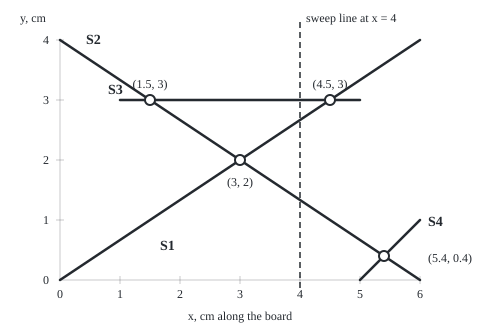

# Sweeping a line across the plane: find every crossing among n segments without testing every pair

[Syllabus](../../../SYLLABUS.md) → [Geometry and trig](../README.md) → [Points, Convexity and Fractals](../README.md#s07) → Sweeping a line across the plane

---

## General Overview

A circuit board carries copper tracks: thin straight strips of metal that carry signals. Two tracks on the same layer must never cross, because a crossing joins two signals and shorts them. Before a board is made, a design check must list every crossing.

Here is a small board, 6 cm by 4 cm, with four tracks. Positions are in centimetres, along the board then up it:

- S1 runs from (0, 0) to (6, 4).
- S2 runs from (0, 4) to (6, 0).
- S3 runs from (1, 3) to (5, 3).
- S4 runs from (5, 0) to (6, 1).

The obvious method tests every pair with the segment test from [Inside or outside](03-point-in-polygon-and-segment-tests.md). Four tracks make 6 pairs; 1,000 tracks make 499,500, almost none near each other.

The plane sweep does better. Slide a vertical ruler left to right across the board. The tracks it cuts have an up-down order along it, and two tracks can only cross after they become next to each other in that order. So the sweep tests only next-door pairs. On this board it finds all 4 crossings and never tests S3 against S4. On a random 10 cm board of 1,000 short tracks, it finds all 186 crossings with 2,735 tests instead of 499,500.

**Two segments that cross are next to each other in the up-down order just before they cross, so a line swept across the plane finds every crossing by testing only next-door pairs, at a cost that grows like (n + k) log2 n for n segments with k crossings.**

**What kind of fact this is:** an algorithm (a step-by-step method), first published in 1979; its correctness is a theorem, proved in Why it works for segments in general position (no shared $`x`$, triple crossing or overlap); its cost rests on textbook costs of two sorted structures (Step 3).

### The picture: four tracks and the sweep line

<p align="center"></p>

Drawn at 1 cm = 60 units. At x = 4 the dashed sweep line cuts S3, S1 and S2, from the top down.

---

## The formula

- The **sweep line** is the vertical line $`x`$ = constant that moves from left to right.
- The **status** is the list of segments the sweep line cuts right now, sorted by height on that line.
- An **event** is a place where the status changes: a segment starts, a segment ends, or two segments cross.
- A **next-door pair** is two segments next to each other in the status.

The sweep keeps the events in a queue sorted by $`x`$ and handles them one at a time. At each event it updates the status and tests the new next-door pairs. A crossing it finds goes into the queue as a new event. The cost is

```math
\text{steps} \approx (n + k)\,\log_2 n \quad\text{instead of}\quad \frac{n(n-1)}{2}\ \text{pair tests}
```

**Read it aloud:** the work grows with the number of segments plus the number of crossings, times a small factor for keeping things sorted, instead of with the number of pairs.

On the 1,000-track board: $`(1000 + 186)\log_2 1000`$ is about 11,819, a size estimate, against 499,500 pair tests.

| Symbol | Plain meaning | In our example | Push it up and the answer… |
| --- | --- | --- | --- |
| S1 to S4; A, B, C | segments (tracks); A, B, C stand for any three in the proof | S1 from (0, 0) to (6, 4) | — |
| P | the point where A and B cross | (3, 2) for S1 and S2 | — |
| $`n`$ | number of segments (tracks) | 4; 1,000 on the big board | pair tests grow with its square, sweep steps only a little faster than it |
| $`k`$ | number of crossings | 4; 186 on the big board | each crossing adds an event, a swap and up to two tests |
| $`x`$ | where the sweep line stands, in cm | 0 to 6 | — |
| $`\log_2 n`$ | how many times $`n`$ halves to reach 1: the cost of one step in a sorted structure | 2 for 4 tracks | grows very slowly |
| $`\frac{n(n-1)}{2}`$ | number of pairs, the brute-force cost | 6; 499,500 | — |
| $`2n + k`$ | number of events: each segment starts and ends once, each crossing once | 2,186 on the big board | — |

### When it holds

- **No two event points share an $`x`$, and no segment is vertical.** Without a fixed rule for ties, code can sort the status wrongly. The example has ties at $`x`$ = 0, 5 and 6, which the code settles by handling starts before crossings before ends.
- **No three segments through one point, and no two overlapping along a line.** A swap of two segments then no longer describes the change in the status.
- **Careful arithmetic.** Crossing points are decimals; two events a hair apart can be handled in the wrong order.
- **Few crossings compared with pairs.** If every pair crosses, $`k`$ is $`n(n-1)/2`$ and the sweep loses: for 1,000 segments, 499,500 crossing events alone match 499,500 pair tests.

---

## Why it works

### Step 0: crossing segments are next-door just before they cross

Take two segments A and B that cross at a point P. Stand the sweep line just left of P, after every earlier event. Could a third segment C lie between A and B there?

As the line moves on, the gap between A and B shrinks to the point P, so C must get out. C ending, or crossing A or B, would be an event before P, and none is left. Passing through P needs three segments through one point. So the gap is empty: A and B are next-door.

### Step 1: the status changes only at events

Between events, two segments cannot swap their up-down order without crossing, and every crossing is an event. So the status only changes at three kinds of event:

- **a start:** the new segment is slotted in by its height, and it is tested against its new neighbours above and below;
- **an end:** the segment leaves, and its two old neighbours become next-door and are tested;
- **a crossing:** the two segments swap places, and each is tested against its new outer neighbour.

### Step 2: every crossing is found in time

By Step 0, A and B are next-door just before P. They became next-door at some event, and the sweep tests every new next-door pair. So P was found and queued before the sweep line reached it.

### Step 3: the cost

There are $`2n + k`$ events. Each one creates at most two new next-door pairs, so at most two tests. Each event also needs a lookup in the sorted status and in the event queue.

With a balanced search tree for the status (a sorted structure that finds, inserts or removes an item in about $`\log_2 n`$ steps) and a heap for the queue (a structure that always hands out the smallest $`x`$ in about $`\log_2`$ of its size), each event costs about $`\log_2 n`$ steps. The queue never holds more than $`2n + n^2`$ events, and $`\log_2`$ of that is about $`\log_2 n^2 = 2\log_2 n`$. That gives about $`(2n + k)\log_2 n`$, at most twice the textbook's $`(n + k)\log_2 n`$ (Sources, chapter 2).

The code here keeps the status as a plain list: up to $`n`$ steps per event, fine for a check, not for a real board.

On the big board, 2,186 events give 2,735 tests. Doubling the tracks on the same board roughly doubles the tests but quadruples the pairs.

---

## Worked numbers, by hand

The status is read from the top down. Heights on the sweep line come from each track's straight-line equation.

| Step | Arithmetic | Value |
| --- | --- | --- |
| x = 0: S1 and S2 start | heights S2 at 4.00, S1 at 0.00; test S1–S2 | they cross at (3, 2): queued |
| x = 1: S3 starts at height 3 | S2 at 3.33, S1 at 0.67, so S3 slots between them; test S2–S3 and S3–S1 | (1.5, 3) and (4.5, 3) queued |
| x = 1.5: S2 meets S3 | swap: S3, S2, S1; new next-door pair S2–S1 already tested | crossing 1 |
| x = 3: S1 meets S2 | swap: S3, S1, S2; S3–S1 already tested | crossing 2 |
| x = 4.5: S1 meets S3 | swap: S1, S3, S2; S3–S2 already tested | crossing 3 |
| x = 5: S4 starts at height 0, S3 ends | S2 at 0.67 is just above S4; test S2–S4; S3 leaves, S1–S2 already tested | (5.4, 0.4) queued |
| x = 5.4: S2 meets S4 | swap: S1, S4, S2; test S1–S4 | crossing 4; S1–S4 do not cross |
| x = 6: S1, S2, S4 end | status empty | done |
| total | 5 of the 6 pairs tested; S3–S4 never | **4 crossings** |

Four crossings mean four shorts; the design must move tracks to another layer there.

### What breaks if you drop a piece

| Mistake | Comes out at | What went wrong |
| --- | --- | --- |
| No swap at a crossing | 3 of 4 found, S2–S4 missed; 167 of 186 on the big board | The status keeps the old order, so S4 is slotted next to the wrong track |
| Testing every pair on the big board | 499,500 tests | Right answer, but most pairs are far apart; the sweep needs 2,735 |
| Using the sweep when every pair crosses | estimate 4,987,875 for 1,000 segments | The $`k`$ term dominates; 499,500 pair tests is cheaper |

The code prints all three.

---

## Code, from first principles, and it actually runs

The code runs the sweep on the four tracks and prints the status after each $`x`$. It then builds a 1,000-track board from a fixed pseudo-random sequence (a formula that makes numbers that look random but repeat exactly). Positions there are in micrometres (thousandths of a millimetre); tracks start in a square 100,000 across and run at most 3,000 along and 3,000 up or down. Two independent roads reach the crossings: the sweep, and brute force over all pairs. A third check confirms each crossing point lies on both tracks.

### Python

```python
# Plane sweep -- the check behind the card.  Standard library only.  A vertical line sweeps
# left to right over straight copper tracks.  Tracks are kept in up-down order and only next-door
# tracks are tested for a crossing.  Road two tests every pair (brute force); the answers must agree.
import heapq, math
TRACKS = [((0, 0), (6, 4)), ((0, 4), (6, 0)), ((1, 3), (5, 3)), ((5, 0), (6, 1))]
def orient(a, b, c):                   # twice the signed area of triangle a, b, c
    return (b[0] - a[0]) * (c[1] - a[1]) - (b[1] - a[1]) * (c[0] - a[0])
def meet(s, t):                        # crossing point of two segments, or None
    (p, q), (r, u) = s, t; d1, d2 = orient(r, u, p), orient(r, u, q)
    if d1 * d2 >= 0 or orient(p, q, r) * orient(p, q, u) >= 0: return None    # no straddle, no crossing
    f = d1 / (d1 - d2)                 # fraction of the way from p to q
    return (p[0] + f * (q[0] - p[0]), p[1] + f * (q[1] - p[1]))
def y_at(s, x):                        # height of segment s where the sweep line stands
    return s[0][1] + (x - s[0][0]) * (s[1][1] - s[0][1]) / (s[1][0] - s[0][0])
def sweep(S, swap=True, log=None):     # an event is (x, kind 0 start / 1 crossing / 2 end, y, a, b)
    ev = [(p[0], 0, p[1], i, i) for i, (p, q) in enumerate(S)] + [(q[0], 2, q[1], i, i) for i, (p, q) in enumerate(S)]; heapq.heapify(ev)
    order, tested, found = [], set(), {}          # order: the tracks the line cuts, bottom to top
    def test(k):                                  # test the next-door pair at positions k, k + 1
        if 0 <= k < len(order) - 1 and (pair := tuple(sorted(order[k:k + 2]))) not in tested:
            tested.add(pair)
            if c := meet(S[pair[0]], S[pair[1]]):
                found[pair] = c
                heapq.heappush(ev, (c[0], 1, c[1]) + pair)
    while ev:
        x, kind, y, a, b = heapq.heappop(ev)
        if kind == 0:                             # a track starts: slot it in by height
            k = sum(y_at(S[j], x) < y for j in order)
            order.insert(k, a); test(k - 1); test(k)
        elif kind == 2:                           # a track ends: its two neighbours become next-door
            k = order.index(a); order.pop(k); test(k - 1)
        elif swap:                                # a crossing: the two tracks swap places
            k = min(order.index(a), order.index(b))
            order[k], order[k + 1] = order[k + 1], order[k]; test(k - 1); test(k + 1)
        if log is not None and (not ev or ev[0][0] != x):
            log.append(f"x = {x:g}: top to bottom " + (", ".join(f"S{j + 1} at {y_at(S[j], x):.2f}" for j in reversed(order)) or "(none left)"))
    return found, tested
def brute(S):                                     # road two: test every pair
    return {(i, j): c for i in range(len(S)) for j in range(i + 1, len(S)) if (c := meet(S[i], S[j]))}
log, names = [], lambda pairs: ", ".join(f"S{i + 1}-S{j + 1}" for i, j in sorted(pairs))
found, tested = sweep(TRACKS, log=log)
print("\n".join(log))
print("\n".join(f"S{i + 1} crosses S{j + 1} at ({x:.2f}, {y:.2f})" for (i, j), (x, y) in sorted(found.items(), key=lambda e: e[1])))
every = {(i, j) for i in range(4) for j in range(i + 1, 4)}
print(f"pairs tested {len(tested)} of {len(every)}: {names(tested)}; never tested: {names(every - tested)}")
r = [2026]                                        # a fixed pseudo-random sequence for a 1000-track board
while len(r) < 4001: r.append((r[-1] * 1103515245 + 12345) % 2 ** 31)
board = [((r[i] % 100000, 3000 + r[i + 1] % 100000), (r[i] % 100000 + 1 + r[i + 2] % 3000,
          r[i + 1] % 100000 + r[i + 3] % 6001)) for i in range(1, 4001, 4)]
bf, (bs, bt), n = brute(board), sweep(board), len(board); k, pairs = len(bs), n * (n - 1) // 2
print(f"board: {n} tracks, {k} crossings by sweep, {len(bf)} by all pairs; events 2n + k = {2 * n + k}")
print(f"board: sweep tested {len(bt)} pairs; all pairs is {pairs}; (n + k) log2 n = {(n + k) * math.log2(n):.0f}")
(ns, _), (nb, _) = sweep(TRACKS, swap=False), sweep(board, swap=False)
print(f"mistake 1, no swap at a crossing: finds {len(ns)} of 4, misses {names(set(found) - set(ns))}; board {len(nb)} of {k}")
print(f"mistake 2, all {n} cross each other (k = {pairs}): (n + k) log2 n = {(n + pairs) * math.log2(n):.0f}, more than {pairs}")
print(f"figure, sweep line x = 4 at {60 + 60 * 4}; crossings " + " ".join(f"({60 + 60 * x:g}, {280 - 60 * y:g})" for x, y in sorted(found.values())))
assert found == brute(TRACKS) and len(found) == 4 and len(tested) == 5              # two roads, one answer
assert bs == bf and len(bt) < pairs // 50                 # the board: same crossings, far fewer tests
assert all(abs(y - y_at(TRACKS[i], x)) + abs(y - y_at(TRACKS[j], x)) < 1e-12 for (i, j), (x, y) in found.items())
assert len(ns) < 4 and len(nb) < k                        # dropping the swap loses crossings
print("ALL CHECKS PASS")
```

**Ran 2026-11-23 on macOS, Python 3.14.10, standard library only. All checks passed. Output, pasted from the run:**

```
x = 0: top to bottom S2 at 4.00, S1 at 0.00
x = 1: top to bottom S2 at 3.33, S3 at 3.00, S1 at 0.67
x = 1.5: top to bottom S3 at 3.00, S2 at 3.00, S1 at 1.00
x = 3: top to bottom S3 at 3.00, S1 at 2.00, S2 at 2.00
x = 4.5: top to bottom S1 at 3.00, S3 at 3.00, S2 at 1.00
x = 5: top to bottom S1 at 3.33, S2 at 0.67, S4 at 0.00
x = 5.4: top to bottom S1 at 3.60, S4 at 0.40, S2 at 0.40
x = 6: top to bottom (none left)
S2 crosses S3 at (1.50, 3.00)
S1 crosses S2 at (3.00, 2.00)
S1 crosses S3 at (4.50, 3.00)
S2 crosses S4 at (5.40, 0.40)
pairs tested 5 of 6: S1-S2, S1-S3, S1-S4, S2-S3, S2-S4; never tested: S3-S4
board: 1000 tracks, 186 crossings by sweep, 186 by all pairs; events 2n + k = 2186
board: sweep tested 2735 pairs; all pairs is 499500; (n + k) log2 n = 11819
mistake 1, no swap at a crossing: finds 3 of 4, misses S2-S4; board 167 of 186
mistake 2, all 1000 cross each other (k = 499500): (n + k) log2 n = 4987875, more than 499500
figure, sweep line x = 4 at 300; crossings (150, 100) (240, 160) (330, 100) (384, 256)
ALL CHECKS PASS
```

### Rust

Same numbers, same labels, built with `rustc --edition 2021 -O`.

```rust
// Plane sweep -- the same check as the Python, in Rust.  No crates.  A vertical line sweeps
// left to right over straight copper tracks.  Tracks are kept in up-down order and only next-door
// tracks are tested for a crossing.  Road two tests every pair (brute force); the answers must agree.
use std::cmp::Reverse;
use std::collections::{BinaryHeap, BTreeMap, BTreeSet};
type Seg = ((i64, i64), (i64, i64));
type Ev = Reverse<(u64, u8, u64, usize, usize)>;  // (x, kind 0 start / 1 crossing / 2 end, y, a, b)
type Found = BTreeMap<(usize, usize), (f64, f64)>;
fn orient(a: (i64, i64), b: (i64, i64), c: (i64, i64)) -> i64 { (b.0 - a.0) * (c.1 - a.1) - (b.1 - a.1) * (c.0 - a.0) }
fn meet(s: Seg, t: Seg) -> Option<(f64, f64)> {   // crossing point of two segments, or None
    let ((p, q), (r, u)) = (s, t); let (d1, d2) = (orient(r, u, p), orient(r, u, q));
    if d1 * d2 >= 0 || orient(p, q, r) * orient(p, q, u) >= 0 { return None }   // no straddle, no crossing
    let f = d1 as f64 / (d1 - d2) as f64;          // fraction of the way from p to q
    Some((p.0 as f64 + f * (q.0 - p.0) as f64, p.1 as f64 + f * (q.1 - p.1) as f64))
}
fn y_at(s: Seg, x: f64) -> f64 { s.0.1 as f64 + (x - s.0.0 as f64) * (s.1.1 - s.0.1) as f64 / (s.1.0 - s.0.0) as f64 }
fn g(v: f64) -> String { format!("{:.6}", v).trim_end_matches('0').trim_end_matches('.').to_string() }
fn test(k: usize, s: &[Seg], order: &[usize], tested: &mut BTreeSet<(usize, usize)>, found: &mut Found, ev: &mut BinaryHeap<Ev>) {
    if k + 1 >= order.len() { return }            // the next-door pair at positions k, k + 1
    let pair = (order[k].min(order[k + 1]), order[k].max(order[k + 1]));
    if let (true, Some(c)) = (tested.insert(pair), meet(s[pair.0], s[pair.1])) {
        found.insert(pair, c); ev.push(Reverse((c.0.to_bits(), 1, c.1.to_bits(), pair.0, pair.1)));
    }
}
fn sweep(s: &[Seg], swap: bool, mut log: Option<&mut Vec<String>>) -> (Found, BTreeSet<(usize, usize)>) {
    let mut ev: BinaryHeap<Ev> = s.iter().enumerate().flat_map(|(i, &(p, q))| [(p, 0), (q, 2)].map(|(e, kind)|
        Reverse(((e.0 as f64).to_bits(), kind, (e.1 as f64).to_bits(), i, i)))).collect();
    let (mut order, mut tested, mut found): (Vec<usize>, _, Found) = (vec![], BTreeSet::new(), BTreeMap::new());
    macro_rules! t { ($k:expr) => { test($k, s, &order, &mut tested, &mut found, &mut ev) } }
    while let Some(Reverse((xb, kind, yb, a, b))) = ev.pop() {
        let (x, y) = (f64::from_bits(xb), f64::from_bits(yb));
        if kind == 0 {                             // a track starts: slot it in by height
            let k = order.iter().filter(|&&j| y_at(s[j], x) < y).count();
            order.insert(k, a); if k > 0 { t!(k - 1) } t!(k);
        } else if kind == 2 {                      // a track ends: its two neighbours become next-door
            let k = order.iter().position(|&j| j == a).unwrap();
            order.remove(k); if k > 0 { t!(k - 1) }
        } else if swap {                           // a crossing: the two tracks swap places
            let k = order.iter().position(|&j| j == a || j == b).unwrap();
            order.swap(k, k + 1); if k > 0 { t!(k - 1) } t!(k + 1);
        }
        if let (Some(l), true) = (log.as_deref_mut(), ev.peek().map_or(true, |e| (e.0).0 != xb)) {
            let names: Vec<String> = order.iter().rev().map(|&j| format!("S{} at {:.2}", j + 1, y_at(s[j], x))).collect();
            l.push(format!("x = {}: top to bottom {}", g(x), if names.is_empty() { "(none left)".to_string() } else { names.join(", ") }));
        }
    }
    (found, tested)
}
fn brute(s: &[Seg]) -> Found {                     // road two: test every pair
    let mut out = BTreeMap::new(); for i in 0..s.len() { for j in i + 1..s.len() { if let Some(c) = meet(s[i], s[j]) { out.insert((i, j), c); } } }
    out
}
fn names<'a>(pairs: impl Iterator<Item = &'a (usize, usize)>) -> String { pairs.map(|(i, j)| format!("S{}-S{}", i + 1, j + 1)).collect::<Vec<_>>().join(", ") }
fn main() {
    let tracks: Vec<Seg> = vec![((0, 0), (6, 4)), ((0, 4), (6, 0)), ((1, 3), (5, 3)), ((5, 0), (6, 1))];
    let mut log = vec![]; let (found, tested) = sweep(&tracks, true, Some(&mut log));
    println!("{}", log.join("\n"));
    let mut pts: Vec<_> = found.iter().collect(); pts.sort_by(|a, b| a.1.partial_cmp(b.1).unwrap());
    for ((i, j), (x, y)) in &pts { println!("S{} crosses S{} at ({:.2}, {:.2})", i + 1, j + 1, x, y) }
    let every: BTreeSet<(usize, usize)> = (0..4).flat_map(|i| (i + 1..4).map(move |j| (i, j))).collect();
    println!("pairs tested {} of {}: {}; never tested: {}", tested.len(), every.len(), names(tested.iter()), names(every.difference(&tested)));
    let mut r: Vec<i64> = vec![2026];                 // a fixed pseudo-random sequence for a 1000-track board
    while r.len() < 4001 { let v = (r[r.len() - 1] * 1103515245 + 12345) % (1 << 31); r.push(v) }
    let board: Vec<Seg> = (1..4001).step_by(4).map(|i| ((r[i] % 100000, 3000 + r[i + 1] % 100000),
        (r[i] % 100000 + 1 + r[i + 2] % 3000, r[i + 1] % 100000 + r[i + 3] % 6001))).collect();
    let (bf, (bs, bt), n) = (brute(&board), sweep(&board, true, None), board.len());
    let (k, pairs, lg) = (bs.len(), n * (n - 1) / 2, (n as f64).log2());
    println!("board: {} tracks, {} crossings by sweep, {} by all pairs; events 2n + k = {}", n, k, bf.len(), 2 * n + k);
    println!("board: sweep tested {} pairs; all pairs is {}; (n + k) log2 n = {:.0}", bt.len(), pairs, (n + k) as f64 * lg);
    let ((ns, _), (nb, _)) = (sweep(&tracks, false, None), sweep(&board, false, None));
    println!("mistake 1, no swap at a crossing: finds {} of 4, misses {}; board {} of {}", ns.len(), names(found.keys().filter(|p| !ns.contains_key(p))), nb.len(), k);
    println!("mistake 2, all {} cross each other (k = {}): (n + k) log2 n = {:.0}, more than {}", n, pairs, (n + pairs) as f64 * lg, pairs);
    let fig: Vec<String> = pts.iter().map(|(_, (x, y))| format!("({}, {})", g(60.0 + 60.0 * x), g(280.0 - 60.0 * y))).collect();
    println!("figure, sweep line x = 4 at {}; crossings {}", g(60.0 + 60.0 * 4.0), fig.join(" "));
    assert!(found == brute(&tracks) && found.len() == 4 && tested.len() == 5);       // two roads, one answer
    assert!(bs == bf && bt.len() < pairs / 50);    // the board: same crossings, far fewer tests
    assert!(found.iter().all(|(&(i, j), &(x, y))| (y - y_at(tracks[i], x)).abs() + (y - y_at(tracks[j], x)).abs() < 1e-12));
    assert!(ns.len() < 4 && nb.len() < k);         // dropping the swap loses crossings
    println!("ALL CHECKS PASS");
}
```

**Ran 2026-11-23 on macOS, rustc 1.98.1, no crates. All checks passed. Output, pasted from the run:**

```
x = 0: top to bottom S2 at 4.00, S1 at 0.00
x = 1: top to bottom S2 at 3.33, S3 at 3.00, S1 at 0.67
x = 1.5: top to bottom S3 at 3.00, S2 at 3.00, S1 at 1.00
x = 3: top to bottom S3 at 3.00, S1 at 2.00, S2 at 2.00
x = 4.5: top to bottom S1 at 3.00, S3 at 3.00, S2 at 1.00
x = 5: top to bottom S1 at 3.33, S2 at 0.67, S4 at 0.00
x = 5.4: top to bottom S1 at 3.60, S4 at 0.40, S2 at 0.40
x = 6: top to bottom (none left)
S2 crosses S3 at (1.50, 3.00)
S1 crosses S2 at (3.00, 2.00)
S1 crosses S3 at (4.50, 3.00)
S2 crosses S4 at (5.40, 0.40)
pairs tested 5 of 6: S1-S2, S1-S3, S1-S4, S2-S3, S2-S4; never tested: S3-S4
board: 1000 tracks, 186 crossings by sweep, 186 by all pairs; events 2n + k = 2186
board: sweep tested 2735 pairs; all pairs is 499500; (n + k) log2 n = 11819
mistake 1, no swap at a crossing: finds 3 of 4, misses S2-S4; board 167 of 186
mistake 2, all 1000 cross each other (k = 499500): (n + k) log2 n = 4987875, more than 499500
figure, sweep line x = 4 at 300; crossings (150, 100) (240, 160) (330, 100) (384, 256)
ALL CHECKS PASS
```

The outputs match line for line.

### Lean

Lean proves the two facts the sweep rests on, for any finite set of segments in general position, plus the small board's numbers.

- Suppose no segment is vertical, the segments are in general position, and two of them cross at a point P. Then just left of P the sweep line cuts both, and no other segment lies between them: they are next-door.
- Suppose the sweep line at one $`x`$ cuts segment A below segment B, and at a later $`x`$ cuts A above B. Then A and B meet at a point strictly between those two places.
- Take $`n`$ segments. Then they make exactly $`n(n-1)/2`$ pairs.
- The four crossings on the small board, at (1.5, 3), (3, 2), (4.5, 3) and (5.4, 0.4), each lie strictly inside both tracks.
- Four tracks make 6 pairs, and 1,000 tracks make 499,500. With 186 crossings, 1,000 tracks give 2,186 events.

The sweep itself, its tests, the big board's 186 crossings and the cost are left to the Python and Rust checks.

```lean
-- Sweeping a line across the plane: two segments that cross are next-door in the up-down order on a vertical sweep line just before they cross, two segments only swap order by crossing, and the card's four crossings and pair counts are exact.
import Mathlib.Analysis.Convex.Segment
import Mathlib.Basic.Real.Basic
import Mathlib.Data.Finset.Powerset
import Mathlib.Data.Fintype.Powerset
import Mathlib.Data.Nat.Choose.Basic
import Mathlib.Analysis.Normed.Module.Convex
import Mathlib.Tactic.Linarith
import Mathlib.Tactic.FieldSimp
import Mathlib.Tactic.FunProp

open Set

/-- A closed segment in the plane is a closed set. -/
theorem planeSweep_isClosed_segment (p q : ℝ × ℝ) : IsClosed (segment ℝ p q) := by
  rw [segment_eq_image']
  exact (isCompact_Icc.image (by fun_prop)).isClosed

/-- A non-vertical segment meets each vertical line in at most one point. -/
theorem planeSweep_segment_y_unique {p q : ℝ × ℝ} (hpq : p.1 ≠ q.1) {x y₁ y₂ : ℝ}
    (h₁ : (x, y₁) ∈ segment ℝ p q) (h₂ : (x, y₂) ∈ segment ℝ p q) : y₁ = y₂ := by
  rw [segment_eq_image'] at h₁ h₂
  obtain ⟨t₁, -, e₁⟩ := h₁
  obtain ⟨t₂, -, e₂⟩ := h₂
  simp only [Prod.ext_iff, Prod.fst_add, Prod.snd_add, Prod.smul_fst, Prod.smul_snd,
    Prod.fst_sub, Prod.snd_sub, smul_eq_mul] at e₁ e₂
  have hd : q.1 - p.1 ≠ 0 := sub_ne_zero.2 (Ne.symm hpq)
  have ht : t₁ = t₂ := mul_right_cancel₀ hd (by linarith [e₁.1, e₂.1])
  subst ht
  linarith [e₁.2, e₂.2]

/-- Near the x of an inside point P of a non-vertical segment, each vertical line cuts the
segment at a height within ε of P's height. -/
theorem planeSweep_eventually_on_segment {p q P : ℝ × ℝ} (hpq : p.1 ≠ q.1)
    (hP : P ∈ openSegment ℝ p q) {ε : ℝ} (hε : 0 < ε) :
    ∀ᶠ x in nhds P.1, ∃ y, (x, y) ∈ segment ℝ p q ∧ |y - P.2| < ε := by
  rw [openSegment_eq_image'] at hP
  obtain ⟨t₀, ht₀, hP⟩ := hP
  have hd : q.1 - p.1 ≠ 0 := sub_ne_zero.2 (Ne.symm hpq)
  set τ : ℝ → ℝ := fun x => t₀ + (x - P.1) / (q.1 - p.1) with hτ
  set g : ℝ → ℝ × ℝ := fun x => p + τ x • (q - p) with hg
  have hτc : Continuous τ := by rw [hτ]; fun_prop
  have hgc : Continuous g := by rw [hg]; fun_prop
  have hτP : τ P.1 = t₀ := by simp [hτ]
  have hgP : g P.1 = P := by simp only [hg, hτP]; exact hP
  have hP1 : P.1 = p.1 + t₀ * (q.1 - p.1) := by
    rw [← hP]; simp
  have h1 : ∀ᶠ x in nhds P.1, τ x ∈ Ioo (0 : ℝ) 1 := by
    have := hτc.continuousAt (x := P.1)
    rw [ContinuousAt, hτP] at this
    exact this (isOpen_Ioo.mem_nhds ht₀)
  have h2 : ∀ᶠ x in nhds P.1, g x ∈ Metric.ball P ε := by
    have := hgc.continuousAt (x := P.1)
    rw [ContinuousAt, hgP] at this
    exact this (Metric.ball_mem_nhds P hε)
  filter_upwards [h1, h2] with x hx1 hx2
  refine ⟨(g x).2, ?_, ?_⟩
  · have hfst : (g x).1 = x := by
      simp only [hg, hτ, Prod.fst_add, Prod.smul_fst, Prod.fst_sub, smul_eq_mul]
      field_simp
      linarith
    have : (x, (g x).2) = g x := Prod.ext hfst.symm rfl
    rw [this, segment_eq_image']
    exact ⟨τ x, Ioo_subset_Icc_self hx1, rfl⟩
  · rw [Metric.mem_ball, Prod.dist_eq] at hx2
    have := lt_of_le_of_lt (le_max_right _ _) hx2
    rwa [Real.dist_eq] at this

#print axioms planeSweep_isClosed_segment
#print axioms planeSweep_segment_y_unique
#print axioms planeSweep_eventually_on_segment

/-- Step 0, the key fact behind the sweep. Take a finite family of straight segments in
general position: no segment is vertical, no two event points (segment ends and crossing
points) share an x, no three segments pass through one point, and no two overlap along a
line. If segments A and B cross at a point P, then just left of P the vertical sweep line
cuts both A and B, and no segment C is cut by that line strictly between them: A and B are
next-door in the up-down order. A segment is given by its two end points, and two segments
cross at P when P lies inside both (not at an end). -/
theorem crossing_segments_are_next_door_before_crossing
    {ι : Type*} [Finite ι] (seg : ι → (ℝ × ℝ) × (ℝ × ℝ))
    -- no segment is vertical
    (h_not_vertical : ∀ i, (seg i).1.1 ≠ (seg i).2.1)
    -- no two event points share an x; event points are the ends and the crossing points
    (h_events : ∀ E F : ℝ × ℝ,
      ((∃ i, E = (seg i).1 ∨ E = (seg i).2) ∨
        (∃ i j, i ≠ j ∧ E ∈ openSegment ℝ (seg i).1 (seg i).2 ∧
          E ∈ openSegment ℝ (seg j).1 (seg j).2)) →
      ((∃ i, F = (seg i).1 ∨ F = (seg i).2) ∨
        (∃ i j, i ≠ j ∧ F ∈ openSegment ℝ (seg i).1 (seg i).2 ∧
          F ∈ openSegment ℝ (seg j).1 (seg j).2)) →
      E.1 = F.1 → E = F)
    -- no three segments through one point
    (h_no_triple : ∀ i j k (Q : ℝ × ℝ), i ≠ j → j ≠ k → i ≠ k →
      Q ∈ segment ℝ (seg i).1 (seg i).2 → Q ∈ segment ℝ (seg j).1 (seg j).2 →
      Q ∉ segment ℝ (seg k).1 (seg k).2)
    -- no two segments overlap along a line
    (h_no_overlap : ∀ i j, i ≠ j →
      (segment ℝ (seg i).1 (seg i).2 ∩ segment ℝ (seg j).1 (seg j).2).Subsingleton)
    (a b : ι) (hab : a ≠ b) (P : ℝ × ℝ)
    (hPa : P ∈ openSegment ℝ (seg a).1 (seg a).2)
    (hPb : P ∈ openSegment ℝ (seg b).1 (seg b).2) :
    ∃ x₀ < P.1, ∀ x ∈ Ioo x₀ P.1,
      (∃ ya, (x, ya) ∈ segment ℝ (seg a).1 (seg a).2) ∧
      (∃ yb, (x, yb) ∈ segment ℝ (seg b).1 (seg b).2) ∧
      ∀ c (ya yb yc : ℝ), (x, ya) ∈ segment ℝ (seg a).1 (seg a).2 →
        (x, yb) ∈ segment ℝ (seg b).1 (seg b).2 → (x, yc) ∈ segment ℝ (seg c).1 (seg c).2 →
        ¬ (min ya yb < yc ∧ yc < max ya yb) := by
  have ha := h_not_vertical a
  have hb := h_not_vertical b
  -- every other segment misses P, so a whole ball around P misses them
  have hU : ∀ᶠ z in nhds P, ∀ c, c ≠ a → c ≠ b → z ∉ segment ℝ (seg c).1 (seg c).2 := by
    refine Filter.eventually_all.2 fun c => ?_
    by_cases hc : c ≠ a ∧ c ≠ b
    · have hPc : P ∉ segment ℝ (seg c).1 (seg c).2 :=
        h_no_triple a b c P hab (Ne.symm hc.2) (Ne.symm hc.1)
          (openSegment_subset_segment ℝ _ _ hPa) (openSegment_subset_segment ℝ _ _ hPb)
      filter_upwards [(planeSweep_isClosed_segment _ _).isOpen_compl.mem_nhds hPc] with z hz
      exact fun _ _ => hz
    · exact Filter.Eventually.of_forall fun z h1 h2 => absurd ⟨h1, h2⟩ hc
  obtain ⟨ε, hε, hball⟩ := Metric.eventually_nhds_iff.1 hU
  have hev : ∀ᶠ x in nhds P.1,
      (∃ y, (x, y) ∈ segment ℝ (seg a).1 (seg a).2 ∧ |y - P.2| < ε) ∧
      (∃ y, (x, y) ∈ segment ℝ (seg b).1 (seg b).2 ∧ |y - P.2| < ε) ∧
      dist x P.1 < ε := by
    filter_upwards [planeSweep_eventually_on_segment ha hPa hε,
      planeSweep_eventually_on_segment hb hPb hε, Metric.ball_mem_nhds P.1 hε]
      with x h1 h2 h3
    exact ⟨h1, h2, h3⟩
  obtain ⟨δ, hδ, hδx⟩ := Metric.eventually_nhds_iff.1 hev
  refine ⟨P.1 - δ, by linarith, fun x hx => ?_⟩
  have hxd : dist x P.1 < δ := by
    rw [Real.dist_eq, abs_sub_lt_iff]
    constructor <;> linarith [hx.1, hx.2]
  obtain ⟨⟨ya', hya', hya'ε⟩, ⟨yb', hyb', hyb'ε⟩, hxε⟩ := hδx hxd
  refine ⟨⟨ya', hya'⟩, ⟨yb', hyb'⟩, ?_⟩
  intro c ya yb yc hya hyb hyc hbetw
  have e1 : ya = ya' := planeSweep_segment_y_unique ha hya hya'
  have e2 : yb = yb' := planeSweep_segment_y_unique hb hyb hyb'
  subst e1 e2
  obtain ⟨hlo, hhi⟩ := hbetw
  rw [min_lt_iff] at hlo
  rw [lt_max_iff] at hhi
  by_cases hca : c = a
  · subst hca
    have := planeSweep_segment_y_unique ha hyc hya
    subst this
    rcases hlo with h | h <;> rcases hhi with h' | h' <;> linarith
  by_cases hcb : c = b
  · subst hcb
    have := planeSweep_segment_y_unique hb hyc hyb
    subst this
    rcases hlo with h | h <;> rcases hhi with h' | h' <;> linarith
  have hyε : |yc - P.2| < ε := by
    rw [abs_lt] at hya'ε hyb'ε ⊢
    constructor <;> rcases hlo with h | h <;> rcases hhi with h' | h' <;> linarith
  have hdist : dist (x, yc) P < ε := by
    rw [Prod.dist_eq]
    exact max_lt hxε (by rw [Real.dist_eq]; exact hyε)
  exact hball hdist c hca hcb hyc

/-- Step 1: the up-down order changes only at a crossing. If the sweep line at x₁ cuts
segment A below segment B, and the sweep line at a later x₂ cuts A above B, then A and B
meet at a point strictly between the two sweep lines. -/
theorem order_changes_only_at_crossings (p q r s : ℝ × ℝ) {x₁ x₂ ya₁ yb₁ ya₂ yb₂ : ℝ}
    (hx : x₁ < x₂)
    (ha₁ : (x₁, ya₁) ∈ segment ℝ p q) (hb₁ : (x₁, yb₁) ∈ segment ℝ r s)
    (ha₂ : (x₂, ya₂) ∈ segment ℝ p q) (hb₂ : (x₂, yb₂) ∈ segment ℝ r s)
    (h₁ : ya₁ < yb₁) (h₂ : yb₂ < ya₂) :
    ∃ P ∈ segment ℝ p q ∩ segment ℝ r s, x₁ < P.1 ∧ P.1 < x₂ := by
  obtain ⟨u, hu, hu'⟩ : ∃ u, 0 < u ∧ u = yb₁ - ya₁ := ⟨_, by linarith, rfl⟩
  obtain ⟨v, hv, hv'⟩ : ∃ v, 0 < v ∧ v = ya₂ - yb₂ := ⟨_, by linarith, rfl⟩
  set l : ℝ := u / (u + v) with hl
  have huv : 0 < u + v := by linarith
  have hl0 : 0 < l := div_pos hu huv
  have hl1 : l < 1 := (div_lt_one huv).2 (by linarith)
  have hsubA : segment ℝ (x₁, ya₁) (x₂, ya₂) ⊆ segment ℝ p q :=
    (convex_segment p q).segment_subset ha₁ ha₂
  have hsubB : segment ℝ (x₁, yb₁) (x₂, yb₂) ⊆ segment ℝ r s :=
    (convex_segment r s).segment_subset hb₁ hb₂
  have hy : (1 - l) * ya₁ + l * ya₂ = (1 - l) * yb₁ + l * yb₂ := by
    have : (1 - l) * (ya₁ - yb₁) + l * (ya₂ - yb₂) = 0 := by
      rw [hl]; field_simp; rw [hu', hv']; ring
    linarith
  refine ⟨((1 - l) * x₁ + l * x₂, (1 - l) * ya₁ + l * ya₂), ⟨hsubA ?_, hsubB ?_⟩, ?_, ?_⟩
  · exact ⟨1 - l, l, by linarith, hl0.le, by ring, by ext <;> simp⟩
  · refine ⟨1 - l, l, by linarith, hl0.le, by ring, ?_⟩
    ext <;> simp [hy]
  · show x₁ < (1 - l) * x₁ + l * x₂
    nlinarith
  · show (1 - l) * x₁ + l * x₂ < x₂
    nlinarith

/-- Testing every pair of n segments means n(n - 1)/2 tests: that is the number of
two-segment sets. -/
theorem number_of_pairs (ι : Type*) [Fintype ι] [DecidableEq ι] :
    ((Finset.univ : Finset ι).powersetCard 2).card =
      Fintype.card ι * (Fintype.card ι - 1) / 2 := by
  rw [Finset.card_powersetCard, Finset.card_univ, Nat.choose_two_right]

-- The four crossings of the worked example, each strictly inside both tracks.
-- S1 (0, 0)-(6, 4), S2 (0, 4)-(6, 0), S3 (1, 3)-(5, 3), S4 (5, 0)-(6, 1).
-- S2 and S3 meet at (1.5, 3)
example : ((3 / 2 : ℝ), (3 : ℝ)) ∈ openSegment ℝ ((0 : ℝ), (4 : ℝ)) ((6 : ℝ), (0 : ℝ)) ∧
    ((3 / 2 : ℝ), (3 : ℝ)) ∈ openSegment ℝ ((1 : ℝ), (3 : ℝ)) ((5 : ℝ), (3 : ℝ)) :=
  ⟨⟨3 / 4, 1 / 4, by norm_num, by norm_num, by norm_num, by ext <;> norm_num⟩,
   ⟨7 / 8, 1 / 8, by norm_num, by norm_num, by norm_num, by ext <;> norm_num⟩⟩
-- S1 and S2 meet at (3, 2)
example : ((3 : ℝ), (2 : ℝ)) ∈ openSegment ℝ ((0 : ℝ), (0 : ℝ)) ((6 : ℝ), (4 : ℝ)) ∧
    ((3 : ℝ), (2 : ℝ)) ∈ openSegment ℝ ((0 : ℝ), (4 : ℝ)) ((6 : ℝ), (0 : ℝ)) :=
  ⟨⟨1 / 2, 1 / 2, by norm_num, by norm_num, by norm_num, by ext <;> norm_num⟩,
   ⟨1 / 2, 1 / 2, by norm_num, by norm_num, by norm_num, by ext <;> norm_num⟩⟩
-- S1 and S3 meet at (4.5, 3)
example : ((9 / 2 : ℝ), (3 : ℝ)) ∈ openSegment ℝ ((0 : ℝ), (0 : ℝ)) ((6 : ℝ), (4 : ℝ)) ∧
    ((9 / 2 : ℝ), (3 : ℝ)) ∈ openSegment ℝ ((1 : ℝ), (3 : ℝ)) ((5 : ℝ), (3 : ℝ)) :=
  ⟨⟨1 / 4, 3 / 4, by norm_num, by norm_num, by norm_num, by ext <;> norm_num⟩,
   ⟨1 / 8, 7 / 8, by norm_num, by norm_num, by norm_num, by ext <;> norm_num⟩⟩
-- S2 and S4 meet at (5.4, 0.4) = (27/5, 2/5)
example : ((27 / 5 : ℝ), (2 / 5 : ℝ)) ∈ openSegment ℝ ((0 : ℝ), (4 : ℝ)) ((6 : ℝ), (0 : ℝ)) ∧
    ((27 / 5 : ℝ), (2 / 5 : ℝ)) ∈ openSegment ℝ ((5 : ℝ), (0 : ℝ)) ((6 : ℝ), (1 : ℝ)) :=
  ⟨⟨1 / 10, 9 / 10, by norm_num, by norm_num, by norm_num, by ext <;> norm_num⟩,
   ⟨3 / 5, 2 / 5, by norm_num, by norm_num, by norm_num, by ext <;> norm_num⟩⟩

-- Pair counts: 4 tracks make 6 pairs, 1,000 tracks make 499,500.
example : Nat.choose 4 2 = 6 := by decide
example : Nat.choose 1000 2 = 499500 := by norm_num [Nat.choose_two_right]
example : 1000 * (1000 - 1) / 2 = 499500 := by norm_num
-- Events on the big board: 2n + k = 2 * 1000 + 186 = 2186.
example : 2 * 1000 + 186 = 2186 := by norm_num

#print axioms crossing_segments_are_next_door_before_crossing
#print axioms order_changes_only_at_crossings
#print axioms number_of_pairs
```

**Checked 2026-11-23 on macOS, Lean 4.36.0-rc2, Mathlib v4.36.0-rc2. Every proof is complete and uses only Lean's standard axioms. Output, pasted from the run:**

```
'planeSweep_isClosed_segment' depends on axioms: [propext, Classical.choice, Quot.sound]
'planeSweep_segment_y_unique' depends on axioms: [propext, Classical.choice, Quot.sound]
'planeSweep_eventually_on_segment' depends on axioms: [propext, Classical.choice, Quot.sound]
'crossing_segments_are_next_door_before_crossing' depends on axioms: [propext, Classical.choice, Quot.sound]
'order_changes_only_at_crossings' depends on axioms: [propext, Classical.choice, Quot.sound]
'number_of_pairs' depends on axioms: [propext, Classical.choice, Quot.sound]
```

> [!TIP]
> **Try changing**
> Guess first, then run it.
> - **Move S4 up.** Set the last track to `((5, 2), (6, 3))`. Guess: S4 now crosses nothing, so 3 crossings, and all 6 pairs get tested. The first assert stops the run.
> - **Double the tracks on the same board.** Change both `4001`s to `8001`. Guess: 2,000 tracks, 662 crossings, 6,064 pairs tested against 1,999,000. All checks still pass.
> - **Make the tracks up to ten times longer along the board.** Change `% 3000,` to `% 30000,`. Guess: 1,494 crossings, and the sweep tests 4,272 pairs. Crossings grow faster than tests, because each crossing adds only one event.
> - **Drop the swap.** Change `swap=True` to `swap=False` in the line `def sweep`. Guess: 3 crossings; the first assert stops the run.

---

## The usual mistake

> [!warning]
> **Forgetting to swap at a crossing.** After x = 3, S1 runs above S2. Without the swap the status still lists S2 above S1, so at x = 5 the new track S4 is slotted next to S1 instead of S2. S2–S4 is never tested: 3 of 4 crossings found here, and 167 of 186 on the big board.
>
> - **Sorting the status by where each segment starts.** Heights change as the line moves: at x = 0 S2 is above S1, and from x = 3 S1 is above S2. The order must be read at the current $`x`$.
> - **Expecting the sweep always to win.** With 1,000 segments that all cross, 499,500 crossing events alone match 499,500 pair tests.
> - **Counting a crossing twice.** S1 and S2 become next-door again at x = 5, after they have already crossed. The code remembers every tested pair, so the crossing at (3, 2) is reported once.

---

## Where you meet it in real life

- **Circuit boards and chips.** Design-rule checks scan every wire on each layer for crossings, and a sweep across the layout is a standard way.
- **Maps.** Laying a road map over a river map to find every bridge is a segment-crossing job; the textbook in Sources opens its chapter with map overlay.
- **Checking a fence.** [Inside or outside](03-point-in-polygon-and-segment-tests.md) needs a boundary that does not cross itself. A sweep checks that for a surveyed polygon, like the six-corner paddock, without testing every pair of fences.

> **Say it back**
> A vertical line sweeps across the plane and keeps the segments it cuts in up-down order. That order changes only when a segment starts, ends or crosses another. Two segments that cross are next to each other just before they cross, so testing only next-door pairs finds every crossing. On the small board that gives 4 crossings from 5 of the 6 pairs; on 1,000 tracks, 186 crossings from 2,735 tests instead of 499,500. The cost is about (n + k) log2 n, so the sweep wins when crossings are few.

---

## What this builds on

- [Inside or outside](03-point-in-polygon-and-segment-tests.md): the straddle test that decides whether two segments cross, used here on every next-door pair.

## Where this goes next

- [Sorting and searching](../../14-Applied%20and%20computational/01-Algorithms%20and%20Growth/05-sorting-and-searching.md): why sorting the events costs about $`n\log_2 n`$, and how a sorted list is searched in $`\log_2 n`$ steps.
- [Data structures](../../14-Applied%20and%20computational/01-Algorithms%20and%20Growth/06-data-structures-heaps-hashes-and-trees.md): the heap and the balanced search tree that make each event cost about $`\log_2 n`$.

The sweep pays about $`\log_2 n`$ for every crossing; whether crossings can be reported at a fixed cost each, for a total of about $`n\log_2 n + k`$, is what a 1992 algorithm in Sources answers, by a far harder method.

---

## Sources

Verified 2026-11-23: every link below resolves to the publisher's page.

- de Berg, Mark, Otfried Cheong, Marc van Kreveld and Mark Overmars. "Line Segment Intersection." Chapter 2 of *Computational Geometry: Algorithms and Applications*, 3rd ed. Springer, 2008. [DOI](https://doi.org/10.1007/978-3-540-77974-2_2). The sweep, its tie rules, the proof that next-door testing finds every crossing, and the (n + k) log n bound.
- Bentley, Jon L., and Thomas A. Ottmann. "Algorithms for reporting and counting geometric intersections." *IEEE Transactions on Computers* C-28, no. 9 (1979): 643–647. [DOI](https://doi.org/10.1109/TC.1979.1675432). The original paper on reporting all k crossings by a sweep.
- Shamos, Michael Ian, and Dan Hoey. "Geometric intersection problems." *17th Annual Symposium on Foundations of Computer Science* (1976): 208–215. [DOI](https://doi.org/10.1109/SFCS.1976.16). The earlier sweep that decides whether any two of n segments cross in about n log n steps.
- Chazelle, Bernard, and Herbert Edelsbrunner. "An optimal algorithm for intersecting line segments in the plane." *Journal of the ACM* 39, no. 1 (1992): 1–54. [DOI](https://doi.org/10.1145/147508.147511). Reports all k crossings in about n log n + k steps.
