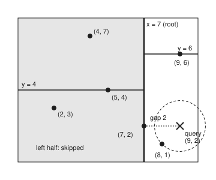
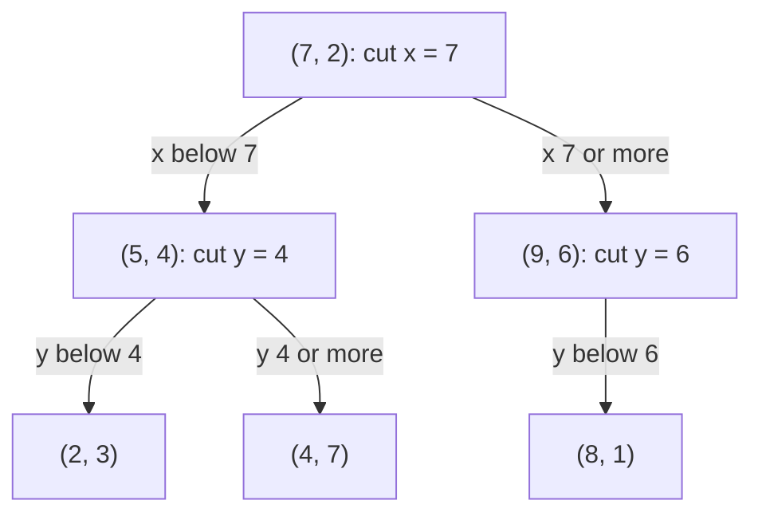

# k-d trees: split the plane in half again and again to find the nearest point fast

[Syllabus](../../../SYLLABUS.md) → [Geometry and trig](../README.md) → [Points, Convexity and Fractals](../README.md#s07) → k-d trees

---

## General Overview

A courier firm has six depots on a grid measured in kilometres: (2, 3), (5, 4), (9, 6), (4, 7), (8, 1) and (7, 2). A van breaks down at (9, 2). Which depot sends the tow truck?

Measuring all six gives (8, 1), 1.41 km away. With 10,000 depots and thousands of breakdowns a day, that is slow.

A **k-d tree** (k-dimensional tree; k is the number of coordinates per point, here 2) sorts the depots once, in advance. Cut the map at the middle depot by x, then each half at its middle depot by y, and keep alternating. Each cut tells the search which side to try first.

For (9, 2) the search measures only (8, 1), (9, 6) and (7, 2). It never looks west of the first cut: that cut is 2 km away, and a depot 1.41 km away is already in hand.

**Split the points at the middle one, first by x, then by y, again and again; to find the nearest point, go down to the query's own box first, then cross a splitting line only when that line is closer than the best point found so far.**

**What kind of fact this is:** the tree is a construction (a way of storing points); the skip rule is a theorem, proved in Why it works; the cost of about log n per query is a theorem of Friedman, Bentley and Finkel (1977) for random points and a close variant (Step 5); the checks measure it.

### The picture: six depots, three cuts, one skipped half

<p align="center"></p>

To scale, 1 km = 30 units. The dashed circle around the query has radius 1.41 km. It does not reach the thick line x = 7, so nothing in the shaded half can be nearer.

---

## The formula

The query is $`q`$, a depot is $`p`$. A small number written low names a coordinate: $`q_1 = 9`$ is the query's x, $`q_2 = 2`$ its y, and $`q_a`$ its coordinate number $`a`$. The distance $`d(q, p)`$ is the straight-line distance from [Distance and midpoint](../04-Coordinates%20and%20Curves/01-distance-and-midpoint.md): the square root of the summed squared gaps.

A tree node holds one depot and one cut: the line where coordinate $`a`$ equals $`s`$. The search keeps $`r`$, the distance to the best depot found so far.

```math
d(q, p) = \sqrt{(q_1 - p_1)^2 + (q_2 - p_2)^2 + \dots + (q_k - p_k)^2} \;\ge\; \lvert q_a - s \rvert \quad \text{for every depot } p \text{ across the line from } q
```

**Read it aloud:** a depot on the far side of a cut is at least as far from the query as the cut itself is.

```math
\text{skip the far side when } \lvert q_a - s \rvert \ge r
```

**Read it aloud:** if the cut is at least as far as the best depot found, nothing beyond it can win. At the root, $`\lvert 9 - 7 \rvert = 2`$ is at least $`r = 1.41`$, so the three western depots are skipped.

```math
\text{levels} = \lfloor \log_2 n \rfloor + 1 \qquad (n \ge 1)
```

**Read it aloud:** for $`n \ge 1`$ points, cutting at the middle makes the number of levels the base-2 logarithm of the point count, rounded down (the brackets), plus one: 3 levels for 6 depots, 14 for 10,000.

| Symbol | Plain meaning | In our example | Push it up and the answer… |
| --- | --- | --- | --- |
| $`q`$ | the query: the point whose nearest neighbour is wanted | the breakdown at (9, 2) | — |
| $`p`$ | one stored point, here a depot | (8, 1), the nearest | — |
| $`d(q, p)`$ | straight-line distance from query to depot | 1.41 km | — |
| $`a`$ | which coordinate a node cuts on: x at the root, then y, then x | x at the root | — |
| $`s`$ | where the cut sits: the middle depot's coordinate $`a`$ | 7 at the root | — |
| $`r`$ | distance to the best depot found so far | 1.41 km | fewer regions are skipped |
| $`n`$ | number of stored points | 6 | more levels, but only about one per doubling |
| $`k`$ | coordinates per point, the dimension | 2 | far more regions must be searched |

### When it holds

- **A distance never shorter than one coordinate's gap,** such as straight-line or road km. Driving minutes, compared with a gap in km, are not: the skip rule can lose a depot on a fast road.
- **The tree is built at the middle point.** Added one at a time in sorted order, 1000 diagonal depots make a chain 1000 levels deep, not 10.
- **Few dimensions.** Among 10,000 random points the search measures 19.2 in 2 dimensions but 9758.3 in 16.
- **The points stay put.** Many insertions and deletions unbalance the tree, which is then rebuilt.

---

## Why it works

### Step 0: halving, as in a sorted list

In a sorted phone book, open the middle and keep the half holding the name; 10,000 names need about 14 looks. Points on a plane have no single order, so the k-d tree takes turns: x at one level, y at the next.

### Step 1: build by cutting at the middle

Sort the depots by x: 2, 4, 5, 7, 8, 9. Of the two middles, the upper one, (7, 2), becomes the **root** (the top node), and its cut is x = 7. The three depots west of it go left, the two east of it right.

Each half is cut the same way, by y. The left half's y values are 3, 4 and 7, so (5, 4) cuts it at y = 4, leaving (2, 3) below and (4, 7) above. The right half's y values are 1 and 6; the second of the two, (9, 6), cuts at y = 6 with (8, 1) below. A depot with no depots under it is a **leaf**.



Each cut leaves at most half the depots on either side, so each level at least halves what is left: 6 depots run out after 3 levels.

### Step 2: the skip rule

Take any depot $`p`$ across the cut x = 7 from the query. Its x lies beyond 7, so its x gap is at least the query's gap to the line: $`\lvert q_1 - p_1\rvert \ge \lvert q_1 - 7\rvert`$.

The full distance adds other squared gaps, never negative, so $`d(q, p) \ge \lvert q_1 - p_1\rvert \ge \lvert q_1 - 7\rvert`$. It is Pythagoras: the long side of a right triangle is at least either leg.

So if the line is at least $`r`$ away, so is every depot beyond it, for any coordinate, in any dimension.

### Step 3: the search, traced

1. **Go down.** At the root, 9 is at least 7, so go right. At (9, 6), 2 is below 6, so go down to the leaf (8, 1).
2. **Measure on the way back up.** (8, 1) is 1.41 km away: the best so far, r = 1.41.
3. **At (9, 6).** It is 4.00 km away, no better. Its other side, above y = 6, is empty.
4. **At the root (7, 2).** It is 2.00 km away, no better. The line x = 7 is 2 km away, and 2 is at least 1.41, so the whole left half is skipped.

Every depot was measured or ruled out by Step 2, so (8, 1) at 1.41 km is exact. The query lies in the Voronoi cell of (8, 1), its region of nearest spots ([Nearest-neighbour maps](04-voronoi-and-delaunay.md)); the tree gets there without drawing cells.

### Step 4: range search uses the same skip

A **range search** reports every depot inside a box. The box 7.5 ≤ x ≤ 10, 0 ≤ y ≤ 3 lies east of x = 7, so the left half is skipped; it lies below y = 6, so only the lower side of (9, 6) is visited. Three depots are visited, and (8, 1) is found.

In two dimensions the worst case is about $`\sqrt{n}`$ visits plus one per depot reported (de Berg and co-authors, chapter 5).

### Step 5: why about log n, and why many dimensions hurt

On spread-out points the circle of radius $`r`$ is small and crosses only a few cuts near the bottom. Friedman, Bentley and Finkel proved that, for a fixed dimension, the average work grows only like $`\log n`$: the walk down, plus a bounded number of extra points.

Their tree cuts whichever coordinate is most spread out; the checks measure this tree at 10.9, 15.7 and 19.2 points per query for 100, 1000 and 10,000 random points in 2 dimensions.

Many dimensions break this. A tree of 10,000 points has 14 levels, so in 16 dimensions some coordinates are never cut, and boxes stay wide. Random points there are also all about equally far from a query, so the circle stays large and crosses almost every cut.

The measured cost climbs to 65.3 in 4 dimensions, 753.0 in 8 and 9758.3 in 16.

---

## Worked numbers, by hand

| Step | Arithmetic | Value |
| --- | --- | --- |
| root | x values 2, 4, 5, 7, 8, 9; take the 4th | (7, 2), cut x = 7 |
| left child | y values 3, 4, 7; take the middle | (5, 4), cut y = 4 |
| right child | y values 1, 6; take the 2nd | (9, 6), cut y = 6 |
| go down for (9, 2) | 9 is at least 7: right; 2 is below 6: down | leaf (8, 1) |
| measure (8, 1) | square root of 1 squared + 1 squared | 1.41 km, best |
| measure (9, 6) | square root of 0 squared + 4 squared | 4.00 km |
| measure (7, 2) | square root of 2 squared + 0 squared | 2.00 km |
| gap to x = 7 | 9 − 7 = 2, which is at least 1.41 | skip 3 depots |
| answer | 3 of 6 depots measured | **(8, 1) at 1.41 km** |

The tow truck comes from (8, 1), proved without measuring (2, 3), (5, 4) or (4, 7), at 7.07, 4.47 and 7.07 km.

### What breaks if you drop a piece

| Mistake | Comes out at | What went wrong |
| --- | --- | --- |
| Never cross a line, query (6.5, 0) | (7, 2) at 2.06 km | (8, 1), 1.80 km away, sits just across x = 7 |
| Stop at the first leaf, query (6.5, 0) | (2, 3) at 5.41 km | the query's own box need not hold its nearest point |
| Never skip, query (9, 2) | 6 depots measured, not 3 | right answer, but the tree saved nothing |
| Add 1000 diagonal depots one by one, in order | 1000 levels, not 10 | no middle cut: the tree is a chain |

---

## Code, from first principles, and it actually runs

The code builds the tree, searches it with the skip rule, and logs each depot measured. Two independent roads reach each answer: the tree, and brute force (measure every point). They are compared on the depots, on a box search, and on 200 random queries in each of six clouds of up to 10,000 points in 2 to 16 dimensions.

A fixed random-number formula gives Python and Rust the same points.

### Python

```python
# k-d trees and nearest neighbours -- the check behind the card. Nothing is imported.
# Road one searches the tree and skips whole regions; road two measures every depot (brute force).
DEPOTS, Q, Q2, INF = [(2, 3), (5, 4), (9, 6), (4, 7), (8, 1), (7, 2)], (9, 2), (6.5, 0), float("inf")
d2 = lambda p, q: sum((a - b) ** 2 for a, b in zip(p, q))
km, pt = lambda p, q: f"{d2(p, q) ** 0.5:.2f}", lambda p: "(" + ", ".join(f"{c:g}" for c in p) + ")"
px = lambda p: f"({30 + 30 * p[0]:g},{270 - 30 * p[1]:g})"  # figure position: 1 km = 30 units
def build(pts, depth=0):  # the median along this level's axis sits at the node; smaller left, the rest right
    if not pts: return None
    a = depth % len(pts[0]); pts = sorted(pts, key=lambda p: p[a]); m = len(pts) // 2
    return (pts[m], a, build(pts[:m], depth + 1), build(pts[m + 1:], depth + 1))
def nearest(node, q, best, log, rule=lambda gap2, best2: gap2 < best2):  # best = [squared distance, depot]
    if node is None: return best
    p, a, left, right = node; near, far = (left, right) if q[a] < p[a] else (right, left)
    nearest(near, q, best, log, rule)                        # go down the side the query is on
    log.append(p)                                            # on the way back up, measure this depot
    if d2(p, q) < best[0]: best[:] = [d2(p, q), p]
    if rule((q[a] - p[a]) ** 2, best[0]): nearest(far, q, best, log, rule)  # cross only if the line is closer
    return best
def inbox(node, lo, hi, log, out):  # range search: every depot in the box lo..hi
    if node is None: return out
    p, a, left, right = node; log.append(p)
    if all(l <= c <= h for l, c, h in zip(lo, p, hi)): out.append(p)
    if lo[a] <= p[a]: inbox(left, lo, hi, log, out)          # left holds coordinates <= the split
    if hi[a] >= p[a]: inbox(right, lo, hi, log, out)         # right holds coordinates >= the split
    return out
pts_of, depth = lambda t: [] if t is None else [t[0]] + pts_of(t[2]) + pts_of(t[3]), lambda t: 0 if t is None else 1 + max(depth(t[2]), depth(t[3]))
ok = lambda t: t is None or (all(s[t[1]] <= t[0][t[1]] for s in pts_of(t[2])) and all(s[t[1]] >= t[0][t[1]] for s in pts_of(t[3])) and ok(t[2]) and ok(t[3]))
show = lambda t: "-" if t is None else pt(t[0]) + (f" {'xy'[t[1]]}={t[0][t[1]]} {{{show(t[2])} | {show(t[3])}}}" if t[2] or t[3] else "")
T = build(DEPOTS); log = []; b = nearest(T, Q, [INF, None], log); skipped = [p for p in DEPOTS if p not in log]
print(f"tree: {show(T)}\ndepth {depth(T)} levels for n = {len(DEPOTS)}; every split rule holds: {ok(T)}")
print(f"query {pt(Q)}: measured " + ", ".join(f"{pt(p)} {km(p, Q)}" for p in log) + f" -> nearest {pt(b[1])} at {b[0] ** 0.5:.2f}")
print(f"skipped beyond x = 7 (gap {abs(Q[0] - 7):.2f} > {b[0] ** 0.5:.2f}): " + " ".join(f"{pt(p)} {km(p, Q)}" for p in skipped))
brute = min(DEPOTS, key=lambda p: d2(p, Q)); rlog = []; found = inbox(T, (7.5, 0), (10, 3), rlog, [])
print("brute force: " + " ".join(f"{pt(p)} {km(p, Q)}" for p in DEPOTS) + f" -> nearest {pt(brute)} at {km(brute, Q)}")
print(f"box 7.5 <= x <= 10, 0 <= y <= 3: tree visited {len(rlog)} depots, found " + " ".join(map(pt, found)))
l1, l2, l3 = [], [], []; m1, m2 = nearest(T, Q2, [INF, None], l1, lambda g, b: False), nearest(T, Q2, [INF, None], l2)
nearest(T, Q, [INF, None], l3, lambda g, b: True)                # no skipping at all
print(f"mistake 1, never cross a line, query {pt(Q2)}: {pt(m1[1])} at {m1[0] ** 0.5:.2f}; first leaf {pt(l1[0])} at {km(l1[0], Q2)}; true {pt(m2[1])} at {m2[0] ** 0.5:.2f}")
print(f"mistake 2, never skip, query {pt(Q)}: {len(l3)} depots measured, not {len(log)}")
def rnd(seed=[2026]):  # a fixed linear congruential generator, so Python and Rust draw the same numbers
    seed[0] = (seed[0] * 6364136223846793005 + 1442695040888963407) % 2 ** 64; return (seed[0] >> 33) % 1000000
for k, n in [(2, 100), (2, 1000), (2, 10000), (4, 10000), (8, 10000), (16, 10000)]:
    pts = [tuple(rnd() for _ in range(k)) for _ in range(n)]; tree = build(pts); cost = match = 0
    for _ in range(200):
        q = tuple(rnd() for _ in range(k)); lg = []; bq = nearest(tree, q, [INF, None], lg)
        cost += len(lg); match += bq[0] == min(d2(p, q) for p in pts)
    print(f"random, {k} dims, n = {n}: depth {depth(tree)}, measured per query {cost / 200:.1f}, {match} of 200 match brute force")
    assert match == 200 and depth(tree) == n.bit_length() and (k > 2 or cost < 400 * depth(tree))  # exact; log2 n levels; 2 dims: under 2 per level
arena, worst = [], 0                  # 1000 depots on a diagonal, added one at a time in order, no median
for i in range(1000):                 # depot (i, i) walks down from the root and hangs where a branch is empty
    j, d, nd = 0, 1, None
    while j is not None and j < len(arena): nd = arena[j]; side = 3 if i >= nd[0][nd[1]] else 2; j, d = nd[side], d + 1
    if nd: nd[side] = len(arena)
    arena.append([(i, i), (d - 1) % 2, None, None]); worst = max(worst, d)
print(f"1000 depots on a diagonal: added in order, depth {worst}; built at the median, depth {depth(build([(i, i) for i in range(1000)]))}")
print("figure, 1 km = 30 units, depots " + " ".join(map(px, DEPOTS)) + f", query {px(Q)}, circle radius {30 * b[0] ** 0.5:.2f}")
assert b[1] == brute and b[0] == d2(brute, Q) and m2[0] == min(d2(p, Q2) for p in DEPOTS)  # tree against brute force
assert found == [p for p in DEPOTS if 7.5 <= p[0] <= 10 and 0 <= p[1] <= 3]             # range search against a filter
assert ok(T) and skipped == [p for p in DEPOTS if p[0] < 7] and all(d2(p, Q) >= (Q[0] - 7) ** 2 for p in skipped)  # west half skipped, safely
print("ALL CHECKS PASS")
```

**Ran 2026-11-23 on macOS, Python 3.14.10, standard library only. All checks passed. Output, pasted from the run:**

```
tree: (7, 2) x=7 {(5, 4) y=4 {(2, 3) | (4, 7)} | (9, 6) y=6 {(8, 1) | -}}
depth 3 levels for n = 6; every split rule holds: True
query (9, 2): measured (8, 1) 1.41, (9, 6) 4.00, (7, 2) 2.00 -> nearest (8, 1) at 1.41
skipped beyond x = 7 (gap 2.00 > 1.41): (2, 3) 7.07 (5, 4) 4.47 (4, 7) 7.07
brute force: (2, 3) 7.07 (5, 4) 4.47 (9, 6) 4.00 (4, 7) 7.07 (8, 1) 1.41 (7, 2) 2.00 -> nearest (8, 1) at 1.41
box 7.5 <= x <= 10, 0 <= y <= 3: tree visited 3 depots, found (8, 1)
mistake 1, never cross a line, query (6.5, 0): (7, 2) at 2.06; first leaf (2, 3) at 5.41; true (8, 1) at 1.80
mistake 2, never skip, query (9, 2): 6 depots measured, not 3
random, 2 dims, n = 100: depth 7, measured per query 10.9, 200 of 200 match brute force
random, 2 dims, n = 1000: depth 10, measured per query 15.7, 200 of 200 match brute force
random, 2 dims, n = 10000: depth 14, measured per query 19.2, 200 of 200 match brute force
random, 4 dims, n = 10000: depth 14, measured per query 65.3, 200 of 200 match brute force
random, 8 dims, n = 10000: depth 14, measured per query 753.0, 200 of 200 match brute force
random, 16 dims, n = 10000: depth 14, measured per query 9758.3, 200 of 200 match brute force
1000 depots on a diagonal: added in order, depth 1000; built at the median, depth 10
figure, 1 km = 30 units, depots (90,180) (180,150) (300,90) (150,60) (270,240) (240,210), query (300,210), circle radius 42.43
ALL CHECKS PASS
```

### Rust

Same numbers, same labels, built with `rustc --edition 2021 -O`.

```rust
// k-d trees and nearest neighbours -- the same check as the Python, in Rust. No crates.
// Road one searches the tree and skips whole regions; road two measures every depot (brute force).
type P = Vec<f64>; const INF: f64 = f64::INFINITY;
struct Node { p: P, a: usize, l: Option<usize>, r: Option<usize> }
fn d2(p: &P, q: &P) -> f64 { p.iter().zip(q).map(|(a, b)| (a - b) * (a - b)).sum() }
fn km(p: &P, q: &P) -> String { format!("{:.2}", d2(p, q).sqrt()) }
fn pt(p: &P) -> String { format!("({})", p.iter().map(|c| c.to_string()).collect::<Vec<_>>().join(", ")) }
fn px(p: &P) -> String { format!("({},{})", 30.0 + 30.0 * p[0], 270.0 - 30.0 * p[1]) } // figure position: 1 km = 30 units
fn build(mut pts: Vec<P>, depth: usize, t: &mut Vec<Node>) -> Option<usize> { // the median along this level's axis sits at the node
    if pts.is_empty() { return None }
    let a = depth % pts[0].len(); pts.sort_by(|x, y| x[a].partial_cmp(&y[a]).unwrap()); let m = pts.len() / 2;
    let (right, p) = { let r = pts.split_off(m + 1); (r, pts.pop().unwrap()) }; let (l, r) = (build(pts, depth + 1, t), build(right, depth + 1, t));
    t.push(Node { p, a, l, r }); Some(t.len() - 1)
}
fn nearest(t: &[Node], node: Option<usize>, q: &P, best: &mut (f64, P), log: &mut Vec<P>, rule: &dyn Fn(f64, f64) -> bool) {
    let Some(i) = node else { return }; let n = &t[i];
    let (near, far) = if q[n.a] < n.p[n.a] { (n.l, n.r) } else { (n.r, n.l) };
    nearest(t, near, q, best, log, rule);                    // go down the side the query is on
    log.push(n.p.clone());                                   // on the way back up, measure this depot
    if d2(&n.p, q) < best.0 { *best = (d2(&n.p, q), n.p.clone()) }
    if rule((q[n.a] - n.p[n.a]).powi(2), best.0) { nearest(t, far, q, best, log, rule) } // cross only if the line is closer
}
fn inbox(t: &[Node], node: Option<usize>, lo: &P, hi: &P, log: &mut Vec<P>, out: &mut Vec<P>) { // range search
    let Some(i) = node else { return }; let n = &t[i]; log.push(n.p.clone());
    if (0..lo.len()).all(|k| lo[k] <= n.p[k] && n.p[k] <= hi[k]) { out.push(n.p.clone()) }
    if lo[n.a] <= n.p[n.a] { inbox(t, n.l, lo, hi, log, out) }  // left holds coordinates <= the split
    if hi[n.a] >= n.p[n.a] { inbox(t, n.r, lo, hi, log, out) }  // right holds coordinates >= the split
}
fn pts_of(t: &[Node], node: Option<usize>) -> Vec<P> { node.map_or(vec![], |i| [vec![t[i].p.clone()], pts_of(t, t[i].l), pts_of(t, t[i].r)].concat()) }
fn depth(t: &[Node], node: Option<usize>) -> usize { node.map_or(0, |i| 1 + depth(t, t[i].l).max(depth(t, t[i].r))) }
fn ok(t: &[Node], node: Option<usize>) -> bool { node.map_or(true, |i| { let n = &t[i];
    pts_of(t, n.l).iter().all(|s| s[n.a] <= n.p[n.a]) && pts_of(t, n.r).iter().all(|s| s[n.a] >= n.p[n.a]) && ok(t, n.l) && ok(t, n.r) }) }
fn show(t: &[Node], node: Option<usize>) -> String { node.map_or("-".into(), |i| { let n = &t[i];
    if n.l.is_none() && n.r.is_none() { pt(&n.p) } else { format!("{} {}={} {{{} | {}}}", pt(&n.p), ["x", "y"][n.a], n.p[n.a], show(t, n.l), show(t, n.r)) } }) }
fn rnd(s: &mut u64) -> f64 { // a fixed linear congruential generator, so Python and Rust draw the same numbers
    *s = s.wrapping_mul(6364136223846793005).wrapping_add(1442695040888963407); ((*s >> 33) % 1000000) as f64 }
fn join(v: &[P], q: &P, sep: &str) -> String { v.iter().map(|p| format!("{} {}", pt(p), km(p, q))).collect::<Vec<_>>().join(sep) }
fn main() {
    let depots: Vec<P> = [(2., 3.), (5., 4.), (9., 6.), (4., 7.), (8., 1.), (7., 2.)].iter().map(|&(x, y)| vec![x, y]).collect();
    let (q, q2, mut t) = (vec![9.0, 2.0], vec![6.5, 0.0], Vec::new()); let root = build(depots.clone(), 0, &mut t);
    let (mut log, mut b) = (Vec::new(), (INF, vec![])); nearest(&t, root, &q, &mut b, &mut log, &|g, b| g < b); let skipped: Vec<P> = depots.iter().filter(|p| !log.contains(p)).cloned().collect();
    println!("tree: {}\ndepth {} levels for n = {}; every split rule holds: {}", show(&t, root), depth(&t, root), depots.len(), if ok(&t, root) { "True" } else { "False" });
    println!("query {}: measured {} -> nearest {} at {:.2}", pt(&q), join(&log, &q, ", "), pt(&b.1), b.0.sqrt());
    println!("skipped beyond x = 7 (gap {:.2} > {:.2}): {}", (q[0] - 7.0).abs(), b.0.sqrt(), join(&skipped, &q, " "));
    let brute = depots.iter().fold(depots[0].clone(), |m, p| if d2(p, &q) < d2(&m, &q) { p.clone() } else { m });
    let (mut rlog, mut found) = (Vec::new(), Vec::new()); inbox(&t, root, &vec![7.5, 0.0], &vec![10.0, 3.0], &mut rlog, &mut found);
    println!("brute force: {} -> nearest {} at {}", join(&depots, &q, " "), pt(&brute), km(&brute, &q));
    println!("box 7.5 <= x <= 10, 0 <= y <= 3: tree visited {} depots, found {}", rlog.len(), found.iter().map(pt).collect::<Vec<_>>().join(" "));
    let (mut l1, mut l2, mut l3, mut m1, mut m2, mut m3) = (vec![], vec![], vec![], (INF, vec![]), (INF, vec![]), (INF, vec![]));
    nearest(&t, root, &q2, &mut m1, &mut l1, &|_, _| false); nearest(&t, root, &q2, &mut m2, &mut l2, &|g, b| g < b);
    nearest(&t, root, &q, &mut m3, &mut l3, &|_, _| true);  // no skipping at all
    println!("mistake 1, never cross a line, query {}: {} at {:.2}; first leaf {} at {}; true {} at {:.2}", pt(&q2), pt(&m1.1), m1.0.sqrt(), pt(&l1[0]), km(&l1[0], &q2), pt(&m2.1), m2.0.sqrt());
    println!("mistake 2, never skip, query {}: {} depots measured, not {}", pt(&q), l3.len(), log.len());
    let mut s = 2026u64;
    for (k, n) in [(2, 100), (2, 1000), (2, 10000), (4, 10000), (8, 10000), (16, 10000)] {
        let mut pts: Vec<P> = Vec::new(); for _ in 0..n { let mut p = vec![]; for _ in 0..k { p.push(rnd(&mut s)) } pts.push(p) }
        let mut tr = Vec::new(); let rt = build(pts.clone(), 0, &mut tr); let (mut cost, mut matched) = (0, 0);
        for _ in 0..200 {
            let mut qq = vec![]; for _ in 0..k { qq.push(rnd(&mut s)) }
            let (mut lg, mut bq) = (vec![], (INF, vec![])); nearest(&tr, rt, &qq, &mut bq, &mut lg, &|g, b| g < b);
            cost += lg.len(); if bq.0 == pts.iter().map(|p| d2(p, &qq)).fold(INF, f64::min) { matched += 1 }
        }
        println!("random, {} dims, n = {}: depth {}, measured per query {:.1}, {} of 200 match brute force", k, n, depth(&tr, rt), cost as f64 / 200.0, matched);
        assert!(matched == 200 && depth(&tr, rt) == (usize::BITS - (n as usize).leading_zeros()) as usize && (k > 2 || cost < 400 * depth(&tr, rt))); // exact; log2 n levels; 2 dims: under 2 per level
    }
    let mut td = Vec::new(); let rd = build((0..1000).map(|i| vec![i as f64; 2]).collect(), 0, &mut td); // the same depots, built at the median
    let (mut ch, mut worst): (Vec<Node>, usize) = (Vec::new(), 0); // 1000 depots on a diagonal, added one at a time in order, no median
    for i in 0..1000 { // depot (i, i) walks down from the root and hangs where a branch is empty
        let (mut j, mut d, mut last) = (Some(0), 1, None);
        while let Some(jj) = j { if jj >= ch.len() { break } let nd = &ch[jj]; let right = i as f64 >= nd.p[nd.a]; last = Some((jj, right)); j = if right { nd.r } else { nd.l }; d += 1 }
        let id = ch.len(); if let Some((jj, right)) = last { if right { ch[jj].r = Some(id) } else { ch[jj].l = Some(id) } }
        ch.push(Node { p: vec![i as f64; 2], a: (d - 1) % 2, l: None, r: None }); worst = worst.max(d);
    }
    println!("1000 depots on a diagonal: added in order, depth {}; built at the median, depth {}", worst, depth(&td, rd));
    println!("figure, 1 km = 30 units, depots {}, query {}, circle radius {:.2}", depots.iter().map(px).collect::<Vec<_>>().join(" "), px(&q), 30.0 * b.0.sqrt());
    assert!(b.1 == brute && b.0 == d2(&brute, &q) && m2.0 == depots.iter().map(|p| d2(p, &q2)).fold(INF, f64::min)); // tree against brute force
    assert!(found == depots.iter().filter(|p| 7.5 <= p[0] && p[0] <= 10.0 && 0.0 <= p[1] && p[1] <= 3.0).cloned().collect::<Vec<P>>()); // range search against a filter
    assert!(ok(&t, root) && skipped == depots.iter().filter(|p| p[0] < 7.0).cloned().collect::<Vec<P>>() && skipped.iter().all(|p| d2(p, &q) >= (q[0] - 7.0).powi(2))); // west half skipped, safely
    println!("ALL CHECKS PASS");
}
```

**Ran 2026-11-23 on macOS, rustc 1.98.1, no crates. All checks passed. Output, pasted from the run:**

```
tree: (7, 2) x=7 {(5, 4) y=4 {(2, 3) | (4, 7)} | (9, 6) y=6 {(8, 1) | -}}
depth 3 levels for n = 6; every split rule holds: True
query (9, 2): measured (8, 1) 1.41, (9, 6) 4.00, (7, 2) 2.00 -> nearest (8, 1) at 1.41
skipped beyond x = 7 (gap 2.00 > 1.41): (2, 3) 7.07 (5, 4) 4.47 (4, 7) 7.07
brute force: (2, 3) 7.07 (5, 4) 4.47 (9, 6) 4.00 (4, 7) 7.07 (8, 1) 1.41 (7, 2) 2.00 -> nearest (8, 1) at 1.41
box 7.5 <= x <= 10, 0 <= y <= 3: tree visited 3 depots, found (8, 1)
mistake 1, never cross a line, query (6.5, 0): (7, 2) at 2.06; first leaf (2, 3) at 5.41; true (8, 1) at 1.80
mistake 2, never skip, query (9, 2): 6 depots measured, not 3
random, 2 dims, n = 100: depth 7, measured per query 10.9, 200 of 200 match brute force
random, 2 dims, n = 1000: depth 10, measured per query 15.7, 200 of 200 match brute force
random, 2 dims, n = 10000: depth 14, measured per query 19.2, 200 of 200 match brute force
random, 4 dims, n = 10000: depth 14, measured per query 65.3, 200 of 200 match brute force
random, 8 dims, n = 10000: depth 14, measured per query 753.0, 200 of 200 match brute force
random, 16 dims, n = 10000: depth 14, measured per query 9758.3, 200 of 200 match brute force
1000 depots on a diagonal: added in order, depth 1000; built at the median, depth 10
figure, 1 km = 30 units, depots (90,180) (180,150) (300,90) (150,60) (270,240) (240,210), query (300,210), circle radius 42.43
ALL CHECKS PASS
```

The outputs match line for line.

### Lean

Lean proves the skip rule in any number of dimensions, and checks the six-depot search and the level counts exactly.

- Take a distance never shorter than one coordinate's gap, and a depot across a cut at least $`r`$ from the query. Then that depot is at least $`r`$ from the query too.
- Suppose depot $`p`$ lies across the cut where coordinate $`a`$ equals $`s`$. Then $`d(q, p) \ge \lvert q_a - s \rvert`$ for straight-line distance.
- Suppose every depot was either measured and found no nearer than the best, or skipped by the skip rule. Then no depot is nearer than the best.
- From the breakdown at (9, 2), the squared distances to the six depots are 50, 20, 16, 50, 2 and 4. So (8, 1) is nearest.
- The root (7, 2) leaves three depots west of x = 7 and two east of it. The west ones are exactly (2, 3), (5, 4) and (4, 7).
- The cut x = 7 is 2 km from the query, and 2 squared is at least 1.41 squared, so the west half is skipped.
- The levels formula gives 3 for 6 depots, 10 for 1000 and 14 for 10,000.

Building the tree, running the search, the box search and the random-cloud costs are left to the Python and Rust checks.

```lean
-- k-d trees: a point across a cut is at least as far from the query as the cut, so a cut no nearer than the best point found lets the search skip everything beyond it, and the card's six-depot search and level counts are exact.
import Mathlib.Analysis.InnerProductSpace.PiL2
import Mathlib.Data.Nat.Log

/-- `p` lies across the cut "coordinate `a` equals `s`" from the query `q`: the cut sits
between them in coordinate `a` (either side may touch the cut). -/
def AcrossCut {k : ℕ} (q p : Fin k → ℝ) (a : Fin k) (s : ℝ) : Prop :=
  (q a ≤ s ∧ s ≤ p a) ∨ (p a ≤ s ∧ s ≤ q a)

/-- The skip rule. Take any distance `D` that is never shorter than the gap in one
coordinate (the card's "When it holds" condition: `|q a - p a| ≤ D q p` for every
coordinate `a`). If a depot `p` lies across the cut "coordinate `a` equals `s`" from the
query `q`, and the cut is at least `r` away from the query (`r ≤ |q a - s|`, where `r` is
the distance to the best depot found so far), then `p` is at least `r` away too, so nothing
beyond the cut can beat the best depot and the whole far side may be skipped. -/
theorem skip_far_side_of_cut {k : ℕ} (D : (Fin k → ℝ) → (Fin k → ℝ) → ℝ)
    (hD : ∀ q p : Fin k → ℝ, ∀ a : Fin k, |q a - p a| ≤ D q p)
    (q p : Fin k → ℝ) (a : Fin k) (s r : ℝ)
    (hp : AcrossCut q p a s) (hr : r ≤ |q a - s|) :
    r ≤ D q p := by
  have h1 : |q a - s| ≤ |q a - p a| := by
    rcases hp with ⟨h1, h2⟩ | ⟨h1, h2⟩
    · rw [abs_of_nonpos (by linarith), abs_of_nonpos (by linarith)]; linarith
    · rw [abs_of_nonneg (by linarith), abs_of_nonneg (by linarith)]; linarith
  exact hr.trans (h1.trans (hD q p a))

/-- The card's formula: for straight-line distance in `k` dimensions, a depot `p` across
the cut "coordinate `a` equals `s`" from the query `q` is at least as far from `q` as the
cut is, `d(q, p) ≥ |q a - s|` (Pythagoras with the other legs thrown away). -/
theorem euclidean_dist_ge_gap_to_cut {k : ℕ} (q p : EuclideanSpace ℝ (Fin k)) (a : Fin k)
    (s : ℝ) (hp : (q a ≤ s ∧ s ≤ p a) ∨ (p a ≤ s ∧ s ≤ q a)) :
    |q a - s| ≤ dist q p := by
  have h1 : |q a - s| ≤ |q a - p a| := by
    rcases hp with ⟨h1, h2⟩ | ⟨h1, h2⟩
    · rw [abs_of_nonpos (by linarith), abs_of_nonpos (by linarith)]; linarith
    · rw [abs_of_nonneg (by linarith), abs_of_nonneg (by linarith)]; linarith
  have h2 : dist (q a) (p a) ≤ dist q p := PiLp.dist_apply_le q p a
  rw [Real.dist_eq] at h2
  exact h1.trans h2

/-- The search is exact: if every stored point was either measured and found no nearer
than the best point `b`, or ruled out because it lies across some cut that is no nearer
to the query than `b`, then `b` is a nearest point to the query among all stored points. -/
theorem nearest_of_measured_or_skipped {k : ℕ} (S : Finset (EuclideanSpace ℝ (Fin k)))
    (q b : EuclideanSpace ℝ (Fin k)) (hb : b ∈ S)
    (hS : ∀ p ∈ S, dist q b ≤ dist q p ∨
      ∃ (a : Fin k) (s : ℝ), ((q a ≤ s ∧ s ≤ p a) ∨ (p a ≤ s ∧ s ≤ q a)) ∧
        dist q b ≤ |q a - s|) :
    ∀ p ∈ S, dist q b ≤ dist q p := by
  intro p hpS
  rcases hS p hpS with h | ⟨a, s, hp, h⟩
  · exact h
  · exact h.trans (euclidean_dist_ge_gap_to_cut q p a s hp)

/-! Worked examples from the card, in whole numbers (squared distances, so no square roots). -/

/-- The six depots. -/
def depots : List (ℤ × ℤ) := [(2, 3), (5, 4), (9, 6), (4, 7), (8, 1), (7, 2)]

/-- Squared straight-line distance from the breakdown at (9, 2). -/
def sqDistFromQuery (p : ℤ × ℤ) : ℤ := (9 - p.1) ^ 2 + (2 - p.2) ^ 2

-- Squared distances from (9, 2): 50, 20, 16, 50, 2, 4 (so 7.07, 4.47, 4.00, 7.07, 1.41, 2.00 km).
example : depots.map sqDistFromQuery = [50, 20, 16, 50, 2, 4] := by decide

-- (8, 1) is nearest to (9, 2) among all six depots (brute force).
example : ∀ p ∈ depots, sqDistFromQuery (8, 1) ≤ sqDistFromQuery p := by decide

-- Sorted by x the depots read 2, 4, 5, 7, 8, 9; the 4th, (7, 2), is the root: three depots
-- lie west of x = 7 and two east of it.
example : (depots.filter (fun p => p.1 < 7)).length = 3 ∧
    (depots.filter (fun p => 7 < p.1)).length = 2 := by decide

-- The cut x = 7 is 2 km from the query; 2 squared = 4 is at least 1.41 squared = 2, so skip.
example : (9 - 7 : ℤ) ^ 2 ≥ sqDistFromQuery (8, 1) := by decide

-- The three skipped depots are exactly those west of x = 7.
example : depots.filter (fun p => p.1 < 7) = [(2, 3), (5, 4), (4, 7)] := by decide

-- Levels = ⌊log₂ n⌋ + 1: 3 for 6 depots, 10 for 1000, 14 for 10,000.
example : Nat.log 2 6 + 1 = 3 := by decide
example : Nat.log 2 1000 + 1 = 10 := by decide
example : Nat.log 2 10000 + 1 = 14 := by decide

#print axioms skip_far_side_of_cut
#print axioms euclidean_dist_ge_gap_to_cut
#print axioms nearest_of_measured_or_skipped
```

**Checked 2026-11-23 on macOS, Lean 4.36.0-rc2, Mathlib v4.36.0-rc2. Every proof is complete and uses only Lean's standard axioms. Output, pasted from the run:**

```
'skip_far_side_of_cut' depends on axioms: [propext, Classical.choice, Quot.sound]
'euclidean_dist_ge_gap_to_cut' depends on axioms: [propext, Classical.choice, Quot.sound]
'nearest_of_measured_or_skipped' depends on axioms: [propext, Classical.choice, Quot.sound]
```

> [!TIP]
> **Try changing**
> Guess first, then run it.
> - **Move the breakdown next to a cut.** Change `Q`, the `(9, 2)` on line 3, to `(7.5, 5)`: the nearest is (9, 6) at 1.80 km, but all six depots are measured, and an assert stops the run.
> - **Turn off crossing.** Change `gap2 < best2` to `False`: only 151 of 200 random queries in the first cloud match brute force, and an assert stops the run.
> - **Go to 32 dimensions.** Add `(32, 10000)` to the clouds: every query measures all 10000.0 points, still exact but no faster than brute force.

---

## The usual mistake

> [!warning]
> **Stopping once the query's own box is reached.** A breakdown at (6.5, 0) is west of x = 7, so the search goes down to the leaf (2, 3), 5.41 km away. The best on the way is the root (7, 2), at 2.06 km. The true nearest is (8, 1), 1.80 km away, just across the line. Going down gives a first guess; only the way back up proves it.
>
> - **Never skipping.** Safe but pointless: 6 depots measured for (9, 2), not 3.
> - **Adding points one at a time in sorted order.** 1000 diagonal depots make a chain 1000 levels deep, not 10.
> - **Trusting the tree in many dimensions.** With 10,000 points in 16 dimensions it measures 9758.3 per query.

---

## Where you meet it in real life

- **Dispatch.** The nearest free van, ambulance or tow truck is a nearest-neighbour query against fixed bases.
- **Maps on a screen.** Showing every shop inside the visible window is a range search: the window is the box.
- **Point clouds.** Lining up two laser scans means finding each point's nearest point in the other scan.
- **Classifying data.** A new item is labelled by its closest known example; with few features, a k-d tree finds it fast.

> **Say it back**
> A k-d tree cuts the points at the middle one, by x, then by y, in turn, so n points need about log n levels. To find the nearest point, go down to the query's box, then measure on the way back up. A point across a cut is at least as far as the cut, so a cut farther than the best point found skips everything beyond it. Three measurements prove (8, 1) is nearest at 1.41 km. In many dimensions almost nothing can be skipped.

---

## What this builds on

- [Nearest-neighbour maps](04-voronoi-and-delaunay.md): the Voronoi cell answers the same question by drawing every region in advance; the tree answers it by searching.
- [Distance and midpoint](../04-Coordinates%20and%20Curves/01-distance-and-midpoint.md): the distance formula, whose sum of squares gives the skip rule.

## Where this goes next

- [Data structures](../../14-Applied%20and%20computational/01-Algorithms%20and%20Growth/06-data-structures-heaps-hashes-and-trees.md): search trees in general, and keeping them balanced as points arrive.
- [Limits](../../06-Calculus%20and%20analysis/01-Limits%20and%20Continuity/01-limits.md): the first card of [Calculus and analysis](../../06-Calculus%20and%20analysis/README.md), where the syllabus continues after this wing.

This finishes Wing 5 (Geometry and trig). Left open: how to find a nearly nearest point fast among millions of points with hundreds of coordinates, where the tree slows to brute force.

---

## Sources

Verified 2026-11-23: every link below resolves to the publisher's page.

- de Berg, Mark, Otfried Cheong, Marc van Kreveld and Mark Overmars. *Computational Geometry: Algorithms and Applications*, 3rd ed. Springer, 2008. [Publisher page](https://link.springer.com/book/10.1007/978-3-540-77974-2). Chapter 5, "Orthogonal Range Searching", builds the k-d tree at the median and bounds its range-search cost.
- Bentley, Jon Louis. "Multidimensional binary search trees used for associative searching." *Communications of the ACM* 18(9), 1975, 509–517. [DOI](https://doi.org/10.1145/361002.361007). The k-d tree, first described.
- Friedman, Jerome H., Jon Louis Bentley and Raphael Ari Finkel. "An algorithm for finding best matches in logarithmic expected time." *ACM Transactions on Mathematical Software* 3(3), 1977, 209–226. [DOI](https://doi.org/10.1145/355744.355745). The nearest-neighbour search with skipping, and its logarithmic expected cost.
