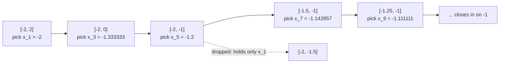

# Compactness of [a, b]: every bounded sequence has a settling subsequence, and every open cover has a finite one inside it

[Syllabus](../../../SYLLABUS.md) → [Calculus and analysis](../README.md) → [Limits and Continuity](../README.md#s01) → Compactness of [a, b]

---

## General Overview

A thermostat overshoots its set point, then undershoots, again and again. Its error in degrees at check n is $`x_n = (-1)^n (1 + 1/n)`$: −2, 1.5, −1.333333, 1.25, −1.2, 1.166667. Every reading lies in [−2, 2], both ends included.

The error never settles: late readings still jump by about 2 degrees. But the cold readings alone, −2, −1.333333, −1.2, and so on, close in on −1 degree. A part of a list kept in order, like this, is a **subsequence**.

A second job: clear the first hour, [0, 1], as safe. Each check clears an open window of time around its moment, since the temperature cannot jump. Must finitely many windows clear the hour? On [0, 1], yes: here two, (−0.1, 0.1) and (1/11, 2), do it. On (0, 1], with the start 0 missing, the windows (1/n, 2) cover it, but no finite handful does.

Both facts say one thing: nothing can escape a closed, bounded interval. So finitely many checks can clear [a, b], and calculus theorems that promise a point exists need [a, b].

**On a closed, bounded interval [a, b], every list of points has a subsequence that settles at a point of [a, b], and every covering by open sets can be cut down to finitely many of them.**

**What kind of fact this is:** two theorems: Heine–Borel, proved on this card in Why it works, and Bolzano–Weierstrass, outlined here and proved on [Extreme value theorem](07-extreme-value-theorem.md); "compact" is the name for a set where they hold.

### The picture: halving [−2, 2] to trap a settling subsequence



Each box is a kept half with its pick; the dotted arrow is a dropped half holding one term.

---

## The formula

Notation first. An **open set** of real numbers is one where every member $`p`$ has some room around it: a gap $`\delta > 0`$ with the whole stretch from $`p - \delta`$ to $`p + \delta`$ inside the set. Round brackets, as in (1/11, 2), give open stretches.

An **open cover** of a set $`K`$ is a family of open sets $`U_i`$ whose union contains $`K`$. A **finite subcover** is a finite selection from it that still covers $`K`$. The symbol $`\bigcup`$ means "the union of all of them".

Bolzano–Weierstrass, for any list $`x_n`$ in $`[a,b]`$:

```math
a \le x_n \le b \text{ for every } n \;\Longrightarrow\; x_{n_1}, x_{n_2}, x_{n_3}, \ldots \to c \text{ for some } n_1 < n_2 < \cdots \text{ and some } c \text{ in } [a,b]
```

**Read it aloud:** if every term lies between a and b, some subsequence heads for a point c that also lies between a and b.

Heine–Borel, for any open cover of $`[a,b]`$:

```math
[a,b] \subseteq \bigcup_i U_i \;\Longrightarrow\; [a,b] \subseteq U_{i_1} \cup U_{i_2} \cup \cdots \cup U_{i_m} \text{ for some finite } m
```

**Read it aloud:** if open sets cover the interval, then finitely many of them already cover it.

On the real line a set $`K`$ passes the cover test exactly when it passes the subsequence test, exactly when it is **closed** (it keeps the limits of its own lists) and **bounded** (it fits inside some finite interval $`[a, b]`$). Such a set is **compact**.

| Symbol | Plain meaning | In our example | Push it up and the answer… |
| --- | --- | --- | --- |
| $`a`$, $`b`$, $`K`$ | the interval's ends, both included; a set being tested | −2 and 2; then 0 and 1 | a longer interval needs more halvings |
| $`x_n`$, $`n`$ | the list and its clock | error $`x_3`$ = −1.333333 degrees | terms crowd near −1 and 1 |
| $`x_{n_k}`$, $`n_k`$, $`k`$ | a subsequence, a kept term's old position, the new clock | picks at n = 1, 3, 5, 7, 9, 11, 17 | — |
| $`c`$ | the point a subsequence settles at | −1 | — |
| $`U_i`$, $`U`$, $`i`$ | one open set of a cover, and its label | windows (−0.1, 0.1), and (1/n, 2) for n = 1 to 1000 | — |
| $`m`$ | how many sets the finite subcover uses | 2 | — |
| $`S`$, $`s`$ | points x with [a, x] covered by finitely many sets; $`s = \sup S`$ | s = 1 | — |
| $`p`$, $`\delta`$ | a point of an open set, and the room around it | p = 0.1 inside (1/11, 2), room 0.009091 | — |

### When it holds

- **Both ends included.** (0, 1] fails both tests at its missing end 0: the list 1/n heads there (Step 3).
- **Both ends finite.** [0, infinity) fails both tests by having no end: the list 0, 1, 2, 3 runs off (Step 3).
- **Open sets in the cover.** With closed pieces the test fails: one-point sets cover [0, 1], and the 100001 grid points k/100000 alone need 100001 of them.
- **Real numbers, with no gaps.** On fractions alone, halving [1, 2] toward the square root of 2 closes in on a point that is not there.

---

## Why it works

### Step 0: a search that keeps going cannot stop short

Both proofs run an endless search: halving, or reaching further right. The real line has no gaps ([No gaps](02-supremum-and-completeness.md)), so the search closes in on a real point, and the included ends keep that point inside [a, b].

### Step 1: Bolzano–Weierstrass, by halving

The [Extreme value theorem](07-extreme-value-theorem.md) card proves this in full. In short:

1. Cut the interval into two closed halves.
2. At least one half holds terms at infinitely many positions. Keep the left half if it does; otherwise keep the right.
3. Pick a term from the kept half that comes later in the list than the last pick.
4. Repeat. The halves nest and shrink, so they close in on one point c, and the picks head for c.

On the example, the left half [−2, −1.5] of [−2, −1] is dropped: it holds only $`x_1`$ = −2. The picks, at n = 1, 3, 5, 7, 9, 11, 17, are odd terms, which sit exactly 1/n below −1, so they settle on c = −1.

### Step 2: Heine–Borel, by the supremum of what a finite subcover reaches

Take any open cover of $`[a,b]`$. Let $`S`$ be the points x of $`[a,b]`$ for which $`[a,x]`$ is covered by finitely many of the sets. Then $`a`$ is in $`S`$ and $`b`$ is a ceiling, so the least ceiling $`s = \sup S`$ exists.

The point $`s`$ lies in some cover set $`U`$, with room $`\delta`$ on each side. The finite handful reaching a point of $`S`$ within $`\delta`$ below $`s`$, plus $`U`$, reaches past $`s`$. So $`s`$ cannot stop short of $`b`$, and $`[a,b]`$ itself is finitely covered.

On the example, the walk takes (−0.1, 0.1) to 0.1, then (1/11, 2), which holds 0.1 with room 0.009091 on its left and reaches past 1. So s = 1, with m = 2 sets.

<details>
<summary>Detailed proof: Heine–Borel on [a, b]</summary>

Assume $`a \le b`$, and let $`\{U_i\}`$ be open sets covering $`[a,b]`$. Define

$`\displaystyle S = \{\, x \in [a,b] : [a,x] \text{ is covered by finitely many } U_i \,\}.`$

Some $`U_i`$ contains $`a`$, so $`a \in S`$. Every member of $`S`$ is at most $`b`$. By completeness, $`s = \sup S`$ exists, and $`a \le s \le b`$.

Some $`U`$ in the cover contains $`s`$. It is open, so there is $`\delta > 0`$ with $`(s - \delta, s + \delta) \subseteq U`$. Since $`s`$ is the least upper bound, some $`x \in S`$ has $`x > s - \delta`$.

Let $`U_{i_1}, \ldots, U_{i_m}`$ cover $`[a,x]`$. Adding $`U`$ covers $`[a, t]`$ for every $`t`$ in $`[a,b]`$ with $`t < s + \delta`$. Taking $`t = s`$ shows $`s \in S`$.

If $`s < b`$, take $`t = \min(s + \delta/2, b)`$: then $`t \in S`$ and $`t > s`$, a contradiction. So $`s = b \in S`$.

</details>

### Step 3: why (0, 1] and [0, infinity) fail both tests

On (0, 1], every subsequence of 1/n heads for the missing 0, and any finite selection of the sets (1/n, 2) stops at some largest n and misses the point 1/n. On [0, infinity), the list 0, 1, 2, 3 runs off, and any finite selection of the sets (−1, n) misses its largest n. Both tests fail through the same escape: a missing end, or no end.

### Step 4: on the line, the two tests agree

Both tests match "closed and bounded":

1. **Closed and bounded gives the subsequence test.** Bolzano–Weierstrass finds a settling subsequence; closed means its limit stays in the set.
2. **Closed and bounded gives the cover test.** Put the set $`K`$ inside some $`[a,b]`$. The points outside $`K`$ form an open set: if an outside point p had no room, each stretch from p − 1/n to p + 1/n would hold a point of $`K`$, those points would form a list in $`K`$ heading for p, and closed would put p in $`K`$. Add that open set to the cover, apply Heine–Borel to $`[a,b]`$, then drop it.
3. **Either test gives bounded.** Otherwise $`K`$ holds points ever further from 0, past distance 1, 2, and so on. That list runs off, and the sets (−n, n) have no finite subcover, as in Step 3.
4. **Either test gives closed.** Otherwise some list in $`K`$ heads for a point p outside it, as 1/n heads for 0. No subsequence settles in $`K`$, and the sets of points more than 1/n from p cover $`K`$ with no finite subcover.

---

## Worked numbers, by hand

| Step | Arithmetic | Value |
| --- | --- | --- |
| First terms | −(1 + 1), +(1 + 1/2), −(1 + 1/3) | −2, 1.5, −1.333333 |
| Halve [−2, 2] | the left half holds every odd term | keep [−2, 0] |
| Halve [−2, 0] | same reason | keep [−2, −1] |
| Halve [−2, −1] | [−2, −1.5] holds only $`x_1`$ | keep [−1.5, −1] |
| Picks | n = 1, 3, 5, 7, 9, 11, 17 | $`x_{17}`$ = −1.058824, inside [−1.0625, −1] |
| Stage 20 | width 4 halved 20 times | 0.000004; pick n = 262145 |
| Settling point | odd terms sit 1/n below −1 | **c = −1** |
| Cover [0, 1] from 0 | only (−0.1, 0.1) holds 0 | reach 0.1 |
| Cover from 0.1 | 1/11 = 0.0909091, below 0.1 | (1/11, 2) reaches 2, past 1 |
| Finite subcover | two sets | **m = 2** |

The thermostat's cold readings settle on −1 degree, and an infinite cover of the hour [0, 1] shrinks to two windows.

### What breaks if you drop a piece

| Mistake | Comes out at | What went wrong |
| --- | --- | --- |
| Using the whole list, not a subsequence | $`x_{1000}`$ = 1.001000, $`x_{1001}`$ = −1.000999, gap 2.001999 | The list swings between −1 and 1 forever |
| Keeping any half that holds a term | [−2, −1.5] holds 1 of the first 1000000 terms | No later term to pick |
| Treating (0, 1] as compact | first 10, 100, 1000 sets miss 0.1, 0.01, 0.001 | The end 0 is missing |
| Treating [0, infinity) as compact | first 10, 100, 1000 sets (−1, n) miss 10, 100, 1000 | No right end |

---

## Code, from first principles, and it actually runs

Two roads to each theorem. Bolzano–Weierstrass: halving 20 times, checked against the algebra (odd terms sit 1/n below −1). Heine–Borel: the supremum walk, checked by testing all 100001 grid points k/100000 against the two chosen sets.

### Python

```python
# Compactness of [a, b] -- the check behind the card.  Standard library only.
# Part 1, Bolzano-Weierstrass: halve [-2, 2] and keep a half that still holds the list's
# far terms, then pick ever-later terms.  Part 2, Heine-Borel: walk right along [0, 1],
# each step jumping to the farthest right end of a cover set that holds the current point.
M = 10 ** 6                                         # far terms x_{M+1}, x_{M+2} witness "infinitely many"

def x(n):
    return (-1) ** n * (1 + 1 / n)

def holds_far_terms(lo, hi):
    return any(lo <= x(n) <= hi for n in (M + 1, M + 2))

lo, hi, n, kept, picks = -2.0, 2.0, 0, [], []
for stage in range(21):
    if stage > 0:                                   # halve; keep the left half if it still qualifies
        mid = (lo + hi) / 2
        lo, hi = (lo, mid) if holds_far_terms(lo, mid) else (mid, hi)
    n += 1
    while not lo <= x(n) <= hi:                     # first term later than the last pick
        n += 1
    kept.append((lo, hi))
    picks.append(n)
print("x_1 to x_6:", " ".join(f"{x(k):.6f}" for k in range(1, 7)))
print("kept halves:", " ".join(f"[{a:g}, {b:g}]" for a, b in kept[:7]))
print("picks n:", " ".join(str(k) for k in picks[:7]), " values:", " ".join(f"{x(k):.6f}" for k in picks[:7]))
print(f"stage 20: kept [{lo:.6f}, {hi:.6f}], width {hi - lo:.6f}, pick n = {n}, x_n = {x(n):.6f}")
road2 = all(n % 2 == 1 and abs(x(n) + 1 - (-1 / n)) < 1e-12 for n in picks)   # odd terms sit 1/n below -1
inside = all(abs(x(k) + 1) <= b - a for k, (a, b) in zip(picks[2:], kept[2:]))
print(f"every pick is an odd term, 1/n below -1: {'yes' if road2 else 'no'}; within its half's width of -1: {'yes' if inside else 'no'}")

cover = [(-0.1, 0.1)] + [(1 / k, 2.0) for k in range(1, 1001)]
point, used = 0.0, []
while point <= 1.0:                                 # the supremum walk: reach as far right as one set allows
    best = max((s for s in cover if s[0] < point < s[1]), key=lambda s: s[1])
    used.append(best)
    point = best[1]
print("walk on [0, 1]: from 0 via " + ", then ".join(f"({a:.6g}, {b:g})" for a, b in used) + f": {len(used)} sets")
print(f"0.1 is not where the walk stops: (1/11, 2) holds it with room {0.1 - 1 / 11:.6f} on its left")
grid = all(any(a < k / 100000 < b for a, b in used) for k in range(100001))
print(f"those {len(used)} sets hold all 100001 points k/100000 of [0, 1]: {'yes' if grid else 'no'}")
miss = [next(1 / m for m in range(1, N + 2) if not any(1 / k < 1 / m < 2 for k in range(1, N + 1))) for N in (10, 100, 1000)]
print("(0, 1], first N sets (1/n, 2) for N = 10, 100, 1000 miss", ", ".join(f"{v:g}" for v in miss) + "; x_n = 1/n heads for 0, outside")
far = [next(m for m in range(N + 2) if not any(-1 < m < k for k in range(1, N + 1))) for N in (10, 100, 1000)]
print("[0, infinity), first N sets (-1, n) miss", ", ".join(map(str, far)) + "; x_n = n: neighbours 1 apart, nothing settles")
print(f"mistake, the whole list: x_1000 = {x(1000):.6f}, x_1001 = {x(1001):.6f}, gap {x(1000) - x(1001):.6f}")
first = sum(1 for k in range(1, M + 1) if -2 <= x(k) <= -1.5)
print(f"mistake, keep a half holding any term: [-2, -1.5] holds {first} of the first {M} terms")
assert kept[3] == (-1.5, -1.0) and picks[:7] == [1, 3, 5, 7, 9, 11, 17]        # halving as the card says
assert road2 and inside and abs(x(n) + 1) <= hi - lo                            # picks settle on -1
assert len(used) == 2 and grid and used[1][0] < used[0][1]                      # two sets cover [0, 1]
assert miss == [0.1, 0.01, 0.001] and far == [10, 100, 1000] and first == 1  # failures
print("ALL CHECKS PASS")
```

**Ran 2026-11-23 on macOS, Python 3.14.10, standard library only. All checks passed. Output, pasted from the run:**

```
x_1 to x_6: -2.000000 1.500000 -1.333333 1.250000 -1.200000 1.166667
kept halves: [-2, 2] [-2, 0] [-2, -1] [-1.5, -1] [-1.25, -1] [-1.125, -1] [-1.0625, -1]
picks n: 1 3 5 7 9 11 17  values: -2.000000 -1.333333 -1.200000 -1.142857 -1.111111 -1.090909 -1.058824
stage 20: kept [-1.000004, -1.000000], width 0.000004, pick n = 262145, x_n = -1.000004
every pick is an odd term, 1/n below -1: yes; within its half's width of -1: yes
walk on [0, 1]: from 0 via (-0.1, 0.1), then (0.0909091, 2): 2 sets
0.1 is not where the walk stops: (1/11, 2) holds it with room 0.009091 on its left
those 2 sets hold all 100001 points k/100000 of [0, 1]: yes
(0, 1], first N sets (1/n, 2) for N = 10, 100, 1000 miss 0.1, 0.01, 0.001; x_n = 1/n heads for 0, outside
[0, infinity), first N sets (-1, n) miss 10, 100, 1000; x_n = n: neighbours 1 apart, nothing settles
mistake, the whole list: x_1000 = 1.001000, x_1001 = -1.000999, gap 2.001999
mistake, keep a half holding any term: [-2, -1.5] holds 1 of the first 1000000 terms
ALL CHECKS PASS
```

### Rust

Same numbers, same labels, built with `rustc --edition 2021 -O`.

```rust
// Compactness of [a, b] -- the same check as the Python, in Rust.  No crates.
// Part 1, Bolzano-Weierstrass: halve [-2, 2] and keep a half that still holds the list's
// far terms, then pick ever-later terms.  Part 2, Heine-Borel: walk right along [0, 1],
// each step jumping to the farthest right end of a cover set that holds the current point.
const M: i64 = 1_000_000;                           // far terms x_{M+1}, x_{M+2} witness "infinitely many"

fn x(n: i64) -> f64 { (if n % 2 == 0 { 1.0 } else { -1.0 }) * (1.0 + 1.0 / n as f64) }

fn holds_far_terms(lo: f64, hi: f64) -> bool { [M + 1, M + 2].iter().any(|&n| lo <= x(n) && x(n) <= hi) }

fn g(v: f64) -> String {                            // six significant digits, trailing zeros dropped
    let d = (5 - v.abs().log10().floor() as i64).max(0) as usize;
    let s = format!("{:.*}", d, v);
    if s.contains('.') { s.trim_end_matches('0').trim_end_matches('.').to_string() } else { s }
}

fn yn(b: bool) -> &'static str { if b { "yes" } else { "no" } }

fn main() {
    let (mut lo, mut hi, mut n) = (-2.0f64, 2.0f64, 0i64);
    let (mut kept, mut picks): (Vec<(f64, f64)>, Vec<i64>) = (vec![], vec![]);
    for stage in 0..21 {
        if stage > 0 {                              // halve; keep the left half if it still qualifies
            let mid = (lo + hi) / 2.0;
            if holds_far_terms(lo, mid) { hi = mid } else { lo = mid }
        }
        n += 1;
        while !(lo <= x(n) && x(n) <= hi) { n += 1 }   // first term later than the last pick
        kept.push((lo, hi));
        picks.push(n);
    }
    let join = |v: Vec<String>, sep: &str| v.join(sep);
    println!("x_1 to x_6: {}", join((1..7).map(|k| format!("{:.6}", x(k))).collect(), " "));
    println!("kept halves: {}", join(kept[..7].iter().map(|&(a, b)| format!("[{}, {}]", g(a), g(b))).collect(), " "));
    println!("picks n: {}  values: {}", join(picks[..7].iter().map(|k| k.to_string()).collect(), " "),
             join(picks[..7].iter().map(|&k| format!("{:.6}", x(k))).collect(), " "));
    println!("stage 20: kept [{:.6}, {:.6}], width {:.6}, pick n = {}, x_n = {:.6}", lo, hi, hi - lo, n, x(n));
    let road2 = picks.iter().all(|&k| k % 2 == 1 && (x(k) + 1.0 - (-1.0 / k as f64)).abs() < 1e-12);
    let inside = picks[2..].iter().zip(&kept[2..]).all(|(&k, &(a, b))| (x(k) + 1.0).abs() <= b - a);
    println!("every pick is an odd term, 1/n below -1: {}; within its half's width of -1: {}", yn(road2), yn(inside));

    let mut cover = vec![(-0.1f64, 0.1f64)];
    for k in 1..=1000 { cover.push((1.0 / k as f64, 2.0)) }
    let (mut point, mut used): (f64, Vec<(f64, f64)>) = (0.0, vec![]);
    while point <= 1.0 {                            // the supremum walk: reach as far right as one set allows
        let mut best = (0.0, f64::NEG_INFINITY);
        for &s in &cover { if s.0 < point && point < s.1 && s.1 > best.1 { best = s } }
        used.push(best);
        point = best.1;
    }
    println!("walk on [0, 1]: from 0 via {}: {} sets",
             join(used.iter().map(|&(a, b)| format!("({}, {})", g(a), g(b))).collect(), ", then "), used.len());
    println!("0.1 is not where the walk stops: (1/11, 2) holds it with room {:.6} on its left", 0.1 - 1.0 / 11.0);
    let grid = (0..=100000).all(|k| used.iter().any(|&(a, b)| a < k as f64 / 100000.0 && (k as f64 / 100000.0) < b));
    println!("those {} sets hold all 100001 points k/100000 of [0, 1]: {}", used.len(), yn(grid));
    let miss: Vec<f64> = [10i64, 100, 1000].iter().map(|&nn| (1..nn + 2).map(|m| 1.0 / m as f64)
        .find(|&p| !(1..=nn).any(|k| 1.0 / (k as f64) < p && p < 2.0)).unwrap()).collect();
    println!("(0, 1], first N sets (1/n, 2) for N = 10, 100, 1000 miss {}; x_n = 1/n heads for 0, outside",
             join(miss.iter().map(|&v| g(v)).collect(), ", "));
    let far: Vec<i64> = [10i64, 100, 1000].iter()
        .map(|&nn| (0..nn + 2).find(|&m| !(1..=nn).any(|k| -1 < m && m < k)).unwrap()).collect();
    println!("[0, infinity), first N sets (-1, n) miss {}; x_n = n: neighbours 1 apart, nothing settles",
             join(far.iter().map(|v| v.to_string()).collect(), ", "));
    println!("mistake, the whole list: x_1000 = {:.6}, x_1001 = {:.6}, gap {:.6}", x(1000), x(1001), x(1000) - x(1001));
    let first = (1..=M).filter(|&k| -2.0 <= x(k) && x(k) <= -1.5).count();
    println!("mistake, keep a half holding any term: [-2, -1.5] holds {} of the first {} terms", first, M);
    assert!(kept[3] == (-1.5, -1.0) && picks[..7] == [1, 3, 5, 7, 9, 11, 17]);   // halving as the card says
    assert!(road2 && inside && (x(n) + 1.0).abs() <= hi - lo);                  // picks settle on -1
    assert!(used.len() == 2 && grid && used[1].0 < used[0].1);                  // two sets cover [0, 1]
    assert!(miss == [0.1, 0.01, 0.001] && far == [10, 100, 1000] && first == 1); // failures
    println!("ALL CHECKS PASS");
}
```

**Ran 2026-11-23 on macOS, rustc 1.98.1, no crates. All checks passed. Output, pasted from the run:**

```
x_1 to x_6: -2.000000 1.500000 -1.333333 1.250000 -1.200000 1.166667
kept halves: [-2, 2] [-2, 0] [-2, -1] [-1.5, -1] [-1.25, -1] [-1.125, -1] [-1.0625, -1]
picks n: 1 3 5 7 9 11 17  values: -2.000000 -1.333333 -1.200000 -1.142857 -1.111111 -1.090909 -1.058824
stage 20: kept [-1.000004, -1.000000], width 0.000004, pick n = 262145, x_n = -1.000004
every pick is an odd term, 1/n below -1: yes; within its half's width of -1: yes
walk on [0, 1]: from 0 via (-0.1, 0.1), then (0.0909091, 2): 2 sets
0.1 is not where the walk stops: (1/11, 2) holds it with room 0.009091 on its left
those 2 sets hold all 100001 points k/100000 of [0, 1]: yes
(0, 1], first N sets (1/n, 2) for N = 10, 100, 1000 miss 0.1, 0.01, 0.001; x_n = 1/n heads for 0, outside
[0, infinity), first N sets (-1, n) miss 10, 100, 1000; x_n = n: neighbours 1 apart, nothing settles
mistake, the whole list: x_1000 = 1.001000, x_1001 = -1.000999, gap 2.001999
mistake, keep a half holding any term: [-2, -1.5] holds 1 of the first 1000000 terms
ALL CHECKS PASS
```

The two outputs match line for line.

### Lean

Lean proves both theorems for every closed, bounded interval [a, b], the two tests on the whole line, and both failures.

- Bolzano–Weierstrass. Take any list in [a, b]. Then some subsequence settles at a point of [a, b].
- Heine–Borel. Take any open cover of [a, b]. Then finitely many of its sets still cover [a, b].
- On the real line, a set passes the cover test exactly when it is closed and bounded. The same holds for the subsequence test.
- (0, 1] fails both tests. Some list in it has no subsequence settling in it. The sets (1/n, 2) cover it with no finite subcover.
- [0, infinity) fails both tests. Some list in it has no subsequence settling in it. The sets (−1, n) cover it with no finite subcover.
- The worked terms are exact: $`x_3 = -4/3`$, $`x_{17} = -18/17`$, and every odd term sits exactly 1/n below −1.
- At stage 20, the pick n = 262145 sits 1/262145 below −1, within the kept width $`4/2^{20}`$.
- The whole list does not settle: $`x_{1000} - x_{1001} = 2 + 1/1000 + 1/1001`$.
- (1/11, 2) holds 0.1 with room 1/110 on its left. The two sets (−0.1, 0.1) and (1/11, 2) cover [0, 1].

The decimal printouts, the halving and walk runs, and the grid of 100001 points are left to the Python and Rust checks.

```lean
-- Compactness of [a, b]: every list in [a, b] has a subsequence settling at a point of [a, b], every open cover of [a, b] has a finite subcover, on the real line both tests mean "closed and bounded", and (0, 1] and [0, infinity) fail both.
import Mathlib.Topology.Order.Compact
import Mathlib.Topology.Sequences
import Mathlib.Topology.MetricSpace.Bounded
import Mathlib.Topology.Instances.Real.Lemmas
import Mathlib.Tactic.NormNum
import Mathlib.Analysis.SpecificLimits.Basic

open Filter Topology Set

universe u

/-- Helper: on the real line, compact means closed and inside some `[a, b]`. -/
theorem compactness_helper_compact_iff (K : Set ℝ) :
    IsCompact K ↔ (IsClosed K ∧ ∃ a b : ℝ, K ⊆ Icc a b) := by
  rw [Metric.isCompact_iff_isClosed_bounded]
  refine and_congr Iff.rfl ⟨fun h => ?_, fun ⟨a, b, h⟩ => (Metric.isBounded_Icc a b).subset h⟩
  obtain ⟨r, hr⟩ := h.subset_closedBall 0
  exact ⟨0 - r, 0 + r, by rwa [← Real.closedBall_eq_Icc]⟩

/-- Helper: the finite-subcover test for index types in any universe gives compactness. -/
theorem compactness_helper_cover_compact (K : Set ℝ)
    (h : ∀ (ι : Type u) (U : ι → Set ℝ), (∀ i, IsOpen (U i)) → K ⊆ ⋃ i, U i →
        ∃ t : Finset ι, K ⊆ ⋃ i ∈ t, U i) : IsCompact K := by
  rw [isCompact_iff_finite_subcover]
  intro ι U hU hcov
  obtain ⟨t, ht⟩ := h (ULift.{u} ι) (fun i => U i.down) (fun i => hU i.down) (by
    intro x hx
    obtain ⟨i, hi⟩ := mem_iUnion.1 (hcov hx)
    exact mem_iUnion.2 ⟨⟨i⟩, hi⟩)
  refine ⟨t.map ⟨ULift.down, ULift.down_injective⟩, ?_⟩
  intro x hx
  obtain ⟨i, hi, hxi⟩ := mem_iUnion₂.1 (ht hx)
  exact mem_iUnion₂.2 ⟨i.down, Finset.mem_map_of_mem _ hi, hxi⟩

/-- On a closed, bounded interval `[a, b]` of real numbers, every list `x` whose terms all lie
in `[a, b]` has a subsequence `x (φ 0), x (φ 1), ...` (with `φ` strictly increasing) that
settles at some point `c` of `[a, b]` (Bolzano–Weierstrass), and every cover of `[a, b]` by
open sets `U i` can be cut down to finitely many of them that still cover it (Heine–Borel). -/
theorem closed_interval_seq_and_cover_compact (a b : ℝ) :
    (∀ x : ℕ → ℝ, (∀ n, x n ∈ Icc a b) →
        ∃ c ∈ Icc a b, ∃ φ : ℕ → ℕ, StrictMono φ ∧ Tendsto (x ∘ φ) atTop (𝓝 c)) ∧
    (∀ (ι : Type u) (U : ι → Set ℝ), (∀ i, IsOpen (U i)) → Icc a b ⊆ ⋃ i, U i →
        ∃ t : Finset ι, Icc a b ⊆ ⋃ i ∈ t, U i) := by
  have hK : IsCompact (Icc a b) := isCompact_Icc
  exact ⟨fun x hx => hK.tendsto_subseq hx,
    fun ι U hU hcov => hK.elim_finite_subcover U hU hcov⟩

/-- On the real line, a set `K` passes the cover test (every open cover has a finite subcover)
exactly when it is closed and bounded (it fits inside some interval `[a, b]`), and it passes the
subsequence test (every list in `K` has a subsequence settling at a point of `K`) exactly when
it is closed and bounded. So the two tests agree. -/
theorem real_cover_test_and_seq_test_iff_closed_bounded (K : Set ℝ) :
    ((∀ (ι : Type u) (U : ι → Set ℝ), (∀ i, IsOpen (U i)) → K ⊆ ⋃ i, U i →
        ∃ t : Finset ι, K ⊆ ⋃ i ∈ t, U i) ↔ (IsClosed K ∧ ∃ a b : ℝ, K ⊆ Icc a b)) ∧
    ((∀ x : ℕ → ℝ, (∀ n, x n ∈ K) →
        ∃ c ∈ K, ∃ φ : ℕ → ℕ, StrictMono φ ∧ Tendsto (x ∘ φ) atTop (𝓝 c)) ↔
      (IsClosed K ∧ ∃ a b : ℝ, K ⊆ Icc a b)) := by
  refine ⟨⟨fun h => (compactness_helper_compact_iff K).1 (compactness_helper_cover_compact K h),
    fun h ι U hU hcov => ((compactness_helper_compact_iff K).2 h).elim_finite_subcover U hU hcov⟩,
    ⟨fun h => (compactness_helper_compact_iff K).1 (isCompact_iff_isSeqCompact.2 fun x hx => h x hx),
    fun h x hx => ((compactness_helper_compact_iff K).2 h).tendsto_subseq hx⟩⟩

/-- `(0, 1]` and `[0, infinity)` fail both tests. On `(0, 1]` some list has no subsequence
settling inside it, and the open sets `(1/n, 2)` for `n = 1, 2, 3, ...` cover it with no finite
subcover. On `[0, infinity)` some list has no subsequence settling inside it, and the open sets
`(-1, n)` cover it with no finite subcover. -/
theorem half_open_and_unbounded_intervals_fail_both_tests :
    (¬ (∀ x : ℕ → ℝ, (∀ n, x n ∈ Ioc 0 1) →
        ∃ c ∈ Ioc (0 : ℝ) 1, ∃ φ : ℕ → ℕ, StrictMono φ ∧ Tendsto (x ∘ φ) atTop (𝓝 c)) ∧
      Ioc (0 : ℝ) 1 ⊆ ⋃ n : ℕ, Ioo (1 / ((n : ℝ) + 1)) 2 ∧
      ∀ t : Finset ℕ, ¬ Ioc (0 : ℝ) 1 ⊆ ⋃ n ∈ t, Ioo (1 / ((n : ℝ) + 1)) 2) ∧
    (¬ (∀ x : ℕ → ℝ, (∀ n, x n ∈ Ici 0) →
        ∃ c ∈ Ici (0 : ℝ), ∃ φ : ℕ → ℕ, StrictMono φ ∧ Tendsto (x ∘ φ) atTop (𝓝 c)) ∧
      Ici (0 : ℝ) ⊆ ⋃ n : ℕ, Ioo (-1) (n : ℝ) ∧
      ∀ t : Finset ℕ, ¬ Ici (0 : ℝ) ⊆ ⋃ n ∈ t, Ioo (-1) (n : ℝ)) := by
  refine ⟨⟨?_, ?_, ?_⟩, ⟨?_, ?_, ?_⟩⟩
  · intro h
    obtain ⟨c, hc, φ, hφ, hlim⟩ := h (fun n => 1 / ((n : ℝ) + 1)) (fun n => by
      refine ⟨by positivity, ?_⟩
      rw [div_le_one (by positivity)]
      have : (0 : ℝ) ≤ n := Nat.cast_nonneg n
      linarith)
    have h0 : Tendsto ((fun n : ℕ => 1 / ((n : ℝ) + 1)) ∘ φ) atTop (𝓝 0) :=
      tendsto_one_div_add_atTop_nhds_zero_nat.comp hφ.tendsto_atTop
    have := tendsto_nhds_unique hlim h0
    exact (ne_of_gt hc.1) this
  · intro x hx
    obtain ⟨n, hn⟩ := exists_nat_one_div_lt hx.1
    exact mem_iUnion.2 ⟨n, hn, by linarith [hx.2]⟩
  · intro t ht
    set M := t.sup id
    have hpos : (0 : ℝ) < (M : ℝ) + 1 := by positivity
    have hx : 1 / ((M : ℝ) + 1) ∈ Ioc (0 : ℝ) 1 := by
      refine ⟨by positivity, ?_⟩
      rw [div_le_one hpos]
      have : (0 : ℝ) ≤ M := Nat.cast_nonneg M
      linarith
    obtain ⟨n, hn, hxn⟩ := mem_iUnion₂.1 (ht hx)
    have hnM : (n : ℝ) ≤ M := by exact_mod_cast (Finset.le_sup (f := id) hn)
    have : 1 / ((M : ℝ) + 1) ≤ 1 / ((n : ℝ) + 1) :=
      one_div_le_one_div_of_le (by positivity) (by linarith)
    linarith [hxn.1]
  · intro h
    obtain ⟨c, -, φ, hφ, hlim⟩ := h (fun n => (n : ℝ)) (fun n => mem_Ici.2 (Nat.cast_nonneg n))
    have htop : Tendsto ((fun n : ℕ => (n : ℝ)) ∘ φ) atTop atTop :=
      tendsto_natCast_atTop_atTop.comp hφ.tendsto_atTop
    exact not_tendsto_nhds_of_tendsto_atTop htop c hlim
  · intro x hx
    obtain ⟨n, hn⟩ := exists_nat_gt x
    exact mem_iUnion.2 ⟨n, by linarith [show (0 : ℝ) ≤ x from hx], hn⟩
  · intro t ht
    set M := t.sup id
    have hx : (M : ℝ) ∈ Ici (0 : ℝ) := mem_Ici.2 (Nat.cast_nonneg M)
    obtain ⟨n, hn, hxn⟩ := mem_iUnion₂.1 (ht hx)
    have hnM : (n : ℝ) ≤ M := by exact_mod_cast (Finset.le_sup (f := id) hn)
    linarith [hxn.2]

-- The card's list x_n = (-1)^n (1 + 1/n): x_3 = -4/3 and x_17 = -18/17.
example : (-1 : ℚ) ^ 3 * (1 + 1 / 3) = -4 / 3 := by norm_num
example : (-1 : ℚ) ^ 17 * (1 + 1 / 17) = -18 / 17 := by norm_num

-- Odd terms sit exactly 1/n below -1: for every odd n, x_n = -1 - 1/n.
example (k : ℕ) : (-1 : ℚ) ^ (2 * k + 1) * (1 + 1 / ((2 * k + 1 : ℕ) : ℚ)) =
    -1 - 1 / ((2 * k + 1 : ℕ) : ℚ) := by
  rw [pow_succ, pow_mul]
  norm_num
  ring

-- Stage 20: the kept half has width 4 / 2^20, and the pick n = 262145 lies within it of -1.
example : (1 : ℚ) / 262145 ≤ 4 / 2 ^ 20 := by norm_num

-- The whole list does not settle: x_1000 - x_1001 = 2 + 1/1000 + 1/1001.
example : (-1 : ℚ) ^ 1000 * (1 + 1 / 1000) - (-1 : ℚ) ^ 1001 * (1 + 1 / 1001) =
    2 + 1 / 1000 + 1 / 1001 := by norm_num

-- 0.1 lies inside (1/11, 2) with room 1/10 - 1/11 = 1/110 on its left.
example : (1 : ℚ) / 11 < 1 / 10 ∧ (1 : ℚ) / 10 - 1 / 11 = 1 / 110 := by norm_num

-- Two sets, (-1/10, 1/10) and (1/11, 2), already cover [0, 1].
example : Icc (0 : ℝ) 1 ⊆ Ioo (-1 / 10) (1 / 10) ∪ Ioo (1 / 11) 2 := by
  intro x hx
  by_cases h : x < 1 / 10
  · left; exact ⟨by linarith [hx.1], h⟩
  · right; exact ⟨by linarith, by linarith [hx.2]⟩

#print axioms compactness_helper_compact_iff
#print axioms compactness_helper_cover_compact
#print axioms closed_interval_seq_and_cover_compact
#print axioms real_cover_test_and_seq_test_iff_closed_bounded
#print axioms half_open_and_unbounded_intervals_fail_both_tests
```

**Checked 2026-11-23 on macOS, Lean 4.36.0-rc2, Mathlib v4.36.0-rc2. Every proof is complete and uses only Lean's standard axioms. Output, pasted from the run:**

```
'compactness_helper_compact_iff' depends on axioms: [propext, Classical.choice, Quot.sound]
'compactness_helper_cover_compact' depends on axioms: [propext, Classical.choice, Quot.sound]
'closed_interval_seq_and_cover_compact' depends on axioms: [propext, Classical.choice, Quot.sound]
'real_cover_test_and_seq_test_iff_closed_bounded' depends on axioms: [propext, Classical.choice, Quot.sound]
'half_open_and_unbounded_intervals_fail_both_tests' depends on axioms: [propext, Classical.choice, Quot.sound]
```

> [!TIP]
> **Try changing**
> - **Guess first:** keep the right half when it qualifies, instead of the left. After the first pick, the picks are even terms, n = 1, 2, 4, 6, 8, 10, 16, and settle on +1. The first assert stops the run: the list has two settling points, and halving finds the one on the side it favours.
> - **Guess first:** shrink the first set to (−0.1, 0.05). The walk still uses 2 sets, but the second becomes (1/21, 2), printed as (0.047619, 2): a smaller first step needs a later set.
> - **Guess first:** delete (−0.1, 0.1) from the cover. The run stops with an error: no set holds 0, so the rest is no cover of [0, 1].

---

## The usual mistake

> [!warning]
> **Bounded is not enough: the ends must be in.** (0, 1] is bounded, yet the list 1/n escapes to the missing 0, and the first 1000 sets (1/n, 2) still miss 0.001: no finite selection is enough.
>
> - **The whole list need not settle.** Only a subsequence does: $`x_{1000}`$ and $`x_{1001}`$ are 2.001999 apart.
> - **"Holds a term" is not "holds infinitely many".** The half [−2, −1.5] holds 1 of the first 1000000 terms, so the search would stall there.
> - **"Some cover is finite" is not the test.** One set, (−1, 2), covers [0, 1]; the test is that every open cover has a finite part.

---

## Where you meet it in real life

- **Computer-checked bounds.** Interval arithmetic proves a bound on [a, b] by checking finitely many pieces, as two windows clear the thermostat's hour here. Heine–Borel is why finitely many suffice when every point has a safe window.
- **Best and worst values.** The [Extreme value theorem](07-extreme-value-theorem.md) uses Bolzano–Weierstrass to show a continuous function on [a, b] reaches its top. On (0, 1], the function 1/x has no top.
- **One tolerance for the whole interval.** [Uniform continuity](08-uniform-continuity-and-lipschitz.md) turns each point's own tolerance into one shared tolerance on [a, b], by the same escape argument.

> **Say it back**
> On a closed, bounded interval [a, b], nothing can escape. Any list in it has a subsequence settling inside it, found by halving. Any open cover has a finite part that still covers, since the furthest point a finite part reaches cannot stop short of b. On the line both tests mean "closed and bounded"; (0, 1] and [0, infinity) fail both.

---

## What this builds on

- [No gaps](02-supremum-and-completeness.md): the supremum s that Heine–Borel's walk reaches, and the gap-free line that halving closes in on.
- [Sequences](03-sequences-and-limits.md): what it means for a list, or a subsequence, to settle.
- [Extreme value theorem](07-extreme-value-theorem.md): the full halving proof of Bolzano–Weierstrass, reused here by link.

## Where this goes next

- [Limit superior and inferior](10-limsup-and-liminf.md): the largest and smallest settling points of a bounded list, +1 and −1 here.
- [Compactness three ways](../../17-Topology/01-Metric%20Spaces/06-compactness-in-metric-spaces.md): the same tests for any distance, where "closed and bounded" can fail.

Left open: Bolzano–Weierstrass promises a bounded sequence has at least one settling point, so how do you name its largest and smallest settling points directly?

---

## Sources

Verified 2026-11-23: every link below resolves to the publisher's page.

- Lebl, Jiří. *Basic Analysis I: Introduction to Real Analysis*. [Bolzano–Weierstrass, §2.3](https://www.jirka.org/ra/html/sec_bw.html) and [Completeness and compactness, §7.4](https://www.jirka.org/ra/html/sec_metcompact.html). Free; halving, and Heine–Borel by open covers.
- Abbott, Stephen. "Basic Topology of R." Chapter 3 of *Understanding Analysis*, 2nd ed. Springer, 2015. [doi:10.1007/978-1-4939-2712-8_3](https://doi.org/10.1007/978-1-4939-2712-8_3). Compact sets on the line, three ways.
