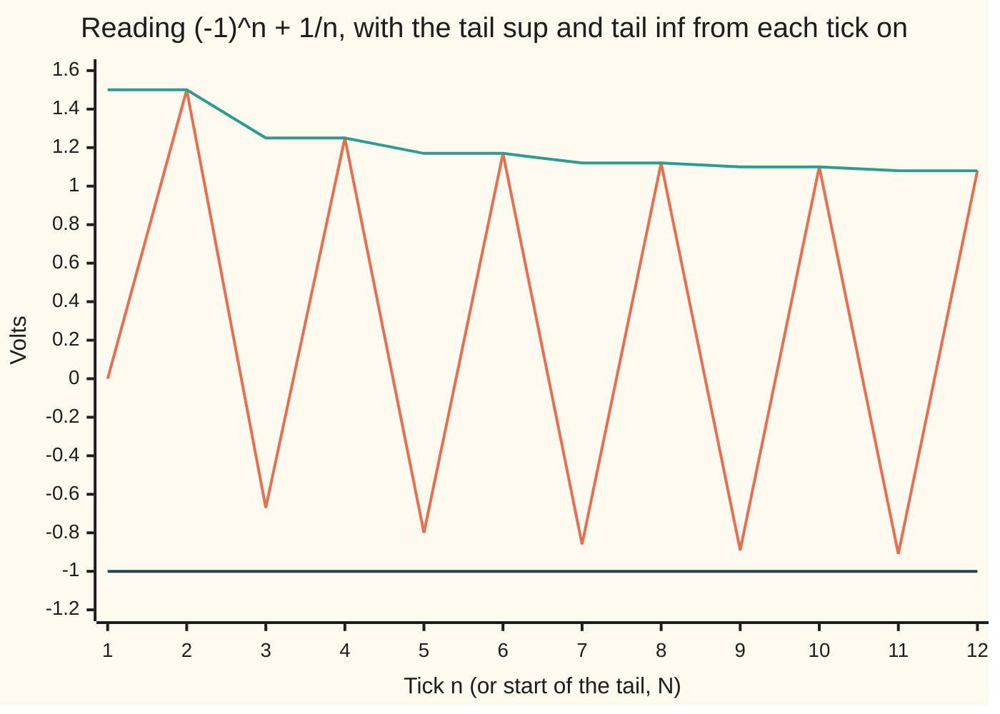

# Limit superior and inferior: the eventual ceiling and floor of a sequence that will not settle

[Syllabus](../../../SYLLABUS.md) → [Calculus and analysis](../README.md) → [Limits and Continuity](../README.md#s01) → Limit superior and inferior

---

## General Overview

A sensor flips between +1 volt and −1 volt on alternate ticks, plus a fading start-up offset of 1/n volts at tick n. Tick 1 reads 0 V, tick 2 reads 1.5 V, tick 3 reads −0.67 V, tick 4 reads 1.25 V.

The reading never settles, but its swing does. Past tick 100 no reading tops 1.01 V, yet readings above 0.99 V keep coming. The floor of every tail is −1 V, a value no reading hits. The eventual ceiling is 1 V; the eventual floor is −1 V.

Those two numbers are the **limit superior** (limsup) and **limit inferior** (liminf). Every bounded sequence has them. A sequence settles exactly when they meet. A power series, an endless sum of powers of x, gets its radius, the edge where the sum starts to fail, from a limsup too: the Cauchy–Hadamard formula.

**The limsup is where the highest values of the tail end up, the liminf is where the lowest end up; they are the largest and smallest values any part of the sequence can head for, and the sequence has a limit exactly when the two are equal.**

**What kind of fact this is:** two definitions (limsup and liminf) and three theorems, all proved on this card in Why it works.

### The picture: the reading and its tail ceiling



Orange is the reading. Teal is the tail sup, the lowest ceiling over the readings from tick N on, falling toward 1. Dark blue is the tail inf, flat at −1.

---

## The formula

Notation first. A **tail** is the sequence with its first N − 1 terms thrown away: the terms from place N on. The tail sup $`s_N`$ is that tail's least upper bound, its lowest ceiling ([No gaps](02-supremum-and-completeness.md)). The tail inf $`i_N`$ is its greatest lower bound, its highest floor.

```math
\limsup_{n\to\infty} a_n = \lim_{N\to\infty} s_N, \quad s_N = \sup\{a_n : n \ge N\}; \qquad \liminf_{n\to\infty} a_n = \lim_{N\to\infty} i_N, \quad i_N = \inf\{a_n : n \ge N\}
```

**Read it aloud:** the limsup is where the tail ceilings end up as the start moves out, and the liminf is where the tail floors end up.

A **subsequence** keeps infinitely many terms, in order, and drops the rest, such as the even ticks. A **subsequential limit** is a limit of some subsequence. Three theorems follow.

```math
\limsup_{n\to\infty} a_n = \text{largest subsequential limit}, \qquad \liminf_{n\to\infty} a_n = \text{smallest subsequential limit}
```

**Read it aloud:** the limsup is the highest value some part of the sequence heads for; nothing heads higher.

```math
\lim_{n\to\infty} a_n = L \iff \limsup_{n\to\infty} a_n = \liminf_{n\to\infty} a_n = L
```

**Read it aloud:** a sequence settles at L exactly when its eventual ceiling and eventual floor are both L.

```math
\frac{1}{R} = \limsup_{n\to\infty} |c_n|^{1/n}
```

**Read it aloud:** the radius is one over the limsup of the n-th roots of the coefficients. This is the Cauchy–Hadamard formula. A **power series** is the endless sum $`c_0 + c_1 x + c_2 x^2 + \cdots`$. Its **radius of convergence** R is the edge: the sum **converges** (its running totals have a limit) for |x| < R and fails for |x| > R.

The card's power series has $`c_n = (2 + (-1)^n)^n`$: 3^n at even n, 1 at odd n.

| Symbol | Plain meaning | In our example | Push it up and the answer… |
| --- | --- | --- | --- |
| $`a_n`$ | term n of the sequence | $`(-1)^n + 1/n`$ volts | — |
| $`n`$, $`N`$, $`n_k`$ | a place; the start of a tail; the k-th place a subsequence keeps | N = 1001; $`n_k = 2k`$ | later N, lower $`s_N`$ |
| $`s_N`$, $`i_N`$ | tail sup and tail inf: lowest ceiling, highest floor from place N on | 1.000998; −1 | — |
| $`\limsup`$, $`\liminf`$ | eventual ceiling and eventual floor | 1 V and −1 V | their gap is the lasting swing |
| $`t`$ | a tolerance | 0.01 V | smaller t, more exceptions, still finitely many |
| $`c_n`$, $`r_n`$, $`x`$ | power-series coefficient; its n-th root $`\lvert c_n\rvert^{1/n}`$; input | $`(2 + (-1)^n)^n`$; roots 3, 1, 3, 1; x = 0.3 | larger roots, smaller radius |
| $`R`$, $`\rho`$, $`L`$ | radius of convergence; rho, the limsup of the roots; a limit | 1/3; 3; 0 for $`(-1)^n/n`$ | larger ρ, smaller R |
| $`q`$ | in the proof, a ratio between $`\rho\lvert x\rvert`$ and 1 | — | — |

### When it holds

- **Bounded above, for a finite limsup.** The sequence 1, 2, 3, … has no ceiling, so every $`s_N`$ is infinite and the limsup is +∞.
- **Real numbers, not fractions only.** The tail sups need least upper bounds. Among fractions alone, a tail can have none.
- **Equal and finite, for convergence.** If both are +∞, the terms grow without bound and settle nowhere.
- **Cauchy–Hadamard is silent at the edge.** At |x| = R the formula decides nothing. Here, at x = 1/3, every even term is 1, so the series fails there.

---

## Why it works

### Step 0: tails only shrink, so their ceilings only fall

Moving the start from N to N + 1 drops one term, and a smaller collection cannot need a higher ceiling. So $`s_1 \ge s_2 \ge s_3 \ge \cdots`$, and the tail floors only rise.

A sequence that only falls and has a floor has a limit ([Sequences](03-sequences-and-limits.md), monotone convergence). So a bounded sequence has a limsup and a liminf, even when it has no limit.

### Step 1: the reading's ceiling and floor

The largest term from tick N on sits at the first even tick from N on, since the even terms 1 + 1/n fall. So $`s_N = 1 + 1/(\text{first even } n \ge N)`$: 1.5 at N = 1, and 1.000998 at N = 1001. These head for **1**.

The odd terms −1 + 1/n stay above −1 but come within any tolerance of it. So the highest floor of every tail is exactly −1, though no term equals −1. The liminf is **−1**.

### Step 2: the limsup is the largest subsequential limit

Fix a tolerance t. The tail sups fall to the limsup, so one of them is below limsup + t: only finitely many terms lie above limsup + t. Each tail sup is at least the limsup and is a least upper bound, so every tail has a term above limsup − t: infinitely many terms lie there. For t = 0.01, only 49 terms exceed 1.01, the even ticks 2 to 98, while every even tick is above 0.99.

So no subsequence can head above the limsup: it would need infinitely many terms above limsup + t. And some subsequence heads exactly to it: take one term above limsup − 1/k for k = 1, 2, 3, …, each later than the last. Being ever later, the picks eventually fall below limsup + t, for every t, since only finitely many terms lie above it. Squeezed from both sides ([Limit laws and the squeeze](04-limit-laws-and-the-squeeze.md)), they head for the limsup. Here the even ticks head for 1, the odd ticks for −1. The liminf is the same argument upside down.

So the limsup names a limit that Bolzano–Weierstrass only promises ([Compactness of [a, b]](09-compactness-of-closed-intervals.md)).

### Step 3: a limit exists exactly when ceiling and floor meet

Past place N, every term lies between the tail floor and the tail ceiling: $`i_N \le a_n \le s_N`$. If both head for L, the terms are squeezed to L.

Conversely, if $`a_n`$ heads for L, then for any tolerance t some tail lies within t of L, and so do its ceiling and floor. So both limits are L.

The reading's tail ceiling and floor never come closer than 2, so it has no limit. For $`(-1)^n/n`$ the gap from place 1001 is already 0.001997, and it shrinks to 0: that sequence heads for 0.

### Step 4: the radius of a power series is one over a limsup

Write ρ (rho) for the limsup of the roots $`r_n = |c_n|^{1/n}`$. The proof uses one fact about sums, the comparison test: for 0 ≤ q < 1 the geometric series 1 + q + q² + ⋯ adds up to 1/(1 − q), and a series whose terms are eventually smaller in size than $`q^n`$ adds up too (Lebl, §2.5, in Sources).

- **Inside, |x| < 1/ρ.** Pick q between $`\rho\lvert x\rvert`$ and 1. The tail sups of the roots fall to ρ, below $`q/\lvert x\rvert`$, so eventually every root is below $`q/\lvert x\rvert`$. Then $`|c_n x^n| = (r_n \lvert x\rvert)^n < q^n`$, and the series converges by comparison.
- **Outside, |x| > 1/ρ.** By Step 2, infinitely many roots exceed $`1/\lvert x\rvert`$, so infinitely many terms exceed 1 in size. Neighbouring running totals differ by one term, so they keep jumping by more than 1 and never settle.

So the radius is 1/ρ, reading 1/0 as no edge and 1/∞ as radius 0. For $`c_n = (2 + (-1)^n)^n`$ the roots run 3, 1, 3, 1. The limsup is 3, so **R = 1/3**.

- **Inside, x = 0.3:** even terms are 0.81^k and odd terms are 0.3 times 0.09^k, two geometric series. They add to 1/(1 − 0.81) + 0.3/(1 − 0.09) = 5.592828.
- **Outside, x = 0.34:** term 400 is 2754.7, and the even terms keep growing.

The ratio test, which reads the radius from the ratios of neighbouring coefficients, cannot see this. Those ratios are $`3^{-n}`$ after an even place and $`3^{n+1}`$ after an odd one: 0.000017 then 531441 at n = 10 and 11. They never settle.

---

## Worked numbers, by hand

| Step | Arithmetic | Value |
| --- | --- | --- |
| First readings | $`(-1)^n + 1/n`$ for n = 1 to 6 | 0, 1.5, −0.666667, 1.25, −0.8, 1.166667 |
| Tail sups | 1 + 1/(first even n from N on), at N = 11, 101, 1001 | 1.083333, 1.009804, 1.000998 |
| Limsup | the tail sups head for | **1** |
| Liminf | every tail floor | **−1** |
| Exceptions above 1.01 | even n with 1/n > 0.01: n = 2 to 98 | 49 |
| Roots of $`c_n`$ | $`(3^n)^{1/n}`$ at even n, $`1^{1/n}`$ at odd n | 3, 1, 3, 1 |
| Radius | 1 / limsup of the roots | **1/3 = 0.333333** |
| Series at 0.3 | 1/(1 − 0.81) + 0.3/(1 − 0.09) | **5.592828** |

The reading's lasting swing is 2 V; the series works for inputs closer to 0 than 1/3.

### What breaks if you drop a piece

| Mistake | Comes out at | What went wrong |
| --- | --- | --- |
| Radius from the liminf of the roots, 1 | at x = 0.5, term 40 is 11057332 | the even terms set the edge, not the odd |
| Largest term taken as the limsup | 1.5 | the limsup ignores every finite start |
| Midpoint 0 taken as a limit | $`a_{1000}`$ is 1.001 away | ceiling and floor differ, so no limit exists |
| Ratio test for the radius | ratios 0.000017, then 531441 | the ratios never settle |

---

## Code, from first principles, and it actually runs

For the reading, road one scans 4,000 terms for tail sups and counts terms past a line; road two is the closed form 1 + 1/(first even n from N on). For the power series, road one takes roots; road two never does: a grid search for the edge, and the series summed against its closed form. Five asserts compare the roads.

### Python

```python
# Limit superior and inferior -- the check behind the card.  Nothing is imported.
# The reading a_n = (-1)^n + 1/n.  Road one scans a long window for tail sups
# and counts terms past a line; road two is the closed form 1 + 1/(first even
# n from N on).  Then Cauchy-Hadamard for c_n = (2 + (-1)^n)^n, checked against
# the series itself: a grid search for the edge, and a closed-form sum.
M = 4000                                     # the window: places 1 to M
a = [(1 if n % 2 == 0 else -1) + 1 / n for n in range(1, M + 1)]

def tail_sup(N):                             # largest term from place N on, by scanning
    return max(a[N - 1:])

def closed_sup(N):                           # 1 + 1/(first even place from N on)
    return 1 + 1 / (N if N % 2 == 0 else N + 1)

def c(n):                                    # the coefficient (2 + (-1)^n)^n
    return float(3 if n % 2 == 0 else 1) ** n

def series(x, terms=400):
    return sum(c(n) * x ** n for n in range(terms))

def row(vals, d=6):
    return ", ".join(f"{v:.{d}f}" for v in vals)

Ns = [1, 4, 5, 11, 101, 1001]
scan, closed = [tail_sup(N) for N in Ns], [closed_sup(N) for N in Ns]
above = sum(1 for v in a if v > 1.01)
near_top = sum(1 for v in a if v > 0.99)
below = sum(1 for v in a if v < -1.01)
near_floor = sum(1 for v in a if v < -0.99)
b_gap = max((-1) ** n / n for n in range(1001, M + 1)) - min((-1) ** n / n for n in range(1001, M + 1))
roots = [c(n) ** (1 / n) for n in (10, 11, 12, 13)]
edge = max(k for k in range(300, 401) if c(400) * (k / 1000) ** 400 < 1) / 1000
x = 0.3
closed_sum = 1 / (1 - 9 * x * x) + x / (1 - x * x)
print("first six terms:", row(a[:6]))
print("chart, terms n = 1 to 12:", row(a[:12], 2))
print("chart, tail sups N = 1 to 12:", row([tail_sup(N) for N in range(1, 13)], 2) + "; tail inf -1 at every N")
print("tail sups, N = 1, 4, 5, 11, 101, 1001, by scanning:", row(scan))
print("the same, 1 + 1/(first even n from N on):", row(closed))
print(f"terms above 1.01: {above} (n = 2 to 98); above 0.99: {near_top} of {M}")
print(f"terms below -1.01: {below}; below -0.99: {near_floor} (odd n from 101)")
print(f"far along: a_4000 = {a[3999]:.6f}, a_3999 = {a[3998]:.6f}")
print(f"limsup - liminf = 1 - (-1) = 2; for (-1)^n/n, tail gap from 1001 = {b_gap:.6f}")
print("roots |c_n|^(1/n), n = 10 to 13:", row(roots))
print(f"limsup 3, liminf 1, radius 1/3 = {1 / 3:.6f}")
print(f"ratios c_11/c_10 = {c(11) / c(10):.6f}, c_12/c_11 = {c(12) / c(11):.0f}")
print(f"grid search: largest x with term 400 below 1 = {edge:.3f}")
print(f"series at x = 0.3, 400 terms = {series(x):.6f}; 1/(1 - 0.81) + 0.3/(1 - 0.09) = {closed_sum:.6f}")
print(f"at x = 0.34, term 400 = {c(400) * 0.34 ** 400:.1f}")
print(f"mistake 1, radius from liminf 1: at x = 0.5, term 40 = {c(40) * 0.5 ** 40:.0f}")
print(f"mistake 2, sup of the whole list: {max(a):.6f}, not the eventual ceiling 1")
print(f"mistake 3, the midpoint 0 as a limit: a_1000 is {abs(a[999]):.6f} away")
assert all(abs(s - t) < 1e-12 for s, t in zip(scan, closed))   # scan against closed form
assert above == (98 - 2) // 2 + 1 and near_floor == (3999 - 101) // 2 + 1 and below == 0
assert abs(series(x) - closed_sum) < 1e-9                       # series against closed form
assert abs(edge - int(1000 / max(roots)) / 1000) < 1e-12        # grid edge against 1/limsup
assert abs(b_gap - (1 / 1002 + 1 / 1001)) < 1e-12 and max(a[1000:]) - min(a[1000:]) > 1.99
print("ALL CHECKS PASS")
```

**Ran 2026-11-23 on macOS, Python 3.14.10, standard library only. All checks passed. Output, pasted from the run:**

```
first six terms: 0.000000, 1.500000, -0.666667, 1.250000, -0.800000, 1.166667
chart, terms n = 1 to 12: 0.00, 1.50, -0.67, 1.25, -0.80, 1.17, -0.86, 1.12, -0.89, 1.10, -0.91, 1.08
chart, tail sups N = 1 to 12: 1.50, 1.50, 1.25, 1.25, 1.17, 1.17, 1.12, 1.12, 1.10, 1.10, 1.08, 1.08; tail inf -1 at every N
tail sups, N = 1, 4, 5, 11, 101, 1001, by scanning: 1.500000, 1.250000, 1.166667, 1.083333, 1.009804, 1.000998
the same, 1 + 1/(first even n from N on): 1.500000, 1.250000, 1.166667, 1.083333, 1.009804, 1.000998
terms above 1.01: 49 (n = 2 to 98); above 0.99: 2000 of 4000
terms below -1.01: 0; below -0.99: 1950 (odd n from 101)
far along: a_4000 = 1.000250, a_3999 = -0.999750
limsup - liminf = 1 - (-1) = 2; for (-1)^n/n, tail gap from 1001 = 0.001997
roots |c_n|^(1/n), n = 10 to 13: 3.000000, 1.000000, 3.000000, 1.000000
limsup 3, liminf 1, radius 1/3 = 0.333333
ratios c_11/c_10 = 0.000017, c_12/c_11 = 531441
grid search: largest x with term 400 below 1 = 0.333
series at x = 0.3, 400 terms = 5.592828; 1/(1 - 0.81) + 0.3/(1 - 0.09) = 5.592828
at x = 0.34, term 400 = 2754.7
mistake 1, radius from liminf 1: at x = 0.5, term 40 = 11057332
mistake 2, sup of the whole list: 1.500000, not the eventual ceiling 1
mistake 3, the midpoint 0 as a limit: a_1000 is 1.001000 away
ALL CHECKS PASS
```

### Rust

Same numbers and labels, built with `rustc --edition 2021 -O`.

```rust
// Limit superior and inferior -- the same check as the Python, in Rust.  No crates.
// The reading a_n = (-1)^n + 1/n.  Road one scans a long window for tail sups
// and counts terms past a line; road two is the closed form 1 + 1/(first even
// n from N on).  Then Cauchy-Hadamard for c_n = (2 + (-1)^n)^n, checked against
// the series itself: a grid search for the edge, and a closed-form sum.
const M: usize = 4000; // the window: places 1 to M

fn tail_sup(a: &[f64], n: usize) -> f64 { // largest term from place n on, by scanning
    a[n - 1..].iter().cloned().fold(f64::MIN, f64::max)
}

fn closed_sup(n: usize) -> f64 { // 1 + 1/(first even place from n on)
    1.0 + 1.0 / (if n % 2 == 0 { n } else { n + 1 }) as f64
}

fn c(n: i32) -> f64 { // the coefficient (2 + (-1)^n)^n
    (if n % 2 == 0 { 3.0f64 } else { 1.0 }).powf(n as f64)
}

fn series(x: f64, terms: i32) -> f64 {
    (0..terms).map(|n| c(n) * x.powf(n as f64)).sum()
}

fn row(vals: &[f64], d: usize) -> String {
    vals.iter().map(|v| format!("{:.*}", d, v)).collect::<Vec<_>>().join(", ")
}

fn alt(n: usize) -> f64 { (if n % 2 == 0 { 1.0 } else { -1.0 }) / n as f64 }

fn main() {
    let a: Vec<f64> = (1..=M).map(|n| (if n % 2 == 0 { 1.0 } else { -1.0 }) + 1.0 / n as f64).collect();
    let ns = [1usize, 4, 5, 11, 101, 1001];
    let scan: Vec<f64> = ns.iter().map(|&n| tail_sup(&a, n)).collect();
    let closed: Vec<f64> = ns.iter().map(|&n| closed_sup(n)).collect();
    let above = a.iter().filter(|&&v| v > 1.01).count();
    let near_top = a.iter().filter(|&&v| v > 0.99).count();
    let below = a.iter().filter(|&&v| v < -1.01).count();
    let near_floor = a.iter().filter(|&&v| v < -0.99).count();
    let b_max = (1001..=M).map(alt).fold(f64::MIN, f64::max);
    let b_min = (1001..=M).map(alt).fold(f64::MAX, f64::min);
    let b_gap = b_max - b_min;
    let roots: Vec<f64> = [10, 11, 12, 13].iter().map(|&n| c(n).powf(1.0 / n as f64)).collect();
    let edge = (300..=400).filter(|&k| c(400) * (k as f64 / 1000.0).powf(400.0) < 1.0).max().unwrap() as f64 / 1000.0;
    let x = 0.3;
    let closed_sum = 1.0 / (1.0 - 9.0 * x * x) + x / (1.0 - x * x);
    let max_root = roots.iter().cloned().fold(f64::MIN, f64::max);
    println!("first six terms: {}", row(&a[..6], 6));
    println!("chart, terms n = 1 to 12: {}", row(&a[..12], 2));
    let chart: Vec<f64> = (1..=12).map(|n| tail_sup(&a, n)).collect();
    println!("chart, tail sups N = 1 to 12: {}; tail inf -1 at every N", row(&chart, 2));
    println!("tail sups, N = 1, 4, 5, 11, 101, 1001, by scanning: {}", row(&scan, 6));
    println!("the same, 1 + 1/(first even n from N on): {}", row(&closed, 6));
    println!("terms above 1.01: {} (n = 2 to 98); above 0.99: {} of {}", above, near_top, M);
    println!("terms below -1.01: {}; below -0.99: {} (odd n from 101)", below, near_floor);
    println!("far along: a_4000 = {:.6}, a_3999 = {:.6}", a[3999], a[3998]);
    println!("limsup - liminf = 1 - (-1) = 2; for (-1)^n/n, tail gap from 1001 = {:.6}", b_gap);
    println!("roots |c_n|^(1/n), n = 10 to 13: {}", row(&roots, 6));
    println!("limsup 3, liminf 1, radius 1/3 = {:.6}", 1.0 / 3.0);
    println!("ratios c_11/c_10 = {:.6}, c_12/c_11 = {:.0}", c(11) / c(10), c(12) / c(11));
    println!("grid search: largest x with term 400 below 1 = {:.3}", edge);
    println!("series at x = 0.3, 400 terms = {:.6}; 1/(1 - 0.81) + 0.3/(1 - 0.09) = {:.6}", series(x, 400), closed_sum);
    println!("at x = 0.34, term 400 = {:.1}", c(400) * 0.34f64.powf(400.0));
    println!("mistake 1, radius from liminf 1: at x = 0.5, term 40 = {:.0}", c(40) * 0.5f64.powf(40.0));
    println!("mistake 2, sup of the whole list: {:.6}, not the eventual ceiling 1", tail_sup(&a, 1));
    println!("mistake 3, the midpoint 0 as a limit: a_1000 is {:.6} away", a[999].abs());
    assert!(scan.iter().zip(&closed).all(|(s, t)| (s - t).abs() < 1e-12)); // scan against closed form
    assert!(above == (98 - 2) / 2 + 1 && near_floor == (3999 - 101) / 2 + 1 && below == 0);
    assert!((series(x, 400) - closed_sum).abs() < 1e-9); // series against closed form
    assert!((edge - (1000.0 / max_root).floor() / 1000.0).abs() < 1e-12); // grid edge against 1/limsup
    assert!((b_gap - (1.0 / 1002.0 + 1.0 / 1001.0)).abs() < 1e-12 && tail_sup(&a, 1001) - a[1000..].iter().cloned().fold(f64::MAX, f64::min) > 1.99);
    println!("ALL CHECKS PASS");
}
```

**Ran 2026-11-23 on macOS, rustc 1.98.1, no crates. All checks passed. Output, pasted from the run:**

```
first six terms: 0.000000, 1.500000, -0.666667, 1.250000, -0.800000, 1.166667
chart, terms n = 1 to 12: 0.00, 1.50, -0.67, 1.25, -0.80, 1.17, -0.86, 1.12, -0.89, 1.10, -0.91, 1.08
chart, tail sups N = 1 to 12: 1.50, 1.50, 1.25, 1.25, 1.17, 1.17, 1.12, 1.12, 1.10, 1.10, 1.08, 1.08; tail inf -1 at every N
tail sups, N = 1, 4, 5, 11, 101, 1001, by scanning: 1.500000, 1.250000, 1.166667, 1.083333, 1.009804, 1.000998
the same, 1 + 1/(first even n from N on): 1.500000, 1.250000, 1.166667, 1.083333, 1.009804, 1.000998
terms above 1.01: 49 (n = 2 to 98); above 0.99: 2000 of 4000
terms below -1.01: 0; below -0.99: 1950 (odd n from 101)
far along: a_4000 = 1.000250, a_3999 = -0.999750
limsup - liminf = 1 - (-1) = 2; for (-1)^n/n, tail gap from 1001 = 0.001997
roots |c_n|^(1/n), n = 10 to 13: 3.000000, 1.000000, 3.000000, 1.000000
limsup 3, liminf 1, radius 1/3 = 0.333333
ratios c_11/c_10 = 0.000017, c_12/c_11 = 531441
grid search: largest x with term 400 below 1 = 0.333
series at x = 0.3, 400 terms = 5.592828; 1/(1 - 0.81) + 0.3/(1 - 0.09) = 5.592828
at x = 0.34, term 400 = 2754.7
mistake 1, radius from liminf 1: at x = 0.5, term 40 = 11057332
mistake 2, sup of the whole list: 1.500000, not the eventual ceiling 1
mistake 3, the midpoint 0 as a limit: a_1000 is 1.001000 away
ALL CHECKS PASS
```

### Lean

Lean proves the three theorems for every bounded sequence and every real power series.

- The tail sups head for the limsup, and the tail infs head for the liminf.
- The limsup is the largest subsequential limit: some subsequence heads for it, and none heads higher.
- The liminf is the smallest subsequential limit: some subsequence heads for it, and none heads lower.
- A bounded sequence heads for L exactly when its limsup and its liminf both equal L.
- Take ρ, the limsup of the roots $`\lvert c_n\rvert^{1/n}`$, and R = 1/ρ, reading 1/0 as no edge. Then the series converges for |x| < R and fails for |x| > R.
- The hand numbers are exact: 49 exceptions above 1.01, the ratios 1/59049 and 531441, and the sum 9670/1729 at x = 0.3.

The tail-sup scans, the grid search for the edge and the 400-term sums are left to the Python and Rust checks.

```lean
-- Limit superior and inferior: for a bounded real sequence the tail sups and tail infs settle at the limsup and liminf, these are the largest and smallest subsequential limits, the sequence has limit L exactly when both equal L, and a real power series has radius one over the limsup of the n-th roots of its coefficients.
import Mathlib.Order.LiminfLimsup
import Mathlib.Topology.Order.LiminfLimsup
import Mathlib.Topology.Instances.Real.Lemmas
import Mathlib.Analysis.Analytic.RadiusLiminf
import Mathlib.Analysis.Analytic.OfScalars
import Mathlib.Analysis.SpecialFunctions.Pow.NNReal
import Mathlib.Tactic.NormNum

open Filter Finset
open scoped Topology ENNReal

/-- **Ceiling, floor and subsequential limits.** Let `a` be a bounded real sequence.
The tail sup `s N = sup {a n : n ≥ N}` heads for the limsup and the tail inf
`i N = inf {a n : n ≥ N}` heads for the liminf. The limsup is the largest subsequential
limit: some subsequence heads exactly to it, and no subsequence heads higher. The liminf
is the smallest subsequential limit: some subsequence heads exactly to it, and no
subsequence heads lower. -/
theorem limsup_liminf_largest_smallest_subsequential_limits (a : ℕ → ℝ)
    (hab : BddAbove (Set.range a)) (hbb : BddBelow (Set.range a)) :
    Tendsto (fun N => sSup (a '' Set.Ici N)) atTop (𝓝 (limsup a atTop)) ∧
    Tendsto (fun N => sInf (a '' Set.Ici N)) atTop (𝓝 (liminf a atTop)) ∧
    (∃ φ : ℕ → ℕ, StrictMono φ ∧ Tendsto (a ∘ φ) atTop (𝓝 (limsup a atTop))) ∧
    (∀ (φ : ℕ → ℕ) (x : ℝ), StrictMono φ → Tendsto (a ∘ φ) atTop (𝓝 x) →
      x ≤ limsup a atTop) ∧
    (∃ φ : ℕ → ℕ, StrictMono φ ∧ Tendsto (a ∘ φ) atTop (𝓝 (liminf a atTop))) ∧
    (∀ (φ : ℕ → ℕ) (x : ℝ), StrictMono φ → Tendsto (a ∘ φ) atTop (𝓝 x) →
      liminf a atTop ≤ x) := by
  have hU : atTop.IsBoundedUnder (· ≤ ·) a := hab.isBoundedUnder_of_range
  have hL : atTop.IsBoundedUnder (· ≥ ·) a := hbb.isBoundedUnder_of_range
  have hUc : atTop.IsCoboundedUnder (· ≤ ·) a := hL.isCoboundedUnder_le
  have hLc : atTop.IsCoboundedUnder (· ≥ ·) a := hU.isCoboundedUnder_ge
  have hclus : ∀ y : ℝ, (∀ ε > 0, ∃ᶠ n in atTop, y - ε < a n ∧ a n < y + ε) →
      ∃ φ : ℕ → ℕ, StrictMono φ ∧ Tendsto (a ∘ φ) atTop (𝓝 y) := by
    intro y hy
    apply MapClusterPt.tendsto_subseq
    rw [mapClusterPt_iff_frequently]
    intro s hs
    obtain ⟨ε, hε, hball⟩ := Metric.mem_nhds_iff.1 hs
    refine (hy ε hε).mono fun n hn => hball ?_
    rw [Metric.mem_ball, Real.dist_eq, abs_sub_lt_iff]
    constructor <;> linarith [hn.1, hn.2]
  refine ⟨?_, ?_, ?_, ?_, ?_, ?_⟩
  · rw [tendsto_order]
    constructor
    · intro y hy
      have hf := frequently_lt_of_lt_limsup hUc hy
      rw [frequently_atTop] at hf
      refine Eventually.of_forall fun N => ?_
      obtain ⟨n, hn, hyn⟩ := hf N
      exact hyn.trans_le (le_csSup (hab.mono (Set.image_subset_range _ _)) ⟨n, hn, rfl⟩)
    · intro y hy
      obtain ⟨b, hb1, hb2⟩ := exists_between hy
      have h := eventually_lt_of_limsup_lt hb1 hU
      rw [eventually_atTop] at h
      obtain ⟨N0, hN0⟩ := h
      filter_upwards [eventually_ge_atTop N0] with N hN
      refine lt_of_le_of_lt (csSup_le ⟨a N, N, le_refl N, rfl⟩ ?_) hb2
      rintro _ ⟨n, hn, rfl⟩
      exact (hN0 n (hN.trans hn)).le
  · rw [tendsto_order]
    constructor
    · intro y hy
      obtain ⟨b, hb1, hb2⟩ := exists_between hy
      have h := eventually_lt_of_lt_liminf hb2 hL
      rw [eventually_atTop] at h
      obtain ⟨N0, hN0⟩ := h
      filter_upwards [eventually_ge_atTop N0] with N hN
      refine lt_of_lt_of_le hb1 (le_csInf ⟨a N, N, le_refl N, rfl⟩ ?_)
      rintro _ ⟨n, hn, rfl⟩
      exact (hN0 n (hN.trans hn)).le
    · intro y hy
      have hf := frequently_lt_of_liminf_lt hLc hy
      rw [frequently_atTop] at hf
      refine Eventually.of_forall fun N => ?_
      obtain ⟨n, hn, hyn⟩ := hf N
      exact (csInf_le (hbb.mono (Set.image_subset_range _ _)) ⟨n, hn, rfl⟩).trans_lt hyn
  · apply hclus
    intro ε hε
    exact (frequently_lt_of_lt_limsup hUc (sub_lt_self _ hε)).and_eventually
      (eventually_lt_of_limsup_lt (lt_add_of_pos_right _ hε) hU)
  · intro φ x hφ hx
    by_contra h
    rw [not_le] at h
    obtain ⟨b, hb1, hb2⟩ := exists_between h
    have h2 := hφ.tendsto_atTop.eventually (eventually_lt_of_limsup_lt hb1 hU)
    have h3 := hx.eventually (lt_mem_nhds hb2)
    obtain ⟨n, hn1, hn2⟩ := (h2.and h3).exists
    exact lt_asymm hn1 hn2
  · apply hclus
    intro ε hε
    exact ((frequently_lt_of_liminf_lt hLc (lt_add_of_pos_right _ hε)).and_eventually
      (eventually_lt_of_lt_liminf (sub_lt_self _ hε) hL)).mono fun n hn => ⟨hn.2, hn.1⟩
  · intro φ x hφ hx
    by_contra h
    rw [not_le] at h
    obtain ⟨b, hb1, hb2⟩ := exists_between h
    have h2 := hφ.tendsto_atTop.eventually (eventually_lt_of_lt_liminf hb2 hL)
    have h3 := hx.eventually (gt_mem_nhds hb1)
    obtain ⟨n, hn1, hn2⟩ := (h2.and h3).exists
    exact lt_asymm hn1 hn2

/-- **A limit exists exactly when ceiling and floor meet.** A bounded real sequence
heads for `L` exactly when its limsup and its liminf are both `L`. -/
theorem tendsto_iff_limsup_eq_liminf (a : ℕ → ℝ) (L : ℝ)
    (hab : BddAbove (Set.range a)) (hbb : BddBelow (Set.range a)) :
    Tendsto a atTop (𝓝 L) ↔ limsup a atTop = L ∧ liminf a atTop = L := by
  have hU : atTop.IsBoundedUnder (· ≤ ·) a := hab.isBoundedUnder_of_range
  have hL : atTop.IsBoundedUnder (· ≥ ·) a := hbb.isBoundedUnder_of_range
  constructor
  · intro h
    exact ⟨h.limsup_eq, h.liminf_eq⟩
  · rintro ⟨h1, h2⟩
    exact tendsto_of_liminf_eq_limsup h2 h1 hU hL

/-- **Cauchy–Hadamard on the real line.** For the real power series `∑ c n * x ^ n`,
let `R` be one over the limsup of the n-th roots `|c n|^(1/n)`, reading `1/0` as no edge
and `1/∞` as radius 0. Then `R` is the series' radius of convergence: the running totals
have a limit for every `|x| < R`, and have no limit for any `|x| > R`. The edge
`|x| = R` is left open. -/
theorem cauchy_hadamard_radius (c : ℕ → ℝ) (R : ℝ≥0∞)
    (hR : R = (limsup (fun n : ℕ => (‖c n‖₊ : ℝ≥0∞) ^ ((n : ℝ)⁻¹)) atTop)⁻¹) :
    (FormalMultilinearSeries.ofScalars ℝ c).radius = R ∧
    (∀ x : ℝ, (‖x‖₊ : ℝ≥0∞) < R →
      ∃ S : ℝ, Tendsto (fun N => ∑ n ∈ range N, c n * x ^ n) atTop (𝓝 S)) ∧
    (∀ x : ℝ, R < (‖x‖₊ : ℝ≥0∞) →
      ¬ ∃ S : ℝ, Tendsto (fun N => ∑ n ∈ range N, c n * x ^ n) atTop (𝓝 S)) := by
  set p := FormalMultilinearSeries.ofScalars ℝ c with hp
  have hnorm : ∀ n, ‖p n‖ = ‖c n‖ := fun n => FormalMultilinearSeries.ofScalars_norm ℝ c n
  have hnnorm : ∀ n, ‖p n‖₊ = ‖c n‖₊ := fun n => by
    ext
    simp only [coe_nnnorm]
    exact hnorm n
  have hrad : p.radius = R := by
    have h := p.radius_inv_eq_limsup
    have hfun : (fun n : ℕ => ((‖p n‖₊ ^ (1 / (n : ℝ)) : NNReal) : ℝ≥0∞)) =
        fun n : ℕ => (‖c n‖₊ : ℝ≥0∞) ^ ((n : ℝ)⁻¹) := by
      funext n
      rw [hnnorm, ENNReal.coe_rpow_of_nonneg _ (by positivity : (0 : ℝ) ≤ 1 / (n : ℝ)), one_div]
    rw [hfun] at h
    rw [hR, ← h, inv_inv]
  refine ⟨hrad, ?_, ?_⟩
  · intro x hx
    rw [← hrad] at hx
    have hs := p.summable_norm_mul_pow hx
    have hs' : Summable (fun n => c n * x ^ n) := by
      refine Summable.of_norm ?_
      refine hs.congr fun n => ?_
      rw [norm_mul, norm_pow, hnorm, coe_nnnorm]
    exact ⟨_, hs'.hasSum.tendsto_sum_nat⟩
  · rintro x hx ⟨S, hS⟩
    have hterm : Tendsto (fun n => c n * x ^ n) atTop (𝓝 0) := by
      have := (hS.comp (tendsto_add_atTop_nat 1)).sub hS
      rw [sub_self] at this
      refine this.congr fun n => ?_
      simp [Function.comp, Finset.sum_range_succ]
    obtain ⟨C, hC⟩ := isBounded_iff_forall_norm_le.1 (Metric.isBounded_range_of_tendsto _ hterm)
    have hle : (‖x‖₊ : ℝ≥0∞) ≤ p.radius := by
      refine p.le_radius_of_bound C fun n => ?_
      have := hC _ ⟨n, rfl⟩
      rw [norm_mul, norm_pow] at this
      rw [hnorm, coe_nnnorm]
      exact this
    rw [hrad] at hle
    exact absurd hx (not_lt.2 hle)

-- Exceptions above 1.01: the even places n = 2 to 98, which number 49.
example : ((Finset.Icc 2 98).filter Even).card = 49 := by decide

-- Readings below -0.99 in the window up to 4000: the odd places 101 to 3999, which number 1950.
set_option maxRecDepth 100000 in
example : ((Finset.Icc 101 3999).filter Odd).card = 1950 := by decide

-- The coefficient ratios for c n = (2 + (-1)^n)^n swing: c 11 / c 10 = 1/3^10 and c 12 / c 11 = 3^12.
example : ((2 + (-1 : ℚ) ^ 11) ^ 11) / ((2 + (-1 : ℚ) ^ 10) ^ 10) = 1 / 59049 := by norm_num
example : ((2 + (-1 : ℚ) ^ 12) ^ 12) / ((2 + (-1 : ℚ) ^ 11) ^ 11) = 531441 := by norm_num

-- The series at x = 3/10, split into two geometric series: 1/(1 - 81/100) + (3/10)/(1 - 9/100).
example : (1 : ℚ) / (1 - 81 / 100) + (3 / 10) / (1 - 9 / 100) = 9670 / 1729 := by norm_num

#print axioms limsup_liminf_largest_smallest_subsequential_limits
#print axioms tendsto_iff_limsup_eq_liminf
#print axioms cauchy_hadamard_radius
```

**Checked 2026-11-23 on macOS, Lean 4.36.0-rc2, Mathlib v4.36.0-rc2. Every proof is complete and uses only Lean's standard axioms. Output, pasted from the run:**

```
'limsup_liminf_largest_smallest_subsequential_limits' depends on axioms: [propext, Classical.choice, Quot.sound]
'tendsto_iff_limsup_eq_liminf' depends on axioms: [propext, Classical.choice, Quot.sound]
'cauchy_hadamard_radius' depends on axioms: [propext, Classical.choice, Quot.sound]
```

> [!TIP]
> **Try changing**
> - **A smaller tolerance.** Change `v > 1.01` to `v > 1.001`. Guess the count first. It is 499: a smaller tolerance allows more exceptions, but still finitely many. The second assert stops the run.
> - **Closer to the edge.** Change `x = 0.3` to `x = 0.33`. Guess whether 400 terms still suffice. They do not: the sum is 49.719547 against a true 50.621585.
> - **Past the edge.** Change `x = 0.3` to `x = 0.34`. Guess first: does the sum settle? The series reaches 68160.395651 and keeps growing; the closed form gives a meaningless −24.368034.

---

## The usual mistake

> [!warning]
> **Reading the largest term as the limsup.** The largest reading is 1.5 V, at tick 2, but the limsup is 1 V: it ignores any finite start, so one early spike changes the maximum but not the eventual ceiling.
>
> - **Liminf in Cauchy–Hadamard.** The odd roots give 1, so radius 1. At x = 0.5 the 40th term is 11057332: the even terms set the edge.
> - **The midpoint as a limit.** Halfway between ceiling and floor is 0, yet $`a_{1000}`$ is 1.001 away from it.
> - **Expecting the floor to be reached.** Every tail floor is −1, and no reading equals −1. The nearest by tick 3999 is −0.999750.

---

## Where you meet it in real life

- **Power-series libraries.** Cauchy–Hadamard gives the radius even when the coefficient ratios swing, in the plane as well as on the line.
- **Probability.** "Happens infinitely often" is a limsup of events. [The Borel-Cantelli lemmas](../../10-Measure%20and%20integration/10-The%20Limit%20Theorems%2C%20Proved/01-borel-cantelli-lemmas.md) decide when that has probability 0 or 1.
- **Integration.** [Fatou's lemma](../../10-Measure%20and%20integration/05-Swapping%20Limits%20and%20Integrals/01-fatous-lemma.md) bounds the integral of a liminf, which exists even when the functions never settle.

> **Say it back**
> The tail sup, the lowest ceiling from place N on, only falls; its limit is the limsup, and the rising tail floors give the liminf. They are the largest and smallest values any subsequence can head for. A sequence has a limit exactly when they are equal. A power series has radius one over the limsup of the n-th roots of its coefficients, even when the ratio test fails.

---

## What this builds on

- [Sequences](03-sequences-and-limits.md): the tolerance definition of a limit, and monotone convergence, which makes the tail sups settle.
- [No gaps](02-supremum-and-completeness.md): least upper bounds, which every tail sup needs.
- [Compactness of [a, b]](09-compactness-of-closed-intervals.md): Bolzano–Weierstrass, which the limsup sharpens by naming a limit.

## Where this goes next

- [Power series](../06-Series/04-power-series.md): the full theory, where settled coefficient ratios give the radius.
- [Power series in the plane](../../07-Complex%20analysis/02-Holomorphic%20Functions/02-complex-power-series.md): Cauchy–Hadamard for complex inputs, with a disc in place of an interval.
- [Fatou's lemma](../../10-Measure%20and%20integration/05-Swapping%20Limits%20and%20Integrals/01-fatous-lemma.md): the liminf of functions under an integral.
- [The Borel-Cantelli lemmas](../../10-Measure%20and%20integration/10-The%20Limit%20Theorems%2C%20Proved/01-borel-cantelli-lemmas.md): the limsup of events, "infinitely often".

The question this card leaves open: what do the eventual ceiling and floor of a function, rather than a list, say about where it is continuous?

---

## Sources

Verified 2026-11-23: every link below resolves to the publisher's page.

- Lebl, Jiří. *Basic Analysis I*, §2.3 "Limit superior, limit inferior, and Bolzano–Weierstrass". [Section page](https://www.jirka.org/ra/html/sec_bw.html). Free; tail sups, subsequential limits and Bolzano–Weierstrass. §2.5 [Series](https://www.jirka.org/ra/html/sec_series.html): the geometric series sum and the comparison test.
- Tao, Terence. *Analysis I*, 4th ed. Springer, 2022. [doi:10.1007/978-981-19-7261-4](https://doi.org/10.1007/978-981-19-7261-4). Chapter 6 builds limsup and liminf from tail sups and proves the limit-point facts.
- Abbott, Stephen. *Understanding Analysis*, 2nd ed. Springer, 2015. [Publisher page](https://link.springer.com/book/10.1007/978-1-4939-2712-8). Chapter 2's exercises define limsup as the limit of tail sups; Chapter 6 treats power series.
