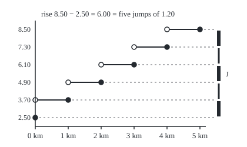

# Monotone functions: one-sided limits always exist, every break is a jump, and there are only countably many

[Syllabus](../../../SYLLABUS.md) → [Calculus and analysis](../README.md) → [Limits and Continuity](../README.md#s01) → Monotone functions

---

## General Overview

A taxi charges 2.50 dollars at the kerb, then 1.20 dollars for every kilometre started. This is the stepped fare from [Continuity](05-continuity.md), at a different tariff. At 1.999 km the meter reads 4.90. At exactly 2 km it still reads 4.90. At 2.001 km it reads 6.10.

The fare never goes down. A function that never goes down is **increasing** (or never goes up: **decreasing**); either kind is **monotone**. That one property controls every break in the graph:

- At every point the fare heads for one value from the left and one from the right: 4.90 and 6.10 at 2 km.
- A break can only be a **jump**, where the two sides disagree: no holes, no blow-ups, no endless swinging.
- The jumps are few. The fare rises 6.00 dollars over 5 km, so at most 6.00 / 1.20 = 5 jumps can be 1.20 or bigger. There are exactly 5, at 0, 1, 2, 3 and 4 km.

Counting by size this way shows that a monotone function has only **countably many** jumps: they can be listed first, second, third, and so on, even when the list never ends.

**A monotone function has a left and a right limit at every point, its only breaks are jumps, and the total rise caps how many jumps of each size fit, so its jumps can be listed one by one.**

**What kind of fact this is:** a theorem, proved on this card in Why it works. The countability part is known as Froda's theorem.

### The picture: five jumps fill the rise

<p align="center"></p>

Drawn to scale. A filled dot is the fare charged at that distance; an open dot is a value approached but not charged there. The bar J on the right stacks the five jumps. They do not overlap, and together they fill the whole rise of 6.00 dollars.

---

## The formula

Notation first. The fare is $`f(x) = 2.50 + 1.20 \lceil x \rceil`$, where x is the distance in km and $`\lceil x \rceil`$ is x rounded up, the kilometres started. The function f is increasing on the interval from a to b: if x < y, then f(x) ≤ f(y).

From [Continuity](05-continuity.md): $`f(c^-)`$ is the **left limit**, the value f heads for as x approaches c from below. $`f(c^+)`$ is the **right limit**, from above. From [No gaps](02-supremum-and-completeness.md): sup is the least upper bound, the lowest number no member passes; inf is the greatest lower bound.

```math
f(c^-) = \sup_{x < c} f(x) \;\le\; f(c) \;\le\; \inf_{x > c} f(x) = f(c^+), \qquad J(c) = f(c^+) - f(c^-)
```

**Read it aloud:** the left limit is the lowest ceiling of the values before c, the right limit is the highest floor of the values after c, the value at c sits between them, and the jump at c is the gap between the two limits.

At an end of the interval only one side exists: the jump at a is $`f(a^+) - f(a)`$, and at b it is $`f(b) - f(b^-)`$.

```math
\sum_{\text{jump points}} J(c) \;\le\; f(b) - f(a), \qquad N_h \;\le\; \frac{f(b) - f(a)}{h}, \qquad \{c : J(c) > 0\} = \bigcup_{k=1}^{\infty} \{c : J(c) \ge 1/k\}
```

**Read it aloud:** the jumps add up to at most the total rise, so the number of jumps of size h or more is at most the rise divided by h, and every jump is at least 1/k for some whole number k.

| Symbol | Plain meaning | In our example | Push it up and the answer… |
| --- | --- | --- | --- |
| $`f`$, $`x`$ | an increasing function; its input | the fare; distance in km | a steeper tariff, bigger jumps |
| $`\lceil x \rceil`$ | x rounded up: kilometres started | 3 at 2.001 km | steps up at each whole km |
| $`a`$, $`b`$; $`c`$ | the ends of the interval; the point tested | 0 km and 5 km; 2 km | a longer trip, more rise, more room for jumps |
| $`f(c^-)`$, $`f(c^+)`$; $`L`$, $`x_0`$ | left and right limits: sup of values before c, inf of values after; in Step 1, L is that sup and $`x_0`$ a point before c | 4.90 and 6.10; L = 4.90, $`x_0`$ = 1.9 km | — |
| $`J(c)`$, $`c_i`$ | the jump at c; $`\sum`$ adds the jumps up; $`c_1 < c_2 < \dots < c_n`$ are jump points in order | 1.20 at each of 0 to 4 km; total 6.00 | — |
| $`h`$, $`N_h`$ | a size threshold; how many jumps are at least that big | 1.20; 5 | a smaller h allows more jumps |
| $`k`$, $`\bigcup`$ | a whole number 1, 2, 3, …; "all of these sets together" | thresholds 1, 1/2, 1/3, … | each k adds a finite batch |
| $`g`$, $`n`$ | the test staircase on [0, 1]: it adds $`2^{-n}`$ at x = 1/n, for n = 1, 2, 3, … | jumps 0.50, 0.25, 0.125, …; total rise 1 | a bigger n, a smaller jump |

### When it holds

- **Monotone on the whole interval.** A function that rises and falls can break badly: the one that is 1 at fractions and 0 elsewhere breaks at every point, and none of its breaks is a jump.
- **A finite total rise.** The counting bound needs a finite rise f(b) − f(a). On an endless trip, [0, ∞), the fare jumps 1.20 at every whole km, and no bound caps how many. Count on [0, 5], [0, 10], and so on instead: each piece has countably many jumps, and so does their union.
- **Countable, not finite.** The bound caps the jumps above each size, not all jumps. The test staircase g below has infinitely many.
- **Real numbers.** The one-sided limits are a supremum and an infimum. Their existence is completeness, from [No gaps](02-supremum-and-completeness.md).

---

## Why it works

### Step 0: a rising function cannot wiggle, so the values pile up under a ceiling

Left of c, the values of f stay at or below f(c), so by completeness they have a lowest ceiling. Because f only rises, they crowd up against it: that is the left limit. For the count, each jump takes its own slice of the vertical rise, and slices that do not overlap cannot add up to more than the whole.

### Step 1: the left and right limits exist

Fix c = 2 km. Every value before 2 km is at most f(2) = 4.90, so the values before c have a lowest ceiling L. Here L = 4.90.

Name any tolerance, say one cent. L minus one cent is not a ceiling, so some point $`x_0`$ before c has a value above it. Here any $`x_0`$ past 1 km works, for example 1.9 km, where f = 4.90. For every x between $`x_0`$ and c, f only rises, so $`f(x_0) \le f(x) \le L`$. Every such f(x) is within a cent of L. The same works for any tolerance, so f(x) heads for L from the left.

The right limit is the mirror image: the values after c have a floor f(c), so they have a greatest lower bound. Here it is 6.10.

### Step 2: every break is a jump

The left limit is at most f(c), and the right limit is at least f(c). So two cases remain:

- **The limits agree.** Then f(c) is squeezed between equal numbers, so it equals both, and f is continuous at c.
- **The limits differ.** That is a jump of size J(c) > 0.

The other kinds of break from [Continuity](05-continuity.md) cannot happen. A hole would need equal limits with a different value. A blow-up or a swing would need a limit that fails to exist.

### Step 3: jumps take separate slices of the rise

Take any jump points $`c_1 < c_2 < \dots < c_n`$. Between two neighbours $`c_i`$ and $`c_{i+1}`$ pick any point x. Since f rises, $`f(c_i^+) \le f(x) \le f(c_{i+1}^-)`$. So the slice of heights from $`f(c_i^-)`$ to $`f(c_i^+)`$ ends before the next slice starts.

All the slices sit between f(a) and f(b) and do not overlap. So the jumps add up to at most f(b) − f(a). For the fare: 5 × 1.20 = 6.00, exactly the rise.

### Step 4: count by size, then list

If $`N_h`$ jumps are each at least h, they add up to at least $`N_h \times h`$. That is at most the rise, so $`N_h \le (f(b) - f(a))/h`$.

Now list the jumps: first every jump of size 1 or more (finitely many), then every jump between 1/2 and 1, then between 1/3 and 1/2, and so on. Each batch is finite, and every jump lands in some batch. So the whole collection can be listed: it is countable.

The test staircase g on [0, 1] adds $`2^{-n}`$ at x = 1/n for n = 1, 2, 3, …. It rises by 1 in total and has a jump at every 1/n: infinitely many. Jumps of at least 0.1: 3, within the bound 10. Of at least 0.000001: 19, within the bound 1000000.

---

## Worked numbers, by hand

| Step | Arithmetic | Value |
| --- | --- | --- |
| left limit at 2 km | at 1.999 km, 2 km started: 2.50 + 1.20 × 2 | 4.90 |
| value at 2 km | still 2 started | 4.90 |
| right limit at 2 km | at 2.001 km, 3 started: 2.50 + 1.20 × 3 | 6.10 |
| jump at 2 km | 6.10 − 4.90 | 1.20 |
| total rise on [0, 5] | 8.50 − 2.50 | 6.00 |
| bound on jumps of 1.20 or more | 6.00 / 1.20 | 5 |
| jumps found | at 0, 1, 2, 3 and 4 km | **5: the bound is met exactly** |

The bound is met because this fare rises only at its jumps; a fare that also crept up between kilometres would have room for fewer.

### What breaks if you drop a piece

| Mistake | Comes out at | What went wrong |
| --- | --- | --- |
| Reading the bound as the count | jumps of at least 0.50: bound 12, found 5 | The bound caps the count; it does not predict it |
| Measuring the jump from the value | 4.90 − 4.90 = 0.00 at 2 km | The jump is right limit minus left limit; the value sits on one side |
| Dropping the jump at the kerb | 4 jumps, 4.80 of the 6.00 rise | At an end, one side counts, and that jump is real |
| Reading countable as finite | g: 19 jumps of at least 0.000001, more for every smaller size | A countable list may never end |

---

## Code, from first principles, and it actually runs

The code takes three roads. Road 1 reads the one-sided limits from the fare formula. Road 2 drives a simulated meter metre by metre and takes the highest value before each point and the lowest after it. Road 3 checks the counting bound against the jumps found, for the fare and for g, whose jumps come from its definition and are compared with $`2^{-n}`$.

### Python

```python
# Monotone functions and jumps -- the check behind the card.  Standard library
# only.  Road 1: the fare formula gives the one-sided limits.  Road 2: a meter
# driven metre by metre, read as highest value below and lowest value above.
# Road 3: the counting bound, jumps of size h or more <= rise / h.
def F(m): return 250 + 120 * -(-m // 1000)            # fare in cents at m metres
vals, fare = [], 250                                  # the meter, metre by metre
for m in range(0, 5001):
    if m % 1000 == 1: fare += 120                     # a new kilometre starts
    vals.append(fare)
d = lambda c: f"{c / 100:.2f}"
print("setup: taxi fare 2.50 + 1.20 per started km on [0, 5]; "
      "test staircase g on [0, 1] adds 2^-n at x = 1/n")
jumps = {}
for c in range(6):
    lf = 250 + 120 * c if c > 0 else None               # road 1: the formula
    rf = 250 + 120 * (c + 1) if c < 5 else None
    lb = max(vals[:1000 * c]) if c > 0 else None        # road 2: sup below
    rb = min(vals[1000 * c + 1:]) if c < 5 else None    # road 2: inf above
    assert (lf, rf) == (lb, rb) and (lf or 0) <= F(1000 * c) <= (rf or 10**9)
    j = (rf if rf else F(5000)) - (lf if lf is not None else F(0))
    jumps[c] = j
    print(f"at {c} km: left {d(lf) if lf else '-'}, value {d(F(1000 * c))}, "
          f"right {d(rf) if rf else '-'}, jump {d(j)}")
print("near 2 km from the left, 1.9, 1.99, 1.999 km:", ", ".join(d(F(m)) for m in (1900, 1990, 1999)),
      "| from the right, 2.1, 2.01, 2.001 km:", ", ".join(d(F(m)) for m in (2100, 2010, 2001)))
scan = [(m - 1, vals[m] - vals[m - 1]) for m in range(1, 5001) if vals[m] > vals[m - 1]]
print("meter scan: rises at", ", ".join(f"{m // 1000}" for m, _ in scan), "km; sizes",
      ", ".join(d(s) for _, s in scan) + "; total", d(sum(s for _, s in scan)))
rise = F(5000) - F(0)
assert [m for m, _ in scan] == [1000 * c for c in jumps if jumps[c]] and sum(s for _, s in scan) == rise
for h in (120, 50):
    n = sum(1 for j in jumps.values() if j >= h)
    print(f"rise {d(rise)}; jumps of at least {d(h)}: bound {rise // h}, found {n}")
    assert n <= rise / h
def g(x): return sum(2.0 ** -n for n in range(1, 61) if x >= 1 / n)   # by definition
brute = [g(1 / n) - g(1 / n - 1e-9) for n in range(1, 61)]
assert all(abs(b - 2.0 ** -n) < 1e-12 for n, b in zip(range(1, 61), brute))
print("g jumps at x = 1, 1/2, 1/3, 1/4 by definition:", ", ".join(f"{b:.6f}" for b in brute[:4]),
      "| formula 2^-n:", ", ".join(f"{2.0 ** -n:.6f}" for n in range(1, 5)))
grise = g(1) - g(0)
hs = (0.1, 0.01, 0.001, 0.000001)
found = [sum(1 for b in brute if b >= h) for h in hs]
assert all(n <= grise / h for n, h in zip(found, hs)) and found == [3, 6, 9, 19]
print(f"g rise {grise:.6f}; jumps of at least 0.1, 0.01, 0.001, 0.000001: found "
      + ", ".join(map(str, found)) + "; bounds " + ", ".join(f"{grise / h:.0f}" for h in hs))
print(f"mistakes: jump at 2 km measured from the value {d(F(2000) - max(vals[:2000]))}; "
      f"kerb jump dropped: {sum(1 for c in range(1, 6) if jumps[c])} jumps, {d(sum(jumps[c] for c in range(1, 6)))} of {d(rise)}")
X, Y = (lambda km: 60 + 56 * km), (lambda c: 200 - 25 * (c - 250) / 100)
print("figure, 56 px per km, 25 px per dollar; step heights y =", ", ".join(f"{Y(250 + 120 * k):.0f}" for k in range(1, 6))
      + "; jump edges x =", ", ".join(f"{X(c):.0f}" for c in range(5)))
print("ALL CHECKS PASS")
```

**Ran 2026-11-23 on macOS, Python 3.14.10, standard library only. All checks passed. Output, pasted from the run:**

```
setup: taxi fare 2.50 + 1.20 per started km on [0, 5]; test staircase g on [0, 1] adds 2^-n at x = 1/n
at 0 km: left -, value 2.50, right 3.70, jump 1.20
at 1 km: left 3.70, value 3.70, right 4.90, jump 1.20
at 2 km: left 4.90, value 4.90, right 6.10, jump 1.20
at 3 km: left 6.10, value 6.10, right 7.30, jump 1.20
at 4 km: left 7.30, value 7.30, right 8.50, jump 1.20
at 5 km: left 8.50, value 8.50, right -, jump 0.00
near 2 km from the left, 1.9, 1.99, 1.999 km: 4.90, 4.90, 4.90 | from the right, 2.1, 2.01, 2.001 km: 6.10, 6.10, 6.10
meter scan: rises at 0, 1, 2, 3, 4 km; sizes 1.20, 1.20, 1.20, 1.20, 1.20; total 6.00
rise 6.00; jumps of at least 1.20: bound 5, found 5
rise 6.00; jumps of at least 0.50: bound 12, found 5
g jumps at x = 1, 1/2, 1/3, 1/4 by definition: 0.500000, 0.250000, 0.125000, 0.062500 | formula 2^-n: 0.500000, 0.250000, 0.125000, 0.062500
g rise 1.000000; jumps of at least 0.1, 0.01, 0.001, 0.000001: found 3, 6, 9, 19; bounds 10, 100, 1000, 1000000
mistakes: jump at 2 km measured from the value 0.00; kerb jump dropped: 4 jumps, 4.80 of 6.00
figure, 56 px per km, 25 px per dollar; step heights y = 170, 140, 110, 80, 50; jump edges x = 60, 116, 172, 228, 284
ALL CHECKS PASS
```

### Rust

Same numbers, same labels, built with `rustc --edition 2021 -O`.

```rust
// Monotone functions and jumps -- the same check as the Python, in Rust, std
// only.  Road 1: the fare formula gives the one-sided limits.  Road 2: a meter
// driven metre by metre, read as highest value below and lowest value above.
// Road 3: the counting bound, jumps of size h or more <= rise / h.
fn f(m: i64) -> i64 { 250 + 120 * ((m + 999) / 1000) }  // fare in cents at m metres
fn d(c: i64) -> String { format!("{}.{:02}", c / 100, c % 100) }
fn g(x: f64) -> f64 { (1..=60).filter(|&n| x >= 1.0 / n as f64).map(|n| 2f64.powi(-n)).sum() }
fn join(v: Vec<String>) -> String { v.join(", ") }
fn main() {
    let mut vals = Vec::new();
    let mut fare = 250;                                   // the meter, metre by metre
    for m in 0..=5000 {
        if m % 1000 == 1 { fare += 120; }                 // a new kilometre starts
        vals.push(fare);
    }
    println!("setup: taxi fare 2.50 + 1.20 per started km on [0, 5]; test staircase g on [0, 1] adds 2^-n at x = 1/n");
    let mut jumps = [0i64; 6];
    for c in 0..6usize {
        let ci = c as i64;
        let lf = if c > 0 { Some(250 + 120 * ci) } else { None };        // road 1: the formula
        let rf = if c < 5 { Some(250 + 120 * (ci + 1)) } else { None };
        let lb = if c > 0 { vals[..1000 * c].iter().max().copied() } else { None };      // road 2: sup below
        let rb = if c < 5 { vals[1000 * c + 1..].iter().min().copied() } else { None };  // road 2: inf above
        assert!((lf, rf) == (lb, rb) && lf.unwrap_or(0) <= f(1000 * ci) && f(1000 * ci) <= rf.unwrap_or(1_000_000_000));
        let j = rf.unwrap_or(f(5000)) - lf.unwrap_or(f(0));
        jumps[c] = j;
        let show = |o: Option<i64>| o.map(d).unwrap_or("-".to_string());
        println!("at {} km: left {}, value {}, right {}, jump {}", c, show(lf), d(f(1000 * ci)), show(rf), d(j));
    }
    println!("near 2 km from the left, 1.9, 1.99, 1.999 km: {} | from the right, 2.1, 2.01, 2.001 km: {}",
             join([1900, 1990, 1999].iter().map(|&m| d(f(m))).collect()), join([2100, 2010, 2001].iter().map(|&m| d(f(m))).collect()));
    let scan: Vec<(usize, i64)> = (1..=5000).filter(|&m| vals[m] > vals[m - 1]).map(|m| (m - 1, vals[m] - vals[m - 1])).collect();
    let total: i64 = scan.iter().map(|s| s.1).sum();
    println!("meter scan: rises at {} km; sizes {}; total {}", join(scan.iter().map(|s| format!("{}", s.0 / 1000)).collect()),
             join(scan.iter().map(|s| d(s.1)).collect()), d(total));
    let rise = f(5000) - f(0);
    let nonzero: Vec<usize> = (0..6).filter(|&c| jumps[c] != 0).map(|c| 1000 * c).collect();
    assert!(scan.iter().map(|s| s.0).collect::<Vec<_>>() == nonzero && total == rise);
    for h in [120i64, 50] {
        let n = jumps.iter().filter(|&&j| j >= h).count();
        println!("rise {}; jumps of at least {}: bound {}, found {}", d(rise), d(h), rise / h, n);
        assert!(n as f64 <= rise as f64 / h as f64);
    }
    let brute: Vec<f64> = (1..=60).map(|n| g(1.0 / n as f64) - g(1.0 / n as f64 - 1e-9)).collect();
    assert!(brute.iter().enumerate().all(|(i, b)| (b - 2f64.powi(-(i as i32 + 1))).abs() < 1e-12));
    println!("g jumps at x = 1, 1/2, 1/3, 1/4 by definition: {} | formula 2^-n: {}",
             join(brute[..4].iter().map(|b| format!("{:.6}", b)).collect()), join((1..5).map(|n| format!("{:.6}", 2f64.powi(-n))).collect()));
    let grise = g(1.0) - g(0.0);
    let hs = [0.1, 0.01, 0.001, 0.000001];
    let found: Vec<usize> = hs.iter().map(|&h| brute.iter().filter(|&&b| b >= h).count()).collect();
    assert!(found.iter().zip(hs).all(|(&n, h)| n as f64 <= grise / h) && found == vec![3, 6, 9, 19]);
    println!("g rise {:.6}; jumps of at least 0.1, 0.01, 0.001, 0.000001: found {}; bounds {}", grise,
             join(found.iter().map(|n| n.to_string()).collect()), join(hs.iter().map(|h| format!("{:.0}", grise / h)).collect()));
    println!("mistakes: jump at 2 km measured from the value {}; kerb jump dropped: {} jumps, {} of {}",
             d(f(2000) - vals[..2000].iter().max().unwrap()), (1..6).filter(|&c| jumps[c] != 0).count(),
             d(jumps[1..].iter().sum()), d(rise));
    let (x, y) = (|km: f64| 60.0 + 56.0 * km, |c: f64| 200.0 - 25.0 * (c - 250.0) / 100.0);
    println!("figure, 56 px per km, 25 px per dollar; step heights y = {}; jump edges x = {}",
             join((1..6).map(|k| format!("{:.0}", y(250.0 + 120.0 * k as f64))).collect()),
             join((0..5).map(|c| format!("{:.0}", x(c as f64))).collect()));
    println!("ALL CHECKS PASS");
}
```

**Ran 2026-11-23 on macOS, rustc 1.98.1, no crates. All checks passed. Output, pasted from the run:**

```
setup: taxi fare 2.50 + 1.20 per started km on [0, 5]; test staircase g on [0, 1] adds 2^-n at x = 1/n
at 0 km: left -, value 2.50, right 3.70, jump 1.20
at 1 km: left 3.70, value 3.70, right 4.90, jump 1.20
at 2 km: left 4.90, value 4.90, right 6.10, jump 1.20
at 3 km: left 6.10, value 6.10, right 7.30, jump 1.20
at 4 km: left 7.30, value 7.30, right 8.50, jump 1.20
at 5 km: left 8.50, value 8.50, right -, jump 0.00
near 2 km from the left, 1.9, 1.99, 1.999 km: 4.90, 4.90, 4.90 | from the right, 2.1, 2.01, 2.001 km: 6.10, 6.10, 6.10
meter scan: rises at 0, 1, 2, 3, 4 km; sizes 1.20, 1.20, 1.20, 1.20, 1.20; total 6.00
rise 6.00; jumps of at least 1.20: bound 5, found 5
rise 6.00; jumps of at least 0.50: bound 12, found 5
g jumps at x = 1, 1/2, 1/3, 1/4 by definition: 0.500000, 0.250000, 0.125000, 0.062500 | formula 2^-n: 0.500000, 0.250000, 0.125000, 0.062500
g rise 1.000000; jumps of at least 0.1, 0.01, 0.001, 0.000001: found 3, 6, 9, 19; bounds 10, 100, 1000, 1000000
mistakes: jump at 2 km measured from the value 0.00; kerb jump dropped: 4 jumps, 4.80 of 6.00
figure, 56 px per km, 25 px per dollar; step heights y = 170, 140, 110, 80, 50; jump edges x = 60, 116, 172, 228, 284
ALL CHECKS PASS
```

### Lean

Lean proves the general facts for any monotone function on an interval [a, b], and checks the fare and staircase numbers.

- Suppose f is increasing on [a, b] and c lies strictly between a and b. Then the left limit exists and is the sup of the values before c.
- With the same f and c, the right limit exists and is the inf of the values after c.
- Suppose f and c are as above. Then $`f(c^-) \le f(c) \le f(c^+)`$.
- Suppose f and c are as above. Then f breaks at c exactly when $`f(c^-) < f(c^+)`$, so every break is a jump.
- Take f increasing on [a, b] and any finitely many points of [a, b], with end jumps measured as on the card. Then their jumps add up to at most $`f(b) - f(a)`$.
- Suppose $`N_h`$ of those points each have a jump of at least h, with h > 0. Then $`N_h \times h \le f(b) - f(a)`$.
- Suppose f is increasing or decreasing on [a, b]. Then the points of [a, b] where f breaks are countable.
- The fare never goes down. It reads 4.90 from just past 1 km to 2 km, and 6.10 from just past 2 km to 3 km.
- The jump at 2 km is 1.20 and the rise is 6.00. Five jumps of 1.20 fill it; four give 4.80.
- The bounds are 5 jumps of at least 1.20 and 12 of at least 0.50.
- The staircase g has 3 jumps of at least 0.1 and 19 of at least 0.000001.

The metre-by-metre meter, the jumps of g read from its definition, and the figure numbers are left to the Python and Rust checks.

```lean
-- Monotone functions: a function increasing on [a, b] has a left and a right limit at every inner point, breaks only by jumping, has jumps that add up to at most its total rise, and (increasing or decreasing) breaks at only countably many points.
import Mathlib.Topology.Order.Monotone
import Mathlib.Topology.Instances.Real.Lemmas
import Mathlib.Algebra.Order.Archimedean.Real.Basic
import Mathlib.Algebra.BigOperators.Group.Finset.Basic

open Set Filter Topology

/-- Froda's theorem, as on the card: if f is monotone (increasing or decreasing) on the
interval [a, b], then the points of [a, b] where f breaks (is not continuous on the interval)
are countable: they can be listed one by one. -/
theorem countable_breaks_of_monotone {f : ℝ → ℝ} {a b : ℝ}
    (hf : MonotoneOn f (Icc a b) ∨ AntitoneOn f (Icc a b)) :
    {c ∈ Icc a b | ¬ContinuousWithinAt f (Icc a b) c}.Countable := by
  rcases hf with hf | hf
  · exact hf.countable_not_continuousWithinAt
  · exact hf.countable_not_continuousWithinAt

/-- One-sided limits and the jump: if f is increasing on [a, b] and c lies strictly inside,
then f heads for the left limit f(c⁻) = sup of f on [a, c) from the left and for the right
limit f(c⁺) = inf of f on (c, b] from the right, f(c⁻) ≤ f(c) ≤ f(c⁺), and f breaks at c
exactly when the two limits differ, that is, when it jumps: f(c⁻) < f(c⁺). -/
theorem one_sided_limits_and_every_break_is_a_jump {f : ℝ → ℝ} {a b c : ℝ}
    (hf : MonotoneOn f (Icc a b)) (hc : c ∈ Ioo a b) :
    Tendsto f (𝓝[<] c) (𝓝 (sSup (f '' Ico a c))) ∧
    Tendsto f (𝓝[>] c) (𝓝 (sInf (f '' Ioc c b))) ∧
    sSup (f '' Ico a c) ≤ f c ∧ f c ≤ sInf (f '' Ioc c b) ∧
    (¬ContinuousAt f c ↔ sSup (f '' Ico a c) < sInf (f '' Ioc c b)) := by
  obtain ⟨hac, hcb⟩ := hc
  have hcI : c ∈ Icc a b := ⟨hac.le, hcb.le⟩
  have hbddL : BddAbove (f '' Ioo a c) := ⟨f c, by
    rintro _ ⟨x, hx, rfl⟩; exact hf ⟨hx.1.le, hx.2.le.trans hcb.le⟩ hcI hx.2.le⟩
  have hbddR : BddBelow (f '' Ioo c b) := ⟨f c, by
    rintro _ ⟨x, hx, rfl⟩; exact hf hcI ⟨hac.le.trans hx.1.le, hx.2.le⟩ hx.1.le⟩
  have hneL : (Ioo a c).Nonempty := nonempty_Ioo.2 hac
  have hneR : (Ioo c b).Nonempty := nonempty_Ioo.2 hcb
  have hL : sSup (f '' Ico a c) = sSup (f '' Ioo a c) := by
    rw [← Ioo_insert_left hac, image_insert_eq, csSup_insert hbddL (hneL.image f)]
    apply sup_eq_right.2
    obtain ⟨x, hx⟩ := hneL
    exact (hf ⟨le_rfl, hac.le.trans hcb.le⟩ ⟨hx.1.le, hx.2.le.trans hcb.le⟩ hx.1.le).trans
      (le_csSup hbddL (mem_image_of_mem f hx))
  have hR : sInf (f '' Ioc c b) = sInf (f '' Ioo c b) := by
    rw [← Ioo_insert_right hcb, image_insert_eq, csInf_insert hbddR (hneR.image f)]
    apply inf_eq_right.2
    obtain ⟨x, hx⟩ := hneR
    exact (csInf_le hbddR (mem_image_of_mem f hx)).trans
      (hf ⟨hac.le.trans hx.1.le, hx.2.le⟩ ⟨hac.le.trans hcb.le, le_rfl⟩ hx.2.le)
  have tL : Tendsto f (𝓝[<] c) (𝓝 (sSup (f '' Ico a c))) := by
    rw [hL]
    exact MonotoneOn.tendsto_nhdsWithin_Ioo_left hneL
      (hf.mono fun x hx => ⟨hx.1.le, hx.2.le.trans hcb.le⟩) hbddL
  have tR : Tendsto f (𝓝[>] c) (𝓝 (sInf (f '' Ioc c b))) := by
    rw [hR]
    exact MonotoneOn.tendsto_nhdsWithin_Ioo_right hneR
      (hf.mono fun x hx => ⟨hac.le.trans hx.1.le, hx.2.le⟩) hbddR
  have le1 : sSup (f '' Ico a c) ≤ f c := by
    apply csSup_le ((nonempty_Ico.2 hac).image f)
    rintro _ ⟨x, hx, rfl⟩; exact hf ⟨hx.1, hx.2.le.trans hcb.le⟩ hcI hx.2.le
  have le2 : f c ≤ sInf (f '' Ioc c b) := by
    apply le_csInf ((nonempty_Ioc.2 hcb).image f)
    rintro _ ⟨x, hx, rfl⟩; exact hf hcI ⟨hac.le.trans hx.1.le, hx.2⟩ hx.1.le
  refine ⟨tL, tR, le1, le2, ?_⟩
  constructor
  · intro hnc
    by_contra hlt
    apply hnc
    have e1 : sSup (f '' Ico a c) = f c := le_antisymm le1 (le_trans le2 (not_lt.1 hlt))
    have e2 : sInf (f '' Ioc c b) = f c := le_antisymm (le_trans (not_lt.1 hlt) le1) le2
    rw [continuousAt_iff_continuous_left'_right']
    exact ⟨by rw [ContinuousWithinAt, ← e1]; exact tL,
      by rw [ContinuousWithinAt, ← e2]; exact tR⟩
  · intro hlt hcont
    rw [continuousAt_iff_continuous_left'_right'] at hcont
    have e1 : sSup (f '' Ico a c) = f c := tendsto_nhds_unique tL hcont.1
    have e2 : sInf (f '' Ioc c b) = f c := tendsto_nhds_unique tR hcont.2
    rw [e1, e2] at hlt; exact lt_irrefl _ hlt

/-- The jumps fit inside the rise: let f be increasing on [a, b] and let J(c) be the jump at c,
right limit minus left limit, where at the end a the left side is the value f(a) and at the end b
the right side is the value f(b). For any finitely many points of [a, b], their jumps add up to at
most the total rise f(b) − f(a); so if each of N of them is at least h > 0, then N · h ≤ f(b) − f(a). -/
theorem jumps_sum_le_rise {f : ℝ → ℝ} {a b : ℝ} (hab : a ≤ b) (hf : MonotoneOn f (Icc a b))
    (s : Finset ℝ) (hs : ∀ c ∈ s, c ∈ Icc a b) :
    let J : ℝ → ℝ := fun c =>
      sInf (insert (f b) (f '' Ioc c b)) - sSup (insert (f a) (f '' Ico a c))
    (∑ c ∈ s, J c ≤ f b - f a) ∧
    ∀ h : ℝ, 0 < h → (∀ c ∈ s, h ≤ J c) → (s.card : ℝ) * h ≤ f b - f a := by
  intro J
  set L : ℝ → ℝ := fun t => sSup (insert (f a) (f '' Ico a t)) with hL
  set R : ℝ → ℝ := fun x => sInf (insert (f b) (f '' Ioc x b)) with hR
  have hJ : ∀ c, J c = R c - L c := fun c => rfl
  have bddL : ∀ t ∈ Icc a b, BddAbove (insert (f a) (f '' Ico a t)) := by
    intro t ht
    refine ⟨f t, ?_⟩
    rintro _ (rfl | ⟨x, hx, rfl⟩)
    · exact hf ⟨le_rfl, hab⟩ ht ht.1
    · exact hf ⟨hx.1, (hx.2.trans_le ht.2).le⟩ ht hx.2.le
  have bddR : ∀ x ∈ Icc a b, BddBelow (insert (f b) (f '' Ioc x b)) := by
    intro x hx
    refine ⟨f x, ?_⟩
    rintro _ (rfl | ⟨y, hy, rfl⟩)
    · exact hf hx ⟨hab, le_rfl⟩ hx.2
    · exact hf hx ⟨(hx.1.trans_lt hy.1).le, hy.2⟩ hy.1.le
  have aL : ∀ t ∈ Icc a b, f a ≤ L t := fun t ht => le_csSup (bddL t ht) (mem_insert _ _)
  have Rb : ∀ x ∈ Icc a b, R x ≤ f b := fun x hx => csInf_le (bddR x hx) (mem_insert _ _)
  have RL : ∀ x ∈ Icc a b, ∀ t ∈ Icc a b, x < t → R x ≤ L t := by
    intro x hx t ht hxt
    set y := (x + t) / 2
    have hy1 : x < y := by simp only [y]; linarith
    have hy2 : y < t := by simp only [y]; linarith
    calc R x ≤ f y := csInf_le (bddR x hx)
            (mem_insert_of_mem _ ⟨y, ⟨hy1, (hy2.trans_le ht.2).le⟩, rfl⟩)
      _ ≤ L t := le_csSup (bddL t ht)
            (mem_insert_of_mem _ ⟨y, ⟨(hx.1.trans_lt hy1).le, hy2⟩, rfl⟩)
  -- main telescoping bound
  have key : ∀ s : Finset ℝ, (∀ c ∈ s, c ∈ Icc a b) →
      ∀ t ∈ Icc a b, (∀ c ∈ s, c < t) → ∑ c ∈ s, J c ≤ L t - f a := by
    intro s
    induction s using Finset.induction_on_max with
    | empty =>
      intro _ t ht _
      simp only [Finset.sum_empty]
      linarith [aL t ht]
    | insert x s hlt ih =>
      intro hs t ht hxt
      have hxs : x ∉ s := fun hx => lt_irrefl x (hlt x hx)
      rw [Finset.sum_insert hxs]
      have hx : x ∈ Icc a b := hs x (Finset.mem_insert_self _ _)
      have h1 := ih (fun c hc => hs c (Finset.mem_insert_of_mem hc)) x hx hlt
      have h2 := RL x hx t ht (hxt x (Finset.mem_insert_self _ _))
      rw [hJ x]
      linarith
  have sum_le : ∑ c ∈ s, J c ≤ f b - f a := by
    rcases s.eq_empty_or_nonempty with rfl | hne
    · simp only [Finset.sum_empty]
      linarith [hf ⟨le_rfl, hab⟩ ⟨hab, le_rfl⟩ hab]
    · set m := s.max' hne
      have hm : m ∈ s := s.max'_mem hne
      have hmI := hs m hm
      rw [← Finset.add_sum_erase s J hm]
      have h1 := key (s.erase m) (fun c hc => hs c (Finset.mem_of_mem_erase hc)) m hmI
        (fun c hc => lt_of_le_of_ne (s.le_max' c (Finset.mem_of_mem_erase hc))
          (Finset.ne_of_mem_erase hc))
      rw [hJ m]
      linarith [Rb m hmI]
  refine ⟨sum_le, fun h _ hh => ?_⟩
  have := Finset.card_nsmul_le_sum s J h hh
  rw [nsmul_eq_mul] at this
  linarith

/-! The card's worked numbers, in cents: the fare is 250 + 120 · ⌈x⌉ cents at x km. -/

-- The fare never goes down.
example : Monotone (fun x : ℝ => (250 : ℝ) + 120 * (⌈x⌉ : ℝ)) := by
  intro x y hxy
  have := Int.ceil_mono hxy
  have : ((⌈x⌉ : ℤ) : ℝ) ≤ ((⌈y⌉ : ℤ) : ℝ) := by exact_mod_cast this
  linarith

-- Just before 2 km (from 1 km up to 2 km) the meter reads 490 cents: the left limit at 2 km.
example : ∀ x ∈ Ioc (1 : ℝ) 2, (250 : ℝ) + 120 * (⌈x⌉ : ℝ) = 490 := by
  intro x hx
  have h : ⌈x⌉ = 2 := by
    rw [Int.ceil_eq_iff]; constructor <;> push_cast <;> linarith [hx.1, hx.2]
  rw [h]; norm_num

-- Just after 2 km (up to 3 km) it reads 610 cents: the right limit at 2 km.
example : ∀ x ∈ Ioc (2 : ℝ) 3, (250 : ℝ) + 120 * (⌈x⌉ : ℝ) = 610 := by
  intro x hx
  have h : ⌈x⌉ = 3 := by
    rw [Int.ceil_eq_iff]; constructor <;> push_cast <;> linarith [hx.1, hx.2]
  rw [h]; norm_num

-- The jump at 2 km is 610 − 490 = 120 cents; the rise on [0, 5] is 850 − 250 = 600 cents.
example : (610 : ℕ) - 490 = 120 ∧ (850 : ℕ) - 250 = 600 := by decide

-- Five jumps of 120 fill the rise of 600 exactly; dropping the kerb jump leaves 4 · 120 = 480.
example : 5 * 120 = 600 ∧ 4 * 120 = 480 := by decide

-- The bound on jumps of at least 120 cents is 600 / 120 = 5; of at least 50 cents, 12.
example : 600 / 120 = 5 ∧ 600 / 50 = 12 := by decide

-- The test staircase g jumps 2⁻ⁿ at 1/n. Jumps of at least 1/10: those n with 2ⁿ ≤ 10, which are 3.
example : ((Finset.Icc 1 40).filter (fun n => 2 ^ n ≤ 10)).card = 3 := by decide

-- Jumps of at least 1/1000000: those n with 2ⁿ ≤ 1000000, which are 19.
example : ((Finset.Icc 1 40).filter (fun n => 2 ^ n ≤ 1000000)).card = 19 := by decide

#print axioms countable_breaks_of_monotone
#print axioms one_sided_limits_and_every_break_is_a_jump
#print axioms jumps_sum_le_rise
```

**Checked 2026-11-23 on macOS, Lean 4.36.0-rc2, Mathlib v4.36.0-rc2. Every proof is complete and uses only Lean's standard axioms. Output, pasted from the run:**

```
'countable_breaks_of_monotone' depends on axioms: [propext, Classical.choice, Quot.sound]
'one_sided_limits_and_every_break_is_a_jump' depends on axioms: [propext, Classical.choice, Quot.sound]
'jumps_sum_le_rise' depends on axioms: [propext, Classical.choice, Quot.sound]
```

> [!TIP]
> **Try changing**
> - Guess first: a smaller threshold. Change `for h in (120, 50):` to `for h in (120, 50, 30):`. How many jumps of at least 0.30 can fit? Answer: the bound is 20, and 5 are found.
> - Guess first: a meter that disagrees with the tariff. Change `fare += 120` to `fare += 110`. Answer: just past the kerb the meter reads 3.60, the formula's right limit is 3.70, and the first assert stops the run.
> - Guess first: smaller jumps of g. In `hs` change `0.000001` to `0.0000001`, and `19` to `23` in the assert. Answer: 23 jumps found, against a bound of 10000000 (the label still reads 0.000001).

---

## The usual mistake

> [!warning]
> **"Only countably many jumps" read as "only a few jumps".** Countable means the jumps can be listed, not that the list ends. The test staircase g has a jump at every 1/n: infinitely many.
>
> - **The bound is not the count.** For jumps of at least 0.50, the fare's bound is 12; it has 5.
> - **The jump is not the value minus a limit.** At 2 km, value minus left limit gives 0.00; the jump is 6.10 − 4.90 = 1.20.
> - **Ends count.** Dropping the kerb jump leaves 4 jumps and 4.80 of the 6.00 rise.

---

## Where you meet it in real life

- **Probability.** A cumulative distribution function, the chance that a quantity is at most x, never goes down. Its jumps are the values the quantity takes with positive probability, so there are only countably many of them.
- **Tariffs and running totals.** Fares, postage by weight band, a day's cumulative trading volume: each only rises, and each break is a jump you can measure as right limit minus left limit.
- **Integration.** An increasing rate can be integrated as a limit of thin rectangles, jumps and all ([The integral](../04-Integrals/01-riemann-integral.md)).

> **Say it back**
> A function that never goes down has, at every point, a left and a right limit: the lowest ceiling of the values before and the highest floor of those after. If they agree, it is continuous there; if not, it jumps. Jumps take separate slices of the total rise, so only finitely many exceed any size, and listing them by size band shows they are countable. The 5 km taxi ride: a rise of 6.00, five jumps of 1.20.

---

## What this builds on

- [Continuity](05-continuity.md): the one-sided limits, the stepped taxi fare, and the four kinds of break that this card narrows to one.
- [No gaps](02-supremum-and-completeness.md): completeness, which guarantees the supremum that the left limit turns out to be.
- [Sequences](03-sequences-and-limits.md): the monotone convergence theorem, the same argument for a list of numbers instead of a function.

## Where this goes next

- [Lebesgue's theorem on monotone functions](../../10-Measure%20and%20integration/11-Derivatives%20Meet%20the%20Lebesgue%20Integral/03-monotone-functions-differentiable-almost-everywhere.md): an increasing function has a slope outside a set of total length zero, a set that holds this card's countable jumps.

Left open: a jump has no slope, but away from the countably many jumps, must an increasing function have a slope at almost every point? That is Lebesgue's theorem.

---

## Sources

Verified 2026-11-23: every link below resolves to the publisher's page.

- OpenStax. *Calculus Volume 1*, section 2.4, "Continuity". [Publisher page](https://openstax.org/books/calculus-volume-1/pages/2-4-continuity). Free; one-sided limits and jump discontinuities.
- Abbott, Stephen. *Understanding Analysis*, 2nd ed. Springer, 2015, chapter 4, "Functional Limits and Continuity". [DOI 10.1007/978-1-4939-2712-8_4](https://doi.org/10.1007/978-1-4939-2712-8_4). Functional limits in tolerance form and the sets where a function can be discontinuous.
- Bartle, Robert G., and Donald R. Sherbert. *Introduction to Real Analysis*, 4th ed. Wiley, 2011. [Publisher page](https://www.wiley.com/en-us/Introduction+to+Real+Analysis%2C+4th+Edition-p-9780471433316). Monotone functions, their one-sided limits, and the countability of their jumps.
