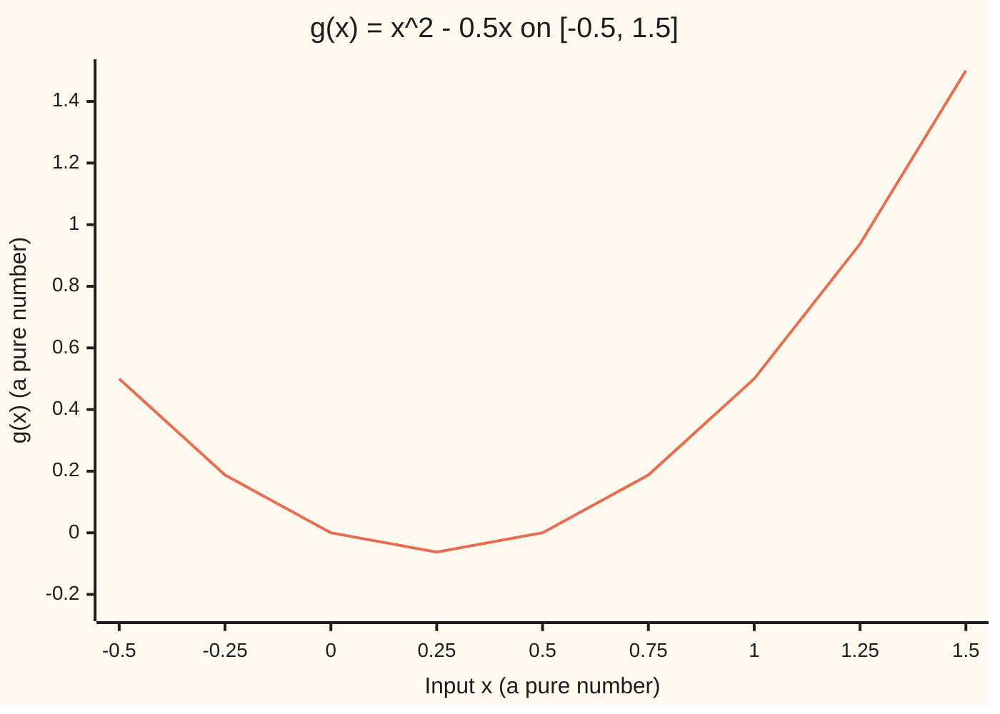

# Darboux's theorem: a derivative cannot jump, even when it is not continuous

[Syllabus](../../../SYLLABUS.md) → [Calculus and analysis](../README.md) → [What Derivatives Tell You](../README.md#s03) → Darboux's theorem

---

## General Overview

A ball rolls at 1 m/s into a wall and bounces back at 1 m/s. Taking away from the wall as positive, the simplest model flips its velocity from −1 to +1 m/s instantly, never reading a value between, such as 0.5 m/s or 0.

Darboux's theorem says no position has that velocity at every instant: a velocity is a derivative, and a derivative never skips a value. The model's position has a corner at the bounce, with no derivative. A real ball squashes, and its velocity passes through every value between.

Every derivative obeys this. For $`f(x) = x^2`$ on the stretch from −0.5 to 1.5, the slope is −1 at the left end and 3 at the right. Every value between, such as 0.5, is the slope at some inside point: here $`x`$ = 0.25.

The slope itself need not be continuous: the slope of $`x^2 \sin(1/x)`$ swings between about −1 and +1 forever as $`x`$ nears 0, yet skips no value. It never jumps: a **jump** is a break where left and right limits differ ([Continuity](../01-Limits%20and%20Continuity/05-continuity.md)).

**If a function has a derivative at every point of a closed stretch, that derivative takes every value between its two end values: it can wobble without limit, but never jump.**

**What kind of fact this is:** a theorem, proved on this card in Why it works, with its consequence: a function with a jump is never a derivative.

Gaston Darboux proved it in 1875. It is not the geometry theorem of the same name in [Symplectic form](../../23-Differential%20geometry%20and%20Lie%20groups/04-Differential%20Forms/10-symplectic-form-and-hamiltonian-flow.md).

### The picture: the tilted function has its lowest point inside



The line is $`x^2`$ minus a line of slope 0.5. It dips to −0.0625 at $`x`$ = 0.25, below both ends; its slope 0 there means $`x^2`$ has slope 0.5.

---

## The formula

At an end of $`[a, b]`$, the derivative is **one-sided**: the slope from inside the stretch.

If $`a \le b`$, $`f`$ has a derivative at every point of $`[a, b]`$, and the target $`y`$ lies strictly between $`f'(a)`$ and $`f'(b)`$, then

```math
f'(c) = y \quad \text{for some } c \text{ in } (a, b).
```

**Read it aloud:** every value between the two end slopes is the slope at some inside point.

This is the intermediate value property: no value between two outputs is skipped. [Intermediate value theorem](../01-Limits%20and%20Continuity/06-intermediate-value-theorem.md) proves it for continuous functions; here it holds for every derivative.

The proof uses the **tilted function**, $`f`$ minus a line of slope $`y`$:

```math
g(x) = f(x) - y\,x, \qquad g'(x) = f'(x) - y.
```

| Symbol | Plain meaning | In our example | Push it up and the answer… |
| --- | --- | --- | --- |
| $`f`$, $`f'`$, $`F`$ | function and its derivative; $`F`$, a supposed antiderivative | $`x^2`$ and $`2x`$ | — |
| $`x`$, $`n`$, $`\pi`$ | input; whole number in $`1/(n\pi)`$; pi | $`x`$ from −0.5 to 1.5; n = 20, 200, 2000 | — |
| $`a`$, $`b`$, $`p`$ | stretch ends; a break point | −0.5 and 1.5 | — |
| $`y`$ | target slope, strictly between $`f'(a)`$ and $`f'(b)`$ | 0.5 | $`c`$ moves right (here) |
| $`c`$ | inside point with $`f'(c) = y`$ | 0.25 | found, not chosen |
| $`g`$ | tilted function, $`f(x) - y\,x`$ | $`x^2 - 0.5x`$ | — |
| $`h`$, $`d`$ | difference-quotient step; a small margin | $`h`$ = 0.1, 0.01, 0.001 | — |
| $`\mathrm{sgn}`$, $`L`$, $`R`$ | sign function (−1, 0, +1); left and right slope limits | sgn takes −1, 0, 1 | — |

### When it holds

- **A derivative at every point, the inside included.** The distance from 0, $`\lvert x\rvert`$, has slope −1 left of 0 and +1 right of it, but a corner at 0 with no slope; its slopes skip 0.5.
- **One unbroken stretch.** On the two pieces −1 to −0.5 and 0.5 to 1, $`\lvert x\rvert`$ has a slope everywhere, yet the slope jumps from −1 to +1 across the gap.
- **A target strictly between.** For $`x^2`$ the end slope −1 occurs only at the end −0.5, not inside.

---

## Why it works

### Step 0: turn the target slope into a flat slope

At an inside lowest or highest point where a derivative exists, the slope is 0 ([Mean value theorem](02-mean-value-theorem.md), Step 0).

So tilt the function until the target slope becomes 0, find its lowest point, and show it is not at an end.

### Step 1: tilt

Set $`g(x) = f(x) - 0.5x`$. Then $`g'(x) = 2x - 0.5`$.

At the ends, $`g'(-0.5) = -1 - 0.5 = -1.5`$ and $`g'(1.5) = 3 - 0.5 = 2.5`$.

### Step 2: a lowest point exists

Differentiable implies continuous ([The derivative](../02-Derivatives/01-the-derivative.md)), so $`g`$ is continuous on $`[a, b]`$ and takes a lowest value there ([Extreme value theorem](../01-Limits%20and%20Continuity/07-extreme-value-theorem.md)).

### Step 3: the lowest point is not at an end

A negative slope at the left end means $`g`$ falls as it leaves $`a`$, so some inside point is lower: $`g(-0.4)`$ = 0.36, below $`g(-0.5)`$ = 0.5.

A positive slope at the right end means $`g`$ was lower just before $`b`$: $`g(1.4)`$ = 1.26, below $`g(1.5)`$ = 1.5. Neither end is lowest, so the lowest point lies strictly inside. When $`f'(a) > y > f'(b)`$, the highest point of $`g`$ lies inside instead.

<details>
<summary>Detailed proof: why a negative end slope puts a lower point just inside</summary>

The one-sided derivative $`g'(a) = -1.5`$ is the limit of $`(g(a + h) - g(a))/h`$ as $`h > 0`$ shrinks. For $`h`$ small enough, that quotient lies within 0.75 of −1.5, so it is negative and $`g(a + h) < g(a)`$. Thus $`a`$ is not lowest. At $`b`$, a negative step $`h < 0`$ with positive quotient likewise gives $`g(b + h) < g(b)`$.

</details>

### Step 4: inside, the slope is zero

At an inside lowest point $`c`$, Step 0 gives $`g'(c) = 0`$, so $`f'(c) = y`$.

For $`x^2`$: $`g`$ is lowest at $`c`$ = 0.25, with $`g(c)`$ = −0.0625 and $`f'(0.25) = 2 \times 0.25 = 0.5`$.

Here $`2x`$ is continuous, so the intermediate value theorem already applies; the proof never used continuity of $`f'`$, so it covers every derivative.

### Step 5: a function with a jump is never a derivative

Suppose some $`F`$ had $`F'(x) = \mathrm{sgn}(x)`$ everywhere on $`[-1, 1]`$. Then $`F'(-1) = -1`$ and $`F'(1) = 1`$, so Step 4 promises an inside point with $`F'(c) = 0.5`$, impossible for the sign function. No such $`F`$ exists; it would be the bouncing ball's position, timed from the bounce.

Any jump fails the same way, and so do a hole and an infinite break (see the fold): of the four breaks in [Continuity](../01-Limits%20and%20Continuity/05-continuity.md), a derivative can only oscillate, as in Step 6.

<details>
<summary>Detailed proof: no derivative has a jump</summary>

Suppose $`f'`$ heads for $`L`$ from the left of $`p`$ and $`R`$ from the right, with $`L < R`$ (the case $`L > R`$ is symmetric). Pick $`y`$ strictly between $`L`$ and $`R`$, not equal to $`f'(p)`$, at distance over $`d > 0`$ from both.

Pick $`a < p < b`$ close enough to $`p`$ that $`f'`$ stays within $`d`$ of $`L`$ on $`[a, p)`$ and within $`d`$ of $`R`$ on $`(p, b]`$. Then $`f'(a) < y < f'(b)`$, so Darboux's theorem gives $`c`$ in $`(a, b)`$ with $`f'(c) = y`$, contradicting all three cases ($`c < p`$, $`c = p`$, $`c > p`$).

For a hole ($`L = R \ne f'(p)`$) or an infinite one-sided limit, pick $`y`$ strictly between $`f'(p)`$ and every value of $`f'`$ in a one-sided window, say $`(p, b]`$. Darboux's theorem on $`[p, b]`$ gives $`c`$ in $`(p, b)`$ with $`f'(c) = y`$, a contradiction.

</details>

### Step 6: a derivative can still be discontinuous

Let $`f(x) = x^2 \sin(1/x)`$, with $`f(0) = 0`$. Away from 0, the product and chain rules give

```math
f'(x) = 2x \sin(1/x) - \cos(1/x).
```

At 0, the difference quotient $`(f(h) - f(0))/h = h \sin(1/h)`$ sits between $`-\lvert h\rvert`$ and $`\lvert h\rvert`$, so it heads for 0 ([Limit laws and the squeeze](../01-Limits%20and%20Continuity/04-limit-laws-and-the-squeeze.md)). At $`h`$ = 0.1, 0.01 and 0.001 it reads −0.054402, −0.005064 and 0.000827, so $`f'(0) = 0`$.

Near 0, $`f'`$ has no limit. At $`x = 1/(n\pi)`$ the sine is 0 and the cosine is $`\pm 1`$, so $`f'`$ alternates +1, −1, +1, −1 as $`n`$ grows: it exists everywhere but breaks at 0.

Darboux's theorem holds even across the break. On $`[0, 1/(20\pi)]`$ (0 to 0.015915494), the end slopes are 0 and −1. The intermediate value theorem fails because $`f'`$ breaks at 0, yet $`f(x) + 0.5x`$ peaks at 0.015662193, where $`f' = -0.5`$.

Between $`1/(21\pi)`$ = 0.015157614 and $`1/(20\pi)`$, the slope hits 0.5 at 0.015409468; closer to 0, at 0.001586270 and 0.000159102.

---

## Worked numbers, by hand

| Step | Arithmetic | Value |
| --- | --- | --- |
| end slopes of $`x^2`$ | $`2 \times (-0.5)`$ and $`2 \times 1.5`$ | −1 and 3 |
| target | between −1 and 3 | 0.5 |
| tilt | $`g(x) = x^2 - 0.5x`$ | — |
| $`g`$ at the ends | 0.25 + 0.25 and 2.25 − 0.75 | 0.5 and 1.5 |
| one step in | $`g(-0.4)`$ = 0.16 + 0.2, $`g(1.4)`$ = 1.96 − 0.7 | 0.36 and 1.26, both lower |
| lowest point | $`2c - 0.5 = 0`$ | $`c`$ = 0.25, $`g(c)`$ = −0.0625 |
| slope there | $`2 \times 0.25`$ | **0.5** |

The slope 0.5 appears exactly where the tilted function bottoms out.

### What breaks if you drop a piece

| Mistake | Comes out at | What went wrong |
| --- | --- | --- |
| Using the highest point of $`g`$ | $`x`$ = 1.5, slope 3, not 0.5 | it sits at an end, where the slope need not be 0 |
| Using the mean value theorem instead | slope 1, the average, at $`x`$ = 0.5 | it gives only the average slope |
| A corner: $`\lvert x\rvert`$ on $`[-1, 1]`$ | one-sided slopes −1 and +1 at 0; 0.5 never hit | no derivative at 0 |
| A jump: the sign function as a slope | takes only −1, 0, 1; 0.5 skipped | it is the slope of no function |

---

## Code, from first principles, and it actually runs

Three independent roads find the slope-0.5 point of $`x^2`$. Road 1 is the formula $`2c = 0.5`$. Road 2 is the proof: the lowest point of $`g`$, found by cutting the stretch in thirds (ternary search), with no slope. Road 3 halves a bracket (bisection) on its own difference-quotient slope. For $`x^2 \sin(1/x)`$, bisection and the tilted function's highest point agree in three swings and across the break at 0.

### Python

```python
# Darboux's theorem -- the check behind the card.  Standard library only.
# A derivative takes every value between two of its values.  Three examples:
# x^2 on [-0.5, 1.5] with target slope 0.5, found three ways; the sign
# function, which jumps and skips 0.5; and x^2 sin(1/x), whose derivative has
# no limit at 0 yet hits 0.5 between any two of its swings, found two ways.
import math
def bisect(fn, lo, hi):                     # halve a bracket where fn changes sign
    for _ in range(200):
        mid = (lo + hi) / 2
        lo, hi = (mid, hi) if (fn(lo) < 0) == (fn(mid) < 0) else (lo, mid)
    return (lo + hi) / 2
def extreme(fn, lo, hi, sign):              # sign 1 lowest point, -1 highest
    for _ in range(200):
        a, b = lo + (hi - lo) / 3, hi - (hi - lo) / 3
        lo, hi = (lo, b) if sign * fn(a) < sign * fn(b) else (a, hi)
    return (lo + hi) / 2
def slope(f, x, h=1e-5): return (f(x + h) - f(x - h)) / (2 * h)
f = lambda x: x * x
y = 0.5
g = lambda x: f(x) - y * x                  # the proof's tilted function
r1 = y / 2                                  # road 1: f'(c) = 2c = 0.5
r2 = extreme(g, -0.5, 1.5, 1)               # road 2: lowest point of g, no slope used
r3 = bisect(lambda x: slope(f, x) - y, -0.5, 1.5)  # road 3: own slope, then bisection
top = max([-0.5 + k / 1000 for k in range(2001)], key=g)
print(f"x^2 on [-0.5, 1.5]: f'(-0.5) = {slope(f, -0.5):.4f}, f'(1.5) = {slope(f, 1.5):.4f}, target {y}")
print(f"road 1, formula 2c = {y}: c = {r1:.6f}")
print(f"road 2, lowest point of g = x^2 - {y}x, no slope used: c = {r2:.6f}, g(c) = {g(r2):.4f}")
print(f"road 3, bisection on difference-quotient slope minus {y}: c = {r3:.6f}")
print(f"g' at the ends {slope(g, -0.5):+.4f} and {slope(g, 1.5):+.4f}; g at the ends {g(-0.5):.4f} and {g(1.5):.4f}; one step in, g(-0.4) = {g(-0.4):.4f} and g(1.4) = {g(1.4):.4f}")
print("chart, g at x = -0.5, -0.25, ..., 1.5:", [round(g(-0.5 + k / 4), 4) for k in range(9)])
sgn = lambda x: (x > 0) - (x < 0)
taken = sorted({sgn(-1 + k / 1000) for k in range(2001)})
print(f"|x|: one-sided slopes at 0, step 0.001: {(abs(-0.001) - 0) / -0.001:+.4f} and {(abs(0.001) - 0) / 0.001:+.4f}")
print(f"sign function on a 2001-point grid of [-1, 1] takes only {taken}; 0.5 is skipped")
w = lambda x: x * x * math.sin(1 / x) if x != 0 else 0.0
dw = lambda x: 2 * x * math.sin(1 / x) - math.cos(1 / x)
q = [w(h) / h for h in (0.1, 0.01, 0.001)]
print("x^2 sin(1/x): (f(h) - f(0))/h at h = 0.1, 0.01, 0.001:", ", ".join(f"{v:.6f}" for v in q))
print("f' at x = 1/(n pi), n = 1 to 8:", ", ".join(f"{dw(1 / (n * math.pi)):+.4f}" for n in range(1, 9)))
pairs = []
for n in (20, 200, 2000):
    a, b = 1 / ((n + 1) * math.pi), 1 / (n * math.pi)   # f' = +1 at a, -1 at b
    cb = bisect(lambda x: dw(x) - y, a, b)
    ce = extreme(lambda x: w(x) - y * x, a, b, -1)      # proof road: highest point
    pairs.append((cb, ce))
    print(f"n = {n}: between {a:.9f} and {b:.9f}, f' = {y} at {cb:.9f} (bisection), {ce:.9f} (highest point)")
b0, s = 1 / (20 * math.pi), 1 / (20 * math.pi) / 10**5   # f'(0) = 0, f'(b0) = -1, f' breaks at 0
ct = max([s * k for k in range(10**5 + 1)], key=lambda x: w(x) + 0.5 * x)  # grid: highest point of f + 0.5x
c0, ce0 = bisect(lambda x: dw(x) + 0.5, ct - s, ct + s), extreme(lambda x: w(x) + 0.5 * x, ct - s, ct + s, -1)
print(f"whole stretch [0, {b0:.9f}]: f' = {dw(b0):+.4f} at the end, f' = -0.5 at {c0:.9f} (bisection), {ce0:.9f} (highest point)")
print(f"mistake 1, highest point of g: x = {top:.4f}, where f' = {slope(f, top):.4f}, not {y}")
print(f"mistake 2, mean value theorem: average slope {(f(1.5) - f(-0.5)) / 2:.4f}, at x = {(f(1.5) - f(-0.5)) / 4:.4f}")
assert abs(r1 - r2) < 1e-6 and abs(r1 - r3) < 1e-6           # three roads, one point
assert all(abs(cb - ce) < 1e-6 * cb for cb, ce in pairs)      # formula vs proof road
assert all(abs(dw(cb) - y) < 1e-9 for cb, _ in pairs)          # it really hits 0.5
assert taken == [-1, 0, 1] and abs(q[2]) < 0.001 and abs(top - 1.5) < 1e-9
assert 0 < ct < b0 and abs(dw(c0) + 0.5) < 1e-9 and abs(c0 - ce0) < 1e-6 * c0  # Darboux on [0, b0]
print("ALL CHECKS PASS")
```

**Ran 2026-11-23 on macOS, Python 3.14.10, standard library only. All checks passed. Output, pasted from the run:**

```
x^2 on [-0.5, 1.5]: f'(-0.5) = -1.0000, f'(1.5) = 3.0000, target 0.5
road 1, formula 2c = 0.5: c = 0.250000
road 2, lowest point of g = x^2 - 0.5x, no slope used: c = 0.250000, g(c) = -0.0625
road 3, bisection on difference-quotient slope minus 0.5: c = 0.250000
g' at the ends -1.5000 and +2.5000; g at the ends 0.5000 and 1.5000; one step in, g(-0.4) = 0.3600 and g(1.4) = 1.2600
chart, g at x = -0.5, -0.25, ..., 1.5: [0.5, 0.1875, 0.0, -0.0625, 0.0, 0.1875, 0.5, 0.9375, 1.5]
|x|: one-sided slopes at 0, step 0.001: -1.0000 and +1.0000
sign function on a 2001-point grid of [-1, 1] takes only [-1, 0, 1]; 0.5 is skipped
x^2 sin(1/x): (f(h) - f(0))/h at h = 0.1, 0.01, 0.001: -0.054402, -0.005064, 0.000827
f' at x = 1/(n pi), n = 1 to 8: +1.0000, -1.0000, +1.0000, -1.0000, +1.0000, -1.0000, +1.0000, -1.0000
n = 20: between 0.015157614 and 0.015915494, f' = 0.5 at 0.015409468 (bisection), 0.015409468 (highest point)
n = 200: between 0.001583631 and 0.001591549, f' = 0.5 at 0.001586270 (bisection), 0.001586270 (highest point)
n = 2000: between 0.000159075 and 0.000159155, f' = 0.5 at 0.000159102 (bisection), 0.000159102 (highest point)
whole stretch [0, 0.015915494]: f' = -1.0000 at the end, f' = -0.5 at 0.015662193 (bisection), 0.015662193 (highest point)
mistake 1, highest point of g: x = 1.5000, where f' = 3.0000, not 0.5
mistake 2, mean value theorem: average slope 1.0000, at x = 0.5000
ALL CHECKS PASS
```

### Rust

Same output, built with `rustc --edition 2021 -O`.

```rust
// Darboux's theorem -- the same check as the Python, in Rust, std only.
// A derivative takes every value between two of its values.  Three examples:
// x^2 on [-0.5, 1.5] with target slope 0.5, found three ways; the sign
// function, which jumps and skips 0.5; and x^2 sin(1/x), whose derivative has
// no limit at 0 yet hits 0.5 between any two of its swings, found two ways.
use std::f64::consts::PI;
fn bisect(f: &dyn Fn(f64) -> f64, mut lo: f64, mut hi: f64) -> f64 {
    for _ in 0..200 {
        let mid = (lo + hi) / 2.0;
        if (f(lo) < 0.0) == (f(mid) < 0.0) { lo = mid } else { hi = mid }
    }
    (lo + hi) / 2.0
}
fn extreme(f: &dyn Fn(f64) -> f64, mut lo: f64, mut hi: f64, sign: f64) -> f64 {
    for _ in 0..200 {
        let (a, b) = (lo + (hi - lo) / 3.0, hi - (hi - lo) / 3.0);
        if sign * f(a) < sign * f(b) { hi = b } else { lo = a }
    }
    (lo + hi) / 2.0
}
fn slope(f: &dyn Fn(f64) -> f64, x: f64) -> f64 { (f(x + 1e-5) - f(x - 1e-5)) / 2e-5 }
fn main() {
    let f = |x: f64| x * x;
    let y = 0.5;
    let g = |x: f64| f(x) - y * x; // the proof's tilted function
    let r1 = y / 2.0; // road 1: f'(c) = 2c = 0.5
    let r2 = extreme(&g, -0.5, 1.5, 1.0); // road 2: lowest point of g, no slope used
    let r3 = bisect(&|x| slope(&f, x) - y, -0.5, 1.5); // road 3: own slope, then bisection
    let mut top = -0.5;
    for k in 0..2001 { let x = -0.5 + k as f64 / 1000.0; if g(x) > g(top) { top = x } }
    println!("x^2 on [-0.5, 1.5]: f'(-0.5) = {:.4}, f'(1.5) = {:.4}, target {}", slope(&f, -0.5), slope(&f, 1.5), y);
    println!("road 1, formula 2c = {}: c = {:.6}", y, r1);
    println!("road 2, lowest point of g = x^2 - {}x, no slope used: c = {:.6}, g(c) = {:.4}", y, r2, g(r2));
    println!("road 3, bisection on difference-quotient slope minus {}: c = {:.6}", y, r3);
    println!("g' at the ends {:+.4} and {:+.4}; g at the ends {:.4} and {:.4}; one step in, g(-0.4) = {:.4} and g(1.4) = {:.4}", slope(&g, -0.5), slope(&g, 1.5), g(-0.5), g(1.5), g(-0.4), g(1.4));
    let chart: Vec<f64> = (0..9).map(|k| (g(-0.5 + k as f64 / 4.0) * 1e4).round() / 1e4).collect();
    println!("chart, g at x = -0.5, -0.25, ..., 1.5: {:?}", chart);
    let sgn = |x: f64| (x > 0.0) as i32 - (x < 0.0) as i32;
    let mut taken: Vec<i32> = Vec::new();
    for k in 0..2001 { let v = sgn(-1.0 + k as f64 / 1000.0); if !taken.contains(&v) { taken.push(v) } }
    taken.sort();
    println!("|x|: one-sided slopes at 0, step 0.001: {:+.4} and {:+.4}", (f64::abs(-0.001) - 0.0) / -0.001, (f64::abs(0.001) - 0.0) / 0.001);
    println!("sign function on a 2001-point grid of [-1, 1] takes only {:?}; 0.5 is skipped", taken);
    let w = |x: f64| if x != 0.0 { x * x * (1.0 / x).sin() } else { 0.0 };
    let dw = |x: f64| 2.0 * x * (1.0 / x).sin() - (1.0 / x).cos();
    let q: Vec<f64> = [0.1, 0.01, 0.001].iter().map(|&h| w(h) / h).collect();
    let qs: Vec<String> = q.iter().map(|v| format!("{:.6}", v)).collect();
    println!("x^2 sin(1/x): (f(h) - f(0))/h at h = 0.1, 0.01, 0.001: {}", qs.join(", "));
    let ds: Vec<String> = (1..9).map(|n| format!("{:+.4}", dw(1.0 / (n as f64 * PI)))).collect();
    println!("f' at x = 1/(n pi), n = 1 to 8: {}", ds.join(", "));
    let mut pairs: Vec<(f64, f64)> = Vec::new();
    for n in [20.0, 200.0, 2000.0] {
        let (a, b) = (1.0 / ((n + 1.0) * PI), 1.0 / (n * PI)); // f' = +1 at a, -1 at b
        let cb = bisect(&|x| dw(x) - y, a, b);
        let ce = extreme(&|x| w(x) - y * x, a, b, -1.0); // proof road: highest point
        pairs.push((cb, ce));
        println!("n = {}: between {:.9} and {:.9}, f' = {} at {:.9} (bisection), {:.9} (highest point)", n, a, b, y, cb, ce);
    }
    let (b0, s) = (1.0 / (20.0 * PI), 1.0 / (20.0 * PI) / 1e5); // f'(0) = 0, f'(b0) = -1, f' breaks at 0
    let mut ct = 0.0;
    for k in 0..100001 { let x = s * k as f64; if w(x) + 0.5 * x > w(ct) + 0.5 * ct { ct = x } } // grid: highest point of f + 0.5x
    let c0 = bisect(&|x| dw(x) + 0.5, ct - s, ct + s);
    let ce0 = extreme(&|x| w(x) + 0.5 * x, ct - s, ct + s, -1.0);
    println!("whole stretch [0, {:.9}]: f' = {:+.4} at the end, f' = -0.5 at {:.9} (bisection), {:.9} (highest point)", b0, dw(b0), c0, ce0);
    println!("mistake 1, highest point of g: x = {:.4}, where f' = {:.4}, not {}", top, slope(&f, top), y);
    println!("mistake 2, mean value theorem: average slope {:.4}, at x = {:.4}", (f(1.5) - f(-0.5)) / 2.0, (f(1.5) - f(-0.5)) / 4.0);
    assert!((r1 - r2).abs() < 1e-6 && (r1 - r3).abs() < 1e-6); // three roads, one point
    assert!(pairs.iter().all(|&(cb, ce)| (cb - ce).abs() < 1e-6 * cb)); // formula vs proof road
    assert!(pairs.iter().all(|&(cb, _)| (dw(cb) - y).abs() < 1e-9)); // it really hits 0.5
    assert!(taken == vec![-1, 0, 1] && q[2].abs() < 0.001 && (top - 1.5).abs() < 1e-9);
    assert!(0.0 < ct && ct < b0 && (dw(c0) + 0.5).abs() < 1e-9 && (c0 - ce0).abs() < 1e-6 * c0); // Darboux on [0, b0]
    println!("ALL CHECKS PASS");
}
```

**Ran 2026-11-23 on macOS, rustc 1.98.1, no crates. All checks passed. Output, pasted from the run:**

```
x^2 on [-0.5, 1.5]: f'(-0.5) = -1.0000, f'(1.5) = 3.0000, target 0.5
road 1, formula 2c = 0.5: c = 0.250000
road 2, lowest point of g = x^2 - 0.5x, no slope used: c = 0.250000, g(c) = -0.0625
road 3, bisection on difference-quotient slope minus 0.5: c = 0.250000
g' at the ends -1.5000 and +2.5000; g at the ends 0.5000 and 1.5000; one step in, g(-0.4) = 0.3600 and g(1.4) = 1.2600
chart, g at x = -0.5, -0.25, ..., 1.5: [0.5, 0.1875, 0.0, -0.0625, 0.0, 0.1875, 0.5, 0.9375, 1.5]
|x|: one-sided slopes at 0, step 0.001: -1.0000 and +1.0000
sign function on a 2001-point grid of [-1, 1] takes only [-1, 0, 1]; 0.5 is skipped
x^2 sin(1/x): (f(h) - f(0))/h at h = 0.1, 0.01, 0.001: -0.054402, -0.005064, 0.000827
f' at x = 1/(n pi), n = 1 to 8: +1.0000, -1.0000, +1.0000, -1.0000, +1.0000, -1.0000, +1.0000, -1.0000
n = 20: between 0.015157614 and 0.015915494, f' = 0.5 at 0.015409468 (bisection), 0.015409468 (highest point)
n = 200: between 0.001583631 and 0.001591549, f' = 0.5 at 0.001586270 (bisection), 0.001586270 (highest point)
n = 2000: between 0.000159075 and 0.000159155, f' = 0.5 at 0.000159102 (bisection), 0.000159102 (highest point)
whole stretch [0, 0.015915494]: f' = -1.0000 at the end, f' = -0.5 at 0.015662193 (bisection), 0.015662193 (highest point)
mistake 1, highest point of g: x = 1.5000, where f' = 3.0000, not 0.5
mistake 2, mean value theorem: average slope 1.0000, at x = 0.5000
ALL CHECKS PASS
```

### Lean

Lean proves the theorem and that no derivative has a jump or a hole, for every function that meets the conditions.

- Suppose $`a \le b`$ and $`f`$ has a derivative at every point of $`[a, b]`$, one-sided at the ends. Then every $`y`$ strictly between $`f'(a)`$ and $`f'(b)`$ equals $`f'(c)`$ for some $`c`$ in $`(a, b)`$.
- Suppose $`f`$ has a derivative at every point near $`p`$, and $`f'`$ heads for $`L`$ from the left and $`R`$ from the right. Then $`L = f'(p)`$ and $`R = f'(p)`$, so a derivative has no jump and no hole.
- Take $`f(x) = x^2 \sin(1/x)`$, with $`f(0) = 0`$. Then $`f`$ has a derivative at every point, $`f'(0) = 0`$, and $`f'`$ is not continuous at 0.
- The hand arithmetic for $`x^2`$: end slopes −1 and 3, and the values of $`g`$ at the ends and one step in.
- The lowest point of $`g`$ at 0.25, where the slope is 0.5, and the mean value theorem's average slope 1.

The decimals, the slope swings near 0, the sign function's grid, bisection and ternary search are left to the Python and Rust checks.

```lean
-- Darboux's theorem: every derivative on a closed interval takes each value strictly between its two end values at some inside point, so no derivative has a jump.
import Mathlib.Analysis.Calculus.Darboux
import Mathlib.Analysis.SpecialFunctions.Trigonometric.Deriv
import Mathlib.Analysis.SpecialFunctions.Trigonometric.Basic
import Mathlib.Analysis.Calculus.FDeriv.Extend
import Mathlib.Analysis.Asymptotics.Lemmas
import Mathlib.Tactic.NormNum

open Set Filter Topology

/-- Helper: away from `0`, the derivative of `t ↦ t² sin(1/t)` is `2x sin(1/x) - cos(1/x)`. -/
theorem xsq_hasDerivAt_ne {x : ℝ} (hx : x ≠ 0) :
    HasDerivAt (fun t : ℝ => t ^ 2 * Real.sin t⁻¹) (2 * x * Real.sin x⁻¹ - Real.cos x⁻¹) x := by
  have h : HasDerivAt (fun t : ℝ => t ^ 2 * Real.sin t⁻¹) _ x :=
    (hasDerivAt_pow 2 x).mul ((Real.hasDerivAt_sin _).comp x (hasDerivAt_inv hx))
  convert h using 1
  field_simp
  ring

/-- Helper: at `0`, the derivative of `t ↦ t² sin(1/t)` is `0`, since `|t² sin(1/t)| ≤ t²`. -/
theorem xsq_hasDerivAt_zero :
    HasDerivAt (fun t : ℝ => t ^ 2 * Real.sin t⁻¹) 0 0 := by
  rw [hasDerivAt_iff_isLittleO_nhds_zero]
  simp only [zero_add, ne_eq, OfNat.ofNat_ne_zero, not_false_eq_true, zero_pow, inv_zero,
    Real.sin_zero, mul_zero, sub_zero, smul_zero]
  refine Asymptotics.IsBigO.trans_isLittleO ?_ (Asymptotics.isLittleO_pow_id (n := 2) one_lt_two)
  refine Asymptotics.IsBigO.of_bound 1 (Eventually.of_forall fun h => ?_)
  rw [norm_mul, one_mul]
  exact mul_le_of_le_one_right (norm_nonneg _) (by simpa using Real.abs_sin_le_one h⁻¹)

#print axioms xsq_hasDerivAt_ne
#print axioms xsq_hasDerivAt_zero

/-- **Darboux's theorem.** If `f` has a derivative `f' x` at every point `x` of the closed
interval `[a, b]` (one-sided at the two ends, taken from inside the interval), and the target
`y` lies strictly between `f' a` and `f' b` (in either order), then `f' c = y` for some point
`c` strictly inside `(a, b)`. -/
theorem derivative_takes_every_value_between_end_slopes {f f' : ℝ → ℝ} {a b y : ℝ}
    (hab : a ≤ b) (hf : ∀ x ∈ Icc a b, HasDerivWithinAt f (f' x) (Icc a b) x)
    (hy : (f' a < y ∧ y < f' b) ∨ (f' b < y ∧ y < f' a)) :
    ∃ c ∈ Ioo a b, f' c = y := by
  rcases hy with ⟨h1, h2⟩ | ⟨h1, h2⟩
  · exact exists_hasDerivWithinAt_eq_of_gt_of_lt hab hf h1 h2
  · exact exists_hasDerivWithinAt_eq_of_lt_of_gt hab hf h2 h1

/-- **No derivative has a jump (or a hole).** If `f` has derivative `f' x` at every point of an
open interval around `p`, and `f'` heads for `L` from the left of `p` and for `R` from the right,
then both limits equal `f' p`. In particular `L = R`: a derivative cannot jump. -/
theorem derivative_has_no_jump {f f' : ℝ → ℝ} {u v p L R : ℝ} (hp : p ∈ Ioo u v)
    (hf : ∀ x ∈ Ioo u v, HasDerivAt f (f' x) x)
    (hL : Tendsto f' (𝓝[<] p) (𝓝 L)) (hR : Tendsto f' (𝓝[>] p) (𝓝 R)) :
    L = f' p ∧ R = f' p := by
  have hcont : ContinuousAt f p := (hf p hp).continuousAt
  have hnhds : Ioo u v ∈ 𝓝 p := isOpen_Ioo.mem_nhds hp
  have hdiff : DifferentiableOn ℝ f (Ioo u v) := fun x hx =>
    (hf x hx).differentiableAt.differentiableWithinAt
  have hderiv : f' =ᶠ[𝓝 p] deriv f :=
    eventually_of_mem hnhds (fun x hx => (hf x hx).deriv.symm)
  constructor
  · have A : HasDerivWithinAt f L (Iic p) p :=
      hasDerivWithinAt_Iic_of_tendsto_deriv hdiff hcont.continuousWithinAt
        (mem_nhdsWithin_of_mem_nhds hnhds) (hL.congr' (hderiv.filter_mono nhdsWithin_le_nhds))
    exact UniqueDiffWithinAt.eq_deriv _ (uniqueDiffWithinAt_Iic p) A (hf p hp).hasDerivWithinAt
  · have A : HasDerivWithinAt f R (Ici p) p :=
      hasDerivWithinAt_Ici_of_tendsto_deriv hdiff hcont.continuousWithinAt
        (mem_nhdsWithin_of_mem_nhds hnhds) (hR.congr' (hderiv.filter_mono nhdsWithin_le_nhds))
    exact UniqueDiffWithinAt.eq_deriv _ (uniqueDiffWithinAt_Ici p) A (hf p hp).hasDerivWithinAt

/-- **A derivative can still be discontinuous.** For `f(x) = x² sin(1/x)` with `f(0) = 0`
(in Lean, `0⁻¹ = 0`, so the formula gives `f 0 = 0` by itself), `f` has a derivative at every
real number, the derivative at `0` is `0`, and the derivative is not continuous at `0`. -/
theorem x_sq_sin_inv_deriv_exists_but_discontinuous :
    (∀ x : ℝ, DifferentiableAt ℝ (fun t : ℝ => t ^ 2 * Real.sin t⁻¹) x) ∧
      deriv (fun t : ℝ => t ^ 2 * Real.sin t⁻¹) 0 = 0 ∧
      ¬ ContinuousAt (deriv (fun t : ℝ => t ^ 2 * Real.sin t⁻¹)) 0 := by
  refine ⟨fun x => ?_, xsq_hasDerivAt_zero.deriv, fun hc => ?_⟩
  · rcases eq_or_ne x 0 with rfl | hx
    · exact xsq_hasDerivAt_zero.differentiableAt
    · exact (xsq_hasDerivAt_ne hx).differentiableAt
  · set s : ℕ → ℝ := fun n => ((n : ℝ) * (2 * Real.pi))⁻¹ with hs
    have hs0 : Tendsto s atTop (𝓝 0) :=
      tendsto_inv_atTop_zero.comp
        (Tendsto.atTop_mul_const (by positivity) tendsto_natCast_atTop_atTop)
    have h1 := hc.tendsto.comp hs0
    rw [xsq_hasDerivAt_zero.deriv] at h1
    have h2 : (deriv (fun t : ℝ => t ^ 2 * Real.sin t⁻¹) ∘ s) =ᶠ[atTop] fun _ => (-1 : ℝ) := by
      filter_upwards [eventually_ge_atTop 1] with n hn
      have hn' : ((n : ℝ) * (2 * Real.pi)) ≠ 0 := by
        have : (1 : ℝ) ≤ n := by exact_mod_cast hn
        positivity
      have hsn : s n ≠ 0 := inv_ne_zero hn'
      have hsin : Real.sin ((n : ℝ) * (2 * Real.pi)) = 0 := by
        have := Real.sin_nat_mul_pi (2 * n)
        push_cast at this
        rwa [show (n : ℝ) * (2 * Real.pi) = 2 * n * Real.pi by ring]
      simp only [Function.comp_apply]
      rw [(xsq_hasDerivAt_ne hsn).deriv, hs]
      simp only [inv_inv, Real.cos_nat_mul_two_pi, hsin]
      ring
    have h3 := tendsto_nhds_unique (h1.congr' h2) tendsto_const_nhds
    norm_num at h3

-- The card's worked numbers for f(x) = x², f'(x) = 2x on [-1/2, 3/2], target slope 1/2.
-- End slopes: f'(-1/2) = -1 and f'(3/2) = 3.
example : (2 : ℚ) * (-1 / 2) = -1 ∧ (2 : ℚ) * (3 / 2) = 3 := by norm_num
-- The tilted function g(x) = x² - x/2 at the ends: g(-1/2) = 1/2 and g(3/2) = 3/2.
example : (-1 / 2 : ℚ) ^ 2 - (1 / 2) * (-1 / 2) = 1 / 2 ∧
    (3 / 2 : ℚ) ^ 2 - (1 / 2) * (3 / 2) = 3 / 2 := by norm_num
-- One step in, g is lower: g(-2/5) = 9/25 < 1/2 and g(7/5) = 63/50 < 3/2.
example : (-2 / 5 : ℚ) ^ 2 - (1 / 2) * (-2 / 5) = 9 / 25 ∧ (9 / 25 : ℚ) < 1 / 2 ∧
    (7 / 5 : ℚ) ^ 2 - (1 / 2) * (7 / 5) = 63 / 50 ∧ (63 / 50 : ℚ) < 3 / 2 := by norm_num
-- Lowest point c = 1/4: g(c) = -1/16 and f'(c) = 2c = 1/2, the target.
example : (1 / 4 : ℚ) ^ 2 - (1 / 2) * (1 / 4) = -1 / 16 ∧ (2 : ℚ) * (1 / 4) = 1 / 2 := by
  norm_num
-- Mistake 2: the mean value theorem's average slope is (f(3/2) - f(-1/2)) / 2 = 1, not 1/2.
example : ((3 / 2 : ℚ) ^ 2 - (-1 / 2) ^ 2) / 2 = 1 := by norm_num

#print axioms derivative_takes_every_value_between_end_slopes
#print axioms derivative_has_no_jump
#print axioms x_sq_sin_inv_deriv_exists_but_discontinuous
```

**Checked 2026-11-23 on macOS, Lean 4.36.0-rc2, Mathlib v4.36.0-rc2. Every proof is complete and uses only Lean's standard axioms. Output, pasted from the run:**

```
'xsq_hasDerivAt_ne' depends on axioms: [propext, Classical.choice, Quot.sound]
'xsq_hasDerivAt_zero' depends on axioms: [propext, Classical.choice, Quot.sound]
'derivative_takes_every_value_between_end_slopes' depends on axioms: [propext, Classical.choice, Quot.sound]
'derivative_has_no_jump' depends on axioms: [propext, Classical.choice, Quot.sound]
'x_sq_sin_inv_deriv_exists_but_discontinuous' depends on axioms: [propext, Classical.choice, Quot.sound]
```

> [!TIP]
> **Try changing**
> - **Guess first:** set `y = 2.5`, still between −1 and 3. All three roads give $`c`$ = 1.25, while the slope of $`x^2 \sin(1/x)`$ stays near $`[-1, 1]`$, so the second assert fails.
> - **Guess first:** set `y = 4`, above both end slopes. Road 1 gives 2 (outside the stretch); roads 2 and 3 return the end 1.5, where the slope is 3, and the first assert fails.
> - **Guess first:** change `(20, 200, 2000)` to `(20, 200, 2000, 20000)`. The slope still hits 0.5 and every assert passes, but at nine decimals all four printed numbers read 0.000015915: swings near 0 are very narrow.

---

## The usual mistake

> [!warning]
> **Reading "no value skipped" as "continuous".** The slope of $`x^2 \sin(1/x)`$ skips no value, yet it reads +1 and −1 alternately however close to 0, while $`f'(0) = 0`$. Darboux's theorem forbids jumps, not wild swings.
>
> - **Using the highest point of $`g`$.** It is the end 1.5, with slope 3, not 0.5.
> - **Using the mean value theorem.** It gives only the average slope, 1, at $`x`$ = 0.5.
> - **Forgetting the corner.** $`\lvert x\rvert`$ has slopes −1 and +1 but none at 0, so 0.5 is never a slope.

---

## Where you meet it in real life

- **Bounces and collisions.** By Step 5, the overview's instant velocity flip belongs to a position with a corner at the bounce.
- **Marginal tax rates.** The rate on the next dollar jumps at each bracket edge, so by Step 5 it is the derivative of total tax only between edges; at an edge, total tax has a corner.
- **The sign test in optimisation.** A derivative that is never 0 on a stretch keeps one sign, since a sign change would force a 0, even if it is not continuous. So the function only rises or only falls ([Optimisation](03-monotonicity-and-optimisation.md)).

> **Say it back**
> If a function has a derivative at every point of a closed stretch, the derivative takes every value between its end values. The proof tilts the function by the target slope; its lowest or highest point is inside, where the tilted slope is 0. For $`x^2`$ on −0.5 to 1.5, slope 0.5 appears at 0.25. So the sign function, which jumps, is never a derivative. A derivative can still be discontinuous, like the slope of $`x^2 \sin(1/x)`$ at 0.

---

## What this builds on

- [Mean value theorem](02-mean-value-theorem.md): an inside lowest point has slope 0; this card's proof copies its tilt.
- [Extreme value theorem](../01-Limits%20and%20Continuity/07-extreme-value-theorem.md): the tilted function reaches a lowest value.
- [Intermediate value theorem](../01-Limits%20and%20Continuity/06-intermediate-value-theorem.md): the same no-skip property, for continuous functions.
- [Limit laws and the squeeze](../01-Limits%20and%20Continuity/04-limit-laws-and-the-squeeze.md): the squeeze behind $`f'(0) = 0`$ in Step 6.

## Where this goes next

- [The integral](../04-Integrals/01-riemann-integral.md): the next shelf, building area as a limit of thin rectangles even when a function jumps.
- [Fundamental theorem of calculus](../04-Integrals/02-fundamental-theorem-of-calculus.md): integrating a function with a jump gives a function with a corner, not one whose derivative is the jump.

This card says a function with a jump cannot be a derivative; the next shelf, starting with [The integral](../04-Integrals/01-riemann-integral.md), asks whether you can still integrate a function that jumps.

---

## Sources

Verified 2026-11-23: every link below resolves to the publisher's page.

- Darboux, Gaston. "Mémoire sur les fonctions discontinues." *Annales scientifiques de l'École normale supérieure*, 2nd series, 4 (1875), 57–112. [doi:10.24033/asens.122](https://doi.org/10.24033/asens.122). The original memoir, where the result first appears.
- Abbott, Stephen. *Understanding Analysis*, 2nd ed. Springer, 2015. [Chapter 5, The Derivative](https://doi.org/10.1007/978-1-4939-2712-8_5). Section 5.2 proves Darboux's theorem from the interior extremum step and studies $`x^2 \sin(1/x)`$-type functions.
- O'Connor, J. J., and E. F. Robertson. "Gaston Darboux." MacTutor Archive, University of St Andrews. [Biography](https://mathshistory.st-andrews.ac.uk/Biographies/Darboux/). His life and his 1875 work in analysis.
