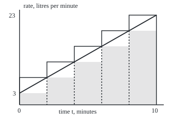
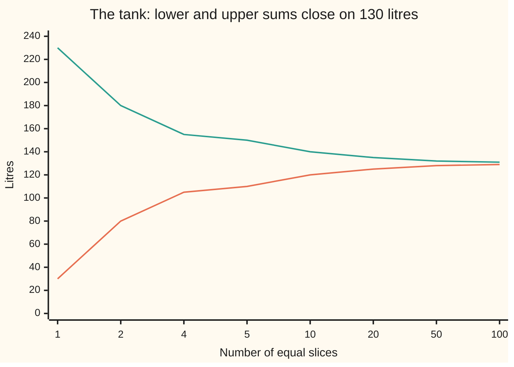

# The integral: area as a limit of thin rectangles

[Syllabus](../../../SYLLABUS.md) → [Calculus and analysis](../README.md) → [Integrals](../README.md#s04) → The integral

---

## General Overview

An empty tank is filled for 10 minutes by a pump that speeds up steadily: at minute t it delivers 3 + 2t litres per minute, so 3 at the start and 23 at the end. How much water is in the tank?

At a fixed rate the answer is rate times time. This rate never holds still, so cut the 10 minutes into thin slices. In each slice, lowest rate times width is too little and highest rate times width too much. With 5 slices the tank holds between 110 and 150 litres; with 100 slices, between 129 and 131. The bracket closes on one number: 130 litres.

Drawn against time, each slice is a thin rectangle and the water is the area under the rate line.

**The integral is the one number above every lower total and below every upper total, when finer slicing can close the gap between them.**

**What kind of fact this is:** a definition; that continuous and monotone rates always close the gap are theorems, proved on this card in Why it works.

### The picture: five slices under the rate line

<p align="center"></p>

To scale: 28 px per minute across, 8 px per litre per minute up. Shaded rectangles use each slice's lowest rate (110 litres in all); the outlined steps use the highest (150 litres). The 130 litres under the line sit between.

---

## The formula

Notation first, in words. The **integral sign** is a stretched S, for "sum", with the start a below and the end b above. After it comes what is added; the closing dt names the variable sliced, here time.

Write $f(t)$ for the rate at time t. Cut the interval from a to b at points $a = t_0 < t_1 < \dots < t_n = b$. That list of cuts is a **partition**, named $P$. Slice k runs from $t_{k-1}$ to $t_k$ and has width $\Delta t_k = t_k - t_{k-1}$. On it, $m_k$ is the rate's **infimum** $\inf$ (the greatest number it never drops below) and $M_k$ its supremum $\sup$ (the least number it never rises above). For a rising rate these are the rates at the slice's two ends.

$$L(P) = \sum_{k=1}^{n} m_k\,\Delta t_k \qquad U(P) = \sum_{k=1}^{n} M_k\,\Delta t_k$$

**Read it aloud:** the lower sum adds each slice's lowest rate times its width; the upper sum uses the highest rate.

The rate is **integrable** when exactly one number lies between every lower sum and every upper sum. That number is the integral:

$$\int_a^b f(t)\,dt = \sup_P L(P) = \inf_P U(P)$$

**Read it aloud:** the integral of f from a to b is the best lower sum, which equals the best upper sum.

| Symbol | Plain meaning | In our example | Push it up and the answer… |
| --- | --- | --- | --- |
| $f$ | the rate being added up | 3 + 2t litres per minute | more water |
| $t$, $a$, $b$ | time, and the start and end of the interval | minutes 0 and 10 | a later end adds water |
| $n$, $k$ | number of slices, and a slice's counter | 5 slices, k = 1 to 5 | the bracket narrows |
| $P$, $t_k$ | the partition, and its k-th cut | cuts 0, 2, 4, 6, 8, 10 | more cuts never loosen it |
| $\Delta t_k$ | width of slice k | 2 minutes | wider slices, looser bracket |
| $m_k$, $M_k$, $\inf$, $\sup$ | lowest and highest rate on slice k | 3 and 7 on the first slice | — |
| $L$, $U$ | lower and upper sums | 110 and 150 litres | — |
| $\int_a^b f(t)\,dt$ | the integral | 130 litres | — |

Units multiply: litres per minute times minutes gives litres.

### When it holds

- **A bounded rate.** A rate like 1/t grows without limit near t = 0, so a slice starting there has no highest rate and no upper sum; [Improper integrals](07-improper-integrals.md) adds a second limit.
- **A closed, finite interval.** An endless interval needs the same second limit.
- **Continuous or monotone is enough.** Continuous means the rate has no jumps or holes ([Continuity](../01-Limits%20and%20Continuity/05-continuity.md)). Monotone means only rising or only falling, jumps allowed. A rate with neither can fail: the fraction rule in What breaks.
- **Signs count.** A negative rate (the tank draining) subtracts, so the integral is a signed area.

---

## Why it works

### Step 0: a lower total can never pass an upper total

Every lower sum is at most every upper sum, even from different slicings. So the lower sums have a ceiling, and completeness (the real numbers have no gaps, [No gaps](../01-Limits%20and%20Continuity/02-supremum-and-completeness.md)) supplies a best lower sum and a best upper sum.

### Step 1: an extra cut tightens the bracket

Cut the 10 minutes at 5 only: lower sum 80 litres, upper 180. Add a cut at 2: the lower sum rises to 92, the upper falls to 168. A piece of a slice has a lowest rate no lower, and a highest no higher, than the whole slice.

For two slicings P and Q, take their **common refinement**, which uses both sets of cuts. The lower sum of P is at most the refinement's lower sum, which is at most its upper sum, which is at most the upper sum of Q. Step 0 is proved.

### Step 2: the gap test

If every tolerance has a slicing whose upper minus lower is smaller, the best lower and best upper sums sit closer than every tolerance, so they are equal. For the tank, a gap of at most 1 litre first appears at 200 equal slices, each 0.05 minutes wide; 0.01 litres needs 20000.

### Step 3: monotone rates pass the test

Cut a rising rate into n equal slices. Upper minus lower is, slice by slice, right-end rate minus left-end rate, times the width. Each slice's right end is the next one's left end, so the differences cancel in a chain and leave f(b) − f(a). A falling rate swaps the ends:

$$U - L = \frac{b - a}{n}\,\bigl|f(b) - f(a)\bigr|$$

For the tank: 10/n times 23 − 3, or 200/n litres. No formula for the rate was used, so jumps are fine: the code's second case opens the valve wider at minute 4, from 3 to 8 litres per minute, and its gap is 50/n.

### Step 4: continuous rates pass the test

The tank's rate climbs 2 litres per minute each minute, so within a slice of width w its rates differ by at most 2w, and the gap is at most 2w × 10. Width 0.05 holds it to 1 litre.

A general continuous rate has no fixed climb. On a closed interval, though, it is **uniformly continuous** ([Uniform continuity](../01-Limits%20and%20Continuity/08-uniform-continuity-and-lipschitz.md)): for every tolerance on the rate, one width works everywhere, so any two times closer than it have rates within that tolerance. Take the rate tolerance as the total tolerance over the interval's length and slice that finely.

<details>
<summary>Detailed proof</summary>

Write ε (epsilon) for a tolerance and δ (delta) for a width.

**Gap test.** Let I₋ = sup L(P) and I₊ = inf U(P); Step 1 gives I₋ ≤ I₊. If every ε > 0 has a P with U(P) − L(P) < ε, then 0 ≤ I₊ − I₋ < ε for all ε, so they are equal.

**Continuous implies integrable.** A continuous f on [a, b] is uniformly continuous. Given ε, take δ so that |s − u| < δ forces |f(s) − f(u)| < ε/(2(b − a)). On any slice narrower than δ every two rates differ by less than that, so M_k − m_k ≤ ε/(2(b − a)). Multiplying by widths and adding, U − L ≤ ε/2 < ε.

</details>

### Step 5: compute one from the definition

The tank's cuts are t_k = 10k/n. The lower sum uses left ends:

$$L = \sum_{k=0}^{n-1}\Bigl(3 + 2\cdot\tfrac{10k}{n}\Bigr)\tfrac{10}{n} = 30 + \tfrac{200}{n^2}\sum_{k=0}^{n-1} k$$

The count 0 + 1 + … + (n − 1) is n(n − 1)/2, by induction. So L = 130 − 100/n, and right ends give U = 130 + 100/n. Both close on 130 litres. Geometry agrees: a 3-by-10 rectangle holds 30, the triangle above it (base 10, height 20) holds 100.

Riemann's own version samples one point anywhere in each slice. Any such sum lies between L and U, so it is squeezed to the same number; [Numerical integration](08-numerical-integration.md) chooses the points to get close with few slices.

---

## Worked numbers, by hand

| Step | Arithmetic | Value |
| --- | --- | --- |
| 5 slices of 2 minutes | cuts 0, 2, 4, 6, 8, 10 | rates 3, 7, 11, 15, 19, 23 |
| lower sum | 2 × (3 + 7 + 11 + 15 + 19) | 110 litres |
| upper sum | 2 × (7 + 11 + 15 + 19 + 23) | 150 litres |
| gap | 200 / 5 | 40 litres |
| 100 slices | 130 − 100/100 and 130 + 100/100 | 129 and 131 |
| 1000 slices | 130 ∓ 100/1000 | 129.9 and 130.1 |
| the limit | both tend to it | **130 litres** |

After 10 minutes the tank holds 130 litres; no slicing, however fine, can say otherwise.



The rising line is the lower sum, the falling line the upper sum. The x axis lists slice counts, not to scale.

### What breaks if you drop a piece

| Mistake | Comes out at | What went wrong |
| --- | --- | --- |
| 10-slice lower sum reported as the total | 120 litres | a bound, not the total |
| Add the 20 right-end rates, forget the widths | 270 | litres per minute summed, not litres |
| Fraction rule on [0, 1]: 1 at fractions, else 0 | lower 0, upper 1 at every n | neither continuous nor monotone |

A fraction here is a ratio of whole numbers. Every slice holds one, its left end k/n, and a non-fraction, k/n + √2/(4n), since a fraction plus a nonzero fraction times √2 is never a fraction. So the fraction rule's gap stays 1 at 4, 100 or 10000 slices.

---

## Code, from first principles, and it actually runs

Nothing is imported. The total is reached three ways: slice-by-slice sums, the closed form 130 ∓ 100/n, and the geometry. The asserts check that the first two agree, that the geometry sits in every bracket with gap 200/n, that a cut tightens, and that the valve traps 60 litres with gap 50/n.

### Python

```python
# The Riemann integral -- the check behind the card.  Nothing is imported.
# A tank fills at f(t) = 3 + 2t litres per minute from t = 0 to t = 10 minutes.
# Road one: lower and upper sums, slice by slice.  Road two: the closed form
# 130 -/+ 100/n, from 0 + 1 + ... + (n - 1) = n(n - 1)/2.  Road three: geometry,
# a 3-by-10 rectangle under a triangle of base 10 and height 20.
def rate(t):
    return 3 + 2 * t

def valve(t):                             # second case: the valve opens wider at t = 4
    return 3 if t < 4 else 8

def sums(f, cuts):                        # a monotone rate is lowest and highest at slice ends
    lo = hi = 0.0
    for s, u in zip(cuts, cuts[1:]):
        lo += min(f(s), f(u)) * (u - s)
        hi += max(f(s), f(u)) * (u - s)
    return lo, hi

def even(n, a=0, b=10):
    return [a + (b - a) * k / n for k in range(n + 1)]

def gap(f, n):
    lo, hi = sums(f, even(n))
    return hi - lo

def row(xs, d):
    return ", ".join(f"{x:.{d}f}" for x in xs)

geometry = 3 * 10 + 10 * 20 / 2
print(f"tank: rate 3 + 2t litres per minute, {rate(0):.0f} at t = 0, {rate(10):.0f} at t = 10; "
      f"geometry 3 x 10 + 10 x 20 / 2 = {geometry:.1f}")
for n in (5, 10, 100, 1000):
    lo, hi = sums(rate, even(n))
    print(f"n = {n}, width {10 / n:g}: lower {lo:.1f}, upper {hi:.1f}, gap {hi - lo:.1f}")
    assert abs(lo - (130 - 100 / n)) < 1e-9 and abs(hi - (130 + 100 / n)) < 1e-9  # road 1 = road 2
    assert lo <= geometry <= hi and abs((hi - lo) * n - 200) < 1e-6         # road 3 trapped, gap 200/n
print(f"n = 5, rate at each cut: {row([rate(t) for t in even(5)], 0)}")
ns = [1, 2, 4, 5, 10, 20, 50, 100]
print(f"chart n: {row(ns, 0)}; lower: {row([sums(rate, even(n))[0] for n in ns], 0)}")
print(f"chart upper: {row([sums(rate, even(n))[1] for n in ns], 0)}")
c, r = sums(rate, [0, 5, 10]), sums(rate, [0, 2, 5, 10])
print(f"refine: cuts 0, 5, 10 give lower {c[0]:.1f}, upper {c[1]:.1f}; a cut at 2 gives {r[0]:.1f}, {r[1]:.1f}")
assert c[0] <= r[0] <= geometry <= r[1] <= c[1]                        # extra cut tightens
n1 = next(n for n in range(1, 10**4) if gap(rate, n) <= 1 + 1e-9)   # road one, searched
n2 = next(n for n in range(19900, 20100) if gap(rate, n) <= 0.01 + 1e-9)
print(f"gap at most 1 litre first at n = {n1}, width {10 / n1:g}; at most 0.01 litres needs n = {n2}")
for n in (7, 100):
    lo, hi = sums(valve, even(n))
    print(f"valve, exact 3 x 4 + 8 x 6 = 60, n = {n}: lower {lo:.3f}, upper {hi:.3f}, gap {hi - lo:.3f}")
    assert lo - 1e-9 <= 3 * 4 + 8 * 6 <= hi and abs((hi - lo) * n - 50) < 1e-6  # gap (8 - 3) x 10 / n
xs = [40 + 28 * t for t in even(5)]
print(f"figure, 28 px per minute, 8 px per litre/min; slice edges x = {row(xs, 0)}")
print(f"figure, lower tops y = {row([215 - 8 * rate(t) for t in even(5)[:-1]], 0)}; "
      f"upper tops y = {row([215 - 8 * rate(t) for t in even(5)[1:]], 0)}")
print(f"mistake 1, lower sum at n = 10 taken as the total: {sums(rate, even(10))[0]:.1f}")
print(f"mistake 2, 20 slice rates added without widths: {sum(rate(t) for t in even(20)[1:]):.1f}")
inside = all(k / n < k / n + 2 ** 0.5 / (4 * n) < (k + 1) / n for n in (4, 100, 10000) for k in range(n))
print(f"mistake 3, fraction rule on [0, 1]: a sqrt(2) tag inside every slice: {'yes' if inside else 'no'}; "
      f"lower 0, upper 1 at n = 4, 100, 10000")
print("ALL CHECKS PASS")
```

**Ran 2026-09-27 on macOS, Python 3.14.6, standard library only. All checks passed. Output, pasted from the run:**

```
tank: rate 3 + 2t litres per minute, 3 at t = 0, 23 at t = 10; geometry 3 x 10 + 10 x 20 / 2 = 130.0
n = 5, width 2: lower 110.0, upper 150.0, gap 40.0
n = 10, width 1: lower 120.0, upper 140.0, gap 20.0
n = 100, width 0.1: lower 129.0, upper 131.0, gap 2.0
n = 1000, width 0.01: lower 129.9, upper 130.1, gap 0.2
n = 5, rate at each cut: 3, 7, 11, 15, 19, 23
chart n: 1, 2, 4, 5, 10, 20, 50, 100; lower: 30, 80, 105, 110, 120, 125, 128, 129
chart upper: 230, 180, 155, 150, 140, 135, 132, 131
refine: cuts 0, 5, 10 give lower 80.0, upper 180.0; a cut at 2 gives 92.0, 168.0
gap at most 1 litre first at n = 200, width 0.05; at most 0.01 litres needs n = 20000
valve, exact 3 x 4 + 8 x 6 = 60, n = 7: lower 58.571, upper 65.714, gap 7.143
valve, exact 3 x 4 + 8 x 6 = 60, n = 100: lower 60.000, upper 60.500, gap 0.500
figure, 28 px per minute, 8 px per litre/min; slice edges x = 40, 96, 152, 208, 264, 320
figure, lower tops y = 191, 159, 127, 95, 63; upper tops y = 159, 127, 95, 63, 31
mistake 1, lower sum at n = 10 taken as the total: 120.0
mistake 2, 20 slice rates added without widths: 270.0
mistake 3, fraction rule on [0, 1]: a sqrt(2) tag inside every slice: yes; lower 0, upper 1 at n = 4, 100, 10000
ALL CHECKS PASS
```

### Rust

Same numbers, same labels, built with `rustc --edition 2021 -O`.

```rust
// The Riemann integral -- the same check as the Python, in Rust.  No crates.
// A tank fills at f(t) = 3 + 2t litres per minute from t = 0 to t = 10 minutes.
// Road one: lower and upper sums, slice by slice.  Road two: the closed form
// 130 -/+ 100/n, from 0 + 1 + ... + (n - 1) = n(n - 1)/2.  Road three: geometry,
// a 3-by-10 rectangle under a triangle of base 10 and height 20.
fn rate(t: f64) -> f64 { 3.0 + 2.0 * t }

fn valve(t: f64) -> f64 { if t < 4.0 { 3.0 } else { 8.0 } }   // second case: wider at t = 4

fn sums(f: fn(f64) -> f64, cuts: &[f64]) -> (f64, f64) {     // monotone: extremes at slice ends
    let (mut lo, mut hi) = (0.0, 0.0);
    for w in cuts.windows(2) {
        let (s, u) = (w[0], w[1]);
        lo += f(s).min(f(u)) * (u - s);
        hi += f(s).max(f(u)) * (u - s);
    }
    (lo, hi)
}

fn even(n: usize) -> Vec<f64> { (0..=n).map(|k| 10.0 * k as f64 / n as f64).collect() }

fn gap(f: fn(f64) -> f64, n: usize) -> f64 { let (lo, hi) = sums(f, &even(n)); hi - lo }

fn row(xs: &[f64], d: usize) -> String {
    xs.iter().map(|x| format!("{:.*}", d, x)).collect::<Vec<_>>().join(", ")
}

fn main() {
    let geometry = 3.0 * 10.0 + 10.0 * 20.0 / 2.0;
    println!("tank: rate 3 + 2t litres per minute, {:.0} at t = 0, {:.0} at t = 10; geometry 3 x 10 + 10 x 20 / 2 = {:.1}",
             rate(0.0), rate(10.0), geometry);
    for n in [5usize, 10, 100, 1000] {
        let (lo, hi) = sums(rate, &even(n));
        let nf = n as f64;
        println!("n = {}, width {}: lower {:.1}, upper {:.1}, gap {:.1}", n, 10.0 / nf, lo, hi, hi - lo);
        assert!((lo - (130.0 - 100.0 / nf)).abs() < 1e-9 && (hi - (130.0 + 100.0 / nf)).abs() < 1e-9);
        assert!(lo <= geometry && geometry <= hi && ((hi - lo) * nf - 200.0).abs() < 1e-6);
    }
    println!("n = 5, rate at each cut: {}", row(&even(5).iter().map(|&t| rate(t)).collect::<Vec<_>>(), 0));
    let ns = [1usize, 2, 4, 5, 10, 20, 50, 100];
    let nsf: Vec<f64> = ns.iter().map(|&n| n as f64).collect();
    let lows: Vec<f64> = ns.iter().map(|&n| sums(rate, &even(n)).0).collect();
    let highs: Vec<f64> = ns.iter().map(|&n| sums(rate, &even(n)).1).collect();
    println!("chart n: {}; lower: {}", row(&nsf, 0), row(&lows, 0));
    println!("chart upper: {}", row(&highs, 0));
    let (c, r) = (sums(rate, &[0.0, 5.0, 10.0]), sums(rate, &[0.0, 2.0, 5.0, 10.0]));
    println!("refine: cuts 0, 5, 10 give lower {:.1}, upper {:.1}; a cut at 2 gives {:.1}, {:.1}", c.0, c.1, r.0, r.1);
    assert!(c.0 <= r.0 && r.0 <= geometry && geometry <= r.1 && r.1 <= c.1);   // extra cut tightens
    let n1 = (1..10_000).find(|&n| gap(rate, n) <= 1.0 + 1e-9).unwrap();         // road one, searched
    let n2 = (19_900..20_100).find(|&n| gap(rate, n) <= 0.01 + 1e-9).unwrap();
    println!("gap at most 1 litre first at n = {}, width {}; at most 0.01 litres needs n = {}", n1, 10.0 / n1 as f64, n2);
    for n in [7usize, 100] {
        let (lo, hi) = sums(valve, &even(n));
        println!("valve, exact 3 x 4 + 8 x 6 = 60, n = {}: lower {:.3}, upper {:.3}, gap {:.3}", n, lo, hi, hi - lo);
        let exact = 3.0 * 4.0 + 8.0 * 6.0;
        assert!(lo - 1e-9 <= exact && exact <= hi && ((hi - lo) * n as f64 - 50.0).abs() < 1e-6);
    }
    let e5 = even(5);
    let xs: Vec<f64> = e5.iter().map(|t| 40.0 + 28.0 * t).collect();
    let low_y: Vec<f64> = e5[..5].iter().map(|&t| 215.0 - 8.0 * rate(t)).collect();
    let up_y: Vec<f64> = e5[1..].iter().map(|&t| 215.0 - 8.0 * rate(t)).collect();
    println!("figure, 28 px per minute, 8 px per litre/min; slice edges x = {}", row(&xs, 0));
    println!("figure, lower tops y = {}; upper tops y = {}", row(&low_y, 0), row(&up_y, 0));
    println!("mistake 1, lower sum at n = 10 taken as the total: {:.1}", sums(rate, &even(10)).0);
    let heights: f64 = even(20)[1..].iter().map(|&t| rate(t)).sum();
    println!("mistake 2, 20 slice rates added without widths: {:.1}", heights);
    let inside = [4usize, 100, 10000].iter().all(|&n| (0..n).all(|k| {
        let (s, u, tag) = (k as f64 / n as f64, (k + 1) as f64 / n as f64,
                           k as f64 / n as f64 + 2f64.sqrt() / (4.0 * n as f64));
        s < tag && tag < u
    }));
    println!("mistake 3, fraction rule on [0, 1]: a sqrt(2) tag inside every slice: {}; lower 0, upper 1 at n = 4, 100, 10000",
             if inside { "yes" } else { "no" });
    println!("ALL CHECKS PASS");
}
```

**Ran 2026-09-27 on macOS, rustc 1.98.1, no crates. All checks passed. Output, pasted from the run:**

```
tank: rate 3 + 2t litres per minute, 3 at t = 0, 23 at t = 10; geometry 3 x 10 + 10 x 20 / 2 = 130.0
n = 5, width 2: lower 110.0, upper 150.0, gap 40.0
n = 10, width 1: lower 120.0, upper 140.0, gap 20.0
n = 100, width 0.1: lower 129.0, upper 131.0, gap 2.0
n = 1000, width 0.01: lower 129.9, upper 130.1, gap 0.2
n = 5, rate at each cut: 3, 7, 11, 15, 19, 23
chart n: 1, 2, 4, 5, 10, 20, 50, 100; lower: 30, 80, 105, 110, 120, 125, 128, 129
chart upper: 230, 180, 155, 150, 140, 135, 132, 131
refine: cuts 0, 5, 10 give lower 80.0, upper 180.0; a cut at 2 gives 92.0, 168.0
gap at most 1 litre first at n = 200, width 0.05; at most 0.01 litres needs n = 20000
valve, exact 3 x 4 + 8 x 6 = 60, n = 7: lower 58.571, upper 65.714, gap 7.143
valve, exact 3 x 4 + 8 x 6 = 60, n = 100: lower 60.000, upper 60.500, gap 0.500
figure, 28 px per minute, 8 px per litre/min; slice edges x = 40, 96, 152, 208, 264, 320
figure, lower tops y = 191, 159, 127, 95, 63; upper tops y = 159, 127, 95, 63, 31
mistake 1, lower sum at n = 10 taken as the total: 120.0
mistake 2, 20 slice rates added without widths: 270.0
mistake 3, fraction rule on [0, 1]: a sqrt(2) tag inside every slice: yes; lower 0, upper 1 at n = 4, 100, 10000
ALL CHECKS PASS
```

The two outputs match line for line.

### Lean

Lean proves the definition's key facts for every continuous or monotone rate, and the tank's sums for every slice count.

- Take a rate that is continuous on a closed interval, or only rising or only falling there, jumps allowed. Exactly one number lies above every lower sum and below every upper sum. That number is the integral.
- For any bounded rate, a lower sum never passes an upper sum, even when the two come from different slicings.
- Cut the tank's 10 minutes into n equal slices, for any n. The lower sum is 130 − 100/n litres and the upper sum is 130 + 100/n.
- The hand arithmetic holds exactly: the 5-slice table, the chart, the extra cut at 2, the geometry, the valve's 60 litres and the 270.

The valve's sums, the 200- and 20000-slice searches, the figure and the fraction rule are left to the Python and Rust checks.

```lean
-- The integral: a continuous or monotone rate on a closed interval has exactly one number between all its lower and upper sums, that number is its integral, no lower sum passes an upper sum, and the card's tank holds 130 litres.
import Mathlib.MeasureTheory.Integral.IntervalIntegral.Basic
import Mathlib.Data.Real.Archimedean
import Mathlib.Algebra.BigOperators.Fin
import Mathlib.Tactic.NormNum
import Mathlib.Tactic.FinCases

open Set

/-- A partition of `[a, b]` into `n` slices: the cuts `a = t 0 < t 1 < ... < t n = b`. -/
def IsPartition (a b : ℝ) (n : ℕ) (t : Fin (n + 1) → ℝ) : Prop :=
  StrictMono t ∧ t 0 = a ∧ t (Fin.last n) = b

/-- The lower sum `L(P)`: each slice's lowest rate (the infimum of `f` on the slice) times its width. -/
noncomputable def lowerSum (f : ℝ → ℝ) (n : ℕ) (t : Fin (n + 1) → ℝ) : ℝ :=
  ∑ k : Fin n, sInf (f '' Icc (t k.castSucc) (t k.succ)) * (t k.succ - t k.castSucc)

/-- The upper sum `U(P)`: each slice's highest rate (the supremum of `f` on the slice) times its width. -/
noncomputable def upperSum (f : ℝ → ℝ) (n : ℕ) (t : Fin (n + 1) → ℝ) : ℝ :=
  ∑ k : Fin n, sSup (f '' Icc (t k.castSucc) (t k.succ)) * (t k.succ - t k.castSucc)

/-- The `n` equal slices of `[a, b]`: cut `k` sits at `a + (b - a) k / n`. -/
noncomputable def evenCuts (a b : ℝ) (n : ℕ) (k : Fin (n + 1)) : ℝ :=
  a + (b - a) * (k : ℕ) / n

/-- The card's tank: at minute `t` the pump delivers `3 + 2t` litres per minute. -/
def tankRate (t : ℝ) : ℝ := 3 + 2 * t

/-- Every cut of a partition of `[a, b]` lies in `[a, b]`. -/
theorem partition_cut_mem {a b : ℝ} {n : ℕ} {t : Fin (n + 1) → ℝ} (ht : IsPartition a b n t)
    (i : Fin (n + 1)) : t i ∈ Icc a b := by
  obtain ⟨hm, h0, hl⟩ := ht
  refine ⟨?_, ?_⟩
  · rw [← h0]; exact hm.monotone (Fin.zero_le i)
  · rw [← hl]; exact hm.monotone (Fin.le_last i)

#print axioms partition_cut_mem

/-- A partition's endpoints are in order. -/
theorem partition_le {a b : ℝ} {n : ℕ} {t : Fin (n + 1) → ℝ} (ht : IsPartition a b n t) :
    a ≤ b := by
  have := partition_cut_mem ht 0
  exact this.1.trans this.2

#print axioms partition_le

/-- Each slice of a partition lies inside `[a, b]`. -/
theorem partition_slice_subset {a b : ℝ} {n : ℕ} {t : Fin (n + 1) → ℝ} (ht : IsPartition a b n t)
    (k : Fin n) : Icc (t k.castSucc) (t k.succ) ⊆ Icc a b :=
  Icc_subset_Icc (partition_cut_mem ht _).1 (partition_cut_mem ht _).2

#print axioms partition_slice_subset

/-- Each slice has its left cut below its right cut. -/
theorem partition_slice_le {a b : ℝ} {n : ℕ} {t : Fin (n + 1) → ℝ} (ht : IsPartition a b n t)
    (k : Fin n) : t k.castSucc ≤ t k.succ :=
  ht.1.monotone (Fin.castSucc_le_succ k)

#print axioms partition_slice_le

/-- The integral over `[a, b]` of the step function that equals `c k` on slice `k`
is `∑ c k × width`. -/
theorem step_integral {a b : ℝ} {n : ℕ} {t : Fin (n + 1) → ℝ} (ht : IsPartition a b n t)
    (c : Fin n → ℝ) :
    ∫ x in a..b, (∑ k : Fin n, (Ioc (t k.castSucc) (t k.succ)).indicator (fun _ => c k) x) =
      ∑ k : Fin n, c k * (t k.succ - t k.castSucc) := by
  rw [intervalIntegral.integral_of_le (partition_le ht)]
  rw [MeasureTheory.integral_finsetSum _ (fun k _ =>
    (MeasureTheory.integrableOn_const (C := c k) (by simp)).indicator measurableSet_Ioc)]
  refine Finset.sum_congr rfl (fun k _ => ?_)
  rw [MeasureTheory.integral_indicator measurableSet_Ioc,
    MeasureTheory.Measure.restrict_restrict measurableSet_Ioc,
    MeasureTheory.setIntegral_const]
  have hsub : Ioc (t k.castSucc) (t k.succ) ∩ Ioc a b = Ioc (t k.castSucc) (t k.succ) :=
    inter_eq_left.mpr (Ioc_subset_Ioc (partition_cut_mem ht _).1 (partition_cut_mem ht _).2)
  rw [hsub, MeasureTheory.measureReal_def, Real.volume_Ioc,
    ENNReal.toReal_ofReal (sub_nonneg.mpr (partition_slice_le ht k)), smul_eq_mul, mul_comm]

#print axioms step_integral

/-- The step function is integrable on `[a, b]`. -/
theorem step_integrableOn {a b : ℝ} {n : ℕ} (t : Fin (n + 1) → ℝ) (c : Fin n → ℝ) :
    MeasureTheory.IntegrableOn
      (fun x => ∑ k : Fin n, (Ioc (t k.castSucc) (t k.succ)).indicator (fun _ => c k) x)
      (Ioc a b) := by
  refine MeasureTheory.integrable_finsetSum _ (fun k _ => ?_)
  exact (MeasureTheory.integrableOn_const (C := c k) (by simp)).indicator measurableSet_Ioc

#print axioms step_integrableOn

/-- Every point of `(a, b]` lies in some slice, and there the step function takes
that slice's value. -/
theorem step_eval {a b : ℝ} {n : ℕ} {t : Fin (n + 1) → ℝ} (ht : IsPartition a b n t)
    {x : ℝ} (hx : x ∈ Ioc a b) :
    ∃ k : Fin n, x ∈ Icc (t k.castSucc) (t k.succ) ∧ ∀ c : Fin n → ℝ,
      (∑ j : Fin n, (Ioc (t j.castSucc) (t j.succ)).indicator (fun _ => c j) x) = c k := by
  have hex : ∃ k : Fin n, x ∈ Ioc (t k.castSucc) (t k.succ) := by
    by_contra hne
    push Not at hne
    have hall : ∀ i : Fin (n + 1), t i < x := by
      intro i
      induction i using Fin.induction with
      | zero => rw [ht.2.1]; exact hx.1
      | succ i ih =>
        by_contra hle
        exact hne i ⟨ih, not_lt.mp hle⟩
    have := hall (Fin.last n)
    rw [ht.2.2] at this
    exact absurd hx.2 (not_le.mpr this)
  obtain ⟨k, hk⟩ := hex
  refine ⟨k, Ioc_subset_Icc_self hk, fun c => ?_⟩
  rw [Finset.sum_eq_single k]
  · exact indicator_of_mem hk _
  · intro j _ hjk
    apply indicator_of_notMem
    intro hj
    rcases lt_or_gt_of_ne hjk with h | h
    · have : t j.succ ≤ t k.castSucc := ht.1.monotone (Fin.succ_le_castSucc_iff.mpr h)
      exact absurd (hj.2.trans this) (not_le.mpr hk.1)
    · have : t k.succ ≤ t j.castSucc := ht.1.monotone (Fin.succ_le_castSucc_iff.mpr h)
      exact absurd (hk.2.trans this) (not_le.mpr hj.1)
  · intro h; exact absurd (Finset.mem_univ k) h

#print axioms step_eval

/-- A rate bounded on `[a, b]` is bounded below on each slice. -/
theorem slice_bddBelow {f : ℝ → ℝ} {a b : ℝ} (hf : ∃ C, ∀ x ∈ Icc a b, |f x| ≤ C)
    {p q : ℝ} (hpq : Icc p q ⊆ Icc a b) : BddBelow (f '' Icc p q) := by
  obtain ⟨C, hC⟩ := hf
  refine ⟨-C, ?_⟩
  rintro _ ⟨y, hy, rfl⟩
  have := hC y (hpq hy)
  linarith [(abs_le.mp this).1]

#print axioms slice_bddBelow

/-- A rate bounded on `[a, b]` is bounded above on each slice. -/
theorem slice_bddAbove {f : ℝ → ℝ} {a b : ℝ} (hf : ∃ C, ∀ x ∈ Icc a b, |f x| ≤ C)
    {p q : ℝ} (hpq : Icc p q ⊆ Icc a b) : BddAbove (f '' Icc p q) := by
  obtain ⟨C, hC⟩ := hf
  refine ⟨C, ?_⟩
  rintro _ ⟨y, hy, rfl⟩
  have := hC y (hpq hy)
  linarith [(abs_le.mp this).2]

#print axioms slice_bddAbove

/-- The lower sum is the integral of the lower step function. -/
theorem lowerSum_eq_step (f : ℝ → ℝ) {a b : ℝ} {n : ℕ} {t : Fin (n + 1) → ℝ}
    (ht : IsPartition a b n t) :
    lowerSum f n t = ∫ x in a..b, (∑ k : Fin n, (Ioc (t k.castSucc) (t k.succ)).indicator
      (fun _ => sInf (f '' Icc (t k.castSucc) (t k.succ))) x) := by
  rw [step_integral ht]; rfl

#print axioms lowerSum_eq_step

/-- The upper sum is the integral of the upper step function. -/
theorem upperSum_eq_step (f : ℝ → ℝ) {a b : ℝ} {n : ℕ} {t : Fin (n + 1) → ℝ}
    (ht : IsPartition a b n t) :
    upperSum f n t = ∫ x in a..b, (∑ k : Fin n, (Ioc (t k.castSucc) (t k.succ)).indicator
      (fun _ => sSup (f '' Icc (t k.castSucc) (t k.succ))) x) := by
  rw [step_integral ht]; rfl

#print axioms upperSum_eq_step

/-- For a bounded, integrable rate, every lower sum is at most the integral. -/
theorem lowerSum_le_integral {f : ℝ → ℝ} {a b : ℝ} (hf : ∃ C, ∀ x ∈ Icc a b, |f x| ≤ C)
    (hi : IntervalIntegrable f MeasureTheory.volume a b) {n : ℕ} {t : Fin (n + 1) → ℝ}
    (ht : IsPartition a b n t) : lowerSum f n t ≤ ∫ x in a..b, f x := by
  have hab := partition_le ht
  rw [lowerSum_eq_step f ht, intervalIntegral.integral_of_le hab,
    intervalIntegral.integral_of_le hab]
  refine MeasureTheory.setIntegral_mono_on (step_integrableOn t _)
    ((intervalIntegrable_iff_integrableOn_Ioc_of_le hab).mp hi) measurableSet_Ioc
    (fun x hx => ?_)
  obtain ⟨k, hk, hc⟩ := step_eval ht hx
  rw [hc]
  exact csInf_le (slice_bddBelow hf (partition_slice_subset ht k)) (mem_image_of_mem f hk)

#print axioms lowerSum_le_integral

/-- For a bounded, integrable rate, the integral is at most every upper sum. -/
theorem integral_le_upperSum {f : ℝ → ℝ} {a b : ℝ} (hf : ∃ C, ∀ x ∈ Icc a b, |f x| ≤ C)
    (hi : IntervalIntegrable f MeasureTheory.volume a b) {n : ℕ} {t : Fin (n + 1) → ℝ}
    (ht : IsPartition a b n t) : ∫ x in a..b, f x ≤ upperSum f n t := by
  have hab := partition_le ht
  rw [upperSum_eq_step f ht, intervalIntegral.integral_of_le hab,
    intervalIntegral.integral_of_le hab]
  refine MeasureTheory.setIntegral_mono_on
    ((intervalIntegrable_iff_integrableOn_Ioc_of_le hab).mp hi) (step_integrableOn t _)
    measurableSet_Ioc (fun x hx => ?_)
  obtain ⟨k, hk, hc⟩ := step_eval ht hx
  rw [hc]
  exact le_csSup (slice_bddAbove hf (partition_slice_subset ht k)) (mem_image_of_mem f hk)

#print axioms integral_le_upperSum

/-- The even cuts form a partition of `[a, b]`. -/
theorem evenCuts_partition {a b : ℝ} (hab : a < b) {n : ℕ} (hn : 0 < n) :
    IsPartition a b n (evenCuts a b n) := by
  have hn' : (0 : ℝ) < n := by exact_mod_cast hn
  refine ⟨?_, ?_, ?_⟩
  · intro i j hij
    have hij' : ((i : ℕ) : ℝ) < ((j : ℕ) : ℝ) := by exact_mod_cast hij
    have hba : 0 < b - a := sub_pos.mpr hab
    unfold evenCuts
    have := mul_lt_mul_of_pos_left hij' hba
    have := div_lt_div_of_pos_right this hn'
    linarith
  · simp [evenCuts]
  · simp only [evenCuts, Fin.val_last]
    field_simp
    ring

#print axioms evenCuts_partition

/-- Upper sum minus lower sum is the sum of the slice gaps times the widths. -/
theorem upper_sub_lower (f : ℝ → ℝ) (n : ℕ) (t : Fin (n + 1) → ℝ) :
    upperSum f n t - lowerSum f n t =
      ∑ k : Fin n, (sSup (f '' Icc (t k.castSucc) (t k.succ)) -
        sInf (f '' Icc (t k.castSucc) (t k.succ))) * (t k.succ - t k.castSucc) := by
  unfold upperSum lowerSum
  rw [← Finset.sum_sub_distrib]
  refine Finset.sum_congr rfl (fun k _ => ?_)
  ring

#print axioms upper_sub_lower

/-- If the rate never rises by more than `e` within a slice, the slice's highest and lowest
rates differ by at most `e`. -/
theorem slice_gap_le {f : ℝ → ℝ} {p q e : ℝ} (hpq : p ≤ q) (h : ∀ x ∈ Icc p q, ∀ y ∈ Icc p q, f y - f x ≤ e) :
    sSup (f '' Icc p q) - sInf (f '' Icc p q) ≤ e := by
  have hne : (f '' Icc p q).Nonempty := (nonempty_Icc.mpr hpq).image f
  have : sSup (f '' Icc p q) ≤ sInf (f '' Icc p q) + e := by
    refine csSup_le hne ?_
    rintro _ ⟨y, hy, rfl⟩
    have : f y - e ≤ sInf (f '' Icc p q) := by
      refine le_csInf hne ?_
      rintro _ ⟨x, hx, rfl⟩
      linarith [h x hx y hy]
    linarith
  linarith

#print axioms slice_gap_le

/-- For the even cuts, if slice `k` has rise at most `e k`, then upper minus lower sum is at most
`(b - a)/n × ∑ e k`. -/
theorem even_gap_le {f : ℝ → ℝ} {a b : ℝ} (hab : a < b) {n : ℕ} (hn : 0 < n)
    (e : ℕ → ℝ)
    (he : ∀ k : Fin n, ∀ x ∈ Icc (evenCuts a b n k.castSucc) (evenCuts a b n k.succ),
      ∀ y ∈ Icc (evenCuts a b n k.castSucc) (evenCuts a b n k.succ), f y - f x ≤ e k) :
    upperSum f n (evenCuts a b n) - lowerSum f n (evenCuts a b n) ≤
      (b - a) / n * ∑ i ∈ Finset.range n, e i := by
  have ht := evenCuts_partition hab hn
  have hw : ∀ k : Fin n, evenCuts a b n k.succ - evenCuts a b n k.castSucc = (b - a) / n := by
    intro k
    simp only [evenCuts, Fin.val_succ, Fin.val_castSucc]
    push_cast
    ring
  rw [upper_sub_lower, Finset.mul_sum, ← Fin.sum_univ_eq_sum_range]
  refine Finset.sum_le_sum (fun k _ => ?_)
  rw [hw, mul_comm]
  have hw0 : 0 ≤ (b - a) / n := div_nonneg (sub_nonneg.mpr hab.le) (Nat.cast_nonneg n)
  exact mul_le_mul_of_nonneg_left (slice_gap_le (partition_slice_le ht k) (he k)) hw0

#print axioms even_gap_le

/-- Any fixed amount divided by a large enough count is small. -/
theorem exists_nat_div_le (K : ℝ) {ε : ℝ} (hε : 0 < ε) : ∃ n : ℕ, 0 < n ∧ K / n ≤ ε := by
  obtain ⟨N, hN⟩ := exists_nat_gt (K / ε)
  refine ⟨N + 1, Nat.succ_pos N, ?_⟩
  have hN1 : (0 : ℝ) < ((N + 1 : ℕ) : ℝ) := by positivity
  rw [div_le_iff₀ hN1]
  have := (div_lt_iff₀ hε).mp hN
  push_cast
  nlinarith

#print axioms exists_nat_div_le

/-- Two numbers that both lie between every lower and upper sum are equal, once some
partition makes the upper and lower sums as close as we like. -/
theorem eq_of_small_gap {f : ℝ → ℝ} {a b I J : ℝ}
    (hgap : ∀ ε > 0, ∃ (n : ℕ) (t : Fin (n + 1) → ℝ), IsPartition a b n t ∧
      upperSum f n t - lowerSum f n t ≤ ε)
    (hI : ∀ (n : ℕ) (t : Fin (n + 1) → ℝ), IsPartition a b n t →
      lowerSum f n t ≤ I ∧ I ≤ upperSum f n t)
    (hJ : ∀ (n : ℕ) (t : Fin (n + 1) → ℝ), IsPartition a b n t →
      lowerSum f n t ≤ J ∧ J ≤ upperSum f n t) : I = J := by
  apply le_antisymm
  · refine le_of_forall_pos_le_add (fun ε hε => ?_)
    obtain ⟨n, t, ht, hg⟩ := hgap ε hε
    linarith [(hI n t ht).2, (hJ n t ht).1]
  · refine le_of_forall_pos_le_add (fun ε hε => ?_)
    obtain ⟨n, t, ht, hg⟩ := hgap ε hε
    linarith [(hJ n t ht).2, (hI n t ht).1]

#print axioms eq_of_small_gap

/-- `0 + 1 + ... + (n - 1) = n(n - 1)/2` in the reals. -/
theorem sum_range_cast (n : ℕ) : ∑ i ∈ Finset.range n, (i : ℝ) = n * (n - 1) / 2 := by
  induction n with
  | zero => simp
  | succ n ih => rw [Finset.sum_range_succ, ih]; push_cast; ring

#print axioms sum_range_cast

/-- The integral exists for continuous and for monotone rates: if the rate `f` is continuous
on the closed interval `[a, b]`, or only rising there, or only falling there (jumps allowed),
then exactly one number lies above every lower sum and below every upper sum, and that
number is the integral `∫ f(t) dt` from `a` to `b`. -/
theorem continuous_or_monotone_rate_has_integral (f : ℝ → ℝ) (a b : ℝ) (hab : a < b)
    (hf : ContinuousOn f (Icc a b) ∨ MonotoneOn f (Icc a b) ∨ AntitoneOn f (Icc a b))
    (I : ℝ) :
    (∀ (n : ℕ) (t : Fin (n + 1) → ℝ), IsPartition a b n t →
        lowerSum f n t ≤ I ∧ I ≤ upperSum f n t) ↔
      I = ∫ x in a..b, f x := by
  have huIcc : uIcc a b = Icc a b := uIcc_of_le hab.le
  have hba : 0 < b - a := sub_pos.mpr hab
  -- the rate is bounded on `[a, b]`
  have hbound : ∃ C, ∀ x ∈ Icc a b, |f x| ≤ C := by
    rcases hf with h | h | h
    · obtain ⟨C, hC⟩ := isCompact_Icc.exists_bound_of_continuousOn h
      exact ⟨C, fun x hx => by simpa [Real.norm_eq_abs] using hC x hx⟩
    · refine ⟨|f a| + |f b|, fun x hx => abs_le.mpr ⟨?_, ?_⟩⟩
      · have := h (left_mem_Icc.mpr hab.le) hx hx.1
        linarith [neg_abs_le (f a), abs_nonneg (f b)]
      · have := h hx (right_mem_Icc.mpr hab.le) hx.2
        linarith [le_abs_self (f b), abs_nonneg (f a)]
    · refine ⟨|f a| + |f b|, fun x hx => abs_le.mpr ⟨?_, ?_⟩⟩
      · have := h hx (right_mem_Icc.mpr hab.le) hx.2
        linarith [neg_abs_le (f b), abs_nonneg (f a)]
      · have := h (left_mem_Icc.mpr hab.le) hx hx.1
        linarith [le_abs_self (f a), abs_nonneg (f b)]
  -- the rate is integrable on `[a, b]`
  have hint : IntervalIntegrable f MeasureTheory.volume a b := by
    rcases hf with h | h | h
    · exact ContinuousOn.intervalIntegrable (by rwa [huIcc])
    · exact MonotoneOn.intervalIntegrable (by rwa [huIcc])
    · exact AntitoneOn.intervalIntegrable (by rwa [huIcc])
  have hJ : ∀ (n : ℕ) (t : Fin (n + 1) → ℝ), IsPartition a b n t →
      lowerSum f n t ≤ ∫ x in a..b, f x ∧ ∫ x in a..b, f x ≤ upperSum f n t :=
    fun n t ht => ⟨lowerSum_le_integral hbound hint ht, integral_le_upperSum hbound hint ht⟩
  -- the even cuts make the gap between upper and lower sums as small as we like
  have hcut : ∀ {n : ℕ} (k : Fin n) (hn : 0 < n), ∀ x ∈ Icc (evenCuts a b n k.castSucc)
      (evenCuts a b n k.succ), x ∈ Icc a b :=
    fun k hn x hx => partition_slice_subset (evenCuts_partition hab hn) k hx
  have hgap : ∀ ε > 0, ∃ (n : ℕ) (t : Fin (n + 1) → ℝ), IsPartition a b n t ∧
      upperSum f n t - lowerSum f n t ≤ ε := by
    intro ε hε
    rcases hf with h | h | h
    · obtain ⟨δ, hδ, hU⟩ := Metric.uniformContinuousOn_iff.mp
        (isCompact_Icc.uniformContinuousOn_of_continuous h) (ε / (b - a)) (div_pos hε hba)
      obtain ⟨n, hn, hnδ⟩ := exists_nat_div_le (b - a) (half_pos hδ)
      refine ⟨n, evenCuts a b n, evenCuts_partition hab hn, ?_⟩
      have hn' : (0 : ℝ) < n := by exact_mod_cast hn
      refine (even_gap_le hab hn (fun _ => ε / (b - a)) ?_).trans (le_of_eq ?_)
      · intro k x hx y hy
        have hw : evenCuts a b n k.succ - evenCuts a b n k.castSucc = (b - a) / n := by
          simp only [evenCuts, Fin.val_succ, Fin.val_castSucc]
          push_cast
          ring
        have hd : dist y x < δ := by
          rw [Real.dist_eq, abs_lt]
          constructor <;> linarith [hx.1, hx.2, hy.1, hy.2]
        have := hU y (hcut k hn y hy) x (hcut k hn x hx) hd
        rw [Real.dist_eq] at this
        linarith [le_abs_self (f y - f x)]
      · simp only [Finset.sum_const, Finset.card_range, nsmul_eq_mul]
        field_simp
    · obtain ⟨n, hn, hnε⟩ := exists_nat_div_le ((b - a) * (f b - f a)) hε
      refine ⟨n, evenCuts a b n, evenCuts_partition hab hn, ?_⟩
      have hn' : (0 : ℝ) < n := by exact_mod_cast hn
      refine (even_gap_le hab hn
        (fun i => f (a + (b - a) * ((i : ℝ) + 1) / n) - f (a + (b - a) * i / n)) ?_).trans ?_
      · intro k x hx y hy
        have hxab := hcut k hn x hx
        have hyab := hcut k hn y hy
        have h1 := h (hcut k hn _ (left_mem_Icc.mpr (hx.1.trans hx.2))) hxab hx.1
        have h2 := h hyab (hcut k hn _ (right_mem_Icc.mpr (hx.1.trans hx.2))) hy.2
        simp only [evenCuts, Fin.val_succ, Fin.val_castSucc] at h1 h2
        push_cast at h1 h2 ⊢
        linarith
      · have hs := Finset.sum_range_sub (fun i : ℕ => f (a + (b - a) * (i : ℝ) / n)) n
        push_cast at hs
        rw [hs]
        have e1 : a + (b - a) * ((n : ℕ) : ℝ) / n = b := by field_simp; ring
        simp only [mul_zero, zero_div, add_zero]
        rw [e1]
        calc (b - a) / n * (f b - f a) = (b - a) * (f b - f a) / n := by ring
          _ ≤ ε := hnε
    · obtain ⟨n, hn, hnε⟩ := exists_nat_div_le ((b - a) * (f a - f b)) hε
      refine ⟨n, evenCuts a b n, evenCuts_partition hab hn, ?_⟩
      have hn' : (0 : ℝ) < n := by exact_mod_cast hn
      refine (even_gap_le hab hn
        (fun i => f (a + (b - a) * i / n) - f (a + (b - a) * ((i : ℝ) + 1) / n)) ?_).trans ?_
      · intro k x hx y hy
        have hxab := hcut k hn x hx
        have hyab := hcut k hn y hy
        have h1 := h hxab (hcut k hn _ (right_mem_Icc.mpr (hx.1.trans hx.2))) hx.2
        have h2 := h (hcut k hn _ (left_mem_Icc.mpr (hx.1.trans hx.2))) hyab hy.1
        simp only [evenCuts, Fin.val_succ, Fin.val_castSucc] at h1 h2
        push_cast at h1 h2 ⊢
        linarith
      · have hs := Finset.sum_range_sub (fun i : ℕ => f (a + (b - a) * (i : ℝ) / n)) n
        rw [show ∑ i ∈ Finset.range n,
            (f (a + (b - a) * (i : ℝ) / n) - f (a + (b - a) * ((i : ℝ) + 1) / n)) =
            -∑ i ∈ Finset.range n, (f (a + (b - a) * ((i + 1 : ℕ) : ℝ) / n) -
              f (a + (b - a) * (i : ℝ) / n)) by
          rw [← Finset.sum_neg_distrib]
          refine Finset.sum_congr rfl (fun i _ => ?_)
          push_cast
          ring, hs]
        have e1 : a + (b - a) * ((n : ℕ) : ℝ) / n = b := by field_simp; ring
        simp only [Nat.cast_zero, mul_zero, zero_div, add_zero]
        rw [e1]
        calc (b - a) / n * -(f b - f a) = (b - a) * (f a - f b) / n := by ring
          _ ≤ ε := hnε
  constructor
  · intro hI
    exact eq_of_small_gap hgap hI hJ
  · rintro rfl
    exact hJ

/-- Step 0: for a bounded rate on `[a, b]`, a lower total can never pass an upper total,
even when the two come from different slicings. -/
theorem lower_sum_le_upper_sum (f : ℝ → ℝ) (a b : ℝ)
    (hf : ∃ C, ∀ x ∈ Icc a b, |f x| ≤ C)
    (n m : ℕ) (t : Fin (n + 1) → ℝ) (s : Fin (m + 1) → ℝ)
    (ht : IsPartition a b n t) (hs : IsPartition a b m s) :
    lowerSum f n t ≤ upperSum f m s := by
  have hab := partition_le ht
  rw [lowerSum_eq_step f ht, upperSum_eq_step f hs, intervalIntegral.integral_of_le hab,
    intervalIntegral.integral_of_le hab]
  refine MeasureTheory.setIntegral_mono_on (step_integrableOn t _) (step_integrableOn s _)
    measurableSet_Ioc (fun x hx => ?_)
  obtain ⟨k, hk, hc⟩ := step_eval ht hx
  obtain ⟨j, hj, hd⟩ := step_eval hs hx
  rw [hc, hd]
  exact (csInf_le (slice_bddBelow hf (partition_slice_subset ht k)) (mem_image_of_mem f hk)).trans
    (le_csSup (slice_bddAbove hf (partition_slice_subset hs j)) (mem_image_of_mem f hj))

/-- Step 5: cut the tank's 10 minutes into `n` equal slices; the lower sum is
`130 - 100/n` litres and the upper sum is `130 + 100/n` litres, so both close on 130. -/
theorem tank_sums_close_on_130 (n : ℕ) (hn : 0 < n) :
    lowerSum tankRate n (evenCuts 0 10 n) = 130 - 100 / n ∧
      upperSum tankRate n (evenCuts 0 10 n) = 130 + 100 / n := by
  have hmono : Monotone tankRate := fun x y h => by unfold tankRate; linarith
  have ht := evenCuts_partition (by norm_num : (0 : ℝ) < 10) hn
  have hn' : (n : ℝ) ≠ 0 := by exact_mod_cast hn.ne'
  have hsum := sum_range_cast n
  constructor
  · unfold lowerSum
    simp_rw [(hmono.monotoneOn _).sInf_image_Icc (partition_slice_le ht _)]
    simp only [tankRate, evenCuts, Fin.val_succ, Fin.val_castSucc]
    rw [Fin.sum_univ_eq_sum_range (fun i : ℕ => (3 + 2 * (0 + (10 - 0) * (i : ℝ) / n)) *
      (0 + (10 - 0) * ((i + 1 : ℕ) : ℝ) / n - (0 + (10 - 0) * (i : ℝ) / n))) n]
    rw [show ∑ i ∈ Finset.range n, (3 + 2 * (0 + (10 - 0) * (i : ℝ) / n)) *
        (0 + (10 - 0) * ((i + 1 : ℕ) : ℝ) / n - (0 + (10 - 0) * (i : ℝ) / n)) =
        ∑ i ∈ Finset.range n, (30 / n + 200 / n ^ 2 * (i : ℝ)) by
      refine Finset.sum_congr rfl (fun i _ => ?_)
      push_cast
      field_simp
      ring]
    rw [Finset.sum_add_distrib, ← Finset.mul_sum, hsum]
    simp only [Finset.sum_const, Finset.card_range, nsmul_eq_mul]
    field_simp
    ring
  · unfold upperSum
    simp_rw [(hmono.monotoneOn _).sSup_image_Icc (partition_slice_le ht _)]
    simp only [tankRate, evenCuts, Fin.val_succ, Fin.val_castSucc]
    rw [Fin.sum_univ_eq_sum_range (fun i : ℕ => (3 + 2 * (0 + (10 - 0) * ((i + 1 : ℕ) : ℝ) / n)) *
      (0 + (10 - 0) * ((i + 1 : ℕ) : ℝ) / n - (0 + (10 - 0) * (i : ℝ) / n))) n]
    rw [show ∑ i ∈ Finset.range n, (3 + 2 * (0 + (10 - 0) * ((i + 1 : ℕ) : ℝ) / n)) *
        (0 + (10 - 0) * ((i + 1 : ℕ) : ℝ) / n - (0 + (10 - 0) * (i : ℝ) / n)) =
        ∑ i ∈ Finset.range n, ((30 / n + 200 / n ^ 2) + 200 / n ^ 2 * (i : ℝ)) by
      refine Finset.sum_congr rfl (fun i _ => ?_)
      push_cast
      field_simp
      ring]
    rw [Finset.sum_add_distrib, ← Finset.mul_sum, hsum]
    simp only [Finset.sum_const, Finset.card_range, nsmul_eq_mul]
    field_simp
    ring

-- Worked numbers, by hand.
-- 5 slices of 2 minutes: the rates at cuts 0, 2, 4, 6, 8, 10 are 3, 7, 11, 15, 19, 23.
example : [0, 2, 4, 6, 8, 10].map (fun t : ℕ => 3 + 2 * t) = [3, 7, 11, 15, 19, 23] := by decide
-- Lower sum 2 × (3 + 7 + 11 + 15 + 19) = 110; upper sum 2 × (7 + 11 + 15 + 19 + 23) = 150; gap 200 / 5 = 40.
example : 2 * (3 + 7 + 11 + 15 + 19) = 110 ∧ 2 * (7 + 11 + 15 + 19 + 23) = 150 ∧ 200 / 5 = 40 := by
  decide
-- 100 slices: 130 - 100/100 = 129 and 130 + 100/100 = 131.
example : (130 : ℚ) - 100 / 100 = 129 ∧ (130 : ℚ) + 100 / 100 = 131 := by norm_num
-- The chart: lower sums 130 - 100/n for n = 1, 2, 4, 5, 10, 20, 50, 100.
example : [1, 2, 4, 5, 10, 20, 50, 100].map (fun n : ℚ => 130 - 100 / n)
    = [30, 80, 105, 110, 120, 125, 128, 129] := by norm_num
-- The chart: upper sums 130 + 100/n.
example : [1, 2, 4, 5, 10, 20, 50, 100].map (fun n : ℚ => 130 + 100 / n)
    = [230, 180, 155, 150, 140, 135, 132, 131] := by norm_num
-- Step 1: cuts 0, 5, 10 give lower 5 × 3 + 5 × 13 = 80 and upper 5 × 13 + 5 × 23 = 180;
-- an extra cut at 2 gives 2 × 3 + 3 × 7 + 5 × 13 = 92 and 2 × 7 + 3 × 13 + 5 × 23 = 168.
example : 5 * 3 + 5 * 13 = 80 ∧ 5 * 13 + 5 * 23 = 180 ∧
    2 * 3 + 3 * 7 + 5 * 13 = 92 ∧ 2 * 7 + 3 * 13 + 5 * 23 = 168 := by decide
-- Step 3: the tank's gap is 10/n × (23 - 3) = 200/n; the valve's is 10/n × (8 - 3) = 50/n.
example : 10 * (23 - 3) = 200 ∧ 10 * (8 - 3) = 50 := by decide
-- Step 5: 0 + 1 + ... + (n - 1) = n(n - 1)/2, checked for n = 5 and n = 100.
example : (Finset.range 5).sum id = 5 * 4 / 2 ∧ (Finset.range 100).sum id = 100 * 99 / 2 := by
  decide
-- Geometry: a 3-by-10 rectangle plus a triangle of base 10 and height 20 holds 30 + 100 = 130.
example : 3 * 10 + 10 * 20 / 2 = 130 := by decide
-- The valve: 3 litres per minute for 4 minutes, then 8 for 6 minutes, traps 3 × 4 + 8 × 6 = 60.
example : 3 * 4 + 8 * 6 = 60 := by decide
-- Mistake 2: the 20 right-end rates 3 + 2(k/2) = 3 + k, k = 1 to 20, add to 270; times the
-- half-minute widths they give the upper sum, 135 litres.
example : (Finset.range 20).sum (fun k => 3 + (k + 1)) = 270 ∧ 270 / 2 = 135 := by decide

#print axioms continuous_or_monotone_rate_has_integral
#print axioms lower_sum_le_upper_sum
#print axioms tank_sums_close_on_130
```

**Checked 2026-11-11 on macOS, Lean 4.36.0-rc2, Mathlib v4.36.0-rc2. Every proof is complete and uses only Lean's standard axioms. Output, pasted from the run:**

```
'partition_cut_mem' depends on axioms: [propext, Classical.choice, Quot.sound]
'partition_le' depends on axioms: [propext, Classical.choice, Quot.sound]
'partition_slice_subset' depends on axioms: [propext, Classical.choice, Quot.sound]
'partition_slice_le' depends on axioms: [propext, Classical.choice, Quot.sound]
'step_integral' depends on axioms: [propext, Classical.choice, Quot.sound]
'step_integrableOn' depends on axioms: [propext, Classical.choice, Quot.sound]
'step_eval' depends on axioms: [propext, Classical.choice, Quot.sound]
'slice_bddBelow' depends on axioms: [propext, Classical.choice, Quot.sound]
'slice_bddAbove' depends on axioms: [propext, Classical.choice, Quot.sound]
'lowerSum_eq_step' depends on axioms: [propext, Classical.choice, Quot.sound]
'upperSum_eq_step' depends on axioms: [propext, Classical.choice, Quot.sound]
'lowerSum_le_integral' depends on axioms: [propext, Classical.choice, Quot.sound]
'integral_le_upperSum' depends on axioms: [propext, Classical.choice, Quot.sound]
'evenCuts_partition' depends on axioms: [propext, Classical.choice, Quot.sound]
'upper_sub_lower' depends on axioms: [propext, Classical.choice, Quot.sound]
'slice_gap_le' depends on axioms: [propext, Classical.choice, Quot.sound]
'even_gap_le' depends on axioms: [propext, Classical.choice, Quot.sound]
'exists_nat_div_le' depends on axioms: [propext, Classical.choice, Quot.sound]
'eq_of_small_gap' depends on axioms: [propext, Classical.choice, Quot.sound]
'sum_range_cast' depends on axioms: [propext, Classical.choice, Quot.sound]
'continuous_or_monotone_rate_has_integral' depends on axioms: [propext, Classical.choice, Quot.sound]
'lower_sum_le_upper_sum' depends on axioms: [propext, Classical.choice, Quot.sound]
'tank_sums_close_on_130' depends on axioms: [propext, Classical.choice, Quot.sound]
```

> [!TIP]
> **Try changing**
> - **Guess first:** double each slice count in `(5, 10, 100, 1000)`. Each gap halves, since it is 200/n; every assert passes.
> - **Guess first:** open the valve at 4.5 minutes instead of 4. The true total falls below 60, so the valve assert fails.
> - **Guess first:** make the rate `3 + 2.1 * t`. Road two still says 130 ∓ 100/n, so the first assert stops the run.

---

## The usual mistake

> [!warning]
> **Treating one sum as the integral.** 10 slices give bounds of 120 and 140 litres, not 130. The integral is what the bounds are forced to.
>
> - **Forgetting the width.** Adding the 20 right-end rates gives 270, a count of litres per minute; times the half-minute widths it is the upper sum, 135 litres.
> - **Trusting samples.** Sampling the fraction rule at fractions reports 1 every time, yet it has no integral.
> - **Reading dt as zero.** It names the variable; every slice here has a positive width.

---

## Where you meet it in real life

- **Water and gas meters.** A meter adds flow rate times short time steps, an integral read in litres.
- **Energy bills.** Kilowatts added over hours give kilowatt-hours.
- **Credit risk.** A default rate integrated over years sets a borrower's survival chance: [The hazard rate](../../12-Financial%20mathematics/41-Default%2C%20Survival%20and%20the%20Hazard%20Rate/02-hazard-rate-and-survival-probability.md).

> **Say it back**
> Slice the interval. Lowest rate times width is too little, highest too much. Extra cuts only tighten the bracket, and no lower total passes an upper one. When the bracket closes below any tolerance, the number left is the integral. Monotone and continuous rates always close it; the tank closes on 130 litres.

---

## What this builds on

- [Sequences](../01-Limits%20and%20Continuity/03-sequences-and-limits.md): the lower sums 130 − 100/n as a sequence with a limit.
- [No gaps](../01-Limits%20and%20Continuity/02-supremum-and-completeness.md): the best lower and upper sums exist because the real numbers have no gaps.

## Where this goes next

- [Fundamental theorem of calculus](02-fundamental-theorem-of-calculus.md): integrals from antiderivatives, functions whose rate of change is the rate being added up.
- [Numerical integration](08-numerical-integration.md): sample points that close the gap fast.
- [Arc length](../05-Curves%20and%20Solids/02-arc-length.md): length as an integral.
- [Swapping limits](../06-Series/08-swapping-limits-with-integrals-and-derivatives.md): limits passing through integrals.
- [Double integrals](../08-Multiple%20Integrals/01-double-integrals.md): brackets over a rectangle.
- [Stieltjes integrals](../08-Multiple%20Integrals/06-riemann-stieltjes-integral.md): widths measured by another function.
- [Why a new integral](../../10-Measure%20and%20integration/01-Sets%20You%20Can%20Measure/01-why-a-new-integral.md): an integral for the fraction rule.
- [Riemann meets Lebesgue](../../10-Measure%20and%20integration/04-The%20Lebesgue%20Integral/05-riemann-meets-lebesgue.md): which rates this definition accepts.
- [The Ito integral](../../11-Stochastic%20processes%20and%20calculus/06-Ito%20Calculus/01-ito-integral.md): sums against a random path.
- [The hazard rate](../../12-Financial%20mathematics/41-Default%2C%20Survival%20and%20the%20Hazard%20Rate/02-hazard-rate-and-survival-probability.md): survival from a default rate.
- [Pricing a CDS](../../12-Financial%20mathematics/42-Credit%20Default%20Swaps%20-%20Pricing%2C%20the%20Par%20Spread%20and%20the%20Hazard%20Behind%20It/02-cds-legs-risky-annuity-and-par-spread.md): swap legs as integrals over time.
- [Trapezoid, midpoint and Simpson](../../16-Numerical%20analysis/05-Quadrature/01-newton-cotes-and-composite-rules.md): slicing rules with error bounds.
- Average orders: sums compared with integrals.
- Partial summation: sums turned into integrals.

The tank reached 130 only because a counting formula was at hand; most rates have none, and the fundamental theorem of calculus replaces the sum with an antiderivative.

---

## Sources

Verified 2026-09-27: every link below resolves to the publisher's page.

- Lebl, Jiří. *Basic Analysis I*, §5.1 "The Riemann integral". [Author's page](https://www.jirka.org/ra/html/sec_rint.html). Free; lower and upper sums and refinement.
- Abbott, Stephen. *Understanding Analysis*, 2nd ed. Springer, 2015. [Publisher page](https://link.springer.com/book/10.1007/978-1-4939-2712-8). Builds the integral from upper and lower sums.
- O'Connor, J. J., and E. F. Robertson. "Gaston Darboux." MacTutor Archive, University of St Andrews. [Biography](https://mathshistory.st-andrews.ac.uk/Biographies/Darboux/). His 1875 upper and lower sums, used here.
