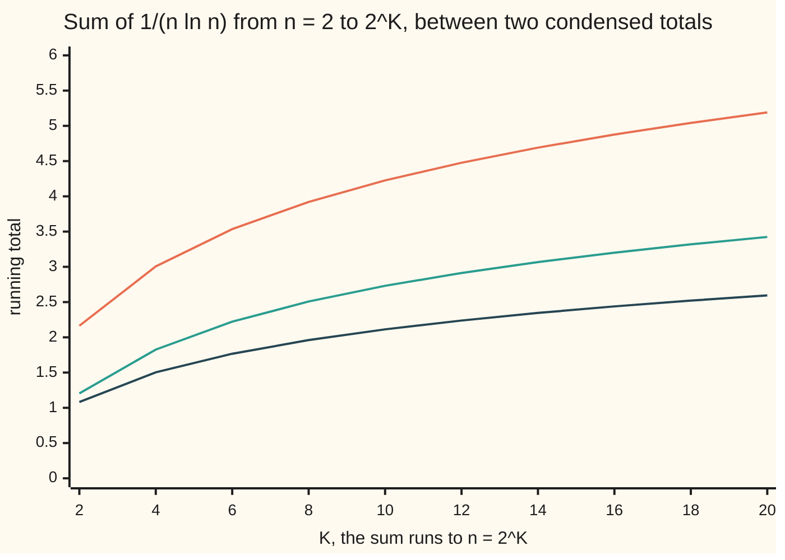

# Cauchy condensation: test a shrinking series by its terms at the powers of 2

[Syllabus](../../../SYLLABUS.md) → [Calculus and analysis](../README.md) → [Series](../README.md#s06) → Cauchy condensation

---

## General Overview

Add one over each prime: 1/2 + 1/3 + 1/5 + 1/7 + 1/11 and on. Below a million there are 78,498 primes, and one over each of them adds to only 2.887328. Is the whole sum finite?

The n-th prime sits close to n ln n, where ln is the natural logarithm. So the question becomes one about a simpler series: the terms $`a_n = 1/(n \ln n)`$, from n = 2 on. Its terms shrink, and its running total after about a million terms is only 3.42.

The **Cauchy condensation test** settles it with one move. Keep only the terms at positions 2, 4, 8, 16 and on, and weight each by how many terms its block holds.

For $`1/(n \ln n)`$ the weighted term at $`2^k`$ is $`1/(k \ln 2)`$: the harmonic series divided by ln 2. So the sum has no ceiling. It grows only like ln ln N (2.63 at a million).

Put $`(\ln n)^2`$ in place of $`\ln n`$ and the weighted terms become $`1/(k^2 (\ln 2)^2)`$: the squares, which converge.

**When the terms never go negative and never rise, the whole series and the series of its terms at the powers of 2, each weighted by its power of 2, either both converge or both diverge.**

**What kind of fact this is:** a theorem, proved on this card in Why it works. The fact about primes is a consequence that also uses a published bound on the n-th prime, stated with its source.

### The picture: the sum trapped between two condensed totals



Orange: the condensed total, a ceiling. Green: the true running total. Dark blue: half the condensed total, a floor. The floor and ceiling are harmonic sums in K, so neither stops climbing, and the green line cannot either.

---

## The formula

Notation first, in words. From [Infinite series](01-series-convergence.md): $`a_n`$ is the term in position n, and a sum to infinity means the limit of the running totals. The **condensed term** $`c_k = 2^k a_{2^k}`$ is the term at position $`2^k`$ times $`2^k`$.

For terms with $`a_n \ge a_{n+1} \ge 0`$ from n = 2 up, every whole number $`K \ge 1`$ gives:

```math
\frac{1}{2}\sum_{k=1}^{K} 2^k a_{2^k} \ \le \ \sum_{n=2}^{2^K} a_n \ \le \ \sum_{k=1}^{K} 2^k a_{2^k}
```

**Read it aloud:** the running total up to $`2^K`$ lies between half the condensed total and the whole condensed total, so the two series converge or diverge together.

For $`1/(n \ln n)`$ at K = 20, about a million terms: 2.595 ≤ 3.424 ≤ 5.190.

| Symbol | Plain meaning | In our example | Push it up and the answer… |
| --- | --- | --- | --- |
| $`a_n`$, $`n`$ | the term in position n | 1/(n ln n) | bigger totals |
| $`k`$ | which power of 2: position $`2^k`$ | k = 20 is position 1,048,576 | — |
| $`c_k = 2^k a_{2^k}`$ | the condensed term: one block's worth | 1/(k ln 2) = 0.072135 at k = 20 | a bigger ceiling |
| $`K`$ | the last power of 2 counted | 20 | totals grow |
| $`N`$ | the number of terms counted, here $`2^K`$ | 1,048,576 | totals grow |
| $`p`$ | a fixed power on n, or on ln n | 1 or 2 | above 1, a finite total |
| $`\ln`$ | the natural logarithm | ln 2 = 0.693147 | — |
| $`p_n`$ | the n-th prime, not the power p | $`p_1 = 2`$, $`p_{78498} = 999983`$ | — |

### When it holds

- **Terms never negative.** With signs that change, cancellation matters and blocks cannot be bounded this way: see [Alternating series](03-alternating-and-conditional-convergence.md).
- **Terms never rising.** Set 1/n to 0 at each power of 2 and the condensed series is all zeros, while the sum to $`2^{20}`$ is 12.440161 and still climbing.
- **The weight $`2^k`$ kept.** Without it, the terms of $`1/(n \ln n)`$ at the powers of 2 add to 1, a false "converges".
- **A verdict, not a value.** The two sides can differ by a factor of 2, so condensation does not give the sum.

---

## Why it works

### Step 0: a falling sequence is nearly flat on each doubling block

Split the positions into blocks that double: 2 and 3; then 4 to 7; then 8 to 15. The block starting at $`2^k`$ holds $`2^k`$ terms.

The terms never rise. So every term in that block is at most its first term, $`a_{2^k}`$, and at least the first term of the next block, $`a_{2^{k+1}}`$. So the block lies between half of $`c_{k+1}`$ and $`c_k`$: two neighbouring condensed terms trap it.

### Step 1: each block is at most its condensed term

The block from $`2^k`$ to $`2^{k+1} - 1`$ holds $`2^k`$ terms, each at most $`a_{2^k}`$. So it adds at most $`2^k a_{2^k} = c_k`$.

For $`1/(n \ln n)`$ the block from 4 to 7 adds 0.471, under $`c_2 = 4/(4 \ln 4) = 0.721`$.

### Step 2: each block is at least half the next condensed term

Shift the blocks by one: from $`2^k + 1`$ to $`2^{k+1}`$. This block also holds $`2^k`$ terms, each at least $`a_{2^{k+1}}`$. So it adds at least $`2^k a_{2^{k+1}}`$, which is half of $`c_{k+1}`$.

### Step 3: add the blocks, then read the verdict

Adding Step 1's blocks gives the ceiling, and adding Step 2's gives the floor. That is the sandwich in The formula.

Terms never negative make the running totals rise. Rising totals converge exactly when they have a ceiling ([Convergence tests](02-comparison-ratio-and-root-tests.md), Step 0). If the condensed series converges, its total caps the whole series. If it diverges, half of it is a floor with no ceiling.

<details>
<summary>Detailed proof: the sandwich, with every index</summary>

Upper side. Positions 2 to $`2^K - 1`$ fill the blocks $`[2^k, 2^{k+1})`$ for k = 1 to K − 1. Each block is at most $`c_k`$. The last term, $`a_{2^K}`$, is at most $`c_K = 2^K a_{2^K}`$. So the sum from 2 to $`2^K`$ is at most $`c_1 + \dots + c_K`$.

Lower side. The first term is $`a_2 = c_1/2`$. Positions 3 to $`2^K`$ fill the blocks $`(2^k, 2^{k+1}]`$ for k = 1 to K − 1. Each holds $`2^k`$ terms, each at least $`a_{2^{k+1}}`$, so each block is at least $`c_{k+1}/2`$. Adding: the sum is at least $`(c_1 + \dots + c_K)/2`$.

Verdict. Both totals rise with K. If $`\sum c_k = C`$ is finite, every running total up to $`2^K`$ is at most C, and every running total sits below one of these.

If $`\sum c_k`$ diverges, the running totals up to $`2^K`$ are at least half the condensed totals, which pass any number. Starting at n = 1 adds block k = 0 the same way.

</details>

### Step 4: settle the two families

**The p-series**, $`1/n^p`$. The condensed term is $`2^k/2^{kp} = (2^{1-p})^k`$, a geometric series with ratio $`2^{1-p}`$. For p > 0 the terms fall, so the test applies; for p ≤ 0 they stay at least 1, so the sum diverges by the term test ([Infinite series](01-series-convergence.md)).

The geometric series converges exactly when its ratio is below 1, so when p > 1. At p = 2 it is 1/2 + 1/4 + 1/8 + …, total 1, so the squares from n = 2 on add to at most 1 (the check gives 0.644933). At p = 1 every condensed term is 1, the doubling blocks of the harmonic series.

**The log family**, $`1/(n (\ln n)^p)`$. Since $`\ln 2^k = k \ln 2`$:

```math
c_k = \frac{2^k}{2^k (k \ln 2)^p} = \frac{1}{(\ln 2)^p}\cdot\frac{1}{k^p}
```

**Read it aloud:** the condensed log series is a p-series in k, times a constant.

For p > 0 the terms fall from n = 2 on, and it converges exactly when p > 1. At p = 1 it is the harmonic series over ln 2, and diverges; at p = 2 it is the squares over $`(\ln 2)^2`$, and converges.

For p ≤ 0 condensation is not needed: from n = 3 on, ln n > 1, so each term is at least 1/n, and the sum diverges by comparison with the harmonic series.

### Why no antiderivative is needed

The integral test on [Convergence tests](02-comparison-ratio-and-root-tests.md) also settles these series. It needs the area under $`1/(x \ln x)`$, which is ln ln x, found by spotting an antiderivative. Condensation needs only the terms at the powers of 2 and the rule $`\ln 2^k = k \ln 2`$.

---

## Worked numbers, by hand

| Step | Arithmetic | Value |
| --- | --- | --- |
| condensed term at k = 20 | $`2^{20} \cdot 1/(2^{20} \cdot 20 \ln 2)`$ | 0.072135 |
| ceiling, K = 20 | $`(1 + 1/2 + \dots + 1/20)/\ln 2`$ | 5.190 |
| floor, K = 20 | half the ceiling | 2.595 |
| running total to $`2^{20}`$ | added one term at a time | **3.423898** |
| integral bounds, a third road | ln ln(N + 1) − ln ln 2; 1/(2 ln 2) + ln ln N − ln ln 2 | 2.995732 to 3.717080 |
| growth from $`2^{10}`$ to $`2^{20}`$ | 3.423898 − 2.730821 | 0.693077, near ln 2 = 0.693147 |
| ln ln N | at $`2^{20}`$; at $`10^6`$ | 2.629219; 2.625792 |
| with $`(\ln n)^2`$: running total to $`2^{20}`$ | added one term at a time | 2.037608 |
| plus the tail, boxed | plus 1/ln(N + 1); plus 1/ln N | **2.109743** |
| its condensed floor and ceiling | $`(\pi^2/6)/(\ln 2)^2`$, halved and whole | 1.711857 to 3.423715 |

The first sum gains only ln 2 each time the number of digits in N doubles. Since the running total stays close to ln ln N + 0.79, passing 5 takes about $`10^{29}`$ terms. The second sum is pinned at 2.109743 and sits inside its condensed box.

### What breaks if you drop a piece

| Mistake | Comes out at | What went wrong |
| --- | --- | --- |
| Terms not decreasing | 1/n with powers of 2 set to 0: condensed 0, sum to $`2^{20}`$ 12.440161 | the terms at $`2^k`$ no longer size their blocks |
| The weight $`2^k`$ dropped | terms of 1/(n ln n) at the powers of 2 add to 1.000000 | one term per block counted, not $`2^k`$ |
| Condensed total read as the sum | 3.423715, against 2.109743 | the sandwich gives a verdict, not a value |

---

## Code, from first principles, and it actually runs

The code adds every term up to $`2^{20}`$ and checks the sandwich at each K from 1 to 20, for both series, via three roads: term-by-term sums, condensed sums, and integral bounds.

It also checks $`c_k = 1/(k \ln 2)`$, boxes the $`(\ln n)^2`$ sum, and sieves the primes below a million to test the prime bound.

### Python

```python
# Cauchy condensation -- the check behind the card.  Standard library only;
# math.log is a primitive.  Every sum is added here one term at a time.
from math import log, exp

a1 = lambda n: 1 / (n * log(n))              # the card's series, from n = 2
a2 = lambda n: 1 / (n * log(n) ** 2)         # the same with (ln n)^2
cond = lambda a, k: 2 ** k * a(2 ** k)       # the condensed term 2^k a(2^k)
KMAX = 20; N = 2 ** KMAX                     # 1048576, about a million terms

S1, S2, at = 0.0, 0.0, {}                    # road one: add every term
for n in range(2, N + 1):
    S1, S2 = S1 + a1(n), S2 + a2(n)
    if n & (n - 1) == 0:
        at[n.bit_length() - 1] = (S1, S2)
for K in range(1, KMAX + 1):                 # road two: the condensed sandwich
    for j, a in ((0, a1), (1, a2)):
        C = sum(cond(a, k) for k in range(1, K + 1))
        assert C / 2 <= at[K][j] <= C        # half the condensed sum <= sum <= condensed sum
    assert abs(cond(a1, K) - 1 / (K * log(2))) < 1e-12  # a harmonic term in K
    assert abs(cond(a2, K) - 1 / (K * log(2)) ** 2) < 1e-12  # a square term in K
half = lambda K: sum(cond(a1, k) for k in range(1, K + 1)) / 2
ks = range(2, KMAX + 1, 2)
f3 = lambda v: " ".join(f"{x:.3f}" for x in v)
print("figure, K (sum runs to 2^K):", " ".join(str(K) for K in ks))
print("figure, half condensed:", f3(half(K) for K in ks))
print("figure, sum of 1/(n ln n):", f3(at[K][0] for K in ks))
print("figure, condensed:", f3(2 * half(K) for K in ks))
lo, hi = log(log(N + 1)) - log(log(2)), a1(2) + log(log(N)) - log(log(2))
assert lo <= S1 <= hi                        # road three: area under 1/(x ln x)
print(f"1/(n ln n) to N={N}: sum {S1:.6f}, integral bounds {lo:.6f} to {hi:.6f}")
print(f"condensed term at k=20: {cond(a1, 20):.6f}; 1/(20 ln 2) = {1 / (20 * log(2)):.6f}")
print(f"ln ln N: at 2^20 {log(log(N)):.6f}, at 10^6 {log(log(10 ** 6)):.6f}; sum to 2^10 "
      f"{at[10][0]:.6f}, gain to 2^20 {S1 - at[10][0]:.6f}, ln 2 = {log(2):.6f}")
print(f"block 4..7: {sum(a1(n) for n in range(4, 8)):.3f}, under c_2 = {cond(a1, 2):.3f}")
c = S1 - log(log(N))                         # the sum runs about ln ln N + c
print(f"sum minus ln ln N: {c:.6f}; estimate: passing 5 takes about 10^{exp(5 - c) / log(10):.0f} terms")
z2 = sum(1 / k ** 2 for k in range(1, 10 ** 6)) + 1 / 10 ** 6  # 1/k^2 summed, tail added
low2, up2 = z2 / log(2) ** 2 / 2, z2 / log(2) ** 2
lo10, hi10 = at[10][1] + 1 / log(2 ** 10 + 1), at[10][1] + 1 / log(2 ** 10)  # the box at 2^10
assert low2 <= lo10 <= S2 + 1 / log(N + 1) and S2 + 1 / log(N) <= hi10 <= up2  # 2^20 box inside it
print(f"1/(n (ln n)^2) to N={N}: sum {S2:.6f}, whole sum between "
      f"{S2 + 1 / log(N + 1):.6f} and {S2 + 1 / log(N):.6f}")
print(f"its condensed series 1/(k^2 (ln 2)^2): half {low2:.6f}, whole {up2:.6f}")
sq = sum(1 / n ** 2 for n in range(2, N + 1))
gq = sum(cond(lambda n: 1 / n ** 2, k) for k in range(1, KMAX + 1))
assert gq / 2 <= sq <= gq and abs(gq - (1 - 2 ** -KMAX)) < 1e-15  # p = 2: 1/2 + 1/4 + ...
print(f"p=2: sum of 1/n^2, n=2..2^20, {sq:.6f}; condensed 1/2 + 1/4 + ... to k=20 {gq:.6f}")
sieve = bytearray([0, 0]) + bytearray([1]) * (10 ** 6 - 1)  # primes below a million, by sieve
for i in range(2, 1001):
    if sieve[i]:
        sieve[i * i::i] = bytearray(len(range(i * i, 10 ** 6 + 1, i)))
P = [i for i in range(10 ** 6 + 1) if sieve[i]]
assert all(P[n - 1] < n * (log(n) + log(log(n))) for n in range(6, len(P) + 1))
print(f"primes below 10^6: {len(P)}, sum of 1/p {sum(1 / p for p in P):.6f}; "
      f"largest {P[-1]}; p_n < n (ln n + ln ln n), n = 6..{len(P)}: yes")
gap = sum(1 / n for n in range(1, N + 1) if n & (n - 1))  # 1/n, powers of 2 set to 0
print(f"mistake 1, not decreasing: sum to 2^20 {gap:.6f}, condensed sum 0")
print(f"mistake 2, 2^k dropped: sum of a(2^k), k=1..20, {sum(a1(2 ** k) for k in range(1, 21)):.6f}")
print(f"mistake 3, condensed value as the sum: {up2:.6f} against {S2 + 1 / log(N):.6f}")
print("ALL CHECKS PASS")
```

**Ran 2026-11-23 on macOS, Python 3.14.10, standard library only. All checks passed. Output, pasted from the run:**

```
figure, K (sum runs to 2^K): 2 4 6 8 10 12 14 16 18 20
figure, half condensed: 1.082 1.503 1.767 1.961 2.113 2.238 2.346 2.439 2.521 2.595
figure, sum of 1/(n ln n): 1.205 1.826 2.222 2.508 2.731 2.913 3.067 3.201 3.319 3.424
figure, condensed: 2.164 3.006 3.535 3.921 4.226 4.477 4.691 4.877 5.042 5.190
1/(n ln n) to N=1048576: sum 3.423898, integral bounds 2.995732 to 3.717080
condensed term at k=20: 0.072135; 1/(20 ln 2) = 0.072135
ln ln N: at 2^20 2.629219, at 10^6 2.625792; sum to 2^10 2.730821, gain to 2^20 0.693077, ln 2 = 0.693147
block 4..7: 0.471, under c_2 = 0.721
sum minus ln ln N: 0.794679; estimate: passing 5 takes about 10^29 terms
1/(n (ln n)^2) to N=1048576: sum 2.037608, whole sum between 2.109743 and 2.109743
its condensed series 1/(k^2 (ln 2)^2): half 1.711857, whole 3.423715
p=2: sum of 1/n^2, n=2..2^20, 0.644933; condensed 1/2 + 1/4 + ... to k=20 0.999999
primes below 10^6: 78498, sum of 1/p 2.887328; largest 999983; p_n < n (ln n + ln ln n), n = 6..78498: yes
mistake 1, not decreasing: sum to 2^20 12.440161, condensed sum 0
mistake 2, 2^k dropped: sum of a(2^k), k=1..20, 1.000000
mistake 3, condensed value as the sum: 3.423715 against 2.109743
ALL CHECKS PASS
```

### Rust

Same numbers, same labels, built with `rustc --edition 2021 -O`.

```rust
// Cauchy condensation -- the same check as the Python, in Rust.  No crates;
// ln() is a primitive.  Every sum is added here one term at a time.
fn a1(n: f64) -> f64 { 1.0 / (n * n.ln()) }                   // the card's series, from n = 2
fn a2(n: f64) -> f64 { let l = n.ln(); 1.0 / (n * (l * l)) }  // the same with (ln n)^2
fn sq(n: f64) -> f64 { 1.0 / (n * n) }                         // the p-series with p = 2
fn cond(a: fn(f64) -> f64, k: u32) -> f64 { let t = (1u64 << k) as f64; t * a(t) }
fn csum(a: fn(f64) -> f64, k: u32) -> f64 { (1..=k).map(|j| cond(a, j)).sum() }
fn f3(v: Vec<f64>) -> String { v.iter().map(|x| format!("{:.3}", x)).collect::<Vec<_>>().join(" ") }

fn main() {
    const KMAX: u32 = 20;
    let n_big: u64 = 1 << KMAX;                                // 1048576, about a million terms
    let (mut s1, mut s2) = (0.0f64, 0.0f64);
    let mut at = vec![(0.0, 0.0); KMAX as usize + 1];
    for n in 2..=n_big {                                       // road one: add every term
        s1 += a1(n as f64);
        s2 += a2(n as f64);
        if n & (n - 1) == 0 { at[n.trailing_zeros() as usize] = (s1, s2) }
    }
    for k in 1..=KMAX {                                        // road two: the condensed sandwich
        let (c1, c2) = (csum(a1, k), csum(a2, k));
        let (x1, x2) = at[k as usize];
        assert!(c1 / 2.0 <= x1 && x1 <= c1 && c2 / 2.0 <= x2 && x2 <= c2);
        assert!((cond(a1, k) - 1.0 / (k as f64 * 2f64.ln())).abs() < 1e-12); // harmonic in k
        assert!((cond(a2, k) - 1.0 / (k as f64 * 2f64.ln()).powi(2)).abs() < 1e-12); // squares in k
    }
    let ks: Vec<u32> = (2..=KMAX).step_by(2).collect();
    println!("figure, K (sum runs to 2^K): {}", ks.iter().map(|k| k.to_string()).collect::<Vec<_>>().join(" "));
    println!("figure, half condensed: {}", f3(ks.iter().map(|&k| csum(a1, k) / 2.0).collect()));
    println!("figure, sum of 1/(n ln n): {}", f3(ks.iter().map(|&k| at[k as usize].0).collect()));
    println!("figure, condensed: {}", f3(ks.iter().map(|&k| csum(a1, k)).collect()));
    let nf = n_big as f64;
    let lnln = |x: f64| x.ln().ln();
    let (lo, hi) = (lnln(nf + 1.0) - lnln(2.0), a1(2.0) + lnln(nf) - lnln(2.0));
    assert!(lo <= s1 && s1 <= hi);                             // road three: area under 1/(x ln x)
    println!("1/(n ln n) to N={}: sum {:.6}, integral bounds {:.6} to {:.6}", n_big, s1, lo, hi);
    println!("condensed term at k=20: {:.6}; 1/(20 ln 2) = {:.6}", cond(a1, 20), 1.0 / (20.0 * 2f64.ln()));
    println!("ln ln N: at 2^20 {:.6}, at 10^6 {:.6}; sum to 2^10 {:.6}, gain to 2^20 {:.6}, ln 2 = {:.6}",
             lnln(nf), lnln(1e6), at[10].0, s1 - at[10].0, 2f64.ln());
    let block: f64 = (4..8).map(|n| a1(n as f64)).sum();
    println!("block 4..7: {:.3}, under c_2 = {:.3}", block, cond(a1, 2));
    let c = s1 - lnln(nf);                                     // the sum runs about ln ln N + c
    println!("sum minus ln ln N: {:.6}; estimate: passing 5 takes about 10^{:.0} terms", c, (5.0 - c).exp() / 10f64.ln());
    let z2: f64 = (1..1_000_000u64).map(|k| 1.0 / (k * k) as f64).sum::<f64>() + 1e-6;
    let l2 = 2f64.ln() * 2f64.ln();
    let (low2, up2) = (z2 / l2 / 2.0, z2 / l2);
    let (box_lo, box_hi) = (s2 + 1.0 / (nf + 1.0).ln(), s2 + 1.0 / nf.ln());
    let (lo10, hi10) = (at[10].1 + 1.0 / 1025f64.ln(), at[10].1 + 1.0 / 1024f64.ln()); // the box at 2^10
    assert!(low2 <= lo10 && lo10 <= box_lo && box_hi <= hi10 && hi10 <= up2); // 2^20 box inside it
    println!("1/(n (ln n)^2) to N={}: sum {:.6}, whole sum between {:.6} and {:.6}", n_big, s2, box_lo, box_hi);
    println!("its condensed series 1/(k^2 (ln 2)^2): half {:.6}, whole {:.6}", low2, up2);
    let sqs: f64 = (2..=n_big).map(|n| sq(n as f64)).sum();
    let gq = csum(sq, KMAX);
    assert!(gq / 2.0 <= sqs && sqs <= gq && (gq - (1.0 - 2f64.powi(-20))).abs() < 1e-15);
    println!("p=2: sum of 1/n^2, n=2..2^20, {:.6}; condensed 1/2 + 1/4 + ... to k=20 {:.6}", sqs, gq);
    let m = 1_000_000usize;                                    // primes below a million, by sieve
    let mut sieve = vec![true; m + 1];
    sieve[0] = false;
    sieve[1] = false;
    for i in 2..=1000 {
        if sieve[i] { let mut j = i * i; while j <= m { sieve[j] = false; j += i } }
    }
    let p: Vec<usize> = (0..=m).filter(|&i| sieve[i]).collect();
    assert!((6..=p.len()).all(|n| { let x = n as f64; (p[n - 1] as f64) < x * (x.ln() + x.ln().ln()) }));
    let rp: f64 = p.iter().map(|&q| 1.0 / q as f64).sum();
    println!("primes below 10^6: {}, sum of 1/p {:.6}; largest {}; p_n < n (ln n + ln ln n), n = 6..{}: yes",
             p.len(), rp, p[p.len() - 1], p.len());
    let gap: f64 = (1..=n_big).filter(|n| n & (n - 1) != 0).map(|n| 1.0 / n as f64).sum();
    println!("mistake 1, not decreasing: sum to 2^20 {:.6}, condensed sum 0", gap);
    let drop: f64 = (1..=20u32).map(|k| a1((1u64 << k) as f64)).sum();
    println!("mistake 2, 2^k dropped: sum of a(2^k), k=1..20, {:.6}", drop);
    println!("mistake 3, condensed value as the sum: {:.6} against {:.6}", up2, box_hi);
    println!("ALL CHECKS PASS");
}
```

**Ran 2026-11-23 on macOS, rustc 1.98.1, no crates. All checks passed. Output, pasted from the run:**

```
figure, K (sum runs to 2^K): 2 4 6 8 10 12 14 16 18 20
figure, half condensed: 1.082 1.503 1.767 1.961 2.113 2.238 2.346 2.439 2.521 2.595
figure, sum of 1/(n ln n): 1.205 1.826 2.222 2.508 2.731 2.913 3.067 3.201 3.319 3.424
figure, condensed: 2.164 3.006 3.535 3.921 4.226 4.477 4.691 4.877 5.042 5.190
1/(n ln n) to N=1048576: sum 3.423898, integral bounds 2.995732 to 3.717080
condensed term at k=20: 0.072135; 1/(20 ln 2) = 0.072135
ln ln N: at 2^20 2.629219, at 10^6 2.625792; sum to 2^10 2.730821, gain to 2^20 0.693077, ln 2 = 0.693147
block 4..7: 0.471, under c_2 = 0.721
sum minus ln ln N: 0.794679; estimate: passing 5 takes about 10^29 terms
1/(n (ln n)^2) to N=1048576: sum 2.037608, whole sum between 2.109743 and 2.109743
its condensed series 1/(k^2 (ln 2)^2): half 1.711857, whole 3.423715
p=2: sum of 1/n^2, n=2..2^20, 0.644933; condensed 1/2 + 1/4 + ... to k=20 0.999999
primes below 10^6: 78498, sum of 1/p 2.887328; largest 999983; p_n < n (ln n + ln ln n), n = 6..78498: yes
mistake 1, not decreasing: sum to 2^20 12.440161, condensed sum 0
mistake 2, 2^k dropped: sum of a(2^k), k=1..20, 1.000000
mistake 3, condensed value as the sum: 3.423715 against 2.109743
ALL CHECKS PASS
```

The two outputs match line for line.

### Lean

Lean proves the test and the sandwich for terms that never go negative and never rise, and the log family for every real p.

- Take terms that never go negative and never rise. Then the whole series and its condensed series converge or diverge together.
- Take such terms and any whole number $`K \ge 1`$. Then the running total up to $`2^K`$ lies between half the condensed total and the whole condensed total.
- Take any real power p. Then the sum of $`1/(n (\ln n)^p)`$ converges exactly when p > 1.
- So at p = 1 the log family diverges, and at p = 2 it converges.
- Position $`2^{20}`$ is 1,048,576.
- The block from 4 to 7 holds 4 terms, and so does the shifted block from 5 to 8.
- Take p = 2. Then the condensed terms 1/2 + 1/4 + … up to k = 20 add to exactly $`1 - 1/2^{20}`$.
- 999983, the largest prime below a million, is prime.

The decimal totals, the integral bounds, the three mistakes and the bound on the n-th prime are left to Python and Rust.

```lean
-- Cauchy condensation: for terms that are never negative and never rise, the series and its condensed series of 2^k times the term at 2^k converge or diverge together, the running total to 2^K sits between half and all of the condensed total, and the sum of 1/(n (ln n)^p) converges exactly when p > 1.
import Mathlib.Analysis.PSeries
import Mathlib.Analysis.SpecialFunctions.Pow.Real
import Mathlib.Tactic.NormNum.Prime
import Mathlib.Analysis.Complex.ExponentialBounds

open Finset

/-- Lower half of the sandwich, on the blocks `(2^(k-1), 2^k]`. -/
lemma condensed_lower_aux (a : ℕ → ℝ) (h_mono : Antitone a) (K : ℕ) (hK : 1 ≤ K) :
    (1 / 2 : ℝ) * ∑ k ∈ Icc 1 K, (2 : ℝ) ^ k * a (2 ^ k) ≤ ∑ n ∈ Ioc 1 (2 ^ K), a n := by
  induction K, hK using Nat.le_induction with
  | base => simp
  | succ K hK ih =>
    rw [sum_Icc_succ_top (by omega), ← sum_Ioc_consecutive _ (m := 1) (n := 2 ^ K)
      (Nat.one_le_two_pow) (Nat.pow_le_pow_right (by norm_num) (by omega))]
    have hblock : (2 : ℝ) ^ K * a (2 ^ (K + 1)) ≤ ∑ n ∈ Ioc (2 ^ K) (2 ^ (K + 1)), a n := by
      have := card_nsmul_le_sum (Ioc (2 ^ K) (2 ^ (K + 1))) a (a (2 ^ (K + 1)))
        (fun x hx => h_mono (mem_Ioc.mp hx).2)
      rw [Nat.card_Ioc, nsmul_eq_mul] at this
      have h2 : (2 : ℕ) ^ (K + 1) - 2 ^ K = 2 ^ K := by rw [pow_succ]; omega
      rw [h2] at this
      push_cast at this
      exact this
    have : (1 / 2 : ℝ) * ((2 : ℝ) ^ (K + 1) * a (2 ^ (K + 1))) = (2 : ℝ) ^ K * a (2 ^ (K + 1)) := by
      rw [pow_succ]; ring
    rw [mul_add, this]
    exact add_le_add ih hblock

#print axioms condensed_lower_aux

/-- Upper half of the sandwich, on the blocks `[2^(k-1), 2^k)`, with the end term kept apart. -/
lemma condensed_upper_aux (a : ℕ → ℝ) (h_mono : Antitone a) (K : ℕ) (hK : 1 ≤ K) :
    ∑ n ∈ Ico 2 (2 ^ K), a n + (2 : ℝ) ^ K * a (2 ^ K) ≤ ∑ k ∈ Icc 1 K, (2 : ℝ) ^ k * a (2 ^ k) := by
  induction K, hK using Nat.le_induction with
  | base => simp
  | succ K hK ih =>
    rw [sum_Icc_succ_top (by omega), ← sum_Ico_consecutive _ (m := 2) (n := 2 ^ K)
      (by calc 2 = 2 ^ 1 := by norm_num
               _ ≤ 2 ^ K := Nat.pow_le_pow_right (by norm_num) hK)
      (Nat.pow_le_pow_right (by norm_num) (by omega))]
    have hblock : ∑ n ∈ Ico (2 ^ K) (2 ^ (K + 1)), a n ≤ (2 : ℝ) ^ K * a (2 ^ K) := by
      have := sum_le_card_nsmul (Ico (2 ^ K) (2 ^ (K + 1))) a (a (2 ^ K))
        (fun x hx => h_mono (mem_Ico.mp hx).1)
      rw [Nat.card_Ico, nsmul_eq_mul] at this
      have h2 : (2 : ℕ) ^ (K + 1) - 2 ^ K = 2 ^ K := by rw [pow_succ]; omega
      rw [h2] at this
      push_cast at this
      exact this
    linarith

#print axioms condensed_upper_aux

/-- Cauchy condensation test: when the terms `a n` are never negative and never rise,
the series `∑ a n` converges exactly when the condensed series `∑ 2^k a (2^k)` converges. -/
theorem summable_iff_summable_condensed (a : ℕ → ℝ)
    (h_nonneg : ∀ n, 0 ≤ a n) (h_mono : Antitone a) :
    Summable a ↔ Summable (fun k : ℕ => (2 : ℝ) ^ k * a (2 ^ k)) := by
  exact (summable_condensed_iff_of_nonneg h_nonneg (fun _ _ _ h => h_mono h)).symm

/-- The sandwich: for terms that are never negative and never rise, and every whole number
`K ≥ 1`, the running total from `n = 2` to `2^K` lies between half the condensed total
`∑_{k=1}^{K} 2^k a (2^k)` and the whole condensed total. -/
theorem condensed_sandwich (a : ℕ → ℝ)
    (h_nonneg : ∀ n, 0 ≤ a n) (h_mono : Antitone a) (K : ℕ) (hK : 1 ≤ K) :
    (1 / 2 : ℝ) * ∑ k ∈ Icc 1 K, (2 : ℝ) ^ k * a (2 ^ k) ≤ ∑ n ∈ Icc 2 (2 ^ K), a n ∧
      ∑ n ∈ Icc 2 (2 ^ K), a n ≤ ∑ k ∈ Icc 1 K, (2 : ℝ) ^ k * a (2 ^ k) := by
  have hpow : 2 ≤ 2 ^ K := by
    calc 2 = 2 ^ 1 := by norm_num
         _ ≤ 2 ^ K := Nat.pow_le_pow_right (by norm_num) hK
  have e1 : Icc 2 (2 ^ K) = Ioc 1 (2 ^ K) := by ext x; simp only [mem_Icc, mem_Ioc]; omega
  have e2 : Icc 2 (2 ^ K) = Ico 2 (2 ^ K + 1) := by ext x; simp only [mem_Icc, mem_Ico]; omega
  refine ⟨e1 ▸ condensed_lower_aux a h_mono K hK, ?_⟩
  rw [e2, sum_Ico_succ_top hpow]
  have hu := condensed_upper_aux a h_mono K hK
  have h1 : a (2 ^ K) ≤ (2 : ℝ) ^ K * a (2 ^ K) := by
    have : (1 : ℝ) ≤ 2 ^ K := one_le_pow₀ (by norm_num)
    nlinarith [h_nonneg (2 ^ K)]
  linarith

/-- The log family: the sum of `1 / (n (ln n)^p)` converges exactly when `p > 1`.
At `p = 1` (the terms `1/(n ln n)`) it diverges; at `p = 2` it converges. -/
theorem summable_one_div_nat_mul_log_rpow_iff (p : ℝ) :
    Summable (fun n : ℕ => 1 / ((n : ℝ) * Real.log n ^ p)) ↔ 1 < p := by
  set f : ℕ → ℝ := fun n => 1 / ((n : ℝ) * Real.log n ^ p) with hf
  rcases le_or_gt p 0 with hp | hp
  · -- p ≤ 0: from n = 3 on, (ln n)^p ≤ 1, so each term is at least 1/n.
    refine iff_of_false ?_ (by linarith)
    intro hs
    rw [← summable_nat_add_iff 3] at hs
    apply Real.not_summable_one_div_natCast
    rw [← summable_nat_add_iff 3]
    refine hs.of_nonneg_of_le (fun n => by positivity) (fun n => ?_)
    have hn : (0 : ℝ) < (n + 3 : ℕ) := by positivity
    have hlog : 1 ≤ Real.log ((n + 3 : ℕ) : ℝ) := by
      rw [Real.le_log_iff_exp_le (by positivity)]
      have := Real.exp_one_lt_d9
      push_cast
      have : (0 : ℝ) ≤ n := n.cast_nonneg
      linarith
    have hr : Real.log ((n + 3 : ℕ) : ℝ) ^ p ≤ 1 := Real.rpow_le_one_of_one_le_of_nonpos hlog hp
    have hr0 : 0 < Real.log ((n + 3 : ℕ) : ℝ) ^ p := Real.rpow_pos_of_pos (by linarith) p
    simp only [hf]
    apply one_div_le_one_div_of_le (by positivity)
    nlinarith
  · -- p > 0: condense.
    have hnn : 0 ≤ᶠ[Filter.atTop] f := Filter.Eventually.of_forall fun n => by
      simp only [hf, Pi.zero_apply]
      have := Real.log_natCast_nonneg n
      positivity
    have hmono : ∀ᶠ k in Filter.atTop, f (k + 1) ≤ f k := by
      filter_upwards [Filter.eventually_ge_atTop 2] with k hk
      have hk' : (2 : ℝ) ≤ k := by exact_mod_cast hk
      have hlog : 0 < Real.log k := Real.log_pos (by linarith)
      have hlog' : Real.log k ≤ Real.log ((k + 1 : ℕ) : ℝ) :=
        Real.log_le_log (by linarith) (by push_cast; linarith)
      simp only [hf]
      apply one_div_le_one_div_of_le (mul_pos (by linarith) (Real.rpow_pos_of_pos hlog p))
      apply mul_le_mul (by push_cast; linarith) (Real.rpow_le_rpow hlog.le hlog' hp.le)
        (Real.rpow_pos_of_pos hlog p).le (by positivity)
    rw [← summable_condensed_iff_of_eventually_nonneg hnn hmono]
    have hl2 : 0 < Real.log 2 := Real.log_pos (by norm_num)
    have heq : (fun k : ℕ => (2 : ℝ) ^ k * f (2 ^ k)) =
        fun k : ℕ => (1 / Real.log 2 ^ p) * (1 / (k : ℝ) ^ p) := by
      funext k
      simp only [hf]
      push_cast
      rw [Real.log_pow, Real.mul_rpow (Nat.cast_nonneg k) hl2.le]
      have h2k : (0 : ℝ) < 2 ^ k := by positivity
      field_simp
    rw [heq, summable_mul_left_iff (by have := Real.rpow_pos_of_pos hl2 p; positivity),
      Real.summable_one_div_nat_rpow]

-- k = 20 is position 1,048,576.
example : 2 ^ 20 = 1048576 := by norm_num

-- The doubling block from 4 to 7 holds 4 = 2^2 terms; so does the shifted block 5 to 8.
example : (Ico 4 8).card = 2 ^ 2 := by decide
example : (Ioc 4 8).card = 2 ^ 2 := by decide

-- p = 2: the condensed terms 2^k / (2^k)^2 are 1/2 + 1/4 + ... ; to k = 20 they add to 1 - 1/2^20.
example : ∑ k ∈ Icc 1 20, (2 : ℚ) ^ k * (1 / ((2 : ℚ) ^ k) ^ 2) = 1 - 1 / 2 ^ 20 := by
  norm_num [Finset.sum_Icc_succ_top]

-- 999983, the largest prime below a million on the card, is prime.
example : Nat.Prime 999983 := by norm_num

#print axioms summable_iff_summable_condensed
#print axioms condensed_sandwich
#print axioms summable_one_div_nat_mul_log_rpow_iff
```

**Checked 2026-11-23 on macOS, Lean 4.36.0-rc2, Mathlib v4.36.0-rc2. Every proof is complete and uses only Lean's standard axioms. Output, pasted from the run:**

```
'condensed_lower_aux' depends on axioms: [propext, Classical.choice, Quot.sound]
'condensed_upper_aux' depends on axioms: [propext, Classical.choice, Quot.sound]
'summable_iff_summable_condensed' depends on axioms: [propext, Classical.choice, Quot.sound]
'condensed_sandwich' depends on axioms: [propext, Classical.choice, Quot.sound]
'summable_one_div_nat_mul_log_rpow_iff' depends on axioms: [propext, Classical.choice, Quot.sound]
```

> [!TIP]
> **Try changing**
> - **Guess first:** set `KMAX = 10`, about a thousand terms. The sum of 1/(n ln n) drops to 2.730821, the $`(\ln n)^2`$ box widens to 2.109733 to 2.109753, and the estimate for passing 5 stays near $`10^{29}`$ terms. Every assert still passes.
> - **Guess first:** is the n-th prime below n ln n? Change `(log(n) + log(log(n)))` to `log(n)`. The prime assert stops the run: the n-th prime is always above n ln n.
> - **Guess first:** change `a1` to `1 / (n * log(n) ** 1.05)`. The series now converges, and the assert that the condensed term is 1/(k ln 2) stops the run.

---

## The usual mistake

> [!warning]
> **Trusting a total that looks settled.** The sum of 1/(n ln n) is 2.730821 after 1,024 terms and 3.423898 after 1,048,576. A thousand times more terms bought 0.69. It still has no ceiling: the condensed terms 1/(k ln 2) form a harmonic series.
>
> - **Using it on terms that rise.** Set 1/n to 0 at the powers of 2: the condensed series is 0, yet the sum reaches 12.440161 by $`2^{20}`$.
> - **Forgetting the weight $`2^k`$.** The bare terms of 1/(n ln n) at the powers of 2 add to 1.000000, which suggests a finite sum that does not exist.
> - **Taking the condensed total as the answer.** For $`1/(n (\ln n)^2)`$ it is 3.423715 against the true sum 2.109743.

---

## Where you meet it in real life

- **Primes.** The n-th prime is below $`n(\ln n + \ln\ln n)`$ from n = 6 on, a published bound the check confirms for all 78,498 primes below a million. Since ln ln n < ln n, each 1/p_n is above $`1/(2 n \ln n)`$, so the sum of one over each prime diverges. It grows like ln ln N: 2.887328 below a million.
- **Doubling data structures.** A growable array doubles its storage when full. Costs that depend on size are counted block by block, one per doubling: the condensation step.
- **Borderline series.** Terms with logarithms, such as $`1/(n (\ln n)^{1.5})`$, sit where ratio and root tests give no verdict. Condensation turns them into p-series.

> **Say it back**
> For terms that never go negative and never rise, the blocks between powers of 2 are each sized by one term. The block from $`2^k`$ holds $`2^k`$ terms, so the sum is between half and all of the condensed series $`\sum 2^k a_{2^k}`$. The two converge or diverge together. For 1/(n ln n) the condensed series is harmonic, so it diverges, but only like ln ln N. With $`(\ln n)^2`$ it becomes the squares, so it converges.

---

## What this builds on

- [Infinite series](01-series-convergence.md): a sum as the limit of running totals, and the geometric series the p-series condenses to.
- [Convergence tests](02-comparison-ratio-and-root-tests.md): rising totals converge exactly when capped, the harmonic doubling blocks, and the integral test that reaches the same verdicts with an antiderivative.
- [Alternating series](03-alternating-and-conditional-convergence.md): cancellation that rescues sums this test rejects.

## Where this goes next

- [Summation by parts](11-summation-by-parts-and-dirichlets-test.md): sums whose terms change sign, where blocks of one sign no longer work.

Condensation requires terms of one sign; how to prove convergence when the terms change sign and only cancellation saves the sum is the question Summation by parts answers.

---

## Sources

Verified 2026-11-23: every link below resolves to the publisher's page.

- Abbott, Stephen. *Understanding Analysis*, 2nd ed. Springer, 2015. [DOI 10.1007/978-1-4939-2712-8](https://doi.org/10.1007/978-1-4939-2712-8). Section 2.4 proves the condensation test and settles the p-series with it.
- Lebl, Jiří. *Basic Analysis I*, §2.5 "Series". [Section page](https://www.jirka.org/ra/html/sec_series.html). The p-series proved, and the condensation principle as Exercise 2.5.15.
- Rosser, J. Barkley, and Lowell Schoenfeld. "Approximate formulas for some functions of prime numbers." *Illinois Journal of Mathematics* 6, no. 1 (1962). [DOI 10.1215/ijm/1255631807](https://doi.org/10.1215/ijm/1255631807). The bound on the n-th prime used for the primes.
