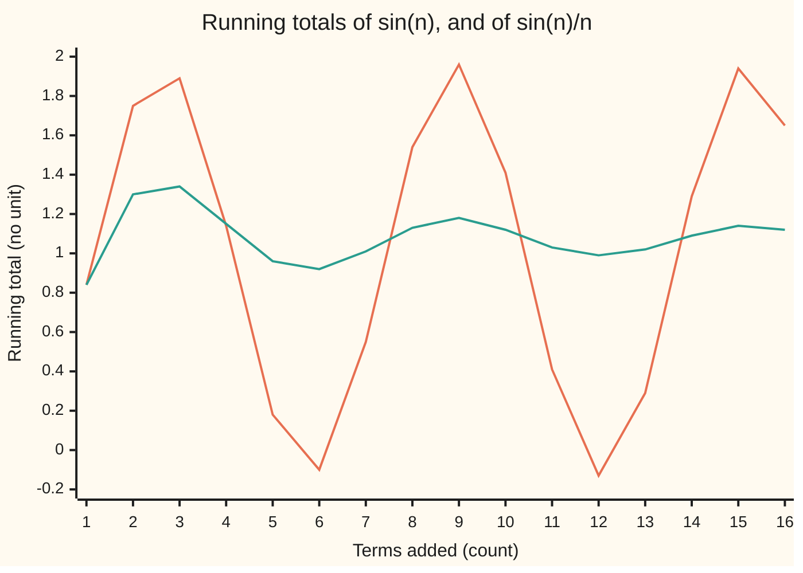

# Summation by parts: Dirichlet's and Abel's tests for series that converge by cancellation

[Syllabus](../../../SYLLABUS.md) → [Calculus and analysis](../README.md) → [Series](../README.md#s06) → Summation by parts

---

## General Overview

A synthesiser's sawtooth wave falls steadily through each cycle, then snaps back to the top. Measure the position in the cycle as an angle x in radians, 0 to 2π. The wave is a stack of pure tones: tone n is sin(nx), at loudness 1/n ([Fourier series](../../08-Differential%20equations%20and%20dynamics/09-Fourier%20Series/01-fourier-series-and-orthogonality.md)). At x = 1 radian the stack is the series sin(1)/1 + sin(2)/2 + sin(3)/3 + ….

Does that sum settle? The loudnesses 1, 1/2, 1/3, … add to infinity, so size comparisons fail. The signs of sin(n) go + + + − − − + + +, not strictly in turn, so the alternating series test is silent too.

What saves it is cancellation. The running totals of sin(n) alone never leave the band from −0.1277 to 1.9582: the ups and downs cancel. The weights 1/n fall steadily to 0. A regrouping called **summation by parts** turns those two facts into a proof. The totals settle on (π − 1)/2 = 1.070796, the wave's height at that point.

**Summation by parts moves the cancellation into the running totals: if every stretch of terms stays within M and the weights fall steadily to zero, the weighted series converges, and its tail is no bigger than M times the first weight left out.**

**What kind of fact this is:** a theorem, Dirichlet's test, with Abel's test as a corollary, both proved on this card in Why it works. The value (π − 1)/2 comes from the sawtooth's Fourier series, cited in Sources and not proved here.

### The picture: the running totals, without and with the weights



Orange: sin(1) + sin(2) + … alone, swinging inside a fixed band forever. Teal: the same terms weighted by 1/n, closing in on 1.0708.

---

## The formula

A reminder from [Infinite series](01-series-convergence.md): a series converges when its partial sums (running totals) settle on a limit.

Split each term into two factors: $`a_n`$, which carries the signs and cancels, and $`b_n`$, a weight. Write $`A_n = a_1 + a_2 + \cdots + a_n`$ for the running total of the $`a`$'s alone. **Summation by parts** is this exact identity, for every $`N`$:

```math
\sum_{n=1}^{N} a_n b_n = A_N b_N + \sum_{n=1}^{N-1} A_n\,(b_n - b_{n+1})
```

**Read it aloud:** the weighted sum equals the last running total times the last weight, plus each running total times the drop in weight that follows it.

**Dirichlet's test.** Suppose every stretch $`a_{K+1} + \cdots + a_n`$ is at most $`M`$ in size, and the weights $`b_n`$ never grow and head for 0. Then the series converges to some $`S`$, and

```math
\lvert S - S_N \rvert \le M\, b_{N+1}
```

**Read it aloud:** stop after N terms and the miss is no bigger than the stretch bound times the first weight left out.

**Abel's test.** If $`\sum a_n`$ itself converges, and the weights $`b_n`$ only move one way and stay bounded, then $`\sum a_n b_n`$ converges.

| Symbol | Plain meaning | In our example | Push it up and the answer… |
| --- | --- | --- | --- |
| $`a_n`$ | the part of term n that carries the sign | sin(n) | — |
| $`b_n`$ | the weight on term n | 1/n | slower fall, slower settling |
| $`A_n`$, $`B_n`$ | running total of the $`a`$'s from term 1; from term N + 1 | 0.84, 1.75, 1.89, 1.14, … | — |
| $`M`$, $`C`$ | a bound on every stretch of the $`a`$'s; a bound on the running totals | M = 1/sin(1/2) = 2.0858 | looser guarantee |
| $`n`$, $`N`$, $`K`$, $`m`$ | a term's position; terms kept; where a stretch starts; where a tail ends | N = 10, 100, 1000 | more terms, smaller miss |
| $`S_N`$, $`S`$ | the weighted partial sum after N terms; its limit | 1.124519 at N = 10; 1.070796 | — |
| $`x`$, $`z`$ | the angle in the series of sin(nx)/n; a complex number of size 1 | x = 1 radian | x nearer 0, bigger bound |
| $`L`$ | where the weights head, in Abel's test | 1, for weights 1 + 1/n | — |

### When it holds

- **The stretches stay bounded.** With $`a_n = 1`$ the running totals are 1, 2, 3, … and the weights 1/n give the harmonic series: 7.4855 after 1000 terms and still climbing.
- **The weights head for 0.** Weight 1 on every term leaves sin(1) + sin(2) + …, whose totals swing forever: 0.0136, −0.0129, 0.8140 at terms 998 to 1000.
- **The weights fall steadily.** Weights (2 + (−1)^n)/n bounce while shrinking to 0. With signs + − + −, the sum after 1000 terms is −6.1002 and falling.
- **Abel's test needs a convergent series.** Its weights need not head for 0, so they cannot tame a series that does not settle on its own.

---

## Why it works

### Step 0: cancellation lives in the running totals

Each term $`a_n`$ is a step of its running total: $`a_n = A_n - A_{n-1}`$. Rewrite the weighted sum in those totals. If they stay small, the sum depends on how much the weights change, not on how big the terms are. It is the discrete twin of [Integration by parts](../04-Integrals/04-integration-by-parts.md).

### Step 1: the identity is a regrouping

Take three terms, with $`A_0 = 0`$:

```math
a_1 b_1 + a_2 b_2 + a_3 b_3 = A_1 b_1 + (A_2 - A_1)\, b_2 + (A_3 - A_2)\, b_3 = A_1 (b_1 - b_2) + A_2 (b_2 - b_3) + A_3 b_3
```

Collect the terms by $`A_n`$ instead of by $`b_n`$. This works for any N; the code confirms it at N = 1000: both forms give 1.070694154320.

[Partial summation](../../21-Algebraic%20and%20analytic%20number%20theory/01-Arithmetic%20Functions%20Again/06-abel-and-partial-summation.md) is the continuous cousin: there the running total is integrated against the slope of a smooth weight.

### Step 2: the running totals of sin(n) are bounded

A product rule for sines makes each term a difference: $`2\sin\tfrac12 \sin k = \cos(k - \tfrac12) - \cos(k + \tfrac12)`$. Added from $`k = K+1`$ to $`n`$, the inner cosines cancel in pairs:

```math
\sin(K+1) + \cdots + \sin n = \frac{\cos(K + \tfrac12) - \cos(n + \tfrac12)}{2 \sin \tfrac12}
```

The top is at most 2 in size, so every stretch is at most $`M = 1/\sin\tfrac12 = 2.0858`$. With K = 0, the running totals lie between −0.1277 and 1.9582; the code meets both ends before n = 100,000.

For a general angle x, the same steps give the bound $`1/\lvert\sin(x/2)\rvert`$. It is finite unless x is a whole multiple of 2π, and there every term sin(nx) is 0. So the series of sin(nx)/n converges for every x.

### Step 3: Dirichlet's test, from the identity

Apply the identity to a tail, from term N + 1 to term m. Let $`B_n`$ be the stretch total from N + 1 to n, so $`\lvert B_n \rvert \le M`$. Every weight drop $`b_n - b_{n+1}`$ is zero or positive, so

```math
\Bigl\lvert \sum_{n=N+1}^{m} a_n b_n \Bigr\rvert \le M\, b_m + M\,(b_{N+1} - b_m) = M\, b_{N+1}
```

The drops add up to the total fall from $`b_{N+1}`$ to $`b_m`$. So every tail is at most $`M b_{N+1}`$, which heads for 0. Late partial sums all lie close together: they form a Cauchy list ([Sequences](../01-Limits%20and%20Continuity/03-sequences-and-limits.md)) and settle on a limit S. Letting m grow gives the bound on the miss.

<details>
<summary>Detailed proof: Dirichlet's test with its error bound</summary>

Let $`\lvert a_{K+1} + \cdots + a_n \rvert \le M`$ whenever $`K < n`$, and let $`b_n`$ never grow, with $`b_n \to 0`$; then every $`b_n \ge 0`$. Fix $`N < m`$ and put $`B_n = a_{N+1} + \cdots + a_n`$, $`B_N = 0`$. Summation by parts on the stretch gives

$`\displaystyle \sum_{n=N+1}^{m} a_n b_n = B_m b_m + \sum_{n=N+1}^{m-1} B_n (b_n - b_{n+1})`$

Each $`\lvert B_n \rvert \le M`$ and each $`b_n - b_{n+1} \ge 0`$, so the size is at most $`M b_m + M(b_{N+1} - b_m) = M b_{N+1}`$. So $`\lvert S_m - S_N \rvert \le M b_{N+1}`$ for all $`m > N`$, and $`M b_{N+1}`$ heads for 0. The partial sums are Cauchy, so they converge to some S, and letting m grow gives $`\lvert S - S_N \rvert \le M b_{N+1}`$. If only the running totals are known to satisfy $`\lvert A_n \rvert \le C`$, every stretch $`A_n - A_K`$ is at most $`2C`$, so take $`M = 2C`$.

</details>

### Step 4: the alternating series test is the special case

Take $`a_n = (-1)^{n-1}`$. The running totals are 1, 0, 1, 0, 1, 0, so M = 1. Dirichlet's test then gives a convergent series with miss at most $`b_{N+1}`$: the test and the bound of [Alternating series](03-alternating-and-conditional-convergence.md). For 1 − 1/2 + 1/3 − … after 10 terms the bound is 1/11 = 0.0909.

### Step 5: Abel's test, from Dirichlet's

Weights that only move one way and stay bounded settle on a limit L, by monotone convergence ([Sequences](../01-Limits%20and%20Continuity/03-sequences-and-limits.md)). Split each term:

```math
a_n b_n = a_n (b_n - L) + L\, a_n
```

If the weights fall, $`b_n - L`$ falls steadily to 0. If they rise, use $`L - b_n`$ and flip the sign. A convergent $`\sum a_n`$ has bounded running totals, so Dirichlet's test handles the first part. The second part is L times a convergent series.

With $`a_n = \sin(n)/n`$ and weights $`1 + 1/n`$, which fall to L = 1, the weighted series is the sawtooth sum plus the sum of sin(n)/n²: 2.0848 = 1.0708 + 1.0140.

### Step 6: why no older test reaches this series

The sizes $`\lvert\sin n\rvert/n`$ add to infinity. Since $`\lvert \sin n \rvert \ge \sin^2 n = \tfrac12 - \tfrac12\cos 2n`$, they outweigh half the harmonic series minus a series of cos(2n)/n. That last series converges by Dirichlet's test, with the bound 1/sin 1 from Step 2's method. So the sizes diverge: 3.5458 after 100 terms, 6.4743 after 10,000, 9.4060 after a million. The convergence is conditional, held by cancellation alone.

---

## Worked numbers, by hand

| Step | Arithmetic | Value |
| --- | --- | --- |
| stretch bound | M = 1/sin(1/2) | 2.0858 |
| running totals of sin(n) | sin(1), then add sin(2), sin(3), sin(4) | 0.84, 1.75, 1.89, 1.14 |
| their true band | from Step 2's formula, K = 0 | −0.1277 to 1.9582 |
| ten weighted terms | sin(1)/1 + … + sin(10)/10 | 1.124519 |
| guarantee at N = 10 | 2.0858/11 | 0.189621 |
| true miss at N = 10 | 1.070796 − 1.124519 | −0.053722 |
| at N = 1000 | guarantee 2.0858/1001; true miss | 0.002084; +0.000102 |
| the limit | (π − 1)/2, with π = 3.141592654 | **1.070796** |

At 1 radian into its cycle the sawtooth's height is 1.0708, and the first 1000 tones are certain to land within 0.002084 of it.

### What breaks if you drop a piece

| Mistake | Comes out at | What went wrong |
| --- | --- | --- |
| Weight 1 on every term: sin(1) + sin(2) + … | 0.0136, −0.0129, 0.8140 at terms 998 to 1000 | Weights must head for 0 |
| Unbounded totals: $`a_n = 1`$, $`b_n = 1/n`$ | 7.4855 after 1000 terms, climbing | Stretches must stay bounded |
| Bouncing weights (2 + (−1)^n)/n, signs + − | −6.1002 after 1000 terms, falling | Weights must fall steadily |
| Judging by sizes: $`\lvert\sin n\rvert/n`$ | 9.4060 after a million terms | Sizes diverge; the signed series still converges |

---

## Code, from first principles, and it actually runs

The code takes three roads. Road one adds sin(n)/n term by term. Road two finds the target (π − 1)/2 with no series: π comes from Simpson's rule (parabolas through pairs of thin strips) on the area under 4/(1 + t²). Road three re-adds the first 1000 terms in the summation-by-parts form and must match road one.

### Python

```python
# Summation by parts and Dirichlet's test -- the check behind the card.
# Road one adds sin(n)/n term by term.  Road two gets the target (pi - 1)/2 with
# no series: pi from Simpson's rule on 4/(1 + t^2).  Road three re-adds the same
# terms in the summation-by-parts form and must agree with road one.
from math import sin, cos, tan

def simpson(f, a, b, panels):                 # parabolas through pairs of strips
    h = (b - a) / panels
    return (f(a) + f(b) + sum((4 if i % 2 else 2) * f(a + i * h) for i in range(1, panels))) * h / 3

PI = simpson(lambda t: 4 / (1 + t * t), 0.0, 1.0, 2000)
target, M = (PI - 1) / 2, 1 / sin(0.5)
print(f"pi by Simpson: {PI:.9f}  target (pi-1)/2 = {target:.6f}  bound M = 1/sin(1/2) = {M:.4f}")
A, S, lo, hi, chartA, chartS = 0.0, 0.0, 9.0, -9.0, [], []
for n in range(1, 100001):
    A, S = A + sin(n), S + sin(n) / n
    assert abs(A - (cos(0.5) - cos(n + 0.5)) / (2 * sin(0.5))) < 1e-9   # telescoped closed form
    lo, hi = min(lo, A), max(hi, A)
    if n <= 16:
        chartA.append(f"{A:.2f}"); chartS.append(f"{S:.2f}")
    if n in (10, 100, 1000, 10000):
        assert abs(S - target) <= M / (n + 1)                    # Dirichlet's tail bound
        print(f"N={n}: S_N={S:.6f}  miss={target - S:+.6f}  bound M/(N+1)={M / (n + 1):.6f}")
print("chart A_n, n=1..16: " + " ".join(chartA))
print("chart S_n, n=1..16: " + " ".join(chartS))
print(f"A_n over n<=100000: lowest {lo:.4f}, highest {hi:.4f}; "
      f"exact range {-tan(0.25) / 2:.4f} to {1 / tan(0.25) / 2:.4f}")
assert -tan(0.25) / 2 - 1e-12 <= lo and hi <= 1 / tan(0.25) / 2 + 1e-12 and hi > 1.95
N = 1000                                      # road three: the identity, at N = 1000
a = [0.0] + [sin(n) for n in range(1, N + 1)]
b = [0.0] + [1 / n for n in range(1, N + 2)]
Acum = [0.0]
for n in range(1, N + 1):
    Acum.append(Acum[-1] + a[n])
direct = sum(a[n] * b[n] for n in range(1, N + 1))
parts = Acum[N] * b[N] + sum(Acum[n] * (b[n] - b[n + 1]) for n in range(1, N))
assert abs(direct - parts) < 1e-12
print(f"identity at N=1000: term by term {direct:.12f}  by parts {parts:.12f}")
abel = sum(sin(n) / n * (1 + 1 / n) for n in range(1, 200001))
sq = sum(sin(n) / n ** 2 for n in range(1, 200001))
assert abs(abel - (target + sq)) < 2 * M / 200001 + 1e-9
print(f"Abel, weights 1+1/n: {abel:.4f} = {target:.4f} + sum sin(n)/n^2 {sq:.4f}")
alt = [sum((-1) ** (k + 1) for k in range(1, n + 1)) for n in range(1, 7)]
print(f"alternating case: A_n = {alt}, so M = 1 and the miss after 10 terms is at most 1/11 = {1 / 11:.4f}")
H = sum(1 / n for n in range(1, 1001))
bounce = sum((-1) ** (n + 1) * (2 + (-1) ** n) / n for n in range(1, 1001))
assert H > 7 and bounce < -6
print(f"sin(n) alone, A_998..A_1000: {Acum[998]:.4f} {Acum[999]:.4f} {Acum[1000]:.4f}")
print(f"a_n = 1 (unbounded A_n), b_n = 1/n: H_1000 = {H:.4f}")
print(f"bouncing sizes (2+(-1)^n)/n with signs +-: total at 1000 = {bounce:.4f}")
absum = {}
t = 0.0
for n in range(1, 1000001):
    t += abs(sin(n)) / n
    if n in (100, 10000, 1000000):
        absum[n] = t
assert absum[1000000] - absum[10000] > 2.5     # grows like (2/pi) ln N: no finite total
print("sizes |sin n|/n: " + "  ".join(f"N={k}: {v:.4f}" for k, v in absum.items()))
print("ALL CHECKS PASS")
```

**Ran 2026-11-23 on macOS, Python 3.14.10, standard library only. All checks passed. Output, pasted from the run:**

```
pi by Simpson: 3.141592654  target (pi-1)/2 = 1.070796  bound M = 1/sin(1/2) = 2.0858
N=10: S_N=1.124519  miss=-0.053722  bound M/(N+1)=0.189621
N=100: S_N=1.060429  miss=+0.010367  bound M/(N+1)=0.020652
N=1000: S_N=1.070694  miss=+0.000102  bound M/(N+1)=0.002084
N=10000: S_N=1.070868  miss=-0.000072  bound M/(N+1)=0.000209
chart A_n, n=1..16: 0.84 1.75 1.89 1.14 0.18 -0.10 0.55 1.54 1.96 1.41 0.41 -0.13 0.29 1.29 1.94 1.65
chart S_n, n=1..16: 0.84 1.30 1.34 1.15 0.96 0.92 1.01 1.13 1.18 1.12 1.03 0.99 1.02 1.09 1.14 1.12
A_n over n<=100000: lowest -0.1277, highest 1.9582; exact range -0.1277 to 1.9582
identity at N=1000: term by term 1.070694154320  by parts 1.070694154320
Abel, weights 1+1/n: 2.0848 = 1.0708 + sum sin(n)/n^2 1.0140
alternating case: A_n = [1, 0, 1, 0, 1, 0], so M = 1 and the miss after 10 terms is at most 1/11 = 0.0909
sin(n) alone, A_998..A_1000: 0.0136 -0.0129 0.8140
a_n = 1 (unbounded A_n), b_n = 1/n: H_1000 = 7.4855
bouncing sizes (2+(-1)^n)/n with signs +-: total at 1000 = -6.1002
sizes |sin n|/n: N=100: 3.5458  N=10000: 6.4743  N=1000000: 9.4060
ALL CHECKS PASS
```

### Rust

```rust
// Summation by parts and Dirichlet's test -- the check behind the card.  Rust std only.
// Road one adds sin(n)/n term by term.  Road two gets the target (pi - 1)/2 with
// no series: pi from Simpson's rule on 4/(1 + t^2).  Road three re-adds the same
// terms in the summation-by-parts form and must agree with road one.

fn simpson(f: impl Fn(f64) -> f64, a: f64, b: f64, panels: usize) -> f64 {
    let h = (b - a) / panels as f64;
    let mut s = f(a) + f(b);
    for i in 1..panels {
        s += if i % 2 == 1 { 4.0 } else { 2.0 } * f(a + i as f64 * h);
    }
    s * h / 3.0
}

fn main() {
    let pi = simpson(|t| 4.0 / (1.0 + t * t), 0.0, 1.0, 2000);
    let (target, m) = ((pi - 1.0) / 2.0, 1.0 / 0.5f64.sin());
    println!("pi by Simpson: {:.9}  target (pi-1)/2 = {:.6}  bound M = 1/sin(1/2) = {:.4}", pi, target, m);
    let (mut a, mut s, mut lo, mut hi) = (0.0f64, 0.0f64, 9.0f64, -9.0f64);
    let (mut chart_a, mut chart_s) = (Vec::new(), Vec::new());
    for n in 1..=100000usize {
        let x = n as f64;
        a += x.sin();
        s += x.sin() / x;
        assert!((a - (0.5f64.cos() - (x + 0.5).cos()) / (2.0 * 0.5f64.sin())).abs() < 1e-9);
        lo = lo.min(a);
        hi = hi.max(a);
        if n <= 16 {
            chart_a.push(format!("{:.2}", a));
            chart_s.push(format!("{:.2}", s));
        }
        if [10, 100, 1000, 10000].contains(&n) {
            assert!((s - target).abs() <= m / (x + 1.0));
            println!("N={}: S_N={:.6}  miss={:+.6}  bound M/(N+1)={:.6}", n, s, target - s, m / (x + 1.0));
        }
    }
    println!("chart A_n, n=1..16: {}", chart_a.join(" "));
    println!("chart S_n, n=1..16: {}", chart_s.join(" "));
    let (low, high) = (-0.25f64.tan() / 2.0, 1.0 / 0.25f64.tan() / 2.0);
    println!("A_n over n<=100000: lowest {:.4}, highest {:.4}; exact range {:.4} to {:.4}", lo, hi, low, high);
    assert!(low - 1e-12 <= lo && hi <= high + 1e-12 && hi > 1.95);
    let big_n = 1000usize;
    let av: Vec<f64> = (0..=big_n).map(|n| if n == 0 { 0.0 } else { (n as f64).sin() }).collect();
    let bv: Vec<f64> = (0..=big_n + 1).map(|n| if n == 0 { 0.0 } else { 1.0 / n as f64 }).collect();
    let mut acum = vec![0.0f64];
    for n in 1..=big_n {
        acum.push(acum[n - 1] + av[n]);
    }
    let direct: f64 = (1..=big_n).map(|n| av[n] * bv[n]).sum();
    let parts = acum[big_n] * bv[big_n] + (1..big_n).map(|n| acum[n] * (bv[n] - bv[n + 1])).sum::<f64>();
    assert!((direct - parts).abs() < 1e-12);
    println!("identity at N=1000: term by term {:.12}  by parts {:.12}", direct, parts);
    let abel: f64 = (1..=200000).map(|n| { let x = n as f64; x.sin() / x * (1.0 + 1.0 / x) }).sum();
    let sq: f64 = (1..=200000).map(|n| { let x = n as f64; x.sin() / (x * x) }).sum();
    assert!((abel - (target + sq)).abs() < 2.0 * m / 200001.0 + 1e-9);
    println!("Abel, weights 1+1/n: {:.4} = {:.4} + sum sin(n)/n^2 {:.4}", abel, target, sq);
    let alt: Vec<i64> = (1..=6).map(|n| (1..=n).map(|k: i64| if k % 2 == 1 { 1 } else { -1 }).sum()).collect();
    println!("alternating case: A_n = {:?}, so M = 1 and the miss after 10 terms is at most 1/11 = {:.4}", alt, 1.0 / 11.0);
    let h: f64 = (1..=1000).map(|n| 1.0 / n as f64).sum();
    let bounce: f64 = (1..=1000).map(|n: i32| { let sg = if n % 2 == 1 { 1.0 } else { -1.0 }; sg * (2.0 - sg) / n as f64 }).sum();
    assert!(h > 7.0 && bounce < -6.0);
    println!("sin(n) alone, A_998..A_1000: {:.4} {:.4} {:.4}", acum[998], acum[999], acum[1000]);
    println!("a_n = 1 (unbounded A_n), b_n = 1/n: H_1000 = {:.4}", h);
    println!("bouncing sizes (2+(-1)^n)/n with signs +-: total at 1000 = {:.4}", bounce);
    let (mut t, mut parts_abs) = (0.0f64, Vec::new());
    for n in 1..=1000000usize {
        t += (n as f64).sin().abs() / n as f64;
        if [100, 10000, 1000000].contains(&n) {
            parts_abs.push((n, t));
        }
    }
    assert!(parts_abs[2].1 - parts_abs[1].1 > 2.5);
    println!("sizes |sin n|/n: {}", parts_abs.iter().map(|(k, v)| format!("N={}: {:.4}", k, v)).collect::<Vec<_>>().join("  "));
    println!("ALL CHECKS PASS");
}
```

**Ran 2026-11-23 on macOS, rustc 1.98.1, no crates. All checks passed. Output, pasted from the run:**

```
pi by Simpson: 3.141592654  target (pi-1)/2 = 1.070796  bound M = 1/sin(1/2) = 2.0858
N=10: S_N=1.124519  miss=-0.053722  bound M/(N+1)=0.189621
N=100: S_N=1.060429  miss=+0.010367  bound M/(N+1)=0.020652
N=1000: S_N=1.070694  miss=+0.000102  bound M/(N+1)=0.002084
N=10000: S_N=1.070868  miss=-0.000072  bound M/(N+1)=0.000209
chart A_n, n=1..16: 0.84 1.75 1.89 1.14 0.18 -0.10 0.55 1.54 1.96 1.41 0.41 -0.13 0.29 1.29 1.94 1.65
chart S_n, n=1..16: 0.84 1.30 1.34 1.15 0.96 0.92 1.01 1.13 1.18 1.12 1.03 0.99 1.02 1.09 1.14 1.12
A_n over n<=100000: lowest -0.1277, highest 1.9582; exact range -0.1277 to 1.9582
identity at N=1000: term by term 1.070694154320  by parts 1.070694154320
Abel, weights 1+1/n: 2.0848 = 1.0708 + sum sin(n)/n^2 1.0140
alternating case: A_n = [1, 0, 1, 0, 1, 0], so M = 1 and the miss after 10 terms is at most 1/11 = 0.0909
sin(n) alone, A_998..A_1000: 0.0136 -0.0129 0.8140
a_n = 1 (unbounded A_n), b_n = 1/n: H_1000 = 7.4855
bouncing sizes (2+(-1)^n)/n with signs +-: total at 1000 = -6.1002
sizes |sin n|/n: N=100: 3.5458  N=10000: 6.4743  N=1000000: 9.4060
ALL CHECKS PASS
```

### Lean

Lean proves the summation-by-parts identity, Dirichlet's test with its error bound, and Abel's test, for all real terms and weights.

- The identity holds for every N. The weighted sum equals the last running total times the last weight, plus each running total times the drop that follows.
- Suppose every stretch is at most M in size, and the weights never grow and head for 0. Then the series converges to some S.
- With that same stretch bound and those weights, stopping after N terms misses S by at most M times the first weight left out.
- Suppose $`\sum a_n`$ converges, and the weights $`b_n`$ only move one way and stay bounded. Then $`\sum a_n b_n`$ converges.
- With signs + − + −, the first six running totals are 1, 0, 1, 0, 1, 0.
- Step 1's three-term regrouping holds for every choice of the six numbers.

Step 2's sine bound, the series of sin(nx)/n, and every decimal are left to the Python and Rust checks.

```lean
-- Summation by parts: the summation-by-parts identity holds, Dirichlet's test gives a convergent series with tail at most M times the first weight left out, and Abel's test follows.
import Mathlib.Analysis.SpecificLimits.Normed

open Filter Topology Finset

theorem sbp_shift_identity (a b : ℕ → ℝ) (N k : ℕ) :
    ∑ i ∈ range k, a (N + i) * b (N + i) =
      (∑ i ∈ range k, a (N + i)) * b (N + k) +
        ∑ i ∈ range k, (∑ j ∈ range (i + 1), a (N + j)) * (b (N + i) - b (N + i + 1)) := by
  induction k with
  | zero => simp
  | succ k ih =>
    rw [sum_range_succ, ih, sum_range_succ, sum_range_succ (fun i => (∑ j ∈ range (i + 1), a (N + j)) * (b (N + i) - b (N + i + 1))), sum_range_succ]
    rw [← add_assoc N k 1]
    ring

#print axioms sbp_shift_identity

theorem sbp_tail_bound (a b : ℕ → ℝ) (M : ℝ)
    (hstretch : ∀ K n, K < n → |∑ i ∈ Ico K n, a i| ≤ M)
    (hb_anti : Antitone b) (hb_zero : Tendsto b atTop (𝓝 0)) (N m : ℕ) (hNm : N ≤ m) :
    |∑ i ∈ Ico N m, a i * b i| ≤ M * b N := by
  have hdrop : ∀ n, 0 ≤ b n - b (n + 1) := fun n => sub_nonneg.mpr (hb_anti (Nat.le_succ n))
  have hM : 0 ≤ M := le_trans (abs_nonneg _) (hstretch 0 1 Nat.zero_lt_one)
  have hpart : ∀ k, |∑ i ∈ range k, a (N + i)| ≤ M := by
    intro k
    rcases Nat.eq_zero_or_pos k with rfl | hk
    · simpa using hM
    · have := hstretch N (N + k) (by omega)
      rwa [sum_Ico_eq_sum_range, Nat.add_sub_cancel_left] at this
  obtain ⟨k, rfl⟩ := Nat.exists_eq_add_of_le hNm
  rw [sum_Ico_eq_sum_range, Nat.add_sub_cancel_left, sbp_shift_identity]
  have hbk : 0 ≤ b (N + k) := hb_anti.le_of_tendsto hb_zero _
  have htel : ∑ i ∈ range k, (b (N + i) - b (N + i + 1)) = b N - b (N + k) := by
    exact sum_range_sub' (fun i => b (N + i)) k
  have h1 : |(∑ i ∈ range k, a (N + i)) * b (N + k)| ≤ M * b (N + k) := by
    rw [abs_mul, abs_of_nonneg hbk]
    exact mul_le_mul_of_nonneg_right (hpart k) hbk
  have h2 : |∑ i ∈ range k, (∑ j ∈ range (i + 1), a (N + j)) * (b (N + i) - b (N + i + 1))|
      ≤ M * (b N - b (N + k)) := by
    refine (abs_sum_le_sum_abs _ _).trans ?_
    rw [← htel, mul_sum]
    refine sum_le_sum fun i _ => ?_
    rw [abs_mul, abs_of_nonneg (hdrop (N + i))]
    exact mul_le_mul_of_nonneg_right (hpart (i + 1)) (hdrop (N + i))
  calc _ ≤ _ := abs_add_le _ _
    _ ≤ M * b (N + k) + M * (b N - b (N + k)) := add_le_add h1 h2
    _ = M * b N := by ring

#print axioms sbp_tail_bound

/-- Dirichlet's test with its error bound. If every stretch of terms
`a K + ⋯ + a (n - 1)` (with `K < n`) is at most `M` in size, and the weights `b n`
never grow and head for 0, then the partial sums of `a n * b n` settle on a limit `S`,
and stopping after the first `N` terms misses `S` by at most `M` times the first weight
left out, `b N`. (Terms are counted from 0, so the first `N` terms are `0, …, N - 1`.) -/
theorem dirichlet_test_with_tail_bound (a b : ℕ → ℝ) (M : ℝ)
    (hstretch : ∀ K n, K < n → |∑ i ∈ Ico K n, a i| ≤ M)
    (hb_anti : Antitone b) (hb_zero : Tendsto b atTop (𝓝 0)) :
    ∃ S : ℝ, Tendsto (fun N => ∑ i ∈ range N, a i * b i) atTop (𝓝 S) ∧
      ∀ N, |S - ∑ i ∈ range N, a i * b i| ≤ M * b N := by
  set s : ℕ → ℝ := fun N => ∑ i ∈ range N, a i * b i with hs
  have hdiff : ∀ N m, N ≤ m → |s m - s N| ≤ M * b N := by
    intro N m hNm
    simp only [hs]
    rw [← sum_Ico_eq_sub _ hNm]
    exact sbp_tail_bound a b M hstretch hb_anti hb_zero N m hNm
  have hcauchy : CauchySeq s := by
    refine cauchySeq_of_le_tendsto_0 (fun N => 2 * (M * b N)) ?_ ?_
    · intro n m N hn hm
      rw [Real.dist_eq]
      calc |s n - s m| = |(s n - s N) - (s m - s N)| := by ring_nf
        _ ≤ |s n - s N| + |s m - s N| := abs_sub _ _
        _ ≤ M * b N + M * b N := add_le_add (hdiff N n hn) (hdiff N m hm)
        _ = 2 * (M * b N) := by ring
    · simpa using (hb_zero.const_mul M).const_mul 2
  obtain ⟨S, hS⟩ := cauchySeq_tendsto_of_complete hcauchy
  refine ⟨S, hS, fun N => ?_⟩
  have hlim : Tendsto (fun m => |s m - s N|) atTop (𝓝 |S - s N|) :=
    (hS.sub_const (s N)).abs
  exact le_of_tendsto hlim (eventually_atTop.mpr ⟨N, fun m hm => hdiff N m hm⟩)

/-- Summation by parts. With `A n = a 0 + ⋯ + a n` the running total of the `a`'s,
the weighted sum of the first `N + 1` terms equals the last running total times the last
weight, plus each running total times the drop in weight that follows it. -/
theorem summation_by_parts (a b : ℕ → ℝ) (N : ℕ) :
    ∑ n ∈ range (N + 1), a n * b n =
      (∑ i ∈ range (N + 1), a i) * b N +
        ∑ n ∈ range N, (∑ i ∈ range (n + 1), a i) * (b n - b (n + 1)) := by
  induction N with
  | zero => simp
  | succ N ih =>
    rw [sum_range_succ, ih, sum_range_succ (fun i => a i) (N + 1),
      sum_range_succ (fun n => (∑ i ∈ range (n + 1), a i) * (b n - b (n + 1))) N]
    ring

/-- Abel's test. If the series of `a n` converges, and the weights `b n` only move one way
(never grow, or never fall) and stay bounded, then the series of `a n * b n` converges. -/
theorem abel_test (a b : ℕ → ℝ)
    (ha : ∃ T : ℝ, Tendsto (fun N => ∑ i ∈ range N, a i) atTop (𝓝 T))
    (hb_mono : Monotone b ∨ Antitone b) (hb_bdd : ∃ C : ℝ, ∀ n, |b n| ≤ C) :
    ∃ S : ℝ, Tendsto (fun N => ∑ i ∈ range N, a i * b i) atTop (𝓝 S) := by
  obtain ⟨T, hT⟩ := ha
  obtain ⟨C, hC⟩ := hb_bdd
  obtain ⟨R, -, hR⟩ := cauchySeq_bdd hT.cauchySeq
  have hstretch : ∀ K n, K < n → |∑ i ∈ Ico K n, a i| ≤ R := by
    intro K n hKn
    rw [sum_Ico_eq_sub _ hKn.le, ← Real.dist_eq]
    exact (hR n K).le
  have hup : BddAbove (Set.range b) := ⟨C, by rintro _ ⟨n, rfl⟩; exact (le_abs_self _).trans (hC n)⟩
  have hdown : BddBelow (Set.range b) :=
    ⟨-C, by rintro _ ⟨n, rfl⟩; exact neg_le_of_abs_le (hC n)⟩
  rcases hb_mono with hmono | hanti
  · -- weights rise to `L`; use `L - b n`, which falls to 0
    set L := ⨆ n, b n
    have hL : Tendsto b atTop (𝓝 L) := tendsto_atTop_ciSup hmono hup
    have hc_anti : Antitone (fun n => L - b n) := fun m n hmn => sub_le_sub_left (hmono hmn) L
    have hc_zero : Tendsto (fun n => L - b n) atTop (𝓝 0) := by
      simpa using (tendsto_const_nhds (x := L)).sub hL
    obtain ⟨S₁, hS₁, -⟩ := dirichlet_test_with_tail_bound a (fun n => L - b n) R hstretch hc_anti hc_zero
    refine ⟨T * L - S₁, ?_⟩
    have : (fun N => ∑ i ∈ range N, a i * b i) =
        fun N => (∑ i ∈ range N, a i) * L - ∑ i ∈ range N, a i * (L - b i) := by
      funext N
      rw [sum_mul, ← sum_sub_distrib]
      exact sum_congr rfl fun i _ => by ring
    rw [this]
    exact (hT.mul_const L).sub hS₁
  · -- weights fall to `L`; use `b n - L`, which falls to 0
    set L := ⨅ n, b n
    have hL : Tendsto b atTop (𝓝 L) := tendsto_atTop_ciInf hanti hdown
    have hc_anti : Antitone (fun n => b n - L) := fun m n hmn => sub_le_sub_right (hanti hmn) L
    have hc_zero : Tendsto (fun n => b n - L) atTop (𝓝 0) := by
      simpa using hL.sub_const L
    obtain ⟨S₁, hS₁, -⟩ := dirichlet_test_with_tail_bound a (fun n => b n - L) R hstretch hc_anti hc_zero
    refine ⟨S₁ + T * L, ?_⟩
    have : (fun N => ∑ i ∈ range N, a i * b i) =
        fun N => ∑ i ∈ range N, a i * (b i - L) + (∑ i ∈ range N, a i) * L := by
      funext N
      rw [sum_mul, ← sum_add_distrib]
      exact sum_congr rfl fun i _ => by ring
    rw [this]
    exact hS₁.add (hT.mul_const L)

/- The alternating case of Step 4: with `a n = (-1)^n` (terms counted from 0) the running
totals are 1, 0, 1, 0, 1, 0, so every stretch is at most 1 in size. -/
example : (List.range 6).map (fun n => ∑ k ∈ range (n + 1), (-1 : ℤ) ^ k) = [1, 0, 1, 0, 1, 0] := by
  decide

/- Step 1: the three-term regrouping, with running totals `a₁`, `a₁ + a₂`, `a₁ + a₂ + a₃`. -/
example (a₁ a₂ a₃ b₁ b₂ b₃ : ℝ) :
    a₁ * b₁ + a₂ * b₂ + a₃ * b₃ =
      a₁ * (b₁ - b₂) + (a₁ + a₂) * (b₂ - b₃) + (a₁ + a₂ + a₃) * b₃ := by
  ring

#print axioms dirichlet_test_with_tail_bound
#print axioms summation_by_parts
#print axioms abel_test
```

**Checked 2026-11-23 on macOS, Lean 4.36.0-rc2, Mathlib v4.36.0-rc2. Every proof is complete and uses only Lean's standard axioms. Output, pasted from the run:**

```
'sbp_shift_identity' depends on axioms: [propext, Classical.choice, Quot.sound]
'sbp_tail_bound' depends on axioms: [propext, Classical.choice, Quot.sound]
'dirichlet_test_with_tail_bound' depends on axioms: [propext, Classical.choice, Quot.sound]
'summation_by_parts' depends on axioms: [propext, Classical.choice, Quot.sound]
'abel_test' depends on axioms: [propext, Classical.choice, Quot.sound]
```

> [!TIP]
> **Try changing**
> - **Guess first:** halve the guarantee in the tail-bound assert, to `M / (n + 1) / 2`. The run stops at N = 100: the miss 0.010367 beats half of 0.020652.
> - **Guess first:** give the bouncing weights a steady fall, `2` for `(2 + (-1) ** n)`. The sum now settles, on 2 ln 2, so the `bounce < -6` assert stops the run.
> - **Guess first:** change `A + sin(n)` to `A + sin(n) ** 2`. Nothing cancels now, so the totals grow like n/2; the closed-form assert stops the run at n = 1, 0.708 against 0.841.

---

## The usual mistake

> [!warning]
> **Judging a series by the sizes of its terms.** The sizes of sin(n)/n add to infinity: 9.4060 after a million terms and climbing. That rules out absolute convergence, not convergence. The signed series settles on 1.070796, because its running totals cancel.
>
> - **Dropping the fall to zero.** Bounded totals alone prove nothing: sin(1) + sin(2) + … still swings, 0.8140 at term 1000.
> - **Dropping the steady fall.** Weights that shrink while bouncing can wreck the sum: −6.1002 after 1000 terms.
> - **Reading the bound as the miss.** At N = 10 the guarantee is 0.189621; the true miss is 0.053722.
> - **Reordering.** The convergence is conditional, so reordering the terms can change the sum, as in [Alternating series](03-alternating-and-conditional-convergence.md).

---

## Where you meet it in real life

- **Sound and signals.** Sawtooth and square waves have tones that fade only like 1/n. Summation by parts is how one proves their Fourier series converge away from the jumps.
- **Primes in arithmetic progressions.** Series like 1 − 1/2 + 1/4 − 1/5 + 1/7 − …, whose signs repeat with a fixed period, converge by this test. Their values are a step in Dirichlet's proof that progressions such as 1, 4, 7, 10, … hold infinitely many primes.
- **Stable simulation code.** Finite-difference schemes for waves and fluid flow are often built as "summation-by-parts operators", so energy estimates proved for the equation carry over to the code.
- **Power series on their edge.** The series of $`z^n/n`$ converges at every point of the unit circle except z = 1, by Dirichlet's test with the bound $`2/\lvert 1 - z\rvert`$.

> **Say it back**
> Summation by parts rewrites a weighted sum through the running totals of the unweighted terms. If every stretch stays within M and the weights fall steadily to zero, the series converges, missing by at most M times the first weight left out. For sin(n)/n, M = 2.0858 and the sum is 1.070796, though the sizes add to infinity. The alternating series test is the case of signs + − + −. Abel's test asks for a convergent series and lets the weights settle anywhere.

---

## What this builds on

- [Infinite series](01-series-convergence.md): partial sums, convergence, and the harmonic series running to infinity.
- [Alternating series](03-alternating-and-conditional-convergence.md): the test this card generalises, and conditional convergence.

## Where this goes next

- [Partial summation](../../21-Algebraic%20and%20analytic%20number%20theory/01-Arithmetic%20Functions%20Again/06-abel-and-partial-summation.md): the same move with an integral in place of the sum, used on sums over primes.
- [Abel's limit theorem](12-abels-limit-theorem.md): the same regrouping with weights $`x^n`$ gives one bound for every x, so a power series that converges at the edge of its range is continuous up to it.
- [Convergence](../../08-Differential%20equations%20and%20dynamics/09-Fourier%20Series/02-convergence-jumps-and-gibbs.md): where Fourier series such as the sawtooth's settle, and what they settle on.
- [Weyl differencing](../../21-Algebraic%20and%20analytic%20number%20theory/08-Additive%20Combinatorics%20and%20Probabilistic%20Number%20Theory/08-weyl-differencing-and-van-der-corput.md): squaring an exponential sum to lower its degree, and van der Corput's bounds.

Left open: the bound 1/sin(x/2) blows up as x nears 0, so does the series of sin(nx)/n settle at the same rate for every x at once?

---

## Sources

Verified 2026-11-23: every link below resolves to the publisher's page.

- Abel, Niels Henrik. "Untersuchungen über die Reihe …", *Journal für die reine und angewandte Mathematik* 1 (1826). [DOI](https://doi.org/10.1515/crll.1826.1.311). The original summation by parts and the test that carries his name.
- Abbott, Stephen. *Understanding Analysis*, 2nd ed. Springer, 2015. [DOI](https://doi.org/10.1007/978-1-4939-2712-8). Summation by parts, Abel's and Dirichlet's tests, in the exercises of section 2.7.
- Knopp, Konrad. *Theory and Application of Infinite Series*. Dover. [Publisher page](https://store.doverpublications.com/products/9780486661650). Abel's partial summation and its tests; §50, article 210: sin(nx)/n sums to (π − x)/2 for 0 < x < 2π.
