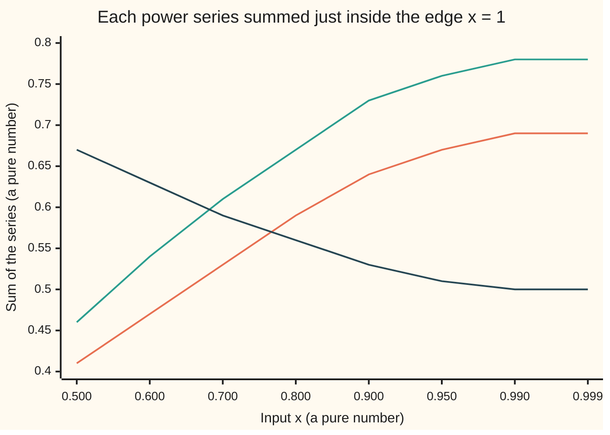

# Abel's limit theorem: a power series that converges at the edge of its interval is continuous there

[Syllabus](../../../SYLLABUS.md) → [Calculus and analysis](../README.md) → [Series](../README.md#s06) → Abel's limit theorem

---

## General Overview

The sum 1 − 1/2 + 1/3 − 1/4 + ⋯ settles on one number, because its signs alternate and its terms shrink ([Alternating series](03-alternating-and-conditional-convergence.md)). After 1,000 terms it reads 0.692647.

Put a dial on it: multiply term n by $`x^n`$, for an input $`x`$ just below 1. The result is the power series of $`\ln(1+x)`$, the natural log of 1 + x ([Power series](04-power-series.md)).

At $`x = 0.9`$ it is 0.641854; at 0.99, 0.688135; at 0.999, 0.692647. These head for $`\ln 2 = 0.693147`$. The series diverges past x = 1, the edge of its interval.

Abel's limit theorem says the two meet: when the series at the edge converges, the values inside slide onto it. So 1 − 1/2 + 1/3 − ⋯ is $`\ln 2`$. The same argument gives 1 − 1/3 + 1/5 − ⋯ = π/4 = 0.785398. Abel, who proved it, complained in a letter that hardly any infinite series had a rigorously determined sum.

The theorem runs one way only. The series $`1 - x + x^2 - \cdots`$ equals 1/(1 + x) inside, which heads for 1/2. At the edge it becomes 1 − 1 + 1 − ⋯, whose running totals flip between 1 and 0 for ever.

**If a power series still converges at the edge of its interval, its value there is the limit of its values just inside, so the function it defines has no jump at the edge.**

**What kind of fact this is:** a theorem, proved on this card in Why it works; the failed converse is shown by an example.

### The picture: three series as the dial nears 1



Orange is the log series, heading for ln 2 = 0.693147. Teal is $`x - x^3/3 + x^5/5 - \cdots`$, heading for π/4 = 0.785398. Dark blue is $`1 - x + x^2 - \cdots`$, heading for 1/2, though its edge series has no sum.

---

## The formula

A power series here is $`a_0 + a_1 x + a_2 x^2 + \cdots`$ with fixed numbers $`a_n`$, the coefficients. Setting $`x = 1`$ gives the **edge series** $`a_0 + a_1 + a_2 + \cdots`$. Its running totals $`s_n = a_0 + \cdots + a_n`$ are the **partial sums**. $`x \to 1^-`$ means x rises to 1 from below.

```math
\sum_{n=0}^{\infty} a_n = s \quad \Longrightarrow \quad \lim_{x \to 1^-} \sum_{n=0}^{\infty} a_n x^n = s
```

**Read it aloud:** if the edge series adds up to s, then the power series, summed at x and with x rising to 1, heads for the same s.

The proof rests on one inequality, **Abel's lemma**. A **run** is a stretch of consecutive terms, $`a_{N+1} + \cdots + a_m`$.

```math
\lvert a_{N+1} + \cdots + a_m \rvert \le \varepsilon \text{ for every } m > N \quad \Longrightarrow \quad \Big\lvert \sum_{n=N+1}^{M} a_n x^n \Big\rvert \le \varepsilon\, x^{N+1} \text{ for } M > N,\; 0 \le x \le 1
```

**Read it aloud:** if every run after term N stays within ε of zero, the same run weighted by powers of any x from 0 to 1 stays within ε times x to the power N + 1.

For the log series, every run after term 10 is at most 1/11 = 0.090909 in size. Over terms 11 to 60, at 101 inputs from 0 to 1, the worst weighted run is 0.039248.

| Symbol | Plain meaning | In our example | Push it up and the answer… |
| --- | --- | --- | --- |
| $`a_n`$ | the n-th coefficient; at x = 1, the n-th term of the edge series | $`(-1)^{n+1}/n`$ for the log | — |
| $`x`$, $`t`$ | the dial, from 0 up to 1; t, a stand-in input in an area | 0.9, 0.99, 0.999 | nearer the edge sum s |
| $`n`$, $`N`$, $`M`$ | term counter; the term after which runs are small; where a run stops | N = 10, M = 60 | larger N, smaller tail |
| $`f(x)`$ | the power series summed at x | $`\ln 1.999 = 0.692647`$ | — |
| $`s`$ | the sum of the edge series | $`\ln 2 = 0.693147`$ | — |
| $`s_n`$ | partial sum of the edge series, through term n | 0.692647 after 1,000 terms | closer to s |
| $`\varepsilon`$, $`B_m`$ | cap on every run after term N; $`B_m`$, the run up to term m | 1/11 = 0.090909 | weaker bound |
| $`x \to 1^-`$ | x rising to 1 from below | 0.9, 0.99, 0.999 | — |

### When it holds

- **The edge series must converge.** If it does not, the inside limit may still exist and mislead: 1/(1 + x) heads for 1/2 while 1 − 1 + 1 − ⋯ has no sum.
- **Approach from inside.** Past the edge the terms grow: at x = 1.01 the 1,000th term of the log series is −20.96.
- **One edge at a time.** At x = −1 the same theorem applies after replacing x with −x, and for any finite radius R > 0 after replacing x with x/R.

---

## Why it works

### Step 0: steady shrinking weights cannot blow up a small run

Inside, term n has weight $`x^n`$: at most 1, and falling as n grows. A run with a small plain total stays small when scaled by falling weights below 1.

So one cutoff N serves the whole interval: the series converges **uniformly**, with one tolerance for every input ([Uniform convergence](07-uniform-convergence.md)). A uniform limit of continuous functions is continuous, and continuity at 1 is the theorem.

### Step 1: runs of a convergent series are small

The edge series converges, so for any tolerance ε there is an N past which every run is within ε of zero: a run is the difference of two partial sums that both sit near s. For the log series, a run after term N is at most $`1/(N+1)`$ in size, because its signs alternate and its terms shrink.

### Step 2: Abel's lemma, by summation by parts

Regroup the weighted run so each running total of the run is multiplied by the drop in weight from one term to the next ([Summation by parts](11-summation-by-parts-and-dirichlets-test.md)). The drops are never negative and add up to $`x^{N+1}`$, the first weight. Each running total is at most ε in size, so the weighted run is at most ε times $`x^{N+1}`$.

<details>
<summary>Detailed proof: Abel's lemma</summary>

Let $`B_m = a_{N+1} + \cdots + a_m`$ for $`m > N`$, and $`B_N = 0`$. Then $`a_n = B_n - B_{n-1}`$. Substitute and regroup:

$`\displaystyle \sum_{n=N+1}^{M} a_n x^n = \sum_{n=N+1}^{M-1} B_n \left(x^n - x^{n+1}\right) + B_M x^M.`$

For $`0 \le x \le 1`$ each bracket $`x^n - x^{n+1}`$ is at least 0. The brackets and the last weight $`x^M`$ telescope: they add to $`x^{N+1}`$. With every $`\lvert B_n\rvert \le \varepsilon`$,

$`\displaystyle \Big\lvert \sum_{n=N+1}^{M} a_n x^n \Big\rvert \le \varepsilon \left( \sum_{n=N+1}^{M-1} \left(x^n - x^{n+1}\right) + x^M \right) = \varepsilon\, x^{N+1}.`$

</details>

### Step 3: one cutoff serves every input

Let M grow. The tail after term N is then at most ε at every x from 0 to 1, and the bound has no x in it. That is uniform convergence on the closed interval, edge included.

### Step 4: polynomials in, a continuous function out

Each partial sum is a polynomial, so it is continuous: it has no jumps ([Continuity](../01-Limits%20and%20Continuity/05-continuity.md)). Their uniform limit $`f`$ is continuous too, and continuity at 1 says $`f(x) \to f(1) = s`$ as $`x \to 1^-`$.

### Step 5: ln 2 and π/4

- **The log.** Inside, $`\ln(1+x) = x - x^2/2 + x^3/3 - \cdots`$. The edge series converges and the log is continuous, so both sides have one limit: 1 − 1/2 + 1/3 − ⋯ = ln 2 = 0.693147. [Alternating series](03-alternating-and-conditional-convergence.md) and [Power series](04-power-series.md) needed a remainder estimate for this; Abel needs only convergence at the edge.
- **The arctangent.** $`\arctan x`$ is the angle, in radians, whose tangent is x. Integrating $`1/(1+t^2) = 1 - t^2 + t^4 - \cdots`$ term by term gives $`\arctan x = x - x^3/3 + x^5/5 - \cdots`$ inside. The edge series converges, and the angle whose tangent is 1 is π/4, so 1 − 1/3 + 1/5 − ⋯ = π/4 = 0.785398.

### Step 6: a second road, the average of the partial sums

Summation by parts turns the power series into an average of the edge's partial sums. For 0 < x < 1, the weights $`(1-x)x^n`$ are positive and add to 1:

```math
f(x) - s = (1 - x) \sum_{n=0}^{\infty} (s_n - s)\, x^n
```

**Read it aloud:** the gap between the inside value and the edge sum is a weighted average of the partial sums' gaps.

As x rises to 1, any fixed stretch of early terms gets weight near 0, and the late gaps are small. At x = 0.9 both sides equal −0.051293.

It also explains $`1 - x + x^2 - \cdots`$: its partial sums are 1, 0, 1, 0, …, and their weighted average tends to 1/2.

### Step 7: the converse fails

The theorem needs convergence at the edge; it never produces it. Inside, $`1 - x + x^2 - \cdots`$ is 0.526316 at 0.9, 0.502513 at 0.99 and 0.500250 at 0.999, heading for 1/2. Its edge partial sums take only the values 1 and 0.

---

## Worked numbers, by hand

| Step | Arithmetic | Value |
| --- | --- | --- |
| log series at 0.9, 0.99, 0.999 | $`x - x^2/2 + x^3/3 - \cdots`$ | 0.641854, 0.688135, 0.692647 |
| their gaps to ln 2 | 0.693147 minus each | 0.051293, 0.005013, 0.000500 |
| edge, 1,000 terms | 1 − 1/2 + 1/3 − ⋯, 1,000 terms | 0.692647 |
| arctan series at 0.9, 0.99, 0.999 | $`x - x^3/3 + x^5/5 - \cdots`$ | 0.732815, 0.780373, 0.784898 |
| their gaps to π/4 | 0.785398 minus each | 0.052583, 0.005025, 0.000500 |
| edge, 1,000 terms | 1 − 1/3 + 1/5 − ⋯, 1,000 terms | 0.785148 |
| Abel's lemma, terms 11 to 60 | worst weighted run against 1/11 | 0.039248 ≤ 0.090909 |
| average road at 0.9 | $`(1-x)\sum (s_n - s)x^n`$ | −0.051293 |
| limits from inside | Abel's theorem | **ln 2 = 0.693147, π/4 = 0.785398** |

The inside values close on the edge sums, as continuity promises.

### What breaks if you drop a piece

| Mistake | Comes out at | What went wrong |
| --- | --- | --- |
| Read Abel backwards on $`1 - x + x^2 - \cdots`$ | 0.500250 at 0.999; edge sums 1, 0, 1, 0, 1, 0 | an inside limit is no edge sum |
| Plug x = 1 into $`1/(1+x)^2`$ for $`1 - 2x + 3x^2 - \cdots`$ | 0.250250 at 0.999; edge sums 1, −1, 2, −2, 3, −3 | the edge diverges, so Abel is silent |
| Approach from outside, x = 1.01 | 1,000th log term −20.96 | past the radius the terms grow |

---

## Code, from first principles, and it actually runs

Road one sums each series term by term just below 1. Road two shares no arithmetic with it: Simpson's rule (an area estimate from thin strips topped by parabolas) under $`1/(1+t)`$ and $`1/(1+t^2)`$, giving ln(1 + x), arctan x, ln 2 and π/4. Road three is the averaging identity of Step 6.

### Python

```python
# Abel's limit theorem -- the check behind the card.  Nothing is imported.
# Road one sums each power series term by term just inside the edge, x < 1.
# Road two shares no arithmetic with it: Simpson areas under 1/(1+t) and
# 1/(1+t^2), which are ln(1+x) and arctan x.  Road three is the averaging
# identity f(x) - s = (1 - x) times the sum of (s_n - s) x^n.  Abel's lemma,
# the summation-by-parts bound, is tested at 101 inputs from 0 to 1.
def series(coef, x):                   # coef(0) + coef(1) x + ... until x^n < 1e-16
    total, n, p = 0.0, 0, 1.0
    while p > 1e-16:
        total, n, p = total + coef(n) * p, n + 1, p * x
    return total
def simpson(g, b, m=4000):             # area under g from 0 to b, parabola strips
    h = b / m
    return h / 3 * (g(0) + g(b) + sum((4 if k % 2 else 2) * g(k * h) for k in range(1, m)))
def partial(coef, N):                  # edge partial sums s_0, ..., s_N at x = 1
    out, s = [], 0.0
    for n in range(N + 1):
        s += coef(n)
        out.append(s)
    return out
ln_c = lambda n: 0.0 if n == 0 else (-1) ** (n + 1) / n          # x - x^2/2 + x^3/3 - ...
at_c = lambda n: 0.0 if n % 2 == 0 else (-1) ** (n // 2) / n     # x - x^3/3 + x^5/5 - ...
geo_c = lambda n: float((-1) ** n)                                # 1 - x + x^2 - ...
row = lambda v, d=6: ", ".join(f"{t:.{d}f}" for t in v)
xs = [0.9, 0.99, 0.999]
ln2, pi4 = simpson(lambda t: 1 / (1 + t), 1.0), simpson(lambda t: 1 / (1 + t * t), 1.0)
for name, c, g, s, last in (("ln(1+x)", ln_c, lambda t: 1 / (1 + t), ln2, 1000),
                            ("arctan x", at_c, lambda t: 1 / (1 + t * t), pi4, 1999)):
    inside, areas, edge = [series(c, x) for x in xs], [simpson(g, x) for x in xs], partial(c, last)[-1]
    print(f"{name} series at x = 0.9, 0.99, 0.999: {row(inside)}; areas {row(areas)}")
    print(f"  edge value {s:.6f}; gaps {row(s - v for v in inside)}; 1000 edge terms {edge:.6f}")
    assert all(abs(v - a) < 1e-9 for v, a in zip(inside, areas))      # road one = road two
    assert s - inside[2] < s - inside[1] < s - inside[0] and s - inside[2] < 0.001
    assert abs(edge - s) < 1 / (last + 2)                             # alternating-series bound
N, M, grid = 10, 60, [k / 100 for k in range(101)]
cap = max(abs(sum(ln_c(n) for n in range(N + 1, m + 1))) for m in range(N + 1, M + 1))
tails = [abs(sum(ln_c(n) * x ** n for n in range(N + 1, M + 1))) for x in grid]
ok = all(t <= cap * x ** (N + 1) + 1e-15 for t, x in zip(tails, grid))
print(f"Abel's lemma, terms 11 to 60 of ln(1+x), 101 inputs: worst tail {max(tails):.6f}; "
      f"cap {cap:.6f} x^11 never beaten: {'yes' if ok else 'no'}")
assert ok
f9, sn = series(ln_c, 0.9), partial(ln_c, 400)
avg = (1 - 0.9) * sum((v - ln2) * 0.9 ** n for n, v in enumerate(sn))
print(f"average road at x = 0.9: f(x) - s = {f9 - ln2:.6f}; (1 - x) sum (s_n - s) x^n = {avg:.6f}")
assert abs((f9 - ln2) - avg) < 1e-9
g3, gs = [series(geo_c, x) for x in xs], partial(geo_c, 1000)
print(f"1 - x + x^2 - ... at 0.9, 0.99, 0.999: {row(g3)}; 1/(1+x): {row(1 / (1 + x) for x in xs)}")
print(f"  edge partial sums of 1 - 1 + 1 - ...: {row(gs[:6], 0)}, ...; values taken: {sorted(set(gs))}")
assert all(abs(v - 1 / (1 + x)) < 1e-9 for v, x in zip(g3, xs)) and sorted(set(gs)) == [0.0, 1.0]
e3 = series(lambda n: (-1) ** n * (n + 1.0), 0.999)
print(f"mistake, 1 - 2x + 3x^2 - ... at 0.999: {e3:.6f}, 1/(1+x)^2 = {1 / 1.999 ** 2:.6f}; "
      f"edge sums {row(partial(lambda n: (-1) ** n * (n + 1.0), 5), 0)}")
print(f"mistake, past the edge: term 1000 of the ln series at x = 1.01 is {ln_c(1000) * 1.01 ** 1000:.2f}")
cx = [0.5, 0.6, 0.7, 0.8, 0.9, 0.95, 0.99, 0.999]
print(f"chart, x: {row(cx, 3)}")
for name, c in (("ln(1+x)", ln_c), ("arctan x", at_c), ("1/(1+x)", geo_c)):
    print(f"chart, {name} by its series: {row((series(c, x) for x in cx), 2)}")
print("ALL CHECKS PASS")
```

**Ran 2026-11-23 on macOS, Python 3.14.10, standard library only. All checks passed. Output, pasted from the run:**

```
ln(1+x) series at x = 0.9, 0.99, 0.999: 0.641854, 0.688135, 0.692647; areas 0.641854, 0.688135, 0.692647
  edge value 0.693147; gaps 0.051293, 0.005013, 0.000500; 1000 edge terms 0.692647
arctan x series at x = 0.9, 0.99, 0.999: 0.732815, 0.780373, 0.784898; areas 0.732815, 0.780373, 0.784898
  edge value 0.785398; gaps 0.052583, 0.005025, 0.000500; 1000 edge terms 0.785148
Abel's lemma, terms 11 to 60 of ln(1+x), 101 inputs: worst tail 0.039248; cap 0.090909 x^11 never beaten: yes
average road at x = 0.9: f(x) - s = -0.051293; (1 - x) sum (s_n - s) x^n = -0.051293
1 - x + x^2 - ... at 0.9, 0.99, 0.999: 0.526316, 0.502513, 0.500250; 1/(1+x): 0.526316, 0.502513, 0.500250
  edge partial sums of 1 - 1 + 1 - ...: 1, 0, 1, 0, 1, 0, ...; values taken: [0.0, 1.0]
mistake, 1 - 2x + 3x^2 - ... at 0.999: 0.250250, 1/(1+x)^2 = 0.250250; edge sums 1, -1, 2, -2, 3, -3
mistake, past the edge: term 1000 of the ln series at x = 1.01 is -20.96
chart, x: 0.500, 0.600, 0.700, 0.800, 0.900, 0.950, 0.990, 0.999
chart, ln(1+x) by its series: 0.41, 0.47, 0.53, 0.59, 0.64, 0.67, 0.69, 0.69
chart, arctan x by its series: 0.46, 0.54, 0.61, 0.67, 0.73, 0.76, 0.78, 0.78
chart, 1/(1+x) by its series: 0.67, 0.63, 0.59, 0.56, 0.53, 0.51, 0.50, 0.50
ALL CHECKS PASS
```

### Rust

Same numbers, same labels, built with `rustc --edition 2021 -O`.

```rust
// Abel's limit theorem -- the same check as the Python, in Rust, std only.
// Road one sums each power series term by term just inside the edge, x < 1.
// Road two shares no arithmetic with it: Simpson areas under 1/(1+t) and
// 1/(1+t^2), which are ln(1+x) and arctan x.  Road three is the averaging
// identity f(x) - s = (1 - x) times the sum of (s_n - s) x^n.  Abel's lemma,
// the summation-by-parts bound, is tested at 101 inputs from 0 to 1.
fn series(coef: fn(i64) -> f64, x: f64) -> f64 { // coef(0) + coef(1) x + ... until x^n < 1e-16
    let (mut total, mut n, mut p) = (0.0, 0, 1.0);
    while p > 1e-16 { total += coef(n) * p; n += 1; p *= x; }
    total
}
fn simpson(g: fn(f64) -> f64, b: f64) -> f64 { // area under g from 0 to b, parabola strips
    let m = 4000;
    let h = b / m as f64;
    let inner = (1..m).fold(0.0, |a, k| a + (if k % 2 == 1 { 4.0 } else { 2.0 }) * g(k as f64 * h));
    h / 3.0 * (g(0.0) + g(b) + inner)
}
fn partial(coef: fn(i64) -> f64, big_n: i64) -> Vec<f64> { // edge partial sums s_0, ..., s_N at x = 1
    let mut s = 0.0;
    (0..=big_n).map(|n| { s += coef(n); s }).collect()
}
fn sgn(k: i64) -> f64 { if k % 2 == 0 { 1.0 } else { -1.0 } } // (-1)^k
fn ln_c(n: i64) -> f64 { if n == 0 { 0.0 } else { sgn(n + 1) / n as f64 } } // x - x^2/2 + ...
fn at_c(n: i64) -> f64 { if n % 2 == 0 { 0.0 } else { sgn(n / 2) / n as f64 } } // x - x^3/3 + ...
fn geo_c(n: i64) -> f64 { sgn(n) } // 1 - x + x^2 - ...
fn eu_c(n: i64) -> f64 { sgn(n) * (n as f64 + 1.0) } // 1 - 2x + 3x^2 - ...
fn row(v: &[f64], d: usize) -> String {
    v.iter().map(|t| format!("{:.*}", d, t)).collect::<Vec<_>>().join(", ")
}
fn main() {
    let xs = [0.9, 0.99, 0.999];
    let (gl, ga): (fn(f64) -> f64, fn(f64) -> f64) = (|t| 1.0 / (1.0 + t), |t| 1.0 / (1.0 + t * t));
    let (ln2, pi4) = (simpson(gl, 1.0), simpson(ga, 1.0));
    for (name, c, g, s, last) in [("ln(1+x)", ln_c as fn(i64) -> f64, gl, ln2, 1000), ("arctan x", at_c, ga, pi4, 1999)] {
        let inside: Vec<f64> = xs.iter().map(|&x| series(c, x)).collect();
        let areas: Vec<f64> = xs.iter().map(|&x| simpson(g, x)).collect();
        let edge = *partial(c, last).last().unwrap();
        let gaps: Vec<f64> = inside.iter().map(|v| s - v).collect();
        println!("{} series at x = 0.9, 0.99, 0.999: {}; areas {}", name, row(&inside, 6), row(&areas, 6));
        println!("  edge value {:.6}; gaps {}; 1000 edge terms {:.6}", s, row(&gaps, 6), edge);
        assert!(inside.iter().zip(&areas).all(|(v, a)| (v - a).abs() < 1e-9)); // road one = road two
        assert!(gaps[2] < gaps[1] && gaps[1] < gaps[0] && gaps[2] < 0.001);
        assert!((edge - s).abs() < 1.0 / (last + 2) as f64); // alternating-series bound
    }
    let (big_n, big_m) = (10, 60);
    let grid: Vec<f64> = (0..=100).map(|k| k as f64 / 100.0).collect();
    let cap = (big_n + 1..=big_m).map(|m| (big_n + 1..=m).map(ln_c).sum::<f64>().abs()).fold(0.0, f64::max);
    let tails: Vec<f64> = grid.iter()
        .map(|&x| (big_n + 1..=big_m).map(|n| ln_c(n) * x.powi(n as i32)).sum::<f64>().abs()).collect();
    let ok = tails.iter().zip(&grid).all(|(t, x)| *t <= cap * x.powi(big_n as i32 + 1) + 1e-15);
    println!("Abel's lemma, terms 11 to 60 of ln(1+x), 101 inputs: worst tail {:.6}; cap {:.6} x^11 never beaten: {}",
        tails.iter().cloned().fold(0.0, f64::max), cap, if ok { "yes" } else { "no" });
    assert!(ok);
    let (f9, sn) = (series(ln_c, 0.9), partial(ln_c, 400));
    let avg = (1.0 - 0.9) * sn.iter().enumerate().map(|(n, v)| (v - ln2) * 0.9_f64.powi(n as i32)).sum::<f64>();
    println!("average road at x = 0.9: f(x) - s = {:.6}; (1 - x) sum (s_n - s) x^n = {:.6}", f9 - ln2, avg);
    assert!(((f9 - ln2) - avg).abs() < 1e-9);
    let g3: Vec<f64> = xs.iter().map(|&x| series(geo_c, x)).collect();
    let closed: Vec<f64> = xs.iter().map(|x| 1.0 / (1.0 + x)).collect();
    let gs = partial(geo_c, 1000);
    let mut vals = gs.clone();
    vals.sort_by(|a, b| a.partial_cmp(b).unwrap());
    vals.dedup();
    println!("1 - x + x^2 - ... at 0.9, 0.99, 0.999: {}; 1/(1+x): {}", row(&g3, 6), row(&closed, 6));
    println!("  edge partial sums of 1 - 1 + 1 - ...: {}, ...; values taken: {:?}", row(&gs[..6], 0), vals);
    assert!(g3.iter().zip(&closed).all(|(v, w)| (v - w).abs() < 1e-9) && vals == vec![0.0, 1.0]);
    println!("mistake, 1 - 2x + 3x^2 - ... at 0.999: {:.6}, 1/(1+x)^2 = {:.6}; edge sums {}",
        series(eu_c, 0.999), 1.0 / 1.999_f64.powi(2), row(&partial(eu_c, 5), 0));
    println!("mistake, past the edge: term 1000 of the ln series at x = 1.01 is {:.2}", ln_c(1000) * 1.01_f64.powi(1000));
    let cx = [0.5, 0.6, 0.7, 0.8, 0.9, 0.95, 0.99, 0.999];
    println!("chart, x: {}", row(&cx, 3));
    for (name, c) in [("ln(1+x)", ln_c as fn(i64) -> f64), ("arctan x", at_c), ("1/(1+x)", geo_c)] {
        let v: Vec<f64> = cx.iter().map(|&x| series(c, x)).collect();
        println!("chart, {} by its series: {}", name, row(&v, 2));
    }
    println!("ALL CHECKS PASS");
}
```

**Ran 2026-11-23 on macOS, rustc 1.98.1, no crates. All checks passed. Output, pasted from the run:**

```
ln(1+x) series at x = 0.9, 0.99, 0.999: 0.641854, 0.688135, 0.692647; areas 0.641854, 0.688135, 0.692647
  edge value 0.693147; gaps 0.051293, 0.005013, 0.000500; 1000 edge terms 0.692647
arctan x series at x = 0.9, 0.99, 0.999: 0.732815, 0.780373, 0.784898; areas 0.732815, 0.780373, 0.784898
  edge value 0.785398; gaps 0.052583, 0.005025, 0.000500; 1000 edge terms 0.785148
Abel's lemma, terms 11 to 60 of ln(1+x), 101 inputs: worst tail 0.039248; cap 0.090909 x^11 never beaten: yes
average road at x = 0.9: f(x) - s = -0.051293; (1 - x) sum (s_n - s) x^n = -0.051293
1 - x + x^2 - ... at 0.9, 0.99, 0.999: 0.526316, 0.502513, 0.500250; 1/(1+x): 0.526316, 0.502513, 0.500250
  edge partial sums of 1 - 1 + 1 - ...: 1, 0, 1, 0, 1, 0, ...; values taken: [0.0, 1.0]
mistake, 1 - 2x + 3x^2 - ... at 0.999: 0.250250, 1/(1+x)^2 = 0.250250; edge sums 1, -1, 2, -2, 3, -3
mistake, past the edge: term 1000 of the ln series at x = 1.01 is -20.96
chart, x: 0.500, 0.600, 0.700, 0.800, 0.900, 0.950, 0.990, 0.999
chart, ln(1+x) by its series: 0.41, 0.47, 0.53, 0.59, 0.64, 0.67, 0.69, 0.69
chart, arctan x by its series: 0.46, 0.54, 0.61, 0.67, 0.73, 0.76, 0.78, 0.78
chart, 1/(1+x) by its series: 0.67, 0.63, 0.59, 0.56, 0.53, 0.51, 0.50, 0.50
ALL CHECKS PASS
```

The two outputs match line for line.

### Lean

Lean proves Abel's theorem for every real power series, both edge sums, and the failed converse.

- Suppose the partial sums of the edge series head for s. Then the power series, summed at x, heads for s as x rises to 1.
- 1 − 1/2 + 1/3 − ⋯ adds up to ln 2, and 1 − 1/3 + 1/5 − ⋯ adds up to π/4.
- Take x with −1 < x < 1. Then $`1 - x + x^2 - \cdots`$ equals 1/(1 + x).
- As x rises to 1, $`1 - x + x^2 - \cdots`$ heads for 1/2. Yet the partial sums of 1 − 1 + 1 − ⋯ head for no number.
- The edge partial sums of 1 − 1 + 1 − ⋯ run 1, 0, 1, 0, 1, 0. Those of 1 − 2 + 3 − ⋯ run 1, −1, 2, −2, 3, −3.

The decimals, Abel's lemma, the average road, the Simpson areas and the chart are left to the Python and Rust checks.

```lean
-- Abel's limit theorem: if a real power series converges at x = 1, its values for x rising to 1 tend to that edge sum, which gives ln 2 and pi/4, and the converse fails.
import Mathlib.Analysis.Complex.AbelLimit
import Mathlib.Analysis.Real.Pi.Leibniz
import Mathlib.Analysis.SpecialFunctions.Log.Basic

open Filter Finset
open scoped Topology

/-- **Abel's limit theorem.** If the edge series `a 0 + a 1 + a 2 + ⋯` converges to `s`
(its partial sums tend to `s`), then the power series `∑ a n * x ^ n`, summed at `x` and
with `x` rising to 1 from below, tends to the same `s`. -/
theorem power_series_tendsto_edge_sum (a : ℕ → ℝ) (s : ℝ)
    (h : Tendsto (fun N => ∑ n ∈ range N, a n) atTop (𝓝 s)) :
    Tendsto (fun x => ∑' n, a n * x ^ n) (𝓝[<] 1) (𝓝 s) := by
  exact Real.tendsto_tsum_powerSeries_nhdsWithin_lt h

/-- **ln 2 and π/4 from the edge.** The edge series `1 - 1/2 + 1/3 - ⋯` adds up to `ln 2`,
and the edge series `1 - 1/3 + 1/5 - ⋯` adds up to `π/4`. -/
theorem alternating_harmonic_log_two_and_leibniz_pi_div_four :
    Tendsto (fun N => ∑ i ∈ range N, (-1 : ℝ) ^ i / (i + 1)) atTop (𝓝 (Real.log 2)) ∧
    Tendsto (fun N => ∑ i ∈ range N, (-1 : ℝ) ^ i / (2 * i + 1)) atTop (𝓝 (Real.pi / 4)) := by
  refine ⟨?_, Real.tendsto_sum_pi_div_four⟩
  obtain ⟨l, h⟩ :
      ∃ l, Tendsto (fun n ↦ ∑ i ∈ range n, (-1 : ℝ) ^ i / (i + 1)) atTop (𝓝 l) := by
    have := Antitone.tendsto_alternating_series_of_tendsto_zero
      (f := fun i : ℕ => 1 / ((i : ℝ) + 1)) ?_ ?_
    · obtain ⟨l, hl⟩ := this
      exact ⟨l, hl.congr fun n => sum_congr rfl fun i _ => by ring⟩
    · exact antitone_iff_forall_lt.mpr fun _ _ _ ↦ by gcongr
    · exact tendsto_one_div_add_atTop_nhds_zero_nat
  have abel := Real.tendsto_tsum_powerSeries_nhdsWithin_lt h
  have m : 𝓝[<] (1 : ℝ) ≤ 𝓝 1 := nhdsWithin_le_nhds
  replace abel := abel.mul (tendsto_id.mono_left m)
  rw [mul_one] at abel
  replace abel : Tendsto (fun x : ℝ => Real.log (1 + x)) (𝓝[<] 1) (𝓝 l) := by
    apply abel.congr'
    rw [eventuallyEq_nhdsWithin_iff, Metric.eventually_nhds_iff]
    refine ⟨1, zero_lt_one, fun y hy1 hy2 => ?_⟩
    rw [Real.dist_eq, abs_sub_lt_iff] at hy1
    rw [Set.mem_Iio] at hy2
    have ny : |-y| < 1 := by rw [abs_neg, abs_lt]; constructor <;> linarith
    have hs := Real.hasSum_pow_div_log_of_abs_lt_one ny
    rw [sub_neg_eq_add] at hs
    rw [← neg_neg (Real.log (1 + y)), ← hs.tsum_eq, ← tsum_neg, ← tsum_mul_right]
    congr 1; ext n
    simp only [id]
    rw [neg_pow y]
    ring
  have hc : Tendsto (fun x : ℝ => Real.log (1 + x)) (𝓝[<] 1) (𝓝 (Real.log (1 + 1))) :=
    ((Real.continuousAt_log (by norm_num)).tendsto.comp
      ((continuous_const.add continuous_id).tendsto 1)).mono_left m
  rw [tendsto_nhds_unique abel hc] at h
  norm_num at h
  exact h

/-- **The converse fails.** Inside the interval, `1 - x + x^2 - ⋯` equals `1/(1 + x)` and
tends to `1/2` as `x` rises to 1, yet the edge series `1 - 1 + 1 - ⋯` has no sum. -/
theorem abel_converse_fails :
    (∀ x : ℝ, -1 < x → x < 1 → ∑' n, (-1 : ℝ) ^ n * x ^ n = 1 / (1 + x)) ∧
    Tendsto (fun x : ℝ => ∑' n, (-1 : ℝ) ^ n * x ^ n) (𝓝[<] 1) (𝓝 (1 / 2)) ∧
    ¬ ∃ s : ℝ, Tendsto (fun N => ∑ i ∈ range N, (-1 : ℝ) ^ i) atTop (𝓝 s) := by
  have key : ∀ x : ℝ, -1 < x → x < 1 → ∑' n, (-1 : ℝ) ^ n * x ^ n = 1 / (1 + x) := by
    intro x h1 h2
    have hx : |-x| < 1 := by rw [abs_neg, abs_lt]; constructor <;> linarith
    simp_rw [← mul_pow, neg_one_mul]
    rw [tsum_geometric_of_abs_lt_one hx, one_div, sub_neg_eq_add]
  refine ⟨key, ?_, ?_⟩
  · have m : 𝓝[<] (1 : ℝ) ≤ 𝓝 1 := nhdsWithin_le_nhds
    have hc : Tendsto (fun x : ℝ => 1 / (1 + x)) (𝓝[<] 1) (𝓝 (1 / 2)) := by
      have : Tendsto (fun x : ℝ => 1 / (1 + x)) (𝓝 1) (𝓝 (1 / (1 + 1))) :=
        tendsto_const_nhds.div (tendsto_const_nhds.add tendsto_id) (by norm_num)
      norm_num at this
      simpa only [one_div] using this.mono_left m
    apply hc.congr'
    rw [eventuallyEq_nhdsWithin_iff, Metric.eventually_nhds_iff]
    refine ⟨1, zero_lt_one, fun y hy1 hy2 => ?_⟩
    rw [Real.dist_eq, abs_sub_lt_iff] at hy1
    rw [Set.mem_Iio] at hy2
    exact (key y (by linarith) hy2).symm
  · rintro ⟨s, hs⟩
    have h1 := (hs.comp (tendsto_add_atTop_nat 1)).sub hs
    rw [sub_self] at h1
    have h2 : Tendsto (fun N : ℕ => (-1 : ℝ) ^ N) atTop (𝓝 0) :=
      h1.congr fun N => by rw [Function.comp_apply, sum_range_succ]; ring
    have h3 := h2.norm
    simp only [norm_pow, norm_neg, norm_one, one_pow, norm_zero] at h3
    exact one_ne_zero (tendsto_nhds_unique tendsto_const_nhds h3)

/-- The edge partial sums of `1 - 1 + 1 - ⋯` run 1, 0, 1, 0, 1, 0. -/
example : (List.range 6).map (fun N => ∑ i ∈ range (N + 1), (-1 : ℤ) ^ i)
    = [1, 0, 1, 0, 1, 0] := by
  decide

/-- The edge partial sums of `1 - 2 + 3 - ⋯` run 1, -1, 2, -2, 3, -3. -/
example : (List.range 6).map (fun N => ∑ i ∈ range (N + 1), (-1 : ℤ) ^ i * (i + 1))
    = [1, -1, 2, -2, 3, -3] := by
  decide

#print axioms power_series_tendsto_edge_sum
#print axioms alternating_harmonic_log_two_and_leibniz_pi_div_four
#print axioms abel_converse_fails
```

**Checked 2026-11-23 on macOS, Lean 4.36.0-rc2, Mathlib v4.36.0-rc2. Every proof is complete and uses only Lean's standard axioms. Output, pasted from the run:**

```
'power_series_tendsto_edge_sum' depends on axioms: [propext, Classical.choice, Quot.sound]
'alternating_harmonic_log_two_and_leibniz_pi_div_four' depends on axioms: [propext, Classical.choice, Quot.sound]
'abel_converse_fails' depends on axioms: [propext, Classical.choice, Quot.sound]
```

> [!TIP]
> **Try changing**
> Guess first, then run it.
> - **Creep closer to the edge.** Change `xs` to `[0.9, 0.99, 0.9999]`. Guess the last gap to ln 2. It drops about tenfold again, and every assert passes.
> - **Tighten Abel's lemma past the truth.** In the `ok` line, change `x ** (N + 1)` to `x ** (N + 5)`. Guess whether it survives. It fails at small x, and the lemma's assert stops the run.
> - **Make the edge diverge.** Change `ln_c` to return `1 / n` for every n above 0. Guess what happens near 1. The run prints 2.302585, 4.605170, 6.907755, climbing like −ln(1 − x) without limit, then the first assert stops it.
> - **Starve the average road.** Change `partial(ln_c, 400)` to `partial(ln_c, 40)`. The weights beyond term 40 still matter, so Step 6's assert stops the run.

---

## The usual mistake

> [!warning]
> **Reading the theorem backwards.** A finite limit as x rises to 1 does not make the edge series converge. The series $`1 - x + x^2 - \cdots`$ is 0.500250 at 0.999 and heads for 1/2, yet its edge partial sums run 1, 0, 1, 0, 1, 0.
>
> - **Plugging x = 1 into a closed form.** The series $`1 - 2x + 3x^2 - \cdots`$ equals $`1/(1+x)^2`$, 0.250250 at 0.999. Setting x = 1 suggests 1/4, but the edge sums run 1, −1, 2, −2, 3, −3.
> - **Approaching from outside.** At x = 1.01 the 1,000th log term is −20.96; past the radius the series has no sum.

---

## Where you meet it in real life

- **Computing π.** Abel's theorem makes 1 − 1/3 + 1/5 − ⋯ = π/4 true. It converges too slowly for real work; formulas such as Machin's sum arctangent series well inside the interval.
- **Probability generating functions.** The chances of a count 0, 1, 2, … become the coefficients of a power series. Abel's theorem lets the total chance and the mean be read as limits as x rises to 1.
- **Discounting.** A payment stream valued with a discount factor below 1 is a power series in that factor. As the interest rate falls to 0, the value tends to the undiscounted total, whenever that total converges.

> **Say it back**
> If a power series converges at the edge, its values just inside head for that edge sum. Falling weights $`x^n`$ cannot enlarge a small run, so one cutoff serves every x. Uniform convergence then makes the sum continuous at the edge. So 1 − 1/2 + 1/3 − ⋯ = ln 2 and 1 − 1/3 + 1/5 − ⋯ = π/4. The converse fails: 1/(1 + x) heads for 1/2, but 1 − 1 + 1 − ⋯ has no sum.

---

## What this builds on

- [Summation by parts](11-summation-by-parts-and-dirichlets-test.md): the regrouping that proves Abel's lemma.
- [Power series](04-power-series.md): the radius, and the log series inside it.
- [Uniform convergence](07-uniform-convergence.md): why a uniform limit of polynomials is continuous.
- [Alternating series](03-alternating-and-conditional-convergence.md): why both edge series converge.

## Where this goes next

- [The Cauchy product](13-cauchy-product-and-mertens-theorem.md): Abel's theorem shows a convergent product of two series sums to the product of their sums.
- [Exp, log, sine, cosine and pi from series alone](14-exp-log-and-trig-from-power-series.md): the log and π built from series alone.

Left open: when does a limit from inside force the edge series to converge? Tauberian theorems answer that (the first asks that n times $`a_n`$ shrink to 0), while The Cauchy product uses Abel's theorem next to rescue products of convergent series.

---

## Sources

Verified 2026-11-23: every link below resolves to the publisher's page.

- Abbott, Stephen. *Understanding Analysis*, 2nd ed. Springer, 2015. [Publisher page](https://link.springer.com/book/10.1007/978-1-4939-2712-8). Chapter 6, section 6.5: Abel's lemma and Abel's theorem, proved by uniform convergence on the closed interval.
- O'Connor, J. J., and E. F. Robertson. "Niels Henrik Abel." MacTutor Archive, University of St Andrews. [Biography](https://mathshistory.st-andrews.ac.uk/Biographies/Abel/). Abel's letter on the lack of rigor in infinite series.
