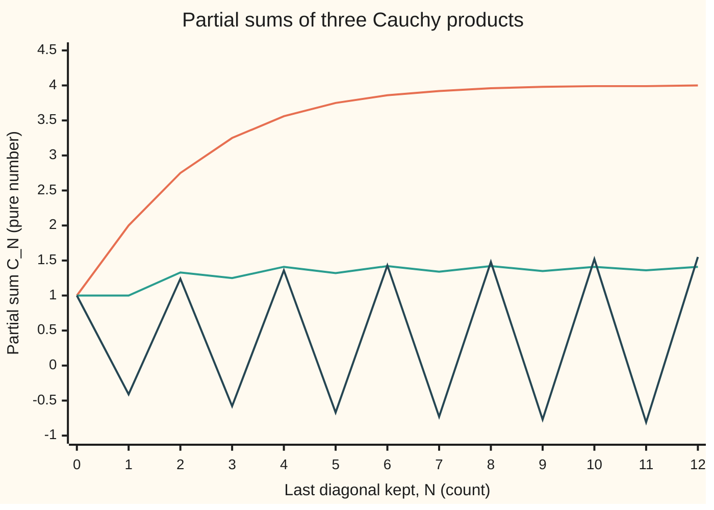

# The Cauchy product: multiply two series term by term, and when the answer is the product of the sums

[Syllabus](../../../SYLLABUS.md) → [Calculus and analysis](../README.md) → [Series](../README.md#s06) → The Cauchy product

---

## General Overview

The geometric series 1 + 1/2 + 1/4 + …, the halving series, adds up to 2 ([Infinite series](01-series-convergence.md)). Multiply it by itself. The answer should be 2 × 2 = 4.

But each factor never ends, so multiplying out the brackets makes an endless grid: every term of one factor times every term of the other. Adding an endless grid needs an order. The standard order walks its diagonals. Diagonal n holds the products whose two positions add to n, and its total is term n of a new series.

Here diagonal n holds n + 1 products of 1/2^n each. The new terms are (n + 1)/2^n: 1, 1, 0.75, 0.5, 0.3125, 0.1875, …. They add up to 4. The new series is the **Cauchy product**.

It does not always work. The series 1 − 1/√2 + 1/√3 − … settles on 0.604899, so its square should be 0.365902. Its Cauchy product's terms never drop below 1 in size, so it has no sum. In 1875 Franz Mertens gave a condition that guarantees success: one factor converges even with every sign made positive.

This is not [Mertens' theorems](../../21-Algebraic%20and%20analytic%20number%20theory/01-Arithmetic%20Functions%20Again/09-mertens-theorems.md) on prime numbers, by the same mathematician.

**Add the grid of products along its diagonals; if both factors converge and at least one converges absolutely, the diagonal totals add up to the product of the two sums.**

**What kind of fact this is:** a theorem (Mertens' theorem), proved on this card in Why it works; the Cauchy product itself is a definition.

### The picture: the grid, cut into diagonals

Rows are the first factor's terms, columns the second's, counted from position 0. Diagonal n runs from the top row down to the left column, through the cells whose two positions add to n.

| first × second | 1 | 1/2 | 1/4 | 1/8 |
| --- | --- | --- | --- | --- |
| **1** | 1 | 1/2 | 1/4 | 1/8 |
| **1/2** | 1/2 | 1/4 | 1/8 | 1/16 |
| **1/4** | 1/4 | 1/8 | 1/16 | 1/32 |
| **1/8** | 1/8 | 1/16 | 1/32 | 1/64 |

Diagonal 2 is the three cells of 1/4, total 0.75.

---

## The formula

The factors have terms $`a_n`$ and $`b_n`$, from position 0, and sums $`A`$ and $`B`$. The **Cauchy product** has terms

```math
c_n = \sum_{k=0}^{n} a_k\, b_{n-k} = a_0 b_n + a_1 b_{n-1} + \cdots + a_n b_0 .
```

**Read it aloud:** the n-th term pairs position k of the first factor with position n minus k of the second, for every k from 0 to n, and adds the products.

A series **converges absolutely** when its sizes $`\lvert a_n\rvert`$, the terms with their signs dropped, add to a finite total ([Alternating series](03-alternating-and-conditional-convergence.md)). Mertens' theorem says

```math
\sum_{n=0}^{\infty} \lvert a_n\rvert < \infty \ \text{ and } \ \sum_{n=0}^{\infty} b_n = B \quad \Longrightarrow \quad \sum_{n=0}^{\infty} c_n = A\,B .
```

**Read it aloud:** if the first factor converges absolutely and the second converges at all, the Cauchy product converges, to the product of the sums.

On the halving series, $`c_n = (n+1)/2^n`$, and

```math
\Bigl(\sum_{n=0}^{\infty} \frac{1}{2^n}\Bigr)^{2} = \sum_{n=0}^{\infty} \frac{n+1}{2^n} = 2 \times 2 = 4 .
```

| Symbol | Plain meaning | In our example | Push it up and the answer… |
| --- | --- | --- | --- |
| $`a_n`$, $`b_n`$ | the two factors' terms, from position 0; $`\lvert a_n\rvert`$ is a size | 1/2^n and 1/2^n | — |
| $`k`$, $`n`$ | a position in the first factor; the diagonal number | diagonal 2 holds k = 0, 1, 2 | longer diagonal, more products |
| $`c_n`$ | the n-th term of the Cauchy product: diagonal n's total | (n + 1)/2^n: 1, 1, 0.75, 0.5 | — |
| $`A`$, $`B`$ | the sums of the two factors | 2 and 2 | product sum AB grows |
| $`N`$; $`A_N`$, $`B_N`$, $`C_N`$ | the last position kept; partial sums, totals through position N | N = 10: $`C_{10}`$ = 3.987305 | smaller miss |
| $`\beta_m`$, $`R_N`$ | in the proof: $`B_m - B`$, the second factor's miss; and the leftover it builds | both head for 0 | — |
| $`\varepsilon`$, $`H`$, $`K`$, $`T`$, $`x`$ | in the folds: a tolerance, a ceiling on every miss, a cut-off position, the sizes' total, a power-series input | T = 2 for the halving series | — |
| $`S`$ | the sum of 1 − 1/√2 + 1/√3 − … | 0.604899; squared 0.365902 | — |

### When it holds

- **Both factors converge, and at least one converges absolutely.** Drop absolute convergence and the square of 1 − 1/√2 + 1/√3 − … has product terms of size 1 or more: no sum.
- **The answer may converge only conditionally.** For (1 + 1/2 + 1/4 + …)(1 − 1/2 + 1/3 − …), the product's sizes add to 3.467045 by position 100 and 4.991202 by 1000, still growing.
- **The diagonal order is part of the definition.** When both factors converge absolutely, every order of the grid gives AB; otherwise another order can give another answer.

---

## Why it works

### Step 0: the diagonal total is a weighted mix of the second factor's partial sums

The triangle of cells on diagonals 0 to N can be added by rows instead. Row k keeps $`a_k`$ times the second factor's terms up to position N − k. So $`C_N`$ is $`a_0 B_N + a_1 B_{N-1} + \cdots + a_N B_0`$.

Each $`B_m`$ is close to B once m is large. Only the last few rows use short, inaccurate partial sums, and absolute convergence makes their weights tiny.

### Step 1: split off the answer

Write $`B_m = B + \beta_m`$, where $`\beta_m`$ is the miss, heading for 0. Then

```math
C_N = A_N\, B + R_N, \qquad R_N = a_0 \beta_N + a_1 \beta_{N-1} + \cdots + a_N \beta_0 .
```

**Read it aloud:** the product's partial sum is the first factor's partial sum times B, plus a leftover that mixes the misses.

$`A_N B`$ heads for $`AB`$. Everything now rests on the leftover $`R_N`$ heading for 0.

### Step 2: the leftover dies, because the sizes have a finite total

Cut $`R_N`$ in two. Early rows pair $`a_k`$ with a late, small miss: their total is at most that miss times the finite total of sizes.

The last few rows pair a late $`a_k`$ with any miss. The misses share one ceiling, and the late sizes add to almost nothing. Both pieces shrink, so $`C_N`$ heads for AB.

<details>
<summary>Detailed proof: Mertens' theorem</summary>

The misses $`\beta_m`$ head for 0, so they are bounded: pick $`H > 0`$ with every $`\lvert \beta_m\rvert \le H`$. Let $`T`$ be the total of the sizes $`\lvert a_n\rvert`$. Given $`\varepsilon > 0`$, pick $`K`$ with $`\lvert \beta_m\rvert < \varepsilon`$ for every $`m \ge K`$.

For $`N > K`$, split $`R_N`$ at row $`N - K`$:

$`\displaystyle \lvert R_N\rvert \le \sum_{k=0}^{N-K} \lvert a_k\rvert\,\lvert \beta_{N-k}\rvert + \sum_{k=N-K+1}^{N} \lvert a_k\rvert\,\lvert \beta_{N-k}\rvert \le \varepsilon\, T + H \sum_{k=N-K+1}^{N} \lvert a_k\rvert .`$

As N grows, the last sum's K positions slide out along a series whose sizes have a finite total, so it heads for 0. Once it is below $`\varepsilon / H`$, $`\lvert R_N\rvert`$ is at most $`\varepsilon T + \varepsilon`$. That holds for every $`\varepsilon`$, so $`R_N`$ heads for 0.

</details>

### Step 3: without absolute convergence, the diagonals stay big

Take $`a_n = b_n = (-1)^n/\sqrt{n+1}`$, the series 1 − 1/√2 + 1/√3 − …. Every product on diagonal n carries the same sign, $`(-1)^n`$. Each one's size is $`1/\sqrt{(k+1)(n-k+1)}`$.

The two numbers $`k+1`$ and $`n-k+1`$ add to $`n+2`$. Two numbers with a fixed sum have the largest product when they are equal, so their product is at most $`((n+2)/2)^2`$. Each of the $`n+1`$ products is therefore at least $`2/(n+2)`$ in size, and

```math
\lvert c_n\rvert \ge \frac{2(n+1)}{n+2} \ge 1 .
```

**Read it aloud:** every diagonal total is at least one in size, whatever n is.

Terms that never shrink to 0 cannot have a sum ([Infinite series](01-series-convergence.md)). The sizes run 1, 1.4142, 1.6547, 1.8165, and the totals swing: $`C_{98}`$ = 1.790925, $`C_{99}`$ = −1.059841.

### Step 4: one absolute factor, worked

Multiply the halving series by 1 − 1/2 + 1/3 − …, which converges only conditionally, to ln 2 = 0.693147181. Mertens promises 2 × ln 2 = 1.386294361. The partial sums give 1.413832 at N = 10, 1.389568 at 100, 1.386627 at 1000 and 1.386461 at 2000.

The product's terms shrink like 2/3 divided by n + 1: (n + 1) times the size of $`c_{1000}`$ is 0.666445. Those sizes add like the harmonic series, so the product converges only conditionally.



Orange: the halving series squared, closing on 4. Teal: the halving series times 1 − 1/2 + 1/3 − …, zigzagging in on 1.386294361. Dark blue: 1 − 1/√2 + 1/√3 − … squared, whose swings widen instead.

<details>
<summary>Abel's rescue: when all three series converge</summary>

If the two factors and their Cauchy product all converge, the product's sum is AB, even with no absolute convergence. Put $`x^n`$ on every term.

For x between 0 and 1 the power series converge absolutely: a convergent series has bounded terms, so its sizes times $`x^n`$ are capped by a geometric series. So Mertens applies, and letting x rise to 1 via [Abel's limit theorem](12-abels-limit-theorem.md) carries each sum to its value at 1.

</details>

---

## Worked numbers, by hand

| Step | Arithmetic | Value |
| --- | --- | --- |
| diagonal 0 | 1 × 1 | 1 |
| diagonal 1 | 1 × 1/2 + 1/2 × 1 | 1 |
| diagonal 2 | three cells of 1/4 | 0.75 |
| diagonal 3 | four cells of 1/8 | 0.5 |
| diagonals 4 and 5 | five cells of 1/16; six of 1/32 | 0.3125, 0.1875 |
| through diagonal 10 | 4 − 13/1024 | 3.987305 |
| all diagonals | 2 × 2 | **4** |

The partial sums follow $`C_N = 4 - (N+3)/2^N`$. It holds at N = 0, and each new term $`(N+1)/2^N`$ is exactly the drop from $`(N+2)/2^{N-1}`$ to $`(N+3)/2^N`$. So the diagonal totals close in on 4, the product of the sums.

### What breaks if you drop a piece

| Mistake | Comes out at | What went wrong |
| --- | --- | --- |
| Multiply matching positions only | 1 + 1/4 + 1/16 + … = 1.333333 | Drops every cell off the main diagonal of the grid |
| Square 1 − 1/√2 + 1/√3 − … by diagonals | $`C_{98}`$ = 1.790925, $`C_{99}`$ = −1.059841, not 0.365902 | Neither factor converges absolutely |
| Expect $`C_N = A_N B_N`$ | 3.987305 against 3.996095 at N = 10 | The triangle leaves out the square's far corner; only the limits agree |
| Read Mertens as promising absolute convergence | sizes total 4.991202 by 1000, still growing | Geometric times alternating converges only conditionally |

---

## Code, from first principles, and it actually runs

Road one builds each Cauchy product by looping over each diagonal's cells. Road two supplies independent values: the count (n + 1)/2^n, the closed form for $`C_N`$, ln 2 by Simpson's rule (parabolas through pairs of thin strips under 1/(1 + t)), and Step 3's bound. A last run prices the rising bond.

### Python

```python
# Cauchy product and Mertens' theorem -- the check behind the card.  Nothing is
# imported.  The product of two series adds the grid of products a_k * b_m
# along its diagonals k + m = n.  Road one convolves the term lists; road two
# uses closed forms, and an independent ln 2 from Simpson's rule.

def cauchy(a, b):                        # c_n = a_0 b_n + a_1 b_(n-1) + ... + a_n b_0
    out = []
    for n in range(len(a)):
        s = 0.0
        for k in range(n + 1):
            s += a[k] * b[n - k]
        out.append(s)
    return out
def running(terms):                      # partial sums: entry N totals terms 0..N
    out, s = [], 0.0
    for t in terms:
        s += t
        out.append(s)
    return out
def simpson(f, a, b, panels):            # parabolas through each pair of strips
    h, s = (b - a) / panels, f(a) + f(b)
    for i in range(1, panels):
        s += (4 if i % 2 else 2) * f(a + i * h)
    return s * h / 3

geo = [0.5 ** n for n in range(2001)]                 # 1 + 1/2 + 1/4 + ..., sum 2
c = cauchy(geo[:60], geo[:60])
C, A = running(c), running(geo[:60])
print("halving: c_n for n=0..5: " + " ".join(f"{x:.4f}" for x in c[:6]))
print(f"halving: C_10={C[10]:.6f}  4-13/1024={4 - 13 / 1024:.6f}  A_10*B_10={A[10] ** 2:.6f}")
print(f"halving: C_59={C[59]:.6f}  A*B={A[59] * A[59]:.6f}")
assert all(abs(c[n] - (n + 1) / 2 ** n) < 1e-15 for n in range(60))   # count the diagonal
assert all(abs(C[N] - (4 - (N + 3) / 2 ** N)) < 1e-12 for N in range(60))
same = running([x * x for x in geo[:60]])[59]
print(f"mistake, positions matched a_n*b_n: {same:.6f}, not 4")
L = simpson(lambda t: 1.0 / (1.0 + t), 0.0, 1.0, 2000)
alt = [(-1) ** n / (n + 1) for n in range(2001)]      # 1 - 1/2 + 1/3 - ..., sum ln 2
m = cauchy(geo, alt); M = running(m)
print(f"ln 2 by Simpson={L:.9f}  2 ln 2={2 * L:.9f}")
print("mertens: C_N at N=10, 100, 1000, 2000: " + " ".join(f"{M[N]:.6f}" for N in (10, 100, 1000, 2000)))
assert abs((M[1999] + M[2000]) / 2 - 2 * L) < 1e-6   # neighbours straddle 2 ln 2
sizes = running([abs(x) for x in m])
print(f"mertens: (n+1)|c_n| at n=1000: {1001 * abs(m[1000]):.6f}; sum |c_n| to 100, 1000: {sizes[100]:.6f} {sizes[1000]:.6f}")
sq = [(-1) ** n / (n + 1) ** 0.5 for n in range(1000001)]   # 1 - 1/sqrt 2 + 1/sqrt 3 - ...
P = running(sq)
S = (P[999999] + P[1000000]) / 2                      # average two neighbouring totals
d = cauchy(sq[:200], sq[:200]); D = running(d)
print(f"conditional: S={S:.6f}  S^2={S * S:.6f}")
print("conditional: |c_n| for n=0..5: " + " ".join(f"{abs(x):.4f}" for x in d[:6]))
assert all(abs(d[n]) >= 2 * (n + 1) / (n + 2) for n in range(200))   # never below 1
print(f"conditional: |c_n| >= 2(n+1)/(n+2) >= 1 for every n < 200; C_98={D[98]:.6f}  C_99={D[99]:.6f}")
for name, line in (("halving", C), ("mertens", M), ("conditional", D)):
    print(f"chart {name} C_N, N=0..12: " + " ".join(f"{x:.2f}" for x in line[:13]))
v = 1 / 1.05                                          # one year's discount at 5%
due = [v ** n for n in range(1500)]                   # 1 now and every year after
late = [0.0] + due[1:]                                # 1 at the end of every year
rising = cauchy(due, late)                            # n paid at the end of year n
print(f"bond at 5%: due={running(due)[-1]:.6f}  level={running(late)[-1]:.6f}  rising={running(rising)[-1]:.6f}")
assert abs(running(rising)[-1] - 21 * 20) < 1e-6 and abs(rising[7] - 7 * v ** 7) < 1e-12
print("ALL CHECKS PASS")
```

**Ran 2026-11-27 on macOS, Python 3.14.10, standard library only. All checks passed. Output, pasted from the run:**

```
halving: c_n for n=0..5: 1.0000 1.0000 0.7500 0.5000 0.3125 0.1875
halving: C_10=3.987305  4-13/1024=3.987305  A_10*B_10=3.996095
halving: C_59=4.000000  A*B=4.000000
mistake, positions matched a_n*b_n: 1.333333, not 4
ln 2 by Simpson=0.693147181  2 ln 2=1.386294361
mertens: C_N at N=10, 100, 1000, 2000: 1.413832 1.389568 1.386627 1.386461
mertens: (n+1)|c_n| at n=1000: 0.666445; sum |c_n| to 100, 1000: 3.467045 4.991202
conditional: S=0.604899  S^2=0.365902
conditional: |c_n| for n=0..5: 1.0000 1.4142 1.6547 1.8165 1.9349 2.0263
conditional: |c_n| >= 2(n+1)/(n+2) >= 1 for every n < 200; C_98=1.790925  C_99=-1.059841
chart halving C_N, N=0..12: 1.00 2.00 2.75 3.25 3.56 3.75 3.86 3.92 3.96 3.98 3.99 3.99 4.00
chart mertens C_N, N=0..12: 1.00 1.00 1.33 1.25 1.41 1.32 1.42 1.34 1.42 1.35 1.41 1.36 1.41
chart conditional C_N, N=0..12: 1.00 -0.41 1.24 -0.58 1.36 -0.67 1.43 -0.73 1.48 -0.77 1.52 -0.81 1.55
bond at 5%: due=21.000000  level=20.000000  rising=420.000000
ALL CHECKS PASS
```

### Rust

Same numbers, same labels, built with `rustc --edition 2021 -O`.

```rust
// Cauchy product and Mertens' theorem -- the same check as the Python, in Rust.
// No crates.  The product of two series adds the grid of products a_k * b_m
// along its diagonals k + m = n.  Road one convolves the term lists; road two
// uses closed forms, and an independent ln 2 from Simpson's rule.

fn cauchy(a: &[f64], b: &[f64]) -> Vec<f64> {  // c_n = a_0 b_n + a_1 b_(n-1) + ... + a_n b_0
    (0..a.len()).map(|n| {
        let mut s = 0.0;
        for k in 0..=n { s += a[k] * b[n - k] }
        s
    }).collect()
}
fn running(terms: &[f64]) -> Vec<f64> {         // partial sums: entry N totals terms 0..N
    let mut s = 0.0;
    terms.iter().map(|t| { s += t; s }).collect()
}
fn simpson(f: impl Fn(f64) -> f64, a: f64, b: f64, panels: usize) -> f64 {
    let h = (b - a) / panels as f64;            // parabolas through each pair of strips
    let mut s = f(a) + f(b);
    for i in 1..panels { s += (if i % 2 == 1 { 4.0 } else { 2.0 }) * f(a + i as f64 * h) }
    s * h / 3.0
}
fn row(xs: &[f64], digits: usize) -> String {
    xs.iter().map(|x| format!("{:.*}", digits, x)).collect::<Vec<_>>().join(" ")
}
fn sign(n: usize) -> f64 { if n % 2 == 0 { 1.0 } else { -1.0 } }

fn main() {
    let geo: Vec<f64> = (0..2001).map(|n| 0.5f64.powi(n)).collect();   // 1 + 1/2 + 1/4 + ..., sum 2
    let c = cauchy(&geo[..60], &geo[..60]);
    let (cc, a) = (running(&c), running(&geo[..60]));
    println!("halving: c_n for n=0..5: {}", row(&c[..6], 4));
    println!("halving: C_10={:.6}  4-13/1024={:.6}  A_10*B_10={:.6}", cc[10], 4.0 - 13.0 / 1024.0, a[10] * a[10]);
    println!("halving: C_59={:.6}  A*B={:.6}", cc[59], a[59] * a[59]);
    assert!((0..60).all(|n| (c[n] - (n + 1) as f64 / 2f64.powi(n as i32)).abs() < 1e-15)); // count the diagonal
    assert!((0..60).all(|n| (cc[n] - (4.0 - (n + 3) as f64 / 2f64.powi(n as i32))).abs() < 1e-12));
    let same = running(&geo[..60].iter().map(|x| x * x).collect::<Vec<_>>())[59];
    println!("mistake, positions matched a_n*b_n: {:.6}, not 4", same);
    let l = simpson(|t| 1.0 / (1.0 + t), 0.0, 1.0, 2000);
    let alt: Vec<f64> = (0..2001).map(|n| sign(n) / (n + 1) as f64).collect(); // 1 - 1/2 + 1/3 - ..., sum ln 2
    let m = cauchy(&geo, &alt);
    let mm = running(&m);
    println!("ln 2 by Simpson={:.9}  2 ln 2={:.9}", l, 2.0 * l);
    println!("mertens: C_N at N=10, 100, 1000, 2000: {}", row(&[mm[10], mm[100], mm[1000], mm[2000]], 6));
    assert!(((mm[1999] + mm[2000]) / 2.0 - 2.0 * l).abs() < 1e-6); // neighbours straddle 2 ln 2
    let sizes = running(&m.iter().map(|x| x.abs()).collect::<Vec<_>>());
    println!("mertens: (n+1)|c_n| at n=1000: {:.6}; sum |c_n| to 100, 1000: {:.6} {:.6}", 1001.0 * m[1000].abs(), sizes[100], sizes[1000]);
    let sq: Vec<f64> = (0..1000001).map(|n| sign(n) / ((n + 1) as f64).powf(0.5)).collect(); // 1 - 1/sqrt 2 + ...
    let p = running(&sq);
    let s = (p[999999] + p[1000000]) / 2.0;      // average two neighbouring totals
    let d = cauchy(&sq[..200], &sq[..200]);
    let dd = running(&d);
    println!("conditional: S={:.6}  S^2={:.6}", s, s * s);
    println!("conditional: |c_n| for n=0..5: {}", row(&d[..6].iter().map(|x| x.abs()).collect::<Vec<_>>(), 4));
    assert!((0..200).all(|n| d[n].abs() >= 2.0 * (n + 1) as f64 / (n + 2) as f64)); // never below 1
    println!("conditional: |c_n| >= 2(n+1)/(n+2) >= 1 for every n < 200; C_98={:.6}  C_99={:.6}", dd[98], dd[99]);
    for (name, line) in [("halving", &cc), ("mertens", &mm), ("conditional", &dd)] {
        println!("chart {} C_N, N=0..12: {}", name, row(&line[..13], 2));
    }
    let v: f64 = 1.0 / 1.05;                      // one year's discount at 5%
    let due: Vec<f64> = (0..1500).map(|n| v.powi(n)).collect();   // 1 now and every year after
    let mut late = due.clone();                   // 1 at the end of every year
    late[0] = 0.0;
    let rising = cauchy(&due, &late);             // n paid at the end of year n
    let total = *running(&rising).last().unwrap();
    println!("bond at 5%: due={:.6}  level={:.6}  rising={:.6}", running(&due)[1499], running(&late)[1499], total);
    assert!((total - 21.0 * 20.0).abs() < 1e-6 && (rising[7] - 7.0 * v.powi(7)).abs() < 1e-12);
    println!("ALL CHECKS PASS");
}
```

**Ran 2026-11-27 on macOS, rustc 1.98.1, no crates. All checks passed. Output, pasted from the run:**

```
halving: c_n for n=0..5: 1.0000 1.0000 0.7500 0.5000 0.3125 0.1875
halving: C_10=3.987305  4-13/1024=3.987305  A_10*B_10=3.996095
halving: C_59=4.000000  A*B=4.000000
mistake, positions matched a_n*b_n: 1.333333, not 4
ln 2 by Simpson=0.693147181  2 ln 2=1.386294361
mertens: C_N at N=10, 100, 1000, 2000: 1.413832 1.389568 1.386627 1.386461
mertens: (n+1)|c_n| at n=1000: 0.666445; sum |c_n| to 100, 1000: 3.467045 4.991202
conditional: S=0.604899  S^2=0.365902
conditional: |c_n| for n=0..5: 1.0000 1.4142 1.6547 1.8165 1.9349 2.0263
conditional: |c_n| >= 2(n+1)/(n+2) >= 1 for every n < 200; C_98=1.790925  C_99=-1.059841
chart halving C_N, N=0..12: 1.00 2.00 2.75 3.25 3.56 3.75 3.86 3.92 3.96 3.98 3.99 3.99 4.00
chart mertens C_N, N=0..12: 1.00 1.00 1.33 1.25 1.41 1.32 1.42 1.34 1.42 1.35 1.41 1.36 1.41
chart conditional C_N, N=0..12: 1.00 -0.41 1.24 -0.58 1.36 -0.67 1.43 -0.73 1.48 -0.77 1.52 -0.81 1.55
bond at 5%: due=21.000000  level=20.000000  rising=420.000000
ALL CHECKS PASS
```

### Lean

Lean proves Mertens' theorem for any two real series, and checks the card's two worked examples.

- Step 0 holds for any two series: the diagonals can be added by rows instead.
- Suppose the first factor converges absolutely to A, and the second converges, perhaps only conditionally, to B. Then the Cauchy product converges to AB.
- The series 1 − 1/√2 + 1/√3 − … converges.
- Every term of its Cauchy product with itself has size at least 1, so that product has no sum.
- Take the halving series times itself. Then term n of the Cauchy product is (n + 1)/2^n, and the terms add up to 4.
- The halving diagonal totals for n = 0 to 5 are 1, 1, 3/4, 1/2, 5/16 and 3/16.
- Through diagonal 10 the halving total is 4 − 13/1024.
- The rising bond's last step is 21 × 20 = 420.

The decimals, the ln 2 product, the chart and the bond's discounting are left to the Python and Rust checks.

```lean
-- The Cauchy product: if one series converges absolutely and the other converges, their diagonal-by-diagonal product converges to the product of the sums.
import Mathlib.Analysis.SpecialFunctions.Pow.Real
import Mathlib.Analysis.SpecificLimits.Basic
import Mathlib.Analysis.SpecificLimits.Normed
import Mathlib.Analysis.Normed.Group.Tannery
import Mathlib.Topology.Algebra.InfiniteSum.Real

open Finset Filter Topology

/-- Helper: the first N diagonals of the Cauchy product, regrouped by the first factor's index. -/
theorem cauchy_product_partial_sum_eq (a b : ℕ → ℝ) (N : ℕ) :
    ∑ n ∈ range N, ∑ k ∈ range (n + 1), a k * b (n - k)
      = ∑ k ∈ range N, a k * ∑ j ∈ range (N - k), b j := by
  induction N with
  | zero => simp
  | succ N ih =>
    rw [sum_range_succ, ih, sum_range_succ (fun k => a k * ∑ j ∈ range (N + 1 - k), b j) N,
      sum_range_succ (fun k => a k * b (N - k)) N]
    have h : ∀ k ∈ range N, a k * ∑ j ∈ range (N + 1 - k), b j
        = a k * ∑ j ∈ range (N - k), b j + a k * b (N - k) := by
      intro k hk
      rw [mem_range] at hk
      rw [show N + 1 - k = (N - k) + 1 by omega, sum_range_succ, mul_add]
    rw [sum_congr rfl h, sum_add_distrib]
    simp only [Nat.sub_self, Nat.add_sub_cancel_left, sum_range_one]
    ring

#print axioms cauchy_product_partial_sum_eq

/-- Mertens' theorem. Let the first factor converge absolutely (its sizes |a n| add to a finite
total) with sum `A`, and let the second factor converge, perhaps only conditionally, to `B`.
Then the Cauchy product, whose term n is `a 0 * b n + a 1 * b (n - 1) + ... + a n * b 0`,
converges to `A * B`. Convergence here means the partial sums head for the limit. -/
theorem cauchy_product_tendsto_mul_of_abs_summable (a b : ℕ → ℝ) (A B : ℝ)
    (ha : Summable fun n => |a n|)
    (hA : Tendsto (fun N => ∑ n ∈ range N, a n) atTop (𝓝 A))
    (hB : Tendsto (fun N => ∑ n ∈ range N, b n) atTop (𝓝 B)) :
    Tendsto (fun N => ∑ n ∈ range N, ∑ k ∈ range (n + 1), a k * b (n - k)) atTop
      (𝓝 (A * B)) := by
  set β : ℕ → ℝ := fun m => ∑ j ∈ range m, b j - B with hβdef
  have hβ : Tendsto β atTop (𝓝 0) := by simpa [β] using hB.sub_const B
  obtain ⟨M, hM⟩ : ∃ M, ∀ m, |β m| ≤ M := by
    obtain ⟨C, hC⟩ := isBounded_iff_forall_norm_le.1 (Metric.isBounded_range_of_tendsto β hβ)
    exact ⟨C, fun m => hC _ ⟨m, rfl⟩⟩
  have key : ∀ N, ∑ n ∈ range N, ∑ k ∈ range (n + 1), a k * b (n - k)
      = (∑ n ∈ range N, a n) * B + ∑' k, (if k < N then a k * β (N - k) else 0) := by
    intro N
    rw [tsum_eq_sum (s := range N) (fun k hk => by
      rw [mem_range] at hk; simp [hk])]
    rw [cauchy_product_partial_sum_eq, sum_mul, ← sum_add_distrib]
    apply sum_congr rfl
    intro k hk
    have hk' := mem_range.1 hk
    simp only [hk', ↓reduceIte, β]
    ring
  have hT : Tendsto (fun N => ∑' k, (if k < N then a k * β (N - k) else 0)) atTop (𝓝 0) := by
    have := tendsto_tsum_of_dominated_convergence
      (f := fun N k => if k < N then a k * β (N - k) else 0) (g := fun _ => (0 : ℝ))
      (bound := fun k => |a k| * M) (𝓕 := atTop) (ha.mul_right M) ?_ ?_
    · simpa using this
    · intro k
      have h1 : Tendsto (fun N => a k * β (N - k)) atTop (𝓝 0) := by
        simpa using (hβ.comp (tendsto_sub_atTop_nat k)).const_mul (a k)
      apply h1.congr'
      filter_upwards [eventually_gt_atTop k] with N hN
      simp [hN]
    · exact Eventually.of_forall fun N k => by
        split_ifs
        · rw [Real.norm_eq_abs, abs_mul]
          exact mul_le_mul_of_nonneg_left (hM _) (abs_nonneg _)
        · simpa using mul_nonneg (abs_nonneg (a k)) ((abs_nonneg _).trans (hM 0))
  refine Tendsto.congr (fun N => (key N).symm) ?_
  simpa using (hA.mul_const B).add hT

/-- Without absolute convergence it fails. The series 1 - 1/√2 + 1/√3 - ... converges, but every
term of its Cauchy square has size at least 1, so the square has no sum. -/
theorem cauchy_square_alternating_inv_sqrt_diverges :
    let a : ℕ → ℝ := fun n => (-1) ^ n / Real.sqrt (n + 1)
    (∃ S, Tendsto (fun N => ∑ n ∈ range N, a n) atTop (𝓝 S)) ∧
    (∀ n, 1 ≤ |∑ k ∈ range (n + 1), a k * a (n - k)|) ∧
    ¬ ∃ L, Tendsto (fun N => ∑ n ∈ range N, ∑ k ∈ range (n + 1), a k * a (n - k)) atTop
      (𝓝 L) := by
  intro a
  have h2 : ∀ n, 1 ≤ |∑ k ∈ range (n + 1), a k * a (n - k)| := by
    intro n
    have hterm : ∀ k ∈ range (n + 1), a k * a (n - k)
        = (-1) ^ n * (1 / (Real.sqrt ((k : ℝ) + 1) * Real.sqrt (((n - k : ℕ) : ℝ) + 1))) := by
      intro k hk
      have hk' : k ≤ n := Nat.lt_succ_iff.1 (mem_range.1 hk)
      simp only [a]
      rw [show ((-1 : ℝ)) ^ n = (-1) ^ k * (-1) ^ (n - k) by
        rw [← pow_add, Nat.add_sub_cancel' hk']]
      rw [div_mul_div_comm, mul_one_div]
    rw [sum_congr rfl hterm, ← mul_sum, abs_mul, abs_pow, abs_neg, abs_one, one_pow, one_mul]
    have hlow : ∀ k ∈ range (n + 1), 2 / ((n : ℝ) + 2)
        ≤ 1 / (Real.sqrt ((k : ℝ) + 1) * Real.sqrt (((n - k : ℕ) : ℝ) + 1)) := by
      intro k hk
      have hk' : k ≤ n := Nat.lt_succ_iff.1 (mem_range.1 hk)
      have hx : Real.sqrt ((k : ℝ) + 1) ^ 2 = (k : ℝ) + 1 := Real.sq_sqrt (by positivity)
      have hy : Real.sqrt (((n - k : ℕ) : ℝ) + 1) ^ 2 = ((n - k : ℕ) : ℝ) + 1 :=
        Real.sq_sqrt (by positivity)
      have hsum : ((n - k : ℕ) : ℝ) + k = n := by exact_mod_cast Nat.sub_add_cancel hk'
      have hxpos : 0 < Real.sqrt ((k : ℝ) + 1) := Real.sqrt_pos.2 (by positivity)
      have hypos : 0 < Real.sqrt (((n - k : ℕ) : ℝ) + 1) := Real.sqrt_pos.2 (by positivity)
      rw [div_le_div_iff₀ (by positivity) (by positivity)]
      nlinarith [sq_nonneg (Real.sqrt ((k : ℝ) + 1) - Real.sqrt (((n - k : ℕ) : ℝ) + 1))]
    have hs := sum_le_sum hlow
    rw [sum_const, card_range, nsmul_eq_mul] at hs
    rw [abs_of_nonneg (sum_nonneg fun k _ => by positivity)]
    refine le_trans ?_ hs
    rw [mul_div_assoc', le_div_iff₀ (by positivity)]
    push_cast
    linarith [(Nat.cast_nonneg n : (0 : ℝ) ≤ n)]
  refine ⟨?_, h2, ?_⟩
  · have hanti : Antitone fun n : ℕ => (Real.sqrt ((n : ℝ) + 1))⁻¹ := by
      intro m n hmn
      apply inv_anti₀ (Real.sqrt_pos.2 (by positivity))
      apply Real.sqrt_le_sqrt
      have : (m : ℝ) ≤ n := by exact_mod_cast hmn
      linarith
    have h0 : Tendsto (fun n : ℕ => (Real.sqrt ((n : ℝ) + 1))⁻¹) atTop (𝓝 0) := by
      apply tendsto_inv_atTop_zero.comp
      apply Real.tendsto_sqrt_atTop.comp
      exact tendsto_atTop_add_const_right _ 1 tendsto_natCast_atTop_atTop
    obtain ⟨l, hl⟩ := hanti.tendsto_alternating_series_of_tendsto_zero h0
    exact ⟨l, by simpa [a, div_eq_mul_inv] using hl⟩
  · rintro ⟨L, hL⟩
    have hc : Tendsto (fun n => ∑ k ∈ range (n + 1), a k * a (n - k)) atTop (𝓝 0) := by
      have := (hL.comp (tendsto_add_atTop_nat 1)).sub hL
      rw [sub_self] at this
      refine this.congr (fun n => ?_)
      simp [Function.comp, sum_range_succ]
    have := ge_of_tendsto' hc.abs h2
    norm_num at this

/-- The halving series squared: the Cauchy product of 1 + 1/2 + 1/4 + ... with itself has terms
(n + 1)/2^n, and they add up to 2 × 2 = 4. -/
theorem cauchy_square_geometric_half :
    (∀ n : ℕ, ∑ k ∈ range (n + 1), (1 / 2 : ℝ) ^ k * (1 / 2) ^ (n - k) = (n + 1) / 2 ^ n) ∧
    HasSum (fun n : ℕ => ∑ k ∈ range (n + 1), (1 / 2 : ℝ) ^ k * (1 / 2) ^ (n - k)) 4 := by
  have h1 : ∀ n : ℕ, ∑ k ∈ range (n + 1), (1 / 2 : ℝ) ^ k * (1 / 2) ^ (n - k)
      = (n + 1) / 2 ^ n := by
    intro n
    rw [sum_congr rfl (fun k hk => by
      rw [← pow_add, Nat.add_sub_cancel' (Nat.lt_succ_iff.1 (mem_range.1 hk))])]
    rw [sum_const, card_range, nsmul_eq_mul]
    push_cast
    rw [one_div_pow, mul_one_div]
  refine ⟨h1, ?_⟩
  simp_rw [h1]
  have hn := hasSum_coe_mul_geometric_of_norm_lt_one (r := (1 / 2 : ℝ)) (by norm_num)
  have := hn.add hasSum_geometric_two
  convert this using 1
  · funext n
    rw [one_div_pow]
    field_simp
  · norm_num

-- Worked numbers: the halving series' diagonal totals 1, 1, 3/4, 1/2, 5/16, 3/16.
example : (List.range 6).map (fun n => ∑ k ∈ range (n + 1), (1 / 2 : ℚ) ^ k * (1 / 2) ^ (n - k))
    = [1, 1, 3 / 4, 1 / 2, 5 / 16, 3 / 16] := by
  norm_num [List.range_succ, Finset.sum_range_succ]

-- Through diagonal 10 the total is 4 - 13/1024, matching C_N = 4 - (N + 3)/2^N.
example : ∑ n ∈ range 11, ∑ k ∈ range (n + 1), (1 / 2 : ℚ) ^ k * (1 / 2) ^ (n - k)
    = 4 - 13 / 1024 := by
  simp [Finset.sum_range_succ]; norm_num

-- The rising perpetual bond at 5%: 21 × 20 = 420.
example : (21 : ℕ) * 20 = 420 := by norm_num

#print axioms cauchy_product_tendsto_mul_of_abs_summable
#print axioms cauchy_square_alternating_inv_sqrt_diverges
#print axioms cauchy_square_geometric_half
```

**Checked 2026-11-27 on macOS, Lean 4.36.0-rc2, Mathlib v4.36.0-rc2. Every proof is complete and uses only Lean's standard axioms. Output, pasted from the run:**

```
'cauchy_product_partial_sum_eq' depends on axioms: [propext, Classical.choice, Quot.sound]
'cauchy_product_tendsto_mul_of_abs_summable' depends on axioms: [propext, Classical.choice, Quot.sound]
'cauchy_square_alternating_inv_sqrt_diverges' depends on axioms: [propext, Classical.choice, Quot.sound]
'cauchy_square_geometric_half' depends on axioms: [propext, Classical.choice, Quot.sound]
```

> [!TIP]
> **Try changing**
> - **Guess first:** in the square, change the power 0.5 to 0.7. The factor still converges only conditionally, but Step 3's floor now shrinks to 0 and proves nothing; $`\lvert c_1\rvert`$ = 1.2311 is under the old floor 4/3, so its assert fails.
> - **Guess first:** swap the two factors of the bond. The diagonals hold the same cells in reverse, so the price stays 420.
> - **Guess first:** in `cauchy`, stop k one short of n. The first halving-series assert fails.

---

## The usual mistake

> [!warning]
> **Assuming two convergent series always multiply to the product of their sums.** The diagonal adding needs one factor to converge absolutely. Squared by diagonals, 1 − 1/√2 + 1/√3 − … should give 0.365902; its partial sums swing between 1.790925 and −1.059841 near N = 99 and never settle.
>
> - **Matching positions only.** Keeping just $`a_n b_n`$ gives 1.333333, not 4.
> - **Comparing partial sums.** $`C_{10}`$ = 3.987305 but $`A_{10} B_{10}`$ = 3.996095; only the limits agree.
> - **Expecting absolute convergence.** With one conditional factor, the product's sizes total 4.991202 by position 1000, still growing.

---

## Where you meet it in real life

- **Rising perpetual bonds.** At 5% a year, 1 paid at the end of every year forever is worth 20; 1 paid now and yearly after is worth 21. A bond paying 1, 2, 3, … at the ends of years 1, 2, 3, … is a level bond started at each of years 0, 1, 2, …: in year n, n of them pay. Its price is the Cauchy product 21 × 20 = 420.
- **Adding independent counts.** Two people toss fair coins until heads. The chance their tails total n is (n + 1)/2^(n+2): the halving diagonals divided by 4.
- **Multiplying power series.** Inside both radii, power series multiply by the Cauchy product. [The binomial series and the number e](06-binomial-series-and-e.md) uses it for e × 1/e = 1. [Generating functions](../../04-Combinatorics%20and%20graphs/07-Generating%20Functions/01-ordinary-generating-functions.md) use the rule as bookkeeping, with no sum asked for.
- **Digital filters.** A filter's output is its input convolved with its response, the same formula. A response whose sizes have a finite total makes a stable filter.

> **Say it back**
> Multiplying two series makes an endless grid of products. The Cauchy product adds it along diagonals: term n pairs positions that add to n. If one factor converges absolutely and the other converges, the product converges to the product of the sums. The halving series squared gives terms (n + 1)/2^n, adding to 4. The square of 1 − 1/√2 + 1/√3 − … has terms at least 1 in size, so no sum.

---

## What this builds on

- [Power series](04-power-series.md): series in powers of x, which the Cauchy product multiplies coefficient by coefficient.
- [Alternating series](03-alternating-and-conditional-convergence.md): absolute and conditional convergence, and the sum ln 2 of 1 − 1/2 + 1/3 − ….
- [Convergence tests](02-comparison-ratio-and-root-tests.md): deciding when the sizes add to a finite total.
- [Abel's limit theorem](12-abels-limit-theorem.md): the tool that rescues the product when all three series converge.

## Where this goes next

- [Exp, log, sine, cosine and pi from series alone](14-exp-log-and-trig-from-power-series.md): the Cauchy product turns the exponential series into the rule that exponents add.
- [Mertens' theorems](../../21-Algebraic%20and%20analytic%20number%20theory/01-Arithmetic%20Functions%20Again/09-mertens-theorems.md): the same mathematician's results on primes, a different subject.

Left open: how much of calculus can be built from power series and the Cauchy product alone, with no geometry? Exp, log, sine, cosine and pi from series alone answers that next (while classifying which products of two conditionally convergent series still converge remains open here).

---

## Sources

Verified 2026-11-23: every link below resolves to the publisher's page.

- Lebl, Jiří. *Basic Analysis I*, §2.6 "More on series". [Free online text](https://www.jirka.org/ra/html/sec_moreonseries.html). Mertens' theorem (Theorem 2.6.5) with proof, and the square of 1 − 1/√2 + … that fails.
- Mertens, Franz. "Ueber die Multiplicationsregel für zwei unendliche Reihen." *Journal für die reine und angewandte Mathematik* 79 (1875). [DOI](https://doi.org/10.1515/crll.1875.79.182). The original theorem.
- Abbott, Stephen. *Understanding Analysis*, 2nd ed. Springer, 2015. [DOI](https://doi.org/10.1007/978-1-4939-2712-8). Chapter 2: double sums and products of series.
- Knopp, Konrad. *Theory and Application of Infinite Series*. Dover. [Publisher page](https://store.doverpublications.com/products/9780486661650). Multiplying series, with the theorems of Cauchy, Mertens and Abel.
