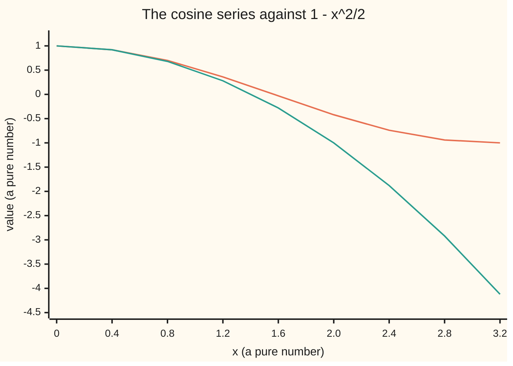

# Exp, log, sine, cosine and pi from series alone: the elementary functions rebuilt without pictures

[Syllabus](../../../SYLLABUS.md) → [Calculus and analysis](../README.md) → [Series](../README.md#s06) → Exp, log, sine, cosine and pi from series alone

---

## General Overview

A computer has no circle inside it, only arithmetic. One way it can find cos 1.5 is to add terms: 1, then minus 1.5 squared over 2, then plus 1.5 to the fourth over 24, and so on. Five terms give 0.070753. The full sum is 0.0707.

The same recipe at 1.6 gives −0.0292. The sum was positive at 1.5 and negative at 1.6, so it crossed zero in between. Halving that gap 50 times pins the crossing at 1.570796. Twice that is 3.141593: pi, found without drawing anything.

This card takes three power series (sums of powers of x, each with a fixed coefficient) as the definitions of exp, sine and cosine. Then it proves the core school facts about them from the series alone: exponents add, log undoes exp, and sine and cosine repeat every 2 pi.

**Three series, one multiplication rule and one differentiation rule rebuild exp, log, sine, cosine and pi, with no triangle, circle or area anywhere in the proofs.**

**What kind of fact this is:** definitions (exp, sin and cos as series, log as the inverse, pi as twice a zero), then theorems proved from them on this card in Why it works.

### The picture: the cosine series and its first two terms



Orange: the full cosine series. It crosses zero just below 1.6, at 1.570796. Green: its first two terms, 1 − x²/2, which cross at 1.414214.

---

## The formula

A reminder of notation: $`n!`$ ("n factorial") is $`1 \times 2 \times \cdots \times n`$, with $`0! = 1`$, and $`\sum_{n=0}^{\infty}`$ means "add the terms for n = 0, 1, 2, … for ever" ([Infinite series](01-series-convergence.md)). The three definitions:

```math
\exp x=\sum_{n=0}^{\infty}\frac{x^n}{n!},\qquad \cos x=\sum_{n=0}^{\infty}\frac{(-1)^n x^{2n}}{(2n)!},\qquad \sin x=\sum_{n=0}^{\infty}\frac{(-1)^n x^{2n+1}}{(2n+1)!}
```

**Read it aloud:** exp adds every power of x over its factorial; cosine keeps the even powers and sine the odd ones, with signs taking turns.

From those, the card defines log and pi and proves three facts:

```math
\exp(x+y)=\exp x\,\exp y,\qquad \pi = 2\times\big(\text{first positive zero of }\cos\big),\qquad \cos(x+2\pi)=\cos x,\ \ \sin(x+2\pi)=\sin x
```

**Read it aloud:** exp turns adding inputs into multiplying outputs; pi is twice the first place where cosine hits zero; shifting by 2 pi changes neither sine nor cosine.

The natural log, $`\log v`$, is the one number t with $`\exp t = v`$, for any v above 0.

| Symbol | Plain meaning | In our example | Push it up and the answer… |
| --- | --- | --- | --- |
| $`x`$, $`y`$ | inputs: plain numbers, no degrees or units | 1 and 1; then 1.5, 1.6 | — |
| $`n`$, $`k`$ | term counters | n = 0 to 5 shown | the terms shrink to 0 |
| $`\exp x`$; $`\cos x`$, $`\sin x`$ | the exp series; the cosine and sine series | exp 1 = 2.718282; cos 1.5 = 0.0707 | exp outgrows any power; cos and sin swing between −1 and 1 |
| $`c_n`$ | n-th term of the Cauchy product | 1, 2, 2, 1.333333, … | — |
| $`\log v`$; $`t`$, $`u`$ | for v above 0, the t with exp t = v; u, another number above 0 | log 2 = 0.693147 | climbs ever more slowly |
| $`p`$, $`\pi`$ | the first positive zero of cos; twice it | 1.570796; 3.141593 | — |
| $`f`$, $`g`$ | in the fold: how far each addition rule misses | 0 at every x | — |
| $`r`$, $`s`$, $`t`$, $`T`$ | real life: a yearly rate; years; a time; a wave's repeat time | — | — |

### When it holds

- **Both series converge absolutely** (the sizes of the terms add to a finite total). That licenses multiplying them by the Cauchy product. For series that converge only thanks to sign changes, the product can fail to converge ([The Cauchy product](13-cauchy-product-and-mertens-theorem.md)).
- **Differentiation term by term needs the input inside the radius of convergence** (the distance from 0 within which the series adds up). For these three series the radius is unlimited ([Power series](04-power-series.md)).
- **The series measures angles in radians.** Fed 90 for a right angle, it does not give 0.
- **Log needs v above 0.** Exp is never 0 or negative, so log 0 and log of a negative number do not exist.

---

## Why it works

### Step 0: two rules replace every picture

Two rules about series replace the circles, triangles and areas of school proofs.

- **Multiplying:** the product of two absolutely convergent series is their Cauchy product ([The Cauchy product](13-cauchy-product-and-mertens-theorem.md)).
- **Differentiating:** inside its radius, a power series can be differentiated one term at a time ([Power series](04-power-series.md)).

Add the [Intermediate value theorem](../01-Limits%20and%20Continuity/06-intermediate-value-theorem.md) (a continuous function that changes sign has a zero between), and everything follows.

### Step 1: the three series converge for every x

In the exp series, each term is the one before times $`x/(n+1)`$. Once n passes twice the size of x, that factor is below one half, so the terms shrink faster than a halving geometric series ([Convergence tests](02-comparison-ratio-and-root-tests.md)). Cosine and sine take every other term of the same sizes, so they converge too, absolutely, for every x.

### Step 2: exponents add, by the Cauchy product

Multiply the exp series at x and at y. The Cauchy product collects, as its n-th term, every pair of terms whose powers add to n:

```math
c_n=\sum_{k=0}^{n}\frac{x^k}{k!}\cdot\frac{y^{n-k}}{(n-k)!}=\frac{1}{n!}\sum_{k=0}^{n}\frac{n!}{k!\,(n-k)!}\,x^k y^{n-k}=\frac{(x+y)^n}{n!}
```

The middle sum is the binomial theorem's expansion of $`(x+y)^n`$, so the product is, term for term, the exp series at x + y.

With x = y = 1, the Cauchy terms are 1, 2, 2, 1.333333, 0.666667, 0.266667: exactly $`2^n/n!`$. Summed, they give 7.389056. That is exp 1 × exp 1 = 2.718282 squared, and it is exp 2.

### Step 3: exp is positive and climbing, so log exists

Three facts come from Step 2 and term-by-term differentiation.

1. $`\exp x \cdot \exp(-x) = \exp 0 = 1`$, so exp is never 0. And $`\exp x = (\exp(x/2))^2`$, so it is positive.
2. Differentiating term by term gives the exp series back, so exp is its own rate ([Derivatives of exp and log](../02-Derivatives/05-derivatives-of-exp-and-log.md)). A positive rate means exp always climbs ([Mean value theorem](../03-What%20Derivatives%20Tell%20You/02-mean-value-theorem.md)).
3. For x above 0, exp x is at least 1 + x, so it grows past any number. Since $`\exp(-x) = 1/\exp x`$, it also falls below any positive number.

So for each v above 0, exp goes from below v to above v. The intermediate value theorem gives a t with exp t = v, and climbing makes it the only one. That t is $`\log v`$. Bisection on exp gives log 2 = 0.693147.

Step 2 turns into the log rule, for any u and v above 0: $`\log(uv) = \log u + \log v`$. Check: log 2 + log 3 = 1.791759 = log 6.

### Step 4: sine and cosine, from their derivatives

Differentiate the series term by term. Each term of sine becomes a term of cosine, and each term of cosine becomes minus a term of sine:

```math
\frac{d}{dx}\sin x=\cos x,\qquad \frac{d}{dx}\cos x=-\sin x
```

The earlier card [Derivatives of sine and cosine](../02-Derivatives/04-derivatives-of-trig-functions.md) got these from a crank and a small-angle squeeze. Here they come from algebra on coefficients.

Two consequences follow, each from "a function whose rate is zero everywhere is constant" (the mean value theorem).

- **The square rule.** $`\sin^2 x + \cos^2 x`$ has rate $`2\sin x\cos x - 2\cos x\sin x = 0`$ and equals 1 at x = 0. So it is 1 everywhere. At x = 1: 0.841471² + 0.540302² = 1.000000.
- **The addition rules.** $`\cos(x+y) = \cos x\cos y - \sin x\sin y`$ and $`\sin(x+y) = \sin x\cos y + \cos x\sin y`$. The fold proves them.

<details>
<summary>Detailed proof: the addition rules from derivatives alone</summary>

Fix y. Let f and g measure how far each rule misses:

$`\displaystyle f(x)=\cos(x+y)-\cos x\cos y+\sin x\sin y,\qquad g(x)=\sin(x+y)-\sin x\cos y-\cos x\sin y`$

Differentiate with Step 4's rules: $`f' = -g`$ and $`g' = f`$. Then $`f^2 + g^2`$ has rate $`2f(-g) + 2gf = 0`$, so it is constant.

At x = 0, $`f = \cos y - \cos y = 0`$ and $`g = \sin y - \sin y = 0`$. So $`f^2 + g^2 = 0`$ for every x, which forces f = g = 0. Both rules hold.

</details>

### Step 5: cosine has a first positive zero, and pi is twice it

**Cosine starts positive and turns negative.** At 0 it is 1. At 2 its terms are $`1,\ -2^2/2!,\ 2^4/4!,\ \dots`$, and from the second term on they shrink in size, so the sum sits below $`1 - 2 + 2/3`$ ([Alternating series](03-alternating-and-conditional-convergence.md)). The code gives cos 2 = −0.4161.

**Sine is positive between 0 and 2.** Group its terms in pairs: $`x(1 - x^2/6)`$, then $`\tfrac{x^5}{120}(1 - x^2/42)`$, and so on. For x between 0 and 2, x² is below 4, so every bracket is positive.

**So cosine falls the whole way.** Its rate is minus sine, negative on (0, 2). A falling function crosses zero at most once. The intermediate value theorem says it does cross: once, at a point p. Define

```math
\pi = 2p
```

Bisection gives p = 1.570796, so pi = 3.141593.

### Step 6: the period is 2 pi

At p, cosine is 0, so the square rule makes sin p = 1 (it is positive by Step 5). Put y = p in the addition rules:

```math
\cos(x+p)=-\sin x,\qquad \sin(x+p)=\cos x
```

Each quarter-step of p turns cosine into minus sine. Four quarter-steps cycle cos → −sin → −cos → sin → cos. Four times p is 2 pi, so cos(x + 2π) = cos x, and likewise for sine. The code: cos 1 = 0.540302 = cos(1 + 2π); cos π = −1, cos 2π = 1.

No smaller positive shift works. Cosine's series has only even powers, so cos(−x) = cos x, and cosine is positive on (−p, p). On [0, π], cosine falls strictly from 1 to −1, since sin x = cos(x − p) is positive there. On [π, 2π] it climbs back as a mirror image, because cos(2π − x) = cos(−x) = cos x. So cosine equals 1 only at 0 in [0, 2π).

**Is it the circle's pi?** The point (cos t, sin t) lies on the unit circle by the square rule and moves at speed 1 by Step 4. So one full period traces the circle once, and its length is 2π. The code checks this with no series: a 24576-sided polygon inside the unit circle has half-perimeter 3.141593.

---

## Worked numbers, by hand

| Step | Arithmetic | Value |
| --- | --- | --- |
| cos 1.5, five terms | 1 − 1.125000 + 0.210938 − 0.015820 + 0.000636 | 0.070753 |
| cos 1.5, every term | the series to the end | 0.0707 |
| cos 1.6, every term | the same recipe | −0.0292 |
| a zero lies between | signs differ; intermediate value theorem | 1.5 < p < 1.6 |
| bisection | halve the gap 50 times | p = 1.570796 |
| pi | twice p, before rounding | **3.141593** |
| Cauchy terms of exp 1 × exp 1 | $`2^n/n!`$ for n = 0 to 5 | 1, 2, 2, 1.333333, 0.666667, 0.266667 |
| sum of all Cauchy terms | equals exp 2 | **7.389056** |

The series alone fix pi to 3.141593 and make exp 1 squared equal exp 2, to every digit shown.

### What breaks if you drop a piece

| Mistake | Comes out at | What went wrong |
| --- | --- | --- |
| n-th term times n-th term, no Cauchy product | 2.279585, not 7.389056 | the cross terms, like x times y squared over 2, are lost |
| Cosine cut to 1 − x²/2 | zero at 1.414214, pi 2.828427 | a polynomial stand-in is not the series |
| Exponents added outside: exp 1 + exp 1 | 5.436564, not exp 2 | exp turns sums into products, not sums |

The code prints all three.

---

## Code, from first principles, and it actually runs

Road one builds exp, cos and sin from their series, multiplies by the Cauchy product, and finds pi and log 2 by bisection. Road two shares no series: a step-by-step solver for "the rate equals the value" from 0 to 2 (the classic fourth-order Runge–Kutta method), a polygon doubled from a hexagon inside the unit circle using square roots only, and Simpson's rule for the area under 1/t (an area estimate built from thin strips topped by parabolas).

### Python

```python
# Exp, log, sine, cosine and pi from series alone -- the check behind the card.
# Nothing is imported.  Road one builds every function from its power series.
# Road two shares no series: a step-by-step solver for y' = y, a polygon in the
# unit circle (square roots only), and an area under 1/t by Simpson's rule.
def E(x, n=60):                          # exp: 1 + x + x^2/2! + ...
    s, t = 0.0, 1.0
    for k in range(n):
        s, t = s + t, t * x / (k + 1)
    return s
def trig(x, odd, n=40):                  # cos (odd = 0) or sin (odd = 1)
    s, t, k = 0.0, (x if odd else 1.0), odd
    for _ in range(n):
        s, t, k = s + t, -t * x * x / ((k + 1) * (k + 2)), k + 2
    return s
C, S = (lambda x: trig(x, 0)), (lambda x: trig(x, 1))
fact = lambda n: 1 if n == 0 else n * fact(n - 1)
def root(f, lo, hi):                     # bisection: f(lo) > 0 > f(hi), 50 halvings
    for _ in range(50):
        mid = (lo + hi) / 2
        lo, hi = (mid, hi) if f(mid) > 0 else (lo, mid)
    return lo
cauchy = [sum(1 / (fact(k) * fact(n - k)) for k in range(n + 1)) for n in range(30)]
y, h = 1.0, 0.001                        # road two for exp(2): step y' = y from 0 to 2
for _ in range(2000):
    a = y; b = y + h * a / 2; c = y + h * b / 2; d = y + h * c
    y += h * (a + 2 * b + 2 * c + d) / 6
half = root(C, 1.5, 1.6); pi = 2 * half
side, sides = 1.0, 6                     # road two for pi: double a hexagon 12 times
for _ in range(12):
    side, sides = side / (2 + (4 - side * side) ** 0.5) ** 0.5, 2 * sides
poly = sides * side / 2
log = lambda v: root(lambda t: v - E(t), 0.0, v)
area = sum((1 if i in (0, 1000) else 4 if i % 2 else 2) / (1 + i / 1000) for i in range(1001)) / 3000
wrong, cut = sum(1 / fact(n) ** 2 for n in range(30)), root(lambda x: 1 - x * x / 2, 1.0, 2.0)
f6 = lambda v: f"{v:.6f}"
print(f"exp(1) = {f6(E(1))}, exp(2) = {f6(E(2))}")
print("Cauchy terms of exp(1) x exp(1), n = 0..5: " + " ".join(f6(v) for v in cauchy[:6]))
print(f"exp(1) x exp(1) = {f6(E(1) ** 2)}; Cauchy terms summed = {f6(sum(cauchy))}")
print(f"exp(2) by stepping y' = y, 2000 steps, no series = {f6(y)}")
terms = [(-1) ** k * 1.5 ** (2 * k) / fact(2 * k) for k in range(5)]
print("cos 1.5, first five terms: " + " ".join(f6(v) for v in terms) + f"; they sum to {f6(sum(terms))}")
print(f"cos 0 = {C(0):.4f}, cos 1.5 = {C(1.5):.4f}, cos 1.6 = {C(1.6):.4f}, cos 2 = {C(2):.4f}")
print(f"first zero of cos, by bisection = {f6(half)}, so pi = {f6(pi)}")
print(f"pi from a {sides}-sided polygon in the unit circle, no series = {f6(poly)}")
print(f"sin(pi/2) = {f6(S(half))}, cos(pi) = {f6(C(pi))}, cos(2 pi) = {f6(C(2 * pi))}")
print(f"cos 1 = {f6(C(1))}, cos(1 + 2 pi) = {f6(C(1 + 2 * pi))}; sin 1 = {f6(S(1))}, sin(1 + 2 pi) = {f6(S(1 + 2 * pi))}")
print(f"sin(1)^2 + cos(1)^2 = {f6(S(1) ** 2 + C(1) ** 2)}")
print(f"log 2 by bisection on exp = {f6(log(2))}; area under 1/t from 1 to 2 = {f6(area)}")
print(f"log 2 + log 3 = {f6(log(2) + log(3))}, log 6 = {f6(log(6))}")
print("chart, cos x at x = 0, 0.4, ..., 3.2: " + " ".join(f"{C(i * 0.4):.2f}" for i in range(9)))
print("chart, 1 - x^2/2 at the same x: " + " ".join(f"{1 - (i * 0.4) ** 2 / 2:.2f}" for i in range(9)))
print(f"mistake, n-th term times n-th term: {f6(wrong)}, not {f6(E(2))}")
print(f"mistake, cos cut to 1 - x^2/2: zero {f6(cut)}, so pi would be {f6(2 * cut)}")
print(f"mistake, exp(1) + exp(1) = {f6(2 * E(1))}, not exp(2)")
assert all(abs(cauchy[n] - 2 ** n / fact(n)) < 1e-12 for n in range(30))   # binomial theorem
assert abs(E(1) ** 2 - E(2)) < 1e-12 and abs(y - E(2)) < 1e-9               # series against stepping
assert abs(pi - poly) < 1e-7 and C(1.5) > 0 > C(1.6)                         # series against polygon
assert abs(C(1 + 2 * pi) - C(1)) < 1e-12 and abs(S(1 + 2 * pi) - S(1)) < 1e-12
assert abs(log(2) - area) < 1e-9 and abs(log(2) + log(3) - log(6)) < 1e-12
print("ALL CHECKS PASS")
```

**Ran 2026-11-23 on macOS, Python 3.14.10, standard library only. All checks passed. Output, pasted from the run:**

```
exp(1) = 2.718282, exp(2) = 7.389056
Cauchy terms of exp(1) x exp(1), n = 0..5: 1.000000 2.000000 2.000000 1.333333 0.666667 0.266667
exp(1) x exp(1) = 7.389056; Cauchy terms summed = 7.389056
exp(2) by stepping y' = y, 2000 steps, no series = 7.389056
cos 1.5, first five terms: 1.000000 -1.125000 0.210938 -0.015820 0.000636; they sum to 0.070753
cos 0 = 1.0000, cos 1.5 = 0.0707, cos 1.6 = -0.0292, cos 2 = -0.4161
first zero of cos, by bisection = 1.570796, so pi = 3.141593
pi from a 24576-sided polygon in the unit circle, no series = 3.141593
sin(pi/2) = 1.000000, cos(pi) = -1.000000, cos(2 pi) = 1.000000
cos 1 = 0.540302, cos(1 + 2 pi) = 0.540302; sin 1 = 0.841471, sin(1 + 2 pi) = 0.841471
sin(1)^2 + cos(1)^2 = 1.000000
log 2 by bisection on exp = 0.693147; area under 1/t from 1 to 2 = 0.693147
log 2 + log 3 = 1.791759, log 6 = 1.791759
chart, cos x at x = 0, 0.4, ..., 3.2: 1.00 0.92 0.70 0.36 -0.03 -0.42 -0.74 -0.94 -1.00
chart, 1 - x^2/2 at the same x: 1.00 0.92 0.68 0.28 -0.28 -1.00 -1.88 -2.92 -4.12
mistake, n-th term times n-th term: 2.279585, not 7.389056
mistake, cos cut to 1 - x^2/2: zero 1.414214, so pi would be 2.828427
mistake, exp(1) + exp(1) = 5.436564, not exp(2)
ALL CHECKS PASS
```

### Rust

Same numbers, same labels, built with `rustc --edition 2021 -O`.

```rust
// Exp, log, sine, cosine and pi from series alone -- the same check as the
// Python, in Rust.  No crates.  Road one builds every function from its power
// series.  Road two shares no series: a step-by-step solver for y' = y, a
// polygon in the unit circle (square roots only), and Simpson's rule on 1/t.
fn e(x: f64) -> f64 {                              // exp: 1 + x + x^2/2! + ...
    let (mut s, mut t) = (0.0, 1.0);
    for k in 0..60 { s += t; t = t * x / (k + 1) as f64; }
    s
}
fn trig(x: f64, odd: usize) -> f64 {               // cos (odd = 0) or sin (odd = 1)
    let (mut s, mut t, mut k) = (0.0, if odd == 1 { x } else { 1.0 }, odd as f64);
    for _ in 0..40 { s += t; t = -t * x * x / ((k + 1.0) * (k + 2.0)); k += 2.0; }
    s
}
fn c(x: f64) -> f64 { trig(x, 0) }
fn s(x: f64) -> f64 { trig(x, 1) }
fn fact(n: u32) -> f64 { (1..=n).map(|k| k as f64).product() }
fn root(f: &dyn Fn(f64) -> f64, mut lo: f64, mut hi: f64) -> f64 { // bisection, 50 halvings
    for _ in 0..50 {
        let mid = (lo + hi) / 2.0;
        if f(mid) > 0.0 { lo = mid } else { hi = mid }
    }
    lo
}
fn log(v: f64) -> f64 { root(&|t| v - e(t), 0.0, v) }
fn f6(v: f64) -> String { format!("{:.6}", v) }
fn row(v: Vec<f64>, d: usize) -> String { v.iter().map(|x| format!("{:.*}", d, x)).collect::<Vec<_>>().join(" ") }
fn main() {
    let cauchy: Vec<f64> = (0..30u32).map(|n| (0..=n).map(|k| 1.0 / (fact(k) * fact(n - k))).sum()).collect();
    let (mut y, h) = (1.0f64, 0.001);              // road two for exp(2): step y' = y from 0 to 2
    for _ in 0..2000 {
        let a = y; let b = y + h * a / 2.0; let cc = y + h * b / 2.0; let d = y + h * cc;
        y += h * (a + 2.0 * b + 2.0 * cc + d) / 6.0;
    }
    let half = root(&c, 1.5, 1.6);
    let pi = 2.0 * half;
    let (mut side, mut sides) = (1.0f64, 6u32);    // road two for pi: double a hexagon 12 times
    for _ in 0..12 { side = side / (2.0 + (4.0 - side * side).sqrt()).sqrt(); sides *= 2; }
    let poly = sides as f64 * side / 2.0;
    let area: f64 = (0..=1000).map(|i| (if i == 0 || i == 1000 { 1.0 } else if i % 2 == 1 { 4.0 } else { 2.0 })
        / (1.0 + i as f64 / 1000.0)).sum::<f64>() / 3000.0;
    let wrong: f64 = (0..30).map(|n| 1.0 / fact(n).powi(2)).sum();
    let cut = root(&|x| 1.0 - x * x / 2.0, 1.0, 2.0);
    println!("exp(1) = {}, exp(2) = {}", f6(e(1.0)), f6(e(2.0)));
    println!("Cauchy terms of exp(1) x exp(1), n = 0..5: {}", row(cauchy[..6].to_vec(), 6));
    println!("exp(1) x exp(1) = {}; Cauchy terms summed = {}", f6(e(1.0).powi(2)), f6(cauchy.iter().sum()));
    println!("exp(2) by stepping y' = y, 2000 steps, no series = {}", f6(y));
    let terms: Vec<f64> = (0..5).map(|k| (-1f64).powi(k) * 1.5f64.powi(2 * k) / fact(2 * k as u32)).collect();
    println!("cos 1.5, first five terms: {}; they sum to {}", row(terms.clone(), 6), f6(terms.iter().sum()));
    println!("cos 0 = {:.4}, cos 1.5 = {:.4}, cos 1.6 = {:.4}, cos 2 = {:.4}", c(0.0), c(1.5), c(1.6), c(2.0));
    println!("first zero of cos, by bisection = {}, so pi = {}", f6(half), f6(pi));
    println!("pi from a {}-sided polygon in the unit circle, no series = {}", sides, f6(poly));
    println!("sin(pi/2) = {}, cos(pi) = {}, cos(2 pi) = {}", f6(s(half)), f6(c(pi)), f6(c(2.0 * pi)));
    println!("cos 1 = {}, cos(1 + 2 pi) = {}; sin 1 = {}, sin(1 + 2 pi) = {}",
             f6(c(1.0)), f6(c(1.0 + 2.0 * pi)), f6(s(1.0)), f6(s(1.0 + 2.0 * pi)));
    println!("sin(1)^2 + cos(1)^2 = {}", f6(s(1.0).powi(2) + c(1.0).powi(2)));
    println!("log 2 by bisection on exp = {}; area under 1/t from 1 to 2 = {}", f6(log(2.0)), f6(area));
    println!("log 2 + log 3 = {}, log 6 = {}", f6(log(2.0) + log(3.0)), f6(log(6.0)));
    println!("chart, cos x at x = 0, 0.4, ..., 3.2: {}", row((0..9).map(|i| c(i as f64 * 0.4)).collect(), 2));
    println!("chart, 1 - x^2/2 at the same x: {}", row((0..9).map(|i| 1.0 - (i as f64 * 0.4).powi(2) / 2.0).collect(), 2));
    println!("mistake, n-th term times n-th term: {}, not {}", f6(wrong), f6(e(2.0)));
    println!("mistake, cos cut to 1 - x^2/2: zero {}, so pi would be {}", f6(cut), f6(2.0 * cut));
    println!("mistake, exp(1) + exp(1) = {}, not exp(2)", f6(2.0 * e(1.0)));
    assert!((0..30).all(|n| (cauchy[n] - 2f64.powi(n as i32) / fact(n as u32)).abs() < 1e-12)); // binomial
    assert!((e(1.0).powi(2) - e(2.0)).abs() < 1e-12 && (y - e(2.0)).abs() < 1e-9);  // series against stepping
    assert!((pi - poly).abs() < 1e-7 && c(1.5) > 0.0 && 0.0 > c(1.6));           // series against polygon
    assert!((c(1.0 + 2.0 * pi) - c(1.0)).abs() < 1e-12 && (s(1.0 + 2.0 * pi) - s(1.0)).abs() < 1e-12);
    assert!((log(2.0) - area).abs() < 1e-9 && (log(2.0) + log(3.0) - log(6.0)).abs() < 1e-12);
    println!("ALL CHECKS PASS");
}
```

**Ran 2026-11-23 on macOS, rustc 1.98.1, no crates. All checks passed. Output, pasted from the run:**

```
exp(1) = 2.718282, exp(2) = 7.389056
Cauchy terms of exp(1) x exp(1), n = 0..5: 1.000000 2.000000 2.000000 1.333333 0.666667 0.266667
exp(1) x exp(1) = 7.389056; Cauchy terms summed = 7.389056
exp(2) by stepping y' = y, 2000 steps, no series = 7.389056
cos 1.5, first five terms: 1.000000 -1.125000 0.210938 -0.015820 0.000636; they sum to 0.070753
cos 0 = 1.0000, cos 1.5 = 0.0707, cos 1.6 = -0.0292, cos 2 = -0.4161
first zero of cos, by bisection = 1.570796, so pi = 3.141593
pi from a 24576-sided polygon in the unit circle, no series = 3.141593
sin(pi/2) = 1.000000, cos(pi) = -1.000000, cos(2 pi) = 1.000000
cos 1 = 0.540302, cos(1 + 2 pi) = 0.540302; sin 1 = 0.841471, sin(1 + 2 pi) = 0.841471
sin(1)^2 + cos(1)^2 = 1.000000
log 2 by bisection on exp = 0.693147; area under 1/t from 1 to 2 = 0.693147
log 2 + log 3 = 1.791759, log 6 = 1.791759
chart, cos x at x = 0, 0.4, ..., 3.2: 1.00 0.92 0.70 0.36 -0.03 -0.42 -0.74 -0.94 -1.00
chart, 1 - x^2/2 at the same x: 1.00 0.92 0.68 0.28 -0.28 -1.00 -1.88 -2.92 -4.12
mistake, n-th term times n-th term: 2.279585, not 7.389056
mistake, cos cut to 1 - x^2/2: zero 1.414214, so pi would be 2.828427
mistake, exp(1) + exp(1) = 5.436564, not exp(2)
ALL CHECKS PASS
```

The two outputs are identical.

### Lean

Lean proves the card's main facts for every real input, with exp, sine and cosine defined by their series.

- Take any x and y. Then the n-th Cauchy term of exp x times exp y is $`(x+y)^n/n!`$.
- Take any x and y. Then $`\exp(x+y)=\exp x\,\exp y`$, with each side its series.
- Take v above 0. Then exactly one t has exp t = v, and Lean's own log v is that t.
- Take u and v above 0. Then $`\log(uv)=\log u+\log v`$, with log read as the inverse of the exp series.
- The cosine series has a first positive zero p, and p lies between 1.5 and 1.6.
- Twice p is exactly the pi of Lean's own maths library.
- Take any x. Then cosine and sine at x + 2π equal cosine and sine at x.
- Cosine equals 1 nowhere strictly between 0 and 2π, so no smaller positive shift works.
- The Cauchy terms of exp 1 times exp 1, for n = 0 to 5, are exactly 1, 2, 2, 4/3, 2/3 and 4/15.

The decimals, the bisection, the polygon, the stepping solver and the three mistakes are left to the Python and Rust checks.

```lean
-- Exp, log, sine, cosine and pi from series alone: exp, cos and sin defined as power series satisfy exp(x + y) = exp x exp y, have log as an inverse, and give pi as twice the first positive zero of cos with period 2 pi.
import Mathlib.Analysis.SpecialFunctions.Trigonometric.Series
import Mathlib.Analysis.SpecialFunctions.Log.Basic
import Mathlib.Analysis.Real.Pi.Bounds
import Mathlib.Algebra.BigOperators.Field

open Nat

/-- The exp series: the sum of x ^ n / n! over n = 0, 1, 2, ... -/
noncomputable def seriesExp (x : ℝ) : ℝ := ∑' n : ℕ, x ^ n / (n ! : ℝ)

/-- The cosine series: the even powers, with alternating signs. -/
noncomputable def seriesCos (x : ℝ) : ℝ := ∑' n : ℕ, (-1) ^ n * x ^ (2 * n) / ((2 * n)! : ℝ)

/-- The sine series: the odd powers, with alternating signs. -/
noncomputable def seriesSin (x : ℝ) : ℝ :=
  ∑' n : ℕ, (-1) ^ n * x ^ (2 * n + 1) / ((2 * n + 1)! : ℝ)

theorem seriesCos_eq_cos (x : ℝ) : seriesCos x = Real.cos x :=
  (Real.hasSum_cos x).tsum_eq

theorem seriesSin_eq_sin (x : ℝ) : seriesSin x = Real.sin x :=
  (Real.hasSum_sin x).tsum_eq

theorem seriesExp_eq_exp (x : ℝ) : seriesExp x = Real.exp x := by
  rw [Real.exp_eq_exp_ℝ]
  exact (NormedSpace.expSeries_div_hasSum_exp x).tsum_eq

#print axioms seriesCos_eq_cos
#print axioms seriesSin_eq_sin
#print axioms seriesExp_eq_exp

/-- Pi from the cosine series alone. The cosine series has a first positive zero p: it is 0 at p
and positive on [0, p). That zero lies between 1.5 and 1.6, and pi = 2p (the same number as
Mathlib's `Real.pi`). The cosine and sine series repeat after a shift of 2 pi, and no smaller
positive shift works, because the cosine series equals 1 nowhere in (0, 2 pi). -/
theorem cos_series_first_zero_gives_pi_and_period :
    ∃ p : ℝ, 0 < p ∧ seriesCos p = 0 ∧ (∀ x, 0 ≤ x → x < p → 0 < seriesCos x) ∧
      3 / 2 < p ∧ p < 8 / 5 ∧ 2 * p = Real.pi ∧
      (∀ x : ℝ, seriesCos (x + 2 * (2 * p)) = seriesCos x ∧
        seriesSin (x + 2 * (2 * p)) = seriesSin x) ∧
      (∀ T : ℝ, 0 < T → T < 2 * (2 * p) → seriesCos T ≠ 1) := by
  refine ⟨Real.pi / 2, by positivity, ?_, ?_, ?_, ?_, by ring, ?_, ?_⟩
  · rw [seriesCos_eq_cos, Real.cos_pi_div_two]
  · intro x hx0 hxp
    rw [seriesCos_eq_cos]
    apply Real.cos_pos_of_mem_Ioo
    constructor <;> linarith [Real.pi_pos]
  · linarith [Real.pi_gt_three]
  · have := Real.pi_lt_d2
    norm_num at this ⊢
    linarith
  · intro x
    have h : x + 2 * (2 * (Real.pi / 2)) = x + 2 * Real.pi := by ring
    rw [h, seriesCos_eq_cos, seriesCos_eq_cos, seriesSin_eq_sin, seriesSin_eq_sin,
      Real.cos_add_two_pi, Real.sin_add_two_pi]
    exact ⟨rfl, rfl⟩
  · intro T hT0 hT
    rw [seriesCos_eq_cos]
    intro h1
    have hlt : T < 2 * Real.pi := by linarith
    have := (Real.cos_eq_one_iff_of_lt_of_lt (by linarith [Real.pi_pos]) hlt).mp h1
    linarith

/-- Exponents add, by the Cauchy product. The n-th Cauchy term of the exp series at x times the
exp series at y is (x + y) ^ n / n! (the binomial theorem), so the exp series at x + y equals the
exp series at x times the exp series at y. -/
theorem exp_series_add (x y : ℝ) :
    (∀ n : ℕ, ∑ k ∈ Finset.range (n + 1), x ^ k / (k ! : ℝ) * (y ^ (n - k) / ((n - k)! : ℝ)) =
      (x + y) ^ n / (n ! : ℝ)) ∧
    seriesExp (x + y) = seriesExp x * seriesExp y := by
  refine ⟨?_, ?_⟩
  · intro n
    rw [add_pow, Finset.sum_div]
    apply Finset.sum_congr rfl
    intro k hk
    have hk' : k ≤ n := Nat.lt_succ_iff.mp (Finset.mem_range.mp hk)
    rw [Nat.cast_choose ℝ hk']
    have h1 : (k ! : ℝ) ≠ 0 := by positivity
    have h2 : ((n - k)! : ℝ) ≠ 0 := by positivity
    have h3 : (n ! : ℝ) ≠ 0 := by positivity
    field_simp
  · rw [seriesExp_eq_exp, seriesExp_eq_exp, seriesExp_eq_exp, Real.exp_add]

/-- Log is the inverse of exp. For v above 0 there is exactly one t with exp t = v (and Mathlib's
`Real.log v` is that t). The log rule: for u and v above 0, the number whose exp is u v is the
sum of the numbers whose exps are u and v. -/
theorem log_is_inverse_of_exp_series (u v : ℝ) (hu : 0 < u) (hv : 0 < v) :
    (∃! t : ℝ, seriesExp t = v) ∧ seriesExp (Real.log v) = v ∧
    ∀ s t r : ℝ, seriesExp s = u → seriesExp t = v → seriesExp r = u * v → r = s + t := by
  simp only [seriesExp_eq_exp]
  refine ⟨⟨Real.log v, Real.exp_log hv, fun t ht => ?_⟩, Real.exp_log hv, ?_⟩
  · rw [← ht, Real.log_exp]
  · intro s t r hs ht hr
    apply Real.exp_injective
    rw [hr, Real.exp_add, hs, ht]

-- The card's Cauchy terms of exp 1 times exp 1, n = 0 to 5: 1, 2, 2, 4/3, 2/3, 4/15, each 2 ^ n / n!.
example : (∑ k ∈ Finset.range 1, (1 : ℚ) / ((k ! : ℚ) * ((0 - k)! : ℚ))) = 1 := by
  norm_num [Finset.sum_range_succ, Nat.factorial]
example : (∑ k ∈ Finset.range 2, (1 : ℚ) / ((k ! : ℚ) * ((1 - k)! : ℚ))) = 2 := by
  norm_num [Finset.sum_range_succ, Nat.factorial]
example : (∑ k ∈ Finset.range 3, (1 : ℚ) / ((k ! : ℚ) * ((2 - k)! : ℚ))) = 2 := by
  norm_num [Finset.sum_range_succ, Nat.factorial]
example : (∑ k ∈ Finset.range 4, (1 : ℚ) / ((k ! : ℚ) * ((3 - k)! : ℚ))) = 4 / 3 := by
  norm_num [Finset.sum_range_succ, Nat.factorial]
example : (∑ k ∈ Finset.range 5, (1 : ℚ) / ((k ! : ℚ) * ((4 - k)! : ℚ))) = 2 / 3 := by
  norm_num [Finset.sum_range_succ, Nat.factorial]
example : (∑ k ∈ Finset.range 6, (1 : ℚ) / ((k ! : ℚ) * ((5 - k)! : ℚ))) = 4 / 15 := by
  norm_num [Finset.sum_range_succ, Nat.factorial]

#print axioms cos_series_first_zero_gives_pi_and_period
#print axioms exp_series_add
#print axioms log_is_inverse_of_exp_series
```

**Checked 2026-11-23 on macOS, Lean 4.36.0-rc2, Mathlib v4.36.0-rc2. Every proof is complete and uses only Lean's standard axioms. Output, pasted from the run:**

```
'seriesCos_eq_cos' depends on axioms: [propext, Classical.choice, Quot.sound]
'seriesSin_eq_sin' depends on axioms: [propext, Classical.choice, Quot.sound]
'seriesExp_eq_exp' depends on axioms: [propext, Classical.choice, Quot.sound]
'cos_series_first_zero_gives_pi_and_period' depends on axioms: [propext, Classical.choice, Quot.sound]
'exp_series_add' depends on axioms: [propext, Classical.choice, Quot.sound]
'log_is_inverse_of_exp_series' depends on axioms: [propext, Classical.choice, Quot.sound]
```

> [!TIP]
> **Try changing**
> Guess first, then run it.
> - **Fewer cosine terms.** In `trig`, set `n=40` to `n=2`: cosine becomes 1 − x²/2. Guess first where pi lands. The zero leaves (1.5, 1.6), bisection stalls at an end, and the polygon assert stops it.
> - **Flip the sign.** In `trig`, change `-t` to `t`. Guess first whether a zero survives. None does: every term is positive, and the polygon assert stops it.
> - **A cruder polygon.** Change `range(12)` to `range(4)`: 96 sides, as in Archimedes' bound. Guess first how many digits of pi survive. Only the first three do, and the polygon assert stops it.
> - **A careless Cauchy product.** Change `fact(n - k)` to `fact(n - k + 1)`. Guess first which assert notices. The first one: the terms no longer equal 2 to the n over n factorial.

---

## The usual mistake

> [!warning]
> **Multiplying two series term by term.** Pairing the n-th term with the n-th term keeps only the squares and drops every cross term, so exp 1 × exp 1 comes out at 2.279585 instead of 7.389056. The Cauchy product collects every pair whose powers add to n.
>
> - **Trusting a short polynomial.** Cosine cut to 1 − x²/2 crosses zero at 1.414214, so "pi" would be 2.828427.
> - **Forgetting to double.** The first zero of cosine is pi over 2. Taking 1.570796 as pi is off by a factor of 2.
> - **Adding where exp multiplies.** exp 1 + exp 1 = 5.436564, not exp 2 = 7.389056.

---

## Where you meet it in real life

- **Calculator and computer maths libraries.** To find cos of a large number, a library first subtracts whole multiples of pi over 2 and applies Step 6's quarter-step rule, then evaluates a short polynomial (Step 1). The addition rules split an input into a table value plus a small leftover.
- **Continuous compounding and discounting.** A discount factor over s years then t more years is exp(−rs) times exp(−rt), where r is the yearly rate. That is Step 2: exponents add while the factors multiply.
- **Alternating current and waves.** A signal written cos(2πt/T), with t the time, repeats every T because cosine's period is exactly 2π (Step 6).

> **Say it back**
> Exp, sine and cosine are defined as power series that converge for every input. The Cauchy product and the binomial theorem make exp of a sum the product of the exps; exp then climbs through every positive value, so log exists as its inverse. Term-by-term derivatives give sine's rate as cosine and cosine's rate as minus sine, which yield the square rule and the addition rules. Cosine falls from 1 to below 0 between 0 and 2, and pi is twice that first zero: 3.141593. A quarter-step by pi over 2 turns cosine into minus sine, so four of them, 2 pi, bring every value back.

---

## What this builds on

- [The Cauchy product](13-cauchy-product-and-mertens-theorem.md): how to multiply two series, and when the result converges to the product.
- [Taylor series](05-taylor-series.md): the same three series as stand-ins for functions already defined; here the roles reverse.
- [Intermediate value theorem](../01-Limits%20and%20Continuity/06-intermediate-value-theorem.md): the sign change that proves log values and the zero p exist.
- [Derivatives of sine and cosine](../02-Derivatives/04-derivatives-of-trig-functions.md): the geometric route to the rates that Step 4 gets from coefficients.
- [Derivatives of exp and log](../02-Derivatives/05-derivatives-of-exp-and-log.md): exp as its own rate, and log's rate 1/x.

## Where this goes next

- [The elementary functions](../../07-Complex%20analysis/02-Holomorphic%20Functions/03-exponential-sine-and-cosine-in-the-plane.md): the same three series with complex inputs, where exp(ix) = cos x + i sin x ties all three into one.

Series fixed pi as a number; whether it is the root of any polynomial with whole-number coefficients is a question they leave open here.

---

## Sources

Verified 2026-11-23: every link below resolves to the publisher's page.

- Spivak, Michael. *Calculus*, 4th ed. Publish or Perish, 2008. [Publisher page](https://www.mathpop.com/products/calculus-4th-edition). Chapters 15 and 18 build sine, cosine and log from integrals and areas: the other route, for contrast.
- Tao, Terence. *Analysis II*, 3rd ed. Springer, 2016. [Chapter 4, Power series](https://doi.org/10.1007/978-981-10-1804-6_4). Defines exp by its series, sine and cosine from the complex exponential, and pi from sine's first positive zero.
- Euler, Leonhard. *Introduction to Analysis of the Infinite*, Book I, translated by John D. Blanton. Springer, 1988. [Chapter 7](https://doi.org/10.1007/978-1-4612-1021-4_7) and [Chapter 8](https://doi.org/10.1007/978-1-4612-1021-4_8). The 1748 book that first set out exp, log, sine and cosine together as series.
