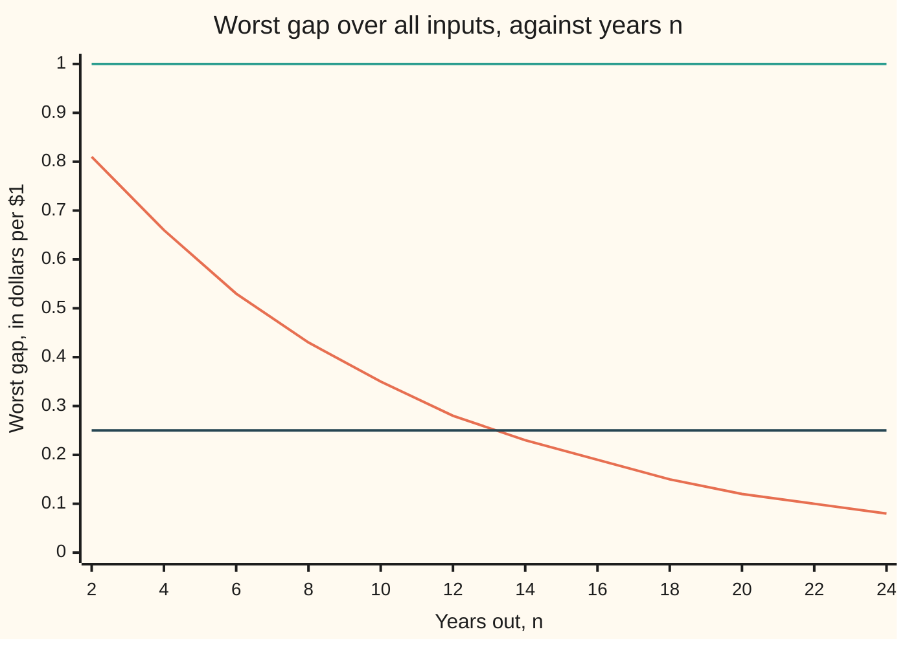

# Dini's theorem: when rising continuous functions with a continuous limit must converge uniformly

[Syllabus](../../../SYLLABUS.md) → [Calculus and analysis](../README.md) → [Series](../README.md#s06) → Dini's theorem

---

## General Overview

A bond desk is owed $1 in n years. Its value today is $`x^n`$ dollars, where x is the yearly discount factor: one dollar a year from now is worth x today. A rate of 11.1% a year gives x = 0.9, and a higher rate gives a smaller x.

The desk ignores any payment worth under 10 cents today. How far out is that? It depends on the rate. At x = 0.5 (a rate of 100.0%) it is year 4. At x = 0.9 (11.1%) it is year 22. At x = 0.99 (1.0%) it is year 230, and at x = 0.999 (0.1%) it is year 2,302.

Now the desk wants one year that works for every rate it might face. If rates stay at 11.1% or above, so x runs from 0 to 0.9, year 22 works: the worst case is x = 0.9, and $`0.9^{22} = 0.098477`$. If rates may fall toward zero, so x creeps up toward 1, the years 230, 2,302, … grow without a ceiling. No single year works.

Finding one cutoff for every input is **uniform convergence** ([Uniform convergence](07-uniform-convergence.md)). Here the worst case was easy to spot. Dini's theorem says when one cutoff must exist without spotting the worst case at all.

**If continuous functions on a closed interval move toward their limit in one direction at every input, and the limit is continuous too, then one cutoff serves every input: the convergence is uniform.**

**What kind of fact this is:** a theorem, proved on this card in Why it works; the four examples showing each condition is needed are direct calculations, printed by the checks.

### The picture: the worst gap, case by case



Orange: $`x^n`$ with x from 0 to 0.9, all of Dini's conditions met; the worst gap is $`0.9^n`$ and drops under 0.1 at n = 22. Teal: $`x^n`$ with x from 0 up to (but not including) 1, or up to and including 1; the worst gap stays 1. Dark blue: $`x^n - x^{2n}`$, which does not move in one direction; the worst gap stays 0.25.

---

## The formula

Notation first. An interval $`[a, b]`$ with square brackets includes both ends; $`[0, 1)`$ includes 0 but not 1. $`\sup`$, the supremum, is the least upper bound of a set of numbers, reached or not ([Uniform convergence](07-uniform-convergence.md)). A function is **continuous** when nearby inputs give nearby outputs, with no jumps.

**Dini's theorem.** Let $`f_1, f_2, \ldots`$ be continuous on $`[a, b]`$, rising at every input, with a continuous limit $`f`$:

```math
f_1(x) \le f_2(x) \le f_3(x) \le \cdots \to f(x) \text{ for each } x \text{ in } [a, b] \;\Longrightarrow\; E_n = \sup_{a \le x \le b} \lvert f(x) - f_n(x)\rvert \to 0
```

**Read it aloud:** if the stage-n values climb toward a continuous limit at every input of a closed interval, the worst gap over the whole interval shrinks to zero.

Falling sequences work the same way: if $`f_n`$ falls to $`f`$, then $`-f_n`$ rises to $`-f`$. The bond example falls: $`x^n`$ drops toward 0 as n grows. On $`[0, 0.9]`$ its worst gap is $`E_n = 0.9^n`$, which is 0.098477 at n = 22.

The proof works with the **gap** $`g_n(x) = f(x) - f_n(x)`$ and, for a tolerance $`\varepsilon`$, the set $`U_n`$ of inputs where that gap is already small.

| Symbol | Plain meaning | In our example | Push it up and the answer… |
| --- | --- | --- | --- |
| $`x`$; $`a`$, $`b`$ | an input; the interval's ends | discount factor; 0 and 0.9 | b nearer 1 needs a later cutoff |
| $`n`$, $`N`$ | the stage; one cutoff stage for all inputs | years; N = 22 | later stages, smaller gaps |
| $`f_n`$ | the stage-n function | $`x^n`$, value of $1 due in n years | — |
| $`f`$ | the limit function | 0 on $`[0, 0.9]`$ | — |
| $`g_n`$ | the gap at one input | $`x^n`$ | — |
| $`E_n`$ | the worst gap over the interval, a sup | $`0.9^n`$ | weaker guarantee |
| $`\varepsilon`$ | the tolerance | 0.1, ten cents | earlier cutoff |
| $`U_n`$ | inputs where the stage-n gap is under $`\varepsilon`$ | $`[0, 0.1^{1/n})`$ | — |

### When it holds

- **A closed, bounded interval.** On $`[0, 1)`$ the limit of $`x^n`$ is 0, continuous, yet the worst gap stays 1: inputs crowd toward the missing end.
- **One direction at every input.** $`x^n - x^{2n}`$ settles to 0 everywhere on $`[0, 1]`$, but at x = 0.99 it rises from 0.009900 to 0.238974, then falls to 0.006527. Its worst gap stays 0.25.
- **A continuous limit.** On $`[0, 1]`$ the limit of $`x^n`$ is 0 below 1 and 1 at 1, a jump. The worst gap stays 1.
- **Continuous stages.** A step that is 1 on $`(0, 1/n)`$ and 0 elsewhere falls to 0 everywhere, yet at n = 22 the gap at x = 1/44 is 1.
- **Existence, not size.** The theorem promises a cutoff, but says nothing about how large it is.

---

## Why it works

### Step 0: one good point vouches for its neighbours

At one input, the gap shrinks and never grows back, because the sequence moves one way. The gap is continuous, so where it is small, it is also small at nearby inputs. So each input's cutoff covers a whole stretch around it.

A closed interval can be covered by finitely many such stretches. Take the largest of their cutoffs: it serves everyone.

### Step 1: turn it into gaps that fall to zero

Set $`g_n = f - f_n`$. Because $`f_n`$ rises to $`f`$, each gap is at least 0 and falls to 0 as n grows. Both $`f`$ and $`f_n`$ are continuous, so $`g_n`$ is continuous. For a falling sequence, such as the example, the gap is $`f_n - f`$ instead; here it is $`x^n - 0 = x^n`$.

### Step 2: the sets where the gap is already small

Fix the tolerance $`\varepsilon`$ and let $`U_n`$ be the inputs where $`g_n(x) < \varepsilon`$. Three facts hold, one from each condition:

1. **Each $`U_n`$ is open in the interval** (around each member, a short stretch of the interval also lies in it), because $`g_n`$ is continuous.
2. **They grow:** $`U_1 \subseteq U_2 \subseteq \cdots`$, because each gap only falls.
3. **Together they cover the interval**, because every gap eventually drops below $`\varepsilon`$.

With $`\varepsilon`$ = 0.1 the sets are $`U_n = [0, 0.1^{1/n})`$. $`U_{21}`$ ends at 0.896151 and misses 0.9. $`U_{22}`$ ends at 0.900628 and holds all of $`[0, 0.9]`$.

### Step 3: compactness picks one stage

A closed, bounded interval is **compact**: whenever open sets cover it, finitely many of them already do ([Compactness of [a, b]](../01-Limits%20and%20Continuity/09-compactness-of-closed-intervals.md)). So some $`U_{n_1}, \ldots, U_{n_k}`$ cover $`[a, b]`$. The sets grow, so the one with the largest index, N, contains all the others. Then $`g_N(x) < \varepsilon`$ at every input, and since gaps only fall, $`g_n(x) < \varepsilon`$ for every $`n \ge N`$. That is uniform convergence.

<details>
<summary>Detailed proof, and a second road by subsequences</summary>

Let $`\varepsilon > 0`$ and $`U_n = \{x \in [a, b] : g_n(x) < \varepsilon\}`$. Each $`U_n`$ is open relative to $`[a, b]`$, since it is where a continuous function lies below $`\varepsilon`$. Since $`g_{n+1} \le g_n`$, $`U_n \subseteq U_{n+1}`$. For each x, $`g_n(x) \to 0`$, so x lies in some $`U_n`$. By compactness, $`[a, b] \subseteq U_{n_1} \cup \cdots \cup U_{n_k}`$, and with $`N = \max n_i`$ this union is $`U_N`$. For $`n \ge N`$ and every x,

$`\displaystyle 0 \le g_n(x) \le g_N(x) < \varepsilon,`$

so $`E_n \le \varepsilon`$ for all $`n \ge N`$.

Second road. Suppose not: some $`\varepsilon`$ and, for infinitely many n, an input $`x_n`$ with $`g_n(x_n) \ge \varepsilon`$. The $`x_n`$ lie in $`[a, b]`$, so a subsequence settles on some c in $`[a, b]`$ (Bolzano–Weierstrass, proved in [Extreme value theorem](../01-Limits%20and%20Continuity/07-extreme-value-theorem.md)). Fix any m. For the later terms, those with $`n \ge m`$, $`g_m(x_n) \ge g_n(x_n) \ge \varepsilon`$, and continuity of $`g_m`$ gives $`g_m(c) \ge \varepsilon`$. That holds for every m, so $`g_m(c)`$ does not tend to 0, contradicting convergence at c.

</details>

### Step 4: watch each failure break one step

- **$`[0, 1)`$, not closed.** The sets $`[0, 0.1^{1/n})`$ cover $`[0, 1)`$, but each misses the inputs just below 1, so no finite batch covers. Step 3 fails. At n = 22 the gaps at 0.99, 0.999, 0.9999 are 0.801631, 0.978229, 0.997802.
- **$`[0, 1]`$, jumping limit.** The gap $`g_n`$ is $`x^n`$ below 1 but 0 at 1, so it jumps, and $`U_n`$ is not open. Step 2 fails.
- **$`x^n - x^{2n}`$, not one direction.** Gaps return after shrinking, so the sets do not grow. Step 2 fails. Where $`x^n = 1/2`$ the gap is $`1/2 - 1/4 = 0.25`$, at every n.
- **The step, not continuous.** $`U_n`$ is not open. Step 2 fails.

---

## Worked numbers, by hand

Tolerance 10 cents, rates of 11.1% and up, so x runs over $`[0, 0.9]`$.

| Step | Arithmetic | Value |
| --- | --- | --- |
| worst input | $`x^n`$ grows with x | x = 0.9 |
| worst gap, year 21 | $`0.9^{21}`$ | 0.109419, too big |
| worst gap, year 22 | $`0.9^{22}`$ | 0.098477 |
| last input year 21 serves | $`0.1^{1/21}`$ | 0.896151 |
| last input year 22 serves | $`0.1^{1/22}`$ | 0.900628, past 0.9 |
| one cutoff for every rate | first n with $`0.9^n < 0.1`$ | **year 22** |

Every payment due after year 22 is worth under 10 cents per dollar today, at every rate of 11.1% or more.

### What breaks if you drop a piece

| Mistake | Comes out at | What went wrong |
| --- | --- | --- |
| Rates down to zero, x in $`[0, 1)`$ | worst gap 1 at every n; x = 0.968984 still has gap 0.500000 at n = 22 | the interval is not closed |
| Zero rate allowed, x in $`[0, 1]`$ | worst gap 1 at every n | the limit jumps at x = 1 |
| $`x^n - x^{2n}`$ in place of $`x^n`$ | worst gap 0.25 at n = 1, 22 and 1,000 | the sequence does not move one way |
| Steps, 1 on $`(0, 1/n)`$ | gap 1 at x = 1/44, n = 22 | the stages are not continuous |

The code prints all four.

---

## Code, from first principles, and it actually runs

The code reaches the one cutoff on $`[0, 0.9]`$ by three roads. It counts powers of 0.9 until one is under 0.1. It solves the same question with logarithms. It computes each grid input's own cutoff and takes the largest, then checks that against the cover sets $`U_{21}`$ and $`U_{22}`$. A grid sweep is checked against the formula $`0.9^n`$, and each failing example is printed.

### Python

```python
# Dini's theorem -- the check behind the card.  The example: x^n, the value
# today of $1 paid n years out at a yearly discount factor x.  math's log, exp
# and ceil are primitives; every power, gap and cutoff is built here, and
# the one cutoff for all of [0, 0.9] is reached three ways.
from math import log, exp, ceil
EPS = 0.1
def power(x, n):                          # x multiplied in n times
    out = 1.0
    for _ in range(n):
        out *= x
    return out
def cutoff(x):                            # road one: count until x^n < EPS
    n, v = 1, x
    while v >= EPS:
        n, v = n + 1, v * x
    return n
def bump(x, n):                           # x^n - x^(2n): settles to 0, not monotone
    return power(x, n) - power(x, 2 * n)
def root_poly(t, n):                      # p_0 = 0, p_(k+1) = p_k + (t - p_k^2) / 2
    p = 0.0
    for _ in range(n):
        p += (t - p * p) / 2
    return p

grid = [i / 10000 for i in range(9001)]   # 0, 0.0001, ..., 0.9
for lab, g in (("0.9^n", lambda n: power(0.9, n)), ("[0, 1), gap at x = 1 - 1e-9", lambda n: power(1 - 1e-9, n)),
               ("x^n - x^(2n), gap where x^n = 1/2", lambda n: bump(exp(-log(2) / n), n))):
    print(f"chart {lab}, n = 2, 4, ..., 24:", " ".join(f"{g(n):.2f}" for n in range(2, 25, 2)))
xs = (0.5, 0.8, 0.9, 0.99, 0.999)
count = [cutoff(x) for x in xs]
logs = [ceil(log(EPS) / log(x)) for x in xs]              # road two
print("cutoff for gap 0.1 at x = 0.5, 0.8, 0.9, 0.99, 0.999, by counting:", count)
print("the same cutoffs, by logarithms:", logs)
print("yearly rate for each x, 1/x - 1:", " ".join(f"{100 * (1 / x - 1):.1f}%" for x in xs))
w21, w22 = (max(power(x, n) for x in grid) for n in (21, 22))
print(f"[0, 0.9] worst gap on a 9001-point grid: n=21 {w21:.6f}, n=22 {w22:.6f}")
print(f"formula 0.9^n: n=21 {power(0.9, 21):.6f}, n=22 {power(0.9, 22):.6f}")
top = max(cutoff(x) for x in grid)                         # road three
first = min(x for x in grid if cutoff(x) == top)
print(f"largest pointwise cutoff over the grid: {top}, first needed at x = {first:.4f}")
u21, u22 = exp(log(EPS) / 21), exp(log(EPS) / 22)        # U_n = [0, 0.1^(1/n))
print(f"cover sets U_n = [0, 0.1^(1/n)): U_21 ends at {u21:.6f}, U_22 ends at {u22:.6f}")
wit, near = exp(log(0.5) / 22), [power(x, 22) for x in (0.99, 0.999, 0.9999)]
print(f"[0, 1) at n=22: gaps at x = 0.99, 0.999, 0.9999: {near[0]:.6f} {near[1]:.6f} {near[2]:.6f}")
print(f"  x = {wit:.6f} still has gap {power(wit, 22):.6f}; worst gap 1, never reached")
bg = [max(bump(i / 10000, n) for i in range(10001)) for n in (1, 22)]
peak = [bump(exp(-log(2) / n), n) for n in (1, 22, 1000)]  # where x^n = 1/2
print(f"x^n - x^(2n): grid worst gap n=1 {bg[0]:.6f}, n=22 {bg[1]:.6f}; at x^n = 1/2, n=1, 22, 1000: "
      + " ".join(f"{p:.6f}" for p in peak))
print(f"  at x=0.99: n=1 {bump(0.99, 1):.6f}, n=50 {bump(0.99, 50):.6f}, n=500 {bump(0.99, 500):.6f}")
print(f"step 1 on (0, 1/n), else 0: at n=22 the gap at x = 1/44 is {1.0 if 0 < 1 / 44 < 1 / 22 else 0.0:.0f}")
rg = [max(s - root_poly(s * s, k) for s in (i / 10000 for i in range(10001))) for k in (10, 100)]  # t = s^2
print(f"square-root polynomials, t = (i/10000)^2: worst gap k=10 {rg[0]:.6f}, k=100 {rg[1]:.6f}; "
      f"bound 2/(k+2): {2 / 12:.6f}, {2 / 102:.6f}")
assert count == logs                                       # counting against logarithms
assert abs(w22 - power(0.9, 22)) < 1e-12 and w21 > EPS > w22   # grid against formula
assert top == count[2] and u21 < first <= 0.9 < u22        # grid cutoffs against the cover
assert all(abs(p - 0.25) < 1e-9 for p in peak) and all(abs(b - 0.25) < 1e-6 for b in bg)
assert rg[0] <= 2 / 12 and rg[1] <= 2 / 102                # proved bound holds on the grid
print("ALL CHECKS PASS")
```

**Ran 2026-11-23 on macOS, Python 3.14.10, standard library only. All checks passed. Output, pasted from the run:**

```
chart 0.9^n, n = 2, 4, ..., 24: 0.81 0.66 0.53 0.43 0.35 0.28 0.23 0.19 0.15 0.12 0.10 0.08
chart [0, 1), gap at x = 1 - 1e-9, n = 2, 4, ..., 24: 1.00 1.00 1.00 1.00 1.00 1.00 1.00 1.00 1.00 1.00 1.00 1.00
chart x^n - x^(2n), gap where x^n = 1/2, n = 2, 4, ..., 24: 0.25 0.25 0.25 0.25 0.25 0.25 0.25 0.25 0.25 0.25 0.25 0.25
cutoff for gap 0.1 at x = 0.5, 0.8, 0.9, 0.99, 0.999, by counting: [4, 11, 22, 230, 2302]
the same cutoffs, by logarithms: [4, 11, 22, 230, 2302]
yearly rate for each x, 1/x - 1: 100.0% 25.0% 11.1% 1.0% 0.1%
[0, 0.9] worst gap on a 9001-point grid: n=21 0.109419, n=22 0.098477
formula 0.9^n: n=21 0.109419, n=22 0.098477
largest pointwise cutoff over the grid: 22, first needed at x = 0.8962
cover sets U_n = [0, 0.1^(1/n)): U_21 ends at 0.896151, U_22 ends at 0.900628
[0, 1) at n=22: gaps at x = 0.99, 0.999, 0.9999: 0.801631 0.978229 0.997802
  x = 0.968984 still has gap 0.500000; worst gap 1, never reached
x^n - x^(2n): grid worst gap n=1 0.250000, n=22 0.250000; at x^n = 1/2, n=1, 22, 1000: 0.250000 0.250000 0.250000
  at x=0.99: n=1 0.009900, n=50 0.238974, n=500 0.006527
step 1 on (0, 1/n), else 0: at n=22 the gap at x = 1/44 is 1
square-root polynomials, t = (i/10000)^2: worst gap k=10 0.054694, k=100 0.005559; bound 2/(k+2): 0.166667, 0.019608
ALL CHECKS PASS
```

### Rust

Same numbers, same labels, built with `rustc --edition 2021 -O`.

```rust
// Dini's theorem -- the same check as the Python, in Rust.  No crates.  The
// example: x^n, the value today of $1 paid n years out at a yearly discount
// factor x.  ln, exp and ceil are primitives; every power, gap and cutoff is
// built here, and the one cutoff for all of [0, 0.9] is reached three ways.
const EPS: f64 = 0.1;

fn power(x: f64, n: usize) -> f64 { // x multiplied in n times
    let mut out = 1.0;
    for _ in 0..n { out *= x; }
    out
}

fn cutoff(x: f64) -> usize { // road one: count until x^n < EPS
    let (mut n, mut v) = (1, x);
    while v >= EPS { n += 1; v *= x; }
    n
}

fn bump(x: f64, n: usize) -> f64 { // x^n - x^(2n): settles to 0, not monotone
    power(x, n) - power(x, 2 * n)
}

fn root_poly(t: f64, n: usize) -> f64 { // p_0 = 0, p_(k+1) = p_k + (t - p_k^2) / 2
    let mut p = 0.0;
    for _ in 0..n { p += (t - p * p) / 2.0; }
    p
}

fn fmax(v: impl Iterator<Item = f64>) -> f64 { v.fold(f64::MIN, f64::max) }

fn main() {
    let grid: Vec<f64> = (0..9001).map(|i| i as f64 / 10000.0).collect(); // 0, 0.0001, ..., 0.9
    let charts: [(&str, &dyn Fn(usize) -> f64); 3] = [("0.9^n", &|n| power(0.9, n)),
        ("[0, 1), gap at x = 1 - 1e-9", &|n| power(1.0 - 1e-9, n)),
        ("x^n - x^(2n), gap where x^n = 1/2", &|n| bump((-(2f64.ln()) / n as f64).exp(), n))];
    for (lab, g) in charts {
        let row: Vec<String> = (2..25).step_by(2).map(|n| format!("{:.2}", g(n))).collect();
        println!("chart {}, n = 2, 4, ..., 24: {}", lab, row.join(" "));
    }
    let xs = [0.5, 0.8, 0.9, 0.99, 0.999];
    let count: Vec<usize> = xs.iter().map(|&x| cutoff(x)).collect();
    let logs: Vec<usize> = xs.iter().map(|&x| (EPS.ln() / f64::ln(x)).ceil() as usize).collect(); // road two
    println!("cutoff for gap 0.1 at x = 0.5, 0.8, 0.9, 0.99, 0.999, by counting: {:?}", count);
    println!("the same cutoffs, by logarithms: {:?}", logs);
    let rates: Vec<String> = xs.iter().map(|&x| format!("{:.1}%", 100.0 * (1.0 / x - 1.0))).collect();
    println!("yearly rate for each x, 1/x - 1: {}", rates.join(" "));
    let w21 = fmax(grid.iter().map(|&x| power(x, 21)));
    let w22 = fmax(grid.iter().map(|&x| power(x, 22)));
    println!("[0, 0.9] worst gap on a 9001-point grid: n=21 {:.6}, n=22 {:.6}", w21, w22);
    println!("formula 0.9^n: n=21 {:.6}, n=22 {:.6}", power(0.9, 21), power(0.9, 22));
    let top = grid.iter().map(|&x| cutoff(x)).max().unwrap(); // road three
    let first = *grid.iter().find(|&&x| cutoff(x) == top).unwrap();
    println!("largest pointwise cutoff over the grid: {}, first needed at x = {:.4}", top, first);
    let (u21, u22) = ((EPS.ln() / 21.0).exp(), (EPS.ln() / 22.0).exp()); // U_n = [0, 0.1^(1/n))
    println!("cover sets U_n = [0, 0.1^(1/n)): U_21 ends at {:.6}, U_22 ends at {:.6}", u21, u22);
    let wit = (0.5f64.ln() / 22.0).exp();
    let near: Vec<f64> = [0.99, 0.999, 0.9999].iter().map(|&x| power(x, 22)).collect();
    println!("[0, 1) at n=22: gaps at x = 0.99, 0.999, 0.9999: {:.6} {:.6} {:.6}", near[0], near[1], near[2]);
    println!("  x = {:.6} still has gap {:.6}; worst gap 1, never reached", wit, power(wit, 22));
    let bg: Vec<f64> = [1, 22].iter().map(|&n| fmax((0..10001).map(|i| bump(i as f64 / 10000.0, n)))).collect();
    let peak: Vec<f64> = [1usize, 22, 1000].iter().map(|&n| bump((-(2f64.ln()) / n as f64).exp(), n)).collect();
    let ps: Vec<String> = peak.iter().map(|p| format!("{:.6}", p)).collect();
    println!("x^n - x^(2n): grid worst gap n=1 {:.6}, n=22 {:.6}; at x^n = 1/2, n=1, 22, 1000: {}", bg[0], bg[1], ps.join(" "));
    println!("  at x=0.99: n=1 {:.6}, n=50 {:.6}, n=500 {:.6}", bump(0.99, 1), bump(0.99, 50), bump(0.99, 500));
    let step = if 0.0 < 1.0 / 44.0 && 1.0 / 44.0 < 1.0 / 22.0 { 1.0 } else { 0.0 };
    println!("step 1 on (0, 1/n), else 0: at n=22 the gap at x = 1/44 is {:.0}", step);
    let rg: Vec<f64> = [10, 100].iter() // t = s^2 on a grid of s, so sqrt t = s
        .map(|&k| fmax((0..10001).map(|i| i as f64 / 10000.0).map(|s| s - root_poly(s * s, k)))).collect();
    println!("square-root polynomials, t = (i/10000)^2: worst gap k=10 {:.6}, k=100 {:.6}; bound 2/(k+2): {:.6}, {:.6}",
        rg[0], rg[1], 2.0 / 12.0, 2.0 / 102.0);
    assert_eq!(count, logs); // counting against logarithms
    assert!((w22 - power(0.9, 22)).abs() < 1e-12 && w21 > EPS && EPS > w22); // grid against formula
    assert!(top == count[2] && u21 < first && first <= 0.9 && 0.9 < u22); // grid cutoffs against the cover
    assert!(peak.iter().all(|p| (p - 0.25).abs() < 1e-9) && bg.iter().all(|b| (b - 0.25).abs() < 1e-6));
    assert!(rg[0] <= 2.0 / 12.0 && rg[1] <= 2.0 / 102.0); // proved bound holds on the grid
    println!("ALL CHECKS PASS");
}
```

**Ran 2026-11-23 on macOS, rustc 1.98.1, no crates. All checks passed. Output, pasted from the run:**

```
chart 0.9^n, n = 2, 4, ..., 24: 0.81 0.66 0.53 0.43 0.35 0.28 0.23 0.19 0.15 0.12 0.10 0.08
chart [0, 1), gap at x = 1 - 1e-9, n = 2, 4, ..., 24: 1.00 1.00 1.00 1.00 1.00 1.00 1.00 1.00 1.00 1.00 1.00 1.00
chart x^n - x^(2n), gap where x^n = 1/2, n = 2, 4, ..., 24: 0.25 0.25 0.25 0.25 0.25 0.25 0.25 0.25 0.25 0.25 0.25 0.25
cutoff for gap 0.1 at x = 0.5, 0.8, 0.9, 0.99, 0.999, by counting: [4, 11, 22, 230, 2302]
the same cutoffs, by logarithms: [4, 11, 22, 230, 2302]
yearly rate for each x, 1/x - 1: 100.0% 25.0% 11.1% 1.0% 0.1%
[0, 0.9] worst gap on a 9001-point grid: n=21 0.109419, n=22 0.098477
formula 0.9^n: n=21 0.109419, n=22 0.098477
largest pointwise cutoff over the grid: 22, first needed at x = 0.8962
cover sets U_n = [0, 0.1^(1/n)): U_21 ends at 0.896151, U_22 ends at 0.900628
[0, 1) at n=22: gaps at x = 0.99, 0.999, 0.9999: 0.801631 0.978229 0.997802
  x = 0.968984 still has gap 0.500000; worst gap 1, never reached
x^n - x^(2n): grid worst gap n=1 0.250000, n=22 0.250000; at x^n = 1/2, n=1, 22, 1000: 0.250000 0.250000 0.250000
  at x=0.99: n=1 0.009900, n=50 0.238974, n=500 0.006527
step 1 on (0, 1/n), else 0: at n=22 the gap at x = 1/44 is 1
square-root polynomials, t = (i/10000)^2: worst gap k=10 0.054694, k=100 0.005559; bound 2/(k+2): 0.166667, 0.019608
ALL CHECKS PASS
```

The two outputs are identical.

### Lean

Lean proves Dini's theorem on every closed interval $`[a, b]`$, rising or falling, two of the failures, and the card's exact cutoffs.

- Take continuous stages on $`[a, b]`$, rising at every input to a continuous limit. Then the convergence is uniform.
- Take continuous stages on $`[a, b]`$, falling at every input to a continuous limit. Then the convergence is uniform too.
- Take $`x^n`$ on $`[0, 1)`$, falling to 0 at every input. Then the convergence is not uniform.
- Take $`x^n - x^{2n}`$ on $`[0, 1]`$, heading to 0 at every input. Then the convergence is not uniform.
- Suppose $`x^n = 1/2`$. Then $`x^n - x^{2n} = 1/4`$, at every n.
- Take a tolerance of 10 cents and x = 0.9. Then the first year under it is year 22.
- Take x = 0.5, 0.8, 0.99 and 0.999. Then the first years are 4, 11, 230 and 2,302.
- Take the step at n = 22. Then x = 1/44 lies inside $`(0, 1/22)`$, where the step is 1.

The jump and step failures, the bump's rise and fall, the decimals and the square-root polynomials are left to the Python and Rust checks.

```lean
-- Dini's theorem: continuous functions on a closed interval [a, b] that rise (or fall) at every input toward a continuous limit converge to it uniformly, and dropping "closed" or "one direction" breaks this.
import Mathlib.Topology.UniformSpace.Dini
import Mathlib.Topology.Order.Compact
import Mathlib.Analysis.SpecificLimits.Basic
import Mathlib.Analysis.SpecialFunctions.Pow.Real

open Filter Topology

/-- For every stage n ≥ 1 there is an input x with 0 ≤ x < 1 and x ^ n = 1/2. -/
theorem dini_helper_exists_pow_eq_half (n : ℕ) (hn : n ≠ 0) :
    ∃ x : ℝ, 0 ≤ x ∧ x < 1 ∧ x ^ n = 1 / 2 := by
  refine ⟨(1 / 2 : ℝ) ^ ((n : ℝ)⁻¹), Real.rpow_nonneg (by norm_num) _,
    Real.rpow_lt_one (by norm_num) (by norm_num) (by positivity),
    Real.rpow_inv_natCast_pow (by norm_num) hn⟩

#print axioms dini_helper_exists_pow_eq_half

/-- Dini's theorem. Let f 0, f 1, f 2, … be continuous on the closed interval [a, b], rising at
every input (f 0 x ≤ f 1 x ≤ f 2 x ≤ ⋯), with f n x heading for f x at every x in [a, b], and
let the limit f be continuous on [a, b]. Then the convergence is uniform on [a, b]: for every
tolerance there is one stage after which every gap |f x − f n x| with x in [a, b] is within it,
so the worst gap E_n heads for 0. -/
theorem dini_rising_continuous_converges_uniformly_on_closed_interval (a b : ℝ)
    (F : ℕ → ℝ → ℝ) (f : ℝ → ℝ)
    (hF_cont : ∀ n, ContinuousOn (F n) (Set.Icc a b))
    (hF_rise : ∀ x ∈ Set.Icc a b, Monotone (fun n => F n x))
    (hf_cont : ContinuousOn f (Set.Icc a b))
    (h_lim : ∀ x ∈ Set.Icc a b, Tendsto (fun n => F n x) atTop (𝓝 (f x))) :
    TendstoUniformlyOn F f atTop (Set.Icc a b) := by
  exact Monotone.tendstoUniformlyOn_of_forall_tendsto isCompact_Icc hF_cont hF_rise hf_cont h_lim

/-- Falling sequences work the same way. Let f 0, f 1, … be continuous on [a, b], falling at
every input (f 0 x ≥ f 1 x ≥ ⋯), with f n x heading for f x at every x in [a, b], and let f be
continuous on [a, b]. Then the convergence is uniform on [a, b]. The card's bond example x^n on
[0, 9/10] is of this kind. -/
theorem dini_falling_continuous_converges_uniformly_on_closed_interval (a b : ℝ)
    (F : ℕ → ℝ → ℝ) (f : ℝ → ℝ)
    (hF_cont : ∀ n, ContinuousOn (F n) (Set.Icc a b))
    (hF_fall : ∀ x ∈ Set.Icc a b, Antitone (fun n => F n x))
    (hf_cont : ContinuousOn f (Set.Icc a b))
    (h_lim : ∀ x ∈ Set.Icc a b, Tendsto (fun n => F n x) atTop (𝓝 (f x))) :
    TendstoUniformlyOn F f atTop (Set.Icc a b) := by
  exact Antitone.tendstoUniformlyOn_of_forall_tendsto isCompact_Icc hF_cont hF_fall hf_cont h_lim

/-- Two of the card's examples showing a condition is needed. (1) Not closed: on [0, 1) the
continuous functions x^n fall at every input to the continuous limit 0, yet the convergence is
not uniform. (2) Not one direction: on [0, 1] the continuous functions x^n − x^(2n) head for the
continuous limit 0 at every input, yet the convergence is not uniform; where x^n = 1/2 the gap
is 1/4 at every stage. -/
theorem dini_fails_without_closed_interval_or_one_direction :
    ((∀ x ∈ Set.Ico (0 : ℝ) 1, Antitone (fun n : ℕ => x ^ n)) ∧
      (∀ x ∈ Set.Ico (0 : ℝ) 1, Tendsto (fun n : ℕ => x ^ n) atTop (𝓝 0)) ∧
      ¬ TendstoUniformlyOn (fun (n : ℕ) (x : ℝ) => x ^ n) (fun _ => 0) atTop (Set.Ico 0 1)) ∧
    ((∀ x ∈ Set.Icc (0 : ℝ) 1, Tendsto (fun n : ℕ => x ^ n - x ^ (2 * n)) atTop (𝓝 0)) ∧
      (∀ (n : ℕ) (x : ℝ), x ^ n = 1 / 2 → x ^ n - x ^ (2 * n) = 1 / 4) ∧
      ¬ TendstoUniformlyOn (fun (n : ℕ) (x : ℝ) => x ^ n - x ^ (2 * n)) (fun _ => 0) atTop
        (Set.Icc 0 1)) := by
  refine ⟨⟨?_, ?_, ?_⟩, ⟨?_, ?_, ?_⟩⟩
  · intro x hx m k hmk
    exact pow_le_pow_of_le_one hx.1 hx.2.le hmk
  · intro x hx
    exact tendsto_pow_atTop_nhds_zero_of_lt_one hx.1 hx.2
  · intro h
    rw [Metric.tendstoUniformlyOn_iff] at h
    obtain ⟨n, hn, hn1⟩ :=
      ((h (1 / 2) (by norm_num)).and (eventually_ge_atTop 1)).exists
    obtain ⟨x, hx0, hx1, hxn⟩ := dini_helper_exists_pow_eq_half n (by omega)
    have := hn x ⟨hx0, hx1⟩
    rw [hxn, Real.dist_eq] at this
    norm_num [abs_of_neg] at this
  · intro x hx
    rcases eq_or_lt_of_le hx.2 with h1 | h1
    · subst h1
      simp
    · have h2 : Tendsto (fun n : ℕ => x ^ (2 * n)) atTop (𝓝 0) := by
        have := tendsto_pow_atTop_nhds_zero_of_lt_one (sq_nonneg x)
          (by nlinarith [hx.1] : x ^ 2 < 1)
        simpa [pow_mul] using this
      simpa using (tendsto_pow_atTop_nhds_zero_of_lt_one hx.1 h1).sub h2
  · intro n x hx
    rw [pow_mul', hx]
    norm_num
  · intro h
    rw [Metric.tendstoUniformlyOn_iff] at h
    obtain ⟨n, hn, hn1⟩ :=
      ((h (1 / 4) (by norm_num)).and (eventually_ge_atTop 1)).exists
    obtain ⟨x, hx0, hx1, hxn⟩ := dini_helper_exists_pow_eq_half n (by omega)
    have := hn x ⟨hx0, hx1.le⟩
    rw [pow_mul', hxn, Real.dist_eq] at this
    norm_num [abs_of_neg] at this

/-! The card's exact worked numbers, with the tolerance 1/10 (ten cents). -/

-- The one cutoff on [0, 9/10] is year 22: (9/10)^21 is not under 1/10, (9/10)^22 is.
example : (9 / 10 : ℚ) ^ 22 < 1 / 10 ∧ ¬ ((9 / 10 : ℚ) ^ 21 < 1 / 10) := by norm_num
-- Single-input cutoffs: 4 at x = 1/2 and 11 at x = 4/5.
example : (1 / 2 : ℚ) ^ 4 < 1 / 10 ∧ ¬ ((1 / 2 : ℚ) ^ 3 < 1 / 10) := by norm_num
example : (4 / 5 : ℚ) ^ 11 < 1 / 10 ∧ ¬ ((4 / 5 : ℚ) ^ 10 < 1 / 10) := by norm_num
-- 230 at x = 99/100 and 2302 at x = 999/1000, cleared of fractions:
-- (p/q)^n < 1/10 means 10 · p^n < q^n.
set_option exponentiation.threshold 3000 in
example : 10 * 99 ^ 230 < 100 ^ 230 ∧ ¬ (10 * 99 ^ 229 < 100 ^ 229) := by decide
set_option exponentiation.threshold 3000 in
example : 10 * 999 ^ 2302 < 1000 ^ 2302 ∧ ¬ (10 * 999 ^ 2301 < 1000 ^ 2301) := by decide
-- The bump x^n − x^(2n) where x^n = 1/2: the gap is 1/2 − 1/4 = 1/4.
example : (1 / 2 : ℚ) - (1 / 2) ^ 2 = 1 / 4 := by norm_num
-- The step 1 on (0, 1/n) at n = 22: the input 1/44 lies inside, so its gap is 1.
example : (0 : ℚ) < 1 / 44 ∧ (1 / 44 : ℚ) < 1 / 22 := by norm_num

#print axioms dini_rising_continuous_converges_uniformly_on_closed_interval
#print axioms dini_falling_continuous_converges_uniformly_on_closed_interval
#print axioms dini_fails_without_closed_interval_or_one_direction
```

**Checked 2026-11-23 on macOS, Lean 4.36.0-rc2, Mathlib v4.36.0-rc2. Every proof is complete and uses only Lean's standard axioms. Output, pasted from the run:**

```
'dini_helper_exists_pow_eq_half' depends on axioms: [propext, Classical.choice, Quot.sound]
'dini_rising_continuous_converges_uniformly_on_closed_interval' depends on axioms: [propext, Classical.choice, Quot.sound]
'dini_falling_continuous_converges_uniformly_on_closed_interval' depends on axioms: [propext, Classical.choice, Quot.sound]
'dini_fails_without_closed_interval_or_one_direction' depends on axioms: [propext, Classical.choice, Quot.sound]
```

> [!TIP]
> **Try changing**
> Guess first, then run it. The asserts are pinned to the 10-cent example, so expect one to stop the program.
> - **Tighten the tolerance.** Set `EPS` to `0.01`. The cutoffs become 7, 21, 44, 459 and 4,603; the second assert stops it, since it pins year 22.
> - **Let rates fall further.** Change `range(9001)` to `range(9501)`, so x runs to 0.95. The worst gap at year 22 is 0.323534 and the largest cutoff is 45; the second assert stops it.
> - **Change the bump.** Replace `power(x, 2 * n)` with `power(x, 3 * n)`. The worst gap is 0.384900 at every n, still no shrinking; the fourth assert stops it.

---

## The usual mistake

> [!warning]
> **Dropping "closed" because the limit looks fine.** On $`[0, 1)`$ every stage of $`x^n`$ is continuous, every input falls, and the limit 0 is continuous. The convergence is still not uniform: the worst gap is 1 at every n, because the trouble sits at the missing end x = 1.
>
> - **Forgetting the limit must be continuous.** On $`[0, 1]`$ the limit of $`x^n`$ jumps, and the worst gap stays 1.
> - **Settling without a direction.** $`x^n - x^{2n}`$ heads to 0 at every input, yet its worst gap is 0.25 at every n.
> - **Reading a rate into Dini.** The theorem proves a cutoff exists, not its size. For the square-root polynomials below, the worst gap at k = 10 is 0.054694; the size bound 0.166667 comes from separate work.
> - **Reading it backwards.** Uniform convergence does not need these conditions; Dini only gives one way to earn it.

---

## Where you meet it in real life

- **Truncating cash flows across a rate range.** A model that prices far payments at many rates can drop everything past one year, if the rates stay above a floor. Above 11.1%, year 22 drops at most 10 cents per dollar.
- **Polynomials that build the square root.** Start at $`p_0 = 0`$ and set $`p_{k+1} = p_k + (t - p_k^2)/2`$. On $`[0, 1]`$ these polynomials rise toward $`\sqrt t`$, which is continuous, so Dini makes the approach uniform. On a grid packed toward t = 0, where the gap peaks, the worst gap is 0.054694 at k = 10 and 0.005559 at k = 100, inside the bound 2/(k + 2): 0.166667 and 0.019608. (The gap $`e_k = \sqrt t - p_k`$ obeys $`e_{k+1} \le e_k(1 - e_k/2)`$, so $`1/e_k`$ grows by at least 1/2 a step.) This is the key step in proofs that polynomials can approximate any continuous function.
- **Square roots of operators.** The same polynomials, fed a matrix or operator instead of a number t, build its square root. Dini makes the approach uniform, which is what the operator version needs.

> **Say it back**
> Dini's theorem turns pointwise convergence into uniform convergence for free. It needs continuous stages, a continuous limit, one direction of movement at every input, and a closed, bounded interval. The proof covers the interval by the sets where the gap is already small, and compactness keeps finitely many, so the latest one serves everyone. Drop any condition and the worst gap can stay stuck: 1 for $`x^n`$ on $`[0, 1)`$ or $`[0, 1]`$, 0.25 for $`x^n - x^{2n}`$. On $`[0, 0.9]`$ it falls as $`0.9^n`$, under ten cents from year 22.

---

## What this builds on

- [Uniform convergence](07-uniform-convergence.md): the worst gap $`E_n`$, and $`x^n`$ failing on $`[0, 1]`$ but not on $`[0, 0.9]`$.
- [Compactness of [a, b]](../01-Limits%20and%20Continuity/09-compactness-of-closed-intervals.md): finitely many open sets cover a closed, bounded interval, the step that picks one cutoff.

## Where this goes next

- [Swapping limits](08-swapping-limits-with-integrals-and-derivatives.md): uniform convergence, once Dini earns it, lets a limit pass through an integral.
- [Weierstrass and the minimax fit](../../16-Numerical%20analysis/04-Interpolation%20and%20Approximation/08-weierstrass-and-best-approximation.md): polynomials approximating any continuous function, proved there with Bernstein polynomials; the square-root polynomials, which build $`\lvert x\rvert`$, give a second route.
- [Compactness three ways](../../17-Topology/01-Metric%20Spaces/06-compactness-in-metric-spaces.md): the same proof on any compact set, not only an interval.
- [C-star algebras](../../18-Functional%20analysis/06-Banach%20Algebras%20and%20Fixed%20Points/03-c-star-algebras-in-outline.md): the square-root polynomials applied to operators, with Dini making the limit uniform.

Left open: Dini says one cutoff exists but not how large it is. How fast a uniform approximation can shrink is the question of best approximation.

---

## Sources

Verified 2026-11-23: every link below resolves to the publisher's page.

- Rudin, Walter. *Principles of Mathematical Analysis*, 3rd ed. McGraw-Hill, 1976. [Publisher page](https://www.mheducation.co.uk/principles-of-mathematical-analysis-int-l-ed-9780070856134-emea). Chapter 7: Theorem 7.13 is Dini's theorem on a compact set, proved with shrinking compact sets (the cover argument turned inside out); Exercise 7.23 builds $`\lvert x\rvert`$ from the same square-root polynomials.
- Lebl, Jiří. *Basic Analysis I & II*, §6.2 "Interchange of limits". [Online text](https://www.jirka.org/ra/html/sec_liminter.html). Exercise 6.2.10 states Dini's theorem on $`[a, b]`$ for a falling sequence.
- O'Connor, J. J., and E. F. Robertson. "Ulisse Dini." MacTutor Archive, University of St Andrews. [Biography](https://mathshistory.st-andrews.ac.uk/Biographies/Dini/). Dates his 1878 book on functions of a real variable.
