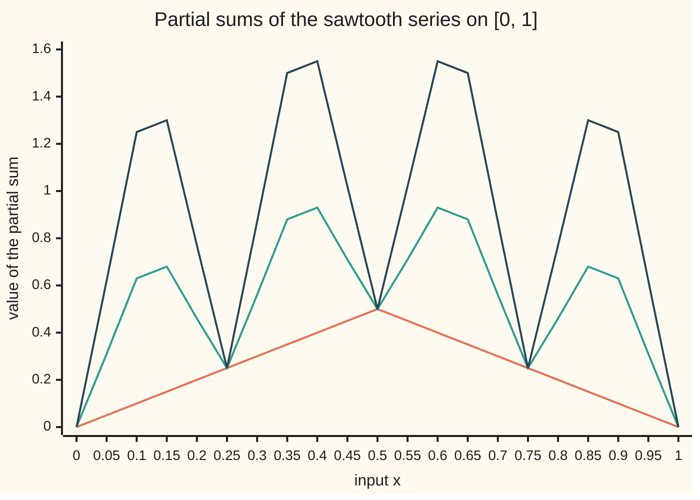

# Weierstrass's monster: a continuous function with no derivative anywhere

[Syllabus](../../../SYLLABUS.md) → [Calculus and analysis](../README.md) → [Series](../README.md#s06) → Weierstrass's monster

---

## General Overview

Zoom into a minute-by-minute price chart and new wiggles appear at every enlargement. A smooth curve, zoomed in, looks straight, and the slope of that straight piece is its derivative.

This card builds a curve that never straightens, using only a sawtooth. The sawtooth φ (the Greek letter phi) gives each input its distance to the nearest whole number: 0 at 0, rising to 0.5 at 0.5, back to 0 at 1.

Stack copies of it, each 4 times as fast and 3/4 as tall, so 3 times as steep.

Stand at x = 0 and take a step h of 1/4, then 1/16, then 1/64. The chord slope (f(h) − f(0))/h runs 1, 4, 13, 40, … . A derivative needs chord slopes to settle on one number; here they grow without bound at every point.

**Add sawtooth layers whose heights shrink geometrically while their steepness more than doubles each layer (here, 3/4 as tall and 4 times faster): the heights add up, so the sum is continuous, while the newest layer always beats all older layers together, so no chord slope ever settles.**

**What kind of fact this is:** a theorem, proved on this card in Why it works: this f is continuous at every point and has a derivative at none.

### The picture: three layers, then twelve



Orange: one layer, the sawtooth itself. Teal: three layers. Dark blue: twelve layers. Sampled every 0.05, the chart misses the wiggles between points.

---

## The formula

Reminder: a series is the limit of its partial sums, the sums of the first N terms ([Infinite series](01-series-convergence.md)). The function is the series

```math
f(x) = \sum_{n=0}^{\infty} \left(\tfrac{3}{4}\right)^n \varphi(4^n x), \qquad \varphi(t) = \text{distance from } t \text{ to the nearest whole number}
```

**Read it aloud:** f at x adds up layer after layer; layer n is the sawtooth run 4 to the n times faster and shrunk to (3/4) to the n of its height.

At x = 0, with the step $`h = 4^{-m}`$, the chord slope is a plain geometric sum:

```math
Q_m = \frac{f(4^{-m}) - f(0)}{4^{-m}} = 1 + 3 + 9 + \cdots + 3^{m-1} = \frac{3^m - 1}{2}
```

**Read it aloud:** at zoom level m, the chord from 0 has slope one plus three plus nine, m terms in all.

At every other point x the card finds a step $`\delta_m`$ of size $`\tfrac14 \cdot 4^{-m}`$ whose chord slope is at least $`(3^m + 1)/2`$ in size.

| Symbol | Plain meaning | In our example | Push it up and the answer… |
| --- | --- | --- | --- |
| $`\varphi(t)`$ | the sawtooth: distance from t to the nearest whole number | 0.5 at t = 0.5 | — |
| $`n`$, $`N`$ | one layer; the number of layers kept | N = 27 | more layers, closer to f |
| $`f`$, $`f_N`$ | the full sum; the sum of the first N layers | $`f(1/3) = 4/3`$ | — |
| $`M_n`$ | a number capping layer n at every x: $`\tfrac12 (3/4)^n`$ | caps add to 2 | — |
| $`x`$, $`h`$ | a point; a step away from it | x = 0, h = 1/64 | — |
| $`m`$, $`\delta_m`$ | the zoom level; the step the proof picks at x, $`\pm\tfrac14 \cdot 4^{-m}`$ | m = 1 to 8; +1/16 at x = 0.3, m = 1 | the chord slope grows |
| $`a`$, $`b`$ | the cosine series' height factor and speed-up (Step 5) | 3/4 and 4 on the sawtooth | — |
| $`Q_m`$, $`\gamma_n`$ | the chord slope (f(x + step) − f(x)) / step; in the fold, layer n's part of it, over 3 to the n | 1, 4, 13, 40, … at x = 0 | — |

### When it holds

- **Heights shrink geometrically (factor between 0 and 1).** Here 3/4 < 1, so caps add up. At factor 1 every layer adds 1/3 at x = 1/3, diverging.
- **Steepness grows.** Layer n has slope $`3^n`$. With heights $`(1/8)^n`$, steepness falls, and at x = 1/3 both sides settle at slope 2.
- **The newest layer beats the rest.** The count below needs steepness to grow by a factor above 2 per layer; here it is 3. At exactly 2 the floor stays at 1; smaller factors need finer arguments.
- **Speed-up a multiple of 4.** With factor 4, a quarter-step at layer m is a whole number at every deeper layer, so deeper layers do not move. Without that, deeper layers move too and this count breaks.
- **Infinitely many layers.** Any finite stack is a broken line: 5 layers give slope 121 just right of 0.

---

## Why it works

### Step 0: heights add up, slopes do not

Layer n has height at most $`\tfrac12 (3/4)^n`$ and steepness $`3^n`$. The heights have a finite sum; the slopes grow. The first gives continuity, the second destroys every derivative.

### Step 1: the sum is continuous, by the M-test

Each partial sum $`f_N`$ is continuous. Every layer sits under $`M_n = \tfrac12 (3/4)^n`$ at every x, and those caps add to 2.

By the M-test (number caps with a finite sum force uniform convergence), $`f_N \to f`$ uniformly ([Uniform convergence](07-uniform-convergence.md), Step 5), so f is continuous (Step 4).

After N layers the caps leave $`2 (3/4)^N`$, first below 0.001 at N = 27 (0.000847). At x = 1/3 every layer reads 1/3 (since $`4^n`$ is 1 more than a multiple of 3), so f(1/3) = 4/3 = 1.333333; 27 layers give 1.332769, gap 0.000564.

### Step 2: the chord slopes at 0

Take the step $`h = 4^{-m}`$. Then $`4^n h = 4^{n-m}`$.

- **Deep layers, n at least m.** $`4^{n-m}`$ is a whole number, so the sawtooth reads 0 there, as it does at 0. These layers add nothing to f(h) − f(0).
- **Shallow layers, n below m.** $`4^{n-m}`$ is at most 1/4, on the sawtooth's rising edge, so the sawtooth reads $`4^{n-m}`$ itself. The layer adds $`(3/4)^n \cdot 4^{n-m}`$ to f(h).

Divide by $`h = 4^{-m}`$: layer n contributes $`(3/4)^n 4^n = 3^n`$. The chord slope is $`1 + 3 + \cdots + 3^{m-1} = (3^m - 1)/2`$: 1, 4, 13, 40, 121, 364, 1,093, 3,280 for m = 1 to 8.

### Step 3: every point, by one well-chosen step

At a general x the layers do not all sit on rising edges, so signs mix. The step is chosen to control them.

1. **Pick the step.** The sawtooth is straight between neighbouring multiples of 1/2. Choose $`\delta_m = \pm\tfrac14 \cdot 4^{-m}`$, signed so that $`4^m x`$ and $`4^m (x + \delta_m)`$ share one straight piece; a move of 1/4 always fits one way.
2. **Deep layers vanish.** For n above m, $`4^n \delta_m = \pm 4^{n-m-1}`$ is a whole number. The sawtooth repeats every 1, so these layers do not change.
3. **Layer m is exact.** It moves along one straight piece of slope ±1, so it contributes exactly $`\pm 3^m`$ to the chord slope.
4. **Shallow layers are small.** The sawtooth never changes faster than slope 1, so layer n contributes at most $`3^n`$ in size. Together that is at most $`(3^m - 1)/2`$.
5. **Subtract.** The chord slope is at least $`3^m - (3^m - 1)/2 = (3^m + 1)/2`$ in size.

At x = 0.3 the steps alternate right and left; the chord slopes are 4, −5, 22, −59, 184, −545, 1,642, −4,919. The floors are 2, 5, 14, 41, 122, 365, 1,094, 3,281; at m = 2 the slope meets its floor of 5 exactly.

<details>
<summary>Detailed proof: f has no derivative at any x</summary>

Fix x and m. Let $`y = 4^m x`$ and let k/2 be the largest multiple of 1/2 not above y. Take $`\delta_m = \tfrac14 4^{-m}`$ if $`y - k/2 \le \tfrac14`$, else $`-\tfrac14 4^{-m}`$.

Either way $`4^m x`$ and $`4^m(x+\delta_m)`$ lie in [k/2, k/2 + 1/2], where φ is a straight line of slope ±1. Write

$`\displaystyle \frac{f(x+\delta_m)-f(x)}{\delta_m} = \sum_{n=0}^{\infty} 3^n \gamma_n, \qquad \gamma_n = \frac{\varphi(4^n(x+\delta_m)) - \varphi(4^n x)}{4^n \delta_m}.`$

For n > m, $`4^n\delta_m`$ is a whole number and φ has period 1, so $`\gamma_n = 0`$. For n = m, the straight piece gives $`\lvert\gamma_m\rvert = 1`$. For n < m, the bound $`\lvert\varphi(s)-\varphi(t)\rvert \le \lvert s-t\rvert`$ gives $`\lvert\gamma_n\rvert \le 1`$. So

$`\displaystyle \left\lvert \frac{f(x+\delta_m)-f(x)}{\delta_m} \right\rvert \ge 3^m - \sum_{n=0}^{m-1} 3^n = \frac{3^m+1}{2}.`$

Suppose f had derivative L at x. Since $`\delta_m \to 0`$, these chord slopes would head for L and stay bounded. They do not, so no derivative exists.

</details>

### Step 4: why the swap of limits fails here

Each partial sum $`f_N`$ is a broken line, with a slope except at corners, and they converge uniformly. Yet the limit has no slope anywhere. A uniform limit keeps continuity, not derivatives. The derivative theorem on [Swapping limits](08-swapping-limits-with-integrals-and-derivatives.md) needs the slopes to converge uniformly; here layer slopes $`3^n`$ grow without bound.

### Step 5: the original, with cosines

Weierstrass's 1872 example used cosines: $`\sum a^n \cos(b^n \pi x)`$, with $`0 < a < 1`$, b a positive odd whole number and $`ab > 1 + 3\pi/2`$. Heights $`a^n`$ add up; steepness $`(ab)^n`$ explodes. Hardy (1916) showed $`0 < a < 1`$ and $`ab \ge 1`$ (for any real $`b > 1`$) are enough. The sawtooth is easier because each layer is straight between corners.

---

## Worked numbers, by hand

The chord at x = 0 with step $`h = 4^{-3} = 1/64`$.

| Step | Arithmetic | Value |
| --- | --- | --- |
| layer 0 | φ(1/64) = 1/64, weight 1 | 1/64 |
| layer 1 | φ(4/64) = 1/16, weight 3/4 | 3/64 |
| layer 2 | φ(16/64) = 1/4, weight 9/16 | 9/64 |
| layers 3 and up | 64/64 = 1 is whole, φ = 0 | 0 |
| f(1/64) − f(0) | 1/64 + 3/64 + 9/64 | 13/64 |
| chord slope | (13/64) ÷ (1/64) | **13** |

One more zoom gives 40, then 121; no number is the limit.

### What breaks if you drop a piece

| Mistake | Comes out at | What went wrong |
| --- | --- | --- |
| Keep only 5 layers | chord slopes 121, 121, 121 for m = 5 to 8 | a finite stack is a broken line with a slope of 121 just right of 0 |
| Heights (1/8) to the n instead of (3/4) to the n | at x = 1/3: right 0.3333, …, 1.9870; left 1.0000, …, 1.9922 | steepness 1/2 to the n shrinks; both sides settle at 2, a true slope |
| Trust one step, m = 8 | slope 3,280 at 0, −4,919 at 0.3 | the next quarter-step gives a different number again |

The code prints all three.

---

## Code, from first principles, and it actually runs

The code builds the sawtooth layers itself and checks each chord slope two ways: at x = 0 against $`(3^m - 1)/2`$, and at x = 0.3 by exact layer changes against slope signs and floating-point sums.

It also tests the floor $`(3^m + 1)/2`$ and, at x = 1/3, the M-test leftover and the (1/8) slopes against hand-worked sums.

### Python

```python
# Weierstrass's monster -- the check behind the card.  Standard library only.
# f(x) = sum over n >= 0 of (3/4)^n phi(4^n x), phi = distance to the nearest
# integer.  Every quotient is reached two ways, and the slope bound is tested.

def phi(t):                                 # distance from t to the nearest integer
    return abs(t - round(t))

def f(x, layers, a=0.75):                   # the first `layers` sawtooth layers
    return sum(a ** n * phi(4 ** n * x) for n in range(layers))

for N in (1, 3, 12):
    print(f"chart {N} layers:", " ".join(f"{f(i / 20, N) + 1e-12:.2f}" for i in range(21)))  # ties like 0.625 round up
tail = lambda N: 2 * 0.75 ** N              # caps 0.5 (3/4)^n left after N layers
N = next(k for k in range(100) if tail(k) < 0.001)
print(f"M-test: caps add to {tail(0):.6f}; first N with leftover below 0.001: N={N}, leftover {tail(N):.6f}")
third = sum(0.75 ** n * min(4 ** n % 3, 3 - 4 ** n % 3) / 3 for n in range(N))
gap = 4 / 3 - third                         # closed form: phi(4^n / 3) = 1/3 always
assert 0 < gap <= tail(N)
print(f"f(1/3): closed form {4 / 3:.6f}, {N} layers {third:.6f}, gap {gap:.6f}")
by_layers = [(f(4.0 ** -m, 60) - f(0, 60)) / 4.0 ** -m for m in range(1, 9)]
closed = [(3 ** m - 1) // 2 for m in range(1, 9)]
assert by_layers == closed                  # exact: powers of 4 are exact in binary
print("x=0, h=4^-m, m=1..8, by layers:", [int(q) for q in by_layers])
print("x=0, the formula (3^m - 1)/2:  ", closed)
shares = [0.75 ** n * phi(4 ** n / 64) * 64 for n in range(6)]  # exact in binary
print("h=1/64, layer shares in 64ths:", [int(v) for v in shares], "total", int(sum(shares)))
cut = [(f(4.0 ** -m, 5) - f(0, 5)) / 4.0 ** -m for m in range(1, 9)]
print("only 5 layers:", [int(q) for q in cut])
slow = [(f(4.0 ** -m, 60, 0.125) - f(0, 60, 0.125)) / 4.0 ** -m for m in range(1, 9)]
print("heights (1/8)^n, x=0, step to the right:", " ".join(f"{q:.4f}" for q in slow))
for s, c in ((1, 5 / 3), (-1, 1)):          # x = 1/3, heights (1/8)^n: by hand, 2 - c / 2^(m-1)
    q = [(f(1 / 3 + s * 4.0 ** -m, 60, 0.125) - f(1 / 3, 60, 0.125)) / (s * 4.0 ** -m) for m in range(1, 9)]
    assert all(abs(v - (2 - c / 2 ** (m - 1))) < 1e-9 for m, v in enumerate(q, 1))
    print(f"heights (1/8)^n, x=1/3, step to the {'right' if s > 0 else 'left'}:", " ".join(f"{v:.4f}" for v in q))
signs, exact, roads, bound = [], [], [], []
for m in range(1, 9):                       # x = 3/10, exact, in units of 1/Q
    Q, P = 10 * 4 ** (m + 1), 3 * 4 ** (m + 1)
    t = (P * 4 ** m) % Q % (Q // 2)         # where 4^m x sits on its straight piece
    s = 1 if 4 * t <= Q else -1             # step right or left by 4^-(m+1)
    d = lambda p, n: min(p * 4 ** n % Q, Q - p * 4 ** n % Q)
    D = [d(P + 10 * s, n) - d(P, n) for n in range(m + 25)]
    assert all(v == 0 for v in D[m + 1:])   # deeper layers move by a whole number
    num = s * sum(3 ** n * 4 ** (m + 1 - n) * D[n] for n in range(m + 1))
    assert num % Q == 0
    sig = []                                # road two: the slope of phi at each layer
    for n in range(m + 1):
        r = 3 * 4 ** n % 10                 # 4^n x = (3 * 4^n)/10, its tenths digit
        sig.append(1 if (r < 5 if s > 0 else 0 < r <= 5) else -1)
    signs.append(s); exact.append(num // Q)
    h = s * 4.0 ** -(m + 1)                 # road three: the float sum itself
    assert abs((f(0.3 + h, m + 2) - f(0.3, m + 2)) / h - exact[-1]) < 1e-6
    roads.append(sum(3 ** n * g for n, g in enumerate(sig)))
    bound.append((3 ** m + 1) // 2)
    assert abs(exact[-1]) >= bound[-1]
assert exact == roads
print("x=0.3, step sign by m:", signs)
print("x=0.3, quotient by exact layers:", exact)
print("x=0.3, quotient by slope signs: ", roads)
print("x=0.3, proof's floor (3^m + 1)/2:", bound)
print("ALL CHECKS PASS")
```

**Ran 2026-11-23 on macOS, Python 3.14.10, standard library only. All checks passed. Output, pasted from the run:**

```
chart 1 layers: 0.00 0.05 0.10 0.15 0.20 0.25 0.30 0.35 0.40 0.45 0.50 0.45 0.40 0.35 0.30 0.25 0.20 0.15 0.10 0.05 0.00
chart 3 layers: 0.00 0.31 0.63 0.68 0.46 0.25 0.56 0.88 0.93 0.71 0.50 0.71 0.93 0.88 0.56 0.25 0.46 0.68 0.63 0.31 0.00
chart 12 layers: 0.00 0.62 1.25 1.30 0.77 0.25 0.87 1.50 1.55 1.02 0.50 1.02 1.55 1.50 0.87 0.25 0.77 1.30 1.25 0.62 0.00
M-test: caps add to 2.000000; first N with leftover below 0.001: N=27, leftover 0.000847
f(1/3): closed form 1.333333, 27 layers 1.332769, gap 0.000564
x=0, h=4^-m, m=1..8, by layers: [1, 4, 13, 40, 121, 364, 1093, 3280]
x=0, the formula (3^m - 1)/2:   [1, 4, 13, 40, 121, 364, 1093, 3280]
h=1/64, layer shares in 64ths: [1, 3, 9, 0, 0, 0] total 13
only 5 layers: [1, 4, 13, 40, 121, 121, 121, 121]
heights (1/8)^n, x=0, step to the right: 1.0000 1.5000 1.7500 1.8750 1.9375 1.9688 1.9844 1.9922
heights (1/8)^n, x=1/3, step to the right: 0.3333 1.1667 1.5833 1.7917 1.8958 1.9479 1.9740 1.9870
heights (1/8)^n, x=1/3, step to the left: 1.0000 1.5000 1.7500 1.8750 1.9375 1.9688 1.9844 1.9922
x=0.3, step sign by m: [1, -1, 1, -1, 1, -1, 1, -1]
x=0.3, quotient by exact layers: [4, -5, 22, -59, 184, -545, 1642, -4919]
x=0.3, quotient by slope signs:  [4, -5, 22, -59, 184, -545, 1642, -4919]
x=0.3, proof's floor (3^m + 1)/2: [2, 5, 14, 41, 122, 365, 1094, 3281]
ALL CHECKS PASS
```

### Rust

Same numbers, same labels, built with `rustc --edition 2021 -O`.

```rust
// Weierstrass's monster -- the same check as the Python, in Rust.  No crates.
// f(x) = sum over n >= 0 of (3/4)^n phi(4^n x), phi = distance to the nearest
// integer.  Every quotient is reached two ways, and the slope bound is tested.

fn phi(t: f64) -> f64 { (t - t.round()).abs() } // distance to the nearest integer

fn f(x: f64, layers: i32, a: f64) -> f64 { // the first `layers` sawtooth layers
    (0..layers).map(|n| a.powi(n) * phi(4f64.powi(n) * x)).sum()
}

fn tail(n: i32) -> f64 { 2.0 * 0.75f64.powi(n) } // caps 0.5 (3/4)^n left after N layers

fn quotients(layers: i32, a: f64) -> Vec<f64> { // x = 0, step h = 4^-m, m = 1..8
    (1..9).map(|m| { let h = 4f64.powi(-m); (f(h, layers, a) - f(0.0, layers, a)) / h }).collect()
}

fn main() {
    for n in [1, 3, 12] {
        let r: Vec<String> = (0..21).map(|i| format!("{:.2}", f(i as f64 / 20.0, n, 0.75) + 1e-12)).collect();
        println!("chart {} layers: {}", n, r.join(" "));
    }
    let n = (0..100).find(|&k| tail(k) < 0.001).unwrap();
    println!("M-test: caps add to {:.6}; first N with leftover below 0.001: N={}, leftover {:.6}", tail(0), n, tail(n));
    let (mut third, mut p4) = (0.0, 1i64); // p4 = 4^k mod 3
    for k in 0..n { third += 0.75f64.powi(k) * (p4.min(3 - p4) as f64) / 3.0; p4 = p4 * 4 % 3; }
    let gap = 4.0 / 3.0 - third; // closed form: phi(4^n / 3) = 1/3 always
    assert!(gap > 0.0 && gap <= tail(n));
    println!("f(1/3): closed form {:.6}, {} layers {:.6}, gap {:.6}", 4.0 / 3.0, n, third, gap);
    let by_layers: Vec<i64> = quotients(60, 0.75).iter().map(|&q| q as i64).collect();
    let closed: Vec<i64> = (1..9u32).map(|m| (3i64.pow(m) - 1) / 2).collect();
    assert!(quotients(60, 0.75).iter().zip(&closed).all(|(&q, &c)| q == c as f64)); // exact
    println!("x=0, h=4^-m, m=1..8, by layers: {:?}", by_layers);
    println!("x=0, the formula (3^m - 1)/2:   {:?}", closed);
    let shares: Vec<i64> = (0..6).map(|k| (0.75f64.powi(k) * phi(4f64.powi(k) / 64.0) * 64.0) as i64).collect(); // exact
    println!("h=1/64, layer shares in 64ths: {:?} total {}", shares, shares.iter().sum::<i64>());
    let cut: Vec<i64> = quotients(5, 0.75).iter().map(|&q| q as i64).collect();
    println!("only 5 layers: {:?}", cut);
    let slow: Vec<String> = quotients(60, 0.125).iter().map(|q| format!("{:.4}", q)).collect();
    println!("heights (1/8)^n, x=0, step to the right: {}", slow.join(" "));
    for (s, c, side) in [(1.0, 5.0 / 3.0, "right"), (-1.0, 1.0, "left")] { // x = 1/3: by hand, 2 - c / 2^(m-1)
        let q: Vec<f64> = (1..9).map(|m| { let h = s * 4f64.powi(-m); (f(1.0 / 3.0 + h, 60, 0.125) - f(1.0 / 3.0, 60, 0.125)) / h }).collect();
        assert!(q.iter().zip(1..).all(|(&v, m)| (v - (2.0 - c / 2f64.powi(m - 1))).abs() < 1e-9));
        let r: Vec<String> = q.iter().map(|v| format!("{:.4}", v)).collect();
        println!("heights (1/8)^n, x=1/3, step to the {}: {}", side, r.join(" "));
    }
    let (mut signs, mut exact, mut roads, mut bound) = (vec![], vec![], vec![], vec![]);
    for m in 1..9u32 { // x = 3/10, exact, in units of 1/Q
        let (q, p) = (10 * 4i128.pow(m + 1), 3 * 4i128.pow(m + 1));
        let t = p * 4i128.pow(m) % q % (q / 2); // where 4^m x sits on its straight piece
        let s: i128 = if 4 * t <= q { 1 } else { -1 }; // step right or left by 4^-(m+1)
        let d = |p: i128, k: u32| { let r = (p % q) * (4i128.pow(k) % q) % q; r.min(q - r) };
        let dd: Vec<i128> = (0..m + 25).map(|k| d(p + 10 * s, k) - d(p, k)).collect();
        assert!(dd[(m + 1) as usize..].iter().all(|&v| v == 0)); // deeper layers move by a whole number
        let num = s * (0..=m).map(|k| 3i128.pow(k) * 4i128.pow(m + 1 - k) * dd[k as usize]).sum::<i128>();
        assert!(num % q == 0);
        let road: i128 = (0..=m).map(|k| { // road two: the slope of phi at each layer
            let r = 3 * 4i128.pow(k) % 10; // 4^n x = (3 * 4^n)/10, its tenths digit
            let up = if s > 0 { r < 5 } else { 0 < r && r <= 5 };
            3i128.pow(k) * if up { 1 } else { -1 }
        }).sum();
        signs.push(s as i64); exact.push((num / q) as i64); roads.push(road as i64);
        let h = s as f64 * 4f64.powi(-(m as i32 + 1)); // road three: the float sum itself
        let fl = (f(0.3 + h, m as i32 + 2, 0.75) - f(0.3, m as i32 + 2, 0.75)) / h;
        assert!((fl - (num / q) as f64).abs() < 1e-6);
        bound.push((3i64.pow(m) + 1) / 2);
        assert!(exact[exact.len() - 1].abs() >= bound[bound.len() - 1]);
    }
    assert_eq!(exact, roads);
    println!("x=0.3, step sign by m: {:?}", signs);
    println!("x=0.3, quotient by exact layers: {:?}", exact);
    println!("x=0.3, quotient by slope signs:  {:?}", roads);
    println!("x=0.3, proof's floor (3^m + 1)/2: {:?}", bound);
    println!("ALL CHECKS PASS");
}
```

**Ran 2026-11-23 on macOS, rustc 1.98.1, no crates. All checks passed. Output, pasted from the run:**

```
chart 1 layers: 0.00 0.05 0.10 0.15 0.20 0.25 0.30 0.35 0.40 0.45 0.50 0.45 0.40 0.35 0.30 0.25 0.20 0.15 0.10 0.05 0.00
chart 3 layers: 0.00 0.31 0.63 0.68 0.46 0.25 0.56 0.88 0.93 0.71 0.50 0.71 0.93 0.88 0.56 0.25 0.46 0.68 0.63 0.31 0.00
chart 12 layers: 0.00 0.62 1.25 1.30 0.77 0.25 0.87 1.50 1.55 1.02 0.50 1.02 1.55 1.50 0.87 0.25 0.77 1.30 1.25 0.62 0.00
M-test: caps add to 2.000000; first N with leftover below 0.001: N=27, leftover 0.000847
f(1/3): closed form 1.333333, 27 layers 1.332769, gap 0.000564
x=0, h=4^-m, m=1..8, by layers: [1, 4, 13, 40, 121, 364, 1093, 3280]
x=0, the formula (3^m - 1)/2:   [1, 4, 13, 40, 121, 364, 1093, 3280]
h=1/64, layer shares in 64ths: [1, 3, 9, 0, 0, 0] total 13
only 5 layers: [1, 4, 13, 40, 121, 121, 121, 121]
heights (1/8)^n, x=0, step to the right: 1.0000 1.5000 1.7500 1.8750 1.9375 1.9688 1.9844 1.9922
heights (1/8)^n, x=1/3, step to the right: 0.3333 1.1667 1.5833 1.7917 1.8958 1.9479 1.9740 1.9870
heights (1/8)^n, x=1/3, step to the left: 1.0000 1.5000 1.7500 1.8750 1.9375 1.9688 1.9844 1.9922
x=0.3, step sign by m: [1, -1, 1, -1, 1, -1, 1, -1]
x=0.3, quotient by exact layers: [4, -5, 22, -59, 184, -545, 1642, -4919]
x=0.3, quotient by slope signs:  [4, -5, 22, -59, 184, -545, 1642, -4919]
x=0.3, proof's floor (3^m + 1)/2: [2, 5, 14, 41, 122, 365, 1094, 3281]
ALL CHECKS PASS
```

The two outputs are identical.

### Lean

Lean proves the card's main theorem for this sawtooth series, the chord slopes at 0, and the floor at every point.

- The full sum f is continuous at every x and has a derivative at no x.
- Take x = 0 and the step $`h = 4^{-m}`$. Then the chord slope is exactly $`(3^m - 1)/2`$, at every zoom level m.
- Take any x and any zoom level m. Then one of the two steps $`\delta_m`$ gives a chord slope of size at least $`(3^m + 1)/2`$.
- The formula $`(3^m - 1)/2`$ gives 1, 4, 13, 40, 121, 364, 1,093, 3,280 for m = 1 to 8.
- The floor $`(3^m + 1)/2`$ gives 2, 5, 14, 41, 122, 365, 1,094, 3,281 for m = 1 to 8.
- The hand table's layers add 1/64 + 3/64 + 9/64 = 13/64, so the chord slope is 13.
- Five layers give 1 + 3 + 9 + 27 + 81 = 121.
- The caps leave less than 0.001 first at N = 27.
- For every n below 27, 4 to the n is 1 more than a multiple of 3.

The chart values, the value f(1/3), the (1/8) heights and the slopes at x = 0.3 are left to the Python and Rust checks.

```lean
-- Weierstrass's monster: the sum of the sawtooth layers (3/4)^n φ(4^n x) is continuous at every point and has a derivative at none, its chord slopes at 0 are (3^m - 1)/2, and at every point a step of ±(1/4)·4^(-m) gives a chord slope of size at least (3^m + 1)/2.
import Mathlib.Algebra.Order.Round
import Mathlib.Analysis.Calculus.Deriv.Basic
import Mathlib.Analysis.SpecificLimits.Basic
import Mathlib.Tactic.NormNum
import Mathlib.Analysis.Calculus.Deriv.Slope
import Mathlib.Analysis.Normed.Group.FunctionSeries
import Mathlib.Algebra.Field.GeomSum

/-! ### How the card's objects are written here

The sawtooth φ(t), the distance from `t` to the nearest whole number, is `|t - round t|`
(Mathlib's `abs_sub_round_eq_min` shows this is `min (fract t) (1 - fract t)`).

The monster is `f x = ∑ (3/4)^n φ(4^n x)` over `n = 0, 1, 2, …`, written with Mathlib's
infinite sum `∑'`. A step of `4^(-m)` is written `((4:ℝ) ^ m)⁻¹`. -/

/-- The sawtooth: the distance from `t` to the nearest whole number. -/
noncomputable def sawtooth (t : ℝ) : ℝ := |t - round t|

/-- Weierstrass's monster in Rudin's sawtooth form: `f x = ∑_{n ≥ 0} (3/4)^n φ(4^n x)`. -/
noncomputable def monster (x : ℝ) : ℝ := ∑' n : ℕ, (3 / 4 : ℝ) ^ n * sawtooth ((4 : ℝ) ^ n * x)

/-! ### Helper lemmas -/

lemma sawtooth_nonneg (t : ℝ) : 0 ≤ sawtooth t := abs_nonneg _

lemma sawtooth_le_half (t : ℝ) : sawtooth t ≤ 1 / 2 := abs_sub_round t

lemma sawtooth_add_int (t : ℝ) (z : ℤ) : sawtooth (t + z) = sawtooth t := by
  unfold sawtooth
  rw [round_add_intCast]
  push_cast
  ring_nf

lemma sawtooth_sub_int (t : ℝ) (z : ℤ) : sawtooth (t - z) = sawtooth t := by
  unfold sawtooth
  rw [round_sub_intCast]
  push_cast
  ring_nf

lemma sawtooth_lipschitz (s t : ℝ) : sawtooth s - sawtooth t ≤ |s - t| := by
  unfold sawtooth
  have h1 := round_le s (round t)
  have h2 : |s - (round t : ℝ)| ≤ |s - t| + |t - round t| := by
    have := abs_sub_le s t (round t : ℝ)
    linarith
  linarith

lemma sawtooth_continuous : Continuous sawtooth := by
  have : LipschitzWith 1 sawtooth := by
    apply LipschitzWith.of_dist_le_mul
    intro s t
    rw [Real.dist_eq, Real.dist_eq, NNReal.coe_one, one_mul]
    rw [abs_le]
    constructor
    · have := sawtooth_lipschitz t s
      rw [abs_sub_comm] at this
      linarith
    · exact sawtooth_lipschitz s t
  exact this.continuous

lemma sawtooth_eq_of_near (t : ℝ) (c : ℤ) (h : |t - c| ≤ 1 / 2) : sawtooth t = |t - c| := by
  unfold sawtooth
  apply le_antisymm (round_le t c)
  by_cases hc : round t = c
  · rw [hc]
  · have h1 : (1 : ℝ) ≤ |(round t : ℝ) - c| := by
      have : (1 : ℤ) ≤ |round t - c| := Int.one_le_abs (sub_ne_zero.mpr hc)
      exact_mod_cast this
    have h2 : |(round t : ℝ) - c| ≤ |(round t : ℝ) - t| + |t - c| := abs_sub_le _ _ _
    rw [abs_sub_comm (round t : ℝ) t] at h2
    linarith

lemma sawtooth_piece (a b : ℝ) (j : ℤ) (ha1 : (j : ℝ) / 2 ≤ a) (ha2 : a ≤ ((j : ℝ) + 1) / 2)
    (hb1 : (j : ℝ) / 2 ≤ b) (hb2 : b ≤ ((j : ℝ) + 1) / 2) :
    |sawtooth b - sawtooth a| = |b - a| := by
  rcases Int.even_or_odd' j with ⟨i, rfl | rfl⟩
  · push_cast at ha1 ha2 hb1 hb2
    have ea : sawtooth a = a - i := by
      rw [sawtooth_eq_of_near a i (by rw [abs_le]; constructor <;> linarith)]
      rw [abs_of_nonneg (by linarith)]
    have eb : sawtooth b = b - i := by
      rw [sawtooth_eq_of_near b i (by rw [abs_le]; constructor <;> linarith)]
      rw [abs_of_nonneg (by linarith)]
    rw [ea, eb]; ring_nf
  · push_cast at ha1 ha2 hb1 hb2
    have ea : sawtooth a = (i + 1) - a := by
      rw [sawtooth_eq_of_near a (i + 1) (by push_cast; rw [abs_le]; constructor <;> linarith)]
      push_cast
      rw [abs_of_nonpos (by linarith)]; ring
    have eb : sawtooth b = (i + 1) - b := by
      rw [sawtooth_eq_of_near b (i + 1) (by push_cast; rw [abs_le]; constructor <;> linarith)]
      push_cast
      rw [abs_of_nonpos (by linarith)]; ring
    rw [ea, eb, abs_sub_comm b a]; ring_nf

/-- Both points lie in one half-unit piece `[j/2, (j+1)/2]`. -/
def SamePiece (a b : ℝ) : Prop :=
  ∃ j : ℤ, (j : ℝ) / 2 ≤ a ∧ a ≤ ((j : ℝ) + 1) / 2 ∧ (j : ℝ) / 2 ≤ b ∧ b ≤ ((j : ℝ) + 1) / 2

lemma samePiece_div_four (a b : ℝ) (h : SamePiece (4 * a) (4 * b)) : SamePiece a b := by
  obtain ⟨k, h1, h2, h3, h4⟩ := h
  refine ⟨k / 4, ?_⟩
  have e1 : ((k / 4 : ℤ) : ℝ) * 4 ≤ k := by
    have : k / 4 * 4 ≤ k := Int.ediv_mul_le k (by norm_num)
    exact_mod_cast this
  have e2 : (k : ℝ) + 1 ≤ ((k / 4 : ℤ) : ℝ) * 4 + 4 := by
    have : k < (k / 4 + 1) * 4 := by omega
    have : k + 1 ≤ k / 4 * 4 + 4 := by linarith
    exact_mod_cast this
  refine ⟨by linarith, by linarith, by linarith, by linarith⟩

lemma samePiece_descend (a b : ℝ) (i : ℕ) (h : SamePiece ((4 : ℝ) ^ i * a) ((4 : ℝ) ^ i * b)) :
    SamePiece a b := by
  induction i generalizing a b with
  | zero => simpa using h
  | succ i ih =>
    apply ih
    apply samePiece_div_four
    rw [pow_succ] at h
    convert h using 1 <;> ring

lemma four_pow_mul_inv_int (n m : ℕ) (h : m + 1 ≤ n) :
    ∃ z : ℤ, (4 : ℝ) ^ n * ((4 : ℝ) ^ (m + 1))⁻¹ = z := by
  refine ⟨4 ^ (n - (m + 1)), ?_⟩
  obtain ⟨k, rfl⟩ := Nat.exists_eq_add_of_le h
  rw [Nat.add_sub_cancel_left]
  push_cast
  rw [pow_add]
  field_simp

lemma summable_layers (x : ℝ) :
    Summable (fun n : ℕ => (3 / 4 : ℝ) ^ n * sawtooth ((4 : ℝ) ^ n * x)) := by
  apply Summable.of_nonneg_of_le
  · intro n; exact mul_nonneg (by positivity) (sawtooth_nonneg _)
  · intro n
    have := sawtooth_le_half ((4 : ℝ) ^ n * x)
    have hp : (0 : ℝ) ≤ (3 / 4) ^ n := by positivity
    calc (3 / 4 : ℝ) ^ n * sawtooth ((4 : ℝ) ^ n * x) ≤ (3 / 4) ^ n * 1 :=
          mul_le_mul_of_nonneg_left (by linarith) hp
      _ = (3 / 4) ^ n := mul_one _
  · exact summable_geometric_of_lt_one (by norm_num) (by norm_num)

lemma monster_sub (x y : ℝ) : monster y - monster x =
    ∑' n : ℕ, (3 / 4 : ℝ) ^ n * (sawtooth ((4 : ℝ) ^ n * y) - sawtooth ((4 : ℝ) ^ n * x)) := by
  unfold monster
  rw [← (summable_layers y).tsum_sub (summable_layers x)]
  congr 1; ext n; ring

lemma geom_three (m : ℕ) : ∑ n ∈ Finset.range m, (3 : ℝ) ^ n = ((3 : ℝ) ^ m - 1) / 2 := by
  rw [geom_sum_eq (by norm_num : (3 : ℝ) ≠ 1)]
  norm_num

lemma chord_floor_core (x δ : ℝ) (m : ℕ) (hδ : |δ| = ((4 : ℝ) ^ (m + 1))⁻¹)
    (hint : ∀ n, m + 1 ≤ n → ∃ z : ℤ, (4 : ℝ) ^ n * δ = z)
    (hp : SamePiece ((4 : ℝ) ^ m * x) ((4 : ℝ) ^ m * (x + δ))) :
    ((3 : ℝ) ^ m + 1) / 2 ≤ |(monster (x + δ) - monster x) / δ| := by
  have hδpos : 0 < |δ| := by rw [hδ]; positivity
  have hδ0 : δ ≠ 0 := abs_pos.mp hδpos
  set d : ℕ → ℝ := fun n => sawtooth ((4 : ℝ) ^ n * (x + δ)) - sawtooth ((4 : ℝ) ^ n * x) with hd
  have hhigh : ∀ n, m + 1 ≤ n → d n = 0 := by
    intro n hn
    obtain ⟨z, hz⟩ := hint n hn
    simp only [hd]
    rw [mul_add, hz, sawtooth_add_int, sub_self]
  have hlow : ∀ n, n ≤ m → |d n| = (4 : ℝ) ^ n * |δ| := by
    intro n hn
    have hs : SamePiece ((4 : ℝ) ^ n * x) ((4 : ℝ) ^ n * (x + δ)) := by
      apply samePiece_descend _ _ (m - n)
      have e : (4 : ℝ) ^ (m - n) * (4 : ℝ) ^ n = (4 : ℝ) ^ m := by
        rw [← pow_add, Nat.sub_add_cancel hn]
      rw [← mul_assoc, ← mul_assoc, e]
      exact hp
    obtain ⟨j, h1, h2, h3, h4⟩ := hs
    simp only [hd]
    rw [sawtooth_piece _ _ j h1 h2 h3 h4]
    rw [show (4 : ℝ) ^ n * (x + δ) - (4 : ℝ) ^ n * x = (4 : ℝ) ^ n * δ by ring, abs_mul,
      abs_of_pos (by positivity)]
  have hsum : monster (x + δ) - monster x = ∑ n ∈ Finset.range (m + 1), (3 / 4 : ℝ) ^ n * d n := by
    rw [monster_sub]
    apply tsum_eq_sum
    intro n hn
    rw [Finset.mem_range, not_lt] at hn
    show (3 / 4 : ℝ) ^ n * d n = 0
    rw [hhigh n hn, mul_zero]
  set e : ℕ → ℝ := fun n => (3 / 4 : ℝ) ^ n * d n / δ with he
  have habs : ∀ n, n ≤ m → |e n| = (3 : ℝ) ^ n := by
    intro n hn
    simp only [he]
    rw [abs_div, abs_mul, hlow n hn, abs_of_pos (by positivity : (0 : ℝ) < (3 / 4) ^ n)]
    field_simp
    rw [← mul_pow]; norm_num
  have hdiv : (monster (x + δ) - monster x) / δ = ∑ n ∈ Finset.range (m + 1), e n := by
    rw [hsum, div_eq_mul_inv, Finset.sum_mul]; simp only [he, div_eq_mul_inv]
  rw [hdiv, Finset.sum_range_succ]
  have hrest : |∑ n ∈ Finset.range m, e n| ≤ ∑ n ∈ Finset.range m, (3 : ℝ) ^ n := by
    refine (Finset.abs_sum_le_sum_abs _ _).trans (le_of_eq ?_)
    apply Finset.sum_congr rfl
    intro n hn
    rw [Finset.mem_range] at hn
    exact habs n hn.le
  rw [geom_three] at hrest
  have hm := habs m le_rfl
  have tri : |e m| ≤ |∑ n ∈ Finset.range m, e n + e m| + |∑ n ∈ Finset.range m, e n| := by
    have := abs_sub_le (e m) (∑ n ∈ Finset.range m, e n + e m) 0
    simp only [sub_zero] at this
    rw [show e m - (∑ n ∈ Finset.range m, e n + e m) = -(∑ n ∈ Finset.range m, e n) by ring,
      abs_neg] at this
    linarith [abs_nonneg (∑ n ∈ Finset.range m, e n + e m)]
  linarith

lemma chord_floor (x : ℝ) (m : ℕ) :
    ∃ δ : ℝ, (δ = ((4 : ℝ) ^ (m + 1))⁻¹ ∨ δ = -((4 : ℝ) ^ (m + 1))⁻¹) ∧
      ((3 : ℝ) ^ m + 1) / 2 ≤ |(monster (x + δ) - monster x) / δ| := by
  have hq : (4 : ℝ) ^ m * ((4 : ℝ) ^ (m + 1))⁻¹ = 1 / 4 := by
    rw [pow_succ]; field_simp
  have hint : ∀ s : ℝ, (s = 1 ∨ s = -1) → ∀ n, m + 1 ≤ n →
      ∃ z : ℤ, (4 : ℝ) ^ n * (s * ((4 : ℝ) ^ (m + 1))⁻¹) = z := by
    intro s hs n hn
    obtain ⟨z, hz⟩ := four_pow_mul_inv_int n m hn
    rcases hs with rfl | rfl
    · exact ⟨z, by rw [one_mul, hz]⟩
    · exact ⟨-z, by push_cast; rw [← hz]; ring⟩
  set y := (4 : ℝ) ^ m * x with hy
  set j := ⌊2 * y⌋ with hj
  have hj1 : (j : ℝ) ≤ 2 * y := Int.floor_le _
  have hj2 : 2 * y < (j : ℝ) + 1 := Int.lt_floor_add_one _
  by_cases hc : 2 * y - j < 1 / 2
  · refine ⟨((4 : ℝ) ^ (m + 1))⁻¹, Or.inl rfl, ?_⟩
    apply chord_floor_core
    · rw [abs_of_pos (by positivity)]
    · intro n hn
      have := hint 1 (Or.inl rfl) n hn
      simpa using this
    · refine ⟨j, by linarith, by linarith, ?_, ?_⟩
      · rw [mul_add, hq]; linarith
      · rw [mul_add, hq]; linarith
  · refine ⟨-((4 : ℝ) ^ (m + 1))⁻¹, Or.inr rfl, ?_⟩
    apply chord_floor_core
    · rw [abs_neg, abs_of_pos (by positivity)]
    · intro n hn
      have := hint (-1) (Or.inr rfl) n hn
      simpa using this
    · refine ⟨j, by linarith, by linarith, ?_, ?_⟩
      · rw [mul_add, mul_neg, hq]; linarith
      · rw [mul_add, mul_neg, hq]; linarith

lemma monster_zero : monster 0 = 0 := by
  unfold monster
  simp [sawtooth]

lemma chord_zero (m : ℕ) :
    (monster ((4 : ℝ) ^ m)⁻¹ - monster 0) / ((4 : ℝ) ^ m)⁻¹ = ((3 : ℝ) ^ m - 1) / 2 := by
  have hval : monster ((4 : ℝ) ^ m)⁻¹ =
      ∑ n ∈ Finset.range m, (3 / 4 : ℝ) ^ n * ((4 : ℝ) ^ n * ((4 : ℝ) ^ m)⁻¹) := by
    unfold monster
    rw [tsum_eq_sum (s := Finset.range m)]
    · apply Finset.sum_congr rfl
      intro n hn
      rw [Finset.mem_range] at hn
      congr 1
      have hle : (4 : ℝ) ^ n * 4 ≤ (4 : ℝ) ^ m := by
        rw [← pow_succ]; exact pow_le_pow_right₀ (by norm_num) hn
      have h0 : 0 ≤ (4 : ℝ) ^ n * ((4 : ℝ) ^ m)⁻¹ := by positivity
      have h1 : (4 : ℝ) ^ n * ((4 : ℝ) ^ m)⁻¹ ≤ 1 / 2 := by
        have : (0 : ℝ) < (4 : ℝ) ^ n := by positivity
        rw [mul_inv_le_iff₀ (by positivity)]; linarith
      rw [sawtooth_eq_of_near _ 0 (by rw [Int.cast_zero, sub_zero, abs_of_nonneg h0]; exact h1)]
      rw [Int.cast_zero, sub_zero, abs_of_nonneg h0]
    · intro n hn
      rw [Finset.mem_range, not_lt] at hn
      obtain ⟨k, rfl⟩ := Nat.exists_eq_add_of_le hn
      have : (4 : ℝ) ^ (m + k) * ((4 : ℝ) ^ m)⁻¹ = ((4 ^ k : ℤ) : ℝ) := by
        push_cast; rw [pow_add]; field_simp
      rw [this, sawtooth, round_intCast, sub_self, abs_zero, mul_zero]
  have hs : ∑ n ∈ Finset.range m, (3 / 4 : ℝ) ^ n * ((4 : ℝ) ^ n * ((4 : ℝ) ^ m)⁻¹) =
      (∑ n ∈ Finset.range m, (3 : ℝ) ^ n) * ((4 : ℝ) ^ m)⁻¹ := by
    rw [Finset.sum_mul]
    apply Finset.sum_congr rfl
    intro n _
    rw [← mul_assoc, ← mul_pow]; norm_num
  rw [hval, monster_zero, sub_zero, hs, mul_div_assoc, div_self (by positivity), mul_one,
    geom_three]

lemma monster_continuous : Continuous monster := by
  apply continuous_tsum (u := fun n : ℕ => (3 / 4 : ℝ) ^ n)
  · intro n
    exact continuous_const.mul (sawtooth_continuous.comp (continuous_const.mul continuous_id))
  · exact summable_geometric_of_lt_one (by norm_num) (by norm_num)
  · intro n x
    rw [Real.norm_eq_abs, abs_mul, abs_of_pos (by positivity : (0 : ℝ) < (3 / 4) ^ n),
      abs_of_nonneg (sawtooth_nonneg _)]
    have := sawtooth_le_half ((4 : ℝ) ^ n * x)
    have hp : (0 : ℝ) < (3 / 4) ^ n := by positivity
    nlinarith

lemma monster_not_differentiable (x : ℝ) : ¬ DifferentiableAt ℝ monster x := by
  intro hdiff
  have hT := (hasDerivAt_iff_tendsto_slope_zero.mp hdiff.hasDerivAt)
  set f' := deriv monster x
  choose δ hδ hfloor using fun m : ℕ => chord_floor x m
  have habsδ : ∀ m, |δ m| = ((4 : ℝ) ^ (m + 1))⁻¹ := by
    intro m
    rcases hδ m with h | h <;> rw [h]
    · rw [abs_of_pos (by positivity)]
    · rw [abs_neg, abs_of_pos (by positivity)]
  have hδT : Filter.Tendsto δ Filter.atTop (nhdsWithin 0 {0}ᶜ) := by
    rw [tendsto_nhdsWithin_iff]
    constructor
    · rw [tendsto_zero_iff_norm_tendsto_zero]
      simp only [Real.norm_eq_abs, habsδ]
      exact tendsto_inv_atTop_zero.comp ((tendsto_pow_atTop_atTop_of_one_lt
        (by norm_num : (1 : ℝ) < 4)).comp (Filter.tendsto_add_atTop_nat 1))
    · refine Filter.Eventually.of_forall (fun m => ?_)
      show δ m ≠ 0
      intro h0
      have := habsδ m
      rw [h0, abs_zero] at this
      have : (0 : ℝ) < ((4 : ℝ) ^ (m + 1))⁻¹ := by positivity
      linarith
  have hS := (continuous_abs.tendsto f').comp (hT.comp hδT)
  have h1 : ∀ᶠ m in Filter.atTop, |(δ m)⁻¹ • (monster (x + δ m) - monster x)| < |f'| + 1 :=
    hS (gt_mem_nhds (by linarith))
  have h2 : ∀ᶠ m : ℕ in Filter.atTop, 2 * |f'| + 2 ≤ (3 : ℝ) ^ m :=
    (tendsto_pow_atTop_atTop_of_one_lt (by norm_num : (1 : ℝ) < 3)).eventually_ge_atTop _
  obtain ⟨m, hm1, hm2⟩ := (h1.and h2).exists
  have h3 := hfloor m
  rw [smul_eq_mul, ← div_eq_inv_mul] at hm1
  linarith

/-- The card's main claim: the sum of sawtooth layers, each 4 times faster and 3/4 as tall,
is continuous at every point and has a derivative at no point. -/
theorem monster_continuous_and_nowhere_differentiable :
    Continuous monster ∧ ∀ x : ℝ, ¬ DifferentiableAt ℝ monster x := by
  exact ⟨monster_continuous, monster_not_differentiable⟩

/-- Step 2: at `x = 0` with the step `h = 4^(-m)`, the chord slope is
`1 + 3 + ⋯ + 3^(m-1) = (3^m - 1)/2`. -/
theorem monster_chord_slope_at_zero (m : ℕ) :
    (monster ((4 : ℝ) ^ m)⁻¹ - monster 0) / ((4 : ℝ) ^ m)⁻¹ = ((3 : ℝ) ^ m - 1) / 2 := by
  exact chord_zero m

/-- Step 3: at every point `x` and every zoom level `m`, one of the two steps
`δ = ±(1/4)·4^(-m)` gives a chord slope of size at least `(3^m + 1)/2`. -/
theorem monster_chord_slope_floor (x : ℝ) (m : ℕ) :
    ∃ δ : ℝ, (δ = ((4 : ℝ) ^ (m + 1))⁻¹ ∨ δ = -((4 : ℝ) ^ (m + 1))⁻¹) ∧
      ((3 : ℝ) ^ m + 1) / 2 ≤ |(monster (x + δ) - monster x) / δ| := by
  exact chord_floor x m

-- The chord slopes at 0 for m = 1 to 8: (3^m - 1)/2 = 1, 4, 13, 40, 121, 364, 1093, 3280.
example : (List.range 8).map (fun k => (3 ^ (k + 1) - 1) / 2) =
    [1, 4, 13, 40, 121, 364, 1093, 3280] := by decide

-- The proof's floors (3^m + 1)/2 for m = 1 to 8: 2, 5, 14, 41, 122, 365, 1094, 3281.
example : (List.range 8).map (fun k => (3 ^ (k + 1) + 1) / 2) =
    [2, 5, 14, 41, 122, 365, 1094, 3281] := by decide

-- Worked numbers by hand, step 1/64 at 0: layers add 1/64 + 3/64 + 9/64 = 13/64, slope 13.
example : (1 : ℚ) * (1 / 64) + 3 / 4 * (1 / 16) + 9 / 16 * (1 / 4) = 13 / 64 := by norm_num
example : (13 / 64 : ℚ) / (1 / 64) = 13 := by norm_num
example : 1 + 3 + 9 = (3 ^ 3 - 1) / 2 := by decide

-- Only 5 layers: the chord slope at 0 freezes at 1 + 3 + 9 + 27 + 81 = 121.
example : ∑ n ∈ Finset.range 5, 3 ^ n = 121 := by decide

-- The caps 1/2·(3/4)^n add to 2; after N layers 2·(3/4)^N is left, first below 1/1000 at N = 27.
example : 2 * (3 / 4 : ℚ) ^ 27 < 1 / 1000 ∧ 1 / 1000 ≤ 2 * (3 / 4 : ℚ) ^ 26 := by norm_num

-- At x = 1/3 every layer reads 1/3, because 4^n is 1 more than a multiple of 3.
example : ∀ n < 27, 4 ^ n % 3 = 1 := by decide

#print axioms sawtooth_nonneg
#print axioms sawtooth_le_half
#print axioms sawtooth_add_int
#print axioms sawtooth_sub_int
#print axioms sawtooth_lipschitz
#print axioms sawtooth_continuous
#print axioms sawtooth_eq_of_near
#print axioms sawtooth_piece
#print axioms samePiece_div_four
#print axioms samePiece_descend
#print axioms four_pow_mul_inv_int
#print axioms summable_layers
#print axioms monster_sub
#print axioms geom_three
#print axioms chord_floor_core
#print axioms chord_floor
#print axioms monster_zero
#print axioms chord_zero
#print axioms monster_continuous
#print axioms monster_not_differentiable
#print axioms monster_continuous_and_nowhere_differentiable
#print axioms monster_chord_slope_at_zero
#print axioms monster_chord_slope_floor
```

**Checked 2026-11-23 on macOS, Lean 4.36.0-rc2, Mathlib v4.36.0-rc2. Every proof is complete and uses only Lean's standard axioms. Output, pasted from the run:**

```
'sawtooth_nonneg' depends on axioms: [propext, Classical.choice, Quot.sound]
'sawtooth_le_half' depends on axioms: [propext, Classical.choice, Quot.sound]
'sawtooth_add_int' depends on axioms: [propext, Classical.choice, Quot.sound]
'sawtooth_sub_int' depends on axioms: [propext, Classical.choice, Quot.sound]
'sawtooth_lipschitz' depends on axioms: [propext, Classical.choice, Quot.sound]
'sawtooth_continuous' depends on axioms: [propext, Classical.choice, Quot.sound]
'sawtooth_eq_of_near' depends on axioms: [propext, Classical.choice, Quot.sound]
'sawtooth_piece' depends on axioms: [propext, Classical.choice, Quot.sound]
'samePiece_div_four' depends on axioms: [propext, Classical.choice, Quot.sound]
'samePiece_descend' depends on axioms: [propext, Classical.choice, Quot.sound]
'four_pow_mul_inv_int' depends on axioms: [propext, Classical.choice, Quot.sound]
'summable_layers' depends on axioms: [propext, Classical.choice, Quot.sound]
'monster_sub' depends on axioms: [propext, Classical.choice, Quot.sound]
'geom_three' depends on axioms: [propext, Classical.choice, Quot.sound]
'chord_floor_core' depends on axioms: [propext, Classical.choice, Quot.sound]
'chord_floor' depends on axioms: [propext, Classical.choice, Quot.sound]
'monster_zero' depends on axioms: [propext, Classical.choice, Quot.sound]
'chord_zero' depends on axioms: [propext, Classical.choice, Quot.sound]
'monster_continuous' depends on axioms: [propext, Classical.choice, Quot.sound]
'monster_not_differentiable' depends on axioms: [propext, Classical.choice, Quot.sound]
'monster_continuous_and_nowhere_differentiable' depends on axioms: [propext, Classical.choice, Quot.sound]
'monster_chord_slope_at_zero' depends on axioms: [propext, Classical.choice, Quot.sound]
'monster_chord_slope_floor' depends on axioms: [propext, Classical.choice, Quot.sound]
```

> [!TIP]
> **Try changing**
> Guess first, then run it.
> - **Steepness 1 per layer.** In the line that builds `slow`, change `0.125` to `0.25`. The chord slopes at 0 become 1, 2, 3, …, 8: no limit, but slow growth.
> - **More layers in the finite stack.** Change both `5`s to `7` in the line that builds `cut` (the label still says 5). Guess first: the slopes follow the monster up to 1,093 and then freeze there.
> - **Break the proof's floor.** Change `(3 ** m + 1)` to `(3 ** m + 3)` in the line that builds `bound`. Guess first: m = 2 at x = 0.3 has slope −5, exactly on the old floor, so the assert stops the program.

---

## The usual mistake

> [!warning]
> **Believing a continuous curve must be smooth at most points.** Continuity only stops jumps. This f has no jumps, yet the chord slopes at 0 run 1, 4, 13, 40, … and at 0.3 swing between 1,642 and −4,919.
>
> - **Trusting a picture.** A plotted curve is a broken line; 5 layers give slope 121 right of 0, forever.
> - **Trusting one step size.** A single chord slope of 1,093 looks like an honest steep slope. Quarter the step and it becomes 3,280.
> - **Differentiating layer by layer.** The layer slopes 3 to the n add without bound, so the derivative theorem does not apply.

---

## Where you meet it in real life

- **Particle and price paths.** Brownian motion, the model for a pollen grain's jitter and for log stock prices, has paths that are continuous with no slope anywhere ([Brownian paths](../../11-Stochastic%20processes%20and%20calculus/05-Brownian%20Motion/02-scaling-and-path-roughness.md)).
- **Finite differences on rough data.** A slope estimate from tick data that grows as the step shrinks, like 1, 4, 13, 40 here, signals no derivative to estimate ([Numerical derivatives](../03-What%20Derivatives%20Tell%20You/08-numerical-derivatives-and-sensitivity.md)).
- **Fractal graphs.** The graph shows new wiggles at every zoom, like the shapes on [Fractals](../../05-Geometry%20and%20trig/07-Points%2C%20Convexity%20and%20Fractals/05-self-similarity-and-fractal-dimension.md).

> **Say it back**
> Stack sawtooth layers, each 4 times faster and 3/4 as tall, so 3 times as steep. The heights add to at most 2, so the M-test makes the sum continuous. At x = 0 with steps 1/4, 1/16, 1/64, … the chord slopes are 1, 4, 13, 40, …. At every point a well-chosen step gives a chord slope of at least (3^m + 1)/2, so no derivative exists anywhere. Uniform limits keep continuity, not slopes.

---

## What this builds on

- [Uniform convergence](07-uniform-convergence.md): the M-test and the theorem that a uniform limit of continuous functions is continuous.
- [The derivative](../02-Derivatives/01-the-derivative.md): the derivative as the limit of chord slopes, which this card shows never settles.
- [Swapping limits](08-swapping-limits-with-integrals-and-derivatives.md): the derivative theorem whose slope condition fails here.

## Where this goes next

- [Partial derivatives](../07-Several%20Variables/01-partial-derivatives.md): the next shelf moves from curves of one variable to surfaces, taking rates along one input while holding the rest fixed.
- [Brownian paths](../../11-Stochastic%20processes%20and%20calculus/05-Brownian%20Motion/02-scaling-and-path-roughness.md): random paths that are continuous everywhere and smooth nowhere, with probability one.

Left open: how do derivatives work when a function depends on more than one variable? Partial derivatives opens the next shelf with that question (while Brownian paths shows that random continuous paths are almost surely monsters too).

---

## Sources

Verified 2026-11-23: every link below resolves to a page naming the cited work.

- Lebl, Jiří. *Basic Analysis I & II*, §11.2 "Swapping limits". [Open textbook page](https://www.jirka.org/ra/html/sec_swaplim.html). Example 11.2.15: the same series with a tent of period 2, and the floor $`(3^m+1)/2`$.
- Abbott, Stephen. *Understanding Analysis*, 2nd ed. Springer, 2015. [Publisher page](https://link.springer.com/book/10.1007/978-1-4939-2712-8). Section 5.4: a sawtooth series that is continuous and nowhere differentiable.
- Hardy, G. H. "Weierstrass's non-differentiable function." *Transactions of the American Mathematical Society* 17 (1916), 301–325. [DOI](https://doi.org/10.1090/S0002-9947-1916-1501044-1). The cosine series, proved nowhere differentiable whenever ab is at least 1.
