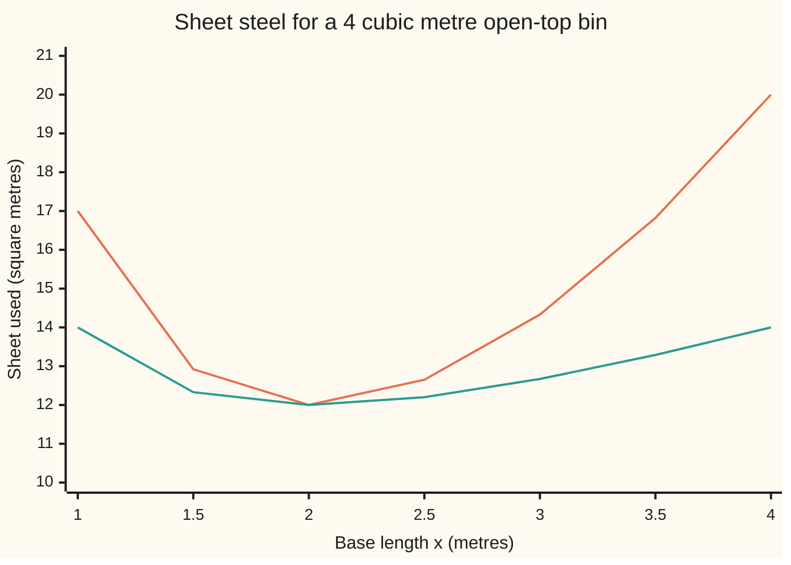

# Extrema in several variables: peaks, pits and saddles

[Syllabus](../../../SYLLABUS.md) → [Calculus and analysis](../README.md) → [Several Variables](../README.md#s07) → Extrema in several variables

---

## General Overview

A workshop folds open-top steel bins holding 4 cubic metres. Steel is sold by the square metre, so the cheapest bin uses least sheet. The base is x metres by y metres; the height must then be 4/(xy) metres.

A long thin base wastes steel on long walls; a tiny base needs tall walls. With one dial, the best point has slope zero. With two dials there are two slopes, and both zero is not enough. The flat spot could be a pit (lowest nearby), a peak (highest nearby) or a saddle: lowest along one road and highest along another, like a mountain pass.

The answer, proved below: a 2-metre square base, 1 metre tall, 12 square metres of steel.

**A smooth lowest or highest point inside the region has every slope zero; the Hessian sorts such a flat spot into pit, peak or saddle; only a whole-region argument makes a pit lowest overall.**

**What kind of fact this is:** a theorem, proved on this card in Why it works.

### The picture: steel used along two roads through the best bin



Orange keeps the base square (y = x); green holds the width at 2 metres. Both bottom out at 12 square metres over x = 2. The picture suggests a pit; the proof decides.

---

## The formula

Notation from this shelf: a curly $\partial$ marks a partial derivative, the rate as one input moves and the others hold still; the gradient $\nabla S$ lists those rates ([Gradient](03-gradient-and-directional-derivatives.md)); the Hessian $H$ is the square table of second partial derivatives.

The sheet used is the base plus four walls. Two walls are x long and 4/(xy) tall, 4/y each; the other two are 4/x each:

$$S(x,y) = xy + \frac{2V}{x} + \frac{2V}{y}, \qquad V = 4.$$

**Find the flat spots,** where both slopes vanish:

$$\nabla S = \left(y - \frac{2V}{x^2},\; x - \frac{2V}{y^2}\right) = (0, 0).$$

**Sort them** with the Hessian's entries at the spot: A, the second rate in x; C, the second rate in y; B, the mixed rate (x then y). Then

$$D = AC - B^2.$$

| At a flat spot | Verdict |
| --- | --- |
| D > 0 and A > 0 | pit: strict local minimum |
| D > 0 and A < 0 | peak: strict local maximum |
| D < 0 | saddle |
| D = 0 | no verdict |

**Read it aloud:** D is the table's corner products, AC, minus the mixed rate squared; its sign, with A's, names the flat spot.

"Local" means best nearby; "global", best of all allowed points; "strict", no nearby tie. Near a flat spot a small step $h$ = ($h_1$ in x, $h_2$ in y) changes S by about

$$\tfrac12\left(A h_1^2 + 2B h_1 h_2 + C h_2^2\right),$$

half the quadratic form $h^{\mathsf T}Hh$: one number built from the step and the table.

| Symbol | Plain meaning | In our example | Push it up and the answer… |
| --- | --- | --- | --- |
| $S$ | sheet steel used, square metres | 12 at the best bin | — |
| $x$, $y$ | base length and width, metres | both 2 at the best bin | past 2, base outgrows wall savings |
| $V$ | volume held, cubic metres | 4 | more steel |
| $\nabla S$, $\partial$ | the two slopes, square metres per metre | (0, 0) at the best bin | nonzero: one way is cheaper |
| $H$, $A$, $B$, $C$ | Hessian and its entries, square metres per square metre | 2, 1, 2 | larger A, C: a steeper pit |
| $D$ | AC − B^2, the Hessian's determinant | 3 | below 0: a saddle |
| $h$, $h_1$, $h_2$ | a small step, metres | (0.1, 0.1) | the quadratic picture drifts |
| $\lambda$ | an eigenvalue: H's stretch along a square-on direction | 3 along (1, 1), 1 along (1, −1) | a firmer pit |

### When it holds

- **Inside the region.** An edge's lowest point need not be flat; check edges separately.
- **Smooth:** continuous second partials nearby. |x| + |y| is lowest at a corner with no gradient.
- **D not zero.** x^4 + y^4 and x^4 − y^4 share an all-zero Hessian at (0, 0): a pit and a saddle.
- **Local only.** Global needs its own argument, Step 4.
- **Two inputs.** With more, a pit needs every eigenvalue of H positive.

---

## Why it works

### Step 0: a lowest point is lowest along every road through it

If (2, 2) beats every nearby shape, hold the width at 2 and vary the length: a one-dial problem lowest at x = 2, so slope zero there ([Optimisation](../03-What%20Derivatives%20Tell%20You/03-monotonicity-and-optimisation.md)). The same holds for the width. So the gradient is zero. Flat says nothing about which way the ground bends.

For the bin: y = 8/x^2 and x = 8/y^2. Substituting, x = x^4/8, so x^3 = 8, x = 2 and y = 2. That is the only flat spot with positive sides.

### Step 1: near a flat spot, the surface is a quadratic bowl or pass

By the Hessian card, the change in S is gradient times step, plus half the quadratic form, plus a remainder shrinking faster than the squared step length. At a flat spot only the last two remain.

On the bin, A = 4V/x^3 = 2, B = 1, C = 2. The step (0.1, 0.1) raises the steel by 0.029048; half the quadratic form predicts 0.030000. The step (0.1, −0.1) raises it by 0.010050 against 0.010000.

### Step 2: completing the square sorts the quadratic form

When A is not zero,

$$A h_1^2 + 2B h_1 h_2 + C h_2^2 = A\left(h_1 + \frac{B}{A} h_2\right)^2 + \frac{D}{A}\, h_2^2 ,$$

as multiplying out confirms.

- A > 0 and D > 0: both terms are at least zero and vanish together only at h = (0, 0). Every step goes up.
- A < 0 and D > 0: both at most zero. Every step goes down.
- D < 0: the step (1, 0) gives A and the step (−B, A) gives A times D, opposite signs: some steps rise, some fall. (If A = 0, swap the roles of x and y; if C = 0 too, the steps (1, 1) and (1, −1) give 2B and −2B.)

The bin: A = 2, D = 3. A pit. Negate the cost and A = −2, D = 3: a peak.

### Step 3: the bowl beats the remainder

The spectral theorem ([The spectral theorem](../../03-Algebra/07-Eigenvalues%20and%20Symmetric%20Matrices/04-spectral-theorem.md)) gives H two square-on directions along which it only stretches; the stretches, its eigenvalues, are 3 along (1, 1) and 1 along (1, −1). So the quadratic form is at least the smallest, $\lambda$ = 1, times the squared step length. The remainder shrinks faster, so for short steps it stays under a quarter of that floor and the rise stays positive: a strict pit. The picture's square-base road runs along (1, 1), the most sharply curved direction.

<details>
<summary>Detailed proof</summary>

Let S have continuous second partials near p, with ∇S(p) = 0, and A > 0, D > 0 at p. The eigenvalues have product D > 0 and sum A + C > 0, so both are positive; with λ the smaller, $h^{\mathsf T}H(p)h \ge \lambda\lvert h\rvert^2$.

With g(t) = S(p + th), [Taylor's theorem](../03-What%20Derivatives%20Tell%20You/05-taylors-theorem.md) gives S(p + h) − S(p) = ½g''(τ) = ½ $h^{\mathsf T}H(p + \tau h)h$ for some τ in (0, 1), since g'(0) = 0.

Set ε = λ/2. Continuity gives δ > 0 with every entry of H(q) − H(p) within ε/2 of zero when |q − p| < δ, so their quadratic forms differ by at most (ε/2)(|h₁| + |h₂|)^2 ≤ ε|h|^2. For 0 < |h| < δ, S(p + h) − S(p) ≥ ½(λ − ε)|h|^2 = ¼λ|h|^2 > 0. Use −S for a peak; for D < 0, Step 2's two steps, scaled small, keep their signs by the same bound.

</details>

### Step 4: from the best nearby bin to the best bin

The allowed region, all positive x and y, runs to infinity, so a pit need not be global. Fence it: the closed square with sides from 8/13 = 0.615385 to 169/8 = 21.125000 metres. Outside it, and on its edges, the steel is at least 13 square metres:

a side below 0.615385 makes its walls, 8/x or 8/y, exceed 13, and a side above 21.125000 with the other at least 0.615385 makes the base exceed 13. The lowest edge value found is 17.437647. Inside, S is continuous on a closed bounded square, so the extreme value theorem ([Extreme value theorem](../01-Limits%20and%20Continuity/07-extreme-value-theorem.md)) gives a cheapest point. It costs at most 12, so it is off the fence, flat by Step 0, hence (2, 2). The pit is global.

A calculus-free grid search over the fence lands on (2.000, 2.000) with 12.000000.

The other route to "local is global" is convexity, a Hessian passing the pit test everywhere ([Convex functions](09-convex-functions.md)). The bin fails it far out, where the wall curvatures shrink below the cross term.

---

## Worked numbers, by hand

| Step | Arithmetic | Value |
| --- | --- | --- |
| Flat-spot equations | y = 8/x^2, x = 8/y^2 | x^3 = 8 |
| The spot | x = 2, y = 8/4 | base 2 by 2 metres |
| Height | 4/(2 × 2) | 1 metre |
| Steel | 4 + 8/2 + 8/2 | 12 square metres |
| Hessian | A = 16/2^3, B = 1, C = 16/2^3 | 2, 1, 2 |
| Sort | D = 2 × 2 − 1 × 1 = 3, A > 0 | pit |
| Fence | outside 0.615385 to 21.125000, over 13 | **global minimum, 12 square metres** |

Base, one wall pair and the other split the steel 4, 4, 4.

### What breaks if you drop a piece

| Mistake | Comes out at | What went wrong |
| --- | --- | --- |
| Skip D | x^2 + 3xy + y^2: A = C = 2, D = −5; (0.1, 0.1) rises 0.050000, (0.1, −0.1) falls 0.010000 | a saddle |
| Trust D = 0 | x^4 + y^4 is 0.000100 at (0.1, 0); x^4 − y^4 is −0.000100 at (0, 0.1) | zero Hessian, pit or saddle |
| Call a pit global | x^2 + y^2 − x^4: pit of value 0 at (0, 0), yet −12 at (2, 0) | no fence |

---

## Code, from first principles, and it actually runs

Two independent roads. Road one is calculus: Newton's method ([Newton's method](../03-What%20Derivatives%20Tell%20You/06-newtons-method.md)) on the gradient, with the Hessian as its slope, eight jumps from (1, 3); then difference quotients, eigenvalues and real rises. Road two is a grid search over the fence, plus a scan of two of its edges (the cost is symmetric in x and y). Four asserts: difference quotients against the formula, real rise against the quadratic model, grid winner against Newton, D's verdict against two steps.

### Python

```python
# Open-top box holding 4 cubic metres: base x by y metres, height 4/(xy).
V = 4.0
S = lambda x, y: x * y + 2 * V / x + 2 * V / y          # sheet area, square metres
grad = lambda x, y: (y - 2 * V / x**2, x - 2 * V / y**2)
hess = lambda x, y: (4 * V / x**3, 1.0, 4 * V / y**3)     # A, B, C from the formula
x, y = 1.0, 3.0                                           # road 1: Newton on gradient = 0
for step in range(8):
    (gx, gy), (a, b, c) = grad(x, y), hess(x, y)
    d = a * c - b * b
    x, y = x - (c * gx - b * gy) / d, y - (a * gy - b * gx) / d
gx, gy = grad(x, y)
print(f"newton from (1,3), 8 steps: x={x:.6f} y={y:.6f} gradient size={(gx*gx+gy*gy)**0.5:.9f}")
print(f"stationary box: base {x:.6f} by {y:.6f}, height {V/(x*y):.6f}, area {S(x,y):.6f}")
def dq(f, x, y, h=1e-3):                                    # second difference quotients
    return ((f(x+h, y) - 2*f(x, y) + f(x-h, y)) / h**2,
            (f(x+h, y+h) - f(x+h, y-h) - f(x-h, y+h) + f(x-h, y-h)) / (4*h*h),
            (f(x, y+h) - 2*f(x, y) + f(x, y-h)) / h**2)
cls = lambda a, d: "saddle" if d < 0 else "no verdict" if d == 0 else "strict local minimum" if a > 0 else "strict local maximum"
A, B, C = hess(x, y); fxx, fxy, fyy = dq(S, x, y)
assert max(abs(fxx-A), abs(fxy-B), abs(fyy-C)) < 1e-4
print(f"hessian formula A={A:.6f} B={B:.6f} C={C:.6f}; difference quotients {fxx:.6f} {fxy:.6f} {fyy:.6f}")
D, T = A*C - B*B, A + C
lam = ((T + (T*T - 4*D)**0.5) / 2, (T - (T*T - 4*D)**0.5) / 2)
print(f"D={D:.6f} trace={T:.6f} eigenvalues {lam[0]:.6f} and {lam[1]:.6f}: {cls(A, D)}")
print(f"sign flip, minus the area: A={-A:.6f} D={D:.6f}: {cls(-A, D)}")
for hx, hy in ((0.1, 0.1), (0.1, -0.1)):
    rise, quad = S(x+hx, y+hy) - S(x, y), 0.5 * (A*hx*hx + 2*B*hx*hy + C*hy*hy)
    assert abs(rise - quad) < 0.1 * quad
    print(f"step ({hx},{hy}): actual rise {rise:.6f}, half h'Hh {quad:.6f}")
M = 13.0                                                     # any area above the best
lo, hi = 2*V / M, M * M / (2*V)                              # fence: area > M outside
edge = [S(e, t) for e in (lo, hi) for t in (lo + (hi-lo)*k/400 for k in range(401))]
print(f"fence: x or y = {lo:.6f} or {hi:.6f} gives area >= {M:.0f}; lowest edge value {min(edge):.6f}")
best = min((S(0.05*i, 0.05*j), 0.05*i, 0.05*j) for i in range(int(lo*20)+1, int(hi*20)+1) for j in range(int(lo*20)+1, int(hi*20)+1))
best = min((S(best[1] + 0.001*i, best[2] + 0.001*j), best[1] + 0.001*i, best[2] + 0.001*j) for i in range(-60, 61) for j in range(-60, 61))
assert abs(best[1] - x) < 2e-3 and abs(best[2] - y) < 2e-3 and best[0] >= S(x, y) - 1e-12
print(f"road 2, grid search over the fence: best ({best[1]:.3f}, {best[2]:.3f}) area {best[0]:.6f}")
print("chart square base y=x:", ", ".join(f"{S(s, s):.2f}" for s in (1, 1.5, 2, 2.5, 3, 3.5, 4)))
print("chart y fixed at 2:", ", ".join(f"{S(s, 2):.2f}" for s in (1, 1.5, 2, 2.5, 3, 3.5, 4)))
f3 = lambda x, y: x*x + 3*x*y + y*y                           # A = C = 2, cross term 3
a3, b3, c3 = dq(f3, 0.0, 0.0); d3 = a3*c3 - b3*b3
assert cls(a3, d3) == "saddle" and f3(0.1, 0.1) > 0 > f3(0.1, -0.1)
print(f"breaks, x^2+3xy+y^2: D={d3:.0f}, rise along (0.1,0.1) {f3(0.1,0.1):.6f}, along (0.1,-0.1) {f3(0.1,-0.1):.6f}: {cls(a3, d3)}")
print(f"breaks, flat Hessian: x^4+y^4 at (0.1,0) {0.1**4:.6f}; x^4-y^4 at (0,0.1) {-0.1**4:.6f}")
g = lambda x, y: x*x + y*y - x**4
print(f"breaks, x^2+y^2-x^4: value 0 at the local minimum (0,0), g(2,0) = {g(2, 0):.6f}")
print("ALL CHECKS PASS")
```

**Ran 2026-11-11 on macOS, Python 3.14.10, standard library only. All checks passed. Output, pasted from the run:**

```
newton from (1,3), 8 steps: x=2.000000 y=2.000000 gradient size=0.000000000
stationary box: base 2.000000 by 2.000000, height 1.000000, area 12.000000
hessian formula A=2.000000 B=1.000000 C=2.000000; difference quotients 2.000000 1.000000 2.000000
D=3.000000 trace=4.000000 eigenvalues 3.000000 and 1.000000: strict local minimum
sign flip, minus the area: A=-2.000000 D=3.000000: strict local maximum
step (0.1,0.1): actual rise 0.029048, half h'Hh 0.030000
step (0.1,-0.1): actual rise 0.010050, half h'Hh 0.010000
fence: x or y = 0.615385 or 21.125000 gives area >= 13; lowest edge value 17.437647
road 2, grid search over the fence: best (2.000, 2.000) area 12.000000
chart square base y=x: 17.00, 12.92, 12.00, 12.65, 14.33, 16.82, 20.00
chart y fixed at 2: 14.00, 12.33, 12.00, 12.20, 12.67, 13.29, 14.00
breaks, x^2+3xy+y^2: D=-5, rise along (0.1,0.1) 0.050000, along (0.1,-0.1) -0.010000: saddle
breaks, flat Hessian: x^4+y^4 at (0.1,0) 0.000100; x^4-y^4 at (0,0.1) -0.000100
breaks, x^2+y^2-x^4: value 0 at the local minimum (0,0), g(2,0) = -12.000000
ALL CHECKS PASS
```

### Rust

```rust
// Open-top box holding 4 cubic metres: base x by y metres, height 4/(xy).
const V: f64 = 4.0;
fn s(x: f64, y: f64) -> f64 { x * y + 2.0 * V / x + 2.0 * V / y } // sheet area, square metres
fn grad(x: f64, y: f64) -> (f64, f64) { (y - 2.0 * V / (x * x), x - 2.0 * V / (y * y)) }
fn hess(x: f64, y: f64) -> (f64, f64, f64) { (4.0 * V / x.powi(3), 1.0, 4.0 * V / y.powi(3)) }
fn dq(f: impl Fn(f64, f64) -> f64, x: f64, y: f64) -> (f64, f64, f64) { // second difference quotients
    let h = 1e-3;
    ((f(x + h, y) - 2.0 * f(x, y) + f(x - h, y)) / (h * h),
     (f(x + h, y + h) - f(x + h, y - h) - f(x - h, y + h) + f(x - h, y - h)) / (4.0 * h * h),
     (f(x, y + h) - 2.0 * f(x, y) + f(x, y - h)) / (h * h))
}
fn cls(a: f64, d: f64) -> &'static str {
    if d < 0.0 { "saddle" } else if d == 0.0 { "no verdict" } else if a > 0.0 { "strict local minimum" } else { "strict local maximum" }
}
fn row(f: impl Fn(f64) -> f64) -> String {
    [1.0, 1.5, 2.0, 2.5, 3.0, 3.5, 4.0].iter().map(|&t| format!("{:.2}", f(t))).collect::<Vec<_>>().join(", ")
}
fn main() {
    let (mut x, mut y) = (1.0_f64, 3.0_f64); // road 1: Newton on gradient = 0
    for _ in 0..8 {
        let ((gx, gy), (a, b, c)) = (grad(x, y), hess(x, y));
        let d = a * c - b * b;
        let (nx, ny) = (x - (c * gx - b * gy) / d, y - (a * gy - b * gx) / d);
        x = nx; y = ny;
    }
    let (gx, gy) = grad(x, y);
    println!("newton from (1,3), 8 steps: x={:.6} y={:.6} gradient size={:.9}", x, y, (gx * gx + gy * gy).sqrt());
    println!("stationary box: base {:.6} by {:.6}, height {:.6}, area {:.6}", x, y, V / (x * y), s(x, y));
    let (a, b, c) = hess(x, y);
    let (fxx, fxy, fyy) = dq(s, x, y);
    assert!((fxx - a).abs().max((fxy - b).abs()).max((fyy - c).abs()) < 1e-4);
    println!("hessian formula A={:.6} B={:.6} C={:.6}; difference quotients {:.6} {:.6} {:.6}", a, b, c, fxx, fxy, fyy);
    let (d, t) = (a * c - b * b, a + c);
    let r = (t * t - 4.0 * d).sqrt();
    println!("D={:.6} trace={:.6} eigenvalues {:.6} and {:.6}: {}", d, t, (t + r) / 2.0, (t - r) / 2.0, cls(a, d));
    println!("sign flip, minus the area: A={:.6} D={:.6}: {}", -a, d, cls(-a, d));
    for (hx, hy) in [(0.1, 0.1), (0.1, -0.1)] {
        let rise = s(x + hx, y + hy) - s(x, y);
        let quad = 0.5 * (a * hx * hx + 2.0 * b * hx * hy + c * hy * hy);
        assert!((rise - quad).abs() < 0.1 * quad);
        println!("step ({},{}): actual rise {:.6}, half h'Hh {:.6}", hx, hy, rise, quad);
    }
    let m = 13.0; // any area above the best
    let (lo, hi) = (2.0 * V / m, m * m / (2.0 * V)); // fence: area > m outside
    let mut edge = f64::INFINITY;
    for e in [lo, hi] {
        for k in 0..=400 { edge = edge.min(s(e, lo + (hi - lo) * k as f64 / 400.0)); }
    }
    println!("fence: x or y = {:.6} or {:.6} gives area >= {:.0}; lowest edge value {:.6}", lo, hi, m, edge);
    let mut best = (f64::INFINITY, 0.0, 0.0);
    let (i0, i1) = ((lo * 20.0) as i32 + 1, (hi * 20.0) as i32 + 1);
    for i in i0..i1 { for j in i0..i1 {
        let (u, v) = (0.05 * i as f64, 0.05 * j as f64);
        if s(u, v) < best.0 { best = (s(u, v), u, v); }
    } }
    let (bx, by) = (best.1, best.2);
    for i in -60..=60 { for j in -60..=60 {
        let (u, v) = (bx + 0.001 * i as f64, by + 0.001 * j as f64);
        if s(u, v) < best.0 { best = (s(u, v), u, v); }
    } }
    assert!((best.1 - x).abs() < 2e-3 && (best.2 - y).abs() < 2e-3 && best.0 >= s(x, y) - 1e-12);
    println!("road 2, grid search over the fence: best ({:.3}, {:.3}) area {:.6}", best.1, best.2, best.0);
    println!("chart square base y=x: {}", row(|t| s(t, t)));
    println!("chart y fixed at 2: {}", row(|t| s(t, 2.0)));
    let f3 = |x: f64, y: f64| x * x + 3.0 * x * y + y * y; // A = C = 2, cross term 3
    let (a3, b3, c3) = dq(f3, 0.0, 0.0);
    let d3 = a3 * c3 - b3 * b3;
    assert!(cls(a3, d3) == "saddle" && f3(0.1, 0.1) > 0.0 && 0.0 > f3(0.1, -0.1));
    println!("breaks, x^2+3xy+y^2: D={:.0}, rise along (0.1,0.1) {:.6}, along (0.1,-0.1) {:.6}: {}", d3, f3(0.1, 0.1), f3(0.1, -0.1), cls(a3, d3));
    println!("breaks, flat Hessian: x^4+y^4 at (0.1,0) {:.6}; x^4-y^4 at (0,0.1) {:.6}", 0.1_f64.powi(4), -0.1_f64.powi(4));
    let g = |x: f64, y: f64| x * x + y * y - x.powi(4);
    println!("breaks, x^2+y^2-x^4: value 0 at the local minimum (0,0), g(2,0) = {:.6}", g(2.0, 0.0));
    println!("ALL CHECKS PASS");
}
```

**Ran 2026-11-11 on macOS, rustc 1.98.1, no crates. All checks passed. Output, pasted from the run:**

```
newton from (1,3), 8 steps: x=2.000000 y=2.000000 gradient size=0.000000000
stationary box: base 2.000000 by 2.000000, height 1.000000, area 12.000000
hessian formula A=2.000000 B=1.000000 C=2.000000; difference quotients 2.000000 1.000000 2.000000
D=3.000000 trace=4.000000 eigenvalues 3.000000 and 1.000000: strict local minimum
sign flip, minus the area: A=-2.000000 D=3.000000: strict local maximum
step (0.1,0.1): actual rise 0.029048, half h'Hh 0.030000
step (0.1,-0.1): actual rise 0.010050, half h'Hh 0.010000
fence: x or y = 0.615385 or 21.125000 gives area >= 13; lowest edge value 17.437647
road 2, grid search over the fence: best (2.000, 2.000) area 12.000000
chart square base y=x: 17.00, 12.92, 12.00, 12.65, 14.33, 16.82, 20.00
chart y fixed at 2: 14.00, 12.33, 12.00, 12.20, 12.67, 13.29, 14.00
breaks, x^2+3xy+y^2: D=-5, rise along (0.1,0.1) 0.050000, along (0.1,-0.1) -0.010000: saddle
breaks, flat Hessian: x^4+y^4 at (0.1,0) 0.000100; x^4-y^4 at (0,0.1) -0.000100
breaks, x^2+y^2-x^4: value 0 at the local minimum (0,0), g(2,0) = -12.000000
ALL CHECKS PASS
```

The two outputs agree line for line.

### Lean

Lean proves the pit, peak and saddle test and the zero gradient rule for every function meeting the conditions, and the bin's answer exactly.

- Take a function of two inputs with continuous second partials near a flat spot. If D > 0 and A > 0, the spot is a strict local minimum: a pit.
- If D > 0 and A < 0, the spot is a strict local maximum: a peak.
- If D < 0, the spot is a saddle: neither a local minimum nor a local maximum.
- In any number of inputs, a lowest or highest nearby point inside the region has zero gradient, if the function has a derivative there.
- Over all positive x and y, the bin's steel S is lowest at the 2 by 2 base: 12 square metres, the global minimum.
- No other base uses exactly 12 square metres.
- The hand arithmetic holds exactly: the flat spot, height, steel, Hessian, D, eigenvalues, fence, and the saddle and x^2 + y^2 − x^4 mistakes.

Newton's method, difference quotients, step rises, the grid search, the chart and the D = 0 examples are left to the Python and Rust checks.

<details>
<summary>The Lean proof, 317 lines</summary>

```lean
-- Extrema in several variables: a smooth lowest or highest point inside a region has zero gradient, the two-input second derivative test sorts a flat spot into strict pit, strict peak or saddle by the signs of D = AC - B^2 and A, and the card's 4 cubic metre bin uses least steel, 12 square metres, exactly at the 2 by 2 base.
import Mathlib.Analysis.Calculus.Gradient.Basic
import Mathlib.Analysis.Calculus.FDeriv.Prod
import Mathlib.Analysis.Calculus.ContDiff.Basic
import Mathlib.Analysis.Calculus.LocalExtr.Basic
import Mathlib.Analysis.InnerProductSpace.PiL2
import Mathlib.Order.Filter.Extr
import Mathlib.Tactic.NormNum
import Mathlib.Tactic.Ring
import Mathlib.Analysis.Calculus.FDeriv.Symmetric
import Mathlib.Analysis.Calculus.Deriv.MeanValue
import Mathlib.Tactic.Linarith
import Mathlib.Tactic.Positivity
import Mathlib.Tactic.FieldSimp

open Set Filter Topology

theorem sdt_mvt_step {E : Type*} [NormedAddCommGroup E] [NormedSpace ℝ E]
    {f : E → ℝ} {p : E} {H : E →L[ℝ] E →L[ℝ] ℝ}
    (hdiff : ∀ᶠ x in 𝓝 p, DifferentiableAt ℝ f x)
    (hH : HasFDerivAt (fderiv ℝ f) H p) (hflat : fderiv ℝ f p = 0) {ε : ℝ} (hε : 0 < ε) :
    ∀ᶠ q in 𝓝 p, ∃ τ : ℝ, 0 < τ ∧ τ < 1 ∧
      |f q - f p - τ * H (q - p) (q - p)| ≤ τ * ε * ‖q - p‖ ^ 2 := by
  have hlo := hH.isLittleO.bound hε
  obtain ⟨r, hr, hball⟩ := Metric.eventually_nhds_iff_ball.1 (hdiff.and hlo)
  filter_upwards [Metric.ball_mem_nhds p hr] with q hq
  have hseg : ∀ t ∈ Icc (0:ℝ) 1, p + t • (q - p) ∈ Metric.ball p r := by
    intro t ht
    rw [Metric.mem_ball, dist_eq_norm] at hq ⊢
    rw [add_sub_cancel_left, norm_smul, Real.norm_eq_abs, abs_of_nonneg ht.1]
    calc t * ‖q - p‖ ≤ 1 * ‖q - p‖ := by gcongr; exact ht.2
      _ < r := by simpa using hq
  have hderiv : ∀ t ∈ Icc (0:ℝ) 1, HasDerivAt (fun t : ℝ => f (p + t • (q - p)))
      (fderiv ℝ f (p + t • (q - p)) (q - p)) t := by
    intro t ht
    have h1 : HasDerivAt (fun t : ℝ => p + t • (q - p)) (q - p) t := by
      simpa using ((hasDerivAt_id t).smul_const (q - p)).const_add p
    exact ((hball _ (hseg t ht)).1.hasFDerivAt).comp_hasDerivAt t h1
  obtain ⟨τ, hτ, hτeq⟩ := exists_hasDerivAt_eq_slope (fun t : ℝ => f (p + t • (q - p)))
    (fun t => fderiv ℝ f (p + t • (q - p)) (q - p)) zero_lt_one
    (fun t ht => (hderiv t ht).continuousAt.continuousWithinAt)
    (fun t ht => hderiv t (Ioo_subset_Icc_self ht))
  simp only [one_smul, zero_smul, add_zero, add_sub_cancel, sub_zero, div_one] at hτeq
  refine ⟨τ, hτ.1, hτ.2, ?_⟩
  have hb := (hball _ (hseg τ (Ioo_subset_Icc_self hτ))).2
  rw [hflat, sub_zero, add_sub_cancel_left, map_smul] at hb
  rw [← hτeq]
  have : fderiv ℝ f (p + τ • (q - p)) (q - p) - τ * H (q - p) (q - p)
      = (fderiv ℝ f (p + τ • (q - p)) - τ • H (q - p)) (q - p) := by simp
  rw [this]
  calc _ ≤ ‖fderiv ℝ f (p + τ • (q - p)) - τ • H (q - p)‖ * ‖q - p‖ := by
        rw [← Real.norm_eq_abs]; exact ContinuousLinearMap.le_opNorm _ _
    _ ≤ ε * ‖τ • (q - p)‖ * ‖q - p‖ := by gcongr
    _ = τ * ε * ‖q - p‖ ^ 2 := by rw [norm_smul, Real.norm_eq_abs, abs_of_pos hτ.1]; ring

theorem sdt_strict_min {E : Type*} [NormedAddCommGroup E] [NormedSpace ℝ E]
    {f : E → ℝ} {p : E} {H : E →L[ℝ] E →L[ℝ] ℝ}
    (hdiff : ∀ᶠ x in 𝓝 p, DifferentiableAt ℝ f x)
    (hH : HasFDerivAt (fderiv ℝ f) H p) (hflat : fderiv ℝ f p = 0) {c : ℝ} (hc : 0 < c)
    (hpos : ∀ h, c * ‖h‖ ^ 2 ≤ H h h) : ∀ᶠ q in 𝓝[≠] p, f p < f q := by
  have hstep := sdt_mvt_step hdiff hH hflat (half_pos hc)
  filter_upwards [nhdsWithin_le_nhds hstep, eventually_mem_nhdsWithin] with q hτq hq
  obtain ⟨τ, hτ0, -, hτ⟩ := hτq
  have hq' : 0 < ‖q - p‖ := norm_pos_iff.2 (sub_ne_zero.2 hq)
  have h1 := hpos (q - p)
  have h2 := (abs_le.1 hτ).1
  have h3 := mul_le_mul_of_nonneg_left h1 hτ0.le
  have h4 : 0 < τ * c * ‖q - p‖ ^ 2 := by positivity
  nlinarith

theorem sdt_strict_max {E : Type*} [NormedAddCommGroup E] [NormedSpace ℝ E]
    {f : E → ℝ} {p : E} {H : E →L[ℝ] E →L[ℝ] ℝ}
    (hdiff : ∀ᶠ x in 𝓝 p, DifferentiableAt ℝ f x)
    (hH : HasFDerivAt (fderiv ℝ f) H p) (hflat : fderiv ℝ f p = 0) {c : ℝ} (hc : 0 < c)
    (hneg : ∀ h, H h h ≤ -(c * ‖h‖ ^ 2)) : ∀ᶠ q in 𝓝[≠] p, f q < f p := by
  have hstep := sdt_mvt_step hdiff hH hflat (half_pos hc)
  filter_upwards [nhdsWithin_le_nhds hstep, eventually_mem_nhdsWithin] with q hτq hq
  obtain ⟨τ, hτ0, -, hτ⟩ := hτq
  have hq' : 0 < ‖q - p‖ := norm_pos_iff.2 (sub_ne_zero.2 hq)
  have h1 := hneg (q - p)
  have h2 := (abs_le.1 hτ).2
  have h3 := mul_le_mul_of_nonneg_left h1 hτ0.le
  have h4 : 0 < τ * c * ‖q - p‖ ^ 2 := by positivity
  nlinarith

theorem sdt_tendsto_line {E : Type*} [NormedAddCommGroup E] [NormedSpace ℝ E] (p w : E) :
    Tendsto (fun s : ℝ => p + s • w) (𝓝[≠] 0) (𝓝 p) := by
  have : Tendsto (fun s : ℝ => p + s • w) (𝓝 0) (𝓝 (p + (0:ℝ) • w)) :=
    (continuous_const.add (continuous_id.smul continuous_const)).tendsto 0
  simpa using this.mono_left nhdsWithin_le_nhds

theorem sdt_not_min {E : Type*} [NormedAddCommGroup E] [NormedSpace ℝ E]
    {f : E → ℝ} {p : E} {H : E →L[ℝ] E →L[ℝ] ℝ}
    (hdiff : ∀ᶠ x in 𝓝 p, DifferentiableAt ℝ f x)
    (hH : HasFDerivAt (fderiv ℝ f) H p) (hflat : fderiv ℝ f p = 0) {w : E}
    (hw : H w w < 0) : ¬ IsLocalMin f p := by
  intro hmin
  have hw0 : w ≠ 0 := by rintro rfl; simp at hw
  have hwn : 0 < ‖w‖ := norm_pos_iff.2 hw0
  have hε : 0 < -H w w / (2 * ‖w‖ ^ 2) := by
    apply div_pos (by linarith) (by positivity)
  have hεw : -H w w / (2 * ‖w‖ ^ 2) * ‖w‖ ^ 2 = -H w w / 2 := by field_simp
  have hmin' : ∀ᶠ y in 𝓝 p, f p ≤ f y := hmin
  obtain ⟨s, hs, ⟨τ, hτ0, -, hτ⟩, hle⟩ := (eventually_mem_nhdsWithin.and
    (((sdt_tendsto_line p w).eventually (sdt_mvt_step hdiff hH hflat hε)).and
      ((sdt_tendsto_line p w).eventually hmin'))).exists
  simp only [add_sub_cancel_left, map_smul, FunLike.coe_smul, Pi.smul_apply, smul_eq_mul,
    norm_smul, Real.norm_eq_abs] at hτ
  have hs2 : 0 < s ^ 2 := by
    have : s ≠ 0 := hs
    positivity
  have h2 := (abs_le.1 hτ).2
  have e1 : |s| ^ 2 = s ^ 2 := sq_abs s
  have e2 : τ * (-H w w / (2 * ‖w‖ ^ 2)) * (|s| * ‖w‖) ^ 2 = τ * s ^ 2 * (-H w w / 2) := by
    rw [mul_pow, e1, ← hεw]; ring
  rw [e2] at h2
  have h5 : 0 < τ * s ^ 2 * (-H w w) := by
    have : 0 < -H w w := by linarith
    positivity
  nlinarith

theorem sdt_not_max {E : Type*} [NormedAddCommGroup E] [NormedSpace ℝ E]
    {f : E → ℝ} {p : E} {H : E →L[ℝ] E →L[ℝ] ℝ}
    (hdiff : ∀ᶠ x in 𝓝 p, DifferentiableAt ℝ f x)
    (hH : HasFDerivAt (fderiv ℝ f) H p) (hflat : fderiv ℝ f p = 0) {w : E}
    (hw : 0 < H w w) : ¬ IsLocalMax f p := by
  intro hmax
  have hw0 : w ≠ 0 := by rintro rfl; simp at hw
  have hwn : 0 < ‖w‖ := norm_pos_iff.2 hw0
  have hε : 0 < H w w / (2 * ‖w‖ ^ 2) := by
    apply div_pos hw (by positivity)
  have hεw : H w w / (2 * ‖w‖ ^ 2) * ‖w‖ ^ 2 = H w w / 2 := by field_simp
  have hmax' : ∀ᶠ y in 𝓝 p, f y ≤ f p := hmax
  obtain ⟨s, hs, ⟨τ, hτ0, -, hτ⟩, hle⟩ := (eventually_mem_nhdsWithin.and
    (((sdt_tendsto_line p w).eventually (sdt_mvt_step hdiff hH hflat hε)).and
      ((sdt_tendsto_line p w).eventually hmax'))).exists
  simp only [add_sub_cancel_left, map_smul, FunLike.coe_smul, Pi.smul_apply, smul_eq_mul,
    norm_smul, Real.norm_eq_abs] at hτ
  have hs2 : 0 < s ^ 2 := by
    have : s ≠ 0 := hs
    positivity
  have h2 := (abs_le.1 hτ).1
  have e1 : |s| ^ 2 = s ^ 2 := sq_abs s
  have e2 : τ * (H w w / (2 * ‖w‖ ^ 2)) * (|s| * ‖w‖) ^ 2 = τ * s ^ 2 * (H w w / 2) := by
    rw [mul_pow, e1, ← hεw]; ring
  rw [e2] at h2
  have h5 : 0 < τ * s ^ 2 * H w w := by positivity
  nlinarith

theorem sdt_indefinite_neg (A B C : ℝ) (hD : A * C - B ^ 2 < 0) :
    ∃ a b : ℝ, A * a ^ 2 + 2 * B * a * b + C * b ^ 2 < 0 := by
  rcases lt_trichotomy A 0 with hA | hA | hA
  · exact ⟨1, 0, by linarith⟩
  · have hB : B ≠ 0 := by rintro rfl; subst hA; linarith
    refine ⟨(-1 - C) / (2 * B), 1, ?_⟩
    subst hA
    have : 2 * B * ((-1 - C) / (2 * B)) * 1 = -1 - C := by field_simp
    nlinarith
  · refine ⟨-B, A, ?_⟩
    nlinarith

theorem sdt_indefinite_pos (A B C : ℝ) (hD : A * C - B ^ 2 < 0) :
    ∃ a b : ℝ, 0 < A * a ^ 2 + 2 * B * a * b + C * b ^ 2 := by
  obtain ⟨a, b, h⟩ := sdt_indefinite_neg (-A) (-B) (-C) (by nlinarith)
  exact ⟨a, b, by nlinarith⟩

/-- **The second derivative test, two inputs.** Let f be a function of two inputs with
continuous second partial derivatives near the point p (f is twice continuously
differentiable at p), and let p be a flat spot: both slopes of f are zero there (the
derivative of f at p is zero). Write A for the second rate in x, B for the mixed rate
(x then y) and C for the second rate in y, all at p, and D = AC − B^2. Then:
* D > 0 and A > 0: p is a pit, a strict local minimum (every nearby point other than p has a
  larger value);
* D > 0 and A < 0: p is a peak, a strict local maximum (every nearby point other than p has a
  smaller value);
* D < 0: p is a saddle: it is neither a local minimum nor a local maximum, since arbitrarily
  close to p some points lie higher and some lower. -/
theorem second_derivative_test_two_variables {f : ℝ × ℝ → ℝ} {p : ℝ × ℝ}
    (hf : ContDiffAt ℝ 2 f p) (hflat : fderiv ℝ f p = 0) :
    let A := fderiv ℝ (fderiv ℝ f) p (1, 0) (1, 0)
    let B := fderiv ℝ (fderiv ℝ f) p (1, 0) (0, 1)
    let C := fderiv ℝ (fderiv ℝ f) p (0, 1) (0, 1)
    (0 < A * C - B ^ 2 → 0 < A → ∀ᶠ q in 𝓝[≠] p, f p < f q) ∧
    (0 < A * C - B ^ 2 → A < 0 → ∀ᶠ q in 𝓝[≠] p, f q < f p) ∧
    (A * C - B ^ 2 < 0 → ¬ IsLocalMin f p ∧ ¬ IsLocalMax f p) := by
  dsimp only
  have hdiff : ∀ᶠ x in 𝓝 p, DifferentiableAt ℝ f x :=
    (hf.eventually (by simp)).mono fun x hx => hx.differentiableAt (by simp)
  have hH : HasFDerivAt (fderiv ℝ f) (fderiv ℝ (fderiv ℝ f) p) p :=
    ((hf.fderiv_right (m := 1) (by norm_num)).differentiableAt (by simp)).hasFDerivAt
  have hsymm : IsSymmSndFDerivAt ℝ f p := hf.isSymmSndFDerivAt (by simp)
  set H := fderiv ℝ (fderiv ℝ f) p with hHdef
  set A := H (1, 0) (1, 0)
  set B := H (1, 0) (0, 1)
  set C := H (0, 1) (0, 1)
  have hQ : ∀ a b : ℝ, H (a, b) (a, b) = A * a ^ 2 + 2 * B * a * b + C * b ^ 2 := by
    intro a b
    have e : ((a, b) : ℝ × ℝ) = a • ((1 : ℝ), (0 : ℝ)) + b • ((0 : ℝ), (1 : ℝ)) := by simp
    have e2 : H (0, 1) (1, 0) = B := hsymm (0, 1) (1, 0)
    rw [e]
    simp only [map_add, map_smul, FunLike.coe_add, Pi.add_apply, FunLike.coe_smul, Pi.smul_apply,
      smul_eq_mul, e2]
    ring
  have hn : ∀ h : ℝ × ℝ, ‖h‖ ^ 2 ≤ h.1 ^ 2 + h.2 ^ 2 := by
    intro h
    rw [Prod.norm_def, Real.norm_eq_abs, Real.norm_eq_abs]
    rcases max_cases |h.1| |h.2| with ⟨h1, _⟩ | ⟨h1, _⟩ <;> rw [h1] <;>
      nlinarith [sq_abs h.1, sq_abs h.2, sq_nonneg h.1, sq_nonneg h.2]
  refine ⟨fun hD hA => ?_, fun hD hA => ?_, fun hD => ?_⟩
  · have hC : 0 < C := by nlinarith [sq_nonneg B]
    have hAC : 0 < A + C := by linarith
    refine sdt_strict_min hdiff hH hflat (c := (A * C - B ^ 2) / (A + C)) (by positivity) ?_
    rintro ⟨a, b⟩
    rw [hQ, div_mul_eq_mul_div, div_le_iff₀ hAC]
    have := hn (a, b)
    nlinarith [sq_nonneg (A * a + B * b), sq_nonneg (B * a + C * b)]
  · have hC : C < 0 := by nlinarith [sq_nonneg B]
    have hAC : 0 < -(A + C) := by linarith
    refine sdt_strict_max hdiff hH hflat (c := (A * C - B ^ 2) / -(A + C)) (by positivity) ?_
    rintro ⟨a, b⟩
    rw [hQ, div_mul_eq_mul_div, le_neg, div_le_iff₀ hAC]
    have := hn (a, b)
    nlinarith [sq_nonneg (A * a + B * b), sq_nonneg (B * a + C * b)]
  · obtain ⟨a, b, hneg⟩ := sdt_indefinite_neg A B C hD
    obtain ⟨a', b', hpos⟩ := sdt_indefinite_pos A B C hD
    exact ⟨sdt_not_min hdiff hH hflat (w := (a, b)) (by rw [hQ]; exact hneg),
      sdt_not_max hdiff hH hflat (w := (a', b')) (by rw [hQ]; exact hpos)⟩

/-- **A best point inside the region is flat.** Let U be an open region of n-dimensional
space and f a function that has a derivative at the point p of U. If p is a lowest or a
highest point of f among the points of U near p (a local extremum of f on U), then every
partial slope of f at p is zero: the gradient of f at p is the zero vector. -/
theorem gradient_eq_zero_of_local_extremum {n : ℕ} {U : Set (EuclideanSpace ℝ (Fin n))}
    {f : EuclideanSpace ℝ (Fin n) → ℝ} {p : EuclideanSpace ℝ (Fin n)}
    (hU : IsOpen U) (hp : p ∈ U) (hf : DifferentiableAt ℝ f p) (hext : IsLocalExtrOn f U p) :
    gradient f p = 0 := by
  have h : fderiv ℝ f p = 0 := (hext.isLocalExtr (hU.mem_nhds hp)).fderiv_eq_zero
  simp [gradient, h]

/-- **The cheapest bin.** An open-top bin holding 4 cubic metres with a base x by y metres
(both positive) and height 4/(xy) uses S(x, y) = xy + 8/x + 8/y square metres of steel.
Over all positive x and y, the least steel is used by the 2 by 2 base: S(2, 2) = 12 is the
global minimum, and no other base reaches it. -/
theorem open_bin_global_minimum :
    let S : ℝ × ℝ → ℝ := fun q => q.1 * q.2 + 8 / q.1 + 8 / q.2
    S (2, 2) = 12 ∧
    IsMinOn S {q | 0 < q.1 ∧ 0 < q.2} (2, 2) ∧
    ∀ q : ℝ × ℝ, 0 < q.1 → 0 < q.2 → S q = 12 → q = (2, 2) := by
  intro S
  have key : ∀ x y : ℝ, 0 < x → 0 < y →
      S (x, y) - 12 = (x ^ 2 * y ^ 2 + 8 * x + 8 * y - 12 * x * y) / (x * y) := by
    intro x y hx hy
    simp only [S]
    field_simp
    ring
  have poly : ∀ x y : ℝ, 0 < x → 0 < y → 0 ≤ x ^ 2 * y ^ 2 + 8 * x + 8 * y - 12 * x * y := by
    intro x y hx hy
    nlinarith [sq_nonneg (x - 2), sq_nonneg (y - 2), sq_nonneg (x - y), sq_nonneg (x * y - 4),
      mul_pos hx hy, mul_pos (mul_pos hx hy) hx, sq_nonneg (x + y - 4)]
  have h12 : S (2, 2) = 12 := by simp only [S]; norm_num
  refine ⟨h12, ?_, ?_⟩
  · rw [isMinOn_iff]
    rintro ⟨x, y⟩ ⟨hx, hy⟩
    have h1 := key x y hx hy
    have h2 : 0 ≤ (x ^ 2 * y ^ 2 + 8 * x + 8 * y - 12 * x * y) / (x * y) :=
      div_nonneg (poly x y hx hy) (mul_pos hx hy).le
    rw [h12]
    linarith
  · rintro ⟨x, y⟩ hx hy hS
    have h1 := key x y hx hy
    rw [hS, sub_self, eq_comm, div_eq_zero_iff] at h1
    have h0 : x ^ 2 * y ^ 2 + 8 * x + 8 * y - 12 * x * y = 0 := by
      rcases h1 with h | h
      · exact h
      · exact absurd h (mul_pos hx hy).ne'
    have hxy : (x - y) ^ 2 = 0 := by
      nlinarith [sq_nonneg (x - 2), sq_nonneg (y - 2), sq_nonneg (x - y), sq_nonneg (x * y - 4),
        mul_pos hx hy, mul_pos (mul_pos hx hy) hx, sq_nonneg (x + y - 4)]
    have hyx : y = x := by nlinarith [pow_eq_zero_iff (n := 2) (two_ne_zero) |>.1 hxy]
    subst hyx
    have hf : y * ((y - 2) ^ 2 * (y + 4)) = 0 := by linear_combination h0
    rcases mul_eq_zero.1 hf with h | h
    · exact absurd h hx.ne'
    rcases mul_eq_zero.1 h with h | h
    · have : y = 2 := by nlinarith [pow_eq_zero_iff (n := 2) (two_ne_zero) |>.1 h]
      subst this; rfl
    · linarith

-- The flat-spot equations y = 8/x^2 and x = 8/y^2 hold at (2, 2): 8/4 = 2, and x^3 = 8.
example : (8 : ℚ) / 2 ^ 2 = 2 ∧ (2 : ℚ) ^ 3 = 8 := by norm_num
-- Height 4/(2 × 2) = 1 metre; steel 4 + 8/2 + 8/2 = 12 square metres, split 4, 4, 4.
example : (4 : ℚ) / (2 * 2) = 1 ∧ (2 : ℚ) * 2 + 8 / 2 + 8 / 2 = 12 := by norm_num
-- Hessian at (2, 2): A = C = 16/2^3 = 2, B = 1; D = 2 × 2 − 1 × 1 = 3 > 0 with A > 0: a pit.
example : (16 : ℚ) / 2 ^ 3 = 2 ∧ (2 : ℤ) * 2 - 1 * 1 = 3 := by norm_num
-- Negated cost: A = −2, D = (−2)(−2) − (−1)^2 = 3 > 0 with A < 0: a peak.
example : (-2 : ℤ) * (-2) - (-1) ^ 2 = 3 := by norm_num
-- Eigenvalues of the table [[2, 1], [1, 2]]: 3 along (1, 1) and 1 along (1, −1).
example : (2 * 1 + 1 * 1 : ℤ) = 3 * 1 ∧ (1 * 1 + 2 * 1 : ℤ) = 3 * 1 ∧
    (2 * 1 + 1 * (-1) : ℤ) = 1 * 1 ∧ (1 * 1 + 2 * (-1) : ℤ) = 1 * (-1) := by norm_num
-- The fence: a side of 8/13 makes its walls 8/(8/13) = 13; the far fence 13^2/8 = 169/8.
example : (8 : ℚ) / (8 / 13) = 13 ∧ (13 : ℚ) ^ 2 / 8 = 169 / 8 := by norm_num
-- Saddle: x^2 + 3xy + y^2 has A = C = 2, B = 3, so D = 2 × 2 − 3^2 = −5 < 0.
example : (2 : ℤ) * 2 - 3 ^ 2 = -5 := by norm_num
-- Local is not global: x^2 + y^2 − x^4 is 0 at (0, 0) but 2^2 + 0^2 − 2^4 = −12 at (2, 0).
example : (2 : ℤ) ^ 2 + 0 ^ 2 - 2 ^ 4 = -12 := by norm_num

#print axioms sdt_mvt_step
#print axioms sdt_strict_min
#print axioms sdt_strict_max
#print axioms sdt_tendsto_line
#print axioms sdt_not_min
#print axioms sdt_not_max
#print axioms sdt_indefinite_neg
#print axioms sdt_indefinite_pos
#print axioms second_derivative_test_two_variables
#print axioms gradient_eq_zero_of_local_extremum
#print axioms open_bin_global_minimum
```

</details>

**Checked 2026-11-11 on macOS, Lean 4.36.0-rc2, Mathlib v4.36.0-rc2. Every proof is complete and uses only Lean's standard axioms. Output, pasted from the run:**

```
'sdt_mvt_step' depends on axioms: [propext, Classical.choice, Quot.sound]
'sdt_strict_min' depends on axioms: [propext, Classical.choice, Quot.sound]
'sdt_strict_max' depends on axioms: [propext, Classical.choice, Quot.sound]
'sdt_tendsto_line' depends on axioms: [propext, Classical.choice, Quot.sound]
'sdt_not_min' depends on axioms: [propext, Classical.choice, Quot.sound]
'sdt_not_max' depends on axioms: [propext, Classical.choice, Quot.sound]
'sdt_indefinite_neg' depends on axioms: [propext, Classical.choice, Quot.sound]
'sdt_indefinite_pos' depends on axioms: [propext, Classical.choice, Quot.sound]
'second_derivative_test_two_variables' depends on axioms: [propext, Classical.choice, Quot.sound]
'gradient_eq_zero_of_local_extremum' depends on axioms: [propext, Classical.choice, Quot.sound]
'open_bin_global_minimum' depends on axioms: [propext, Classical.choice, Quot.sound]
```

> [!TIP]
> **Try changing**
> - **A bigger bin.** Set `V = 32.0` and `M = 49.0`. Guess first. Base and height double, steel quadruples to 48, and the Hessian stays 2, 1, 2, since x^3 = 2V at the spot.
> - **Close the saddle.** Change `3*x*y` to `2*x*y` in `f3`. Guess first. It becomes (x + y)^2: D is 0 up to rounding, the step (0.1, −0.1) changes nothing, a flat valley, and the saddle assert stops the run.
> - **Shrink the fence.** Set `lo` to 2.5. Guess first. The grid winner sits at the fence corner nearest (2, 2), where the gradient is not zero, and the grid assert stops the run.

---

## The usual mistake

> [!warning]
> **Treating "gradient zero" as "found the minimum".** Level ground can be a pit, a peak or a pass; the second derivatives decide. Even a pit is only best nearby; the cheapest bin overall needed the fence.
>
> - **Checking only the axis directions.** For x^2 + 3xy + y^2, A and C are positive yet the step (0.1, −0.1) falls by 0.010000.
> - **Reading D = 0 as "no extremum".** x^4 + y^4 has a strict pit with an all-zero Hessian.
> - **Forgetting the edges.** A boundary minimum can have a nonzero gradient.

---

## Where you meet it in real life

- **Packaging.** Cans, cartons and bins trade base against walls; if the base costs more, the answer moves off the square and the same recipe finds it.
- **Fitting models to data.** A least-squares fit is the pit of summed squared errors; its Hessian says how firmly the data pin each parameter ([Calibration](../../12-Financial%20mathematics/07-Greeks%20by%20Numbers%20and%20Calibration/06-calibration-as-least-squares.md)).

> **Say it back**
> A smooth lowest or highest point inside the region has every partial slope zero. Near a flat spot the surface is half the Hessian's quadratic form plus a fading remainder. With two inputs, D = AC − B^2 and the sign of A sort it into pit, peak or saddle; zero D gives no verdict. A pit is only best nearby; the bin's pit, 12 square metres, is fenced into the global minimum.

---

## What this builds on

- [Hessian](05-hessian-and-second-order-approximation.md): the Hessian and the quadratic picture, Step 1.
- [The spectral theorem](../../03-Algebra/07-Eigenvalues%20and%20Symmetric%20Matrices/04-spectral-theorem.md): square-on directions and real eigenvalues, Step 3.

## Where this goes next

- [Lagrange multipliers](08-lagrange-multipliers.md): flat spots when the inputs must satisfy an equation that cannot be solved by hand, as the volume was.
- [Convex functions](09-convex-functions.md): every pit global, no fence needed.
- [Calibration](../../12-Financial%20mathematics/07-Greeks%20by%20Numbers%20and%20Calibration/06-calibration-as-least-squares.md): model fitting as a pit.
- [The LQR](../../13-Engineering%20mathematics/04-State%20Space%20and%20Optimal%20Control/06-linear-quadratic-regulator.md): control as the pit of a quadratic cost.
- [Local and global minima](../../15-Optimization/01-Convexity/01-local-and-global-minima.md): local against global in general.
- [Optimality conditions](../../15-Optimization/02-Unconstrained%20Methods/01-optimality-conditions.md): these tests in any number of inputs.

Left open: the volume rule let us solve for the height by hand; how is the best point found when the rule tying the inputs cannot be solved?

---

## Sources

Verified 2026-09-27: every link below resolves to the publisher's page.

- Strang, Gilbert, Edwin Herman et al. *Calculus Volume 3*, OpenStax. [Section 4.7](https://openstax.org/books/calculus-volume-3/pages/4-7-maxima-minima-problems). The D test, saddles, a lidless box.
- Lebl, Jiří. *Basic Analysis: Introduction to Real Analysis*. [Higher order derivatives](https://www.jirka.org/ra/html/sec_mvhighordders.html). Second partials in several variables and the two-variable second derivative test, with Taylor's theorem as the tool.
- Strang, Gilbert. *Introduction to Linear Algebra*. [Book page](https://math.mit.edu/~gs/linearalgebra/). Positive definite matrices by completing the square and by eigenvalues.
