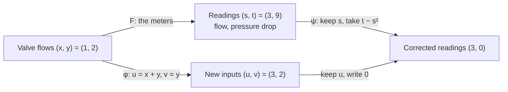

# Constant rank theorem: a map whose derivative keeps the same rank is a projection in disguise

[Syllabus](../../../SYLLABUS.md) → [Calculus and analysis](../README.md) → [Several Variables](../README.md#s07) → Constant rank theorem

---

## General Overview

Two valves feed one water pipe. Valve one lets through x = 1 litre per second, valve two y = 2. Two meters sit on the pipe: one reads the total flow, s = 3 L/s, and one the pressure drop, t = 9 kPa. In this model the drop in kPa is the flow squared, because pipe friction grows with the square of the speed.

Two numbers go in and two come out, yet only one quantity gets through. Move 0.5 L/s from valve two to valve one and neither meter moves.

The **constant rank theorem** says every smooth map whose derivative keeps the same number of independent directions works like this. Here, renaming the inputs and outputs gives the new input u = x + y, the flow, and the new output t − s², which is always 0.

**Near a point where the Jacobian has the same rank r all around, new coordinates on the input side and on the output side turn the map into keeping the first r numbers and setting the rest to zero.**

**What kind of fact this is:** a theorem, proved on this card in Why it works for any number of inputs and outputs.

### The picture: two renamings make the map a projection



Both routes end at (3, 0); the lower one is the projection.

---

## The formula

The **Jacobian** of a map is its grid of partial derivatives, one row per output ([Chain rule in several variables](04-multivariable-chain-rule-and-jacobians.md)). Its **rank** is the number of independent rows, which equals the number of independent columns ([Rank and nullity](../../03-Algebra/05-Solving%20Systems/05-rank-nullity.md)). A **diffeomorphism** is a smooth map with a smooth undo: a renaming of coordinates.

Let $`F`$ take $`m`$ numbers to $`n`$ numbers, with continuous partial derivatives near a point $`p`$. Suppose its Jacobian has the same rank $`r`$ at every point near $`p`$. Then there are diffeomorphisms $`\varphi`$ near $`p`$ (on the inputs) and $`\psi`$ near $`F(p)`$ (on the outputs) with

```math
\psi \circ F \circ \varphi^{-1}(u_1, \dots, u_m) = (u_1, \dots, u_r, 0, \dots, 0)
```

**Read it aloud:** undo the input renaming, apply the map, apply the output renaming, and what remains keeps the first r coordinates and writes zeros for the other n − r.

For the pipe, m = n = 2 and r = 1:

```math
F(x, y) = \big(x + y,\ (x + y)^2\big), \qquad \varphi(x, y) = (x + y,\ y), \qquad \psi(s, t) = (s,\ t - s^2), \qquad \psi\big(F(\varphi^{-1}(u, v))\big) = (u, 0)
```

| Symbol | Plain meaning | In our example | Push it up and the answer… |
| --- | --- | --- | --- |
| $`x, y`$; $`x = (x', x'')`$ | the valve flows in L/s; any inputs, as the first r and the rest | 1 and 2 | more flow: both readings rise |
| $`p`$ | the point under study | (1, 2) | — |
| $`F = (F', F'')`$; $`s`$, $`t`$ | the map, as its first r outputs and the rest; their values, here total flow in L/s and pressure drop in kPa | F(1, 2) = (3, 9) | — |
| $`J`$, $`J_G`$; $`I_r`$; $`P`$, $`Q`$ | the Jacobians of F and G; the r by r identity matrix; the renaming matrices of the linear case | J = `[[1, 1], [6, 6]]` | — |
| $`m`$, $`n`$, $`r`$ | number of inputs, number of outputs, rank | 2, 2, 1 | r = m or r = n: the full-rank cases of Step 5 |
| $`\varphi`$; $`u`$, $`v`$ | the input renaming; the new input coordinates | u = x + y = 3, v = y = 2 | moving v alone changes nothing |
| $`\psi`$ | the output renaming | ψ(3, 9) = (3, 0) | a reading off the curve gives a nonzero second number |
| $`G`$; $`R`$; $`u = (u_1, \dots, u_m) = (u', u'')`$; $`c''`$ | F in the new input coordinates; its leftover outputs; any new inputs, as the first r and the rest; u″ at the point | G(u, v) = (u, u²); R = u²; u′ = u, u″ = v; c″ = 2 | — |

### When it holds

- **Continuous partial derivatives near p.** Without them φ may have no undo: a one-input map with nonzero rate at p can turn back in every interval around p.
- **The rank is the same at every point near p, not only at p.** The fold (x, y) to (x, y²) has rank 2 at (1, 0.1) and rank 1 at (1, 0). Near (1, 0) it is two-to-one, yet its image fills a patch of the plane, so no projection form fits.
- **Full rank at p is enough.** When r equals m or n, a nonzero r by r determinant stays nonzero nearby, so the rank cannot change. Below full rank it can rise.
- **Near p only.** Wrapping the number line round a circle, angle to point, has rank 1 everywhere, yet angles a full turn apart land on one point. The projection form never repeats, so no renamings fit the whole line.

---

## Why it works

### Step 0: a linear map is a projection after renaming; a smooth map is nearly linear

A matrix of rank r becomes "keep r coordinates, zero the rest" after renaming its inputs and outputs. A smooth map is nearly its Jacobian close up ([Tangent planes](02-differentiability-and-tangent-planes.md)). The inverse function theorem makes r outputs into new inputs. The other outputs cannot depend on the remaining inputs, or the rank would rise above r, so renaming the outputs subtracts them.

### Step 1: the linear case

Row operations rename outputs and column operations rename inputs ([Gaussian elimination](../../03-Algebra/05-Solving%20Systems/02-gaussian-elimination.md)). At (1, 2) the Jacobian is J = `[[1, 1], [6, 6]]`. Subtract 6 times row one from row two, with Q = `[[1, 0], [-6, 1]]`. Subtract column one from column two, with P = `[[1, -1], [0, 1]]`. Then Q J P = `[[1, 0], [0, 0]]`: keep the first coordinate, zero the second.

### Step 2: rename the inputs

Renumber so the r by r corner of the Jacobian is invertible. Define φ to report the first r outputs, then the last m − r inputs unchanged. For the pipe, φ(x, y) = (x + y, y). Its Jacobian `[[1, 1], [0, 1]]` has determinant 1, so the [Inverse and implicit function theorems](07-inverse-and-implicit-function-theorems.md) give a smooth undo near p.

Read F in the new coordinates: G = F ∘ φ⁻¹. By construction its first r outputs are u₁ to u_r. Call the other n − r outputs R. For the pipe, φ⁻¹(u, v) = (u − v, v), so G(u, v) = (u, u²) and R = u². The code finds the undo blind by [Newton's method](../03-What%20Derivatives%20Tell%20You/06-newtons-method.md): from (3, 2) it lands on (1, 2) in one step, since φ is linear; step 2 moves 0 and ends the loop.

### Step 3: constant rank makes the leftover ignore the extra inputs

The Jacobian of G has an identity block in its first r rows, with zeros under the last m − r inputs. Its other rows hold the rates of R. If R had a nonzero rate in any of those last inputs, that row would add a new direction: rank at least r + 1.

The rank is r at every nearby point, so all those rates are zero nearby. On a box around the point (one interval per coordinate, so the last inputs can move alone in it), R depends on the first r new coordinates only. For the pipe, ∂R/∂v = 0: the code measures 0.000000 at (3, 2).

### Step 4: rename the outputs

Now subtract the leftover: ψ(s, t) = (s, t − R(s)). Its undo is (s, t + R(s)), so ψ is a diffeomorphism. Then ψ(G(u)) = (u₁, …, u_r, R − R) = (u₁, …, u_r, 0, …, 0). For the pipe, ψ(3, 9) = (3, 9 − 9) = (3, 0).

<details>
<summary>Detailed proof: the general case in m inputs and n outputs</summary>

Renumber inputs and outputs so the top-left r by r block of the Jacobian at p is invertible. Write x = (x′, x″) with x′ the first r inputs, and F = (F′, F″) with F′ the first r outputs.

Input renaming. Set

$`\displaystyle \varphi(x) = \big(F'(x),\ x''\big).`$

Its Jacobian is block triangular, with ∂F′/∂x′ and the identity on the diagonal, so it is invertible at p. The inverse function theorem gives a smooth undo.

The map in new coordinates. Let G = F ∘ φ⁻¹. Since F′(φ⁻¹(u)) = u′ by construction,

$`\displaystyle G(u', u'') = \big(u',\ R(u', u'')\big), \qquad J_G = \begin{pmatrix} I_r & 0 \\ \partial R/\partial u' & \partial R/\partial u'' \end{pmatrix}.`$

By the chain rule J_G is J_F times an invertible matrix, so it has rank r near φ(p). Clearing the lower-left block by row operations leaves rank r + rank(∂R/∂u″), so ∂R/∂u″ = 0. On a box around φ(p), R(u′, u″) = R(u′, c″), with c″ the value of u″ at φ(p).

Output renaming. Set

$`\displaystyle \psi(s, t) = \big(s,\ t - R(s, c'')\big), \qquad \psi^{-1}(s, t) = \big(s,\ t + R(s, c'')\big).`$

Both are smooth, and ψ(G(u)) = (u′, 0).

</details>

### Step 5: the full-rank cases are the old theorems

- **r = m = n: the inverse function theorem.** No leftover outputs and no extra inputs, so ψ and F ∘ φ⁻¹ are identities: F can be undone near p.
- **r = n, fewer outputs than inputs: the implicit function theorem.** F ∘ φ⁻¹ forgets the last m − n coordinates. Fixing the outputs fixes u′ and leaves u″ free, so the solution set is a graph over u″. For the first output alone, s = x + y, the level set s = 3 is the line y = 3 − x, with slope −1 = −(∂s/∂x)/(∂s/∂y).
- **r = m, fewer inputs than outputs: the immersion case.** The map adds zeros, so its image is locally a graph: a smooth curve or surface.

This unifies the three cases; it does not reprove them, since it uses the inverse function theorem. The immersion and submersion cases alone are also proved on [Diffeomorphism, immersion, submersion](../../23-Differential%20geometry%20and%20Lie%20groups/03-Manifolds/04-diffeomorphisms-immersions-and-embeddings.md).

---

## Worked numbers, by hand

| Step | Arithmetic | Value |
| --- | --- | --- |
| readings | s = 1 + 2, t = 3² | (3, 9) |
| Jacobian | rows (1, 1) and (2s, 2s) = (6, 6) | `[[1, 1], [6, 6]]` |
| rank | row two is 6 times row one; det 1·6 − 1·6 | 1 |
| new inputs | u = 1 + 2, v = 2 | (3, 2) |
| undo φ | x = u − v, y = v | (1, 2) |
| F in new inputs | G(3, 2) = (3, 3²) | (3, 9) |
| rename outputs | ψ(3, 9) = (3, 9 − 3²) | **(3, 0)** |

A healthy pipe always gives 0 in the second slot. The ignored direction is v: F(1.5, 1.5) = (3.0, 9.0) and F(3, 0) = (3, 9).

### What breaks if you drop a piece

| Mistake | Comes out at | What went wrong |
| --- | --- | --- |
| Correct the drop with t − s | (3, 6), not (3, 0) | The readings lie on a parabola, so the correction must subtract s², not s |
| Use the tangent line at s = 3: t − 6s + 9 | 0 at s = 3, but 1 at s = 4 | A straight correction fits only at one point |
| Take v = x + y as the second new input | Jacobian determinant 0.000000 | Both new inputs say the same thing, so φ cannot be undone |

---

## Code, from first principles, and it actually runs

Road 1 writes both renamings by hand. Road 2 runs the proof's recipe blind: it undoes φ by Newton's method and builds ψ from R sampled at v = 2 only. Both must agree on a 441-point grid; a determinant test checks the rank, and Q and P come from the computed Jacobian. Lean's Mathlib library has no constant rank theorem yet, so the Lean section below proves it in general.

### Python

```python
# Constant rank theorem -- the check behind the card.  Nothing is imported.
# Two valves feed one pipe: x, y in litres per second.  F(x, y) = (x + y, (x + y)^2)
# gives total flow s and pressure drop t.  Road 1: the charts by hand.  Road 2: the
# proof's recipe run blind (Newton undo, R sampled at one v).  Ranks by a determinant test.
def F(x, y): return (x + y, (x + y) ** 2)
def jac(f, x, y, h=1e-5):                  # central differences, one column per input
    cx = [(a - b) / (2 * h) for a, b in zip(f(x + h, y), f(x - h, y))]
    cy = [(a - b) / (2 * h) for a, b in zip(f(x, y + h), f(x, y - h))]
    return [[cx[0], cy[0]], [cx[1], cy[1]]]
def det(J): return J[0][0] * J[1][1] - J[0][1] * J[1][0]
def rank(J, tol=1e-6):                     # determinant test on a 2 by 2 matrix
    if max(abs(e) for row in J for e in row) < tol: return 0
    return 2 if abs(det(J)) > tol * max(1, abs(J[0][0] * J[1][1]), abs(J[0][1] * J[1][0])) else 1
def mul(A, B): return [[sum(A[i][k] * B[k][j] for k in range(2)) for j in range(2)] for i in range(2)]
def phi(x, y): return (x + y, y)           # the recipe: keep the first output, then y
def undo(u, v, x=0.0, y=0.0):              # Newton's method on phi(x, y) = (u, v)
    for k in range(1, 50):
        J, (p, q) = jac(phi, x, y), phi(x, y)
        dx = ((u - p) * J[1][1] - (v - q) * J[0][1]) / det(J)
        dy = ((v - q) * J[0][0] - (u - p) * J[1][0]) / det(J)
        x, y = x + dx, y + dy
        if abs(dx) + abs(dy) < 1e-13: return x, y, k
    return x, y, k
def R(u, v): return F(*undo(u, v)[:2])[1]  # the leftover output in the new input chart
def psi(s, t): return (s, t - R(s, 2.0))   # road 2 output chart, R sampled at v = 2 only
def psi_hand(s, t): return (s, t - s * s)  # road 1 output chart
A = jac(F, 1, 2)
print(f"point (1, 2): F = ({F(1, 2)[0]}, {F(1, 2)[1]}); Jacobian [[{A[0][0]:.6f}, {A[0][1]:.6f}], [{A[1][0]:.6f}, {A[1][1]:.6f}]]")
grid = [(-5 + i / 2, -5 + j / 2) for i in range(21) for j in range(21)]
ranks = sorted({rank(jac(F, x, y)) for x, y in grid})
print(f"rank by determinant test at {len(grid)} grid points in [-5, 5] by [-5, 5]: {ranks}")
J0 = [[round(e) for e in row] for row in A]        # Step 1: Q and P read off the computed Jacobian
Q, P = [[1, 0], [-J0[1][0] // J0[0][0], 1]], [[1, -J0[0][1] // J0[0][0]], [0, 1]]
D = mul(mul(Q, J0), P)
print(f"linear case: J = {J0}, Q = {Q}, P = {P}, Q J P = {D}")
x, y, k = undo(3, 2)
print(f"input chart: phi(1, 2) = {phi(1, 2)}, Jacobian {[[round(e) for e in r] for r in jac(phi, 1, 2)]}, "
      f"det {det(jac(phi, 1, 2)):.6f}; Newton undo of (3, 2): ({x:.6f}, {y:.6f}) in {k} steps")
dRdv = (R(3, 2 + 1e-4) - R(3, 2 - 1e-4)) / 2e-4
print(f"in the new chart: G(3, 2) = (3, {R(3, 2):.6f}); dR/dv at (3, 2) = {abs(dRdv):.6f}")
print(f"output chart: recipe psi(3, 9) = (3, {psi(3, 9)[1]:.6f}); by hand ({psi_hand(3, 9)[0]}, {psi_hand(3, 9)[1]})")
err = max(abs(a - b) for u, v in grid for a, b in zip(psi(*F(*undo(u, v)[:2])), (u, 0.0)))
gap = max(abs(psi(*F(u, v))[1] - psi_hand(*F(u, v))[1]) for u, v in grid)
print(f"projection form on the grid: max error {err:.9f}; recipe vs hand chart {gap:.9f}")
print(f"ignored direction: F(1.5, 1.5) = ({F(1.5, 1.5)[0]:.1f}, {F(1.5, 1.5)[1]:.1f}), F(3, 0) = {F(3, 0)}")
print(f"meter reading (3, 9.4): corrected output (3, {psi_hand(3, 9.4)[1]:.1f})")
lv = [undo(3, v)[:2] for v in (1.0, 2.0, 3.0)]   # fix u = 3, let v run: the level set
print("level set s = 3: " + ", ".join(f"({a:.6f}, {b:.6f})" for a, b in lv) + f"; slope -Fx/Fy = {-A[0][0] / A[0][1]:.6f}")
def fold(x, y): return (x, y * y)
print(f"fold (x, y) to (x, y^2): rank {rank(jac(fold, 1, 0.1))} at (1, 0.1), {rank(jac(fold, 1, 0))} at (1, 0); (1, 0.1) goes to (1, {fold(1, 0.1)[1]:.6f}), (1, -0.1) goes to (1, {fold(1, -0.1)[1]:.6f})")
tan = [s * s - 6 * s + 9 for s in (3, 4)]
Jb = jac(lambda x, y: (x + y, x + y), 1, 2)
print(f"mistakes: t - s gives (3, {F(1, 2)[1] - F(1, 2)[0]}); tangent fix t - 6s + 9 at s = 3, 4 gives {tan[0]}, {tan[1]}; v = x + y gives det {abs(det(Jb)):.6f}")
assert ranks == [1] and rank(jac(fold, 1, 0.1)) == 2 and rank(jac(fold, 1, 0)) == 1   # determinant test
assert J0 == [[1, 1], [6, 6]] and D == [[1, 0], [0, 0]] and all(abs(a - b) < 1e-6 for ra, rb in zip(A, J0) for a, b in zip(ra, rb))  # linear form of F
assert abs(dRdv) < 1e-6                                                # R ignores v
assert err < 1e-9 and gap < 1e-9                                       # blind recipe = projection = hand
assert abs(x - 1) < 1e-12 and abs(y - 2) < 1e-12                       # Newton undoes phi
assert all(abs(a + b - 3) < 1e-12 for a, b in lv)                     # level set x + y = 3
print("ALL CHECKS PASS")
```

**Ran 2026-11-23 on macOS, Python 3.14.10, standard library only. All checks passed. Output, pasted from the run:**

```
point (1, 2): F = (3, 9); Jacobian [[1.000000, 1.000000], [6.000000, 6.000000]]
rank by determinant test at 441 grid points in [-5, 5] by [-5, 5]: [1]
linear case: J = [[1, 1], [6, 6]], Q = [[1, 0], [-6, 1]], P = [[1, -1], [0, 1]], Q J P = [[1, 0], [0, 0]]
input chart: phi(1, 2) = (3, 2), Jacobian [[1, 1], [0, 1]], det 1.000000; Newton undo of (3, 2): (1.000000, 2.000000) in 2 steps
in the new chart: G(3, 2) = (3, 9.000000); dR/dv at (3, 2) = 0.000000
output chart: recipe psi(3, 9) = (3, 0.000000); by hand (3, 0)
projection form on the grid: max error 0.000000000; recipe vs hand chart 0.000000000
ignored direction: F(1.5, 1.5) = (3.0, 9.0), F(3, 0) = (3, 9)
meter reading (3, 9.4): corrected output (3, 0.4)
level set s = 3: (2.000000, 1.000000), (1.000000, 2.000000), (0.000000, 3.000000); slope -Fx/Fy = -1.000000
fold (x, y) to (x, y^2): rank 2 at (1, 0.1), 1 at (1, 0); (1, 0.1) goes to (1, 0.010000), (1, -0.1) goes to (1, 0.010000)
mistakes: t - s gives (3, 6); tangent fix t - 6s + 9 at s = 3, 4 gives 0, 1; v = x + y gives det 0.000000
ALL CHECKS PASS
```

### Rust

Same numbers, same labels, built with `rustc --edition 2021 -O`.

```rust
// Constant rank theorem -- the same check as the Python, in Rust.  No crates.
// Two valves feed one pipe: x, y in litres per second.  F(x, y) = (x + y, (x + y)^2)
// gives total flow s and pressure drop t.  Road 1: the charts by hand.  Road 2: the
// proof's recipe run blind (Newton undo, R sampled at one v).  Ranks by a determinant test.
type M = [[f64; 2]; 2];
fn f(x: f64, y: f64) -> (f64, f64) { (x + y, (x + y) * (x + y)) }
fn phi(x: f64, y: f64) -> (f64, f64) { (x + y, y) } // the recipe: keep the first output, then y
fn fold(x: f64, y: f64) -> (f64, f64) { (x, y * y) }
fn bad(x: f64, y: f64) -> (f64, f64) { (x + y, x + y) }
fn jac(g: fn(f64, f64) -> (f64, f64), x: f64, y: f64) -> M { // central differences
    let h = 1e-5;
    let (a, b, c, d) = (g(x + h, y), g(x - h, y), g(x, y + h), g(x, y - h));
    [[(a.0 - b.0) / (2.0 * h), (c.0 - d.0) / (2.0 * h)], [(a.1 - b.1) / (2.0 * h), (c.1 - d.1) / (2.0 * h)]]
}
fn det(j: &M) -> f64 { j[0][0] * j[1][1] - j[0][1] * j[1][0] }
fn rank(j: &M) -> i32 {                    // determinant test on a 2 by 2 matrix
    if j.iter().flatten().all(|e| e.abs() < 1e-6) { return 0; }
    let scale = 1f64.max((j[0][0] * j[1][1]).abs()).max((j[0][1] * j[1][0]).abs());
    if det(j).abs() > 1e-6 * scale { 2 } else { 1 }
}
fn mul(a: [[i64; 2]; 2], b: [[i64; 2]; 2]) -> [[i64; 2]; 2] { std::array::from_fn(|i| std::array::from_fn(|j| a[i][0] * b[0][j] + a[i][1] * b[1][j])) }
fn undo(u: f64, v: f64) -> (f64, f64, i32) { // Newton's method on phi(x, y) = (u, v)
    let (mut x, mut y) = (0.0, 0.0);
    for k in 1..50 {
        let (j, (p, q)) = (jac(phi, x, y), phi(x, y));
        let dx = ((u - p) * j[1][1] - (v - q) * j[0][1]) / det(&j);
        let dy = ((v - q) * j[0][0] - (u - p) * j[1][0]) / det(&j);
        x += dx; y += dy;
        if dx.abs() + dy.abs() < 1e-13 { return (x, y, k); }
    }
    (x, y, 49)
}
fn r(u: f64, v: f64) -> f64 { let (x, y, _) = undo(u, v); f(x, y).1 } // leftover output
fn psi(s: f64, t: f64) -> (f64, f64) { (s, t - r(s, 2.0)) } // road 2, R sampled at v = 2 only
fn psi_hand(s: f64, t: f64) -> (f64, f64) { (s, t - s * s) } // road 1 output chart
fn main() {
    let a = jac(f, 1.0, 2.0);
    println!("point (1, 2): F = ({}, {}); Jacobian [[{:.6}, {:.6}], [{:.6}, {:.6}]]", f(1.0, 2.0).0, f(1.0, 2.0).1, a[0][0], a[0][1], a[1][0], a[1][1]);
    let grid: Vec<(f64, f64)> = (0..441).map(|n| (-5.0 + (n / 21) as f64 / 2.0, -5.0 + (n % 21) as f64 / 2.0)).collect();
    let mut ranks: Vec<i32> = grid.iter().map(|&(x, y)| rank(&jac(f, x, y))).collect();
    ranks.sort(); ranks.dedup();
    println!("rank by determinant test at {} grid points in [-5, 5] by [-5, 5]: {:?}", grid.len(), ranks);
    let j0 = a.map(|row| row.map(|e| e.round() as i64)); // Step 1: Q and P read off the computed Jacobian
    let (q, p) = ([[1, 0], [-j0[1][0] / j0[0][0], 1]], [[1, -j0[0][1] / j0[0][0]], [0, 1]]);
    let d = mul(mul(q, j0), p);
    println!("linear case: J = {:?}, Q = {:?}, P = {:?}, Q J P = {:?}", j0, q, p, d);
    let (x, y, k) = undo(3.0, 2.0);
    println!("input chart: phi(1, 2) = ({}, {}), Jacobian {:?}, det {:.6}; Newton undo of (3, 2): ({:.6}, {:.6}) in {} steps", phi(1.0, 2.0).0, phi(1.0, 2.0).1,
             jac(phi, 1.0, 2.0).map(|r| r.map(|e| e.round() as i64)), det(&jac(phi, 1.0, 2.0)), x, y, k);
    let drdv = (r(3.0, 2.0 + 1e-4) - r(3.0, 2.0 - 1e-4)) / 2e-4;
    println!("in the new chart: G(3, 2) = (3, {:.6}); dR/dv at (3, 2) = {:.6}", r(3.0, 2.0), drdv.abs());
    println!("output chart: recipe psi(3, 9) = (3, {:.6}); by hand ({}, {})", psi(3.0, 9.0).1, psi_hand(3.0, 9.0).0, psi_hand(3.0, 9.0).1);
    let (mut err, mut gap) = (0f64, 0f64);
    for &(u, v) in &grid {
        let (px, py, _) = undo(u, v);
        let (fs, ft) = f(px, py);
        let p = psi(fs, ft);
        err = err.max((p.0 - u).abs()).max(p.1.abs());
        let (gs, gt) = f(u, v);
        gap = gap.max((psi(gs, gt).1 - psi_hand(gs, gt).1).abs());
    }
    println!("projection form on the grid: max error {:.9}; recipe vs hand chart {:.9}", err, gap);
    println!("ignored direction: F(1.5, 1.5) = ({:.1}, {:.1}), F(3, 0) = ({}, {})", f(1.5, 1.5).0, f(1.5, 1.5).1, f(3.0, 0.0).0, f(3.0, 0.0).1);
    println!("meter reading (3, 9.4): corrected output (3, {:.1})", psi_hand(3.0, 9.4).1);
    let lv: Vec<(f64, f64)> = [1.0, 2.0, 3.0].iter().map(|&v| { let (p, q, _) = undo(3.0, v); (p, q) }).collect();
    let pts: Vec<String> = lv.iter().map(|(p, q)| format!("({:.6}, {:.6})", p, q)).collect();
    println!("level set s = 3: {}; slope -Fx/Fy = {:.6}", pts.join(", "), -a[0][0] / a[0][1]);
    println!("fold (x, y) to (x, y^2): rank {} at (1, 0.1), {} at (1, 0); (1, 0.1) goes to (1, {:.6}), (1, -0.1) goes to (1, {:.6})",
             rank(&jac(fold, 1.0, 0.1)), rank(&jac(fold, 1.0, 0.0)), fold(1.0, 0.1).1, fold(1.0, -0.1).1);
    let tan: Vec<f64> = [3.0, 4.0].iter().map(|s: &f64| s * s - 6.0 * s + 9.0).collect();
    println!("mistakes: t - s gives (3, {}); tangent fix t - 6s + 9 at s = 3, 4 gives {}, {}; v = x + y gives det {:.6}",
             f(1.0, 2.0).1 - f(1.0, 2.0).0, tan[0], tan[1], det(&jac(bad, 1.0, 2.0)).abs());
    assert!(ranks == vec![1] && rank(&jac(fold, 1.0, 0.1)) == 2 && rank(&jac(fold, 1.0, 0.0)) == 1); // determinant test
    assert!(j0 == [[1, 1], [6, 6]] && d == [[1, 0], [0, 0]] && a.iter().flatten().zip(j0.iter().flatten()).all(|(e, n)| (e - *n as f64).abs() < 1e-6)); // linear form of F
    assert!(drdv.abs() < 1e-6);                                      // R ignores v
    assert!(err < 1e-9 && gap < 1e-9);                               // blind recipe = projection = hand
    assert!((x - 1.0).abs() < 1e-12 && (y - 2.0).abs() < 1e-12);     // Newton undoes phi
    assert!(lv.iter().all(|(p, q)| (p + q - 3.0).abs() < 1e-12));   // level set x + y = 3
    println!("ALL CHECKS PASS");
}
```

**Ran 2026-11-23 on macOS, rustc 1.98.1, no crates. All checks passed. Output, pasted from the run:**

```
point (1, 2): F = (3, 9); Jacobian [[1.000000, 1.000000], [6.000000, 6.000000]]
rank by determinant test at 441 grid points in [-5, 5] by [-5, 5]: [1]
linear case: J = [[1, 1], [6, 6]], Q = [[1, 0], [-6, 1]], P = [[1, -1], [0, 1]], Q J P = [[1, 0], [0, 0]]
input chart: phi(1, 2) = (3, 2), Jacobian [[1, 1], [0, 1]], det 1.000000; Newton undo of (3, 2): (1.000000, 2.000000) in 2 steps
in the new chart: G(3, 2) = (3, 9.000000); dR/dv at (3, 2) = 0.000000
output chart: recipe psi(3, 9) = (3, 0.000000); by hand (3, 0)
projection form on the grid: max error 0.000000000; recipe vs hand chart 0.000000000
ignored direction: F(1.5, 1.5) = (3.0, 9.0), F(3, 0) = (3, 9)
meter reading (3, 9.4): corrected output (3, 0.4)
level set s = 3: (2.000000, 1.000000), (1.000000, 2.000000), (0.000000, 3.000000); slope -Fx/Fy = -1.000000
fold (x, y) to (x, y^2): rank 2 at (1, 0.1), 1 at (1, 0); (1, 0.1) goes to (1, 0.010000), (1, -0.1) goes to (1, 0.010000)
mistakes: t - s gives (3, 6); tangent fix t - 6s + 9 at s = 3, 4 gives 0, 1; v = x + y gives det 0.000000
ALL CHECKS PASS
```

### Lean

Lean proves the theorem for any number of inputs and outputs, the full-rank rule and the pipe example, and checks the worked numbers.

- Take $`F`$ from $`m`$ numbers to $`n`$ numbers, with continuous partial derivatives near $`p`$ and Jacobian rank $`r`$ at every point near $`p`$. Then diffeomorphisms $`\varphi`$ near $`p`$ and $`\psi`$ near $`F(p)`$ turn $`F`$ into keeping the first $`r`$ numbers and zeroing the rest.
- Suppose $`F`$ has continuous partial derivatives near $`p`$, and its Jacobian at $`p`$ has rank $`m`$ or $`n`$. Then the rank is the same at every point near $`p`$.
- The pipe's Jacobian has rank 1 at every point.
- Take $`\varphi(x, y) = (x + y, y)`$ and $`\psi(s, t) = (s, t - s^2)`$. Then $`(u, v) \mapsto (u - v, v)`$ undoes $`\varphi`$, and $`\psi(F(\varphi^{-1}(u, v))) = (u, 0)`$ everywhere.
- The worked numbers: F(1, 2) = (3, 9), the new inputs are (3, 2), and ψ(3, 9) = (3, 0).
- In Step 1, J has determinant 0 and Q J P = `[[1, 0], [0, 0]]`.
- The input renaming's Jacobian has determinant 1. Taking v = x + y instead gives determinant 0.
- The mistakes: t − s gives 6, not 0. The tangent correction gives 0 at s = 3 but 1 at s = 4.

Newton's undo, the 441-point grid, the fold's ranks and the level set are left to the Python and Rust checks.

```lean
-- Constant rank theorem: this file proves that a map with continuous partial derivatives whose Jacobian has the same rank r at every point near p becomes "keep the first r coordinates, write zeros for the rest" after a smooth renaming of its inputs and of its outputs.
import Mathlib.Analysis.Calculus.InverseFunctionTheorem.ContDiff
import Mathlib.Analysis.Calculus.FDeriv.Pi
import Mathlib.LinearAlgebra.Matrix.Determinant.Basic
import Mathlib.LinearAlgebra.Matrix.Notation
import Mathlib.LinearAlgebra.Dimension.Finrank
import Mathlib.LinearAlgebra.Isomorphisms
import Mathlib.LinearAlgebra.FiniteDimensional.Lemmas
import Mathlib.LinearAlgebra.Finsupp.VectorSpace
import Mathlib.Topology.Algebra.Module.FiniteDimension

open Filter Topology

/-- The projection form: from `m` numbers to `n` numbers, keep the first `r` coordinates and
write `0` for the other `n - r`. -/
def projectionForm (m n r : ℕ) (u : Fin m → ℝ) : Fin n → ℝ :=
  fun i => if h : (i : ℕ) < r ∧ (i : ℕ) < m then u ⟨i, h.2⟩ else 0

/-- `projectionForm` as a linear map. -/
def projectionFormL (m n r : ℕ) : (Fin m → ℝ) →ₗ[ℝ] (Fin n → ℝ) where
  toFun := projectionForm m n r
  map_add' u v := by
    funext i; simp only [projectionForm, Pi.add_apply]; split_ifs <;> simp
  map_smul' c u := by
    funext i; simp only [projectionForm, Pi.smul_apply, RingHom.id_apply]; split_ifs <;> simp

/-- Splitting `Fin b` as the first `a` places followed by the remaining `b - a`. -/
def splitFin (a b : ℕ) (h : a ≤ b) : Fin a ⊕ Fin (b - a) ≃ Fin b :=
  finSumFinEquiv.trans (finCongr (by omega))

theorem splitFin_inl (a b : ℕ) (h : a ≤ b) (i : Fin a) :
    ((splitFin a b h (Sum.inl i) : Fin b) : ℕ) = i := by
  simp [splitFin]

theorem splitFin_inr (a b : ℕ) (h : a ≤ b) (i : Fin (b - a)) :
    ((splitFin a b h (Sum.inr i) : Fin b) : ℕ) = a + i := by
  simp [splitFin]

/-- Linear normal form: a linear map of rank `r` becomes `projectionForm` after a linear change
of coordinates on each side. -/
theorem linear_normal_form {m n r : ℕ} (L : (Fin m → ℝ) →ₗ[ℝ] (Fin n → ℝ))
    (hL : Module.finrank ℝ (LinearMap.range L) = r) :
    ∃ (P : (Fin m → ℝ) ≃ₗ[ℝ] (Fin m → ℝ)) (Q : (Fin n → ℝ) ≃ₗ[ℝ] (Fin n → ℝ)),
      ∀ v, Q (L (P v)) = projectionForm m n r v := by
  obtain ⟨C, hC⟩ := (LinearMap.ker L).exists_isCompl
  obtain ⟨C', hC'⟩ := (LinearMap.range L).exists_isCompl
  let eC : C ≃ₗ[ℝ] LinearMap.range L :=
    ((LinearMap.ker L).quotientEquivOfIsCompl C hC).symm.trans L.quotKerEquivRange
  have heC : ∀ c : C, (eC c : Fin n → ℝ) = L c := fun c => rfl
  have hCr : Module.finrank ℝ C = r := eC.finrank_eq.trans hL
  have h1 := Submodule.finrank_add_eq_of_isCompl hC
  have h2 := Submodule.finrank_add_eq_of_isCompl hC'
  simp only [Module.finrank_fin_fun] at h1 h2
  have hrm : r ≤ m := by omega
  have hrn : r ≤ n := by omega
  have hK : Module.finrank ℝ (LinearMap.ker L) = m - r := by omega
  have hC'r : Module.finrank ℝ C' = n - r := by omega
  let bC := Module.finBasisOfFinrankEq ℝ C hCr
  let bK := Module.finBasisOfFinrankEq ℝ (LinearMap.ker L) hK
  let bR := bC.map eC
  let bC' := Module.finBasisOfFinrankEq ℝ C' hC'r
  let bE := ((bC.prod bK).map (Submodule.prodEquivOfIsCompl C _ hC.symm)).reindex
    (splitFin r m hrm)
  let bG := ((bR.prod bC').map (Submodule.prodEquivOfIsCompl _ C' hC')).reindex
    (splitFin r n hrn)
  refine ⟨bE.equivFun.symm, bG.equivFun, fun v => ?_⟩
  have key : bG.equivFun.toLinearMap ∘ₗ L ∘ₗ bE.equivFun.symm.toLinearMap =
      projectionFormL m n r := by
    refine (Pi.basisFun ℝ (Fin m)).ext fun j => ?_
    obtain ⟨s, rfl⟩ := (splitFin r m hrm).surjective j
    simp only [LinearMap.coe_comp, LinearEquiv.coe_coe, Function.comp_apply, Pi.basisFun_apply,
      Basis.equivFun_symm_single]
    have hbE : bE (splitFin r m hrm s) =
        Submodule.prodEquivOfIsCompl C _ hC.symm ((bC.prod bK) s) := by
      simp [bE, Module.Basis.reindex_apply]
    rw [hbE]
    funext i
    rcases s with s | s
    · have hLs : L (Submodule.prodEquivOfIsCompl C _ hC.symm ((bC.prod bK) (Sum.inl s))) =
          bG (splitFin r n hrn (Sum.inl s)) := by
        simp [bG, bR, Module.Basis.reindex_apply, Submodule.coe_prodEquivOfIsCompl', heC]
      rw [hLs, Module.Basis.equivFun_self]
      simp only [projectionFormL, LinearMap.coe_mk, AddHom.coe_mk, projectionForm, Pi.single_apply]
      have a1 := splitFin_inl r m hrm s
      have a2 := splitFin_inl r n hrn s
      split_ifs <;> simp_all [Fin.ext_iff]
      omega
    · have hLs : L (Submodule.prodEquivOfIsCompl C _ hC.symm ((bC.prod bK) (Sum.inr s))) = 0 := by
        simp [Submodule.coe_prodEquivOfIsCompl']
      rw [hLs, map_zero]
      simp only [projectionFormL, LinearMap.coe_mk, AddHom.coe_mk, projectionForm, Pi.single_apply]
      have a1 := splitFin_inr r m hrm s
      split_ifs <;> simp_all [Fin.ext_iff]
      omega
  exact congrArg (fun f => f v) key

/-- Writing a vector's first `r` places into the first `r` places of the output, and the rest
from a second vector. -/
noncomputable def headMix (m n r : ℕ) (hrn : r ≤ n) :
    (Fin n → ℝ) × (Fin m → ℝ) →L[ℝ] (Fin m → ℝ) :=
  ContinuousLinearMap.pi fun i => if h : (i : ℕ) < r then
    (ContinuousLinearMap.proj (R := ℝ) (φ := fun _ : Fin n => ℝ)
      ⟨i, lt_of_lt_of_le h hrn⟩).comp (ContinuousLinearMap.fst ℝ _ _)
    else (ContinuousLinearMap.proj (R := ℝ) (φ := fun _ : Fin m => ℝ) i).comp
      (ContinuousLinearMap.snd ℝ _ _)

theorem headMix_apply {m n r : ℕ} (hrn : r ≤ n) (y : Fin n → ℝ) (z : Fin m → ℝ) (i : Fin m) :
    headMix m n r hrn (y, z) i = if h : (i : ℕ) < r then y ⟨i, lt_of_lt_of_le h hrn⟩ else z i := by
  simp only [headMix, ContinuousLinearMap.pi_apply]
  split_ifs <;> rfl

/-- Zero out the first `r` places. -/
def tailZero (n r : ℕ) (y : Fin n → ℝ) : Fin n → ℝ := fun i => if (i : ℕ) < r then 0 else y i

/-- Keep the first `r` places of `z` and fill the rest from `c`. -/
def headWith (m n r : ℕ) (hrn : r ≤ n) (c : Fin m → ℝ) (z : Fin n → ℝ) : Fin m → ℝ :=
  fun i => if h : (i : ℕ) < r then z ⟨i, lt_of_lt_of_le h hrn⟩ else c i

theorem contDiff_tailZero (n r : ℕ) : ContDiff ℝ 1 (tailZero n r) := by
  rw [contDiff_pi]; intro i
  by_cases h : (i : ℕ) < r
  · simp only [tailZero, h, ite_true]; exact contDiff_const
  · simp only [tailZero, h, ite_false]; exact contDiff_apply _ _ _

theorem contDiff_headWith {m n r : ℕ} (hrn : r ≤ n) (c : Fin m → ℝ) :
    ContDiff ℝ 1 (headWith m n r hrn c) := by
  rw [contDiff_pi]; intro i
  by_cases h : (i : ℕ) < r
  · simp only [headWith, h, dite_true]; exact contDiff_apply _ _ _
  · simp only [headWith, h, dite_false]; exact contDiff_const

theorem headWith_add_tailZero {m n r : ℕ} (hrn : r ≤ n) (c : Fin m → ℝ) (z y : Fin n → ℝ) :
    headWith m n r hrn c (z + tailZero n r y) = headWith m n r hrn c z := by
  funext i; simp only [headWith, tailZero, Pi.add_apply]; split_ifs <;> simp_all

theorem headWith_sub_tailZero {m n r : ℕ} (hrn : r ≤ n) (c : Fin m → ℝ) (z y : Fin n → ℝ) :
    headWith m n r hrn c (z - tailZero n r y) = headWith m n r hrn c z := by
  funext i; simp only [headWith, tailZero, Pi.sub_apply]; split_ifs <;> simp_all

/-- Changing coordinates by linear equivalences on both sides keeps the rank. -/
theorem finrank_range_comp_equiv {m n : ℕ} (T : (Fin m → ℝ) →L[ℝ] (Fin n → ℝ))
    (A : (Fin n → ℝ) ≃L[ℝ] (Fin n → ℝ)) (B : (Fin m → ℝ) ≃L[ℝ] (Fin m → ℝ)) :
    Module.finrank ℝ (LinearMap.range
      ((A : (Fin n → ℝ) →L[ℝ] (Fin n → ℝ)).comp (T.comp (B : (Fin m → ℝ) →L[ℝ] _))).toLinearMap) =
      Module.finrank ℝ (LinearMap.range T.toLinearMap) := by
  have hB : LinearMap.range (B : (Fin m → ℝ) →L[ℝ] (Fin m → ℝ)).toLinearMap = ⊤ :=
    LinearMap.range_eq_top.2 B.surjective
  change Module.finrank ℝ (LinearMap.range ((A.toLinearEquiv : (Fin n → ℝ) →ₗ[ℝ] (Fin n → ℝ)).comp
    (T.toLinearMap.comp (B : (Fin m → ℝ) →L[ℝ] (Fin m → ℝ)).toLinearMap))) = _
  rw [LinearMap.range_comp, LinearMap.range_comp_of_range_eq_top _ hB]
  exact LinearEquiv.finrank_map_eq A.toLinearEquiv _

/-- If a rank-`r` map copies the first `r` input places to the first `r` output places, it sends
every vector with zeros in its first `r` places to zero. -/
theorem tail_kill {m n r : ℕ} (hrn : r ≤ n) (T : (Fin m → ℝ) →L[ℝ] (Fin n → ℝ))
    (hT : Module.finrank ℝ (LinearMap.range T.toLinearMap) = r)
    (hhead : ∀ (w : Fin m → ℝ) (i : Fin m) (hi : (i : ℕ) < r),
      T w ⟨i, lt_of_lt_of_le hi hrn⟩ = w i)
    (w : Fin m → ℝ) (hw : ∀ i : Fin m, (i : ℕ) < r → w i = 0) : T w = 0 := by
  have hrm : r ≤ m := by
    rw [← hT]; exact (LinearMap.finrank_range_le _).trans (by simp)
  let π : (Fin n → ℝ) →ₗ[ℝ] (Fin r → ℝ) :=
    LinearMap.funLeft ℝ ℝ (fun j : Fin r => (⟨j, lt_of_lt_of_le j.2 hrn⟩ : Fin n))
  let πR := π.domRestrict (LinearMap.range T.toLinearMap)
  have hπT : ∀ (v : Fin m → ℝ) (j : Fin r), π (T v) j = v ⟨j, lt_of_lt_of_le j.2 hrm⟩ := by
    intro v j
    exact hhead v ⟨j, lt_of_lt_of_le j.2 hrm⟩ j.2
  have hsurj : Function.Surjective πR := by
    intro z
    refine ⟨⟨T (fun i => if h : (i : ℕ) < r then z ⟨i, h⟩ else 0), LinearMap.mem_range_self _ _⟩, ?_⟩
    funext j
    simp only [πR, LinearMap.domRestrict_apply]
    rw [hπT]; simp
  have hinj : Function.Injective πR :=
    (LinearMap.injective_iff_surjective_of_finrank_eq_finrank (by simp [hT])).2 hsurj
  have h0 : πR ⟨T w, LinearMap.mem_range_self _ _⟩ = πR 0 := by
    funext j
    simp only [πR, LinearMap.domRestrict_apply, map_zero]
    rw [hπT]; exact hw _ j.2
  have := hinj h0
  simpa using congrArg Subtype.val this

/-- The constant rank theorem. Let `F` take `m` numbers to `n` numbers, with continuous partial
derivatives near `p`, and suppose its Jacobian has the same rank `r` at every point near `p`.
Then there are diffeomorphisms `φ` near `p` (on the inputs) and `ψ` near `F p` (on the outputs),
each continuously differentiable with a continuously differentiable undo, such that near `φ p`
the map `ψ ∘ F ∘ φ⁻¹` keeps the first `r` coordinates and writes zeros for the rest. -/
theorem constant_rank_theorem {m n r : ℕ} (F : (Fin m → ℝ) → (Fin n → ℝ)) (p : Fin m → ℝ)
    (hF : ContDiffAt ℝ 1 F p)
    (hrank : ∀ᶠ x in 𝓝 p, Module.finrank ℝ (LinearMap.range (fderiv ℝ F x).toLinearMap) = r) :
    ∃ (φ : OpenPartialHomeomorph (Fin m → ℝ) (Fin m → ℝ))
      (ψ : OpenPartialHomeomorph (Fin n → ℝ) (Fin n → ℝ)),
      p ∈ φ.source ∧ F p ∈ ψ.source ∧
      ContDiffOn ℝ 1 φ φ.source ∧ ContDiffOn ℝ 1 φ.symm φ.target ∧
      ContDiffOn ℝ 1 ψ ψ.source ∧ ContDiffOn ℝ 1 ψ.symm ψ.target ∧
      ∀ᶠ u in 𝓝 (φ p), F (φ.symm u) ∈ ψ.source ∧
        ψ (F (φ.symm u)) = projectionForm m n r u := by
  classical
  have hLr : Module.finrank ℝ (LinearMap.range (fderiv ℝ F p).toLinearMap) = r :=
    hrank.self_of_nhds
  have hrn : r ≤ n := by
    rw [← hLr]; exact (Submodule.finrank_le _).trans (by simp)
  have hrm : r ≤ m := by
    rw [← hLr]; exact (LinearMap.finrank_range_le _).trans (by simp)
  obtain ⟨P0, Q0, hPQ⟩ := linear_normal_form (fderiv ℝ F p).toLinearMap hLr
  set P := P0.toContinuousLinearEquiv with hP
  set Q := Q0.toContinuousLinearEquiv with hQ
  -- the input renaming: first `r` places from `Q ∘ F`, the rest from `P⁻¹`
  set φf : (Fin m → ℝ) → (Fin m → ℝ) := fun x => headMix m n r hrn (Q (F x), P.symm x) with hφf
  have hφC : ∀ x, ContDiffAt ℝ 1 F x → ContDiffAt ℝ 1 φf x := fun x hx =>
    (headMix m n r hrn).contDiff.contDiffAt.comp x
      ((Q.contDiff.contDiffAt.comp x hx).prodMk P.symm.contDiff.contDiffAt)
  have hφD : ∀ x, DifferentiableAt ℝ F x → HasFDerivAt φf ((headMix m n r hrn).comp
      (((Q : (Fin n → ℝ) →L[ℝ] (Fin n → ℝ)).comp (fderiv ℝ F x)).prod
        (P.symm : (Fin m → ℝ) →L[ℝ] (Fin m → ℝ)))) x := fun x hx =>
    (headMix m n r hrn).hasFDerivAt.comp x
      ((Q.hasFDerivAt.comp x hx.hasFDerivAt).prodMk P.symm.hasFDerivAt)
  have hD0 : (headMix m n r hrn).comp
      (((Q : (Fin n → ℝ) →L[ℝ] (Fin n → ℝ)).comp (fderiv ℝ F p)).prod
        (P.symm : (Fin m → ℝ) →L[ℝ] (Fin m → ℝ))) = (P.symm : (Fin m → ℝ) →L[ℝ] _) := by
    ext z i
    simp only [ContinuousLinearMap.comp_apply, ContinuousLinearMap.prod_apply, headMix_apply]
    split_ifs with h
    · have := congrFun (hPQ (P0.symm z)) ⟨i, lt_of_lt_of_le h hrn⟩
      simp only [LinearEquiv.apply_symm_apply, projectionForm, ContinuousLinearMap.coe_coe] at this
      simp only [h, i.isLt, and_self, ↓reduceDIte] at this
      exact this
    · rfl
  have hpd : HasFDerivAt φf ((P.symm : (Fin m → ℝ) ≃L[ℝ] _) : (Fin m → ℝ) →L[ℝ] _) p := by
    rw [← hD0]; exact hφD p (hF.differentiableAt (by norm_num))
  set Φ := (hφC p hF).toOpenPartialHomeomorph φf hpd one_ne_zero with hΦdef
  have hΦ : ∀ x, Φ x = φf x := fun x => rfl
  have hpΦ : p ∈ Φ.source := (hφC p hF).mem_toOpenPartialHomeomorph_source hpd one_ne_zero
  have hcontD : ContinuousAt (fderiv ℝ φf) p :=
    ((hφC p hF).fderiv_right (m := 0) (by norm_num)).continuousAt
  have hU : ∀ᶠ x in 𝓝 p, ContDiffAt ℝ 1 F x ∧
      (∃ D : (Fin m → ℝ) ≃L[ℝ] (Fin m → ℝ), (D : (Fin m → ℝ) →L[ℝ] _) = fderiv ℝ φf x) ∧
      Module.finrank ℝ (LinearMap.range (fderiv ℝ F x).toLinearMap) = r := by
    have h1 := hF.eventually (by simp)
    have h2 : ∀ᶠ x in 𝓝 p, fderiv ℝ φf x ∈
        Set.range ((↑) : ((Fin m → ℝ) ≃L[ℝ] (Fin m → ℝ)) → ((Fin m → ℝ) →L[ℝ] _)) :=
      hcontD.preimage_mem_nhds (by
        rw [hpd.fderiv]; exact ContinuousLinearEquiv.isOpen.mem_nhds ⟨_, rfl⟩)
    filter_upwards [h1, h2, hrank] with x hx1 hx2 hx3
    obtain ⟨D, hD⟩ := hx2
    exact ⟨hx1, ⟨D, hD⟩, hx3⟩
  set c := Φ p with hc
  have hcΦ : Φ.symm c = p := Φ.left_inv hpΦ
  have hnhds : Φ.target ∩ Φ.symm ⁻¹' {x | ContDiffAt ℝ 1 F x ∧
      (∃ D : (Fin m → ℝ) ≃L[ℝ] (Fin m → ℝ), (D : (Fin m → ℝ) →L[ℝ] _) = fderiv ℝ φf x) ∧
      Module.finrank ℝ (LinearMap.range (fderiv ℝ F x).toLinearMap) = r} ∈ 𝓝 c := by
    refine Filter.inter_mem (Φ.open_target.mem_nhds (Φ.map_source hpΦ)) ?_
    apply (Φ.continuousAt_symm (Φ.map_source hpΦ)).preimage_mem_nhds
    rw [hcΦ]; exact hU
  obtain ⟨ε, εpos, hball⟩ := Metric.mem_nhds_iff.1 hnhds
  have hD : ∀ u ∈ Metric.ball c ε, u ∈ Φ.target ∧ ContDiffAt ℝ 1 F (Φ.symm u) ∧
      (∃ D : (Fin m → ℝ) ≃L[ℝ] (Fin m → ℝ),
        (D : (Fin m → ℝ) →L[ℝ] _) = fderiv ℝ φf (Φ.symm u)) ∧
      Module.finrank ℝ (LinearMap.range (fderiv ℝ F (Φ.symm u)).toLinearMap) = r :=
    fun u hu => hball hu
  -- the derivative of the renaming at `Φ⁻¹ u`
  have hΦd : ∀ u ∈ Metric.ball c ε, ∃ Dx : (Fin m → ℝ) ≃L[ℝ] (Fin m → ℝ),
      HasFDerivAt Φ (Dx : (Fin m → ℝ) →L[ℝ] _) (Φ.symm u) ∧
      (Dx : (Fin m → ℝ) →L[ℝ] _) = (headMix m n r hrn).comp
        (((Q : (Fin n → ℝ) →L[ℝ] (Fin n → ℝ)).comp (fderiv ℝ F (Φ.symm u))).prod
          (P.symm : (Fin m → ℝ) →L[ℝ] (Fin m → ℝ))) := by
    intro u hu
    obtain ⟨-, hFx, ⟨Dx, hDx⟩, -⟩ := hD u hu
    have hdiff : DifferentiableAt ℝ F (Φ.symm u) := hFx.differentiableAt (by norm_num)
    refine ⟨Dx, ?_, hDx.trans (hφD _ hdiff).fderiv⟩
    rw [hDx]; exact (hφD _ hdiff).differentiableAt.hasFDerivAt
  have hsymmC : ∀ u ∈ Metric.ball c ε, ContDiffAt ℝ 1 Φ.symm u := by
    intro u hu
    obtain ⟨hut, hFx, -, -⟩ := hD u hu
    obtain ⟨Dx, hDx, -⟩ := hΦd u hu
    exact Φ.contDiffAt_symm hut hDx (hφC _ hFx)
  -- `G = Q ∘ F ∘ Φ⁻¹`
  set Gf : (Fin m → ℝ) → (Fin n → ℝ) := fun u => Q (F (Φ.symm u)) with hGf
  have hhead : ∀ u ∈ Metric.ball c ε, ∀ (i : Fin n) (hi : (i : ℕ) < r),
      Gf u i = u ⟨i, lt_of_lt_of_le hi hrm⟩ := by
    intro u hu i hi
    have h := congrFun (Φ.right_inv (hD u hu).1) ⟨i, lt_of_lt_of_le hi hrm⟩
    rw [hΦ] at h
    simp only [hφf, headMix_apply, hi, ↓reduceDIte] at h
    rw [← h]
  have hderiv : ∀ u ∈ Metric.ball c ε, ∃ T : (Fin m → ℝ) →L[ℝ] (Fin n → ℝ),
      HasFDerivAt Gf T u ∧ ∀ w : Fin m → ℝ, (∀ i : Fin m, (i : ℕ) < r → w i = 0) → T w = 0 := by
    intro u hu
    obtain ⟨hut, hFx, -, hrx⟩ := hD u hu
    obtain ⟨Dx, hDx, hDxe⟩ := hΦd u hu
    have hdiff : DifferentiableAt ℝ F (Φ.symm u) := hFx.differentiableAt (by norm_num)
    have hsymm := Φ.hasFDerivAt_symm hut hDx
    refine ⟨(Q : (Fin n → ℝ) →L[ℝ] (Fin n → ℝ)).comp
      ((fderiv ℝ F (Φ.symm u)).comp (Dx.symm : (Fin m → ℝ) →L[ℝ] _)),
      Q.hasFDerivAt.comp u (hdiff.hasFDerivAt.comp u hsymm), ?_⟩
    intro w hw
    refine tail_kill hrn _ ?_ ?_ w hw
    · rw [finrank_range_comp_equiv]; exact hrx
    · intro w' i hi
      have := congrArg (fun f : (Fin m → ℝ) →L[ℝ] (Fin m → ℝ) => f (Dx.symm w') i) hDxe
      simp only [ContinuousLinearEquiv.coe_coe, ContinuousLinearEquiv.apply_symm_apply,
        ContinuousLinearMap.comp_apply, ContinuousLinearMap.prod_apply, headMix_apply,
        hi, ↓reduceDIte] at this
      exact this.symm
  have hGC : ∀ u ∈ Metric.ball c ε, ContDiffAt ℝ 1 Gf u := by
    intro u hu
    exact Q.contDiff.contDiffAt.comp u ((hD u hu).2.1.comp u (hsymmC u hu))
  -- keep the first `r` places, take the rest from `c`
  set κ := headWith m n r hrn c with hκ
  have hκG : ∀ u ∈ Metric.ball c ε, ∀ i : Fin m, (i : ℕ) < r → κ (Gf u) i = u i := by
    intro u hu i hi
    simp only [hκ, headWith, hi, ↓reduceDIte]
    rw [hhead u hu _ hi]
  have hstar : ∀ u ∈ Metric.ball c ε, κ (Gf u) ∈ Metric.ball c ε := by
    intro u hu
    rw [Metric.mem_ball, dist_pi_lt_iff εpos]
    intro i
    by_cases hi : (i : ℕ) < r
    · rw [hκG u hu i hi]; exact lt_of_le_of_lt (dist_le_pi_dist u c i) hu
    · simp [hκ, headWith, hi, εpos]
  have hconst : ∀ u ∈ Metric.ball c ε, Gf (κ (Gf u)) = Gf u := by
    intro u hu
    set a := κ (Gf u) with ha_def
    have ha := hstar u hu
    have hw : ∀ i : Fin m, (i : ℕ) < r → (u - a) i = 0 := by
      intro i hi; simp [Pi.sub_apply, ha_def, hκG u hu i hi]
    have hseg : ∀ t ∈ Set.Icc (0 : ℝ) 1, a + t • (u - a) ∈ Metric.ball c ε :=
      fun t ht => (convex_ball c ε).add_smul_sub_mem ha hu ht
    have hdt : ∀ t ∈ Set.Icc (0 : ℝ) 1,
        HasDerivAt (fun t : ℝ => Gf (a + t • (u - a))) 0 t := by
      intro t ht
      obtain ⟨T, hT, hTk⟩ := hderiv _ (hseg t ht)
      have hl : HasDerivAt (fun t : ℝ => a + t • (u - a)) ((1 : ℝ) • (u - a)) t :=
        ((hasDerivAt_id' t).smul_const (u - a)).const_add a
      have := hT.comp_hasDerivAt t hl
      rwa [one_smul, hTk _ hw] at this
    have := constant_of_has_deriv_right_zero (f := fun t : ℝ => Gf (a + t • (u - a)))
      (a := 0) (b := 1) (fun t ht => (hdt t ht).continuousAt.continuousWithinAt)
      (fun t ht => (hdt t (Set.Ico_subset_Icc_self ht)).hasDerivWithinAt) 1 (by simp)
    simpa using this.symm
  -- the output renaming `ψ y = Q y - tailZero (G (κ (Q y)))`
  set hfun : (Fin n → ℝ) → (Fin n → ℝ) := fun z => tailZero n r (Gf (κ z)) with hhfun
  have hκC : ContDiff ℝ 1 κ := contDiff_headWith hrn c
  have hGOn : ContDiffOn ℝ 1 Gf (Metric.ball c ε) := fun u hu => (hGC u hu).contDiffWithinAt
  have hhOn : ContDiffOn ℝ 1 hfun (κ ⁻¹' Metric.ball c ε) :=
    (contDiff_tailZero n r).comp_contDiffOn (hGOn.comp hκC.contDiffOn (fun z hz => hz))
  have hκh : ∀ z, κ (z + hfun z) = κ z := fun z => headWith_add_tailZero hrn c z _
  have hκh' : ∀ z, κ (z - hfun z) = κ z := fun z => headWith_sub_tailZero hrn c z _
  have hh1 : ∀ z, hfun (z + hfun z) = hfun z := by
    intro z; show tailZero n r (Gf (κ (z + hfun z))) = _; rw [hκh]
  have hh2 : ∀ z, hfun (z - hfun z) = hfun z := by
    intro z; show tailZero n r (Gf (κ (z - hfun z))) = _; rw [hκh']
  have hSopen : IsOpen (κ ⁻¹' Metric.ball c ε) := Metric.isOpen_ball.preimage hκC.continuous
  let ψ : OpenPartialHomeomorph (Fin n → ℝ) (Fin n → ℝ) :=
    { toFun := fun y => Q y - hfun (Q y)
      invFun := fun z => Q.symm (z + hfun z)
      source := Q ⁻¹' (κ ⁻¹' Metric.ball c ε)
      target := κ ⁻¹' Metric.ball c ε
      map_source' := fun y hy => by
        show κ (Q y - hfun (Q y)) ∈ Metric.ball c ε
        rw [hκh']; exact hy
      map_target' := fun z hz => by
        show κ (Q (Q.symm (z + hfun z))) ∈ Metric.ball c ε
        rw [Q.apply_symm_apply, hκh]; exact hz
      left_inv' := fun y _ => by
        show Q.symm ((Q y - hfun (Q y)) + hfun (Q y - hfun (Q y))) = y
        rw [hh2, sub_add_cancel, Q.symm_apply_apply]
      right_inv' := fun z _ => by
        show Q (Q.symm (z + hfun z)) - hfun (Q (Q.symm (z + hfun z))) = z
        rw [Q.apply_symm_apply, hh1, add_sub_cancel_right]
      open_source := hSopen.preimage Q.continuous
      open_target := hSopen
      continuousOn_toFun := Q.continuous.continuousOn.sub
        (hhOn.continuousOn.comp Q.continuous.continuousOn (fun y hy => hy))
      continuousOn_invFun := Q.symm.continuous.comp_continuousOn
        (continuousOn_id.add hhOn.continuousOn) }
  let φ₀ := (Φ.symm.restrOpen (Metric.ball c ε) Metric.isOpen_ball).symm
  have hφ₀s : ∀ x, x ∈ φ₀.source ↔ x ∈ Φ.source ∧ Φ x ∈ Metric.ball c ε := fun x => Iff.rfl
  have hφ₀t : ∀ u, u ∈ φ₀.target ↔ u ∈ Φ.target ∧ u ∈ Metric.ball c ε := fun u => Iff.rfl
  refine ⟨φ₀, ψ, (hφ₀s p).2 ⟨hpΦ, Metric.mem_ball_self εpos⟩, ?_, ?_, ?_, ?_, ?_, ?_⟩
  · show κ (Q (F p)) ∈ Metric.ball c ε
    have := hstar c (Metric.mem_ball_self εpos)
    simp only [hGf, hcΦ] at this
    exact this
  · intro x hx
    obtain ⟨hxs, hxb⟩ := (hφ₀s x).1 hx
    have := (hD _ hxb).2.1
    rw [Φ.left_inv hxs] at this
    exact (hφC x this).contDiffWithinAt
  · intro u hu
    exact (hsymmC u ((hφ₀t u).1 hu).2).contDiffWithinAt
  · exact Q.contDiff.contDiffOn.sub (hhOn.comp Q.contDiff.contDiffOn (fun y hy => hy))
  · exact Q.symm.contDiff.comp_contDiffOn (contDiffOn_id.add hhOn)
  · show ∀ᶠ u in 𝓝 c, F (Φ.symm u) ∈ ψ.source ∧ ψ (F (Φ.symm u)) = projectionForm m n r u
    filter_upwards [Metric.ball_mem_nhds c εpos] with u hu
    refine ⟨hstar u hu, ?_⟩
    show Gf u - tailZero n r (Gf (κ (Gf u))) = projectionForm m n r u
    rw [hconst u hu]
    funext i
    simp only [Pi.sub_apply, tailZero, projectionForm]
    by_cases hi : (i : ℕ) < r
    · simp [hi, hhead u hu i hi, lt_of_lt_of_le hi hrm]
    · simp [hi]

/-- Full rank at `p` is enough: if `F` has continuous partial derivatives near `p` and its
Jacobian at `p` has rank `m` (the number of inputs) or `n` (the number of outputs), then the
Jacobian has that same rank at every point near `p`. -/
theorem rank_constant_near_of_full_rank {m n : ℕ} (F : (Fin m → ℝ) → (Fin n → ℝ))
    (p : Fin m → ℝ) (hF : ContDiffAt ℝ 1 F p)
    (hfull : Module.finrank ℝ (LinearMap.range (fderiv ℝ F p).toLinearMap) = m ∨
      Module.finrank ℝ (LinearMap.range (fderiv ℝ F p).toLinearMap) = n) :
    ∀ᶠ x in 𝓝 p, Module.finrank ℝ (LinearMap.range (fderiv ℝ F x).toLinearMap) =
      Module.finrank ℝ (LinearMap.range (fderiv ℝ F p).toLinearMap) := by
  have hcont : ContinuousAt (fderiv ℝ F) p :=
    (hF.fderiv_right (m := 0) (by norm_num)).continuousAt
  rcases hfull with h | h
  · have hk : Module.finrank ℝ (LinearMap.ker (fderiv ℝ F p).toLinearMap) = 0 := by
      have := LinearMap.finrank_range_add_finrank_ker (fderiv ℝ F p).toLinearMap
      simp only [Module.finrank_fin_fun] at this
      omega
    obtain ⟨g, hg⟩ := LinearMap.exists_leftInverse_of_injective _ (Submodule.finrank_eq_zero.1 hk)
    let M : (Fin n → ℝ) →L[ℝ] (Fin m → ℝ) := LinearMap.toContinuousLinearMap g
    have hM : M.comp (fderiv ℝ F p) = (ContinuousLinearEquiv.refl ℝ (Fin m → ℝ) :
        (Fin m → ℝ) →L[ℝ] (Fin m → ℝ)) := by
      ext v i
      exact congrFun (LinearMap.congr_fun hg v) i
    have hev : ∀ᶠ x in 𝓝 p, M.comp (fderiv ℝ F x) ∈
        Set.range ((↑) : ((Fin m → ℝ) ≃L[ℝ] (Fin m → ℝ)) → ((Fin m → ℝ) →L[ℝ] _)) := by
      have hc : ContinuousAt (fun x => M.comp (fderiv ℝ F x)) p :=
        (continuous_const.clm_comp continuous_id).continuousAt.comp hcont
      apply hc.preimage_mem_nhds
      simp only [hM]
      exact ContinuousLinearEquiv.isOpen.mem_nhds ⟨_, rfl⟩
    filter_upwards [hev] with x ⟨e, he⟩
    have hinj : Function.Injective (fderiv ℝ F x).toLinearMap := by
      intro a b hab
      apply e.injective
      have ha := congrArg (fun f : (Fin m → ℝ) →L[ℝ] (Fin m → ℝ) => f a) he
      have hb := congrArg (fun f : (Fin m → ℝ) →L[ℝ] (Fin m → ℝ) => f b) he
      simp only [ContinuousLinearEquiv.coe_coe, ContinuousLinearMap.comp_apply] at ha hb
      rw [ha, hb]
      exact congrArg M hab
    rw [h, LinearMap.finrank_range_of_inj hinj]
    simp
  · have htop : LinearMap.range (fderiv ℝ F p).toLinearMap = ⊤ :=
      Submodule.eq_top_of_finrank_eq (h.trans (by simp))
    obtain ⟨M, hM⟩ := (fderiv ℝ F p).exists_rightInverse_of_surjective htop
    have hev : ∀ᶠ x in 𝓝 p, (fderiv ℝ F x).comp M ∈
        Set.range ((↑) : ((Fin n → ℝ) ≃L[ℝ] (Fin n → ℝ)) → ((Fin n → ℝ) →L[ℝ] _)) := by
      have hc : ContinuousAt (fun x => (fderiv ℝ F x).comp M) p :=
        (continuous_id.clm_comp continuous_const).continuousAt.comp hcont
      apply hc.preimage_mem_nhds
      simp only [hM]
      exact ContinuousLinearEquiv.isOpen.mem_nhds ⟨ContinuousLinearEquiv.refl ℝ _, rfl⟩
    filter_upwards [hev] with x ⟨e, he⟩
    have hsurj : LinearMap.range (fderiv ℝ F x).toLinearMap = ⊤ := by
      rw [LinearMap.range_eq_top]
      intro y
      refine ⟨M (e.symm y), ?_⟩
      have := congrArg (fun f : (Fin n → ℝ) →L[ℝ] (Fin n → ℝ) => f (e.symm y)) he
      simp only [ContinuousLinearEquiv.coe_coe, ContinuousLinearMap.comp_apply,
        ContinuousLinearEquiv.apply_symm_apply] at this
      exact this.symm
    rw [h, hsurj, finrank_top]
    simp

/-- The pipe map `F(x, y) = (x + y, (x + y)^2)`: total flow and pressure drop. -/
def pipe (x : Fin 2 → ℝ) : Fin 2 → ℝ := ![x 0 + x 1, (x 0 + x 1) ^ 2]

/-- The pipe: its Jacobian has rank 1 at every point, and with the input renaming
`φ(x, y) = (x + y, y)`, whose undo is `(u, v) ↦ (u - v, v)`, and the output renaming
`ψ(s, t) = (s, t - s^2)`, the map becomes `(u, v) ↦ (u, 0)` everywhere. -/
theorem pipe_rank_one_and_projection_form :
    (∀ x : Fin 2 → ℝ, Module.finrank ℝ (LinearMap.range (fderiv ℝ pipe x).toLinearMap) = 1) ∧
    (∀ x : Fin 2 → ℝ, (fun u : Fin 2 → ℝ => ![u 0 - u 1, u 1]) ![x 0 + x 1, x 1] = x) ∧
    (∀ u : Fin 2 → ℝ, (fun s : Fin 2 → ℝ => ![s 0, s 1 - s 0 ^ 2])
        (pipe ![u 0 - u 1, u 1]) = ![u 0, 0]) := by
  refine ⟨fun x => ?_, fun x => ?_, fun u => ?_⟩
  · let w : Fin 2 → ℝ := ![1, 2 * (x 0 + x 1)]
    let L : (Fin 2 → ℝ) →L[ℝ] (Fin 2 → ℝ) :=
      (ContinuousLinearMap.proj (R := ℝ) (φ := fun _ : Fin 2 => ℝ) 0 +
        ContinuousLinearMap.proj (R := ℝ) (φ := fun _ : Fin 2 => ℝ) 1).smulRight w
    have hs : HasFDerivAt (fun y : Fin 2 → ℝ => y 0 + y 1)
        (ContinuousLinearMap.proj (R := ℝ) (φ := fun _ : Fin 2 => ℝ) 0 +
          ContinuousLinearMap.proj (R := ℝ) (φ := fun _ : Fin 2 => ℝ) 1) x :=
      (hasFDerivAt_apply 0 x).add (hasFDerivAt_apply 1 x)
    have hd : HasFDerivAt pipe L x := by
      rw [hasFDerivAt_pi']
      intro i
      fin_cases i
      · refine hs.congr_fderiv ?_
        ext v; simp [L, w]
      · have h2 := hs.mul hs
        refine (h2.congr_fderiv ?_).congr_of_eventuallyEq ?_
        · ext v; simp [L, w]; ring
        · exact Filter.Eventually.of_forall fun y => by simp [pipe]; ring
    have hrange : LinearMap.range (fderiv ℝ pipe x).toLinearMap = Submodule.span ℝ {w} := by
      rw [hd.fderiv]
      ext y
      simp only [LinearMap.mem_range, Submodule.mem_span_singleton, ContinuousLinearMap.coe_coe]
      constructor
      · rintro ⟨v, rfl⟩
        exact ⟨v 0 + v 1, by simp [L]⟩
      · rintro ⟨a, rfl⟩
        exact ⟨![a, 0], by simp [L]⟩
    rw [hrange, finrank_span_singleton]
    intro h
    have := congrFun h 0
    simp [w] at this
  · ext i; fin_cases i <;> simp
  · ext i; fin_cases i <;> simp [pipe]

/-- Worked numbers: at (1, 2) the readings are (3, 9); the new inputs are (3, 2) and undoing
them gives back (1, 2); the output renaming sends (3, 9) to (3, 9 - 3^2) = (3, 0). -/
example : ((1 : ℤ) + 2, ((1 : ℤ) + 2) ^ 2) = (3, 9) := by norm_num
example : ((1 : ℤ) + 2, (2 : ℤ)) = (3, 2) ∧ ((3 : ℤ) - 2, (2 : ℤ)) = (1, 2) := by norm_num
example : ((3 : ℤ), (9 : ℤ) - 3 ^ 2) = (3, 0) := by norm_num

/-- The Jacobian at (1, 2) has determinant 1·6 - 1·6 = 0, and the renaming matrices give
Q J P = [[1, 0], [0, 0]]. -/
example : Matrix.det !![(1 : ℤ), 1; 6, 6] = 0 := by norm_num [Matrix.det_fin_two_of]
example : !![(1 : ℤ), 0; -6, 1] * !![(1 : ℤ), 1; 6, 6] * !![(1 : ℤ), -1; 0, 1] =
    !![(1 : ℤ), 0; 0, 0] := by decide

/-- The input renaming's Jacobian [[1, 1], [0, 1]] has determinant 1; taking v = x + y instead
gives [[1, 1], [1, 1]] with determinant 0. -/
example : Matrix.det !![(1 : ℤ), 1; 0, 1] = 1 ∧ Matrix.det !![(1 : ℤ), 1; 1, 1] = 0 := by
  norm_num [Matrix.det_fin_two_of]

/-- The usual mistakes: correcting with t - s gives 9 - 3 = 6, not 0; the tangent correction
t - 6s + 9 on the curve t = s^2 gives 0 at s = 3 but 1 at s = 4. -/
example : (9 : ℤ) - 3 = 6 := by norm_num
example : (3 : ℤ) ^ 2 - 6 * 3 + 9 = 0 ∧ (4 : ℤ) ^ 2 - 6 * 4 + 9 = 1 := by norm_num

#print axioms constant_rank_theorem
#print axioms rank_constant_near_of_full_rank
#print axioms pipe_rank_one_and_projection_form
#print axioms splitFin_inl
#print axioms splitFin_inr
#print axioms linear_normal_form
#print axioms headMix_apply
#print axioms contDiff_tailZero
#print axioms contDiff_headWith
#print axioms headWith_add_tailZero
#print axioms headWith_sub_tailZero
#print axioms finrank_range_comp_equiv
#print axioms tail_kill
```

**Checked 2026-11-23 on macOS, Lean 4.36.0-rc2, Mathlib v4.36.0-rc2. Every proof is complete and uses only Lean's standard axioms. Output, pasted from the run:**

```
'constant_rank_theorem' depends on axioms: [propext, Classical.choice, Quot.sound]
'rank_constant_near_of_full_rank' depends on axioms: [propext, Classical.choice, Quot.sound]
'pipe_rank_one_and_projection_form' depends on axioms: [propext, Classical.choice, Quot.sound]
'splitFin_inl' depends on axioms: [propext, Quot.sound]
'splitFin_inr' depends on axioms: [propext, Quot.sound]
'linear_normal_form' depends on axioms: [propext, Classical.choice, Quot.sound]
'headMix_apply' depends on axioms: [propext, Classical.choice, Quot.sound]
'contDiff_tailZero' depends on axioms: [propext, Classical.choice, Quot.sound]
'contDiff_headWith' depends on axioms: [propext, Classical.choice, Quot.sound]
'headWith_add_tailZero' depends on axioms: [propext, Classical.choice, Quot.sound]
'headWith_sub_tailZero' depends on axioms: [propext, Classical.choice, Quot.sound]
'finrank_range_comp_equiv' depends on axioms: [propext, Classical.choice, Quot.sound]
'tail_kill' depends on axioms: [propext, Classical.choice, Quot.sound]
```

> [!TIP]
> **Try changing**
> - **Break the constant rank.** Guess first: which ranks appear? Add `+ 0.1 * y * y` to the second output of `F`. The rank line reads `[1, 2]`: rank 2 wherever y is not 0. The first assert fails.
> - **Sample R somewhere else.** Guess first: what changes? Change `R(s, 2.0)` to `R(s, -4.0)`. Nothing: R ignores v, as Step 3 says.
> - **Rename with the other valve.** Guess first: which assert fails? Make `phi` return `(x + y, x)`. The grid error stays 0.000000000, but Newton now undoes (3, 2) to (2, 1), so the Newton assert fails. Many renamings give the same projection.

---

## The usual mistake

> [!warning]
> **Checking the rank at one point only.** Below full rank the rank can jump up next to the point, and then the theorem says nothing. The fold (x, y) to (x, y²) has rank 1 at (1, 0) and rank 2 at (1, 0.1).
>
> - **Correcting with the Jacobian only.** The tangent correction t − 6s + 9 gives 0 at s = 3 and 1 at s = 4. The output renaming must follow the curve, not its tangent.
> - **Renaming inputs with a repeat.** Choosing v = x + y gives Jacobian determinant 0.000000, so φ has no undo.
> - **Correcting with t − s.** It gives (3, 6), not (3, 0): the readings lie on a parabola.

---

## Where you meet it in real life

- **Fault detection on pipes and machines.** When two sensors read one hidden quantity, the corrected output t − s² should be 0. A reading of (3, 9.4) gives 0.4 kPa: a fault in the pipe or a meter.
- **Robot arms with a spare joint.** Seven joint angles set a six-number hand pose. Where the rank stays 6, one joint motion leaves the hand still, and controllers use it to dodge obstacles.
- **Cameras.** A camera sends points in space to points in a picture, with rank 2. The lost direction is depth along the line of sight.

> **Say it back**
> A smooth map whose Jacobian keeps rank r near a point is a projection in disguise. Make r independent outputs the first new inputs, then subtract the leftover from the other outputs. For the pipe, u = x + y and t − s² turn (1, 2) into (3, 0). Constant rank makes the leftover ignore the extra inputs. With full rank the theorem becomes the inverse or implicit function theorem.

---

## What this builds on

- [Inverse and implicit function theorems](07-inverse-and-implicit-function-theorems.md): the tool that makes the input renaming undoable, and the full-rank cases of this card.
- [Chain rule in several variables](04-multivariable-chain-rule-and-jacobians.md): the Jacobian, and the product rule for Jacobians used in the proof.
- [Rank and nullity](../../03-Algebra/05-Solving%20Systems/05-rank-nullity.md): what rank counts, and why r is at most m and n.

## Where this goes next

- [Diffeomorphism, immersion, submersion](../../23-Differential%20geometry%20and%20Lie%20groups/03-Manifolds/04-diffeomorphisms-immersions-and-embeddings.md): names the full-rank cases and carries them onto curved spaces.

Left open: what a map looks like where its rank jumps, as in the fold.

---

## Sources

Verified 2026-11-23: every link below resolves to the publisher's page.

- Lee, John M. *Introduction to Smooth Manifolds*, 2nd ed. Springer, Graduate Texts in Mathematics 218, 2012. [doi:10.1007/978-1-4419-9982-5](https://doi.org/10.1007/978-1-4419-9982-5). Chapter 4 proves the rank theorem, Theorem 4.12, by the two renamings of Why it works.
- Spivak, Michael. *Calculus on Manifolds*. CRC Press (first published 1965). [Publisher page](https://www.routledge.com/Calculus-On-Manifolds-A-Modern-Approach-To-Classical-Theorems-Of-Advanced-Calculus/Spivak/p/book/9780805390216). Theorem 2-13 straightens a full-rank map with fewer outputs than inputs, the implicit-theorem case of Step 5.
- Lebl, Jiří. *Basic Analysis II*. [Section 8.5, Inverse and implicit function theorems](https://www.jirka.org/ra/html/sec_svinvfuncthm.html). Free; the inverse function theorem that Step 2 uses.
