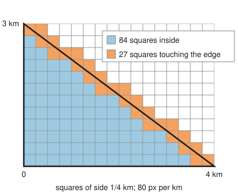

# Jordan content: which regions have an area, and Fubini on them in any dimension

[Syllabus](../../../SYLLABUS.md) → [Calculus and analysis](../README.md) → [Multiple Integrals](../README.md#s08) → Jordan content

---

## General Overview

A triangular catchment, the land draining to one river gauge, has corners (0, 0), (4, 0) and (0, 3) km. A storm leaves 10 mm of rain on its western edge, rising 2 mm per km eastward.

First, what is its area? Grid the 4 by 3 km box around it with squares 1/N km wide. Count the squares wholly inside, then those touching it. At N = 10 they cover 5.70 and 6.39 km²; at N = 1,000, 5.997 and 6.003999. Both close in on 6 km²: the edge squares shrink to nothing in total.

That closing-in is what having an area means. Some sets never close in, such as the unit square's points with both coordinates fractions. Every grid square holds some of these and some other points: inside area 0, touching area 1, at every N.

On a region with an area, rain can be added by squares, by strips in either order, or by horizontal layers of the water. Every road gives 76 mm·km², or 76,000 m³.

**A region has an area, its Jordan content, when the grid squares on its edge can be made to total as little as wanted; on such a region a bounded depth with no jumps off its edge has an integral, and Fubini's theorem computes it one variable at a time, in any order and any dimension.**

**What kind of fact this is:** content zero and Jordan regions are definitions; the integrability test and Fubini's theorem are theorems, proved on this card in Why it works.

### The picture: the catchment on a grid of quarter-km squares

<p align="center"></p>

To scale: 80 px per km. At N = 4 the 84 inside squares cover 5.2500 km²; the 111 box squares touching the catchment, 6.9375 km².

---

## The formula

A point of $`\mathbb{R}^n`$ is a list of n numbers. A **box** is a product of closed intervals, one per coordinate; its **volume** is the product of its sides.

A set has **content zero** when, for every tolerance $`\varepsilon`$ (epsilon) above 0, finitely many boxes of total volume below $`\varepsilon`$ cover it. A bounded region $`D`$ is a **Jordan region** when its edge $`\partial D`$ (points with inside and outside points arbitrarily close) has content zero. Then two counts meet:

```math
c(D) = \lim_{N\to\infty} \frac{\text{cubes inside } D}{N^n} = \lim_{N\to\infty} \frac{\text{cubes meeting } D}{N^n}
```

**Read it aloud:** the content of D is the volume of the grid cubes inside it, and also of the cubes touching it, as the cubes shrink.

To integrate a depth $`f`$ over $`D`$, put $`D`$ in a box $`B`$, set $`F`$ to $`f`$ inside $`D`$ and 0 outside, and take the lower-and-upper-sum integral of $`F`$ ([The integral](../04-Integrals/01-riemann-integral.md)) with boxes as cells. Split the coordinates into $`x`$ and the rest $`y`$, so $`B = A \times C`$, with $`D_x`$ the slice of $`D`$ at a fixed $`x`$. Fubini's theorem:

```math
\int_D f = \int_A \left( \int_{D_x} f(x, y)\,dy \right) dx
```

**Read it aloud:** add the depth over each slice of D at a fixed x, then add the slices.

| Symbol | Plain meaning | In our example | Push it up and the answer… |
| --- | --- | --- | --- |
| $`n`$ | number of coordinates | 2 for the map; 3 for the water | — |
| $`N`$ | squares per km | 10, 100, 1000 | counts close in on 6 |
| $`D`$, $`\partial D`$, $`c(D)`$ | the region, its edge, its content (area or volume) | the catchment T; its three sides; 6 km² | more content, more rain |
| $`\varepsilon`$ | a tolerance, as small as wanted | 7/N = 0.007 at N = 1000 | — |
| $`f`$, $`F`$ | depth; the same depth, set to 0 outside D | 10 + 2x mm | more water |
| $`B = A \times C`$ | a box holding D, split | [0, 4] × [0, 3] | — |
| $`x`$, $`y`$, $`D_x`$ | outer and inner coordinates; slice at x | y from 0 to 3 − 3x/4 | — |
| $`L`$, $`U`$ | lower and upper sums over the cells | 71.24 and 82.08 at N = 10 | close in on 76 |

### When it holds

- **A bounded region.** An endless region fits in no box: no grid to count.
- **An edge of content zero.** The fraction points have the whole square as edge: areas 0 and 1 forever.
- **A bounded depth.** An unbounded spike gives +π/4 one order, −π/4 the other ([Double integrals](01-double-integrals.md)).
- **Jumps only on content zero.** Depth 1 on fractions, 0 elsewhere, has upper sum 1, lower sum 0.
- **Odd slices.** Slices $`D_x`$ of a Jordan region can lack content, even infinitely many; read their inner integral as the largest lower sum and the theorem holds.

---

## Why it works

### Step 0: fence off the trouble, then pay for the fence

Sums fail to settle at jumps. Content zero fences the jumps inside boxes of tiny total volume. Outside the fence, fine cells hold the function nearly flat; inside, it is bounded on a small fence. A Jordan region's edge is such a fence for "depth inside, 0 outside".

### Step 1: the catchment's edge has content zero

The short sides lie on grid lines; one thin box covers each. The slanted side, y = 3 − 3x/4, enters a new square at each of 4N vertical and 3N horizontal grid lines, but crosses both at once at N grid corners. So it cuts 6N squares and touches N − 1 more at a corner: 7N − 1 squares, area under 7/N.

The check counts 6N² − 3N squares inside and 6N² + 4N − 1 meeting T: at N = 1,000, 6999 edge squares, 0.006999 km². So c(T) = 6 km².

### Step 2: a bounded depth with jumps only on content zero is integrable

On the catchment F jumps to 0 across the slanted edge. Inside T the depth climbs 2 mm per km, so a square varies by at most 2/N mm: over 6 km², 12/N. Edge squares, under 7/N km² in all, vary by up to 18 mm: at most 126/N. So upper minus lower is at most 138/N; the check finds 10.8400, 1.0984 and 0.1100 at N = 10, 100 and 1000.

The general proof pays the same two bills: continuity off the fence, and a bound times the fence's volume.

<details>
<summary>Detailed proof: continuous off a set of content zero implies integrable</summary>

Let |F| ≤ M on the box B, with its jump points Z of content zero. Fix ε > 0. Cover Z by boxes of total volume below ε/(4M), slightly enlarged so Z lies in their interiors. Remove the interiors; the rest, K, is closed and bounded, and F is continuous at each point of K.

The halving argument of [Compactness of [a, b]](../01-Limits%20and%20Continuity/09-compactness-of-closed-intervals.md), halving every side of the box at once, gives one δ (delta): points of K and B closer than δ have values within ε/(4 vol B).

Use a grid finer than δ that cuts along the cover boxes' sides. Cells meeting K have spread under ε/(2 vol B), so they cost under ε/2. Cells missing K lie in the cover, total volume under ε/(4M), spread at most 2M: under ε/2. So U − L < ε. For f continuous and bounded on a Jordan region, F jumps only on ∂D, so F is integrable; f = 1 gives the content.

</details>

### Step 3: Fubini on a box, in any dimension

A grid on $`B = A \times C`$ is a grid on $`A`$ times a grid on $`C`$. On each cell, F's lowest value is no higher than its lowest along any slice through the cell. Add over a column of cells, then over columns:

```math
L(F) \le L\Big(\int_C F(x, y)\,dy\Big) \le U\Big(\int_C F(x, y)\,dy\Big) \le U(F)
```

**Read it aloud:** the slice totals' lower and upper sums sit between the box's lower and upper sums.

Step 2 closes the outer pair, trapping the slice totals. At N = 10 the check prints lower 71.2400, strips 74.4900 to 77.4900, upper 82.0800; at N = 1000 all four sit within 0.07 of 76.

Nothing needed $`x`$ and $`y`$ to be single numbers, so peel off one coordinate at a time: a box integral in $`\mathbb{R}^n`$ is n ordinary integrals, in any order.

<details>
<summary>Detailed proof: the squeeze, and slices that are not integrable</summary>

Let P = P_A × P_C be a grid with cells S × Q, and m the lowest value on a set. For x in S, the lower sum of F(x, ·) over P_C is at least Σ_Q m(S × Q) vol Q. Let g(x) be the slice's best lower sum; then the lowest g on S is at least that sum. Multiply by vol S and add: L(F, P) ≤ L(g, P_A).

Highest values give U(h, P_A) ≤ U(F, P), with h the slice's best upper sum and g ≤ h. So L(F, P) ≤ L(g, P_A) ≤ U(g, P_A) ≤ U(h, P_A) ≤ U(F, P). The outer pair closes, so g and h integrate to the integral of F; when slices are integrable, g = h. Repeat n − 1 times for n dimensions.

</details>

### Step 4: Fubini on a Jordan region

Put the region in a box, set the depth to 0 outside, and apply Steps 2 and 3. The zeros confine each slice integral to the slice $`D_x`$: here y from 0 to 3 − 3x/4.

- **North strips first.** The strip at x holds (10 + 2x)(3 − 3x/4) = 30 − 1.5x − 1.5x^2, which is 21 at x = 2. From 0 to 4: 120 − 12 − 32 = 76.
- **East strips first.** At y the strip runs to X = 4 − 4y/3 and holds 10X + X^2, which is 24 at y = 1.5. From 0 to 3: 60 + 16 = 76.
- **No slicing.** A linear depth averages to its value at the centroid, x = 4/3: 10 × 6 + 2 × 6 × 4/3 = 76.

### Step 5: the same rain as a three-dimensional region

Stack the rain on the map: a solid W of points (x, y, z) over T, z from 0 to 10 + 2x. Its content, in km × km × mm, is the rain total.

Integrating z first gives back the map integral. Integrating z last cuts W into layers. Below 10 mm a layer is all of T, area 6. Above, only x ≥ (z − 10)/2 is wet: area (3/8)(4 − (z − 10)/2)^2, which is 1.5 km² at z = 14 mm. The layers add to 60 + 16 = 76.

---

## Worked numbers, by hand

| Step | Arithmetic | Value |
| --- | --- | --- |
| area of T | 4 × 3 / 2 | 6 km² |
| content bracket, N = 10 | 570 and 639 squares of 1/100 km² | 5.70 to 6.39 km² |
| edge squares, N = 1000 | 7N − 1 = 6999, each 10^−6 km² | 0.006999 km² |
| north strip at x = 2 | (10 + 4)(3 − 1.5) | 21 |
| north strips added | 30 × 4 − 1.5 × 16/2 − 1.5 × 64/3 | 120 − 12 − 32 = 76 |
| east strips added | 10 × 6 + 16 × 3/3 | 76 |
| layers added | 6 × 10 + (3/4) × 64/3 | 60 + 16 = 76 |
| units | 76 mm·km² × 1,000 m³ per mm·km² | **76,000 m³** |

The catchment took in 76,000 m³ of rain, however it is sliced.

### What breaks if you drop a piece

| Mistake | Comes out at | What went wrong |
| --- | --- | --- |
| Box limits, x 0 to 4 and y 0 to 3 | 168.00 | the dry half of the box counted |
| Every layer taken as the whole triangle | 108.00 | the slices were not slices of W |
| Upper sum at N = 10 read as the answer | 82.08 | edge squares counted at full depth |
| Fraction points of the unit square | upper 1, lower 0 | an edge without content zero |

---

## Code, from first principles, and it actually runs

Five roads to 76: hand antiderivatives both ways, the centroid, grid lower and upper sums, column strips between them, and layers of the 3D water. Asserts: hand strips match midpoint sums (middle values times widths); exact roads agree; counts equal 6N² − 3N and 6N² + 4N − 1; strips sit in the bracket, gap under 138/N; a brute-force sampler matches the N = 10 sums; layers land within 0.001 of 76.

### Python

```python
# Jordan content and Fubini in n dimensions -- the check behind the card.  Nothing is imported.
# Catchment T: the triangle (0, 0), (4, 0), (0, 3) km; slanted edge y = 3 - 3x/4.  Rain depth 10 + 2x mm.
# Roads to 76: hand antiderivatives in both orders; the centroid; square counts and lower/upper sums
# on a grid; column strips trapped between those sums; horizontal layers of the 3D body of water.
depth = lambda x: 10 + 2 * x                  # rain depth in mm, x km east
def mid(g, a, b, n):                           # midpoint sum of g on [a, b], n pieces
    h = (b - a) / n
    return sum(g(a + (k + 0.5) * h) for k in range(n)) * h
def grid(N):                                   # squares of side 1/N km on the box [0, 4] x [0, 3]
    h, cin, cout, lo, hi = 1 / N, 0, 0, 0.0, 0.0
    for i in range(4 * N):
        for j in range(3 * N):
            if 3 * (i + 1) + 4 * (j + 1) <= 12 * N:      # far corner in T: whole square inside
                cin += 1
                lo += depth(i * h) * h * h
            if 3 * i + 4 * j <= 12 * N:                  # near corner in T: square meets T
                cout += 1
                hi += depth(min((i + 1) * h, 4 - 4 * j * h / 3)) * h * h
    return cin, cout, lo, hi
def brute(N, m=3):                             # lowest and highest F over 16 sample points per square
    cells = [[depth((m * i + a) / N / m) * (3 * (m * i + a) + 4 * (m * j + b) <= 12 * N * m)
              for a in range(m + 1) for b in range(m + 1)] for i in range(4 * N) for j in range(3 * N)]
    return sum(map(min, cells)) / N**2, sum(map(max, cells)) / N**2
def layer(z):                                  # area of the water's horizontal slice at height z mm
    return 6.0 if z <= 10 else 3 / 8 * (4 - (z - 10) / 2) ** 2
column = lambda x: 30 - 1.5 * x - 1.5 * x * x                    # hand: north strip, (10 + 2x)(3 - 3x/4)
row = lambda y: 10 * (4 - 4 * y / 3) + (4 - 4 * y / 3) ** 2      # hand: east strip, x from 0 to 4 - 4y/3
x_first = 30 * 4 - 1.5 * 4 ** 2 / 2 - 1.5 * 4 ** 3 / 3          # integral of column from 0 to 4
y_first = 10 * 6 + 4 ** 2 * 3 / 3                                # 10 x area, plus (4 - 4y/3)^2 from 0 to 3
centroid = 10 * 6 + 2 * 6 * 4 / 3                                # depth at x = 4/3, times area 6
print(f"catchment: area {4 * 3 / 2:.0f} km^2, centroid x = {4 / 3:.4f} km; depth {depth(0):.0f} to {depth(4):.0f} mm")
print(f"strips: north at x = 2 carries {column(2):.3f}, east at y = 1.5 carries {row(1.5):.3f}")
assert all(abs(column(t) - mid(lambda y: depth(t), 0, 3 - 0.75 * t, 8)) < 1e-9 and
           abs(row(t / 4 * 3) - mid(depth, 0, 4 - t, 8)) < 1e-9 for t in (0.5, 2, 3.5))
print(f"exact: north strips {x_first:.4f}, east strips {y_first:.4f}, centroid {centroid:.4f} mm km^2")
assert abs(x_first - y_first) < 1e-9 and abs(x_first - centroid) < 1e-9
for N in (10, 100, 1000):
    cin, cout, lo, hi = grid(N)
    s_lo = sum(column((i + 1) / N) for i in range(4 * N)) / N   # column rain falls with x:
    s_hi = sum(column(i / N) for i in range(4 * N)) / N         # lowest at the right side
    print(f"N = {N}: squares inside {cin}, touching {cout}; content {cin / N**2:.6f} to {cout / N**2:.6f}")
    print(f"  rain: lower {lo:.4f} <= strips {s_lo:.4f} to {s_hi:.4f} <= upper {hi:.4f}; gap {hi - lo:.4f}")
    assert cin == 6 * N * N - 3 * N and cout == 6 * N * N + 4 * N - 1     # the edge costs 7N - 1 squares
    assert lo <= s_lo <= x_first <= s_hi <= hi and hi - lo <= 138 / N   # Fubini's squeeze, and the gap
b_lo, b_hi = brute(10)                                           # brute force, no corner formulas
print(f"brute force, N = 10, 16 points per square: lower {b_lo:.4f}, upper {b_hi:.4f}")
assert abs(b_lo - grid(10)[2]) < 1e-9 and abs(b_hi - grid(10)[3]) < 1e-9
print(f"edge squares at N = 1000: {cout - cin}, area {(cout - cin) / N**2:.6f} km^2, under 7/N = {7 / N:.6f}")
layers = mid(layer, 0, 18, 1800)
print(f"layers: slice area at z = 14 mm is {layer(14):.4f} km^2; layers added {layers:.4f} mm km^2")
assert abs(layers - x_first) < 1e-3
print(f"water: {x_first:.0f} mm km^2 = {x_first * 1000:.0f} m^3")
wit = [b for b in (0, 0.5) if 2 * b * b <= 1]     # points ((i + b sqrt 2)/N, j/N): in square (i, j) iff 2b^2 <= 1; a fraction iff b = 0
print(f"rational points, any N: each square holds a fraction point and a point that is not: upper {max(b == 0 for b in wit):d}, lower {min(b == 0 for b in wit):d}")
print(f"mistake, box limits 0..4 by 0..3: {mid(lambda x: 3 * depth(x), 0, 4, 64):.2f}; "
      f"every layer the whole triangle: {6 * 18:.2f}")
g4 = grid(4)
print(f"figure, 80 px per km, N = 4; corners (40,280), (360,280), (40,40); inside {g4[0]} "
      f"({g4[0] / 16:.4f} km^2), meeting T {g4[1]} ({g4[1] / 16:.4f} km^2), on the edge {g4[1] - g4[0]}")
print("ALL CHECKS PASS")
```

**Ran 2026-11-23 on macOS, Python 3.14.10, standard library only. All checks passed. Output, pasted from the run:**

```
catchment: area 6 km^2, centroid x = 1.3333 km; depth 10 to 18 mm
strips: north at x = 2 carries 21.000, east at y = 1.5 carries 24.000
exact: north strips 76.0000, east strips 76.0000, centroid 76.0000 mm km^2
N = 10: squares inside 570, touching 639; content 5.700000 to 6.390000
  rain: lower 71.2400 <= strips 74.4900 to 77.4900 <= upper 82.0800; gap 10.8400
N = 100: squares inside 59700, touching 60399; content 5.970000 to 6.039900
  rain: lower 75.5204 <= strips 75.8499 to 76.1499 <= upper 76.6188; gap 1.0984
N = 1000: squares inside 5997000, touching 6003999; content 5.997000 to 6.003999
  rain: lower 75.9520 <= strips 75.9850 to 76.0150 <= upper 76.0620; gap 0.1100
brute force, N = 10, 16 points per square: lower 71.2400, upper 82.0800
edge squares at N = 1000: 6999, area 0.006999 km^2, under 7/N = 0.007000
layers: slice area at z = 14 mm is 1.5000 km^2; layers added 76.0000 mm km^2
water: 76 mm km^2 = 76000 m^3
rational points, any N: each square holds a fraction point and a point that is not: upper 1, lower 0
mistake, box limits 0..4 by 0..3: 168.00; every layer the whole triangle: 108.00
figure, 80 px per km, N = 4; corners (40,280), (360,280), (40,40); inside 84 (5.2500 km^2), meeting T 111 (6.9375 km^2), on the edge 27
ALL CHECKS PASS
```

### Rust

Same numbers, same labels, built with `rustc --edition 2021 -O`.

```rust
// Jordan content and Fubini in n dimensions -- the same check as the Python, in Rust.  No crates.
// Catchment T: the triangle (0, 0), (4, 0), (0, 3) km; slanted edge y = 3 - 3x/4.  Rain depth 10 + 2x mm.
// Roads to 76: hand antiderivatives in both orders; the centroid; square counts and lower/upper sums
// on a grid; column strips trapped between those sums; horizontal layers of the 3D body of water.
fn depth(x: f64) -> f64 { 10.0 + 2.0 * x }
fn mid(g: &dyn Fn(f64) -> f64, a: f64, b: f64, n: usize) -> f64 {   // midpoint sum, n pieces
    let h = (b - a) / n as f64;
    (0..n).map(|k| g(a + (k as f64 + 0.5) * h)).sum::<f64>() * h
}
fn grid(n: i64) -> (i64, i64, f64, f64) {      // squares of side 1/N km on the box [0, 4] x [0, 3]
    let h = 1.0 / n as f64;
    let (mut cin, mut cout, mut lo, mut hi) = (0, 0, 0.0, 0.0);
    for i in 0..4 * n {
        for j in 0..3 * n {
            if 3 * (i + 1) + 4 * (j + 1) <= 12 * n {     // far corner in T: whole square inside
                cin += 1;
                lo += depth(i as f64 * h) * h * h;
            }
            if 3 * i + 4 * j <= 12 * n {                 // near corner in T: square meets T
                cout += 1;
                hi += depth(((i + 1) as f64 * h).min(4.0 - 4.0 * j as f64 * h / 3.0)) * h * h;
            }
        }
    }
    (cin, cout, lo, hi)
}
fn brute(n: i64, m: i64) -> (f64, f64) {      // lowest and highest F over 16 sample points per square
    let (mut lo, mut hi) = (0.0, 0.0);
    for i in 0..4 * n { for j in 0..3 * n {
        let v: Vec<f64> = (0..=m).flat_map(|a| (0..=m).map(move |b| (a, b))).map(|(a, b)|
            if 3 * (m * i + a) + 4 * (m * j + b) <= 12 * n * m { depth((m * i + a) as f64 / (n * m) as f64) } else { 0.0 }).collect();
        lo += v.iter().cloned().fold(f64::MAX, f64::min); hi += v.iter().cloned().fold(f64::MIN, f64::max);
    } }
    (lo / (n * n) as f64, hi / (n * n) as f64)
}
fn layer(z: f64) -> f64 {                      // area of the water's horizontal slice at height z mm
    if z <= 10.0 { 6.0 } else { 3.0 / 8.0 * (4.0 - (z - 10.0) / 2.0).powi(2) }
}
fn main() {
    let column = |x: f64| 30.0 - 1.5 * x - 1.5 * x * x;                       // hand: north strip
    let row = |y: f64| 10.0 * (4.0 - 4.0 * y / 3.0) + (4.0 - 4.0 * y / 3.0).powi(2); // hand: east strip
    let x_first: f64 = 30.0 * 4.0 - 1.5 * 16.0 / 2.0 - 1.5 * 64.0 / 3.0;          // integral of column, 0 to 4
    let y_first: f64 = 10.0 * 6.0 + 16.0 * 3.0 / 3.0;                              // 10 x area + (4 - 4y/3)^2
    let centroid = 10.0 * 6.0 + 2.0 * 6.0 * 4.0 / 3.0;                        // depth at x = 4/3, times 6
    println!("catchment: area {:.0} km^2, centroid x = {:.4} km; depth {:.0} to {:.0} mm", 4.0 * 3.0 / 2.0, 4.0 / 3.0, depth(0.0), depth(4.0));
    println!("strips: north at x = 2 carries {:.3}, east at y = 1.5 carries {:.3}", column(2.0), row(1.5));
    assert!([0.5, 2.0, 3.5].iter().all(|&t| (column(t) - mid(&|_y| depth(t), 0.0, 3.0 - 0.75 * t, 8)).abs() < 1e-9
        && (row(t / 4.0 * 3.0) - mid(&depth, 0.0, 4.0 - t, 8)).abs() < 1e-9));
    println!("exact: north strips {:.4}, east strips {:.4}, centroid {:.4} mm km^2", x_first, y_first, centroid);
    assert!((x_first - y_first).abs() < 1e-9 && (x_first - centroid).abs() < 1e-9);
    let (mut cin, mut cout, mut nn) = (0, 0, 1);
    for n in [10i64, 100, 1000] {
        let (ci, co, lo, hi) = grid(n);
        let nf = n as f64;
        let s_lo = (0..4 * n).map(|i| column((i + 1) as f64 / nf)).sum::<f64>() / nf; // column rain falls
        let s_hi = (0..4 * n).map(|i| column(i as f64 / nf)).sum::<f64>() / nf;       // with x
        println!("N = {}: squares inside {}, touching {}; content {:.6} to {:.6}", n, ci, co, ci as f64 / (nf * nf), co as f64 / (nf * nf));
        println!("  rain: lower {:.4} <= strips {:.4} to {:.4} <= upper {:.4}; gap {:.4}", lo, s_lo, s_hi, hi, hi - lo);
        assert!(ci == 6 * n * n - 3 * n && co == 6 * n * n + 4 * n - 1);       // the edge costs 7N - 1 squares
        assert!(lo <= s_lo && s_lo <= x_first && x_first <= s_hi && s_hi <= hi && hi - lo <= 138.0 / nf);
        (cin, cout, nn) = (ci, co, n);
    }
    let (b_lo, b_hi) = brute(10, 3);                                           // brute force, no corner formulas
    println!("brute force, N = 10, 16 points per square: lower {:.4}, upper {:.4}", b_lo, b_hi);
    assert!((b_lo - grid(10).2).abs() < 1e-9 && (b_hi - grid(10).3).abs() < 1e-9);
    let nf = nn as f64;
    println!("edge squares at N = 1000: {}, area {:.6} km^2, under 7/N = {:.6}", cout - cin, (cout - cin) as f64 / (nf * nf), 7.0 / nf);
    let layers = mid(&layer, 0.0, 18.0, 1800);
    println!("layers: slice area at z = 14 mm is {:.4} km^2; layers added {:.4} mm km^2", layer(14.0), layers);
    assert!((layers - x_first).abs() < 1e-3);
    println!("water: {:.0} mm km^2 = {:.0} m^3", x_first, x_first * 1000.0);
    let wit: Vec<f64> = [0.0f64, 0.5].into_iter().filter(|b| 2.0 * b * b <= 1.0).collect();  // points ((i + b sqrt 2)/N, j/N): in square (i, j) iff 2b^2 <= 1; a fraction iff b = 0
    println!("rational points, any N: each square holds a fraction point and a point that is not: upper {}, lower {}", wit.iter().any(|&b| b == 0.0) as i32, wit.iter().all(|&b| b == 0.0) as i32);
    println!("mistake, box limits 0..4 by 0..3: {:.2}; every layer the whole triangle: {:.2}",
             mid(&|x| 3.0 * depth(x), 0.0, 4.0, 64), 6.0 * 18.0);
    let g4 = grid(4);
    println!("figure, 80 px per km, N = 4; corners (40,280), (360,280), (40,40); inside {} ({:.4} km^2), meeting T {} ({:.4} km^2), on the edge {}",
             g4.0, g4.0 as f64 / 16.0, g4.1, g4.1 as f64 / 16.0, g4.1 - g4.0);
    println!("ALL CHECKS PASS");
}
```

**Ran 2026-11-23 on macOS, rustc 1.98.1, no crates. All checks passed. Output, pasted from the run:**

```
catchment: area 6 km^2, centroid x = 1.3333 km; depth 10 to 18 mm
strips: north at x = 2 carries 21.000, east at y = 1.5 carries 24.000
exact: north strips 76.0000, east strips 76.0000, centroid 76.0000 mm km^2
N = 10: squares inside 570, touching 639; content 5.700000 to 6.390000
  rain: lower 71.2400 <= strips 74.4900 to 77.4900 <= upper 82.0800; gap 10.8400
N = 100: squares inside 59700, touching 60399; content 5.970000 to 6.039900
  rain: lower 75.5204 <= strips 75.8499 to 76.1499 <= upper 76.6188; gap 1.0984
N = 1000: squares inside 5997000, touching 6003999; content 5.997000 to 6.003999
  rain: lower 75.9520 <= strips 75.9850 to 76.0150 <= upper 76.0620; gap 0.1100
brute force, N = 10, 16 points per square: lower 71.2400, upper 82.0800
edge squares at N = 1000: 6999, area 0.006999 km^2, under 7/N = 0.007000
layers: slice area at z = 14 mm is 1.5000 km^2; layers added 76.0000 mm km^2
water: 76 mm km^2 = 76000 m^3
rational points, any N: each square holds a fraction point and a point that is not: upper 1, lower 0
mistake, box limits 0..4 by 0..3: 168.00; every layer the whole triangle: 108.00
figure, 80 px per km, N = 4; corners (40,280), (360,280), (40,40); inside 84 (5.2500 km^2), meeting T 111 (6.9375 km^2), on the edge 27
ALL CHECKS PASS
```

### Lean

Lean proves the integrability test and Fubini's theorem in every dimension, and that both cube counts close in on the content.

- Take a bounded depth on a box, with jumps only on a set of content zero. Then its lower and upper sums close in, so it has an integral.
- Take a Jordan region D in any dimension. Then the volume of the grid cubes inside D, and of those meeting D, both tend to its content.
- Take a box $`B = A \times C`$ holding a Jordan region D, with the coordinates split into x and y in any groups. Suppose the depth f is bounded on D and jumps inside D only on a set of content zero. Then F has an integral over B, equal to the slice totals over $`D_x`$ added over x in A.
- Odd slices need no extra condition. Each slice total is Lean's built-in integral, which is defined even where a slice's lower and upper sums differ.
- On the catchment at N = 4, 84 squares lie inside and 111 meet it; at N = 10, 570 and 639.
- At N = 1000, the two count formulas leave 7N − 1 = 6999 edge squares.
- The hand arithmetic holds exactly: north strips, east strips and the centroid each give 76.
- The strip at x = 2 holds 21, and the layers add to 60 + 16 = 76.

The counts at N = 100 and 1000, the rain sums, the sampler and the fraction points are left to the Python and Rust checks.

```lean
-- Jordan content: a bounded region whose edge has content zero has a content equal to the limit of both grid-cube counts, a bounded function continuous off a set of content zero is Riemann integrable on a box, and on a Jordan region the Riemann integral equals the integral of the slice integrals, in any dimension.
import Mathlib.Analysis.BoxIntegral.Basic
import Mathlib.Analysis.BoxIntegral.Integrability
import Mathlib.Analysis.BoxIntegral.Partition.Measure
import Mathlib.MeasureTheory.Integral.Bochner.Set
import Mathlib.MeasureTheory.Measure.Lebesgue.Basic
import Mathlib.Data.Set.Card
import Mathlib.Tactic.NormNum
import Mathlib.MeasureTheory.Integral.Prod
import Mathlib.Data.Pi.Interval
import Mathlib.Data.Int.Interval

open Set Filter Topology MeasureTheory BoxIntegral

/-- A set `Z` in `ℝ^ι` has **content zero**: for every tolerance `ε > 0`, finitely many closed
boxes `[a k, b k]` (each with `a k ≤ b k` in every coordinate) cover `Z` and have total volume
`∑ₖ ∏ᵢ (b k i - a k i)` below `ε`. -/
def ContentZero {ι : Type*} [Fintype ι] (Z : Set (ι → ℝ)) : Prop :=
  ∀ ε > 0, ∃ (n : ℕ) (a b : Fin n → ι → ℝ), (∀ k, a k ≤ b k) ∧
    Z ⊆ ⋃ k, Icc (a k) (b k) ∧ ∑ k, ∏ i, (b k i - a k i) < ε

/-- A **Jordan region**: a bounded set whose edge (its frontier) has content zero. -/
def IsJordanRegion {ι : Type*} [Fintype ι] (D : Set (ι → ℝ)) : Prop :=
  Bornology.IsBounded D ∧ ContentZero (frontier D)

/-- The closed grid cube of side `1/N` with lowest corner `z/N`, for `z` a point with
whole-number coordinates. -/
noncomputable def gridCube {ι : Type*} (N : ℕ) (z : ι → ℤ) : Set (ι → ℝ) :=
  Icc (fun i => (z i : ℝ) / N) (fun i => ((z i : ℝ) + 1) / N)

theorem volume_eq_zero_of_contentZero {ι : Type*} [Fintype ι] {Z : Set (ι → ℝ)}
    (hZ : ContentZero Z) : volume Z = 0 := by
  refine le_antisymm (ENNReal.le_of_forall_pos_le_add fun ε hε _ => ?_) bot_le
  obtain ⟨n, a, b, hab, hcov, hsum⟩ := hZ ε (by exact_mod_cast hε)
  calc volume Z ≤ volume (⋃ k, Icc (a k) (b k)) := measure_mono hcov
    _ ≤ ∑ k, volume (Icc (a k) (b k)) := measure_iUnion_fintype_le _ _
    _ = ∑ k, ∏ i, ENNReal.ofReal (b k i - a k i) := by simp [Real.volume_Icc_pi]
    _ = ENNReal.ofReal (∑ k, ∏ i, (b k i - a k i)) := by
        rw [ENNReal.ofReal_sum_of_nonneg]
        · refine Finset.sum_congr rfl fun k _ => ?_
          rw [ENNReal.ofReal_prod_of_nonneg]
          intro i _; exact sub_nonneg.2 (hab k i)
        · intro k _; exact Finset.prod_nonneg fun i _ => sub_nonneg.2 (hab k i)
    _ ≤ ENNReal.ofReal ε := ENNReal.ofReal_le_ofReal hsum.le
    _ = 0 + ε := by simp
#print axioms volume_eq_zero_of_contentZero

/-- The half-open grid cube, used to tile space without overlap. -/
noncomputable def halfCube {ι : Type*} (N : ℕ) (z : ι → ℤ) : Set (ι → ℝ) :=
  Set.pi univ fun i => Ico ((z i : ℝ) / N) (((z i : ℝ) + 1) / N)

theorem floor_eq_of_mem_halfCube {ι : Type*} {N : ℕ} (hN : 0 < N) {z : ι → ℤ} {p : ι → ℝ}
    (hp : p ∈ halfCube N z) (i : ι) : ⌊(N : ℝ) * p i⌋ = z i := by
  have hN' : (0 : ℝ) < N := by exact_mod_cast hN
  have h := hp i (mem_univ i)
  rw [Int.floor_eq_iff]
  constructor
  · have := h.1; rw [div_le_iff₀ hN'] at this; linarith
  · have := h.2; rw [lt_div_iff₀ hN'] at this; linarith
#print axioms floor_eq_of_mem_halfCube

theorem mem_halfCube_floor {ι : Type*} {N : ℕ} (hN : 0 < N) (p : ι → ℝ) :
    p ∈ halfCube N (fun i => ⌊(N : ℝ) * p i⌋) := by
  have hN' : (0 : ℝ) < N := by exact_mod_cast hN
  intro i _
  constructor
  · rw [div_le_iff₀ hN']; have := Int.floor_le ((N : ℝ) * p i); linarith
  · rw [lt_div_iff₀ hN']; have := Int.lt_floor_add_one ((N : ℝ) * p i); linarith
#print axioms mem_halfCube_floor

theorem halfCube_subset_gridCube {ι : Type*} (N : ℕ) (z : ι → ℤ) :
    halfCube N z ⊆ gridCube N z := by
  intro p hp
  exact ⟨fun i => (hp i (mem_univ i)).1, fun i => le_of_lt (hp i (mem_univ i)).2⟩
#print axioms halfCube_subset_gridCube

theorem volume_biUnion_halfCube {ι : Type*} [Fintype ι] {N : ℕ} (hN : 0 < N)
    (F : Finset (ι → ℤ)) :
    volume (⋃ z ∈ F, halfCube N z) =
      ENNReal.ofReal ((F.card : ℝ) * (1 / (N : ℝ)) ^ Fintype.card ι) := by
  have hN' : (0 : ℝ) < N := by exact_mod_cast hN
  rw [measure_biUnion_finset]
  · have hv : ∀ z : ι → ℤ, volume (halfCube N z) = ENNReal.ofReal ((1 / (N : ℝ)) ^ Fintype.card ι) := by
      intro z
      rw [halfCube, Real.volume_pi_Ico, ENNReal.ofReal_pow (by positivity), ← Finset.card_univ,
        ← Finset.prod_const]
      refine Finset.prod_congr rfl fun i _ => ?_
      congr 1; field_simp; ring
    simp only [hv, Finset.sum_const, nsmul_eq_mul]
    rw [ENNReal.ofReal_mul (by positivity), ENNReal.ofReal_natCast]
  · intro z _ z' _ hzz'
    refine Set.disjoint_left.2 fun p hp hp' => hzz' ?_
    funext i
    rw [← floor_eq_of_mem_halfCube hN hp i, ← floor_eq_of_mem_halfCube hN hp' i]
  · intro z _
    exact MeasurableSet.univ_pi fun i => measurableSet_Ico
#print axioms volume_biUnion_halfCube

/-- The integer points of the grid cubes meeting a box `[a, b]`. -/
theorem gridCube_meet_box_subset {ι : Type*} [Fintype ι] [DecidableEq ι] {N : ℕ} (hN : 0 < N)
    (a b : ι → ℝ) :
    {z : ι → ℤ | (gridCube N z ∩ Icc a b).Nonempty} ⊆
      ↑(Finset.Icc (fun i => ⌈(N : ℝ) * a i⌉ - 1) (fun i => ⌊(N : ℝ) * b i⌋)) := by
  have hN' : (0 : ℝ) < N := by exact_mod_cast hN
  rintro z ⟨p, ⟨hp1, hp2⟩, hq1, hq2⟩
  rw [Finset.coe_Icc, mem_Icc]
  constructor
  · intro i
    have h1 := hp2 i; have h2 := hq1 i
    simp only at h1
    rw [le_div_iff₀ hN'] at h1
    have : ⌈(N : ℝ) * a i⌉ ≤ z i + 1 := by
      rw [Int.ceil_le]; push_cast; nlinarith
    simp only; omega
  · intro i
    have h1 := hp1 i; have h2 := hq2 i
    simp only at h1
    rw [div_le_iff₀ hN'] at h1
    simp only
    rw [Int.le_floor]; nlinarith
#print axioms gridCube_meet_box_subset

theorem card_box_le {ι : Type*} [Fintype ι] [DecidableEq ι] {N : ℕ} (a b : ι → ℝ) (hab : a ≤ b) :
    ((Finset.Icc (fun i => ⌈(N : ℝ) * a i⌉ - 1) (fun i => ⌊(N : ℝ) * b i⌋)).card : ℝ) ≤
      ∏ i, ((N : ℝ) * (b i - a i) + 2) := by
  rw [Pi.card_Icc]
  push_cast
  refine Finset.prod_le_prod₀ (fun i _ => by positivity) fun i _ => ?_
  rw [Int.card_Icc]
  have hN0 : (0 : ℝ) ≤ N := Nat.cast_nonneg N
  have hb := Int.floor_le ((N : ℝ) * b i)
  have ha := Int.le_ceil ((N : ℝ) * a i)
  have hab' : 0 ≤ (N : ℝ) * (b i - a i) := mul_nonneg hN0 (sub_nonneg.2 (hab i))
  have : (((⌊(N : ℝ) * b i⌋ + 1 - (⌈(N : ℝ) * a i⌉ - 1)).toNat : ℤ) : ℝ) ≤
      (N : ℝ) * (b i - a i) + 2 := by
    rw [Int.toNat_eq_max]
    push_cast
    refine max_le ?_ (by linarith)
    nlinarith
  exact_mod_cast this
#print axioms card_box_le

theorem finite_gridCube_meet {ι : Type*} [Fintype ι] {N : ℕ} (hN : 0 < N) {E : Set (ι → ℝ)}
    (hE : Bornology.IsBounded E) : {z : ι → ℤ | (gridCube N z ∩ E).Nonempty}.Finite := by
  classical
  obtain ⟨a, ha⟩ := hE.bddBelow
  obtain ⟨b, hb⟩ := hE.bddAbove
  refine (Finset.finite_toSet _).subset (subset_trans ?_ (gridCube_meet_box_subset hN a b))
  rintro z ⟨p, hp, hpE⟩
  exact ⟨p, hp, ha hpE, hb hpE⟩
#print axioms finite_gridCube_meet

theorem tendsto_count_contentZero {ι : Type*} [Fintype ι] {Z : Set (ι → ℝ)} (hZ : ContentZero Z) :
    Tendsto (fun N : ℕ => ({z : ι → ℤ | (gridCube N z ∩ Z).Nonempty}.ncard : ℝ) /
      (N : ℝ) ^ Fintype.card ι) atTop (𝓝 0) := by
  classical
  rw [tendsto_order]
  refine ⟨fun a ha => Eventually.of_forall fun N => lt_of_lt_of_le ha (by positivity), ?_⟩
  intro ε hε
  obtain ⟨m, a, b, hab, hcov, hsum⟩ := hZ ε hε
  have hlim : Tendsto (fun N : ℕ => ∑ k, ∏ i, (b k i - a k i + 2 / (N : ℝ))) atTop
      (𝓝 (∑ k, ∏ i, (b k i - a k i))) := by
    have h2 : Tendsto (fun N : ℕ => 2 / (N : ℝ)) atTop (𝓝 0) :=
      tendsto_const_div_atTop_nhds_zero_nat 2
    refine tendsto_finsetSum _ fun k _ => tendsto_finsetProd _ fun i _ => ?_
    simpa using (tendsto_const_nhds (x := b k i - a k i)).add h2
  filter_upwards [hlim.eventually (gt_mem_nhds hsum), eventually_gt_atTop 0] with N hN hN0
  refine lt_of_le_of_lt ?_ hN
  have hN' : (0 : ℝ) < N := by exact_mod_cast hN0
  have hsub : {z : ι → ℤ | (gridCube N z ∩ Z).Nonempty} ⊆
      ↑(Finset.univ.biUnion fun k => Finset.Icc (fun i => ⌈(N : ℝ) * a k i⌉ - 1)
        (fun i => ⌊(N : ℝ) * b k i⌋)) := by
    rintro z ⟨p, hp, hpZ⟩
    obtain ⟨k, hk⟩ := mem_iUnion.1 (hcov hpZ)
    rw [Finset.coe_biUnion]
    exact mem_iUnion₂.2 ⟨k, by simp, gridCube_meet_box_subset hN0 (a k) (b k) ⟨p, hp, hk⟩⟩
  have hcount : ({z : ι → ℤ | (gridCube N z ∩ Z).Nonempty}.ncard : ℝ) ≤
      ∑ k, ∏ i, ((N : ℝ) * (b k i - a k i) + 2) := by
    calc ({z : ι → ℤ | (gridCube N z ∩ Z).Nonempty}.ncard : ℝ)
        ≤ ((Finset.univ.biUnion fun k => Finset.Icc (fun i => ⌈(N : ℝ) * a k i⌉ - 1)
            (fun i => ⌊(N : ℝ) * b k i⌋)).card : ℝ) := by
          have := ncard_le_ncard hsub (Finset.finite_toSet _)
          rw [ncard_coe_finset] at this
          exact_mod_cast this
      _ ≤ ∑ k, ((Finset.Icc (fun i => ⌈(N : ℝ) * a k i⌉ - 1)
            (fun i => ⌊(N : ℝ) * b k i⌋)).card : ℝ) := by exact_mod_cast Finset.card_biUnion_le
      _ ≤ ∑ k, ∏ i, ((N : ℝ) * (b k i - a k i) + 2) :=
          Finset.sum_le_sum fun k _ => card_box_le (a k) (b k) (hab k)
  rw [div_le_iff₀ (by positivity)]
  refine hcount.trans (le_of_eq ?_)
  rw [Finset.sum_mul]
  refine Finset.sum_congr rfl fun k _ => ?_
  rw [← Finset.card_univ, ← Finset.prod_const, ← Finset.prod_mul_distrib]
  refine Finset.prod_congr rfl fun i _ => ?_
  field_simp
#print axioms tendsto_count_contentZero

/-- A closed grid cube that meets `D` without lying inside it meets the edge of `D`. -/
theorem gridCube_meet_frontier {ι : Type*} [Fintype ι] {N : ℕ} {z : ι → ℤ} {D : Set (ι → ℝ)}
    (h1 : (gridCube N z ∩ D).Nonempty) (h2 : ¬ gridCube N z ⊆ D) :
    (gridCube N z ∩ frontier D).Nonempty := by
  by_contra hne
  rw [not_nonempty_iff_eq_empty] at hne
  have hnf : ∀ q ∈ gridCube N z, q ∉ frontier D := fun q hq hqf =>
    (eq_empty_iff_forall_notMem.1 hne) q ⟨hq, hqf⟩
  have hQ : IsPreconnected (gridCube N z) := (convex_Icc _ _).isPreconnected
  obtain ⟨r, hr, hru, hrv⟩ := hQ (interior D) (closure D)ᶜ isOpen_interior
    isClosed_closure.isOpen_compl
    (by
      intro q hq
      by_cases hqi : q ∈ interior D
      · exact Or.inl hqi
      · exact Or.inr fun hqc => hnf q hq ⟨hqc, hqi⟩)
    (by
      obtain ⟨p, hp, hpD⟩ := h1
      refine ⟨p, hp, ?_⟩
      by_contra hpi
      exact hnf p hp ⟨subset_closure hpD, hpi⟩)
    (by
      obtain ⟨q, hq, hqD⟩ := not_subset.1 h2
      refine ⟨q, hq, fun hqc => hnf q hq ⟨hqc, fun hqi => hqD (interior_subset hqi)⟩⟩)
  exact hrv (subset_closure (interior_subset hru))
#print axioms gridCube_meet_frontier

/-- **Fubini on a Jordan region, in any dimension.** Split the coordinates of `ℝⁿ` into a group
`x` (indexed by `ι`) and the rest `y` (indexed by `κ`), and let the box `I = A × C` hold the region
`D`. Suppose `D` is a Jordan region (bounded, with edge of content zero), the depth `f` is bounded
on `D`, and `f` jumps only on a set `Z` of content zero (it is continuous on `D` at every point of
`D` off `Z`). Then `F`, equal to `f` on `D` and `0` outside, is Riemann integrable on the box, and
its integral is found one group of variables at a time: add `f` over each slice
`D_x = {y | (x, y) ∈ D}`, then add the slice totals over `x` in `A`. The slice totals are taken
as Lebesgue integrals, which agree with the Riemann slice integrals whenever those exist, so the
odd slices of the card's last condition need no extra hypothesis. -/
theorem fubini_on_jordan_region {ι κ : Type*} [Fintype ι] [Fintype κ]
    (A : Box ι) (C : Box κ) (I : Box (ι ⊕ κ))
    (hlo : I.lower = Sum.elim A.lower C.lower) (hup : I.upper = Sum.elim A.upper C.upper)
    (D : Set (ι ⊕ κ → ℝ)) (hDI : D ⊆ Box.Icc I) (hD : IsJordanRegion D)
    (f : (ι ⊕ κ → ℝ) → ℝ) (hfb : ∃ M : ℝ, ∀ p ∈ D, |f p| ≤ M)
    (Z : Set (ι ⊕ κ → ℝ)) (hZ : ContentZero Z)
    (hfc : ∀ p ∈ D, p ∉ Z → ContinuousWithinAt f D p) :
    HasIntegral I IntegrationParams.Riemann (D.indicator f) BoxAdditiveMap.volume
      (∫ x in Box.Icc A, ∫ y in {y | Sum.elim x y ∈ D}, f (Sum.elim x y)) := by
  obtain ⟨M, hM⟩ := hfb
  set g := D.indicator f with hg
  have hF0 : volume (frontier D) = 0 := volume_eq_zero_of_contentZero hD.2
  have hZ0 : volume Z = 0 := volume_eq_zero_of_contentZero hZ
  -- `g` is continuous off the edge of `D` and off `Z`
  have hcont : ∀ p, p ∉ frontier D → p ∉ Z → ContinuousAt g p := by
    intro p hpF hpZ
    by_cases hpi : p ∈ interior D
    · have hDn : D ∈ 𝓝 p := mem_interior_iff_mem_nhds.1 hpi
      have hfp : ContinuousAt f p :=
        (hfc p (interior_subset hpi) hpZ).continuousAt hDn
      refine hfp.congr ?_
      filter_upwards [hDn] with q hq
      exact (indicator_of_mem hq f).symm
    · have hpc : p ∉ closure D := fun h => hpF ⟨h, hpi⟩
      have hn : (closure D)ᶜ ∈ 𝓝 p := isClosed_closure.isOpen_compl.mem_nhds hpc
      refine (continuousAt_const (y := (0 : ℝ))).congr ?_
      filter_upwards [hn] with q hq
      exact (indicator_of_notMem (fun h => hq (subset_closure h)) f).symm
  have hae : ∀ᵐ p ∂(volume : Measure (ι ⊕ κ → ℝ)), ContinuousAt g p := by
    have h1 : ∀ᵐ p ∂(volume : Measure (ι ⊕ κ → ℝ)), p ∉ frontier D :=
      measure_eq_zero_iff_ae_notMem.1 hF0
    have h2 : ∀ᵐ p ∂(volume : Measure (ι ⊕ κ → ℝ)), p ∉ Z :=
      measure_eq_zero_iff_ae_notMem.1 hZ0
    filter_upwards [h1, h2] with p hp1 hp2
    exact hcont p hp1 hp2
  have hbound : ∀ p, ‖g p‖ ≤ max M 0 := by
    intro p
    by_cases hp : p ∈ D
    · rw [hg, indicator_of_mem hp, Real.norm_eq_abs]; exact (hM p hp).trans (le_max_left _ _)
    · rw [hg, indicator_of_notMem hp, norm_zero]; exact le_max_right _ _
  have hbox := AEContinuous.hasBoxIntegral (E := ℝ) (volume : Measure (ι ⊕ κ → ℝ)) (I := I)
    (f := g) ⟨max M 0, fun p _ => hbound p⟩ hae IntegrationParams.Riemann
  rw [BoxAdditiveMap.volume]
  convert hbox using 1
  -- now the value
  have hgout : ∀ p, p ∉ Box.Icc I → g p = 0 := fun p hp =>
    indicator_of_notMem (fun h => hp (hDI h)) f
  rw [setIntegral_congr_set (Box.coe_ae_eq_Icc I),
    setIntegral_eq_integral_of_forall_compl_eq_zero hgout]
  -- measurability and integrability of `g`
  have hgm : AEStronglyMeasurable g (volume : Measure (ι ⊕ κ → ℝ)) := by
    have hv := (continuousOn_of_forall_continuousAt (s := {p | ContinuousAt g p})
      fun _ h ↦ h).aestronglyMeasurable (μ := volume) (measurableSet_of_continuousAt g)
    rwa [Measure.restrict_eq_self_of_ae_mem hae] at hv
  have hgi : Integrable g (volume : Measure (ι ⊕ κ → ℝ)) := by
    refine IntegrableOn.integrable_of_forall_notMem_eq_zero (s := Box.Icc I) ?_ hgout
    exact IntegrableOn.of_bound I.isCompact_Icc.measure_lt_top hgm.restrict (max M 0)
      (ae_of_all _ hbound)
  set e := MeasurableEquiv.sumPiEquivProdPi (fun _ : ι ⊕ κ => ℝ) with he
  have hmp : MeasurePreserving e.symm (volume : Measure ((ι → ℝ) × (κ → ℝ)))
      (volume : Measure (ι ⊕ κ → ℝ)) :=
    measurePreserving_sumPiEquivProdPi_symm (fun _ => volume)
  have hes : ∀ x y, e.symm (x, y) = Sum.elim x y := fun x y => by ext (i | i) <;> rfl
  rw [← hmp.integral_comp' g]
  have hgi' : Integrable (g ∘ e.symm) (volume : Measure ((ι → ℝ) × (κ → ℝ))) :=
    (hmp.integrable_comp_emb e.symm.measurableEmbedding).2 hgi
  rw [Measure.volume_eq_prod] at hgi' ⊢
  rw [integral_prod (fun z => g (e.symm z)) hgi']
  simp only [hes]
  -- the outer integral may run over all `x`: slices off `A` are empty
  have hslice_out : ∀ x, x ∉ Box.Icc A →
      ∫ y in {y | Sum.elim x y ∈ D}, f (Sum.elim x y) = 0 := by
    intro x hx
    have : {y : κ → ℝ | Sum.elim x y ∈ D} = ∅ := by
      ext y
      simp only [mem_ofPred_eq, mem_empty_iff_false, iff_false]
      intro hy
      apply hx
      have h := hDI hy
      rw [Box.Icc_def, mem_Icc, hlo, hup] at h
      rw [Box.Icc_def, mem_Icc]
      exact ⟨fun i => h.1 (Sum.inl i), fun i => h.2 (Sum.inl i)⟩
    rw [this, Measure.restrict_empty, integral_zero_measure]
  rw [setIntegral_eq_integral_of_forall_compl_eq_zero hslice_out]
  -- almost every slice of the edge is null
  have hFm : MeasurableSet (e.symm ⁻¹' frontier D) :=
    e.symm.measurable isClosed_frontier.measurableSet
  have hFp : (volume.prod volume : Measure ((ι → ℝ) × (κ → ℝ))) (e.symm ⁻¹' frontier D) = 0 := by
    rw [← Measure.volume_eq_prod, hmp.measure_preimage isClosed_frontier.measurableSet.nullMeasurableSet, hF0]
  have hsl := (Measure.measure_prod_null hFm).1 hFp
  refine integral_congr_ae ?_
  filter_upwards [hsl] with x hx
  simp only [Pi.zero_apply] at hx
  have hxF : volume {y : κ → ℝ | Sum.elim x y ∈ frontier D} = 0 := by
    rw [← hx]; congr 1
  have hcontY : Continuous fun y : κ → ℝ => (Sum.elim x y : ι ⊕ κ → ℝ) := by
    refine continuous_pi fun j => ?_
    rcases j with i | i
    · exact continuous_const
    · exact continuous_apply i
  have hTm : MeasurableSet {y : κ → ℝ | Sum.elim x y ∈ interior D} :=
    (isOpen_interior.preimage hcontY).measurableSet
  have hST : {y : κ → ℝ | Sum.elim x y ∈ interior D} =ᵐ[volume] {y | Sum.elim x y ∈ D} := by
    refine ae_eq_set.2 ⟨?_, ?_⟩
    · have h0 : {y : κ → ℝ | Sum.elim x y ∈ interior D} \ {y | Sum.elim x y ∈ D} = ∅ :=
        sdiff_eq_empty.2 fun y (hy : Sum.elim x y ∈ interior D) => (interior_subset hy : Sum.elim x y ∈ D)
      rw [h0]; exact measure_empty
    · refine measure_mono_null ?_ hxF
      intro y hy
      exact ⟨subset_closure hy.1, hy.2⟩
  have hSm : NullMeasurableSet {y : κ → ℝ | Sum.elim x y ∈ D} volume :=
    hTm.nullMeasurableSet.congr hST
  rw [← integral_indicator₀ hSm]
  refine integral_congr_ae (ae_of_all _ fun y => ?_)
  by_cases hy : Sum.elim x y ∈ D
  · simp [hg, indicator_of_mem hy, indicator_of_mem (show y ∈ {y | Sum.elim x y ∈ D} from hy)]
  · simp [hg, indicator_of_notMem hy,
      indicator_of_notMem (show y ∉ {y | Sum.elim x y ∈ D} from hy)]

/-- **The integrability test.** A function `F` that is bounded on a closed box `I` and continuous
(on the box) at every point of the box off a set `Z` of content zero is Riemann integrable on `I`. -/
theorem riemann_integrable_of_continuous_off_content_zero {ι : Type*} [Fintype ι]
    (I : Box ι) (F : (ι → ℝ) → ℝ) (hFb : ∃ M : ℝ, ∀ x ∈ Box.Icc I, |F x| ≤ M)
    (Z : Set (ι → ℝ)) (hZ : ContentZero Z)
    (hFc : ∀ x ∈ Box.Icc I, x ∉ Z → ContinuousWithinAt F (Box.Icc I) x) :
    Integrable I IntegrationParams.Riemann F BoxAdditiveMap.volume := by
  have hZ0 := volume_eq_zero_of_contentZero hZ
  obtain ⟨M, hM⟩ := hFb
  rw [BoxAdditiveMap.volume]
  refine integrable_of_bounded_and_ae_continuousWithinAt (E := ℝ) IntegrationParams.Riemann
    (I := I) (f := F) ⟨M, fun x hx => by rw [Real.norm_eq_abs]; exact hM x hx⟩ volume ?_
  have h1 : ∀ᵐ x ∂(volume.restrict (Box.Icc I)), x ∈ Box.Icc I :=
    ae_restrict_mem measurableSet_Icc
  have h2 : ∀ᵐ x ∂(volume.restrict (Box.Icc I)), x ∉ Z :=
    ae_restrict_of_ae (measure_eq_zero_iff_ae_notMem.1 hZ0)
  filter_upwards [h1, h2] with x hx hxZ
  exact hFc x hx hxZ

/-- **Jordan content from grid counts.** For a Jordan region `D` in `ℝⁿ`, the volume of the grid
cubes of side `1/N` lying inside `D` and the volume of those meeting `D` both tend, as `N` grows,
to one number, the content of `D`, which is its volume. -/
theorem jordan_content_eq_lim_inner_eq_lim_outer {ι : Type*} [Fintype ι]
    (D : Set (ι → ℝ)) (hD : IsJordanRegion D) :
    Tendsto (fun N : ℕ => ({z : ι → ℤ | gridCube N z ⊆ D}.ncard : ℝ) / (N : ℝ) ^ Fintype.card ι)
        atTop (𝓝 (volume D).toReal) ∧
      Tendsto (fun N : ℕ => ({z : ι → ℤ | (gridCube N z ∩ D).Nonempty}.ncard : ℝ) /
        (N : ℝ) ^ Fintype.card ι) atTop (𝓝 (volume D).toReal) := by
  obtain ⟨hB, hF⟩ := hD
  have hfin : volume D ≠ ⊤ := hB.measure_lt_top.ne
  have hc := tendsto_count_contentZero hF
  set n := Fintype.card ι
  set V := (volume D).toReal
  -- the three bounds, for `N > 0`
  have hout_fin : ∀ N : ℕ, 0 < N → {z : ι → ℤ | (gridCube N z ∩ D).Nonempty}.Finite :=
    fun N hN => finite_gridCube_meet hN hB
  have hin_sub : ∀ N : ℕ, 0 < N →
      {z : ι → ℤ | gridCube N z ⊆ D} ⊆ {z : ι → ℤ | (gridCube N z ∩ D).Nonempty} := by
    intro N hN z hz
    have hN' : (0 : ℝ) < N := by exact_mod_cast hN
    refine ⟨fun i => (z i : ℝ) / N, ⟨le_rfl, fun i => ?_⟩, hz ⟨le_rfl, fun i => ?_⟩⟩ <;>
      exact div_le_div_of_nonneg_right (by linarith) hN'.le
  have hin_fin : ∀ N : ℕ, 0 < N → {z : ι → ℤ | gridCube N z ⊆ D}.Finite :=
    fun N hN => (hout_fin N hN).subset (hin_sub N hN)
  have hin_le : ∀ N : ℕ, 0 < N →
      ({z : ι → ℤ | gridCube N z ⊆ D}.ncard : ℝ) / (N : ℝ) ^ n ≤ V := by
    intro N hN
    set F := (hin_fin N hN).toFinset
    have hvol := volume_biUnion_halfCube hN F
    have hsub : (⋃ z ∈ F, halfCube N z) ⊆ D := by
      refine iUnion₂_subset fun z hz => ?_
      rw [Set.Finite.mem_toFinset] at hz
      exact (halfCube_subset_gridCube N z).trans hz
    have h : ENNReal.ofReal _ ≤ volume D := hvol ▸ measure_mono hsub
    rw [ENNReal.ofReal_le_iff_le_toReal hfin] at h
    rw [ncard_eq_toFinset_card _ (hin_fin N hN)]
    convert h using 1
    rw [div_eq_mul_one_div, one_div_pow]
  have hV_le : ∀ N : ℕ, 0 < N →
      V ≤ ({z : ι → ℤ | (gridCube N z ∩ D).Nonempty}.ncard : ℝ) / (N : ℝ) ^ n := by
    intro N hN
    set F := (hout_fin N hN).toFinset
    have hvol := volume_biUnion_halfCube hN F
    have hsub : D ⊆ ⋃ z ∈ F, halfCube N z := by
      intro p hp
      refine mem_iUnion₂.2 ⟨fun i => ⌊(N : ℝ) * p i⌋, ?_, mem_halfCube_floor hN p⟩
      rw [Set.Finite.mem_toFinset]
      exact ⟨p, halfCube_subset_gridCube N _ (mem_halfCube_floor hN p), hp⟩
    have h := (measure_mono hsub).trans_eq hvol
    have h' := ENNReal.toReal_le_of_le_ofReal (by positivity) h
    rw [ncard_eq_toFinset_card _ (hout_fin N hN)]
    convert h' using 1
    rw [div_eq_mul_one_div, one_div_pow]
  have hout_le : ∀ N : ℕ, 0 < N →
      ({z : ι → ℤ | (gridCube N z ∩ D).Nonempty}.ncard : ℝ) ≤
        ({z : ι → ℤ | gridCube N z ⊆ D}.ncard : ℝ) +
          ({z : ι → ℤ | (gridCube N z ∩ frontier D).Nonempty}.ncard : ℝ) := by
    intro N hN
    have hTfin : {z : ι → ℤ | (gridCube N z ∩ frontier D).Nonempty}.Finite :=
      finite_gridCube_meet hN (hB.closure.subset frontier_subset_closure)
    have hsub : {z : ι → ℤ | (gridCube N z ∩ D).Nonempty} ⊆
        {z : ι → ℤ | gridCube N z ⊆ D} ∪ {z : ι → ℤ | (gridCube N z ∩ frontier D).Nonempty} := by
      intro z hz
      by_cases hzD : gridCube N z ⊆ D
      · exact Or.inl hzD
      · exact Or.inr (gridCube_meet_frontier hz hzD)
    have := (ncard_le_ncard hsub ((hin_fin N hN).union hTfin)).trans (ncard_union_le _ _)
    exact_mod_cast this
  set c := fun N : ℕ => ({z : ι → ℤ | (gridCube N z ∩ frontier D).Nonempty}.ncard : ℝ) /
      (N : ℝ) ^ n with hcdef
  have hsplit : ∀ N : ℕ, 0 < N →
      ({z : ι → ℤ | (gridCube N z ∩ D).Nonempty}.ncard : ℝ) / (N : ℝ) ^ n ≤
        ({z : ι → ℤ | gridCube N z ⊆ D}.ncard : ℝ) / (N : ℝ) ^ n + c N := by
    intro N hN
    have hN' : (0 : ℝ) < (N : ℝ) ^ n := by positivity
    rw [hcdef, ← add_div]
    exact div_le_div_of_nonneg_right (hout_le N hN) hN'.le
  constructor
  · refine tendsto_of_tendsto_of_tendsto_of_le_of_le' (g := fun N => V - c N) (h := fun _ => V)
      ?_ tendsto_const_nhds ?_ ?_
    · simpa using (tendsto_const_nhds (x := V)).sub hc
    · filter_upwards [eventually_gt_atTop 0] with N hN
      have := hsplit N hN; have := hV_le N hN
      linarith
    · filter_upwards [eventually_gt_atTop 0] with N hN
      exact hin_le N hN
  · refine tendsto_of_tendsto_of_tendsto_of_le_of_le' (g := fun _ => V) (h := fun N => V + c N)
      tendsto_const_nhds ?_ ?_ ?_
    · simpa using (tendsto_const_nhds (x := V)).add hc
    · filter_upwards [eventually_gt_atTop 0] with N hN
      exact hV_le N hN
    · filter_upwards [eventually_gt_atTop 0] with N hN
      have := hsplit N hN; have := hin_le N hN
      linarith

-- The catchment triangle (0, 0), (4, 0), (0, 3) km on a grid of squares 1/N km wide: square
-- (i, j) lies inside when its far corner does, 3(i + 1) + 4(j + 1) ≤ 12N, and meets the
-- triangle when its near corner does, 3i + 4j ≤ 12N.
-- N = 4: 84 squares inside, 111 meeting the catchment, 27 on the edge.
example : ((Finset.range 16 ×ˢ Finset.range 12).filter
    (fun p : ℕ × ℕ => 3 * (p.1 + 1) + 4 * (p.2 + 1) ≤ 48)).card = 84 := by decide
example : ((Finset.range 16 ×ˢ Finset.range 12).filter
    (fun p : ℕ × ℕ => 3 * p.1 + 4 * p.2 ≤ 48)).card = 111 := by decide
-- N = 10: 570 squares inside, 639 meeting.
set_option maxRecDepth 100000 in
example : ((Finset.range 40 ×ˢ Finset.range 30).filter
    (fun p : ℕ × ℕ => 3 * (p.1 + 1) + 4 * (p.2 + 1) ≤ 120)).card = 570 := by decide
set_option maxRecDepth 100000 in
example : ((Finset.range 40 ×ˢ Finset.range 30).filter
    (fun p : ℕ × ℕ => 3 * p.1 + 4 * p.2 ≤ 120)).card = 639 := by decide
-- The count formulas 6N² − 3N and 6N² + 4N − 1 at N = 1000, and the 7N − 1 = 6999 edge squares.
example : (6 * 1000 ^ 2 + 4 * 1000 - 1) - (6 * 1000 ^ 2 - 3 * 1000) = 6999 := by norm_num
-- The rain total, 76 mm km², three ways: north strips, east strips, the centroid.
example : (30 : ℚ) * 4 - 3 / 2 * 4 ^ 2 / 2 - 3 / 2 * 4 ^ 3 / 3 = 76 := by norm_num
example : (10 : ℚ) * 6 + 4 ^ 2 * 3 / 3 = 76 := by norm_num
example : (10 : ℚ) * 6 + 2 * 6 * (4 / 3) = 76 := by norm_num
-- The strip at x = 2 holds (10 + 2·2)(3 − 3·2/4) = 21; the layers add to 6·10 + (3/4)·64/3 = 76.
example : ((10 : ℚ) + 2 * 2) * (3 - 3 * 2 / 4) = 21 := by norm_num
example : (6 : ℚ) * 10 + 3 / 4 * (64 / 3) = 76 := by norm_num

#print axioms fubini_on_jordan_region
#print axioms riemann_integrable_of_continuous_off_content_zero
#print axioms jordan_content_eq_lim_inner_eq_lim_outer
```

**Checked 2026-11-23 on macOS, Lean 4.36.0-rc2, Mathlib v4.36.0-rc2. Every proof is complete and uses only Lean's standard axioms. Output, pasted from the run:**

```
'volume_eq_zero_of_contentZero' depends on axioms: [propext, Classical.choice, Quot.sound]
'floor_eq_of_mem_halfCube' depends on axioms: [propext, Classical.choice, Quot.sound]
'mem_halfCube_floor' depends on axioms: [propext, Classical.choice, Quot.sound]
'halfCube_subset_gridCube' depends on axioms: [propext, Classical.choice, Quot.sound]
'volume_biUnion_halfCube' depends on axioms: [propext, Classical.choice, Quot.sound]
'gridCube_meet_box_subset' depends on axioms: [propext, Classical.choice, Quot.sound]
'card_box_le' depends on axioms: [propext, Classical.choice, Quot.sound]
'finite_gridCube_meet' depends on axioms: [propext, Classical.choice, Quot.sound]
'tendsto_count_contentZero' depends on axioms: [propext, Classical.choice, Quot.sound]
'gridCube_meet_frontier' depends on axioms: [propext, Classical.choice, Quot.sound]
'fubini_on_jordan_region' depends on axioms: [propext, Classical.choice, Quot.sound]
'riemann_integrable_of_continuous_off_content_zero' depends on axioms: [propext, Classical.choice, Quot.sound]
'jordan_content_eq_lim_inner_eq_lim_outer' depends on axioms: [propext, Classical.choice, Quot.sound]
```

> [!TIP]
> **Try changing**
> - **Inside test.** Guess first: change `<=` to `<` in the far-corner test. Corner-on-edge squares drop out; the count assert fails.
> - **Steeper rain.** Guess first: make `depth` 10 + 2.1x. The hand strips no longer match; the strip assert fails.
> - **Wider layers.** Guess first: change 3/8 to 3/7 in `layer`. The layers overshoot 76; the last assert fails.

---

## The usual mistake

> [!warning]
> **Thinking every bounded set has an area.** The fraction points of the unit square can be listed, yet every grid square holds some of them and other points: inside area 0, touching area 1, at every N. A countable set can fail content zero.
>
> - **Box limits.** The 4 by 3 box gives 168.00, not 76.
> - **Wrong slices.** Every layer taken as the whole triangle gives 108.00.
> - **One grid.** The N = 10 upper sum 82.08 and area 6.39 km² are bounds, not answers.

---

## Where you meet it in real life

- **Hydrology.** Catchment areas come from counting map cells inside a boundary.
- **Medical imaging.** Organ volumes come from counting voxels (3D pixels); edge voxels fade as resolution grows.
- **Probability.** A probability over a region is a density's integral, sliced as in Step 4.
- **Computation.** Grid rules in many dimensions rest on Step 3.

> **Say it back**
> A set has content zero when finitely many boxes of tiny total volume cover it. A Jordan region's edge has content zero, so the cubes inside and the cubes touching give one content. A bounded function jumping only on content zero is integrable. Fubini traps slice totals between lower and upper sums, so an n-dimensional integral is n ordinary ones in any order. The catchment's 76,000 m³ match by squares, strips and layers.

---

## What this builds on

- [Double integrals](01-double-integrals.md): Fubini on a plane region between two graphs; this card frees it from the plane and the shape.
- [Triple integrals](02-triple-integrals.md): three iterated integrals, used here as one case of n.
- [The integral](../04-Integrals/01-riemann-integral.md): lower and upper sums and the gap test, run here with boxes.
- [Compactness of [a, b]](../01-Limits%20and%20Continuity/09-compactness-of-closed-intervals.md): the halving argument behind one cell size working everywhere.

## Where this goes next

- [Riemann meets Lebesgue](../../10-Measure%20and%20integration/04-The%20Lebesgue%20Integral/05-riemann-meets-lebesgue.md): measure zero replaces content zero; the fraction points count for nothing.
- [Tonelli and Fubini](../../10-Measure%20and%20integration/06-Product%20Measures%20and%20Fubini/03-tonelli-and-fubini.md): Fubini for the Lebesgue integral.
- [Change of variables in n dimensions, proved](08-change-of-variables-proved.md): proved on Jordan regions.

The open question: can a better notion of size give the fraction points, countable yet everywhere, size 0?

---

## Sources

Verified 2026-11-23: every link below resolves to the publisher's page.

- Spivak, Michael. *Calculus on Manifolds*. CRC Press (first published 1965). [Publisher page](https://www.routledge.com/Calculus-On-Manifolds-A-Modern-Approach-To-Classical-Theorems-Of-Advanced-Calculus/Spivak/p/book/9780805390216). Chapter 3: content zero, the integrability test, Fubini on boxes, Jordan-measurable sets.
- Munkres, James R. *Analysis on Manifolds*. CRC Press (first published 1991). [Publisher page](https://www.routledge.com/Analysis-On-Manifolds/Munkres/p/book/9780201315967). Chapter 3: rectifiable sets and Fubini with lower and upper inner integrals.
