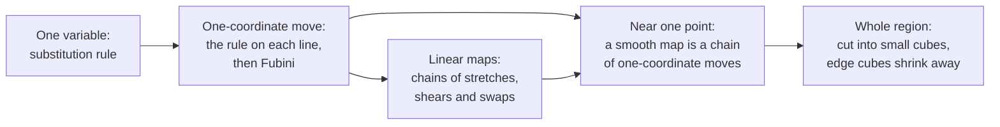

# Change of variables in n dimensions, proved: break the map into moves that change one coordinate at a time

[Syllabus](../../../SYLLABUS.md) → [Calculus and analysis](../README.md) → [Multiple Integrals](../README.md#s08) → Change of variables in n dimensions, proved

---

## General Overview

A drive shaft resists twisting in proportion to its **polar moment of area**: the total of squared distance from the centre line over its cross-section. For a solid round shaft of radius 2 cm it is 8π = 25.132741 cm⁴, found in two lines with polar coordinates and the factor r.

That factor comes from [Change of variables](03-change-of-variables-and-jacobians.md), whose two-dimensional proof only sketched the key estimate. This card proves the rule in full, in any dimension.

The trick: never handle a map all at once. A linear map is a chain of stretches and shears.

The matrix L with rows (2, 1) and (0, 3) is "stretch x by 2 and y by 3, then add y/3 to x". It sends the unit square to a parallelogram of area 2 × 3 × 1 = 6.

A curved map, near each point, also splits into moves that each change one coordinate.

**Near each point, a one-to-one smooth map with nonzero Jacobian determinant is a chain of moves that each change one coordinate; each move obeys the one-variable substitution rule, their factors multiply to the determinant's size, and small pieces carry the rule to the whole region.**

**What kind of fact this is:** a theorem, proved on this card in Why it works, using Fubini's theorem and the inverse function theorem from earlier cards.

### The picture: the shape of the proof



---

## The formula

A **map** $`T`$ sends an address $`u`$, a list of $`n`$ numbers, to a place $`x = T(u)`$. Its **Jacobian matrix** $`J_T(u)`$ holds its partial derivatives ([Chain rule in several variables](../07-Several%20Variables/04-multivariable-chain-rule-and-jacobians.md)). The determinant, det, of a matrix is the signed factor by which it scales volume. A **Jordan region** is a bounded set whose edge has zero content: it can be covered by boxes of total volume as small as wanted ([Jordan content](07-jordan-content-and-fubini-in-n-dimensions.md)).

```math
\int_{T(A)} f(x)\,dx \;=\; \int_A f\big(T(u)\big)\,\big|\det J_T(u)\big|\,du
```

**Read it aloud:** the total of f over the places equals the total over the addresses, each address weighted by f at its place and by the volume factor of the map there.

On the shaft, $`T`$ is polar coordinates, $`f = x^2 + y^2 = r^2`$ and $`\det J_T = r`$:

```math
\int_{x^2+y^2\le 4} (x^2+y^2)\,dx\,dy \;=\; \int_0^{2\pi}\!\!\int_0^2 r^2\cdot r\,dr\,d\theta \;=\; 2\pi \cdot \frac{2^4}{4} \;=\; 8\pi \;=\; 25.132741\ \text{cm}^4
```

| Symbol | Plain meaning | In our example | Push it up and the answer… |
| --- | --- | --- | --- |
| $`n`$, $`k`$ | number of coordinates; the one coordinate a move changes | 2; first x, then y | more coordinates, more moves |
| $`u`$, $`A`$ | an address; the Jordan region of addresses | (r, θ); the rectangle 0 to 2 cm by 0 to 2π | a larger A covers more places |
| $`T`$, $`x`$, $`T(A)`$ | the map; a place it reaches; the places A covers | polar coordinates; (x, y) in cm; the disc of radius 2 cm | — |
| $`f`$ | the quantity totalled | squared distance x² + y², in cm² | the total grows in proportion |
| $`J_T`$, $`\det`$ | matrix of rates; its volume factor | L with det 6; polar with det r | each piece counts more |
| $`L`$, $`S`$, $`H`$, $`c`$ | a linear map; a stretch; a shear; the amount of either | L = H after S; stretch by 2 and 3; shear c = 1/3 | — |
| $`h`$, $`g`$, $`P`$ | the move peeled off; the rest of the map; a swap | (r, θ) to (x, θ); (x, θ) to (x, y); none | — |
| $`\delta`$, $`M`$ | a cube size that fits each cube in one Step 3 neighbourhood; a bound on T's rates | — | smaller δ, more cubes |

### When it holds

- **T is one-to-one on A.** Run θ twice round and every place counts twice: 50.265482 cm⁴, not 25.132741.
- **T has continuous partial derivatives (it is C¹) on an open set holding A and its edge.** Steps 3 and 4 need it.
- **det J_T is nonzero there.** Where it is zero the map can fold or crush. Polar coordinates fail at r = 0 and repeat along θ = 2π. Cut thin strips off those edges, apply the theorem, then let the strips shrink.
- **A is a Jordan region and f is continuous on T(A) and its edge.** Otherwise the Riemann integrals may not exist; wing 10 handles wilder sets.

---

## Why it works

### Step 0: one coordinate at a time is the one-variable rule

**Fubini's theorem** says an n-dimensional integral equals repeated one-dimensional integrals, in any order. A **one-coordinate move** is a C¹ map that changes only coordinate k. It keeps every line along the k-th axis on itself.

On each line it is a one-variable [Substitution](../04-Integrals/03-substitution.md) with factor $`|\partial x_k / \partial u_k|`$: the stretch along that line. That rate is also the move's Jacobian determinant, since every other row is a row of the identity matrix. Fubini adds the lines back up, so the formula holds.

### Step 1: the formula survives chaining

Suppose the formula holds for a map $`h`$ on A and a map $`g`$ on $`h(A)`$. Apply it for g, then h: the factors multiply to $`\lvert\det J_g(h(u))\rvert\,\lvert\det J_h(u)\rvert`$. By the chain rule and the product rule for determinants, that is $`\lvert\det J_{g\circ h}(u)\rvert`$. So a chain of maps that obey the formula obeys it.

### Step 2: linear maps, by elementary matrices

Row reduction (clearing a matrix column by column) writes every invertible matrix as a product of **elementary matrices**. There are three kinds:

- **Stretch** one coordinate by c ≠ 0: a one-coordinate move with factor $`\lvert c\rvert`$.
- **Shear**, add c times one coordinate to another: a one-coordinate move with factor 1. On each line it is a slide.
- **Swap** two coordinates: Fubini in the other order, factor 1.

By Step 1 the formula holds for every invertible linear map. For L the chain is S (two stretches, factors 2 and 3) then H (factor 1). The parallelogram's corners are (0, 0), (2, 0), (3, 3), (1, 3); the shoelace formula, which reads area from corners, gives 6.

### Step 3: near one point, a smooth map is a chain of one-coordinate moves

At a point where $`\det J_T \ne 0`$, peel off one coordinate at a time:

1. Some entry of the first row of $`J_T`$ is nonzero. Swap coordinates so it is $`\partial T_1/\partial u_1`$.
2. Let $`h`$ replace $`u_1`$ by $`T_1(u)`$. This one-coordinate move has a nonzero factor, so the [Inverse and implicit function theorems](../07-Several%20Variables/07-inverse-and-implicit-function-theorems.md) give it a C¹ undo nearby.
3. The rest, $`g = T \circ h^{-1}`$, keeps the first coordinate fixed. Repeat on coordinates 2 to n.

After n rounds T is, near the point, a chain of swaps and one-coordinate moves, so Steps 0 to 2 apply.

In polar coordinates (where $`r > 0`$ and $`\cos\theta > 0`$): move 1 sends (r, θ) to (x, θ) with x = r cos θ: factor cos θ. Move 2 sends (x, θ) to (x, y) with y = x tan θ: factor x / cos²θ. The product is $`\cos\theta \cdot r\cos\theta/\cos^2\theta = r`$.

At r = 1.5 and θ = 0.6, difference quotients give 0.825336 × 1.817442 = 1.500000. Near θ = π/2, where cos θ = 0, the proof peels y first.

<details>
<summary>Detailed proof: the peeling step in n dimensions</summary>

Suppose $`T`$ is C¹ near a point and $`J_T`$ is invertible there. Suppose also that T keeps coordinates 1 to k − 1 fixed. Induct on k; when k − 1 = n, T is the identity.

The rows of $`J_T`$ for the fixed coordinates are rows of the identity matrix. Since $`J_T`$ is invertible, row k has a nonzero entry in some column at or after k. A swap $`P`$ of that column's coordinate with coordinate k makes it the diagonal entry. Swaps are linear, with factor 1.

Define the move

$`\displaystyle h(u) = \big(u_1, \dots, u_{k-1},\ (T\circ P)_k(u),\ u_{k+1}, \dots, u_n\big).`$

Its Jacobian is the identity except row k, so $`\det J_h = \partial (T\circ P)_k/\partial u_k \ne 0`$ at the point. The inverse function theorem gives a C¹ undo $`h^{-1}`$ near the image point.

Let $`g = T\circ P\circ h^{-1}`$. Its coordinate k is $`(T\circ P)_k(h^{-1}(v)) = v_k`$, and its first k − 1 coordinates are still fixed. So g fixes one more coordinate than T. The induction gives g as a chain, and $`T = g\circ h\circ P^{-1}`$ near the point.

</details>

### Step 4: the whole region, by cutting into small cubes

Halving every side of a box at once, as in [Compactness of [a, b]](../01-Limits%20and%20Continuity/09-compactness-of-closed-intervals.md), gives a size δ: every cube of side under δ meeting A or its edge fits in one Step 3 neighbourhood.

Grid space with such cubes. On each cube inside A the formula holds, and integrals add over cubes that meet only along faces. The cubes touching A's edge have total volume that shrinks to zero, and so do their images. Let the grid shrink: both sides agree.

<details>
<summary>Detailed proof: why the edge cubes do not matter</summary>

Let $`M`$ bound every entry of $`J_T`$ on a closed, bounded neighbourhood of A and its edge where T is still C¹; for small δ it holds every edge cube. By the mean value theorem on each coordinate, T sends a cube into a cube at most nM times as wide. So T multiplies the total volume of any cover by cubes by at most $`(nM)^n`$.

The cubes inside A miss at most the edge cubes, and their images miss at most $`(nM)^n`$ times the edge cubes' volume. On the inside cubes the two sides agree exactly. So the sides differ by at most a constant, built from the largest sizes of f and det J_T, times the edge cubes' volume. That volume tends to zero, because the edge has zero content.

</details>

The code takes this step literally: it measures each image cell by the shoelace formula, with no Jacobian. With 40 × 160 cells the sum is 25.124786, closing on 8π.

---

## Worked numbers, by hand

The plate is the unit square, in cm, sent through L. Its polar moment about the corner (0, 0) totals x² + y² over it.

| Step | Arithmetic | Value |
| --- | --- | --- |
| det of the stretch S | 2 × 3 | 6 |
| det of the shear H | 1 × 1 − (1/3) × 0 | 1 |
| det L | 6 × 1 | 6 |
| L(u, v) | (2u + v, 3v) | — |
| x² + y² in addresses | (2u + v)² + 9v² = 4u² + 4uv + 10v² | — |
| over the unit square | 4/3 + 4 × 1/4 + 10/3 | 17/3 |
| plate's polar moment | 6 × 17/3 | **34 cm⁴** |
| shaft, f times factor | r² × r = r³ | — |
| radial total | 2⁴ / 4 | 4 |
| shaft's polar moment | 2π × 4 | **8π = 25.132741 cm⁴** |

Blind grids, which never use a determinant, give 34.022976 on the plate and 25.132456 on the disc.

### What breaks if you drop a piece

| Mistake | Comes out at | What went wrong |
| --- | --- | --- |
| factor r dropped | 16.755161 cm⁴ | address area taken for ground area |
| side lengths multiplied instead of det | 6.324555 cm², not 6 | the det measures the lean |
| θ run twice round | 50.265482 cm⁴ | the map is not one-to-one |
| factor 1/r, from the inverse map | 12.566371 cm⁴ | the factor belongs to the map from addresses |

---

## Code, from first principles, and it actually runs

The code takes four independent roads. Road 1 builds L from its stretch and shear and reads the area from the corners. Road 2 totals x² + y² on blind grids of small squares, with no determinant. Road 3 is Step 4: image cells measured by the shoelace formula. Road 4 is Step 3: polar coordinates as two one-coordinate moves, their factors found by difference quotients.

### Python

```python
# Change of variables, proved -- the check behind the card.  Standard library only.
# Linear case: L = shear after stretch.  Then the polar moment of a disc, radius 2 cm, by
# polar coordinates, by a blind x-y grid, by cutting into pieces, and by two one-coordinate moves.
import math
PI = math.pi
mul = lambda A, B: [[sum(A[i][k] * B[k][j] for k in range(2)) for j in range(2)] for i in range(2)]
det = lambda M: M[0][0] * M[1][1] - M[0][1] * M[1][0]
def shoelace(pts):                              # area of a polygon from its corners, in order
    return sum(x1 * y2 - x2 * y1 for (x1, y1), (x2, y2) in zip(pts, pts[1:] + pts[:1])) / 2
def simpson(f, a, b, n=200):                    # Simpson's rule on n (even) strips
    h, s = (b - a) / n, f(a) + f(b)
    return (s + sum((4 if k % 2 else 2) * f(a + k * h) for k in range(1, n))) * h / 3
def grid(f, inside, lo, hi, n):                 # midpoint cells on a square box, kept if inside
    h = (hi - lo) / n
    pts = ((lo + (i + 0.5) * h, lo + (j + 0.5) * h) for i in range(n) for j in range(n))
    return sum(f(x, y) for x, y in pts if inside(x, y)) * h * h
f = lambda x, y: x * x + y * y                  # squared distance from the axis, cm^2
S, H = [[2, 0], [0, 3]], [[1, 1 / 3], [0, 1]]   # stretch x by 2 and y by 3; shear x + y/3
L = mul(H, S)
sq = [(0, 0), (1, 0), (1, 1), (0, 1)]
Lx = lambda u, v: (L[0][0] * u + L[0][1] * v, L[1][0] * u + L[1][1] * v)
par = [Lx(u, v) for u, v in sq]
PL, swp = mul([[0, 1], [1, 0]], L), [(b, a) for a, b in par]   # a swap after L: not triangular, so det's sign is tested
def ins(x, y):                                  # pull the point back by L inverse, test the square
    u, v = (L[1][1] * x - L[0][1] * y) / det(L), (L[0][0] * y - L[1][0] * x) / det(L)
    return 0 <= u <= 1 and 0 <= v <= 1
print(f"L = shear x stretch: rows ({L[0][0]:g}, {L[0][1]:g}), ({L[1][0]:g}, {L[1][1]:g}); det stretch {det(S):g}, det shear {det(H):g}, det L {det(L):.6f}")
print("image of the unit square: corners", " ".join(f"({a:g}, {b:g})" for a, b in par) + ";", f"area by shoelace {shoelace(par):.6f}; after a swap {shoelace(swp):.6f}, det {det(PL):g}")
print(f"mistake, side lengths multiplied: {math.hypot(L[0][0], L[1][0]) * math.hypot(L[0][1], L[1][1]):.6f}")
lin_grid = grid(f, ins, -0.001, 3.001, 600)     # box padded 0.001 cm, so no cell centre sits on an edge
lin_sq = abs(det(L)) * simpson(lambda u: simpson(lambda v: f(*Lx(u, v)), 0, 1), 0, 1)
print(f"polar moment of the plate about its corner: x-y grid {lin_grid:.6f}; square x 6 {lin_sq:.6f}; by hand 6 x 17/3 = 34")
polar = simpson(lambda t: simpson(lambda r: r ** 3, 0, 2), 0, 2 * PI)
print(f"disc radius 2: polar with factor r {polar:.6f}; by hand 2 pi x 4 = {8 * PI:.6f}")
for n in (200, 800):
    g = grid(f, lambda x, y: x * x + y * y <= 4, -2, 2, n)
    print(f"x-y grid {n} a side, blind to r: {g:.6f}, error {g - 8 * PI:+.6f}")
def pieces(nr, nt, m=8):                        # sum f(T(centre)) x shoelace area of T(cell)
    s, dr, dt = 0.0, 2 / nr, 2 * PI / nt
    for i in range(nr):
        for j in range(nt):
            r0, t0 = i * dr, j * dt
            edge = [(r0 + dr * k / m, t0) for k in range(m)] + [(r0 + dr, t0 + dt * k / m) for k in range(m)]
            edge += [(r0 + dr - dr * k / m, t0 + dt) for k in range(m)] + [(r0, t0 + dt - dt * k / m) for k in range(m)]
            s += (r0 + dr / 2) ** 2 * shoelace([(r * math.cos(t), r * math.sin(t)) for r, t in edge])
    return s
cut = [pieces(n, 4 * n) for n in (10, 40)]
print(f"cut into pieces, no Jacobian used: 10 x 40 cells {cut[0]:.6f}; 40 x 160 cells {cut[1]:.6f}")
d = 1e-6
r, t = 1.5, 0.6                                 # one address; factor polar into two moves
x = r * math.cos(t)
m1 = (math.cos(t) * (r + d) - math.cos(t) * (r - d)) / (2 * d)             # (r, t) -> (x, t)
m2 = (x * math.tan(t + d) - x * math.tan(t - d)) / (2 * d)                 # (x, t) -> (x, x tan t)
print(f"at r {r}, theta {t}: move 1 det {m1:.6f}, move 2 det {m2:.6f}, product {m1 * m2:.6f} = r")
print(f"mistakes: factor r dropped {simpson(lambda t: simpson(lambda r: r * r, 0, 2), 0, 2 * PI):.6f}; theta run twice round {2 * polar:.6f}; factor 1/r {4 * PI:.6f}")
assert abs(shoelace(par) - det(S) * det(H)) < 1e-12 and abs(det(L) - 6) < 1e-12 and abs(shoelace(swp) - det(PL)) < 1e-12
assert abs(lin_grid - 34) < 0.05 and abs(lin_sq - 34) < 1e-9    # plate: blind grid meets the square
assert abs(polar - 8 * PI) < 1e-9 and abs(g - 8 * PI) < 0.01    # disc: polar meets the blind grid
assert abs(cut[1] - 8 * PI) < 0.01 and abs(m1 * m2 - r) < 1e-6  # pieces close in; moves multiply to r
print("ALL CHECKS PASS")
```

**Ran 2026-11-23 on macOS, Python 3.14.10, standard library only. All checks passed. Output, pasted from the run:**

```
L = shear x stretch: rows (2, 1), (0, 3); det stretch 6, det shear 1, det L 6.000000
image of the unit square: corners (0, 0) (2, 0) (3, 3) (1, 3); area by shoelace 6.000000; after a swap -6.000000, det -6
mistake, side lengths multiplied: 6.324555
polar moment of the plate about its corner: x-y grid 34.022976; square x 6 34.000000; by hand 6 x 17/3 = 34
disc radius 2: polar with factor r 25.132741; by hand 2 pi x 4 = 25.132741
x-y grid 200 a side, blind to r: 25.152036, error +0.019295
x-y grid 800 a side, blind to r: 25.132456, error -0.000285
cut into pieces, no Jacobian used: 10 x 40 cells 25.005471; 40 x 160 cells 25.124786
at r 1.5, theta 0.6: move 1 det 0.825336, move 2 det 1.817442, product 1.500000 = r
mistakes: factor r dropped 16.755161; theta run twice round 50.265482; factor 1/r 12.566371
ALL CHECKS PASS
```

### Rust

```rust
// Change of variables, proved -- the same check in Rust, std only.
// Linear case: L = shear after stretch.  Then the polar moment of a disc, radius 2 cm, by
// polar coordinates, by a blind x-y grid, by cutting into pieces, and by two one-coordinate moves.
use std::f64::consts::PI;
type M = [[f64; 2]; 2];
fn mul(a: &M, b: &M) -> M {
    let mut c = [[0.0; 2]; 2];
    for i in 0..2 { for j in 0..2 { c[i][j] = a[i][0] * b[0][j] + a[i][1] * b[1][j]; } }
    c
}
fn det(m: &M) -> f64 { m[0][0] * m[1][1] - m[0][1] * m[1][0] }
fn shoelace(p: &[(f64, f64)]) -> f64 {           // area of a polygon from its corners, in order
    (0..p.len()).map(|k| { let (a, b) = (p[k], p[(k + 1) % p.len()]); a.0 * b.1 - b.0 * a.1 }).sum::<f64>() / 2.0
}
fn simpson(f: &dyn Fn(f64) -> f64, a: f64, b: f64) -> f64 {   // Simpson's rule on 200 strips
    let (n, s) = (200, f(a) + f(b));
    let h = (b - a) / n as f64;
    (s + (1..n).map(|k| if k % 2 == 1 { 4.0 } else { 2.0 } * f(a + k as f64 * h)).sum::<f64>()) * h / 3.0
}
fn grid(f: &dyn Fn(f64, f64) -> f64, inside: &dyn Fn(f64, f64) -> bool, lo: f64, hi: f64, n: usize) -> f64 {
    let (h, mut s) = ((hi - lo) / n as f64, 0.0);  // midpoint cells on a square box, kept if inside
    for i in 0..n { for j in 0..n {
        let (x, y) = (lo + (i as f64 + 0.5) * h, lo + (j as f64 + 0.5) * h);
        if inside(x, y) { s += f(x, y); }
    } }
    s * h * h
}
fn f(x: f64, y: f64) -> f64 { x * x + y * y }    // squared distance from the axis, cm^2
fn pieces(nr: usize, nt: usize) -> f64 {         // sum f(T(centre)) x shoelace area of T(cell)
    let (m, mut s, dr, dt) = (8, 0.0, 2.0 / nr as f64, 2.0 * PI / nt as f64);
    for i in 0..nr { for j in 0..nt {
        let (r0, t0) = (i as f64 * dr, j as f64 * dt);
        let mut e: Vec<(f64, f64)> = (0..m).map(|k| (r0 + dr * k as f64 / m as f64, t0)).collect();
        e.extend((0..m).map(|k| (r0 + dr, t0 + dt * k as f64 / m as f64)));
        e.extend((0..m).map(|k| (r0 + dr - dr * k as f64 / m as f64, t0 + dt)));
        e.extend((0..m).map(|k| (r0, t0 + dt - dt * k as f64 / m as f64)));
        let pts: Vec<(f64, f64)> = e.iter().map(|&(r, t)| (r * t.cos(), r * t.sin())).collect();
        s += (r0 + dr / 2.0).powi(2) * shoelace(&pts);
    } }
    s
}
fn main() {
    let (s, h): (M, M) = ([[2.0, 0.0], [0.0, 3.0]], [[1.0, 1.0 / 3.0], [0.0, 1.0]]);   // stretch; shear
    let l = mul(&h, &s);
    let par: Vec<(f64, f64)> = [(0.0, 0.0), (1.0, 0.0), (1.0, 1.0), (0.0, 1.0)].iter()
        .map(|&(u, v)| (l[0][0] * u + l[0][1] * v, l[1][0] * u + l[1][1] * v)).collect();
    let (pl, swp): (M, Vec<(f64, f64)>) = (mul(&[[0.0, 1.0], [1.0, 0.0]], &l), par.iter().map(|&(a, b)| (b, a)).collect());  // a swap after L: not triangular
    println!("L = shear x stretch: rows ({}, {}), ({}, {}); det stretch {}, det shear {}, det L {:.6}", l[0][0], l[0][1], l[1][0], l[1][1], det(&s), det(&h), det(&l));
    let c: Vec<String> = par.iter().map(|&(a, b)| format!("({}, {})", a, b)).collect();
    println!("image of the unit square: corners {}; area by shoelace {:.6}; after a swap {:.6}, det {}", c.join(" "), shoelace(&par), shoelace(&swp), det(&pl));
    println!("mistake, side lengths multiplied: {:.6}", l[0][0].hypot(l[1][0]) * l[0][1].hypot(l[1][1]));
    let ins = |x: f64, y: f64| {                  // pull the point back by L inverse, test the square
        let (u, v) = ((l[1][1] * x - l[0][1] * y) / det(&l), (l[0][0] * y - l[1][0] * x) / det(&l));
        0.0 <= u && u <= 1.0 && 0.0 <= v && v <= 1.0
    };
    let lin_grid = grid(&f, &ins, -0.001, 3.001, 600);  // box padded 0.001 cm, so no cell centre sits on an edge
    let lin_sq = det(&l).abs() * simpson(&|u| simpson(&|v| f(l[0][0] * u + l[0][1] * v, l[1][0] * u + l[1][1] * v), 0.0, 1.0), 0.0, 1.0);
    println!("polar moment of the plate about its corner: x-y grid {:.6}; square x 6 {:.6}; by hand 6 x 17/3 = 34", lin_grid, lin_sq);
    let polar = simpson(&|_t| simpson(&|r| r.powi(3), 0.0, 2.0), 0.0, 2.0 * PI);
    println!("disc radius 2: polar with factor r {:.6}; by hand 2 pi x 4 = {:.6}", polar, 8.0 * PI);
    let mut g = 0.0;
    for n in [200usize, 800] {
        g = grid(&f, &|x, y| x * x + y * y <= 4.0, -2.0, 2.0, n);
        println!("x-y grid {} a side, blind to r: {:.6}, error {:+.6}", n, g, g - 8.0 * PI);
    }
    let cut = [pieces(10, 40), pieces(40, 160)];
    println!("cut into pieces, no Jacobian used: 10 x 40 cells {:.6}; 40 x 160 cells {:.6}", cut[0], cut[1]);
    let (d, r, t) = (1e-6, 1.5f64, 0.6f64);      // one address; factor polar into two moves
    let x = r * t.cos();
    let m1 = (t.cos() * (r + d) - t.cos() * (r - d)) / (2.0 * d);           // (r, t) -> (x, t)
    let m2 = (x * (t + d).tan() - x * (t - d).tan()) / (2.0 * d);           // (x, t) -> (x, x tan t)
    println!("at r {}, theta {}: move 1 det {:.6}, move 2 det {:.6}, product {:.6} = r", r, t, m1, m2, m1 * m2);
    println!("mistakes: factor r dropped {:.6}; theta run twice round {:.6}; factor 1/r {:.6}", simpson(&|_t| simpson(&|r| r * r, 0.0, 2.0), 0.0, 2.0 * PI), 2.0 * polar, 4.0 * PI);
    assert!((shoelace(&par) - det(&s) * det(&h)).abs() < 1e-12 && (det(&l) - 6.0).abs() < 1e-12 && (shoelace(&swp) - det(&pl)).abs() < 1e-12);
    assert!((lin_grid - 34.0).abs() < 0.05 && (lin_sq - 34.0).abs() < 1e-9);    // plate: blind grid meets the square
    assert!((polar - 8.0 * PI).abs() < 1e-9 && (g - 8.0 * PI).abs() < 0.01);    // disc: polar meets the blind grid
    assert!((cut[1] - 8.0 * PI).abs() < 0.01 && (m1 * m2 - r).abs() < 1e-6);  // pieces close in; moves multiply to r
    println!("ALL CHECKS PASS");
}
```

**Ran 2026-11-23 on macOS, rustc 1.98.1, no crates. All checks passed. Output, pasted from the run:**

```
L = shear x stretch: rows (2, 1), (0, 3); det stretch 6, det shear 1, det L 6.000000
image of the unit square: corners (0, 0) (2, 0) (3, 3) (1, 3); area by shoelace 6.000000; after a swap -6.000000, det -6
mistake, side lengths multiplied: 6.324555
polar moment of the plate about its corner: x-y grid 34.022976; square x 6 34.000000; by hand 6 x 17/3 = 34
disc radius 2: polar with factor r 25.132741; by hand 2 pi x 4 = 25.132741
x-y grid 200 a side, blind to r: 25.152036, error +0.019295
x-y grid 800 a side, blind to r: 25.132456, error -0.000285
cut into pieces, no Jacobian used: 10 x 40 cells 25.005471; 40 x 160 cells 25.124786
at r 1.5, theta 0.6: move 1 det 0.825336, move 2 det 1.817442, product 1.500000 = r
mistakes: factor r dropped 16.755161; theta run twice round 50.265482; factor 1/r 12.566371
ALL CHECKS PASS
```

The blind grids converge slowly: squares cut by the edge are kept or dropped whole.

### Lean

Lean proves the theorem in any number of dimensions, the linear case for every matrix, and the shaft's exact polar moment.

- Take a map $`T`$, a region $`A`$ and a function $`f`$ meeting the conditions in When it holds. Then the total of $`f`$ over $`T(A)`$ equals the total over $`A`$, weighted by $`\lvert\det J_T\rvert`$.
- Take any $`n \times n`$ matrix $`L`$ and any set of addresses. Then $`L`$ sends it to a set with $`\lvert\det L\rvert`$ times its volume.
- The total of x² + y² over the shaft's cross-section, the disc x² + y² ≤ 4, is exactly 8π.
- The hand arithmetic holds exactly: L is the shear after the stretch, and the dets are 6, 1, 6 and −6. The shoelace area is 6, the plate's moment 34, the radial total 4, and multiplied side lengths give √40, not 6.

The decimals, blind grids, sums over cut pieces, difference quotients and other mistake values are left to the Python and Rust checks.

```lean
-- Change of variables in n dimensions, proved: for a one-to-one C¹ map with nonzero Jacobian determinant on a Jordan region, the total of a continuous f over the places equals the total over the addresses weighted by |det J_T|, a linear map scales every volume by |det L|, and the round shaft's polar moment is exactly 8π.
import Mathlib.MeasureTheory.Function.Jacobian
import Mathlib.MeasureTheory.Measure.Lebesgue.EqHaar
import Mathlib.Analysis.SpecialFunctions.PolarCoord
import Mathlib.Analysis.Calculus.ContDiff.Defs
import Mathlib.LinearAlgebra.Matrix.ToLin
import Mathlib.LinearAlgebra.Matrix.Determinant.Basic
import Mathlib.Tactic.NormNum
import Mathlib.Tactic.Ring
import Mathlib.Tactic.FinCases
import Mathlib.MeasureTheory.Integral.Prod
import Mathlib.Analysis.SpecialFunctions.Integrals.Basic

open MeasureTheory Set Real

/-- **Change of variables in n dimensions.** A map T sends an address u, a list of n numbers,
to a place T(u). Its Jacobian matrix J_T(u) holds its partial derivatives: the entry in row i,
column j is ∂T_i/∂u_j, which is Mathlib's `LinearMap.toMatrix'` of the derivative
`fderiv ℝ T u`. Suppose:
* T is one-to-one on A;
* T has continuous partial derivatives (it is C¹) on an open set U holding A and its edge;
* det J_T is nonzero on U;
* A is a Jordan region: it is bounded and its edge has zero content (the edge is closed and
  bounded, so zero content is the same as zero volume);
* f is continuous on the places T covers from A and its edge.
Then the total of f over the places equals the total over the addresses, each address weighted
by f at its place and by the size of the Jacobian determinant there:
∫ over T(A) of f(x) dx = ∫ over A of f(T(u)) · |det J_T(u)| du. -/
theorem integral_image_eq_integral_comp_mul_abs_det_jacobian_jordan {n : ℕ}
    (T : (Fin n → ℝ) → (Fin n → ℝ)) (A U : Set (Fin n → ℝ)) (f : (Fin n → ℝ) → ℝ)
    (hinj : InjOn T A)
    (hU : IsOpen U) (hAU : closure A ⊆ U) (hT : ContDiffOn ℝ 1 T U)
    (hdet : ∀ u ∈ U,
      (LinearMap.toMatrix' (fderiv ℝ T u : (Fin n → ℝ) →ₗ[ℝ] (Fin n → ℝ))).det ≠ 0)
    (hA : Bornology.IsBounded A) (hedge : volume (frontier A) = 0)
    (hf : ContinuousOn f (T '' closure A)) :
    ∫ x in T '' A, f x =
      ∫ u in A, f (T u) *
        |(LinearMap.toMatrix' (fderiv ℝ T u : (Fin n → ℝ) →ₗ[ℝ] (Fin n → ℝ))).det| := by
  have hdiff : DifferentiableOn ℝ T U := hT.differentiableOn one_ne_zero
  -- A and its interior differ by a subset of the edge
  have hsub : A \ interior A ⊆ frontier A := by
    intro x ⟨hxA, hxi⟩; exact ⟨subset_closure hxA, hxi⟩
  have hAe : (interior A : Set _) =ᵐ[volume] A := by
    refine (ae_eq_set).2 ⟨by simp [sdiff_eq_empty.2 interior_subset], ?_⟩
    exact measure_mono_null hsub hedge
  have hfrU : frontier A ⊆ U := (frontier_subset_closure).trans hAU
  have himg_null : volume (T '' (A \ interior A)) = 0 := by
    have h0 : volume (A \ interior A) = 0 := measure_mono_null hsub hedge
    exact addHaar_image_eq_zero_of_differentiableOn_of_addHaar_eq_zero volume
      (hdiff.mono (hsub.trans hfrU)) h0
  have hTe : (T '' interior A : Set _) =ᵐ[volume] T '' A := by
    refine (ae_eq_set).2 ⟨by simp [sdiff_eq_empty.2 (image_mono interior_subset)], ?_⟩
    refine measure_mono_null ?_ himg_null
    rintro y ⟨⟨x, hxA, rfl⟩, hy⟩
    exact ⟨x, ⟨hxA, fun hxi => hy ⟨x, hxi, rfl⟩⟩, rfl⟩
  rw [← setIntegral_congr_set hTe, ← setIntegral_congr_set hAe]
  have hder : ∀ x ∈ interior A, HasFDerivWithinAt T (fderiv ℝ T x) (interior A) x := by
    intro x hx
    have hxU : x ∈ U := hAU (subset_closure (interior_subset hx))
    exact ((hdiff x hxU).differentiableAt (hU.mem_nhds hxU)).hasFDerivAt.hasFDerivWithinAt
  rw [integral_image_eq_integral_abs_det_fderiv_smul volume isOpen_interior.measurableSet hder
    (hinj.mono interior_subset)]
  refine integral_congr_ae (Filter.Eventually.of_forall fun u => ?_)
  simp only [smul_eq_mul, LinearMap.det_toMatrix', ContinuousLinearMap.det]
  ring

/-- **Linear maps scale volume by the size of the determinant.** For every n × n matrix L,
the linear map u ↦ L u sends any set A of addresses to a set whose volume is |det L| times the
volume of A. For the card's L, with rows (2, 1) and (0, 3), the unit square goes to a
parallelogram of area 6. -/
theorem volume_linear_image_eq_abs_det_mul {n : ℕ} (L : Matrix (Fin n) (Fin n) ℝ)
    (A : Set (Fin n → ℝ)) :
    volume (Matrix.toLin' L '' A) = ENNReal.ofReal |L.det| * volume A := by
  rw [Measure.addHaar_image_linearMap, LinearMap.det_toLin']

/-- **The shaft's polar moment.** The total of the squared distance x² + y² over the solid
round cross-section of radius 2 (the points with x² + y² ≤ 4) is exactly 8π: in polar
coordinates it is the integral of r² · r = r³, which is 2π × 2⁴/4. -/
theorem shaft_polar_moment :
    ∫ p in {p : ℝ × ℝ | p.1 ^ 2 + p.2 ^ 2 ≤ 4}, (p.1 ^ 2 + p.2 ^ 2) = 8 * π := by
  rw [← integral_indicator (measurableSet_le (by fun_prop) (by fun_prop)),
    ← integral_comp_polarCoord_symm, polarCoord_target]
  have key : ∀ q ∈ Ioi (0:ℝ) ×ˢ Ioo (-π) π,
      q.1 • ({p : ℝ × ℝ | p.1 ^ 2 + p.2 ^ 2 ≤ 4}.indicator (fun p => p.1 ^ 2 + p.2 ^ 2))
        (polarCoord.symm q) = (Iic (2:ℝ)).indicator (fun r => r ^ 3) q.1 * (1:ℝ) := by
    rintro ⟨r, θ⟩ ⟨hr, -⟩
    simp only [mem_Ioi] at hr
    have h : (r * cos θ) ^ 2 + (r * sin θ) ^ 2 = r ^ 2 := by
      have := sin_sq_add_cos_sq θ; nlinarith
    simp only [polarCoord_symm_apply, indicator, mem_ofPred_eq, mem_Iic, h, smul_eq_mul, mul_one]
    by_cases h2 : r ≤ 2
    · have : r ^ 2 ≤ 4 := by nlinarith
      simp [h2, this]; ring
    · have : ¬ r ^ 2 ≤ 4 := by nlinarith
      simp [h2, this]
  have hp := setIntegral_prod_mul (μ := (volume : Measure ℝ)) (ν := (volume : Measure ℝ))
    ((Iic (2:ℝ)).indicator (fun r => r ^ 3)) (fun _ : ℝ => (1:ℝ)) (Ioi 0) (Ioo (-π) π)
  rw [setIntegral_congr_fun (measurableSet_Ioi.prod measurableSet_Ioo) key,
    Measure.volume_eq_prod, hp]
  rw [setIntegral_indicator measurableSet_Iic, setIntegral_const]
  have hI : Ioi (0:ℝ) ∩ Iic 2 = Ioc 0 2 := Ioi_inter_Iic
  rw [hI, ← intervalIntegral.integral_of_le (by norm_num), integral_pow]
  simp [Real.volume_real_Ioo_of_le (by linarith [pi_pos] : -π ≤ π)]
  ring

-- L is the shear (add y/3 to x) after the stretch (x by 2, y by 3).
example : !![(1 : ℚ), 1 / 3; 0, 1] * !![2, 0; 0, 3] = !![2, 1; 0, 3] := by
  ext i j; fin_cases i <;> fin_cases j <;> norm_num [Matrix.mul_apply, Fin.sum_univ_two]
-- det of the stretch S is 2 × 3 = 6, det of the shear H is 1, det L is 6.
example : Matrix.det !![(2 : ℚ), 0; 0, 3] = 6 := by norm_num [Matrix.det_fin_two_of]
example : Matrix.det !![(1 : ℚ), 1 / 3; 0, 1] = 1 := by norm_num [Matrix.det_fin_two_of]
example : Matrix.det !![(2 : ℚ), 1; 0, 3] = 6 := by norm_num [Matrix.det_fin_two_of]
-- A swap after L has det -6.
example : Matrix.det !![(0 : ℚ), 3; 2, 1] = -6 := by norm_num [Matrix.det_fin_two_of]
-- Shoelace on the corners (0, 0), (2, 0), (3, 3), (1, 3) gives area 6.
example : ((0 * 0 - 2 * 0) + (2 * 3 - 3 * 0) + (3 * 3 - 1 * 3) + (1 * 0 - 0 * 3) : ℚ) / 2 = 6 := by
  norm_num
-- Mistake: side lengths multiplied give √4 × √10 = √40, not 6, since 4 × 10 ≠ 6².
example : (2 ^ 2 + 0 ^ 2) * (1 ^ 2 + 3 ^ 2) ≠ (6 : ℕ) ^ 2 := by norm_num
-- x² + y² in addresses: (2u + v)² + 9v² = 4u² + 4uv + 10v².
example (u v : ℚ) : (2 * u + v) ^ 2 + (3 * v) ^ 2 = 4 * u ^ 2 + 4 * u * v + 10 * v ^ 2 := by ring
-- Over the unit square: 4/3 + 4 × 1/4 + 10/3 = 17/3; the plate's polar moment is 6 × 17/3 = 34.
example : (4 / 3 + 4 * (1 / 4) + 10 / 3 : ℚ) = 17 / 3 := by norm_num
example : (6 * (17 / 3) : ℚ) = 34 := by norm_num
-- Shaft: the radial total 2⁴/4 is 4.
example : ((2 : ℚ) ^ 4 / 4) = 4 := by norm_num

#print axioms integral_image_eq_integral_comp_mul_abs_det_jacobian_jordan
#print axioms volume_linear_image_eq_abs_det_mul
#print axioms shaft_polar_moment
```

**Checked 2026-11-23 on macOS, Lean 4.36.0-rc2, Mathlib v4.36.0-rc2. Every proof is complete and uses only Lean's standard axioms. Output, pasted from the run:**

```
'integral_image_eq_integral_comp_mul_abs_det_jacobian_jordan' depends on axioms: [propext, Classical.choice, Quot.sound]
'volume_linear_image_eq_abs_det_mul' depends on axioms: [propext, Classical.choice, Quot.sound]
'shaft_polar_moment' depends on axioms: [propext, Classical.choice, Quot.sound]
```

> [!TIP]
> **Try changing**
>
> - Guess first: change the shear in `H` from 1/3 to 1/2. The area stays 6, since a shear has det 1, but the moment moves off 34 and the second assert fails.
> - Guess first: write `r ** 2` in `polar`. It prints 16.755161 and the third assert fails.
> - Guess first: set `t = 1.5`, near a right angle. Move 1's factor falls toward 0, move 2's grows to match, and the product stays 1.5.

---

## The usual mistake

> [!warning]
> **Treating the local estimate as the proof.** "A small cube lands with volume about det times its own" is true, but its errors must be summed over many cubes, and the edge cubes must vanish. This proof does both.
>
> - **Multiplying side lengths.** For L that gives 6.324555, not 6.
> - **Forgetting one-to-one.** θ run twice round gives 50.265482 cm⁴.
> - **The inverse map's factor.** 1/r gives 12.566371 cm⁴.
> - **Peeling where the rate is zero.** Move 1 fails at θ = π/2; there the proof peels the other coordinate first.

---

## Where you meet it in real life

- **Shafts and beams.** Moments of area for round and hollow sections come from coordinate changes.
- **Probability.** Transforming random numbers multiplies their density by a Jacobian factor; simulations and generative models rely on it.
- **Finite element software.** Each curved element is integrated on a reference square through a map, weighted by its Jacobian determinant.

> **Say it back**
> The formula weights each address by the size of the map's Jacobian determinant. A one-coordinate move obeys it by the one-variable rule on each line. Linear maps are chains of stretches, shears and swaps; smooth maps are such chains near each point. Small cubes carry it to the whole region, because the edge has zero content. The plate has area 6 and moment 34 cm⁴; the shaft has 25.132741 cm⁴.

---

## What this builds on

- [Change of variables](03-change-of-variables-and-jacobians.md): the formula, the standard factors, and the two-dimensional sketch completed here.
- [Jordan content](07-jordan-content-and-fubini-in-n-dimensions.md): zero-content edges and Fubini in n dimensions, used in Steps 0 and 4.
- [Inverse and implicit function theorems](../07-Several%20Variables/07-inverse-and-implicit-function-theorems.md): the C¹ undo of each one-coordinate move in Step 3.

## Where this goes next

- [Improper integrals with a dial](09-uniform-convergence-of-improper-integrals.md): integrals over an infinite range that carry a dial, and the test that lets limits and derivatives pass inside.
- [Pullback](../../23-Differential%20geometry%20and%20Lie%20groups/04-Differential%20Forms/02-pullback-and-change-of-variables.md): the same theorem with the sign of the determinant kept, written in differential forms.
- [Change of variables for Lebesgue measure](../../10-Measure%20and%20integration/06-Product%20Measures%20and%20Fubini/08-lebesgue-change-of-variables-and-polar-coordinates.md): a linear map scales every volume by |det A|, a smooth map does so point by point, and polar coordinates follow.

This card needs a Jordan region and the Riemann integral; how far the formula reaches on wilder or unbounded regions is a question for the Lebesgue integral above, while the next card on this shelf handles unbounded intervals with a parameter in the Riemann setting.

---

## Sources

Verified 2026-11-23: every link below resolves to the publisher's page.

- Spivak, Michael. *Calculus on Manifolds*. CRC Press (first published 1965). [Publisher page](https://www.routledge.com/Calculus-On-Manifolds-A-Modern-Approach-To-Classical-Theorems-Of-Advanced-Calculus/Spivak/p/book/9780805390216). Chapter 3, Theorem 3-13: the proof by induction on dimension, splitting off one coordinate.
- Munkres, James R. *Analysis on Manifolds*. CRC Press (first published 1991). [Publisher page](https://www.routledge.com/Analysis-On-Manifolds/Munkres/p/book/9780201315967). Chapter 4: the full proof for Riemann integrals by primitive maps.
- Lax, Peter D. "Change of variables in multiple integrals." *The American Mathematical Monthly* 106 (1999), 497–501. [DOI 10.1080/00029890.1999.12005078](https://doi.org/10.1080/00029890.1999.12005078). A short different proof.
- Strang, Gilbert, Edwin Herman, et al. *Calculus Volume 3*, OpenStax. [Section 5.7, Change of Variables in Multiple Integrals](https://openstax.org/books/calculus-volume-3/pages/5-7-change-of-variables-in-multiple-integrals). The formula and worked examples.
