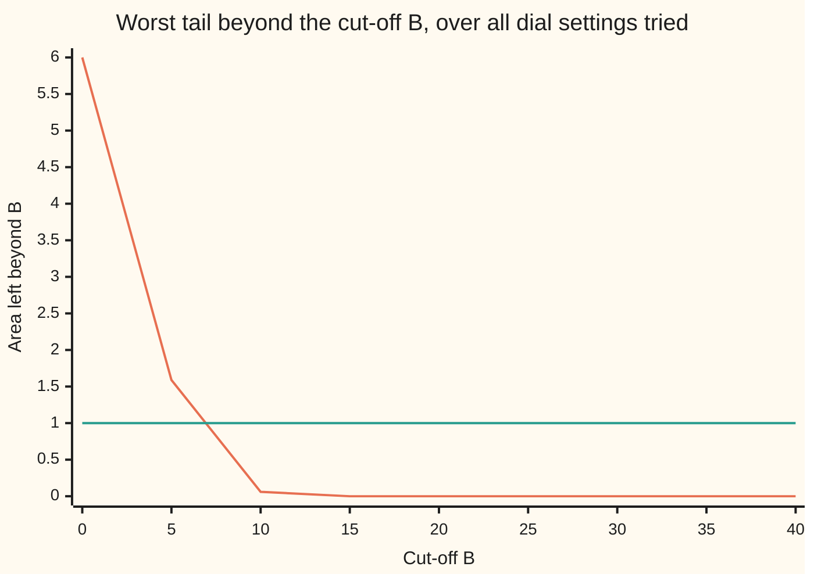

# Improper integrals with a dial: the Weierstrass test that lets limits and derivatives pass inside

[Syllabus](../../../SYLLABUS.md) → [Calculus and analysis](../README.md) → [Multiple Integrals](../README.md#s08) → Improper integrals with a dial

---

## General Overview

The curve x^3 e^(-tx) has a dial t in its exponent. At t = 1 its area from 0 to infinity is 6; at t = 2, 0.375. Both come from 6/t^4, found on [Differentiating under the integral](05-differentiating-under-the-integral.md) by differentiating 1/t three times.

That card's theorem needs a finite range; it bounded this curve's far end by hand. In general the tail (the area beyond a far cut-off) must shrink for every dial setting at once.

The fix is a **cap**: one curve, free of the dial, above the integrand (the curve integrated) at every setting. For t at least 1, x^3 e^(-tx) never rises above x^3 e^(-x), whose area is 6. Beyond x = 20 the cap holds only 0.0000192 of area, so no setting hides more there.

Without a cap, cancellation can work. The integral of e^(-tx) sin x / x is π/2 − arctan t. A tail bound with no t in it carries this to t = 0, the area π/2 = 1.570796 under sin x / x.

**An improper integral with a dial converges uniformly when its tail beyond a cut-off shrinks for every dial setting at once; a cap with finite area forces this (the Weierstrass M-test), and then continuity passes inside the infinite range; derivatives pass inside when the integral of the rates converges uniformly too.**

**What kind of fact this is:** a definition and three theorems (the M-test, continuity, differentiating inside), proved on this card in Why it works.

### The picture: a capped tail dies, an uncapped one never does



Orange: x^3 e^(-tx), t at least 1, under its cap; the worst tail falls away. Teal: t e^(-tx) for any t above 0; at every cut-off some small t leaves almost all its area beyond it.

---

## The formula

The dial $`t`$ is the **parameter**, ranging over a set $`T`$ of allowed values. The integral runs over x from a start $`a`$ to infinity; its value is $`F(t)`$.

**Uniform convergence.** Each integral converges, and the worst tail, over every allowed parameter value, shrinks to 0:

```math
R_B = \sup_{t \in T} \left\lvert \int_B^\infty f(t,x)\,dx \right\rvert \longrightarrow 0 \quad \text{as } B \to \infty
```

**Read it aloud:** past a far enough cut-off B, the area left over is small for every parameter value at once.

Here sup is the least upper bound ([Uniform convergence](../06-Series/07-uniform-convergence.md)).

**The Weierstrass M-test for integrals.** Suppose $`f(t, \cdot)`$ is continuous for $`x \ge a`$ at each $`t \in T`$ and a cap $`M(x)`$, with no t in it, satisfies

```math
\lvert f(t,x)\rvert \le M(x) \ \text{ for every } t \in T,\ x \ge a, \qquad \int_a^\infty M(x)\,dx \ \text{finite}.
```

Then the integral converges uniformly on $`T`$, and $`R_B \le \int_B^\infty M(x)\,dx`$.

**Read it aloud:** one curve with finite area above every member bounds every member's tail.

**The payoff.** Let $`f`$ and its t-rate $`\partial f / \partial t`$ be continuous on $`T \times [a, \infty)`$, with $`T`$ an interval.

- If the integral of $`f`$ converges uniformly, $`F`$ is continuous on $`T`$.
- If the integral of $`\partial f / \partial t`$ converges uniformly, and $`F`$ exists at one point of $`T`$, then (one-sided at an endpoint of $`T`$)

```math
F'(t) = \int_a^\infty \frac{\partial f}{\partial t}(t,x)\,dx .
```

**Read it aloud:** with a uniform tail on the rates, the rate of the total is the total of the rates.

| Symbol | Plain meaning | In our example | Push it up and the answer… |
| --- | --- | --- | --- |
| $`t`$, $`s`$, $`t_0`$, $`c`$ | the parameter, the dial (s for gamma and Laplace); one value of it; a floor for it | 1 or more; c above 0 | 6/t^4 shrinks |
| $`T`$ | the allowed values of t | t ≥ 1; t ≥ 0 | harder to cap |
| $`x`$, $`a`$ | the position; where the integral starts | 0 to infinity | — |
| $`f`$, $`\partial f / \partial t`$, $`g`$ | the integrand; its rate in t, x held still; a falling factor | x^3 e^(-tx); g = e^(-tx)/x | — |
| $`F`$, $`F_B`$, $`I`$, $`k`$ | the totals; the total up to B; a constant | 6/t^4; π/2 − arctan t; k = π/2 | — |
| $`B`$, $`C`$, $`K`$ | far cut-offs on x; a top value of t | B = 20; K any | smaller tail |
| $`R_B`$ | the worst tail beyond B | 0.0000192 at B = 20 | weaker guarantee |
| $`M`$ | the cap, with no t | x^3 e^(-x), area 6 | looser bound |

### When it holds

- **A cap free of the parameter.** t e^(-tx), t above 0, has none: its tail beyond 100 is 0.904837 at t = 0.001. Each total is 1, yet at t = 0 the total is 0, so the limit does not pass inside.
- **A cap with finite area.** For t at least 0 the smallest cap on x^3 e^(-tx) is x^3, with infinite area.
- **Continuity on every finite piece**, for f and its t-rate, so each piece obeys [Differentiating under the integral](05-differentiating-under-the-integral.md). A spike at the start is a second tail, capped the same way.
- **Sufficient, not necessary.** sin x / x has no cap with finite area, yet converges uniformly by cancellation (Step 5).

---

## Why it works

### Step 0: an improper integral is a limit of finite ones

Call the total from a to B $`F_B(t)`$; the full integral is its limit as B grows ([Improper integrals](../04-Integrals/07-improper-integrals.md)). Let B run through 1, 2, 3, … like the stages of a sequence. The gap between $`F_B`$ and $`F`$ is exactly the tail, so a uniform tail means $`F_B`$ converges to $`F`$ uniformly, and the theorems on uniform limits apply.

### Step 1: the cap bounds every tail (the M-test)

Fix t. The cap gives $`0 \le f + M \le 2M`$, so by comparison $`f + M`$ has a finite total; subtract M's total to get f's. For the tail, the size of an area is at most the area of the sizes:

```math
\left\lvert \int_B^\infty f(t,x)\,dx \right\rvert \le \int_B^\infty \lvert f(t,x)\rvert\,dx \le \int_B^\infty M(x)\,dx .
```

The right side has no t, and shrinks to 0 because M's total is finite. One cut-off serves every t.

On the example the cap's tail beyond B is e^(-B)(B^3 + 3B^2 + 6B + 6), 0.0000192 at B = 20. The measured tails for t = 1, 1.5, …, 5 are worst at t = 1, where the curve meets its cap: 0.0000192.

### Step 2: continuity passes inside

Each $`F_B`$ is continuous in t, as f is uniformly continuous on closed, bounded rectangles. The $`F_B`$ close in on $`F`$ uniformly, and a uniform limit of continuous functions is continuous ([Uniform convergence](../06-Series/07-uniform-convergence.md), Theorem 1). So $`F`$ is continuous.

### Step 3: derivatives pass inside

On each finite piece the derivative goes inside ([Differentiating under the integral](05-differentiating-under-the-integral.md)):

```math
F_B'(t) = \int_a^B \frac{\partial f}{\partial t}(t,x)\,dx .
```

As B grows, these close in uniformly on the full integral of the t-rate, by hypothesis, and $`F_B(t_0)`$ settles at one point $`t_0`$. The differentiation theorem of [Swapping limits](../06-Series/08-swapping-limits-with-integrals-and-derivatives.md) then makes the limit's slope the limit of the slopes. It needs a bounded interval, so use t from 1 to any K.

**The example.** For t at least 1, the rates −x e^(-tx), x^2 e^(-tx) and −x^3 e^(-tx) are capped by x e^(-x), x^2 e^(-x) and x^3 e^(-x), with areas 1, 2 and 6. So three derivatives of 1/t pass inside, and the area under x^3 e^(-tx) is 6/t^4.

A second road: at t = 1.5 the difference quotient of the x^2 area is −1.185185, matching minus the x^3 area and −6/1.5^4.

### Step 4: Dirichlet's integral, for t above 0

Let $`I(t)`$ be the integral of e^(-tx) sin x / x (with value 1 at x = 0) from 0 to infinity, with t at least some c above 0. The t-rate is −e^(-tx) sin x, capped by e^(-cx), area 1/c. So by Step 3:

```math
I'(t) = -\int_0^\infty e^{-tx}\sin x\,dx = -\frac{1}{1+t^2} .
```

Integrating by parts twice gives it; at t = 1 it is −0.5.

So $`I(t) = k - \arctan t`$ for a constant k. Since $`\lvert \sin x / x\rvert \le 1`$, I(t) is at most 1/t in size and heads for 0; arctan heads for π/2, so k = π/2 and

```math
I(t) = \frac{\pi}{2} - \arctan t, \qquad t > 0 .
```

At t = 1 that is π/4 = 0.785398, as Simpson's rule confirms.

### Step 5: reaching t = 0 by cancellation

At t = 0 no cap exists. The best would be |sin x| / x, whose area up to 10π, 100π and 1000π is 3.307667, 4.773425 and 6.239295, growing without bound.

Cancellation works instead: each arch of sin x nearly cancels the next. For every t at least 0 and B above 0,

```math
\left\lvert \int_B^\infty e^{-tx}\,\frac{\sin x}{x}\,dx \right\rvert \le \frac{2}{B}.
```

The bound has no t, so the convergence is uniform on t from 0 up. Step 2 makes I continuous at 0, so I(0) is the limit of π/2 − arctan t:

```math
\int_0^\infty \frac{\sin x}{x}\,dx = \frac{\pi}{2} = 1.570796 .
```

Cut at B = 10, 100 and 1000, the area misses π/2 by 0.087551, 0.008571 and 0.000563, inside the bounds 0.2, 0.02 and 0.002.

<details>
<summary>Detailed proof: the tail bound 2/B</summary>

Fix t ≥ 0 and B > 0. For x ≥ B, g(x) = e^(-tx)/x is positive and decreasing, so g′ ≤ 0. For C above B, integrate by parts:

$`\displaystyle \int_B^C g(x)\sin x\,dx = g(B)\cos B - g(C)\cos C + \int_B^C g'(x)\cos x\,dx .`$

Each cosine is at most 1 in size, and the last integral at most g(B) − g(C). So the whole is at most 2g(B) ≤ 2/B, for every C. This is Dirichlet's test for integrals, the integral form of [Summation by parts](../06-Series/11-summation-by-parts-and-dirichlets-test.md).

</details>

---

## Worked numbers, by hand

| Step | Arithmetic | Value |
| --- | --- | --- |
| the easy total | area under e^(-tx) | 1/t |
| caps for t ≥ 1 | areas of x e^(-x), x^2 e^(-x), x^3 e^(-x) | 1, 2, 6 |
| three swaps | −1/t^2, then 2/t^3, then −6/t^4 | area under x^3 e^(-tx) is 6/t^4 |
| at t = 2 | 6/16 | **0.375** |
| worst tail beyond 20 | e^(-20) × (8000 + 1200 + 120 + 6) | 0.0000192 |
| Dirichlet rate | −1/(1 + t^2) at t = 1 | −0.5 |
| Dirichlet at t = 1 | π/2 − π/4 | 0.785398 |
| Dirichlet at t = 0 | π/2 − arctan 0 | **1.570796** |

A cap with area 6 lets three derivatives through; the 2/B bound reaches t = 0.

### What breaks if you drop a piece

| Mistake | Comes out at | What went wrong |
| --- | --- | --- |
| t falls to 0 inside the integral of t e^(-tx) | 0, not 1 | No cap: tail beyond 100 is 0.904837 at t = 0.001 |
| Capping x^3 e^(-tx) by x^3 for t ≥ 0 | no bound | The cap has infinite area |
| Dropping the constant after integrating I′ | I(0) = −arctan 0 = 0, not 1.570796 | The constant comes from I(t) heading to 0 |
| Sine integral cut at B = 10 | 1.658348, off by 0.087551 | The bound 2/B = 0.2 promises only that much |

---

## Code, from first principles, and it actually runs

Every integral is the script's own Simpson sum: parabolas through equal steps. Three roads: direct integration, a derivative passed inside, and a closed form. Tails are compared with the cap's tail and the 2/B bound.

### Python

```python
# Uniform convergence of improper integrals -- the check behind the card.  Only
# exp, sin, atan, log and pi come from the standard library; every integral is the
# script's own Simpson sum.  Road one integrates directly; road two takes the
# derivative through the integral sign; road three is the closed form.
from math import exp, sin, atan, log, pi
def simpson(g, a, b, m=6000):                  # parabolas through equal steps
    w = (b - a) / m
    return w / 3 * sum((1 if i in (0, m) else 4 if i % 2 else 2) * g(a + i * w) for i in range(m + 1))
def area(n, t, a=0.0, b=60.0): return simpson(lambda x: x ** n * exp(-t * x), a, b)
def sinc(x): return 1.0 if x == 0 else sin(x) / x
def dirichlet(t): return simpson(lambda x: exp(-t * x) * sinc(x), 0, 60 / t, int(6000 / t))
def cap_tail(B): return exp(-B) * (B ** 3 + 3 * B ** 2 + 6 * B + 6)    # area of x^3 e^(-x) beyond B
a1, a2 = area(3, 1.0), area(3, 2.0)
print(f"x^3 e^(-tx) on [0, 60]: t=1 Simpson {a1:.6f}, 6/t^4 {6 / 1 ** 4:.6f}; t=2 Simpson {a2:.6f}, 6/t^4 {6 / 2 ** 4:.6f}")
caps = [area(n, 1.0) for n in (1, 2, 3)]
print("caps for t >= 1: area of x e^(-x), x^2 e^(-x), x^3 e^(-x):", " ".join(f"{c:.6f}" for c in caps))
h = 1e-4
dq = (area(2, 1.5 + h) - area(2, 1.5 - h)) / (2 * h)
print(f"slope of the x^2 integral at t=1.5 by difference quotient {dq:.6f}; minus the x^3 integral "
      f"{-area(3, 1.5):.6f}; -6/t^4 {-6 / 1.5 ** 4:.6f}")
tails = [area(3, 1 + k / 2, 20.0, 100.0) for k in range(9)]     # t = 1, 1.5, ..., 5
worst = max(tails)
print(f"tail beyond B=20, worst over t = 1, 1.5, ..., 5: {worst:.7f} at t={1 + tails.index(worst) / 2:.2f}; "
      f"cap's tail {cap_tail(20):.7f}")
Bs = range(0, 45, 5)
capped = [max(area(3, t, B, B + 80.0) for t in (1.0, 2.0, 4.0)) for B in Bs]
ts = [10.0 ** -k for k in range(7)]
def drip(t, B): return simpson(lambda x: t * exp(-t * x), B, B + 60 / t)   # tail of t e^(-tx)
uncapped = [max(drip(t, B) for t in ts) for B in Bs]
print("chart capped:  ", " ".join(f"{v:.2f}" for v in capped))
print("chart uncapped:", " ".join(f"{v:.2f}" for v in uncapped))
print("tail beyond B=100 of t e^(-tx) at t=0.1, 0.01, 0.001:", " ".join(f"{drip(t, 100.0):.6f}" for t in (0.1, 0.01, 0.001)))
print(f"integral of t e^(-tx) at t=0.001: {simpson(lambda x: 0.001 * exp(-0.001 * x), 0, 60000):.6f}; at t=0 the integrand is 0, integral 0")
d1, d01 = dirichlet(1.0), dirichlet(0.1)
print(f"I(t) = integral of e^(-tx) sin x / x: t=1 Simpson {d1:.6f}, pi/2 - arctan t {pi / 2 - atan(1):.6f}")
print(f"  t=0.1 Simpson {d01:.6f}, pi/2 - arctan t {pi / 2 - atan(0.1):.6f}")
dI = (dirichlet(1 + h) - dirichlet(1 - h)) / (2 * h)
print(f"I'(1) by difference quotient {dI:.6f}; integral of -e^(-x) sin x {simpson(lambda x: -exp(-x) * sin(x), 0, 60):.6f}; -1/(1+t^2) {-1 / 2:.6f}")
si = [simpson(sinc, 0, B, 100 * B) for B in (10, 100, 1000)]
print("t=0: integral of sin x / x up to B = 10, 100, 1000:", " ".join(f"{v:.6f}" for v in si))
print("  miss from pi/2:", " ".join(f"{abs(pi / 2 - v):.6f}" for v in si) + "; bound 2/B: 0.200000 0.020000 0.002000")
ab = [simpson(lambda x: abs(sinc(x)), 0, N * pi, 200 * N) for N in (10, 100, 1000)]
print("no cap at t=0: integral of |sin x|/x up to 10pi, 100pi, 1000pi:", " ".join(f"{v:.6f}" for v in ab))
print(f"mistakes: constant dropped, I(0) = -arctan 0 = 0, not {pi / 2:.6f}; "
      f"cap x^3 for t >= 0 has no area, and 6/t^4 at t=0.1 is {6 / 0.1 ** 4:.0f}")
gam = lambda s: simpson(lambda u: 2 * u ** (2 * s - 1) * exp(-u * u), 0, 10, 20000)  # x = u^2
dG = (gam(1 + h) - gam(1 - h)) / (2 * h)
lnin = simpson(lambda u: 4 * u * log(u) * exp(-u * u) if u > 0 else 0.0, 0, 10, 20000)
print(f"gamma'(1) by difference quotient {dG:.6f}; integral of ln x e^(-x) {lnin:.6f}; minus Euler's constant -0.577216")
cap0, cap1 = simpson(lambda u: -16 * u * log(u) if u > 0 else 0.0, 0, 1), simpson(lambda x: x * log(x) * exp(-x), 1, 60)  # x = u^4
print(f"caps on gamma's s-rate, s from 1/2 to 2: x^(-1/2)|ln x| on (0, 1], area {cap0:.6f}; x ln x e^(-x) beyond 1, area {cap1:.6f}")
assert abs(dG - lnin) < 1e-6 and abs(lnin + 0.5772156649) < 1e-6        # gamma: slope inside
assert abs(cap0 - 4) < 1e-6 and abs(cap1 - exp(-1) - simpson(lambda x: exp(-x) / x, 1, 60)) < 1e-6   # caps: by hand; by parts
assert abs(a1 - 6) < 1e-6 and abs(a2 - 6 / 16) < 1e-6                   # direct vs 6/t^4
assert abs(dq + area(3, 1.5)) < 1e-5 and abs(dq + 6 / 1.5 ** 4) < 1e-5  # derivative passes inside
assert tails.index(worst) == 0 and abs(worst - cap_tail(20)) < 1e-9     # the cap bounds every tail
assert abs(d1 - pi / 4) < 1e-6 and abs(d01 - (pi / 2 - atan(0.1))) < 1e-6 and abs(dI + 0.5) < 1e-5
assert all(abs(pi / 2 - v) <= 2 / B for v, B in zip(si, (10, 100, 1000)))  # the uniform tail bound
assert min(uncapped) > 0.99 and capped[-1] < 1e-9 and ab[2] - ab[1] > 1.4  # no cap: tails stay
print("ALL CHECKS PASS")
```

**Ran 2026-11-23 on macOS, Python 3.14.10, standard library only. All checks passed. Output, pasted from the run:**

```
x^3 e^(-tx) on [0, 60]: t=1 Simpson 6.000000, 6/t^4 6.000000; t=2 Simpson 0.375000, 6/t^4 0.375000
caps for t >= 1: area of x e^(-x), x^2 e^(-x), x^3 e^(-x): 1.000000 2.000000 6.000000
slope of the x^2 integral at t=1.5 by difference quotient -1.185185; minus the x^3 integral -1.185185; -6/t^4 -1.185185
tail beyond B=20, worst over t = 1, 1.5, ..., 5: 0.0000192 at t=1.00; cap's tail 0.0000192
chart capped:   6.00 1.59 0.06 0.00 0.00 0.00 0.00 0.00 0.00
chart uncapped: 1.00 1.00 1.00 1.00 1.00 1.00 1.00 1.00 1.00
tail beyond B=100 of t e^(-tx) at t=0.1, 0.01, 0.001: 0.000045 0.367879 0.904837
integral of t e^(-tx) at t=0.001: 1.000000; at t=0 the integrand is 0, integral 0
I(t) = integral of e^(-tx) sin x / x: t=1 Simpson 0.785398, pi/2 - arctan t 0.785398
  t=0.1 Simpson 1.471128, pi/2 - arctan t 1.471128
I'(1) by difference quotient -0.500000; integral of -e^(-x) sin x -0.500000; -1/(1+t^2) -0.500000
t=0: integral of sin x / x up to B = 10, 100, 1000: 1.658348 1.562225 1.570233
  miss from pi/2: 0.087551 0.008571 0.000563; bound 2/B: 0.200000 0.020000 0.002000
no cap at t=0: integral of |sin x|/x up to 10pi, 100pi, 1000pi: 3.307667 4.773425 6.239295
mistakes: constant dropped, I(0) = -arctan 0 = 0, not 1.570796; cap x^3 for t >= 0 has no area, and 6/t^4 at t=0.1 is 60000
gamma'(1) by difference quotient -0.577216; integral of ln x e^(-x) -0.577216; minus Euler's constant -0.577216
caps on gamma's s-rate, s from 1/2 to 2: x^(-1/2)|ln x| on (0, 1], area 4.000000; x ln x e^(-x) beyond 1, area 0.587263
ALL CHECKS PASS
```

### Rust

Same numbers, same labels, built with `rustc --edition 2021 -O`.

```rust
// Uniform convergence of improper integrals -- the same check as the Python, in
// Rust.  No crates; exp, sin, atan, ln and pi come from std, and every integral
// is the script's own Simpson sum.  Road one integrates directly; road two takes
// the derivative through the integral sign; road three is the closed form.
use std::f64::consts::PI;
fn simpson(g: &dyn Fn(f64) -> f64, a: f64, b: f64, m: usize) -> f64 {   // parabolas through equal steps
    let w = (b - a) / m as f64;
    let s: f64 = (0..=m).map(|i| (if i == 0 || i == m { 1.0 } else if i % 2 == 1 { 4.0 } else { 2.0 })
        * g(a + i as f64 * w)).sum();
    w / 3.0 * s
}
fn area(n: i32, t: f64, a: f64, b: f64) -> f64 { simpson(&|x: f64| x.powi(n) * (-t * x).exp(), a, b, 6000) }
fn sinc(x: f64) -> f64 { if x == 0.0 { 1.0 } else { x.sin() / x } }
fn dirichlet(t: f64) -> f64 { simpson(&|x: f64| (-t * x).exp() * sinc(x), 0.0, 60.0 / t, (6000.0 / t) as usize) }
fn cap_tail(b: f64) -> f64 { (-b).exp() * (b.powi(3) + 3.0 * b * b + 6.0 * b + 6.0) }  // x^3 e^(-x) beyond B
fn drip(t: f64, b: f64) -> f64 { simpson(&|x: f64| t * (-t * x).exp(), b, b + 60.0 / t, 6000) }
fn join(v: &[f64], d: usize) -> String { v.iter().map(|x| format!("{:.*}", d, x)).collect::<Vec<_>>().join(" ") }
fn main() {
    let (a1, a2) = (area(3, 1.0, 0.0, 60.0), area(3, 2.0, 0.0, 60.0));
    println!("x^3 e^(-tx) on [0, 60]: t=1 Simpson {:.6}, 6/t^4 {:.6}; t=2 Simpson {:.6}, 6/t^4 {:.6}", a1, 6.0, a2, 6.0 / 16.0);
    let caps: Vec<f64> = (1..=3).map(|n| area(n, 1.0, 0.0, 60.0)).collect();
    println!("caps for t >= 1: area of x e^(-x), x^2 e^(-x), x^3 e^(-x): {}", join(&caps, 6));
    let h = 1e-4;
    let dq = (area(2, 1.5 + h, 0.0, 60.0) - area(2, 1.5 - h, 0.0, 60.0)) / (2.0 * h);
    println!("slope of the x^2 integral at t=1.5 by difference quotient {:.6}; minus the x^3 integral {:.6}; -6/t^4 {:.6}",
             dq, -area(3, 1.5, 0.0, 60.0), -6.0 / 1.5f64.powi(4));
    let grid: Vec<f64> = (0..9).map(|k| 1.0 + k as f64 / 2.0).collect();
    let tails: Vec<f64> = grid.iter().map(|&t| area(3, t, 20.0, 100.0)).collect();
    let mut iw = 0;
    for i in 0..tails.len() { if tails[i] > tails[iw] { iw = i } }
    let worst = tails[iw];
    println!("tail beyond B=20, worst over t = 1, 1.5, ..., 5: {:.7} at t={:.2}; cap's tail {:.7}", worst, grid[iw], cap_tail(20.0));
    let bs: Vec<f64> = (0..9).map(|k| 5.0 * k as f64).collect();
    let capped: Vec<f64> = bs.iter().map(|&b| [1.0, 2.0, 4.0].iter().map(|&t| area(3, t, b, b + 80.0)).fold(f64::MIN, f64::max)).collect();
    let ts: Vec<f64> = (0..7).map(|k| 10f64.powi(-k)).collect();
    let uncapped: Vec<f64> = bs.iter().map(|&b| ts.iter().map(|&t| drip(t, b)).fold(f64::MIN, f64::max)).collect();
    println!("chart capped:   {}", join(&capped, 2));
    println!("chart uncapped: {}", join(&uncapped, 2));
    println!("tail beyond B=100 of t e^(-tx) at t=0.1, 0.01, 0.001: {}", join(&[drip(0.1, 100.0), drip(0.01, 100.0), drip(0.001, 100.0)], 6));
    let whole = simpson(&|x: f64| 0.001 * (-0.001 * x).exp(), 0.0, 60000.0, 6000);
    println!("integral of t e^(-tx) at t=0.001: {:.6}; at t=0 the integrand is 0, integral 0", whole);
    let (d1, d01) = (dirichlet(1.0), dirichlet(0.1));
    println!("I(t) = integral of e^(-tx) sin x / x: t=1 Simpson {:.6}, pi/2 - arctan t {:.6}", d1, PI / 2.0 - 1f64.atan());
    println!("  t=0.1 Simpson {:.6}, pi/2 - arctan t {:.6}", d01, PI / 2.0 - 0.1f64.atan());
    let di = (dirichlet(1.0 + h) - dirichlet(1.0 - h)) / (2.0 * h);
    let inside = simpson(&|x: f64| -(-x).exp() * x.sin(), 0.0, 60.0, 6000);
    println!("I'(1) by difference quotient {:.6}; integral of -e^(-x) sin x {:.6}; -1/(1+t^2) {:.6}", di, inside, -0.5);
    let bb = [10.0, 100.0, 1000.0];
    let si: Vec<f64> = bb.iter().map(|&b| simpson(&sinc, 0.0, b, 100 * b as usize)).collect();
    println!("t=0: integral of sin x / x up to B = 10, 100, 1000: {}", join(&si, 6));
    let miss: Vec<f64> = si.iter().map(|v| (PI / 2.0 - v).abs()).collect();
    println!("  miss from pi/2: {}; bound 2/B: 0.200000 0.020000 0.002000", join(&miss, 6));
    let ab: Vec<f64> = [10usize, 100, 1000].iter().map(|&n| simpson(&|x: f64| sinc(x).abs(), 0.0, n as f64 * PI, 200 * n)).collect();
    println!("no cap at t=0: integral of |sin x|/x up to 10pi, 100pi, 1000pi: {}", join(&ab, 6));
    println!("mistakes: constant dropped, I(0) = -arctan 0 = 0, not {:.6}; cap x^3 for t >= 0 has no area, and 6/t^4 at t=0.1 is {:.0}",
             PI / 2.0, 6.0 / 0.1f64.powi(4));
    let gam = |s: f64| simpson(&|u: f64| 2.0 * u.powf(2.0 * s - 1.0) * (-u * u).exp(), 0.0, 10.0, 20000);  // x = u^2
    let dg = (gam(1.0 + h) - gam(1.0 - h)) / (2.0 * h);
    let lnin = simpson(&|u: f64| if u > 0.0 { 4.0 * u * u.ln() * (-u * u).exp() } else { 0.0 }, 0.0, 10.0, 20000);
    println!("gamma'(1) by difference quotient {:.6}; integral of ln x e^(-x) {:.6}; minus Euler's constant -0.577216", dg, lnin);
    let (cap0, cap1) = (simpson(&|u: f64| if u > 0.0 { -16.0 * u * u.ln() } else { 0.0 }, 0.0, 1.0, 6000),
                        simpson(&|x: f64| x * x.ln() * (-x).exp(), 1.0, 60.0, 6000));   // x = u^4 near 0
    println!("caps on gamma's s-rate, s from 1/2 to 2: x^(-1/2)|ln x| on (0, 1], area {:.6}; x ln x e^(-x) beyond 1, area {:.6}", cap0, cap1);
    assert!((dg - lnin).abs() < 1e-6 && (lnin + 0.5772156649).abs() < 1e-6);     // gamma: slope inside
    assert!((cap0 - 4.0).abs() < 1e-6 && (cap1 - (-1f64).exp() - simpson(&|x: f64| (-x).exp() / x, 1.0, 60.0, 6000)).abs() < 1e-6);  // caps: by hand; by parts
    assert!((a1 - 6.0).abs() < 1e-6 && (a2 - 6.0 / 16.0).abs() < 1e-6);         // direct vs 6/t^4
    assert!((dq + area(3, 1.5, 0.0, 60.0)).abs() < 1e-5 && (dq + 6.0 / 1.5f64.powi(4)).abs() < 1e-5);
    assert!(iw == 0 && (worst - cap_tail(20.0)).abs() < 1e-9);                   // the cap bounds every tail
    assert!((d1 - PI / 4.0).abs() < 1e-6 && (d01 - (PI / 2.0 - 0.1f64.atan())).abs() < 1e-6 && (di + 0.5).abs() < 1e-5);
    assert!(si.iter().zip(bb.iter()).all(|(v, b)| (PI / 2.0 - v).abs() <= 2.0 / b)); // the uniform tail bound
    assert!(uncapped.iter().cloned().fold(f64::MAX, f64::min) > 0.99 && capped[8] < 1e-9 && ab[2] - ab[1] > 1.4);
    println!("ALL CHECKS PASS");
}
```

**Ran 2026-11-23 on macOS, rustc 1.98.1, no crates. All checks passed. Output, pasted from the run:**

```
x^3 e^(-tx) on [0, 60]: t=1 Simpson 6.000000, 6/t^4 6.000000; t=2 Simpson 0.375000, 6/t^4 0.375000
caps for t >= 1: area of x e^(-x), x^2 e^(-x), x^3 e^(-x): 1.000000 2.000000 6.000000
slope of the x^2 integral at t=1.5 by difference quotient -1.185185; minus the x^3 integral -1.185185; -6/t^4 -1.185185
tail beyond B=20, worst over t = 1, 1.5, ..., 5: 0.0000192 at t=1.00; cap's tail 0.0000192
chart capped:   6.00 1.59 0.06 0.00 0.00 0.00 0.00 0.00 0.00
chart uncapped: 1.00 1.00 1.00 1.00 1.00 1.00 1.00 1.00 1.00
tail beyond B=100 of t e^(-tx) at t=0.1, 0.01, 0.001: 0.000045 0.367879 0.904837
integral of t e^(-tx) at t=0.001: 1.000000; at t=0 the integrand is 0, integral 0
I(t) = integral of e^(-tx) sin x / x: t=1 Simpson 0.785398, pi/2 - arctan t 0.785398
  t=0.1 Simpson 1.471128, pi/2 - arctan t 1.471128
I'(1) by difference quotient -0.500000; integral of -e^(-x) sin x -0.500000; -1/(1+t^2) -0.500000
t=0: integral of sin x / x up to B = 10, 100, 1000: 1.658348 1.562225 1.570233
  miss from pi/2: 0.087551 0.008571 0.000563; bound 2/B: 0.200000 0.020000 0.002000
no cap at t=0: integral of |sin x|/x up to 10pi, 100pi, 1000pi: 3.307667 4.773425 6.239295
mistakes: constant dropped, I(0) = -arctan 0 = 0, not 1.570796; cap x^3 for t >= 0 has no area, and 6/t^4 at t=0.1 is 60000
gamma'(1) by difference quotient -0.577216; integral of ln x e^(-x) -0.577216; minus Euler's constant -0.577216
caps on gamma's s-rate, s from 1/2 to 2: x^(-1/2)|ln x| on (0, 1], area 4.000000; x ln x e^(-x) beyond 1, area 0.587263
ALL CHECKS PASS
```

### Lean

Lean proves the card's three theorems, the M-test, continuity and differentiating inside, for every integrand that meets their conditions.

- Suppose $`f(t, \cdot)`$ is continuous from a on for each allowed t, and a cap with finite area lies above $`\lvert f(t,x)\rvert`$ for every allowed t and every x from a on. Then every integral converges, each tail is at most the cap's tail, and the convergence is uniform.
- Suppose f is continuous on $`T \times [a, \infty)`$ and the totals $`F_B`$ close in on $`F`$ uniformly. Then $`F`$ is continuous on $`T`$.
- Suppose $`T`$ is an interval, f and its t-rate are continuous on $`T \times [a, \infty)`$, the rate's integral converges uniformly, and $`F`$ exists at one point $`t_0`$ of $`T`$. Then $`F`$ exists throughout $`T`$, and $`F'(t)`$ (one-sided at an endpoint of $`T`$) is the integral of the t-rate.
- The exact arithmetic in Worked numbers checks too, such as 3! = 6 and 6/16 = 3/8.

The Simpson sums, the cap's tail beyond 20, Dirichlet's integral and the gamma slope are left to the Python and Rust checks.

```lean
-- Improper integrals with a dial: a cap with finite area makes an improper integral with a parameter converge uniformly (the Weierstrass M-test), and then continuity and derivatives pass inside the infinite range.
import Mathlib.MeasureTheory.Integral.IntegralEqImproper
import Mathlib.MeasureTheory.Integral.IntervalIntegral.Basic
import Mathlib.Topology.UniformSpace.UniformConvergence
import Mathlib.Analysis.Calculus.Deriv.Basic
import Mathlib.Order.Interval.Set.OrdConnected
import Mathlib.Tactic.NormNum
import Mathlib.MeasureTheory.Integral.DominatedConvergence
import Mathlib.Analysis.Calculus.ParametricIntervalIntegral
import Mathlib.MeasureTheory.Integral.IntervalIntegral.FundThmCalculus

open Set Filter Topology MeasureTheory

/-- Helper: the total from a to B depends continuously on the parameter. -/
theorem uc_continuousOn_intervalIntegral {f : ℝ → ℝ → ℝ} {a B : ℝ} {T : Set ℝ}
    (hf : ContinuousOn (Function.uncurry f) (T ×ˢ Ici a)) (hB : a ≤ B) :
    ContinuousOn (fun t => ∫ x in a..B, f t x) T := by
  rw [continuousOn_iff_continuous_domRestrict]
  have hg : Continuous (Function.uncurry (fun (t : T) (x : ℝ) => f t.1 (max a x))) := by
    have hc : Continuous (fun p : T × ℝ => ((p.1 : ℝ), max a p.2)) := by fun_prop
    exact hf.comp_continuous hc (fun p => ⟨p.1.2, show a ≤ max a p.2 from le_max_left _ _⟩)
  have h := intervalIntegral.continuous_parametric_intervalIntegral_of_continuous'
    (μ := volume) hg a B
  refine h.congr (fun t => ?_)
  simp only [Set.domRestrict_apply]
  refine intervalIntegral.integral_congr (fun x hx => ?_)
  rw [uIcc_of_le hB] at hx
  simp [max_eq_right hx.1]

/-- Helper: at a point inside T, the total from a to B can be differentiated under the
integral sign. -/
theorem uc_hasDerivAt_intervalIntegral {f f' : ℝ → ℝ → ℝ} {a B u : ℝ} {T : Set ℝ}
    (hf : ContinuousOn (Function.uncurry f) (T ×ˢ Ici a))
    (hf' : ContinuousOn (Function.uncurry f') (T ×ˢ Ici a))
    (hderiv : ∀ x, a ≤ x → ∀ t ∈ T, HasDerivWithinAt (fun s => f s x) (f' t x) T t)
    (hB : a ≤ B) (hu : T ∈ 𝓝 u) :
    HasDerivAt (fun t => ∫ x in a..B, f t x) (∫ x in a..B, f' u x) u := by
  obtain ⟨ε, hε, hball⟩ := Metric.mem_nhds_iff.1 hu
  have hcb : Metric.closedBall u (ε / 2) ⊆ T :=
    (Metric.closedBall_subset_ball (by linarith)).trans hball
  have hK : IsCompact (Metric.closedBall u (ε / 2) ×ˢ Icc a B) :=
    (isCompact_closedBall u _).prod isCompact_Icc
  obtain ⟨C, hC⟩ := hK.exists_bound_of_continuousOn
    (hf'.mono (prod_mono hcb Icc_subset_Ici_self))
  have hIoc : Set.uIoc a B = Ioc a B := uIoc_of_le hB
  have hcont : ∀ {g : ℝ → ℝ → ℝ}, ContinuousOn (Function.uncurry g) (T ×ˢ Ici a) →
      ∀ t ∈ T, ContinuousOn (g t) (Icc a B) := by
    intro g hg t ht
    exact hg.comp (by fun_prop : Continuous fun x : ℝ => (t, x)).continuousOn
      (fun x hx => ⟨ht, hx.1⟩)
  have hu' : u ∈ T := mem_of_mem_nhds hu
  have key := intervalIntegral.hasDerivAt_integral_of_dominated_loc_of_deriv_le
    (μ := volume) (F := f) (F' := f') (x₀ := u) (bound := fun _ => C) (a := a) (b := B)
    (Metric.ball_mem_nhds u (half_pos hε)) ?_ ?_ ?_ ?_ intervalIntegrable_const ?_
  · exact key.2
  · filter_upwards [hu] with t ht
    rw [hIoc]
    exact ((hcont hf t ht).mono Ioc_subset_Icc_self).aestronglyMeasurable measurableSet_Ioc
  · exact (hcont hf u hu').intervalIntegrable_of_Icc hB
  · rw [hIoc]
    exact ((hcont hf' u hu').mono Ioc_subset_Icc_self).aestronglyMeasurable measurableSet_Ioc
  · refine Eventually.of_forall fun x hx t ht => ?_
    rw [hIoc] at hx
    exact hC (t, x) ⟨Metric.ball_subset_closedBall ht, Ioc_subset_Icc_self hx⟩
  · refine Eventually.of_forall fun x hx t ht => ?_
    rw [hIoc] at hx
    have ht' : t ∈ Metric.ball u ε := Metric.ball_subset_ball (by linarith) ht
    exact (hderiv x hx.1.le t (hball ht')).hasDerivAt
      (mem_of_superset (Metric.isOpen_ball.mem_nhds ht') hball)

/-- **The Weierstrass M-test for integrals.** Let f(t, x) depend on a parameter t in a set T
and a position x ≥ a, continuous in x on every finite piece for each allowed t. Suppose a cap
M(x), with no t in it, has finite area from a to infinity and sits above |f(t, x)| for every
t in T and every x ≥ a. Then every integral of f(t, ·) from a to infinity converges; the tail
beyond any cut-off B is at most the cap's tail beyond B; the worst tail over all t in T
shrinks to 0 as B grows (uniform convergence); and so the totals up to B close in on the
full totals uniformly in t. -/
theorem weierstrass_m_test_improper_integral
    {f : ℝ → ℝ → ℝ} {M : ℝ → ℝ} {a : ℝ} {T : Set ℝ}
    (hf : ∀ t ∈ T, ContinuousOn (f t) (Ici a))
    (hM : IntegrableOn M (Ioi a))
    (hcap : ∀ t ∈ T, ∀ x, a ≤ x → |f t x| ≤ M x) :
    (∀ t ∈ T, IntegrableOn (f t) (Ioi a)) ∧
    (∀ t ∈ T, ∀ B, a ≤ B → |∫ x in Ioi B, f t x| ≤ ∫ x in Ioi B, M x) ∧
    TendstoUniformlyOn (fun B t => ∫ x in Ioi B, f t x) (fun _ => 0) atTop T ∧
    TendstoUniformlyOn (fun B t => ∫ x in a..B, f t x) (fun t => ∫ x in Ioi a, f t x)
      atTop T := by
  have hint : ∀ t ∈ T, IntegrableOn (f t) (Ioi a) := fun t ht =>
    hM.mono' (((hf t ht).mono Ioi_subset_Ici_self).aestronglyMeasurable measurableSet_Ioi)
      (ae_restrict_of_forall_mem measurableSet_Ioi fun x hx => by
        rw [Real.norm_eq_abs]; exact hcap t ht x (le_of_lt hx))
  have htail : ∀ t ∈ T, ∀ B, a ≤ B → |∫ x in Ioi B, f t x| ≤ ∫ x in Ioi B, M x := by
    intro t ht B hB
    rw [← Real.norm_eq_abs]
    exact norm_integral_le_of_norm_le (hM.mono_set (Ioi_subset_Ioi hB))
      (ae_restrict_of_forall_mem measurableSet_Ioi fun x hx => by
        rw [Real.norm_eq_abs]; exact hcap t ht x (hB.trans (le_of_lt hx)))
  have hMtail : Tendsto (fun B => ∫ x in Ioi B, M x) atTop (𝓝 0) := by
    have h := tendsto_setIntegral_of_antitone (μ := volume) (f := M) (s := fun B : ℝ => Ioi B)
      (fun B => measurableSet_Ioi) (fun B C hBC => Ioi_subset_Ioi hBC) ⟨a, hM⟩
    have he : (⋂ n : ℝ, Ioi n) = ∅ := by
      ext x
      simp only [mem_iInter, mem_Ioi, mem_empty_iff_false, iff_false, not_forall, not_lt]
      exact ⟨x, le_rfl⟩
    rwa [he, Measure.restrict_empty, integral_zero_measure] at h
  have hsplit : ∀ t ∈ T, ∀ B, a ≤ B →
      ∫ x in Ioi a, f t x = (∫ x in a..B, f t x) + ∫ x in Ioi B, f t x := by
    intro t ht B hB
    rw [intervalIntegral.integral_of_le hB, ← setIntegral_union (Ioc_disjoint_Ioi le_rfl)
      measurableSet_Ioi ((hint t ht).mono_set Ioc_subset_Ioi_self)
      ((hint t ht).mono_set (Ioi_subset_Ioi hB)), Ioc_union_Ioi_eq_Ioi hB]
  refine ⟨hint, htail, ?_, ?_⟩
  · rw [Metric.tendstoUniformlyOn_iff]
    intro ε hε
    filter_upwards [hMtail.eventually (gt_mem_nhds hε), eventually_ge_atTop a] with B hB hBa t ht
    rw [Real.dist_eq, zero_sub, abs_neg]
    exact (htail t ht B hBa).trans_lt hB
  · rw [Metric.tendstoUniformlyOn_iff]
    intro ε hε
    filter_upwards [hMtail.eventually (gt_mem_nhds hε), eventually_ge_atTop a] with B hB hBa t ht
    rw [Real.dist_eq, hsplit t ht B hBa, add_sub_cancel_left]
    exact (htail t ht B hBa).trans_lt hB

/-- **Continuity passes inside.** Let f(t, x) be continuous for t in T and x ≥ a. If the
totals from a to B converge, uniformly for t in T, to F(t) as B grows (the improper integral
converges uniformly), then F is continuous on T. -/
theorem continuousOn_of_uniform_improper_integral
    {f : ℝ → ℝ → ℝ} {F : ℝ → ℝ} {a : ℝ} {T : Set ℝ}
    (hf : ContinuousOn (Function.uncurry f) (T ×ˢ Ici a))
    (hunif : TendstoUniformlyOn (fun B t => ∫ x in a..B, f t x) F atTop T) :
    ContinuousOn F T := by
  have hcont : ∀ᶠ B in atTop, ContinuousOn (fun t => ∫ x in a..B, f t x) T :=
    eventually_atTop.2 ⟨a, fun B hB => uc_continuousOn_intervalIntegral hf hB⟩
  exact hunif.continuousOn hcont.frequently

/-- **Derivatives pass inside.** Let T be an interval, and let f(t, x) and its rate in t,
f'(t, x) (x held still), be continuous for t in T and x ≥ a. Suppose the improper integral of
the rate converges uniformly on T, to G(t), and the improper integral of f converges at one
point t₀ of T. Then the improper integral of f converges at every t in T, to a value F(t), and
F has derivative G(t) at every t in T (one-sided at an end of T): the rate of the total is the
total of the rates. -/
theorem hasDerivWithinAt_of_uniform_improper_integral_deriv
    {f f' : ℝ → ℝ → ℝ} {G : ℝ → ℝ} {a t₀ F₀ : ℝ} {T : Set ℝ}
    (hT : T.OrdConnected)
    (hf : ContinuousOn (Function.uncurry f) (T ×ˢ Ici a))
    (hf' : ContinuousOn (Function.uncurry f') (T ×ˢ Ici a))
    (hderiv : ∀ x, a ≤ x → ∀ t ∈ T, HasDerivWithinAt (fun s => f s x) (f' t x) T t)
    (hunif : TendstoUniformlyOn (fun B t => ∫ x in a..B, f' t x) G atTop T)
    (ht₀ : t₀ ∈ T)
    (hF₀ : Tendsto (fun B => ∫ x in a..B, f t₀ x) atTop (𝓝 F₀)) :
    ∃ F : ℝ → ℝ, (∀ t ∈ T, Tendsto (fun B => ∫ x in a..B, f t x) atTop (𝓝 (F t))) ∧
      ∀ t ∈ T, HasDerivWithinAt F (G t) T t := by
  have hG : ContinuousOn G T := continuousOn_of_uniform_improper_integral hf' hunif
  have hJ : ∀ B, a ≤ B → ContinuousOn (fun t => ∫ x in a..B, f' t x) T := fun B hB =>
    uc_continuousOn_intervalIntegral hf' hB
  have hI : ∀ B, a ≤ B → ContinuousOn (fun t => ∫ x in a..B, f t x) T := fun B hB =>
    uc_continuousOn_intervalIntegral hf hB
  have hFTC : ∀ B, a ≤ B → ∀ t ∈ T, (∫ x in a..B, f t x) =
      (∫ x in a..B, f t₀ x) + ∫ s in t₀..t, ∫ x in a..B, f' s x := by
    intro B hB t ht
    have hsub : uIcc t₀ t ⊆ T := hT.uIcc_subset ht₀ ht
    have hsub' : Icc (min t₀ t) (max t₀ t) ⊆ T := by rw [Icc_min_max]; exact hsub
    rw [intervalIntegral.integral_eq_sub_of_hasDeriv_right ((hI B hB).mono hsub) ?_
      (((hJ B hB).mono hsub).intervalIntegrable)]
    · ring
    · intro u hu
      refine (uc_hasDerivAt_intervalIntegral hf hf' hderiv hB ?_).hasDerivWithinAt
      exact mem_of_superset (Ioo_mem_nhds hu.1 hu.2) (Ioo_subset_Icc_self.trans hsub')
  refine ⟨fun t => F₀ + ∫ s in t₀..t, G s, ?_, ?_⟩
  · intro t ht
    have hsub : uIcc t₀ t ⊆ T := hT.uIcc_subset ht₀ ht
    have h1 : Tendsto (fun B => ∫ s in t₀..t, ∫ x in a..B, f' s x) atTop
        (𝓝 (∫ s in t₀..t, G s)) := by
      rw [Metric.tendsto_nhds]
      intro ε hε
      have hε' : 0 < ε / (|t - t₀| + 1) := by positivity
      filter_upwards [(Metric.tendstoUniformlyOn_iff.1 hunif) _ hε', eventually_ge_atTop a]
        with B hB hBa
      rw [dist_eq_norm, ← intervalIntegral.integral_sub
        ((hJ B hBa).mono hsub).intervalIntegrable (hG.mono hsub).intervalIntegrable]
      calc ‖∫ s in t₀..t, ((∫ x in a..B, f' s x) - G s)‖
          ≤ ε / (|t - t₀| + 1) * |t - t₀| :=
            intervalIntegral.norm_integral_le_of_norm_le_const (fun s hs => by
              rw [← dist_eq_norm, dist_comm]
              exact (hB s (hsub (uIoc_subset_uIcc hs))).le)
        _ < ε := by
            rw [div_mul_eq_mul_div, div_lt_iff₀ (by positivity)]
            nlinarith [abs_nonneg (t - t₀)]
    refine (hF₀.add h1).congr' ?_
    filter_upwards [eventually_ge_atTop a] with B hB
    exact (hFTC B hB t ht).symm
  · intro t ht
    rw [hasDerivWithinAt_iff_isLittleO, Asymptotics.isLittleO_iff]
    intro c hc
    obtain ⟨δ, hδ, hδG⟩ := Metric.continuousWithinAt_iff.1 (hG t ht) c hc
    filter_upwards [self_mem_nhdsWithin, nhdsWithin_le_nhds (Metric.ball_mem_nhds t hδ)]
      with s hs hsδ
    have hsub : uIcc t s ⊆ T := hT.uIcc_subset ht hs
    have hint1 : IntervalIntegrable G volume t₀ s := (hG.mono (hT.uIcc_subset ht₀ hs)).intervalIntegrable
    have hint2 : IntervalIntegrable G volume t₀ t := (hG.mono (hT.uIcc_subset ht₀ ht)).intervalIntegrable
    have heq : (F₀ + ∫ u in t₀..s, G u) - (F₀ + ∫ u in t₀..t, G u) - (s - t) • G t =
        ∫ u in t..s, (G u - G t) := by
      rw [intervalIntegral.integral_sub (hG.mono hsub).intervalIntegrable (intervalIntegrable_const (μ := volume)),
        intervalIntegral.integral_const, ← intervalIntegral.integral_interval_sub_left hint1 hint2]
      simp only [smul_eq_mul]
      ring
    rw [heq]
    refine (intervalIntegral.norm_integral_le_of_norm_le_const (C := c) fun u hu => ?_).trans
      (le_of_eq (by rw [Real.norm_eq_abs]))
    have hu' : u ∈ uIcc t s := uIoc_subset_uIcc hu
    rw [← dist_eq_norm]
    refine (hδG (hsub hu') (lt_of_le_of_lt ?_ hsδ)).le
    rw [Real.dist_eq, Metric.mem_ball, Real.dist_eq] at *
    exact abs_sub_left_of_mem_uIcc hu'

-- The worked numbers, by hand.
-- Caps for t ≥ 1: the areas under x e^(-x), x^2 e^(-x), x^3 e^(-x) are 1!, 2!, 3!.
example : (Nat.factorial 1, Nat.factorial 2, Nat.factorial 3) = (1, 2, 6) := by decide
-- Three swaps on 1/t: -1/t^2, then 2/t^3, then -6/t^4; the coefficients are 1·2·3 = 6.
example : (1 : ℤ) * (-1) * (-2) * (-3) = -6 := by norm_num
-- At t = 2: 6/t^4 = 6/16 = 0.375 = 3/8.
example : (6 : ℚ) / 2 ^ 4 = 3 / 8 := by norm_num
-- The cap's tail beyond B = 20 is e^(-20) × (B^3 + 3B^2 + 6B + 6) = e^(-20) × 9326.
example : (20 : ℤ) ^ 3 + 3 * 20 ^ 2 + 6 * 20 + 6 = 8000 + 1200 + 120 + 6 := by norm_num
example : (8000 : ℤ) + 1200 + 120 + 6 = 9326 := by norm_num
-- The infinite-area cap x^3 for t ≥ 0: 6/t^4 at t = 1/10 is 60000.
example : (6 : ℚ) / (1 / 10) ^ 4 = 60000 := by norm_num
-- Dirichlet's rate -1/(1 + t^2) at t = 1 is -1/2.
example : (-1 : ℚ) / (1 + 1 ^ 2) = -1 / 2 := by norm_num
-- The bound 2/B at B = 10, 100, 1000 is 1/5, 1/50, 1/500.
example : ((2 : ℚ) / 10, (2 : ℚ) / 100, (2 : ℚ) / 1000) = (1 / 5, 1 / 50, 1 / 500) := by norm_num

#print axioms uc_continuousOn_intervalIntegral
#print axioms uc_hasDerivAt_intervalIntegral
#print axioms weierstrass_m_test_improper_integral
#print axioms continuousOn_of_uniform_improper_integral
#print axioms hasDerivWithinAt_of_uniform_improper_integral_deriv
```

**Checked 2026-11-23 on macOS, Lean 4.36.0-rc2, Mathlib v4.36.0-rc2. Every proof is complete and uses only Lean's standard axioms. Output, pasted from the run:**

```
'uc_continuousOn_intervalIntegral' depends on axioms: [propext, Classical.choice, Quot.sound]
'uc_hasDerivAt_intervalIntegral' depends on axioms: [propext, Classical.choice, Quot.sound]
'weierstrass_m_test_improper_integral' depends on axioms: [propext, Classical.choice, Quot.sound]
'continuousOn_of_uniform_improper_integral' depends on axioms: [propext, Classical.choice, Quot.sound]
'hasDerivWithinAt_of_uniform_improper_integral_deriv' depends on axioms: [propext, Classical.choice, Quot.sound]
```

> [!TIP]
> **Try changing**
> - **A faster decay.** In `area(3, 2.0)` change 2.0 to 3.0. Guess first: Simpson gives 6/81 = 0.074074, and the 6/t^4 assert stops the run.
> - **A dial nearer 0.** Change every `0.1` in the Dirichlet lines to `0.01`. Guess first: both roads give 1.560797.
> - **Forbid tiny t.** Change `range(7)` in `ts` to `range(2)`. Guess first: the teal line falls, to 0.37 at B = 10, and the last assert stops the run.

---

## The usual mistake

> [!warning]
> **Swapping because the integral converges at each t.** Not enough: every t e^(-tx) has total 1, yet at t = 0 the total is 0: beyond B = 100, area 0.904837 remains at t = 0.001. Find a cap, or a tail bound with no t in it, first.
>
> - **A cap with infinite area.** x^3 caps x^3 e^(-tx) for t ≥ 0 but proves nothing; the integral is 60000 at t = 0.1.
> - **Losing the constant.** Integrating I′ without a constant gives I(0) = 0 instead of 1.570796.
> - **Reading a failed M-test as failure.** sin x / x has no cap, yet converges uniformly by cancellation.

---

## Where you meet it in real life

- **Factorials between the integers.** The gamma function, the integral of x^(s−1) e^(-x), extends the factorial. For s from 1/2 to 2 its rate in s spikes at x = 0: x^(-1/2)|ln x| caps it up to x = 1 (area 4), and x ln x e^(-x) beyond (area 0.587263). So the derivative goes inside: the slope at s = 1 is the integral of ln x e^(-x), −0.577216, minus Euler's constant.
- **Transform tables.** The Laplace transform weighs a signal by e^(-sx) and integrates from 0. Differentiating in s brings down −x; the entry taking x^3 to 6/s^4 is this card's example.
- **Filters.** The sinc pulse, sin x / x, is the response of an ideal low-pass filter. Its total area, π/2 on each side by Step 5, sets the gain for a steady signal.

> **Say it back**
> An integral with a parameter converges uniformly when its tail is small for every parameter value at once. A cap with no parameter and finite area forces this, since its tail bounds every tail: the Weierstrass M-test. Then continuity passes inside, and a uniform tail on the rates lets the derivative pass inside, giving 6/t^4. Where no cap exists, cancellation can give a uniform tail, and the sine integral comes out as π/2.

---

## What this builds on

- [Differentiating under the integral](05-differentiating-under-the-integral.md): the swap on a finite range, and the example 6/t^4.
- [Improper integrals](../04-Integrals/07-improper-integrals.md): an integral to infinity as a limit of finite ones, and the comparison test.
- [Uniform convergence](../06-Series/07-uniform-convergence.md): one tolerance for every input, and the M-test for series.

## Where this goes next

- [Line integrals of a function](../09-Vector%20Calculus/01-scalar-line-integrals.md): the first card of Vector Calculus, integrating density along a curve in space instead of a straight axis.
- [The gamma function](../../07-Complex%20analysis/09-Special%20Functions%20and%20the%20Zeta%20Function/02-gamma-function.md): an integral with a spike and a tail, differentiated by these rules.
- [The Laplace transform](../../07-Complex%20analysis/08-Transforms%20in%20Outline/05-laplace-transform.md): integrals with a dial s, where caps exist to the right of a line.
- [Dominated convergence](../../10-Measure%20and%20integration/05-Swapping%20Limits%20and%20Integrals/02-dominated-convergence-theorem.md): the cap idea for the Lebesgue integral, with no continuity required.

Left open: the cap here needs continuous integrands; can one integrable roof justify the swap for wilder functions too? That leads to Dominated convergence in wing 10, while the next shelf, starting with Line integrals of a function, moves integration onto curved wires and surfaces in space.

---

## Sources

Verified 2026-11-23: every link below resolves to the publisher's or the author's page.

- Lang, Serge. *Undergraduate Analysis*, 2nd ed. Springer, 1997. [DOI 10.1007/978-1-4757-2698-5](https://doi.org/10.1007/978-1-4757-2698-5). Chapter XIII, "Improper Integrals": improper integrals with a parameter, by the Riemann integral.
- Whittaker, E. T., and G. N. Watson. *A Course of Modern Analysis*, 5th ed. Cambridge University Press, 2021. [DOI 10.1017/9781009004091](https://doi.org/10.1017/9781009004091). Chapter 4, "The Theory of Riemann Integration": its sections on infinite integrals and their uniform convergence.
- Conrad, Keith. "Differentiating under the integral sign." University of Connecticut notes. [PDF](https://kconrad.math.uconn.edu/blurbs/analysis/diffunderint.pdf). Section 3, "A damped sine integral", derives π/2 − arctan t.
