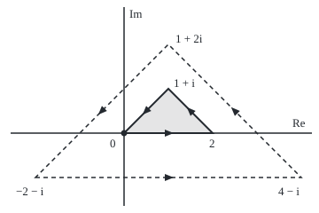

# Cauchy's theorem: a holomorphic function integrates to zero round any loop with no hole inside

[Syllabus](../../../SYLLABUS.md) → [Complex analysis](../README.md) → [Contour Integrals and Cauchy's Theorem](../README.md#s03) → Cauchy's theorem

---

## General Overview

A regatta is sailed anticlockwise round three buoys, in kilometres east and north of the start: 0, then 2, then 1 + i, then home. The course is a triangle of area 1 square kilometre.

Multiply a function's value by each small step of the boat and add: that sum is the contour integral ([Contour integrals](01-contour-integrals.md)). For z^2 the three legs give 2.666667, −3.333333 + 0.666667i and 0.666667 − 0.666667i. They add to 0. For e^z the legs differ and the total is 0 again.

Now take 1/z, which has no value at 0, the start buoy. Move the course one kilometre east and the total is 0. Triple it, with corners −2 − i, 4 − i, 1 + 2i, and the total is 2πi, about 6.283185i. Both boats pass only points where 1/z is defined; what changed is the water inside, which now holds 0.

**If a function has a complex derivative at every point of a region with no holes, its integral round every closed loop in that region is 0, so it has an antiderivative there.**

**What kind of fact this is:** a theorem, proved in Why it works when the derivative is continuous; Goursat's stronger version is stated there and proved in a folded callout.

### The picture: the course and the tripled course

<p align="center"></p>

To scale: 50 units per kilometre, 0 at (140, 150). Shaded course: (140, 150), (240, 150), (190, 100); dashed tripled course: (40, 200), (340, 200), (190, 50).

---

## The formula

Reminder: $\oint_\gamma f(z)\,dz$ is the contour integral once anticlockwise round the loop γ; holomorphic means having a complex derivative at every point ([The complex derivative](../02-Holomorphic%20Functions/01-complex-derivative-and-cauchy-riemann.md)). A region is **simply connected** when it is open (each point has a small disc round it inside the region), joined up, and every loop shrinks to a point without leaving it: it has no holes. A disc qualifies; the plane without 0 does not.

$$\oint_\gamma f(z)\,dz = 0$$

**Read it aloud:** round any closed loop in a region with no holes, a function holomorphic throughout it integrates to zero.

The proof's engine, Green's theorem in complex form:

$$\oint_\gamma f(z)\,dz = i \iint_D \left(f_x + i\,f_y\right) dA$$

**Read it aloud:** the loop integral is i times the area integral of f's eastward slope plus i times its northward slope.

The consequence, an antiderivative:

$$F(z) = \int_{z_0}^{z} f(w)\,dw, \qquad F'(z) = f(z)$$

**Read it aloud:** integrating f from a base point to z, by any path, gives a function whose derivative is f.

| Symbol | Plain meaning | In our example | Push it up and the answer… |
| --- | --- | --- | --- |
| $z$, $x$, $y$ | a point x + iy: x km east, y north | buoys 0, 2, 1 + i | — |
| $f$, $u$, $v$ | the function; its real and imaginary parts | z^2: u = x^2 − y^2, v = 2xy | still 0, if holomorphic |
| $f'$, $f_x$, $f_y$ | complex derivative; f's slopes east and north | for z^2: 2z, 2z, 2iz | — |
| $u_x$, $u_y$, $v_x$, $v_y$ | the four real slopes of u and v | 2x, −2y, 2y, 2x | — |
| $\gamma$, $dz$ | the closed loop; one small step along it | the course | reversed: sign flips |
| $D$, $dA$ | the region the loop encloses; a small patch of its area | the course's water, area 1 | bigger, same 0 |
| $F$, $z_0$, $w$ | antiderivative; base point; point moving along the path | e^z − 1, base 0 | — |
| $\bar{z}$ | the conjugate, read "z-bar": x − iy | not holomorphic: 2i round the course | 2i times the area |

### When it holds

- **Holomorphic inside, not only on the loop.** 1/z is smooth all along the tripled course, yet gives 2πi, because 0 sits inside.
- **No holes.** On the plane with 0 removed, 1/z is holomorphic everywhere, and the loop round 0 still gives 2πi.
- **A complex derivative, not mere smoothness.** z-bar has smooth parts but no complex derivative, and gives 2i round the course.
- **A closed loop.** An open path gives F(end) − F(start): 0.468694 + 2.287355i for e^z from 0 to 1 + i.

---

## Why it works

### Step 0: two line integrals become two vanishing area integrals

A complex loop integral is two real line integrals. Green's theorem turns each into an area integral ([Green's theorem](../../06-Calculus%20and%20analysis/09-Vector%20Calculus/06-greens-theorem.md)), and the Cauchy-Riemann equations make both integrands zero.

### Step 1: split into real and imaginary parts

Write f = u + iv and dz = dx + i dy, and multiply out:

$$f\,dz = (u\,dx - v\,dy) + i\,(v\,dx + u\,dy)$$

Each bracket is a real line integral of the kind Green's theorem handles: the loop integral of P dx + Q dy equals the area integral of Q_x − P_y, for real functions P and Q.

### Step 2: apply Green twice

Real part: P = u, Q = −v, so the area integrand is −v_x − u_y. Imaginary part: P = v, Q = u, so it is u_x − v_y. Together:

$$\oint_\gamma f\,dz = \iint_D \left(-v_x - u_y\right) dA + i \iint_D \left(u_x - v_y\right) dA$$

Green's theorem needs the four slopes to be continuous, so this proof does too.

### Step 3: Cauchy-Riemann kills both integrands

A complex derivative is the same from every direction. Eastward, $f_x = f'$; a northward step h moves z by ih, so $f_y = i f'$. In parts, these are the Cauchy-Riemann equations $u_x = v_y$ and $u_y = -v_x$, so both integrands in Step 2 vanish. On z^2: u_x = 2x = v_y and u_y = −2y = −v_x.

Compactly, the two integrands are the parts of i(f_x + i f_y), and $f_x + i f_y = f' + i \cdot i f' = 0$: the code's second road.

For z-bar, f_x = 1 and f_y = −i, so f_x + i f_y = 2. The loop integral is 2i times the area: 2i round the course.

### Step 4: Goursat removes the continuity condition

Édouard Goursat showed the derivative need only exist. **Goursat's theorem:** if f is holomorphic on an open set containing a closed filled triangle T, then the integral of f round the edge of T is 0. No continuity of f' is assumed.

The proof skips Green. Joining midpoints cuts the triangle into four, and one carries at least a quarter of the total. Repeating closes on a point near which f is nearly c + kz for constants c and k, whose loop integral is 0; the leftover shrinks faster than the quarter-shares.

<details>
<summary>Detailed proof: Goursat's subdivision</summary>

Let I be the size of the edge integral of T, with perimeter p and diameter d (longest distance across). The four midpoint triangles' edge integrals add to the original, so one, T1, has size at least I/4. Repeating gives nested triangles Tn with edge integral at least $I/4^n$, perimeter $p/2^n$, diameter $d/2^n$.

They share a point z* in T, where $f(z) = f(z^*) + f'(z^*)(z - z^*) + \psi(z)(z - z^*)$ with ψ(z) → 0: given ε > 0 there is δ > 0 with $|\psi(z)| < \varepsilon$ whenever $|z - z^*| < \delta$. The first two terms have an antiderivative, so integrate to 0. Once $d/2^n < \delta$, the third is at most ε times $d/2^n$ on the edge of Tn, so $I/4^n \le \varepsilon\,dp/4^n$. Thus $I \le \varepsilon\,dp$ for every ε > 0, and I = 0.

</details>

### Step 5: from triangles to every loop

A closed polygon that does not cross itself, in a simply connected region, cuts into triangles whose inner edges cancel; smooth loops are limits of polygons. The proof for every loop is on [Deforming a loop](04-deforming-contours-and-winding-numbers.md).

### Step 6: an antiderivative on every region with no holes

Let F(z) be the integral from a base point $z_0$ to z along any path in the region. Two paths to z, one reversed, make a loop, so they agree. F(z + h) − F(z) is the integral along a short segment, h f(z) plus something smaller than h, so F' = f, as in [Antiderivatives](02-antiderivatives-and-path-independence.md).

On the course, e^z from 0 to 1 + i gives 0.468694 + 2.287355i straight and via buoy 2: e^(1+i) − 1.

<details>
<summary>A holomorphic logarithm for a function that is never zero</summary>

If f is holomorphic and never 0 on a simply connected region, f'/f is holomorphic, so it has an antiderivative L, shifted so that $e^{L(z_0)} = f(z_0)$. The derivative of $f e^{-L}$ is $f' e^{-L} - f L' e^{-L} = 0$, so $f e^{-L}$ stays 1 and $f = e^{L}$. For f(z) = z on the plane cut along a ray from 0, this is a branch of [The complex logarithm](../02-Holomorphic%20Functions/04-complex-logarithm.md); with only 0 removed it fails, since 1/z round the tripled course gives 2πi.

</details>

---

## Worked numbers, by hand

| Step | Arithmetic | Value |
| --- | --- | --- |
| z^2, leg 0 → 2 | antiderivative z^3/3: (8 − 0)/3 | 2.666667 |
| z^2, leg 2 → 1 + i | (1 + i)^3 = −2 + 2i, so (−2 + 2i − 8)/3 | −3.333333 + 0.666667i |
| z^2, leg 1 + i → 0 | (0 − (−2 + 2i))/3 | 0.666667 − 0.666667i |
| z^2, round the course | the three legs | **0** |
| e^z, the three legs | e^2 − 1, then e^(1+i) − e^2, then 1 − e^(1+i) | 6.389056; −5.920362 + 2.287355i; −0.468694 − 2.287355i |
| e^z, round the course | each value of e^z at a buoy enters once with +, once with − | **0** |
| 1/z, course moved east | 0 outside 1, 3, 2 + i | **0** |
| 1/z, course tripled | 0 inside −2 − i, 4 − i, 1 + 2i | **6.283185i**, which is 2πi |

A holomorphic function comes home to 0 round any course with no hole inside; 2πi is the signature of the missing point at 0.

### What breaks if you drop a piece

| Mistake | Comes out at | What went wrong |
| --- | --- | --- |
| Checking 1/z only along the tripled course | 6.283185i, not 0 | 0 is inside: a hole |
| z-bar, smooth but not holomorphic | 2i, by both roads | f_x + i f_y = 2 |
| z-bar from 0 to 1 + i, two routes | 1 straight, 1 + 2i via 2 | No antiderivative |

The code prints all three.

---

## Code, from first principles, and it actually runs

Road one is a trapezoid sum along each leg, checked against the antiderivative. Road two never touches the course: i times the area integral of f_x + i f_y, slopes by finite differences, over a mesh of small triangles. With 10, 100 and 1000 steps a leg, the e^z total sits 0.030298, 0.000303 and 0.000003 from 0. Four asserts: legs and both roads, the shrinking error, 1/z against 0 and 2πi, z-bar against 2i times the shoelace area (the area worked out from the corners' coordinates).

### Python

```python
# Cauchy's theorem -- the check behind the card.  Standard library only.
# Road one: the loop integral as a trapezoid sum along each straight leg.
# Road two: Green's theorem, i times the area integral of f_x + i f_y over the
# triangle, with the partial derivatives taken by finite differences.
import math

def show(w):                                 # 'a + bi', six decimals, no -0.000000
    a, b = round(w.real, 6) + 0.0, round(w.imag, 6) + 0.0
    return f"{a:.6f} {'-' if b < 0 else '+'} {abs(b):.6f}i"

def leg(f, a, b, n=20000):                   # trapezoid sum of f(z) dz from a to b
    d = (b - a) / n
    return d * (sum(f(a + k * d) for k in range(1, n)) + (f(a) + f(b)) / 2)

def loop(f, pts, n=20000):
    return [leg(f, pts[k], pts[(k + 1) % 3], n) for k in range(3)]

def green(f, pts, m=300, h=1e-4):            # i * (f_x + i f_y) dA over m^2 small triangles
    a, u, v = pts[0], (pts[1] - pts[0]) / m, (pts[2] - pts[0]) / m
    cell, total = abs((u.conjugate() * v).imag) / 2, 0j
    cents = [(j + 1 / 3, k + 1 / 3) for j in range(m) for k in range(m - j)]
    cents += [(j + 2 / 3, k + 2 / 3) for j in range(m) for k in range(m - j - 1)]
    for j, k in cents:
        g = a + j * u + k * v
        total += ((f(g + h) - f(g - h)) + 1j * (f(g + 1j * h) - f(g - 1j * h))) / (2 * h) * cell
    return 1j * total

course = [0j, 2 + 0j, 1 + 1j]
area = sum((course[k].conjugate() * course[(k + 1) % 3]).imag for k in range(3)) / 2
print(f"course 0 -> 2 -> 1+i, area by shoelace: {area:.6f}")
expz = lambda z: math.exp(z.real) * complex(math.cos(z.imag), math.sin(z.imag))
e1i = complex(math.e * math.cos(1), math.e * math.sin(1))
exact = {"z^2": [8 / 3, (-10 + 2j) / 3, (2 - 2j) / 3], "e^z": [math.e ** 2 - 1, e1i - math.e ** 2, 1 - e1i]}
for name, f in (("z^2", lambda z: z * z), ("e^z", expz)):
    legs, r2 = loop(f, course), green(f, course)
    print(f"{name} legs, sums:           " + " | ".join(show(w) for w in legs))
    print(f"{name} legs, antiderivative: " + " | ".join(show(w) for w in exact[name]))
    print(f"{name} loop: road one {show(sum(legs))}, road two {show(r2)}")
    assert all(abs(p - q) < 1e-6 for p, q in zip(legs, exact[name])) and abs(sum(legs) - r2) < 1e-6
sizes = [abs(sum(loop(expz, course, n))) for n in (10, 100, 1000)]
print("e^z loop, trapezoid with 10, 100, 1000 steps a leg: " + ", ".join(f"{s:.6f}" for s in sizes))
assert sizes[0] > 50 * sizes[1] > 2500 * sizes[2]
via2 = leg(expz, 0j, 2 + 0j) + leg(expz, 2 + 0j, 1 + 1j)
print(f"e^z from 0 to 1+i: straight {show(leg(expz, 0j, 1 + 1j))}, via 2 {show(via2)}, e^(1+i) - 1 = {show(e1i - 1)}")
moved = sum(loop(lambda z: 1 / z, [p + 1 for p in course]))
big = [3 * p - 2 - 1j for p in course]
ring = sum(loop(lambda z: 1 / z, big))
print(f"1/z, course moved to 1 -> 3 -> 2+i: {show(moved)}")
print(f"1/z, course tripled to -2-i -> 4-i -> 1+2i: {show(ring)}, 2 pi i = {show(2j * math.pi)}")
assert abs(moved) < 1e-6 and abs(ring - 2j * math.pi) < 1e-6
bar = lambda z: z.conjugate()
zb, gb = sum(loop(bar, course)), green(bar, course)
print(f"mistake, z-bar round the course: road one {show(zb)}, road two {show(gb)}, 2i x area = {show(2j * area)}")
print(f"mistake, z-bar from 0 to 1+i: straight {show(leg(bar, 0j, 1 + 1j))}, via 2 {show(leg(bar, 0j, 2 + 0j) + leg(bar, 2 + 0j, 1 + 1j))}")
assert abs(zb - 2j * area) < 1e-6 and abs(gb - 2j * area) < 1e-6
print(f"mistake, 1/z round the tripled course clockwise: {show(sum(loop(lambda z: 1 / z, big[::-1])))}")
svg = lambda p: f"({140 + 50 * p.real:.0f}, {150 - 50 * p.imag:.0f})"
print("figure, course " + " ".join(svg(p) for p in course) + ", tripled " + " ".join(svg(p) for p in big))
print("ALL CHECKS PASS")
```

**Ran 2026-09-28 on macOS, Python 3.14.6, standard library only. All checks passed. Output, pasted from the run:**

```
course 0 -> 2 -> 1+i, area by shoelace: 1.000000
z^2 legs, sums:           2.666667 + 0.000000i | -3.333333 + 0.666667i | 0.666667 - 0.666667i
z^2 legs, antiderivative: 2.666667 + 0.000000i | -3.333333 + 0.666667i | 0.666667 - 0.666667i
z^2 loop: road one 0.000000 + 0.000000i, road two 0.000000 + 0.000000i
e^z legs, sums:           6.389056 + 0.000000i | -5.920362 + 2.287355i | -0.468694 - 2.287355i
e^z legs, antiderivative: 6.389056 + 0.000000i | -5.920362 + 2.287355i | -0.468694 - 2.287355i
e^z loop: road one 0.000000 + 0.000000i, road two 0.000000 + 0.000000i
e^z loop, trapezoid with 10, 100, 1000 steps a leg: 0.030298, 0.000303, 0.000003
e^z from 0 to 1+i: straight 0.468694 + 2.287355i, via 2 0.468694 + 2.287355i, e^(1+i) - 1 = 0.468694 + 2.287355i
1/z, course moved to 1 -> 3 -> 2+i: 0.000000 + 0.000000i
1/z, course tripled to -2-i -> 4-i -> 1+2i: 0.000000 + 6.283185i, 2 pi i = 0.000000 + 6.283185i
mistake, z-bar round the course: road one 0.000000 + 2.000000i, road two 0.000000 + 2.000000i, 2i x area = 0.000000 + 2.000000i
mistake, z-bar from 0 to 1+i: straight 1.000000 + 0.000000i, via 2 1.000000 + 2.000000i
mistake, 1/z round the tripled course clockwise: 0.000000 - 6.283185i
figure, course (140, 150) (240, 150) (190, 100), tripled (40, 200) (340, 200) (190, 50)
ALL CHECKS PASS
```

### Rust

Same numbers, same labels, built with `rustc --edition 2021 -O`.

```rust
// Cauchy's theorem -- the same check as the Python, in Rust.  No crates.
// Road one: the loop integral as a trapezoid sum along each straight leg.
// Road two: Green's theorem, i times the area integral of f_x + i f_y over the
// triangle, with the partial derivatives taken by finite differences.
use std::f64::consts::{E, PI};
use std::ops::{Add, Mul, Sub};
#[derive(Clone, Copy)] struct C { re: f64, im: f64 }
fn c(re: f64, im: f64) -> C { C { re, im } }
impl Add for C { type Output = C; fn add(self, o: C) -> C { c(self.re + o.re, self.im + o.im) } }
impl Sub for C { type Output = C; fn sub(self, o: C) -> C { c(self.re - o.re, self.im - o.im) } }
impl Mul for C { type Output = C; fn mul(self, o: C) -> C { c(self.re * o.re - self.im * o.im, self.re * o.im + self.im * o.re) } }
fn sc(a: C, k: f64) -> C { c(a.re * k, a.im * k) }
fn abs(a: C) -> f64 { a.re.hypot(a.im) }
fn show(w: C) -> String { // 'a + bi', six decimals, no -0.000000
    let a = format!("{:.6}", w.re).replace("-0.000000", "0.000000");
    let b = format!("{:.6}", w.im.abs());
    format!("{} {} {}i", a, if w.im < 0.0 && b != "0.000000" { '-' } else { '+' }, b)
}
fn leg(f: &dyn Fn(C) -> C, a: C, b: C, n: usize) -> C { // trapezoid sum of f(z) dz from a to b
    let d = sc(b - a, 1.0 / n as f64);
    let mut s = sc(f(a) + f(b), 0.5);
    for k in 1..n { s = s + f(a + sc(d, k as f64)) }
    d * s
}
fn lp(f: &dyn Fn(C) -> C, p: &[C], n: usize) -> Vec<C> { (0..3).map(|k| leg(f, p[k], p[(k + 1) % 3], n)).collect() }
fn sum(v: &[C]) -> C { v.iter().fold(c(0.0, 0.0), |s, &w| s + w) }
fn green(f: &dyn Fn(C) -> C, p: &[C]) -> C { // i * (f_x + i f_y) dA over m^2 small triangles
    let (m, h) = (300usize, 1e-4);
    let (u, v) = (sc(p[1] - p[0], 1.0 / m as f64), sc(p[2] - p[0], 1.0 / m as f64));
    let (cell, mut t) = ((u.re * v.im - u.im * v.re).abs() / 2.0, c(0.0, 0.0));
    let mut cents = Vec::new();
    for j in 0..m { for k in 0..m - j { cents.push((j as f64 + 1.0 / 3.0, k as f64 + 1.0 / 3.0)) } }
    for j in 0..m { for k in 0..m - j - 1 { cents.push((j as f64 + 2.0 / 3.0, k as f64 + 2.0 / 3.0)) } }
    for (j, k) in cents {
        let g = p[0] + sc(u, j) + sc(v, k);
        let (fx, fy) = (f(g + c(h, 0.0)) - f(g - c(h, 0.0)), f(g + c(0.0, h)) - f(g - c(0.0, h)));
        t = t + sc(fx + c(0.0, 1.0) * fy, cell / (2.0 * h));
    }
    c(0.0, 1.0) * t
}
fn main() {
    let course = [c(0.0, 0.0), c(2.0, 0.0), c(1.0, 1.0)];
    let area = (0..3).map(|k| { let (a, b) = (course[k], course[(k + 1) % 3]); a.re * b.im - a.im * b.re }).sum::<f64>() / 2.0;
    println!("course 0 -> 2 -> 1+i, area by shoelace: {:.6}", area);
    let (expz, sq) = (|z: C| sc(c(z.im.cos(), z.im.sin()), z.re.exp()), |z: C| z * z);
    let e1i = c(E * 1f64.cos(), E * 1f64.sin());
    let ex1 = [c(8.0 / 3.0, 0.0), c(-10.0 / 3.0, 2.0 / 3.0), c(2.0 / 3.0, -2.0 / 3.0)];
    let ex2 = [c(E * E - 1.0, 0.0), e1i - c(E * E, 0.0), c(1.0, 0.0) - e1i];
    let cases: [(&str, &dyn Fn(C) -> C, [C; 3]); 2] = [("z^2", &sq, ex1), ("e^z", &expz, ex2)];
    for (name, f, ex) in cases {
        let (legs, r2) = (lp(f, &course, 20000), green(f, &course));
        println!("{} legs, sums:           {}", name, legs.iter().map(|&w| show(w)).collect::<Vec<_>>().join(" | "));
        println!("{} legs, antiderivative: {}", name, ex.iter().map(|&w| show(w)).collect::<Vec<_>>().join(" | "));
        println!("{} loop: road one {}, road two {}", name, show(sum(&legs)), show(r2));
        assert!(legs.iter().zip(ex.iter()).all(|(&p, &q)| abs(p - q) < 1e-6) && abs(sum(&legs) - r2) < 1e-6);
    }
    let sizes: Vec<f64> = [10usize, 100, 1000].iter().map(|&n| abs(sum(&lp(&expz, &course, n)))).collect();
    println!("e^z loop, trapezoid with 10, 100, 1000 steps a leg: {}", sizes.iter().map(|s| format!("{:.6}", s)).collect::<Vec<_>>().join(", "));
    assert!(sizes[0] > 50.0 * sizes[1] && 50.0 * sizes[1] > 2500.0 * sizes[2]);
    let (o, two, top) = (course[0], course[1], course[2]);
    let via2 = leg(&expz, o, two, 20000) + leg(&expz, two, top, 20000);
    println!("e^z from 0 to 1+i: straight {}, via 2 {}, e^(1+i) - 1 = {}", show(leg(&expz, o, top, 20000)), show(via2), show(e1i - c(1.0, 0.0)));
    let inv = |z: C| sc(c(z.re, -z.im), 1.0 / (z.re * z.re + z.im * z.im));
    let moved: Vec<C> = course.iter().map(|&p| p + c(1.0, 0.0)).collect();
    let big: Vec<C> = course.iter().map(|&p| sc(p, 3.0) - c(2.0, 1.0)).collect();
    let (mv, ring) = (sum(&lp(&inv, &moved, 20000)), sum(&lp(&inv, &big, 20000)));
    println!("1/z, course moved to 1 -> 3 -> 2+i: {}", show(mv));
    println!("1/z, course tripled to -2-i -> 4-i -> 1+2i: {}, 2 pi i = {}", show(ring), show(c(0.0, 2.0 * PI)));
    assert!(abs(mv) < 1e-6 && abs(ring - c(0.0, 2.0 * PI)) < 1e-6);
    let bar = |z: C| c(z.re, -z.im);
    let (zb, gb) = (sum(&lp(&bar, &course, 20000)), green(&bar, &course));
    println!("mistake, z-bar round the course: road one {}, road two {}, 2i x area = {}", show(zb), show(gb), show(c(0.0, 2.0 * area)));
    println!("mistake, z-bar from 0 to 1+i: straight {}, via 2 {}", show(leg(&bar, o, top, 20000)), show(leg(&bar, o, two, 20000) + leg(&bar, two, top, 20000)));
    assert!(abs(zb - c(0.0, 2.0 * area)) < 1e-6 && abs(gb - c(0.0, 2.0 * area)) < 1e-6);
    let rev: Vec<C> = big.iter().rev().copied().collect();
    println!("mistake, 1/z round the tripled course clockwise: {}", show(sum(&lp(&inv, &rev, 20000))));
    let svg = |p: &C| format!("({:.0}, {:.0})", 140.0 + 50.0 * p.re, 150.0 - 50.0 * p.im);
    println!("figure, course {}, tripled {}", course.iter().map(svg).collect::<Vec<_>>().join(" "), big.iter().map(svg).collect::<Vec<_>>().join(" "));
    println!("ALL CHECKS PASS");
}
```

**Ran 2026-09-28 on macOS, rustc 1.98.1, no crates. All checks passed. Output, pasted from the run:**

```
course 0 -> 2 -> 1+i, area by shoelace: 1.000000
z^2 legs, sums:           2.666667 + 0.000000i | -3.333333 + 0.666667i | 0.666667 - 0.666667i
z^2 legs, antiderivative: 2.666667 + 0.000000i | -3.333333 + 0.666667i | 0.666667 - 0.666667i
z^2 loop: road one 0.000000 + 0.000000i, road two 0.000000 + 0.000000i
e^z legs, sums:           6.389056 + 0.000000i | -5.920362 + 2.287355i | -0.468694 - 2.287355i
e^z legs, antiderivative: 6.389056 + 0.000000i | -5.920362 + 2.287355i | -0.468694 - 2.287355i
e^z loop: road one 0.000000 + 0.000000i, road two 0.000000 + 0.000000i
e^z loop, trapezoid with 10, 100, 1000 steps a leg: 0.030298, 0.000303, 0.000003
e^z from 0 to 1+i: straight 0.468694 + 2.287355i, via 2 0.468694 + 2.287355i, e^(1+i) - 1 = 0.468694 + 2.287355i
1/z, course moved to 1 -> 3 -> 2+i: 0.000000 + 0.000000i
1/z, course tripled to -2-i -> 4-i -> 1+2i: 0.000000 + 6.283185i, 2 pi i = 0.000000 + 6.283185i
mistake, z-bar round the course: road one 0.000000 + 2.000000i, road two 0.000000 + 2.000000i, 2i x area = 0.000000 + 2.000000i
mistake, z-bar from 0 to 1+i: straight 1.000000 + 0.000000i, via 2 1.000000 + 2.000000i
mistake, 1/z round the tripled course clockwise: 0.000000 - 6.283185i
figure, course (140, 150) (240, 150) (190, 100), tripled (40, 200) (340, 200) (190, 50)
ALL CHECKS PASS
```

### Lean

Lean proves Cauchy's theorem for every simply connected region and every loop made of smooth pieces, and Goursat for every triangle.

- If f is holomorphic throughout a simply connected region, its integral round every closed loop in that region is 0.
- The loop may have corners, as long as it is made of finitely many smooth pieces.
- Such an f has an antiderivative F there: F' = f at every point of the region.
- Goursat: if f is holomorphic on an open set holding a closed filled triangle, its integral round the triangle's edge is 0.
- Goursat needs no continuity of f'.
- The hand arithmetic holds exactly: (1 + i)^3 = −2 + 2i, the three z^2 legs and their zero sum, and the e^z cancellation.
- So do the course's area, the moved and tripled corners, f_x + i f_y for z^2 and z-bar, and the figure's coordinates.

The trapezoid sums, Green's area integral, 1/z giving 0 and 2πi, and z-bar's two routes are left to the Python and Rust checks.

<details>
<summary>The Lean proof, 391 lines</summary>

```lean
-- Cauchy's theorem: a function with a complex derivative at every point of an open region with no holes integrates to zero round every closed loop made of finitely many smooth pieces in that region, so it has an antiderivative there, and (Goursat) it integrates to zero round the edge of any filled triangle inside an open set where it has a complex derivative.
import Mathlib.MeasureTheory.Integral.CurveIntegral.Basic
import Mathlib.AlgebraicTopology.FundamentalGroupoid.SimplyConnected
import Mathlib.Analysis.Convex.PathConnected
import Mathlib.Analysis.Convex.Hull
import Mathlib.Analysis.Calculus.Deriv.Basic
import Mathlib.Analysis.Complex.Exponential
import Mathlib.Tactic.NormNum
import Mathlib.Tactic.Ring
import Mathlib.MeasureTheory.Integral.CurveIntegral.Poincare
import Mathlib.MeasureTheory.Integral.DivergenceTheorem
import Mathlib.Topology.Homotopy.Lifting
import Mathlib.Topology.Covering.Basic
import Mathlib.Analysis.Calculus.MeanValue
import Mathlib.Analysis.Calculus.Deriv.AffineMap
import Mathlib.Analysis.Calculus.Deriv.Comp
import Mathlib.Analysis.Normed.Module.Convex
import Mathlib.Topology.MetricSpace.Thickening
import Mathlib.Analysis.Convex.Topology
import Mathlib.MeasureTheory.Integral.IntervalIntegral.FundThmCalculus

open Set Complex

open Filter Topology

/-- `G` is a primitive of `f` on `W`: its complex derivative at each point `w` of `W` is `f w`. -/
def IsPrimOn (f : ℂ → ℂ) (W : Set ℂ) (G : ℂ → ℂ) : Prop := ∀ w ∈ W, HasDerivAt G (f w) w

/-- A point of the space of primitives of `f`: a place `pt` and a value `val` there. -/
structure PrimGerm (f : ℂ → ℂ) where
  pt : ℂ
  val : ℂ

instance (f : ℂ → ℂ) : Nonempty (PrimGerm f) := ⟨⟨0, 0⟩⟩

/-- The graph of `G + c` over `W`. -/
def primSheet (f : ℂ → ℂ) (W : Set ℂ) (G : ℂ → ℂ) (c : ℂ) : Set (PrimGerm f) :=
  {q | q.pt ∈ W ∧ q.val = G q.pt + c}

/-- The open sets are generated by the graphs of local primitives over open sets. -/
instance (f : ℂ → ℂ) : TopologicalSpace (PrimGerm f) :=
  TopologicalSpace.generateFrom
    {S | ∃ W G c, IsOpen W ∧ IsPrimOn f W G ∧ S = primSheet f W G c}

/-- A copy of `ℂ` with the discrete topology: the fibre of the space of primitives. -/
def DiscreteShift : Type := ℂ

instance : TopologicalSpace DiscreteShift := ⊥
instance : DiscreteTopology DiscreteShift := ⟨rfl⟩
instance : Nonempty DiscreteShift := ⟨(0 : ℂ)⟩

/-- The complex number behind a point of `DiscreteShift`. -/
def DiscreteShift.val (c : DiscreteShift) : ℂ := c

theorem isOpen_primSheet {f : ℂ → ℂ} {W : Set ℂ} {G : ℂ → ℂ} (c : ℂ) (hW : IsOpen W)
    (hG : IsPrimOn f W G) : IsOpen (primSheet f W G c) :=
  TopologicalSpace.isOpen_generateFrom_of_mem ⟨W, G, c, hW, hG, rfl⟩

#print axioms isOpen_primSheet

theorem isOpen_primAgree {f : ℂ → ℂ} {W W' : Set ℂ} {G G' : ℂ → ℂ} (c c' : ℂ)
    (hW : IsOpen W) (hG : IsPrimOn f W G) (hW' : IsOpen W') (hG' : IsPrimOn f W' G') :
    IsOpen {w | w ∈ W ∧ w ∈ W' ∧ G w + c = G' w + c'} := by
  have hd : ∀ w ∈ W ∩ W', HasDerivAt (fun w => G w + c - (G' w + c')) 0 w := by
    intro w hw
    have := ((hG w hw.1).add_const c).fun_sub ((hG' w hw.2).add_const c')
    rwa [sub_self] at this
  have := (hW.inter hW').isOpen_inter_preimage_of_fderiv_eq_zero
    (f := fun w => G w + c - (G' w + c'))
    (fun w hw => (hd w hw).differentiableAt.differentiableWithinAt)
    (fun w hw => by simp [(hd w hw).hasFDerivAt.fderiv]) {0}
  convert this using 1
  ext w
  simp only [mem_inter_iff, mem_preimage, mem_singleton_iff, mem_ofPred_eq, sub_eq_zero]
  tauto

#print axioms isOpen_primAgree

theorem continuousAt_primSection {f : ℂ → ℂ} {W : Set ℂ} {G : ℂ → ℂ} (c : ℂ) (hW : IsOpen W)
    (hG : IsPrimOn f W G) {w : ℂ} (hw : w ∈ W) :
    ContinuousAt (fun z => (⟨z, G z + c⟩ : PrimGerm f)) w := by
  rw [ContinuousAt, TopologicalSpace.nhds_generateFrom]
  simp only [tendsto_iInf, tendsto_principal]
  rintro S ⟨hwS, W', G', c', hW', hG', rfl⟩
  obtain ⟨hw', hval⟩ := hwS
  filter_upwards [(isOpen_primAgree c c' hW hG hW' hG').mem_nhds ⟨hw, hw', hval⟩] with z hz
  exact ⟨hz.2.1, hz.2.2⟩

#print axioms continuousAt_primSection

theorem exists_isPrimOn_of_convex {f : ℂ → ℂ} {V : Set ℂ} (hV : Convex ℝ V) (hVo : IsOpen V)
    (hf : DifferentiableOn ℂ f V) : ∃ G : ℂ → ℂ, IsPrimOn f V G := by
  obtain ⟨G, hG⟩ := hV.exists_forall_hasDerivWithinAt hf
  exact ⟨G, fun w hw => (hG w hw).hasDerivAt (hVo.mem_nhds hw)⟩

#print axioms exists_isPrimOn_of_convex

theorem isCoveringMapOn_primGerm {U : Set ℂ} (hUo : IsOpen U) {f : ℂ → ℂ}
    (hf : DifferentiableOn ℂ f U) : IsCoveringMapOn (PrimGerm.pt (f := f)) U := by
  intro x hx
  obtain ⟨r, hr, hrU⟩ := Metric.isOpen_iff.mp hUo x hx
  obtain ⟨G, hG⟩ := exists_isPrimOn_of_convex (convex_ball x r) Metric.isOpen_ball (hf.mono hrU)
  have hopen : ∀ (c : DiscreteShift) {W : Set ℂ}, W ⊆ Metric.ball x r →
      (IsOpen W ↔ IsOpen (PrimGerm.pt ⁻¹' W ∩ primSheet f (Metric.ball x r) G c.val)) := by
    intro c W hW
    constructor
    · intro hWo
      have : PrimGerm.pt ⁻¹' W ∩ primSheet f (Metric.ball x r) G c.val =
          primSheet f W G c.val := by
        ext q
        simp only [primSheet, mem_inter_iff, mem_preimage, mem_ofPred_eq]
        constructor
        · rintro ⟨h1, -, h3⟩; exact ⟨h1, h3⟩
        · rintro ⟨h1, h3⟩; exact ⟨h1, hW h1, h3⟩
      rw [this]
      exact isOpen_primSheet _ hWo (fun w hw => hG w (hW hw))
    · intro hS
      have hcont : ContinuousOn (fun z => (⟨z, G z + c.val⟩ : PrimGerm f)) (Metric.ball x r) :=
        fun z hz => (continuousAt_primSection _ Metric.isOpen_ball hG hz).continuousWithinAt
      have := hcont.isOpen_inter_preimage Metric.isOpen_ball hS
      convert this using 1
      ext z
      simp only [primSheet, mem_inter_iff, mem_preimage, mem_ofPred_eq]
      constructor
      · intro hz; exact ⟨hW hz, hz, hW hz, by simp⟩
      · rintro ⟨-, hz, -, -⟩; exact hz
  have hinj : ∀ c : DiscreteShift,
      InjOn PrimGerm.pt (primSheet f (Metric.ball x r) G c.val) := by
    rintro c ⟨p1, v1⟩ hq ⟨p2, v2⟩ hq' h
    simp only [primSheet, mem_ofPred_eq] at hq hq' h
    subst h
    simp [hq.2, hq'.2]
  have hsurj : ∀ c : DiscreteShift,
      SurjOn PrimGerm.pt (primSheet f (Metric.ball x r) G c.val) (Metric.ball x r) := by
    intro c z hz
    exact ⟨⟨z, G z + c.val⟩, ⟨hz, rfl⟩, rfl⟩
  have hdisj : Pairwise (Function.onFun Disjoint
      (fun c : DiscreteShift => primSheet f (Metric.ball x r) G c.val)) := by
    intro c c' hcc'
    rw [Function.onFun, Set.disjoint_left]
    rintro q ⟨-, h1⟩ ⟨-, h2⟩
    exact hcc' (add_left_cancel (h1.symm.trans h2) : c.val = c'.val)
  have hexh : PrimGerm.pt ⁻¹' Metric.ball x r ⊆
      ⋃ c : DiscreteShift, primSheet f (Metric.ball x r) G c.val := by
    intro q hq
    refine mem_iUnion.mpr ⟨(show DiscreteShift from (q.val - G q.pt : ℂ)), hq, ?_⟩
    change q.val = G q.pt + (q.val - G q.pt)
    ring
  exact (IsEvenlyCovered.of_trivialization
    (t := IsOpen.trivializationDiscrete (f := PrimGerm.pt (f := f)) (ι := DiscreteShift)
      (fun c : DiscreteShift => primSheet f (Metric.ball x r) G c.val) (Metric.ball x r)
      Metric.isOpen_ball hopen hinj hsurj hdisj hexh)
    (by simpa using hr)).to_isEvenlyCovered_preimage

#print axioms isCoveringMapOn_primGerm

theorem exists_antiderivative_aux
    {U : Set ℂ} (hUo : IsOpen U) (hUs : IsSimplyConnected U)
    {f : ℂ → ℂ} (hf : DifferentiableOn ℂ f U) :
    ∃ F : ℂ → ℂ, ∀ z ∈ U, HasDerivAt F (f z) z := by
  classical
  have := hUs.simplyConnectedSpace
  have := hUo.locallyPathConnectedSpace
  obtain ⟨x₀, hx₀⟩ := hUs.nonempty
  obtain ⟨F, ⟨-, hFp⟩, -⟩ := (isCoveringMapOn_primGerm hUo hf).existsUnique_continuousMap_lifts
    (⟨Subtype.val, continuous_subtype_val⟩ : C(U, ℂ)) (a₀ := ⟨x₀, hx₀⟩)
    (e₀ := (⟨x₀, 0⟩ : PrimGerm f)) rfl (fun a => a.2)
  have hpt : ∀ a : U, (F a).pt = a := fun a => congrFun hFp a
  let Φ : ℂ → PrimGerm f := fun z => if hz : z ∈ U then F ⟨z, hz⟩ else ⟨z, 0⟩
  have hΦpt : ∀ z, (Φ z).pt = z := by
    intro z
    by_cases hz : z ∈ U
    · simp [Φ, hz, hpt]
    · simp [Φ, hz]
  have hΦ : ContinuousOn Φ U := by
    rw [continuousOn_iff_continuous_domRestrict]
    convert F.continuous using 1
    funext a
    simp [Φ, a.2]
  refine ⟨fun z => (Φ z).val, fun z hz => ?_⟩
  obtain ⟨r, hr, hrU⟩ := Metric.isOpen_iff.mp hUo z hz
  obtain ⟨G, hG⟩ := exists_isPrimOn_of_convex (convex_ball z r) Metric.isOpen_ball (hf.mono hrU)
  set c := (Φ z).val - G z with hc
  have hmem : Φ z ∈ primSheet f (Metric.ball z r) G c := by
    refine ⟨?_, ?_⟩
    · rw [hΦpt]; exact Metric.mem_ball_self hr
    · rw [hΦpt, hc]; ring
  have hev : ∀ᶠ w in 𝓝 z, Φ w ∈ primSheet f (Metric.ball z r) G c :=
    (hΦ.continuousAt (hUo.mem_nhds hz)).preimage_mem_nhds
      ((isOpen_primSheet c Metric.isOpen_ball hG).mem_nhds hmem)
  have hd : HasDerivAt (fun w => G w + c) (f z) z := (hG z (Metric.mem_ball_self hr)).add_const c
  refine hd.congr_of_eventuallyEq ?_
  filter_upwards [hev] with w hw
  rw [hw.2, hΦpt]

#print axioms exists_antiderivative_aux

theorem exists_mem_Ioo_of_partition {n : ℕ} {t : Fin (n + 1) → ℝ} (_ht : Monotone t)
    (h0 : t 0 = 0) (h1 : t (Fin.last n) = 1) {x : ℝ} (hx : x ∈ Ioo (0 : ℝ) 1)
    (hxt : x ∉ range t) : ∃ i : Fin n, x ∈ Ioo (t i.castSucc) (t i.succ) := by
  classical
  have hx0 : (0 : Fin (n + 1)) ∈ Finset.univ.filter (fun k => t k < x) := by simp [h0, hx.1]
  set i := (Finset.univ.filter (fun k => t k < x)).max' ⟨0, hx0⟩ with hi
  have hiS : t i < x := by
    have := Finset.max'_mem (Finset.univ.filter (fun k => t k < x)) ⟨0, hx0⟩
    simpa [← hi] using this
  have hi_ne : i ≠ Fin.last n := by
    intro h
    rw [h, h1] at hiS
    exact absurd hx.2 (not_lt.mpr hiS.le)
  obtain ⟨j, hj⟩ := Fin.exists_castSucc_eq.mpr hi_ne
  refine ⟨j, by rw [hj]; exact hiS, ?_⟩
  have hnot : ¬ t j.succ < x := by
    intro hlt
    have : j.succ ≤ i := Finset.le_max' _ _ (by simp [hlt])
    rw [← hj] at this
    exact absurd this (not_le.mpr Fin.castSucc_lt_succ)
  rcases (not_lt.mp hnot).lt_or_eq with h | h
  · exact h
  · exact absurd ⟨j.succ, h.symm⟩ hxt

#print axioms exists_mem_Ioo_of_partition

theorem curveIntegral_eq_zero_of_hasDerivAt {U : Set ℂ} {f F : ℂ → ℂ}
    (hF : ∀ z ∈ U, HasDerivAt F (f z) z) {z₀ : ℂ} (γ : Path z₀ z₀) (hγU : ∀ t, γ t ∈ U)
    (hγ : ∃ n : ℕ, ∃ t : Fin (n + 1) → ℝ, Monotone t ∧ t 0 = 0 ∧ t (Fin.last n) = 1 ∧
      ∀ i : Fin n, ContDiffOn ℝ 1 γ.extend (Icc (t i.castSucc) (t i.succ))) :
    (∫ᶜ z in γ, f z • ContinuousLinearMap.id ℂ ℂ) = 0 := by
  obtain ⟨n, t, htm, ht0, ht1, hC⟩ := hγ
  rw [curveIntegral_def]
  by_cases hint : IntervalIntegrable
      (curveIntegralFun (fun z => f z • ContinuousLinearMap.id ℂ ℂ) γ) MeasureTheory.volume 0 1
  swap
  · exact intervalIntegral.integral_undef hint
  have hext : ∀ s, γ.extend s ∈ U := fun s => by
    simp only [Path.extend]
    exact hγU _
  rw [MeasureTheory.integral_eq_of_hasDerivAt_off_countable_of_le (fun s => F (γ.extend s)) _
    zero_le_one (Set.countable_range t) ?_ ?_ hint]
  · simp
  · intro s _
    exact ((hF _ (hext s)).continuousAt.comp γ.continuous_extend.continuousAt).continuousWithinAt
  · rintro s ⟨hs, hsr⟩
    obtain ⟨i, hi⟩ := exists_mem_Ioo_of_partition htm ht0 ht1 hs hsr
    have hcd : ContDiffAt ℝ 1 γ.extend s := (hC i).contDiffAt (Icc_mem_nhds hi.1 hi.2)
    have hdiff : HasDerivAt γ.extend (deriv γ.extend s) s :=
      (hcd.differentiableAt one_ne_zero).hasDerivAt
    have heq : curveIntegralFun (fun z => f z • ContinuousLinearMap.id ℂ ℂ) γ s =
        f (γ.extend s) * deriv γ.extend s := by
      rw [curveIntegralFun_def, derivWithin_of_mem_nhds (Icc_mem_nhds hs.1 hs.2)]
      simp
    rw [heq]
    exact (hF _ (hext s)).comp s hdiff

#print axioms curveIntegral_eq_zero_of_hasDerivAt

theorem curveIntegrable_segment_smul {f : ℂ → ℂ} {a b : ℂ}
    (hfc : ContinuousOn f (segment ℝ a b)) :
    CurveIntegrable (fun z => f z • ContinuousLinearMap.id ℂ ℂ) (Path.segment a b) := by
  have hmem : ∀ t ∈ Icc (0 : ℝ) 1, AffineMap.lineMap a b t ∈ segment ℝ a b := fun t ht => by
    rw [segment_eq_image_lineMap]; exact ⟨t, ht, rfl⟩
  rw [curveIntegrable_segment]
  apply ContinuousOn.intervalIntegrable
  rw [uIcc_of_le zero_le_one]
  simp only [FunLike.coe_smul, Pi.smul_apply, ContinuousLinearMap.id_apply, smul_eq_mul]
  exact (hfc.comp AffineMap.lineMap_continuous.continuousOn hmem).mul continuousOn_const

#print axioms curveIntegrable_segment_smul

theorem curveIntegral_segment_eq_sub {f G : ℂ → ℂ} {a b : ℂ}
    (hG : ∀ z ∈ segment ℝ a b, HasDerivAt G (f z) z) (hfc : ContinuousOn f (segment ℝ a b)) :
    (∫ᶜ z in Path.segment a b, f z • ContinuousLinearMap.id ℂ ℂ) = G b - G a := by
  have hmem : ∀ t ∈ Icc (0 : ℝ) 1, AffineMap.lineMap a b t ∈ segment ℝ a b := fun t ht => by
    rw [segment_eq_image_lineMap]; exact ⟨t, ht, rfl⟩
  rw [curveIntegral_segment]
  simp only [FunLike.coe_smul, Pi.smul_apply, ContinuousLinearMap.id_apply, smul_eq_mul]
  rw [intervalIntegral.integral_eq_sub_of_hasDerivAt
    (f := fun t => G (AffineMap.lineMap a b t))]
  · simp
  · intro t ht
    rw [uIcc_of_le zero_le_one] at ht
    exact (hG _ (hmem t ht)).comp t (AffineMap.hasDerivAt_lineMap ..)
  · apply ContinuousOn.intervalIntegrable
    rw [uIcc_of_le zero_le_one]
    exact (hfc.comp AffineMap.lineMap_continuous.continuousOn hmem).mul continuousOn_const

#print axioms curveIntegral_segment_eq_sub


/-- **Cauchy's theorem.** Let U be a simply connected region of the complex plane: open,
joined up, and with every loop in it shrinking to a point without leaving it (no holes).
Let f have a complex derivative at every point of U. Let γ be a closed loop in U, starting and
ending at the same point z₀, made of finitely many smooth pieces: there are times
0 = t₀ ≤ t₁ ≤ … ≤ tₙ = 1 such that γ is continuously differentiable on each stretch
[tᵢ, tᵢ₊₁] (corners are allowed). Then the contour integral of f(z) dz once round γ is 0.
Here the 1-form `f z • id` sends a small step dz to f(z) · dz, so `∫ᶜ z in γ, …` is
∫₀¹ f(γ(t)) γ'(t) dt. -/
theorem contour_integral_eq_zero_of_isSimplyConnected
    {U : Set ℂ} (hUo : IsOpen U) (hUs : IsSimplyConnected U)
    {f : ℂ → ℂ} (hf : DifferentiableOn ℂ f U)
    {z₀ : ℂ} (γ : Path z₀ z₀) (hγU : ∀ t, γ t ∈ U)
    (hγ : ∃ n : ℕ, ∃ t : Fin (n + 1) → ℝ, Monotone t ∧ t 0 = 0 ∧ t (Fin.last n) = 1 ∧
      ∀ i : Fin n, ContDiffOn ℝ 1 γ.extend (Icc (t i.castSucc) (t i.succ))) :
    (∫ᶜ z in γ, f z • ContinuousLinearMap.id ℂ ℂ) = 0 := by
  obtain ⟨F, hF⟩ := exists_antiderivative_aux hUo hUs hf
  exact curveIntegral_eq_zero_of_hasDerivAt hF γ hγU hγ

/-- **An antiderivative on every region with no holes.** If U is a simply connected region
(open, joined up, no holes) and f has a complex derivative at every point of U, then there is a
function F whose complex derivative at every point z of U is f(z). -/
theorem exists_antiderivative_of_isSimplyConnected
    {U : Set ℂ} (hUo : IsOpen U) (hUs : IsSimplyConnected U)
    {f : ℂ → ℂ} (hf : DifferentiableOn ℂ f U) :
    ∃ F : ℂ → ℂ, ∀ z ∈ U, HasDerivAt F (f z) z := by
  exact exists_antiderivative_aux hUo hUs hf

/-- **Goursat's theorem.** If f has a complex derivative at every point of an open set U that
contains the closed filled triangle T with corners a, b, c, then the integral of f(z) dz round
the edge of T (straight from a to b, then to c, then back to a) is 0. No continuity of the
derivative is assumed. -/
theorem goursat_triangle_integral_eq_zero
    {U : Set ℂ} (hUo : IsOpen U) {f : ℂ → ℂ} (hf : DifferentiableOn ℂ f U)
    {a b c : ℂ} (hT : convexHull ℝ {a, b, c} ⊆ U) :
    (∫ᶜ z in ((Path.segment a b).trans (Path.segment b c)).trans (Path.segment c a),
      f z • ContinuousLinearMap.id ℂ ℂ) = 0 := by
  set T := convexHull ℝ {a, b, c} with hTdef
  have hTconv : Convex ℝ T := convex_convexHull ℝ _
  have hTc : IsCompact T := (Set.toFinite ({a, b, c} : Set ℂ)).isCompact_convexHull ℝ
  obtain ⟨δ, hδ, hδU⟩ := hTc.exists_thickening_subset_open hUo hT
  have hVc : Convex ℝ (Metric.thickening δ T) := hTconv.thickening δ
  have hTV : T ⊆ Metric.thickening δ T := Metric.self_subset_thickening hδ T
  obtain ⟨G, hG⟩ := exists_isPrimOn_of_convex hVc Metric.isOpen_thickening (hf.mono hδU)
  have hfc : ContinuousOn f T := hf.continuousOn.mono hT
  have hseg : ∀ x y, x ∈ T → y ∈ T → segment ℝ x y ⊆ T :=
    fun x y hx hy => hTconv.segment_subset hx hy
  have ha : a ∈ T := subset_convexHull ℝ _ (by simp)
  have hb : b ∈ T := subset_convexHull ℝ _ (by simp)
  have hc : c ∈ T := subset_convexHull ℝ _ (by simp)
  have hI : ∀ x y, x ∈ T → y ∈ T →
      (∫ᶜ z in Path.segment x y, f z • ContinuousLinearMap.id ℂ ℂ) = G y - G x :=
    fun x y hx hy => curveIntegral_segment_eq_sub
      (fun z hz => hG z (hTV (hseg x y hx hy hz))) (hfc.mono (hseg x y hx hy))
  have hJ : ∀ x y, x ∈ T → y ∈ T →
      CurveIntegrable (fun z => f z • ContinuousLinearMap.id ℂ ℂ) (Path.segment x y) :=
    fun x y hx hy => curveIntegrable_segment_smul (hfc.mono (hseg x y hx hy))
  rw [curveIntegral_trans ((hJ a b ha hb).trans (hJ b c hb hc)) (hJ c a hc ha),
    curveIntegral_trans (hJ a b ha hb) (hJ b c hb hc), hI a b ha hb, hI b c hb hc, hI c a hc ha]
  ring

-- z^2 on the course 0 → 2 → 1 + i, antiderivative z^3/3. First, (1 + i)^3 = −2 + 2i.
example : (1 + I) ^ 3 = -2 + 2 * I := by
  apply Complex.ext <;> simp [pow_succ] <;> norm_num
-- The three legs: (8 − 0)/3, (−2 + 2i − 8)/3 and (0 − (−2 + 2i))/3 add to 0.
example : ((8 : ℂ) - 0) / 3 + ((-2 + 2 * I) - 8) / 3 + (0 - (-2 + 2 * I)) / 3 = 0 := by ring
-- Leg two is −10/3 + (2/3)i and leg three is 2/3 − (2/3)i.
example : ((-2 + 2 * I) - 8) / 3 = -10 / 3 + 2 / 3 * I ∧ (0 - (-2 + 2 * I)) / 3 = 2 / 3 - 2 / 3 * I := by
  constructor <;> ring
-- e^z round the course: each value of e^z at a buoy enters once with +, once with −.
example : (exp 2 - 1) + (exp (1 + I) - exp 2) + (1 - exp (1 + I)) = 0 := by ring
-- The course's area by the shoelace rule, corners (0, 0), (2, 0), (1, 1): 1 square kilometre.
example : ((0 : ℚ) * 0 - 2 * 0 + (2 * 1 - 1 * 0) + (1 * 0 - 0 * 1)) / 2 = 1 := by norm_num
-- The course moved one kilometre east: corners 1, 3, 2 + i.
example : (0 : ℂ) + 1 = 1 ∧ (2 : ℂ) + 1 = 3 ∧ (1 + I) + 1 = 2 + I := by
  refine ⟨by ring, by norm_num, by ring⟩
-- The tripled course 3p − 2 − i: corners −2 − i, 4 − i, 1 + 2i.
example : 3 * (0 : ℂ) - 2 - I = -2 - I ∧ 3 * (2 : ℂ) - 2 - I = 4 - I ∧
    3 * (1 + I) - 2 - I = 1 + 2 * I := by
  refine ⟨by ring, by ring, by ring⟩
-- z^2 = u + iv with u = x^2 − y^2 and v = 2xy.
example (x y : ℝ) : ((x : ℂ) + y * I) ^ 2 = ((x ^ 2 - y ^ 2 : ℝ) : ℂ) + ((2 * x * y : ℝ) : ℂ) * I := by
  apply Complex.ext <;> simp [pow_two]; ring
-- For z^2: f_x = 2z and f_y = 2iz, so f_x + i f_y = 2z + i · 2iz = 0.
example (z : ℂ) : 2 * z + I * (2 * I * z) = 0 := by
  ring_nf; rw [I_sq]; ring
-- For z-bar: f_x = 1 and f_y = −i, so f_x + i f_y = 1 + i · (−i) = 2.
example : (1 : ℂ) + I * (-I) = 2 := by
  ring_nf; rw [I_sq]; norm_num
-- z-bar round the course: i times the area integral of 2 over area 1 is 2i.
example : I * (2 * 1) = 2 * I := by ring
-- The figure, 50 units per kilometre with 0 at (140, 150) and north drawn upward:
-- buoys 2 and 1 + i at (240, 150) and (190, 100).
example : (140 + 50 * 2, 150 - 50 * 0) = ((240 : ℤ), (150 : ℤ)) ∧
    (140 + 50 * 1, 150 - 50 * 1) = ((190 : ℤ), (100 : ℤ)) := by norm_num
-- The tripled course −2 − i, 4 − i, 1 + 2i at (40, 200), (340, 200), (190, 50).
example : (140 + 50 * (-2), 150 - 50 * (-1)) = ((40 : ℤ), (200 : ℤ)) ∧
    (140 + 50 * 4, 150 - 50 * (-1)) = ((340 : ℤ), (200 : ℤ)) ∧
    (140 + 50 * 1, 150 - 50 * 2) = ((190 : ℤ), (50 : ℤ)) := by norm_num

#print axioms contour_integral_eq_zero_of_isSimplyConnected
#print axioms exists_antiderivative_of_isSimplyConnected
#print axioms goursat_triangle_integral_eq_zero
```

</details>

**Checked 2026-11-11 on macOS, Lean 4.36.0-rc2, Mathlib v4.36.0-rc2. Every proof is complete and uses only Lean's standard axioms. Output, pasted from the run:**

```
'isOpen_primSheet' depends on axioms: [propext, Classical.choice, Quot.sound]
'isOpen_primAgree' depends on axioms: [propext, Classical.choice, Quot.sound]
'continuousAt_primSection' depends on axioms: [propext, Classical.choice, Quot.sound]
'exists_isPrimOn_of_convex' depends on axioms: [propext, Classical.choice, Quot.sound]
'isCoveringMapOn_primGerm' depends on axioms: [propext, Classical.choice, Quot.sound]
'exists_antiderivative_aux' depends on axioms: [propext, Classical.choice, Quot.sound]
'exists_mem_Ioo_of_partition' depends on axioms: [propext, Classical.choice, Quot.sound]
'curveIntegral_eq_zero_of_hasDerivAt' depends on axioms: [propext, Classical.choice, Quot.sound]
'curveIntegrable_segment_smul' depends on axioms: [propext, Classical.choice, Quot.sound]
'curveIntegral_segment_eq_sub' depends on axioms: [propext, Classical.choice, Quot.sound]
'contour_integral_eq_zero_of_isSimplyConnected' depends on axioms: [propext, Classical.choice, Quot.sound]
'exists_antiderivative_of_isSimplyConnected' depends on axioms: [propext, Classical.choice, Quot.sound]
'goursat_triangle_integral_eq_zero' depends on axioms: [propext, Classical.choice, Quot.sound]
```

> [!TIP]
> **Try changing**
> - **Sail the tripled course clockwise.** Guess first. The total is −6.283185i.
> - **Shift the tripled course west.** Guess first. Change `- 2 - 1j` to `- 3 - 1j`: 0 stays inside, so still 2πi.
> - **Cut to 10 steps a leg.** Guess first. The e^z loop reads 0.030298: a numerical error, not the theorem failing.

---

## The usual mistake

> [!warning]
> **Checking the function on the loop instead of inside it.** 1/z has a derivative at every point of the tripled course, and the total is still 2πi. One missing point inside is enough.
>
> - **Smooth read as holomorphic.** z-bar fails Cauchy-Riemann and gives 2i round the course.
> - **Forgetting direction.** Clockwise flips the sign: −6.283185i for 1/z round the tripled course.

---

## Where you meet it in real life

- **Evaluating real integrals.** Contour methods close a real line into a loop; pieces enclosing no singularity (a point where the function has no complex derivative) give 0, and the rest is counted by [The residue theorem](../05-Laurent%20Series%2C%20Singularities%20and%20Residues/05-the-residue-theorem.md).
- **Two-dimensional flow.** In steady ideal flow the conjugate velocity is holomorphic away from sources and vortices; its loop integral is circulation plus i times net outflow, so both vanish round a loop enclosing neither.
- **Inverse transforms.** Sliding an inverse transform's vertical line across a strip with no singularities leaves it unchanged: this theorem on the rectangle between the lines ([Where a transform lives](../08-Transforms%20in%20Outline/06-strips-of-convergence-and-shifting-the-line.md)).

> **Say it back**
> A complex loop integral is two real line integrals. Green turns them into area integrals, and Cauchy-Riemann makes both integrands zero. Goursat gets the same zero without a continuous derivative. So in a region with no holes, a holomorphic function integrates to 0 round every loop and has an antiderivative. A hole, like 0 for 1/z, can leave 2πi.

---

## What this builds on

- [Antiderivatives](02-antiderivatives-and-path-independence.md): zero loop integrals and path independence are the same fact.
- [Green's theorem](../../06-Calculus%20and%20analysis/09-Vector%20Calculus/06-greens-theorem.md): turning a loop integral into an area integral.
- [The complex derivative](../02-Holomorphic%20Functions/01-complex-derivative-and-cauchy-riemann.md): the equations that make the area integrands vanish.
- [Contour integrals](01-contour-integrals.md): the integral along a parametrised path.

## Where this goes next

- [Deforming a loop](04-deforming-contours-and-winding-numbers.md): sliding loops, and counting turns round a hole.
- [Where a transform lives](../08-Transforms%20in%20Outline/06-strips-of-convergence-and-shifting-the-line.md): moving a transform's line of integration.
- [Cauchy's integral formula](05-cauchys-integral-formula.md): a loop round one hole recovers the function's value there.

Left open: when a loop does surround a hole, what decides the total, and why does 1/z give exactly 2πi?

---

## Sources

Verified 2026-11-11: every link below resolves to the publisher's page.

- Lebl, Jiří. *Guide to Cultivating Complex Analysis*. [Book page and free PDF](https://www.jirka.org/ca/). Goursat's theorem for a closed filled triangle, as stated here.
- Stein, Elias M., and Rami Shakarchi. *Complex Analysis*. Princeton University Press, 2003. [Publisher page](https://press.princeton.edu/books/hardcover/9780691113852/complex-analysis). Chapter 2: Goursat by subdivision, local antiderivatives, Cauchy's theorem.
- Beck, Matthias, Gerald Marchesi, Dennis Pixton, and Lucas Sabalka. *A First Course in Complex Analysis*. [Book page and free PDF](https://matthbeck.github.io/complex.html). A free open textbook; its integration chapter covers Cauchy's theorem.
