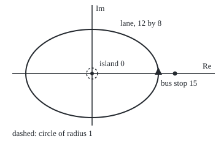
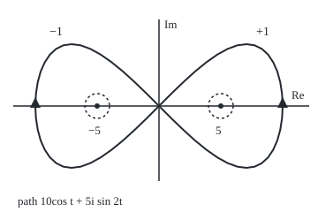

# Deforming a loop: slide it anywhere without crossing a singularity, and count how many times it winds

[Syllabus](../../../SYLLABUS.md) → [Complex analysis](../README.md) → [Contour Integrals and Cauchy's Theorem](../README.md#s03) → Deforming a loop

---

## General Overview

A car drives an oval roundabout: the lane runs 12 metres east and west of the island, 8 metres north and south. Put the plane on the map, east along the real axis, north up the imaginary axis, the island at 0. One lap anticlockwise, the usual direction, counts 1. Two laps count 2. A lap the wrong way counts −1. A bus stop 15 metres east, outside the lane, is circled 0 times.

That count has a formula: integrate 1/(z − a) round the loop, where a is the point circled, and divide by 2πi. The result, always a whole number, is called the **winding number** from here on.

It rests on [Cauchy's theorem](03-cauchys-theorem.md): a loop round a region with no hole gives 0. So a loop can be slid, stretched and shrunk freely, provided it never crosses a **singularity**, or hole for short, a point where the function has no value: here the island. The oval then gives the same integral as a small circle round the island.

A double roundabout has islands at 5 and −5. A figure-eight lap winds +1 round the east island and −1 round the west: its integral is one small circle per island, counted with sign.

**A loop may be slid anywhere without crossing a singularity and its integral does not change; so an integral round a loop is the sum, over the holes it circles, of a small circle's integral times the winding number, the whole number of times the loop goes round that hole.**

**What kind of fact this is:** a theorem, proved on this card in Why it works for the functions used here and in general on [The residue theorem](../05-Laurent%20Series%2C%20Singularities%20and%20Residues/05-the-residue-theorem.md); the winding number is a definition, and that it is whole is proved here.

### The picture: the oval lane, the island and the bus stop

<p align="center"></p>

To scale, 9 pixels per metre. The triangle at 12 + 0i shows the car heading north: anticlockwise. The dashed circle gives the same integral of dz/z as the lane.

---

## The formula

Notation first, in words. The loop integral sign $\oint$ means a contour integral once round a closed path ([Contour integrals](01-contour-integrals.md)). This card introduces the **winding number** $n(\gamma, a)$, read "n of gamma and a": the net anticlockwise laps the loop $\gamma$ (gamma) makes round the point $a$.

$$n(\gamma, a) = \frac{1}{2\pi i}\oint_\gamma \frac{dz}{z - a}$$

**Read it aloud:** integrate one over the arrow from the island to the car, once round, and divide by 2πi; the result counts laps.

Now let $f$ be holomorphic (it has a complex derivative) everywhere in the plane except at $m$ holes $a_1, \dots, a_m$, none on the loop, and let $C_k$ be a small anticlockwise circle round $a_k$ alone.

$$\oint_\gamma f(z)\,dz = \sum_{k=1}^{m} n(\gamma, a_k)\oint_{C_k} f(z)\,dz$$

**Read it aloud:** the loop's integral is each hole's small-circle integral times the loop's laps round that hole, added up.

For a building block $c_k/(z - a_k)$, with $c_k$ a fixed number called its strength, the small circle gives $2\pi i\,c_k$. The double roundabout's function is

$$f(z) = \frac{4z + 10}{z^2 - 25} = \frac{3}{z - 5} + \frac{1}{z + 5},$$

so its holes are 5 and −5, with strengths 3 and 1.

| Symbol | Plain meaning | In our example | Push it up and the answer… |
| --- | --- | --- | --- |
| $\gamma$, $\oint$ | a loop, the car's route; the integral once round it | the oval lane | more laps, bigger count |
| $z$ | a point on the loop: the car's position | 12 + 0i at the start | — |
| $a$ | the point circled | the island, 0 | past the lane, count 0 |
| $n(\gamma, a)$ | winding number: net anticlockwise laps round $a$ | 1, 2, −1; figure-eight +1 and −1 | integral grows by 2πi per lap |
| $f$ | a function holomorphic except at its holes | (4z + 10)/(z^2 − 25) | — |
| $a_k$, $c_k$, $m$ | the holes, their strengths, how many | 5 and −5; 3 and 1; 2 | bigger strength, bigger share |
| $C_k$, $r$ | small anticlockwise circle round one hole; its radius | radius 1 | no change |
| $t$, $i$ | the path's clock, in radians; the number with $i^2 = -1$ | 0 to 2π per lap | — |

### When it holds

- **No hole on the loop.** Through the island, $1/z$ has no value: the integral is undefined.
- **The loop is closed.** Stopped halfway, the arrow from the island has turned half a turn: only a loop ending where it began gives a whole number.
- **Sliding never crosses a hole.** Shift the lane 20 metres east so the island falls outside, and the integral of dz/z jumps from 6.283185i to 0.

---

## Why it works

### Step 0: the region between two loops decides

A loop surrounding only points where $f$ is holomorphic gives 0, so two loops differing only across such a region give the same integral.

### Step 1: one lap of a small circle gives 2πi

Walk a circle of radius $r$ round the island: $z = r(\cos t + i\sin t)$ as $t$ runs from 0 to 2π. Then $dz/dt = r(-\sin t + i\cos t) = i z$. So $dz/z = i\,dt$, and one lap gives $\int_0^{2\pi} i\,dt = 2\pi i$, whatever $r$ is.

With the island at $a_k$ and strength $c_k$ the same steps give $2\pi i\,c_k$: at 5 with strength 3, 18.849556i.

### Step 2: the oval can shrink to the small circle

Cut the ring between the oval and the radius-1 circle along the real axis, east and west of the island. It falls into an upper and a lower piece, neither containing the island, so Cauchy's theorem gives 0 round each. Add the two boundaries: the cuts are travelled once each way and cancel. What remains is the oval anticlockwise plus the small circle clockwise, summing to 0. So the oval equals the small circle, $2\pi i$. The checks find 6.283185i for the oval and for circles of radius 1 and 0.1.

<details>
<summary>Detailed proof: why Cauchy's theorem applies to each piece</summary>

The upper piece, edges included, avoids the ray running straight down from 0. The plane minus that ray is star-shaped about $i$: the segment from $i$ to any point off the ray stays off it. On a star-shaped region a holomorphic function has an antiderivative ([Antiderivatives](02-antiderivatives-and-path-independence.md)), so every closed path there gives 0; $1/z$ is holomorphic off 0. The lower piece avoids the upward ray and gives 0 the same way. Nothing here used the oval's shape: any two loops joined by cuts into hole-free pieces give equal integrals.

</details>

### Step 3: the winding number is a whole number

Write $z - a$, the arrow from the island to the car, in polar form. Then $dz/(z - a)$ has a real part, the change in the logarithm of the arrow's length, and an imaginary part, the change in its angle. Back at the start the length is unchanged, so the real part totals 0. The angle has turned through whole turns, $2\pi$ each. Divide by $2\pi i$ and a whole number remains.

That is the checks' second road. They follow the arrow in 100000 small steps, add each step's turn, read off by atan2 (the angle of a point, in (−π, π]), and divide by 2π: 1.000000, 2.000000 and −1.000000 for the three laps, matching the integral.

<details>
<summary>Detailed proof: the integral is 2πi times a whole number</summary>

Let $\gamma(t)$, $0 \le t \le T$, be a closed path avoiding $a$. Define $h(t) = \int_0^t \gamma'(s)/(\gamma(s) - a)\,ds$. The function $(\gamma(t) - a)\,e^{-h(t)}$ has derivative $\gamma' e^{-h} - (\gamma - a)\,h' e^{-h} = 0$, so it is constant. Since $\gamma(T) = \gamma(0)$, this forces $e^{-h(T)} = 1$. The exponential is 1 exactly at whole multiples of $2\pi i$ ([Euler's formula](../01-Complex%20Numbers%20and%20the%20Plane/04-eulers-formula.md)), and $h(T)$ is the loop integral. Moving $a$ without touching the loop changes $h(T)$ continuously, so the whole number stays fixed, and it is 0 for $a$ far away.

</details>

### Step 4: several holes, each with its own small circle

The double roundabout's $f$ splits into $3/(z - 5)$ and $1/(z + 5)$. By the winding number's definition, the pieces give $3 \cdot 2\pi i \cdot n(\gamma, 5)$ and $1 \cdot 2\pi i \cdot n(\gamma, -5)$ round the figure-eight. The small circle round 5 sees only the first piece, since the second is holomorphic on a disc containing that circle. So:

$$\oint_\gamma f\,dz = (+1)(2\pi i \cdot 3) + (-1)(2\pi i \cdot 1) = 4\pi i.$$

For a general $f$, subtract near each hole the part that blows up there ([Laurent series](../05-Laurent%20Series%2C%20Singularities%20and%20Residues/01-laurent-series.md)); the remainder gives 0, and so do the powers beyond the first. The full statement is [The residue theorem](../05-Laurent%20Series%2C%20Singularities%20and%20Residues/05-the-residue-theorem.md). Topology counts the same laps by deforming loops alone, with no integral: The circle's fundamental group is the integers.

### The picture: the figure-eight round two islands

<p align="center"></p>

To scale, 14 pixels per metre; t runs from 0 to 2π. Both triangles point north: anticlockwise round 5, clockwise round −5. Dashed circles have radius 1.

---

## Worked numbers, by hand

| Step | Arithmetic | Value |
| --- | --- | --- |
| small circle round the island | $dz/z = i\,dt$, one lap is 2π of $t$ | 2πi = 6.283185i |
| the oval lane, once | same as the circle, by Step 2 | **n = 1** |
| two laps; the wrong way | 2 × 2πi and −2πi, divided by 2πi | **2 and −1** |
| bus stop at 15 | shrink the lane to a point away from 15 | **0** |
| strengths of $f$ | drop the factor z − 5, put z = 5: 30/10; drop z + 5, put z = −5: −10/−10 | 3 and 1 |
| small circles | 2πi × 3 and 2πi × 1 | 18.849556i and 6.283185i |
| figure-eight | (+1)(18.849556i) + (−1)(6.283185i) | **12.566371i = 4πi** |
| the oval lane round both | (+1)(18.849556i) + (+1)(6.283185i) | **25.132741i = 8πi** |

The figure-eight gives half the big loop's value: it subtracts the weaker hole instead of adding it.

### What breaks if you drop a piece

| Mistake | Comes out at | What went wrong |
| --- | --- | --- |
| Lane slid 20 m east, past the island | 0 for dz/z, not 6.283185i | The slide crossed the singularity |
| Figure-eight direction ignored | 25.132741i, not 12.566371i | The west island's circle must count −1 |
| Two laps counted as "inside, so once" | 6.283185i, not 12.566371i | Winding counts laps |

The code prints all three.

---

## Code, from first principles, and it actually runs

Two independent roads. Road one is a trapezoid sum of $f(z)\,dz$ along short chords of each path; its error falls about a hundredfold per tenfold more steps. Road two never integrates: it adds up the arrow's turns with atan2. The small circles and counted windings rebuild the figure-eight's integral.

### Python

```python
# Deforming a loop and winding numbers -- the check behind the card.  Standard
# library only.  Metres.  An oval roundabout lane, 12 by 8, round an island at 0;
# a double roundabout with islands at 5 and -5, driven as a figure-eight.
# Road one: a trapezoid sum of f(z) dz along the path.  Road two: add up, step
# by step with atan2, how far the arrow from the island to the car turns.
import math
TAU, N = 2 * math.pi, 100000
def clean(x): return 0.0 if abs(x) < 5e-7 else x
def fmt(z): return f"{clean(z.real):.6f} {'-' if clean(z.imag) < 0 else '+'} {abs(clean(z.imag)):.6f}i"
def path(curve, t0, t1, n): return [curve(t0 + (t1 - t0) * k / n) for k in range(n + 1)]
def integral(f, zs): return sum((f(u) + f(v)) / 2 * (v - u) for u, v in zip(zs, zs[1:]))
def turns(zs, a):
    steps = ((w - a) / (v - a) for v, w in zip(zs, zs[1:]))
    return sum(math.atan2(s.imag, s.real) for s in steps) / TAU
def pole(a): return lambda z: 1 / (z - a)
def oval(t, shift=0): return complex(12 * math.cos(t) + shift, 8 * math.sin(t))
def eight(t): return complex(10 * math.cos(t), 5 * math.sin(2 * t))
def ring(c, r): return lambda t: c + complex(r * math.cos(t), r * math.sin(t))
def f(z): return (4 * z + 10) / (z * z - 25)          # = 3/(z - 5) + 1/(z + 5)
def fig(z, sc, ox, oy): return f"({ox + sc * z.real:.0f}, {oy - sc * z.imag:.0f})"
print(f"figure, lane: scale 9 px per m, island {fig(0j, 9, 150, 120)}, lane east {fig(oval(0), 9, 150, 120)}, "
      f"lane north {fig(oval(TAU / 4), 9, 150, 120)}, bus stop {fig(15 + 0j, 9, 150, 120)}")
print(f"figure, eight: scale 14 px per m, islands {fig(5 + 0j, 14, 180, 120)} and {fig(-5 + 0j, 14, 180, 120)}, "
      f"ends {fig(eight(0), 14, 180, 120)} and {fig(eight(math.pi), 14, 180, 120)}, lobe top {fig(eight(math.pi / 4), 14, 180, 120)}")
laps = [("one lap", path(oval, 0, TAU, N), 1), ("two laps", path(oval, 0, 2 * TAU, 2 * N), 2),
        ("wrong way", path(oval, TAU, 0, N), -1)]
for name, zs, hand in laps:
    n1, n2 = integral(pole(0), zs) / (TAU * 1j), turns(zs, 0)
    print(f"{name} round island 0: integral / 2 pi i = {fmt(n1)}; turns counted = {clean(n2):.6f}")
    assert abs(n1 - n2) < 1e-6 and round(n2) == hand                   # two roads agree, and match the hand count
lane, bus = laps[0][1], 15 + 0j
print(f"bus stop at 15, outside the lane: integral / 2 pi i = {fmt(integral(pole(bus), lane) / (TAU * 1j))}; turns counted = {clean(turns(lane, bus)):.6f}")
small = [integral(pole(0), path(ring(0, r), 0, TAU, N)) for r in (1, 0.1)]
big = integral(pole(0), lane)
print(f"integral of dz/z: oval lane {fmt(big)}; circle radius 1 {fmt(small[0])}; radius 0.1 {fmt(small[1])}; 2 pi = {TAU:.6f}")
assert abs(big - small[0]) < 1e-5 and abs(small[0] - small[1]) < 1e-5  # deformation: three loops, one value
e8 = path(eight, 0, TAU, N)
w5, wm5 = turns(e8, 5), turns(e8, -5)
print(f"figure-eight winding about 5: integral / 2 pi i = {fmt(integral(pole(5), e8) / (TAU * 1j))}; turns counted = {w5:.6f}")
print(f"figure-eight winding about -5: integral / 2 pi i = {fmt(integral(pole(-5), e8) / (TAU * 1j))}; turns counted = {wm5:.6f}")
h5, hm5 = (integral(f, path(ring(c, 1), 0, TAU, N)) for c in (5, -5))
holes = round(w5) * h5 + round(wm5) * hm5
print(f"small circles round the holes of f: at 5 {fmt(h5)}; at -5 {fmt(hm5)}; winding-weighted sum {fmt(holes)}")
errs = [abs(integral(f, path(eight, 0, TAU, n)) - holes) for n in (100, 1000, 10000)]
print(f"cancellation, 1/(z - 5) + 1/(z + 5) round the figure-eight: {fmt(integral(lambda z: 1 / (z - 5) + 1 / (z + 5), e8))}")
print(f"f round the figure-eight directly, {N} steps: {fmt(integral(f, path(eight, 0, TAU, N)))}; error at 100, 1000, 10000 steps: "
      + ", ".join(f"{e:.2e}" for e in errs))
assert (round(w5), round(wm5)) == (1, -1) and abs(holes - 2 * TAU * 1j) < 1e-5 \
    and errs[2] < 1e-5 and errs[0] > errs[1] > errs[2]  # windings +1, -1; 4 pi i by hand; direct sum agrees, error shrinking
both = integral(f, lane)
print(f"f round the oval lane, both holes inside: {fmt(both)}; 2 pi i (3 + 1) = {fmt(TAU * 4j)}")
assert abs(both - (h5 + hm5)) < 1e-5 and abs(both - TAU * 4j) < 1e-5   # big loop = both circles = 2 pi i (3 + 1)
print(f"mistake 1, lane slid 20 m east past the island: integral of dz/z = {fmt(integral(pole(0), path(lambda t: oval(t, 20), 0, TAU, N)))}, not {fmt(big)}")
print(f"mistake 2, figure-eight with direction ignored: {fmt(h5 + hm5)}, not {fmt(holes)}")
print(f"mistake 3, two laps counted as 'inside, so once': {fmt(TAU * 1j)}, not {fmt(integral(pole(0), laps[1][1]))}")
print("ALL CHECKS PASS")
```

**Ran 2026-09-28 on macOS, Python 3.14.6, standard library only. All checks passed. Output, pasted from the run:**

```
figure, lane: scale 9 px per m, island (150, 120), lane east (258, 120), lane north (150, 48), bus stop (285, 120)
figure, eight: scale 14 px per m, islands (250, 120) and (110, 120), ends (320, 120) and (40, 120), lobe top (279, 50)
one lap round island 0: integral / 2 pi i = 1.000000 + 0.000000i; turns counted = 1.000000
two laps round island 0: integral / 2 pi i = 2.000000 + 0.000000i; turns counted = 2.000000
wrong way round island 0: integral / 2 pi i = -1.000000 + 0.000000i; turns counted = -1.000000
bus stop at 15, outside the lane: integral / 2 pi i = 0.000000 + 0.000000i; turns counted = 0.000000
integral of dz/z: oval lane 0.000000 + 6.283185i; circle radius 1 0.000000 + 6.283185i; radius 0.1 0.000000 + 6.283185i; 2 pi = 6.283185
figure-eight winding about 5: integral / 2 pi i = 1.000000 + 0.000000i; turns counted = 1.000000
figure-eight winding about -5: integral / 2 pi i = -1.000000 + 0.000000i; turns counted = -1.000000
small circles round the holes of f: at 5 0.000000 + 18.849556i; at -5 0.000000 + 6.283185i; winding-weighted sum 0.000000 + 12.566371i
cancellation, 1/(z - 5) + 1/(z + 5) round the figure-eight: 0.000000 + 0.000000i
f round the figure-eight directly, 100000 steps: 0.000000 + 12.566371i; error at 100, 1000, 10000 steps: 2.26e-02, 2.26e-04, 2.25e-06
f round the oval lane, both holes inside: 0.000000 + 25.132741i; 2 pi i (3 + 1) = 0.000000 + 25.132741i
mistake 1, lane slid 20 m east past the island: integral of dz/z = 0.000000 + 0.000000i, not 0.000000 + 6.283185i
mistake 2, figure-eight with direction ignored: 0.000000 + 25.132741i, not 0.000000 + 12.566371i
mistake 3, two laps counted as 'inside, so once': 0.000000 + 6.283185i, not 0.000000 + 12.566371i
ALL CHECKS PASS
```

### Rust

Same numbers, same labels, built with `rustc --edition 2021 -O`; a small helper matches Python's exponent format.

```rust
// Deforming a loop and winding numbers -- the same check as the Python, in Rust.
// No crates.  Metres.  An oval lane, 12 by 8, round an island at 0; a double
// roundabout with islands at 5 and -5, driven as a figure-eight.  Road one: a
// trapezoid sum of f(z) dz along the path.  Road two: add up the arrow's turns.
use std::f64::consts::PI;
use std::ops::{Add, Div, Mul, Sub};
#[derive(Clone, Copy)]
struct C { re: f64, im: f64 }
fn c(re: f64, im: f64) -> C { C { re, im } }
impl Add for C { type Output = C; fn add(self, o: C) -> C { c(self.re + o.re, self.im + o.im) } }
impl Sub for C { type Output = C; fn sub(self, o: C) -> C { c(self.re - o.re, self.im - o.im) } }
impl Mul for C { type Output = C; fn mul(self, o: C) -> C { c(self.re * o.re - self.im * o.im, self.re * o.im + self.im * o.re) } }
impl Div for C { type Output = C; fn div(self, o: C) -> C { let d = o.re * o.re + o.im * o.im;
    c((self.re * o.re + self.im * o.im) / d, (self.im * o.re - self.re * o.im) / d) } }
fn r(x: f64) -> C { c(x, 0.0) }
fn abs(z: C) -> f64 { (z.re * z.re + z.im * z.im).sqrt() }
fn clean(x: f64) -> f64 { if x.abs() < 5e-7 { 0.0 } else { x } }
fn fmt(z: C) -> String {
    format!("{:.6} {} {:.6}i", clean(z.re), if clean(z.im) < 0.0 { "-" } else { "+" }, clean(z.im).abs())
}
fn path(g: &dyn Fn(f64) -> C, t0: f64, t1: f64, n: usize) -> Vec<C> { (0..=n).map(|k| g(t0 + (t1 - t0) * k as f64 / n as f64)).collect() }
fn integral(f: &dyn Fn(C) -> C, zs: &[C]) -> C {
    zs.windows(2).fold(r(0.0), |s, w| s + (f(w[0]) + f(w[1])) * r(0.5) * (w[1] - w[0]))
}
fn turns(zs: &[C], a: C) -> f64 { zs.windows(2).map(|w| { let s = (w[1] - a) / (w[0] - a); s.im.atan2(s.re) }).sum::<f64>() / (2.0 * PI) }
fn pole(a: C) -> impl Fn(C) -> C { move |z| r(1.0) / (z - a) }
fn oval(t: f64, shift: f64) -> C { c(12.0 * t.cos() + shift, 8.0 * t.sin()) }
fn eight(t: f64) -> C { c(10.0 * t.cos(), 5.0 * (2.0 * t).sin()) }
fn ring(z0: C, rad: f64) -> impl Fn(f64) -> C { move |t| z0 + c(rad * t.cos(), rad * t.sin()) }
fn f(z: C) -> C { (r(4.0) * z + r(10.0)) / (z * z - r(25.0)) }  // = 3/(z - 5) + 1/(z + 5)
fn fig(z: C, sc: f64, ox: f64, oy: f64) -> String { format!("({:.0}, {:.0})", ox + sc * z.re, oy - sc * z.im) }

fn main() {
    let (tau, n, i2p) = (2.0 * PI, 100000usize, c(0.0, 2.0 * PI));
    let lane_f = |t: f64| oval(t, 0.0);
    println!("figure, lane: scale 9 px per m, island {}, lane east {}, lane north {}, bus stop {}", fig(r(0.0), 9.0, 150.0, 120.0),
        fig(oval(0.0, 0.0), 9.0, 150.0, 120.0), fig(oval(tau / 4.0, 0.0), 9.0, 150.0, 120.0), fig(r(15.0), 9.0, 150.0, 120.0));
    println!("figure, eight: scale 14 px per m, islands {} and {}, ends {} and {}, lobe top {}", fig(r(5.0), 14.0, 180.0, 120.0),
        fig(r(-5.0), 14.0, 180.0, 120.0), fig(eight(0.0), 14.0, 180.0, 120.0), fig(eight(PI), 14.0, 180.0, 120.0), fig(eight(PI / 4.0), 14.0, 180.0, 120.0));
    let laps = [("one lap", path(&lane_f, 0.0, tau, n), 1.0), ("two laps", path(&lane_f, 0.0, 2.0 * tau, 2 * n), 2.0),
        ("wrong way", path(&lane_f, tau, 0.0, n), -1.0)];
    for (name, zs, hand) in laps.iter() {
        let (n1, n2) = (integral(&pole(r(0.0)), zs) / i2p, turns(zs, r(0.0)));
        println!("{} round island 0: integral / 2 pi i = {}; turns counted = {:.6}", name, fmt(n1), clean(n2));
        assert!(abs(n1 - r(n2)) < 1e-6 && n2.round() == *hand);          // two roads agree, and match the hand count
    }
    let (lane, bus) = (&laps[0].1, r(15.0));
    println!("bus stop at 15, outside the lane: integral / 2 pi i = {}; turns counted = {:.6}", fmt(integral(&pole(bus), lane) / i2p), clean(turns(lane, bus)));
    let small: Vec<C> = [1.0, 0.1].iter().map(|&rad| integral(&pole(r(0.0)), &path(&ring(r(0.0), rad), 0.0, tau, n))).collect();
    let big = integral(&pole(r(0.0)), lane);
    println!("integral of dz/z: oval lane {}; circle radius 1 {}; radius 0.1 {}; 2 pi = {:.6}", fmt(big), fmt(small[0]), fmt(small[1]), tau);
    assert!(abs(big - small[0]) < 1e-5 && abs(small[0] - small[1]) < 1e-5); // deformation: three loops, one value
    let e8 = path(&eight, 0.0, tau, n);
    let (w5, wm5) = (turns(&e8, r(5.0)), turns(&e8, r(-5.0)));
    println!("figure-eight winding about 5: integral / 2 pi i = {}; turns counted = {:.6}", fmt(integral(&pole(r(5.0)), &e8) / i2p), w5);
    println!("figure-eight winding about -5: integral / 2 pi i = {}; turns counted = {:.6}", fmt(integral(&pole(r(-5.0)), &e8) / i2p), wm5);
    let h5 = integral(&f, &path(&ring(r(5.0), 1.0), 0.0, tau, n));
    let hm5 = integral(&f, &path(&ring(r(-5.0), 1.0), 0.0, tau, n));
    let holes = r(w5.round()) * h5 + r(wm5.round()) * hm5;
    println!("small circles round the holes of f: at 5 {}; at -5 {}; winding-weighted sum {}", fmt(h5), fmt(hm5), fmt(holes));
    let errs: Vec<f64> = [100, 1000, 10000].iter().map(|&m| abs(integral(&f, &path(&eight, 0.0, tau, m)) - holes)).collect();
    let es: Vec<String> = errs.iter().map(|e| sci(*e)).collect();
    println!("cancellation, 1/(z - 5) + 1/(z + 5) round the figure-eight: {}", fmt(integral(&|z: C| r(1.0) / (z - r(5.0)) + r(1.0) / (z + r(5.0)), &e8)));
    println!("f round the figure-eight directly, {} steps: {}; error at 100, 1000, 10000 steps: {}", n, fmt(integral(&f, &e8)), es.join(", "));
    assert!(w5.round() == 1.0 && wm5.round() == -1.0 && abs(holes - i2p * r(2.0)) < 1e-5
        && errs[2] < 1e-5 && errs[0] > errs[1] && errs[1] > errs[2]); // windings +1, -1; 4 pi i by hand; direct sum agrees, error shrinking
    let both = integral(&f, lane);
    println!("f round the oval lane, both holes inside: {}; 2 pi i (3 + 1) = {}", fmt(both), fmt(i2p * r(4.0)));
    assert!(abs(both - (h5 + hm5)) < 1e-5 && abs(both - i2p * r(4.0)) < 1e-5); // big loop = both circles = 2 pi i (3 + 1)
    let shifted = path(&|t| oval(t, 20.0), 0.0, tau, n);
    println!("mistake 1, lane slid 20 m east past the island: integral of dz/z = {}, not {}", fmt(integral(&pole(r(0.0)), &shifted)), fmt(big));
    println!("mistake 2, figure-eight with direction ignored: {}, not {}", fmt(h5 + hm5), fmt(holes));
    println!("mistake 3, two laps counted as 'inside, so once': {}, not {}", fmt(i2p), fmt(integral(&pole(r(0.0)), &laps[1].1)));
    println!("ALL CHECKS PASS");
}
fn sci(x: f64) -> String { let e = x.log10().floor() as i32; format!("{:.2}e{}{:02}", x / 10f64.powi(e), if e < 0 { "-" } else { "+" }, e.abs()) }
```

**Ran 2026-09-28 on macOS, rustc 1.98.1, no crates. All checks passed. Output, pasted from the run:**

```
figure, lane: scale 9 px per m, island (150, 120), lane east (258, 120), lane north (150, 48), bus stop (285, 120)
figure, eight: scale 14 px per m, islands (250, 120) and (110, 120), ends (320, 120) and (40, 120), lobe top (279, 50)
one lap round island 0: integral / 2 pi i = 1.000000 + 0.000000i; turns counted = 1.000000
two laps round island 0: integral / 2 pi i = 2.000000 + 0.000000i; turns counted = 2.000000
wrong way round island 0: integral / 2 pi i = -1.000000 + 0.000000i; turns counted = -1.000000
bus stop at 15, outside the lane: integral / 2 pi i = 0.000000 + 0.000000i; turns counted = 0.000000
integral of dz/z: oval lane 0.000000 + 6.283185i; circle radius 1 0.000000 + 6.283185i; radius 0.1 0.000000 + 6.283185i; 2 pi = 6.283185
figure-eight winding about 5: integral / 2 pi i = 1.000000 + 0.000000i; turns counted = 1.000000
figure-eight winding about -5: integral / 2 pi i = -1.000000 + 0.000000i; turns counted = -1.000000
small circles round the holes of f: at 5 0.000000 + 18.849556i; at -5 0.000000 + 6.283185i; winding-weighted sum 0.000000 + 12.566371i
cancellation, 1/(z - 5) + 1/(z + 5) round the figure-eight: 0.000000 + 0.000000i
f round the figure-eight directly, 100000 steps: 0.000000 + 12.566371i; error at 100, 1000, 10000 steps: 2.26e-02, 2.26e-04, 2.25e-06
f round the oval lane, both holes inside: 0.000000 + 25.132741i; 2 pi i (3 + 1) = 0.000000 + 25.132741i
mistake 1, lane slid 20 m east past the island: integral of dz/z = 0.000000 + 0.000000i, not 0.000000 + 6.283185i
mistake 2, figure-eight with direction ignored: 0.000000 + 25.132741i, not 0.000000 + 12.566371i
mistake 3, two laps counted as 'inside, so once': 0.000000 + 6.283185i, not 0.000000 + 12.566371i
ALL CHECKS PASS
```

### Lean

Lean proves the three general facts for every loop and function that obey When it holds, and checks the worked arithmetic exactly.

- A loop's integral is the sum, over the holes, of its winding number round each hole times that hole's small-circle integral.
- This holds for any f holomorphic except at finitely many holes, and any closed loop of smooth pieces that misses them.
- Each small circle runs anticlockwise round one hole alone, with any radius that keeps the other holes outside.
- The winding number of a closed loop round any point off it is a whole number.
- For a building block c/(z − a), one anticlockwise lap of a circle round a gives 2πi c, whatever the radius.
- The double roundabout's f splits into 3/(z − 5) + 1/(z + 5), so its strengths are 3 and 1.
- Dividing 2 × 2πi and −2πi by 2πi gives 2 and −1. The figure-eight gives 4πi; the oval lane round both holes gives 8πi.
- The mistakes miss: direction ignored gives 8πi, not 4πi; two laps read as once give 2πi, not 4πi.

The decimals, and the laps each actual path makes, such as the figure-eight's +1 and −1, are left to the Python and Rust checks.

<details>
<summary>The Lean proof, 554 lines</summary>

```lean
-- Deforming a loop: for a function holomorphic except at finitely many holes, the integral round any closed piecewise smooth loop that misses the holes is the sum over the holes of the loop's winding number times a small circle's integral, the winding number is always a whole number, and a small circle round a hole of strength c gives 2πi c.
import Mathlib.MeasureTheory.Integral.CircleIntegral
import Mathlib.MeasureTheory.Integral.IntervalIntegral.Basic
import Mathlib.Analysis.Calculus.Deriv.Basic
import Mathlib.Analysis.SpecialFunctions.Trigonometric.Basic
import Mathlib

open Complex MeasureTheory Set

/-- The winding number n(γ, a) of a loop γ(t), 0 ≤ t ≤ T, with velocity γ'(t), round the point a:
the integral of dz/(z − a) once round the loop, divided by 2πi. -/
noncomputable def windingNumber (γ γ' : ℝ → ℂ) (T : ℝ) (a : ℂ) : ℂ :=
  (2 * Real.pi * I)⁻¹ * ∫ t in (0 : ℝ)..T, γ' t / (γ t - a)

section Helpers

open Metric

lemma ftc_off_finset {F F' : ℝ → ℂ} {T : ℝ} (E : Finset ℝ) (hT : 0 ≤ T)
    (hc : ContinuousOn F (Icc 0 T)) (hd : ∀ t ∈ Ioo 0 T \ (E : Set ℝ), HasDerivAt F (F' t) t)
    (hi : IntervalIntegrable F' volume 0 T) :
    ∫ t in (0 : ℝ)..T, F' t = F T - F 0 :=
  integral_eq_of_hasDerivAt_off_countable_of_le F F' hT E.countable_toSet hc hd hi

lemma winding_const (γ γ' : ℝ → ℂ) (T : ℝ) (E : Finset ℝ) (hT : 0 ≤ T) (hγ : Continuous γ)
    (hderiv : ∀ t ∈ Ioo 0 T \ (E : Set ℝ), HasDerivAt γ (γ' t) t)
    (hγ' : IntervalIntegrable γ' volume 0 T) (hclosed : γ 0 = γ T) (b z : ℂ)
    (hz : ∀ t, ‖z - b‖ < ‖γ t - b‖) :
    ∫ t in (0:ℝ)..T, γ' t / (γ t - z) = ∫ t in (0:ℝ)..T, γ' t / (γ t - b) := by
  have hb : ∀ t, γ t - b ≠ 0 := fun t h => by
    have := hz t; rw [h, norm_zero] at this; exact (norm_nonneg _).not_gt this
  have hzz : ∀ t, γ t - z ≠ 0 := fun t h => by
    have := hz t
    rw [show γ t - b = (γ t - z) + (z - b) by ring, h, zero_add] at this
    exact lt_irrefl _ this
  have hint : ∀ c : ℂ, (∀ t, γ t - c ≠ 0) →
      IntervalIntegrable (fun t => γ' t / (γ t - c)) volume 0 T := by
    intro c hc
    have : ContinuousOn (fun t => (γ t - c)⁻¹) (uIcc 0 T) :=
      ((hγ.sub continuous_const).inv₀ hc).continuousOn
    simpa [div_eq_mul_inv] using hγ'.mul_continuousOn this
  have hslit : ∀ t, (γ t - z) / (γ t - b) ∈ slitPlane := by
    intro t
    have h1 : (γ t - z) / (γ t - b) = 1 + (b - z) / (γ t - b) := by
      field_simp [hb t]; ring
    rw [h1]
    apply mem_slitPlane_of_norm_lt_one
    rw [norm_div, div_lt_one (norm_pos_iff.mpr (hb t)), norm_sub_rev]
    exact hz t
  have key : ∫ t in (0:ℝ)..T, (γ' t / (γ t - z) - γ' t / (γ t - b)) = 0 := by
    rw [ftc_off_finset (F := fun t => log ((γ t - z) / (γ t - b))) E hT ?_ ?_
      ((hint z hzz).sub (hint b hb))]
    · simp [hclosed]
    · exact fun t _ => (((hγ.sub continuous_const).div (hγ.sub continuous_const)
        hb).continuousAt.clog (hslit t)).continuousWithinAt
    · intro t ht
      have hd : HasDerivAt (fun t => (γ t - z) / (γ t - b))
          ((γ' t * (γ t - b) - (γ t - z) * γ' t) / (γ t - b) ^ 2) t :=
        ((hderiv t ht).sub_const z).div ((hderiv t ht).sub_const b) (hb t)
      convert hd.clog_real (hslit t) using 1
      field_simp [hb t, hzz t]
  rw [intervalIntegral.integral_sub (hint z hzz) (hint b hb)] at key
  exact sub_eq_zero.mp key

lemma sphere_sub_punctured {a : ℂ} {r R : ℝ} (hr : 0 < r) (hrR : r ≤ R) :
    sphere a r ⊆ closedBall a R \ {a} := by
  intro z hz
  rw [mem_sphere_iff_norm] at hz
  refine ⟨mem_closedBall_iff_norm.mpr (hz.le.trans hrR), ?_⟩
  rintro rfl
  simp at hz
  linarith

lemma kernel_indep {f : ℂ → ℂ} {U : Set ℂ} (hU : IsOpen U) (hf : DifferentiableOn ℂ f U)
    {a w : ℂ} {ρ₁ ρ₂ R : ℝ} (h1 : 0 < ρ₁) (h12 : ρ₁ ≤ ρ₂) (h2w : ρ₂ < ‖w - a‖) (hR : ρ₂ ≤ R)
    (hsub : closedBall a R \ {a} ⊆ U) :
    ∮ z in C(a, ρ₂), (z - w)⁻¹ • f z = ∮ z in C(a, ρ₁), (z - w)⁻¹ • f z := by
  have hmem : ∀ z ∈ closedBall a ρ₂ \ ball a ρ₁, z ∈ U ∧ z - w ≠ 0 := by
    rintro z ⟨hz1, hz2⟩
    rw [mem_closedBall_iff_norm] at hz1
    rw [mem_ball_iff_norm, not_lt] at hz2
    refine ⟨hsub ⟨mem_closedBall_iff_norm.mpr (by linarith), ?_⟩, ?_⟩
    · rintro rfl
      simp at hz2
      linarith
    · intro h
      rw [sub_eq_zero.mp h] at hz1
      linarith
  apply circleIntegral_eq_of_differentiable_on_annulus_off_countable h1 h12 countable_empty
  · intro z hz
    obtain ⟨hzU, hzw⟩ := hmem z hz
    exact (((continuousAt_id.sub continuousAt_const).inv₀ hzw).smul
      (hf.continuousOn.continuousAt (hU.mem_nhds hzU))).continuousWithinAt
  · intro z hz
    obtain ⟨hzU, hzw⟩ := hmem z ⟨ball_subset_closedBall hz.1.1,
      fun h => hz.1.2 (ball_subset_closedBall h)⟩
    exact ((differentiableAt_id.sub_const w).inv hzw).smul
      (hf.differentiableAt (hU.mem_nhds hzU))

lemma annulus_cauchy {f : ℂ → ℂ} {U : Set ℂ} (hU : IsOpen U) (hf : DifferentiableOn ℂ f U)
    {a w : ℂ} {ρ R : ℝ} (hρ : 0 < ρ) (hρw : ρ < ‖w - a‖) (hwR : ‖w - a‖ < R)
    (hsub : closedBall a R \ {a} ⊆ U) :
    (∮ z in C(a, R), (z - w)⁻¹ • f z) - (∮ z in C(a, ρ), (z - w)⁻¹ • f z)
      = (2 * Real.pi * I) * f w := by
  have hwa : w ≠ a := by
    rintro rfl; simp at hρw; linarith
  have hwU : w ∈ U := hsub ⟨mem_closedBall_iff_norm.mpr hwR.le, hwa⟩
  have hd : DifferentiableOn ℂ (dslope f w) U := (differentiableOn_dslope (hU.mem_nhds hwU)).mpr hf
  have hR : 0 < R := hρ.trans (hρw.trans hwR)
  have hannU : closedBall a R \ ball a ρ ⊆ U := by
    rintro z ⟨hz1, hz2⟩
    refine hsub ⟨hz1, ?_⟩
    rintro rfl
    exact hz2 (mem_ball_self hρ)
  have hann := circleIntegral_eq_of_differentiable_on_annulus_off_countable (f := dslope f w) hρ
    (hρw.le.trans hwR.le) countable_empty (hd.continuousOn.mono hannU)
    (fun z hz => hd.differentiableAt (hU.mem_nhds (hannU ⟨ball_subset_closedBall hz.1.1,
      fun h => hz.1.2 (ball_subset_closedBall h)⟩)))
  have e : ∀ r, 0 < r → r ≤ R → r ≠ ‖w - a‖ → EqOn (dslope f w)
      (fun z => (z - w)⁻¹ • f z - (z - w)⁻¹ • f w) (sphere a r) := by
    intro r _ _ hr z hz
    have hzw : z ≠ w := by
      rintro rfl; rw [mem_sphere_iff_norm] at hz; exact hr hz.symm
    simp only
    rw [dslope_of_ne _ hzw, slope_def_module, smul_sub]
  have hc : ∀ r, 0 < r → r ≤ R → r ≠ ‖w - a‖ →
      ContinuousOn (fun z => (z - w)⁻¹) (sphere a r) ∧ ContinuousOn f (sphere a r) := by
    intro r hr hrR hrw
    refine ⟨fun z hz => ?_, hf.continuousOn.mono ((sphere_sub_punctured hr hrR).trans hsub)⟩
    have hzw : z - w ≠ 0 := by
      intro h; rw [sub_eq_zero.mp h, mem_sphere_iff_norm] at hz; exact hrw hz.symm
    exact ((continuousAt_id.sub continuousAt_const).inv₀ hzw).continuousWithinAt
  obtain ⟨hcR1, hcR2⟩ := hc R hR le_rfl hwR.ne'
  obtain ⟨hcρ1, hcρ2⟩ := hc ρ hρ (hρw.le.trans hwR.le) hρw.ne
  have i1 : CircleIntegrable (fun z => (z - w)⁻¹ • f z) a R :=
    (hcR1.smul hcR2).circleIntegrable hR.le
  have i2 : CircleIntegrable (fun z => (z - w)⁻¹ • f w) a R :=
    (hcR1.smul continuousOn_const).circleIntegrable hR.le
  have i3 : CircleIntegrable (fun z => (z - w)⁻¹ • f z) a ρ :=
    (hcρ1.smul hcρ2).circleIntegrable hρ.le
  have i4 : CircleIntegrable (fun z => (z - w)⁻¹ • f w) a ρ :=
    (hcρ1.smul continuousOn_const).circleIntegrable hρ.le
  rw [circleIntegral.integral_congr hR.le (e R hR le_rfl hwR.ne'),
    circleIntegral.integral_congr hρ.le (e ρ hρ (hρw.le.trans hwR.le) hρw.ne),
    circleIntegral.integral_sub i1 i2, circleIntegral.integral_sub i3 i4,
    circleIntegral.integral_smul_const, circleIntegral.integral_smul_const,
    circleIntegral.integral_sub_inv_of_mem_ball (mem_ball_iff_norm.mpr hwR)] at hann
  have h0 : ∮ z in C(a, ρ), (z - w)⁻¹ = 0 := by
    apply circleIntegral_eq_zero_of_differentiable_on_off_countable hρ.le countable_empty
    · intro z hz
      have hzw : z - w ≠ 0 := by
        intro h; rw [sub_eq_zero.mp h, mem_closedBall_iff_norm] at hz; linarith
      exact ((continuousAt_id.sub continuousAt_const).inv₀ hzw).continuousWithinAt
    · intro z hz
      have hzw : z - w ≠ 0 := by
        intro h; rw [sub_eq_zero.mp h] at hz; have := mem_ball_iff_norm.mp hz.1; linarith
      exact (differentiableAt_id.sub_const w).inv hzw
  rw [h0, zero_smul, sub_zero, smul_eq_mul] at hann
  linear_combination hann

lemma ppart_eq {f : ℂ → ℂ} {U : Set ℂ} (hU : IsOpen U) (hf : DifferentiableOn ℂ f U)
    {a w : ℂ} {ρ R : ℝ} (hρ : 0 < ρ) (hρR : ρ ≤ R) (hρw : ρ < ‖w - a‖)
    (hsub : closedBall a R \ {a} ⊆ U) :
    ∮ z in C(a, min R ‖w - a‖ / 2), (z - w)⁻¹ • f z = ∮ z in C(a, ρ), (z - w)⁻¹ • f z := by
  have hR : 0 < R := hρ.trans_le hρR
  have hwa : 0 < ‖w - a‖ := hρ.trans hρw
  have hm : 0 < min R ‖w - a‖ := lt_min hR hwa
  have h1 : 0 < min R ‖w - a‖ / 2 := half_pos hm
  have h2 : min R ‖w - a‖ / 2 ≤ R := (half_le_self hm.le).trans (min_le_left _ _)
  have h3 : min R ‖w - a‖ / 2 < ‖w - a‖ := (half_lt_self hm).trans_le (min_le_right _ _)
  rcases le_total ρ (min R ‖w - a‖ / 2) with h | h
  · exact kernel_indep hU hf hρ h h3 h2 hsub
  · exact (kernel_indep hU hf h1 h hρw hρR hsub).symm

lemma ppart_differentiableAt {f : ℂ → ℂ} {U : Set ℂ} (hU : IsOpen U)
    (hf : DifferentiableOn ℂ f U) {a w₀ : ℂ} {R : ℝ} (hR : 0 < R) (hw₀ : w₀ ≠ a)
    (hsub : closedBall a R \ {a} ⊆ U) :
    DifferentiableAt ℂ (fun w => ∮ z in C(a, min R ‖w - a‖ / 2), (z - w)⁻¹ • f z) w₀ := by
  have hwa : 0 < ‖w₀ - a‖ := norm_pos_iff.mpr (sub_ne_zero.mpr hw₀)
  have hm : 0 < min R ‖w₀ - a‖ := lt_min hR hwa
  have h1 : 0 < min R ‖w₀ - a‖ / 2 := half_pos hm
  have h2 : min R ‖w₀ - a‖ / 2 ≤ R := (half_le_self hm.le).trans (min_le_left _ _)
  have h3 : min R ‖w₀ - a‖ / 2 < ‖w₀ - a‖ := (half_lt_self hm).trans_le (min_le_right _ _)
  have hev : (fun w => ∮ z in C(a, min R ‖w - a‖ / 2), (z - w)⁻¹ • f z) =ᶠ[nhds w₀]
      fun w => ∮ z in C(a, min R ‖w₀ - a‖ / 2), (z - w)⁻¹ • f z := by
    have : {w : ℂ | min R ‖w₀ - a‖ / 2 < ‖w - a‖} ∈ nhds w₀ :=
      (isOpen_lt continuous_const (continuous_id.sub continuous_const).norm).mem_nhds h3
    filter_upwards [this] with w hw
    exact ppart_eq hU hf h1 h2 hw hsub
  have hci : CircleIntegrable f a (min R ‖w₀ - a‖ / 2) :=
    ContinuousOn.circleIntegrable h1.le
      (hf.continuousOn.mono ((sphere_sub_punctured h1 h2).trans hsub))
  have hns : w₀ ∉ sphere a |min R ‖w₀ - a‖ / 2| := by
    rw [abs_of_pos h1, mem_sphere_iff_norm]; exact h3.ne'
  exact (hasDerivAt_circleIntegral_sub_inv_smul hci hns).differentiableAt.congr_of_eventuallyEq hev
lemma fubini_curve_circle (γ γ' : ℝ → ℂ) (T : ℝ) (hT : 0 ≤ T) (hγ : Continuous γ)
    (hγ' : IntervalIntegrable γ' volume 0 T) (f : ℂ → ℂ) (b : ℂ) (ρ : ℝ)
    (hfc : Continuous (fun θ => f (circleMap b ρ θ)))
    (hsep : ∀ t θ, circleMap b ρ θ - γ t ≠ 0) :
    ∫ t in (0:ℝ)..T, (∮ z in C(b, ρ), (z - γ t)⁻¹ • f z) * γ' t
      = ∮ z in C(b, ρ), (∫ t in (0:ℝ)..T, γ' t / (z - γ t)) • f z := by
  set K : ℝ → ℝ → ℂ := fun t θ =>
    (circleMap 0 ρ θ * I) * ((circleMap b ρ θ - γ t)⁻¹ * f (circleMap b ρ θ)) with hKdef
  have hK : Continuous (Function.uncurry K) := by
    have h1 : Continuous fun p : ℝ × ℝ => circleMap b ρ p.2 - γ p.1 :=
      ((continuous_circleMap b ρ).comp continuous_snd).sub (hγ.comp continuous_fst)
    have h2 := h1.inv₀ (fun p => hsep p.1 p.2)
    exact (((continuous_circleMap 0 ρ).comp continuous_snd).mul continuous_const).mul
      (h2.mul (hfc.comp continuous_snd))
  have lhs : ∀ t, (∮ z in C(b, ρ), (z - γ t)⁻¹ • f z) * γ' t
      = ∫ θ in (0:ℝ)..2 * Real.pi, K t θ * γ' t := by
    intro t
    rw [circleIntegral, ← intervalIntegral.integral_mul_const]
    simp [deriv_circleMap, hKdef]
  have rhs : (∮ z in C(b, ρ), (∫ t in (0:ℝ)..T, γ' t / (z - γ t)) • f z)
      = ∫ θ in (0:ℝ)..2 * Real.pi, ∫ t in (0:ℝ)..T, K t θ * γ' t := by
    rw [circleIntegral]
    refine intervalIntegral.integral_congr (fun θ _ => ?_)
    have : ∀ t, K t θ * γ' t = (circleMap 0 ρ θ * I * f (circleMap b ρ θ)) *
        (γ' t / (circleMap b ρ θ - γ t)) := fun t => by simp only [hKdef]; ring
    simp only [this, intervalIntegral.integral_const_mul, deriv_circleMap, smul_eq_mul]
    ring
  rw [intervalIntegral.integral_congr (fun t _ => lhs t), rhs]
  simp_rw [intervalIntegral.integral_of_le hT, intervalIntegral.integral_of_le Real.two_pi_pos.le]
  apply integral_integral_swap
  have hg : Integrable (fun p : ℝ × ℝ => γ' p.1)
      ((volume.restrict (Ioc 0 T)).prod (volume.restrict (Ioc 0 (2 * Real.pi)))) :=
    (hγ'.1).comp_fst _
  obtain ⟨C, hC⟩ := (isCompact_Icc.prod isCompact_Icc).exists_bound_of_continuousOn
    (hK.continuousOn (s := Icc 0 T ×ˢ Icc 0 (2 * Real.pi)))
  refine hg.bdd_mul (c := C) hK.aestronglyMeasurable ?_
  rw [Measure.prod_restrict]
  exact ae_restrict_of_forall_mem (measurableSet_Ioc.prod measurableSet_Ioc)
    (fun x hx => hC x ⟨Ioc_subset_Icc_self hx.1, Ioc_subset_Icc_self hx.2⟩)

lemma isSimplyConnected_univ_real : IsSimplyConnected (univ : Set ℝ) := by
  have : ContractibleSpace (univ : Set ℝ) := convex_univ.contractibleSpace univ_nonempty
  exact SimplyConnectedSpace.ofContractible _

/-- derivative of a continuous logarithm of a differentiable nonvanishing function -/
lemma hasDerivAt_of_exp_eq {ℓ h : ℝ → ℂ} {t : ℝ} {h' : ℂ} (hℓ : ContinuousAt ℓ t)
    (hexp : ∀ s, exp (ℓ s) = h s) (hh : HasDerivAt h h' t) (h0 : h t ≠ 0) :
    HasDerivAt ℓ (h' / h t) t := by
  have hev : ∀ᶠ s in nhds t, ℓ s = ℓ t + log (h s / h t) := by
    have hc : Filter.Tendsto (fun s => (ℓ s - ℓ t).im) (nhds t) (nhds 0) := by
      have h2 : ContinuousAt (fun s => (ℓ s - ℓ t).im) t :=
        Complex.continuous_im.continuousAt.comp (hℓ.sub continuousAt_const)
      simpa using h2.tendsto
    have hpi : (0:ℝ) ∈ Ioo (-Real.pi) Real.pi := ⟨by linarith [Real.pi_pos], Real.pi_pos⟩
    filter_upwards [hc (Ioo_mem_nhds hpi.1 hpi.2)] with s hs
    have : h s / h t = exp (ℓ s - ℓ t) := by
      rw [← hexp, ← hexp, exp_sub]
    rw [this, log_exp hs.1 hs.2.le]; ring
  have hq : HasDerivAt (fun s => h s / h t) (h' / h t) t := hh.div_const _
  have hq1 : h t / h t ∈ slitPlane := by rw [div_self h0]; exact one_mem_slitPlane
  have := (hq.clog_real hq1).const_add (ℓ t)
  rw [div_self h0, div_one] at this
  exact this.congr_of_eventuallyEq hev

lemma loop_aux (f : ℂ → ℂ) (S : Finset ℂ) (hf : DifferentiableOn ℂ f (↑S)ᶜ)
    (γ γ' : ℝ → ℂ) (T : ℝ) (E : Finset ℝ) (hT : 0 ≤ T) (hγ : Continuous γ)
    (hderiv : ∀ t ∈ Ioo 0 T \ (E : Set ℝ), HasDerivAt γ (γ' t) t)
    (hγ' : IntervalIntegrable γ' volume 0 T) (hclosed : γ 0 = γ T)
    (hrange : ∀ t, ∃ s ∈ Icc 0 T, γ t = γ s)
    (hoff : ∀ t, γ t ∉ S)
    (r : ℂ → ℝ) (hr : ∀ a ∈ S, 0 < r a)
    (halone : ∀ a ∈ S, ∀ b ∈ S, b ≠ a → r a < ‖b - a‖) :
    ∫ t in (0 : ℝ)..T, f (γ t) * γ' t
      = ∑ a ∈ S, windingNumber γ γ' T a * ∮ z in C(a, r a), f z := by
  classical
  set U : Set ℂ := (↑S)ᶜ with hUdef
  have hU : IsOpen U := S.finite_toSet.isClosed.isOpen_compl
  have hsub : ∀ a ∈ S, closedBall a (r a) \ {a} ⊆ U := by
    rintro a ha z ⟨hz1, hz2⟩ hzS
    have := halone a ha z hzS hz2
    rw [mem_closedBall_iff_norm] at hz1
    linarith
  have h2pi : (2 * Real.pi * I : ℂ) ≠ 0 := by simp [Real.pi_ne_zero, I_ne_zero]
  set P : ℂ → ℂ → ℂ := fun a w =>
    -(2 * Real.pi * I)⁻¹ * ∮ z in C(a, min (r a) ‖w - a‖ / 2), (z - w)⁻¹ • f z with hP
  have hPd : ∀ a ∈ S, ∀ w, w ≠ a → DifferentiableAt ℂ (P a) w := fun a ha w hw =>
    (ppart_differentiableAt hU hf (hr a ha) hw (hsub a ha)).const_mul _
  set K : ℂ → ℂ → ℂ := fun a w => (2 * Real.pi * I)⁻¹ * ∮ z in C(a, r a), (z - w)⁻¹ • f z
    with hKdef
  have hK : ∀ a ∈ S, ∀ w ∈ ball a (r a), w ≠ a → f w - P a w = K a w := by
    intro a ha w hw hwa
    have hwa' : 0 < ‖w - a‖ := norm_pos_iff.mpr (sub_ne_zero.mpr hwa)
    have hm : 0 < min (r a) ‖w - a‖ := lt_min (hr a ha) hwa'
    have := annulus_cauchy hU hf (half_pos hm) ((half_lt_self hm).trans_le (min_le_right _ _))
      (mem_ball_iff_norm.mp hw) (hsub a ha)
    simp only [hP, hKdef]
    have hf' : f w = (2 * Real.pi * I)⁻¹ * ((∮ z in C(a, r a), (z - w)⁻¹ • f z) -
        ∮ z in C(a, min (r a) ‖w - a‖ / 2), (z - w)⁻¹ • f z) := by
      rw [this, ← mul_assoc, inv_mul_cancel₀ h2pi, one_mul]
    rw [hf']
    ring
  have hKd : ∀ a ∈ S, DifferentiableAt ℂ (K a) a := by
    intro a ha
    have hci : CircleIntegrable f a (r a) := ContinuousOn.circleIntegrable (hr a ha).le
      (hf.continuousOn.mono ((sphere_sub_punctured (hr a ha) le_rfl).trans (hsub a ha)))
    have hns : a ∉ sphere a |r a| := by
      rw [abs_of_pos (hr a ha), mem_sphere_iff_norm, sub_self, norm_zero]
      exact (hr a ha).ne
    exact (hasDerivAt_circleIntegral_sub_inv_smul hci hns).differentiableAt.const_mul _
  set G : ℂ → ℂ := fun w =>
    if w ∈ S then K w w - ∑ b ∈ S.erase w, P b w else f w - ∑ b ∈ S, P b w with hGdef
  have hGd : Differentiable ℂ G := by
    intro w
    by_cases hw : w ∈ S
    · have hev : G =ᶠ[nhds w] fun v => K w v - ∑ b ∈ S.erase w, P b v := by
        filter_upwards [ball_mem_nhds w (hr w hw)] with v hv
        by_cases hvw : v = w
        · subst hvw; simp [hGdef, hw]
        · have hvS : v ∉ S := fun hvS => by
            have := halone w hw v hvS hvw
            rw [mem_ball_iff_norm] at hv
            linarith
          simp only [hGdef, hvS, ite_false]
          rw [← Finset.add_sum_erase S _ hw, ← hK w hw v hv hvw]
          ring
      refine DifferentiableAt.congr_of_eventuallyEq ?_ hev
      exact (hKd w hw).sub (DifferentiableAt.fun_sum fun b hb =>
        hPd b (Finset.mem_of_mem_erase hb) w (Finset.ne_of_mem_erase hb).symm)
    · have hev : G =ᶠ[nhds w] fun v => f v - ∑ b ∈ S, P b v := by
        filter_upwards [hU.mem_nhds hw] with v hv
        have hv' : v ∉ S := hv
        simp [hGdef, hv']
      refine DifferentiableAt.congr_of_eventuallyEq ?_ hev
      exact (hf.differentiableAt (hU.mem_nhds hw)).sub (DifferentiableAt.fun_sum fun b hb =>
        hPd b hb w (fun h => hw (h ▸ hb)))
  have hcomp : ∀ φ : ℂ → ℂ, (∀ t, ContinuousAt φ (γ t)) →
      IntervalIntegrable (fun t => φ (γ t) * γ' t) volume 0 T := fun φ hφ =>
    hγ'.continuousOn_mul
      (continuous_iff_continuousAt.mpr (fun t => (hφ t).comp hγ.continuousAt)).continuousOn
  obtain ⟨Φ, hΦ⟩ := hGd.isExactOn_univ
  have hG0 : ∫ t in (0:ℝ)..T, G (γ t) * γ' t = 0 := by
    rw [ftc_off_finset (F := fun t => Φ (γ t)) E hT ?_ ?_
      (hcomp G fun t => (hGd _).continuousAt)]
    · simp [hclosed]
    · exact (continuous_iff_continuousAt.mpr fun t =>
        (hΦ (γ t) (mem_univ _)).differentiableAt.continuousAt.comp hγ.continuousAt).continuousOn
    · intro t ht
      exact (hΦ (γ t) (mem_univ _)).comp t (hderiv t ht)
  have hPc : ∀ b ∈ S, IntervalIntegrable (fun t => P b (γ t) * γ' t) volume 0 T :=
    fun b hb => hcomp (P b) fun t => (hPd b hb (γ t) (fun h => hoff t (h ▸ hb))).continuousAt
  have hdecomp : ∀ t, f (γ t) * γ' t = G (γ t) * γ' t + ∑ b ∈ S, P b (γ t) * γ' t := by
    intro t
    simp only [hGdef, hoff t, ite_false]
    rw [← Finset.sum_mul]
    ring
  rw [intervalIntegral.integral_congr (fun t _ => hdecomp t),
    intervalIntegral.integral_add (hcomp G fun t => (hGd _).continuousAt)
      (by convert IntervalIntegrable.sum S hPc using 1; ext t; simp [Finset.sum_apply]),
    intervalIntegral.integral_finsetSum hPc, hG0, zero_add]
  refine Finset.sum_congr rfl fun b hb => ?_
  obtain ⟨t₀, -, hmin⟩ := isCompact_Icc.exists_isMinOn (nonempty_Icc.mpr hT)
    (hγ.sub continuous_const).norm.continuousOn (f := fun t => ‖γ t - b‖)
  have hδpos : 0 < ‖γ t₀ - b‖ := norm_pos_iff.mpr (sub_ne_zero.mpr (fun h => hoff t₀ (h ▸ hb)))
  have hδ : ∀ t, ‖γ t₀ - b‖ ≤ ‖γ t - b‖ := fun t => by
    obtain ⟨s, hs, hts⟩ := hrange t
    rw [hts]
    exact hmin hs
  set ρ := min (r b) (‖γ t₀ - b‖ / 2) with hρdef
  have hρpos : 0 < ρ := lt_min (hr b hb) (half_pos hδpos)
  have hρr : ρ ≤ r b := min_le_left _ _
  have hρδ : ρ < ‖γ t₀ - b‖ := (min_le_right _ _).trans_lt (half_lt_self hδpos)
  have hPγ : ∀ t, P b (γ t) = -(2 * Real.pi * I)⁻¹ * ∮ z in C(b, ρ), (z - γ t)⁻¹ • f z := by
    intro t
    simp only [hP]
    rw [ppart_eq hU hf hρpos hρr (hρδ.trans_le (hδ t)) (hsub b hb)]
  have hfc : Continuous fun θ => f (circleMap b ρ θ) :=
    hf.continuousOn.comp_continuous (continuous_circleMap b ρ) (fun θ =>
      (sphere_sub_punctured hρpos hρr).trans (hsub b hb) (circleMap_mem_sphere b hρpos.le θ))
  have hsep : ∀ t θ, circleMap b ρ θ - γ t ≠ 0 := by
    intro t θ h
    have h1 : ‖circleMap b ρ θ - b‖ = ρ :=
      mem_sphere_iff_norm.mp (circleMap_mem_sphere b hρpos.le θ)
    rw [sub_eq_zero.mp h] at h1
    linarith [hδ t]
  have hfub := fubini_curve_circle γ γ' T hT hγ hγ' f b ρ hfc hsep
  have hW : ∀ z ∈ sphere b ρ, (∫ t in (0:ℝ)..T, γ' t / (z - γ t))
      = -(2 * Real.pi * I * windingNumber γ γ' T b) := by
    intro z hz
    have e1 : (∫ t in (0:ℝ)..T, γ' t / (z - γ t)) = -∫ t in (0:ℝ)..T, γ' t / (γ t - z) := by
      rw [← intervalIntegral.integral_neg]
      refine intervalIntegral.integral_congr (fun t _ => ?_)
      rw [← neg_sub, div_neg]
    rw [e1, winding_const γ γ' T E hT hγ hderiv hγ' hclosed b z (fun t => by
      rw [mem_sphere_iff_norm.mp hz]; exact hρδ.trans_le (hδ t)), windingNumber]
    field_simp
  have hann : (∮ z in C(b, r b), f z) = ∮ z in C(b, ρ), f z := by
    have hannU : closedBall b (r b) \ ball b ρ ⊆ U := by
      rintro z ⟨hz1, hz2⟩
      refine hsub b hb ⟨hz1, ?_⟩
      rintro rfl
      exact hz2 (mem_ball_self hρpos)
    exact circleIntegral_eq_of_differentiable_on_annulus_off_countable hρpos hρr countable_empty
      (hf.continuousOn.mono hannU)
      (fun z hz => hf.differentiableAt (hU.mem_nhds (hannU ⟨ball_subset_closedBall hz.1.1,
        fun h => hz.1.2 (ball_subset_closedBall h)⟩)))
  calc ∫ t in (0:ℝ)..T, P b (γ t) * γ' t
      = -(2 * Real.pi * I)⁻¹ * ∫ t in (0:ℝ)..T, (∮ z in C(b, ρ), (z - γ t)⁻¹ • f z) * γ' t := by
        simp_rw [hPγ, mul_assoc]
        rw [intervalIntegral.integral_const_mul]
    _ = -(2 * Real.pi * I)⁻¹ * ∮ z in C(b, ρ), (-(2 * Real.pi * I * windingNumber γ γ' T b)) • f z := by
        rw [hfub, circleIntegral.integral_congr hρpos.le (fun z hz => by rw [hW z hz])]
    _ = windingNumber γ γ' T b * ∮ z in C(b, r b), f z := by
        rw [circleIntegral.integral_smul, smul_eq_mul, hann]
        field_simp

end Helpers

#print axioms ftc_off_finset
#print axioms winding_const
#print axioms sphere_sub_punctured
#print axioms kernel_indep
#print axioms annulus_cauchy
#print axioms ppart_eq
#print axioms ppart_differentiableAt
#print axioms fubini_curve_circle
#print axioms isSimplyConnected_univ_real
#print axioms hasDerivAt_of_exp_eq
#print axioms loop_aux

/-- A loop may be slid anywhere without crossing a hole, so its integral is the sum over the holes
of a small circle's integral times the winding number. Let f be holomorphic everywhere in the plane
except at finitely many holes (the finite set S). Let γ(t), 0 ≤ t ≤ T, be a loop made of finitely
many smooth pieces (velocity γ' off a finite set of corners), closed (it ends where it began), and
passing through no hole. For each hole a, let C(a, r a) be an anticlockwise circle round a alone:
radius r a > 0, and every other hole lies farther from a than r a. Then the integral of f round γ
equals the sum, over the holes a, of n(γ, a) times the integral of f round C(a, r a). -/
theorem loop_integral_eq_sum_winding_number_mul_small_circle
    (f : ℂ → ℂ) (S : Finset ℂ) (hf : DifferentiableOn ℂ f (↑S)ᶜ)
    (γ γ' : ℝ → ℂ) (T : ℝ) (E : Finset ℝ) (hT : 0 ≤ T)
    (hγ : ContinuousOn γ (Icc 0 T))
    (hderiv : ∀ t ∈ Ioo 0 T \ (E : Set ℝ), HasDerivAt γ (γ' t) t)
    (hγ' : IntervalIntegrable γ' volume 0 T)
    (hclosed : γ 0 = γ T)
    (hoff : ∀ t ∈ Icc 0 T, γ t ∉ S)
    (r : ℂ → ℝ) (hr : ∀ a ∈ S, 0 < r a)
    (halone : ∀ a ∈ S, ∀ b ∈ S, b ≠ a → r a < ‖b - a‖) :
    ∫ t in (0 : ℝ)..T, f (γ t) * γ' t
      = ∑ a ∈ S, windingNumber γ γ' T a * ∮ z in C(a, r a), f z := by
  set γ₁ : ℝ → ℂ := fun s => γ (projIcc 0 T hT s) with hγ₁
  have hγ₁c : Continuous γ₁ := hγ.comp_continuous
    (continuous_subtype_val.comp continuous_projIcc) (fun s => (projIcc 0 T hT s).2)
  have hγ₁I : ∀ s ∈ Icc 0 T, γ₁ s = γ s := fun s hs => by simp [hγ₁, projIcc_of_mem hT hs]
  have hderiv' : ∀ t ∈ Ioo 0 T \ (E : Set ℝ), HasDerivAt γ₁ (γ' t) t := fun t ht =>
    (hderiv t ht).congr_of_eventuallyEq (by
      filter_upwards [Ioo_mem_nhds ht.1.1 ht.1.2] with s hs
      exact hγ₁I s (Ioo_subset_Icc_self hs))
  have hclosed' : γ₁ 0 = γ₁ T := by
    rw [hγ₁I 0 ⟨le_rfl, hT⟩, hγ₁I T ⟨hT, le_rfl⟩, hclosed]
  have hrange : ∀ t, ∃ s ∈ Icc 0 T, γ₁ t = γ₁ s := fun t =>
    ⟨projIcc 0 T hT t, (projIcc 0 T hT t).2, by rw [hγ₁I _ (projIcc 0 T hT t).2]⟩
  have hoff' : ∀ t, γ₁ t ∉ S := fun t => hoff _ (projIcc 0 T hT t).2
  have e1 : ∫ t in (0:ℝ)..T, f (γ t) * γ' t = ∫ t in (0:ℝ)..T, f (γ₁ t) * γ' t :=
    intervalIntegral.integral_congr (fun t ht => by
      rw [uIcc_of_le hT] at ht
      simp only [hγ₁I t ht])
  have e2 : ∀ a, windingNumber γ γ' T a = windingNumber γ₁ γ' T a := fun a => by
    unfold windingNumber
    congr 1
    exact intervalIntegral.integral_congr (fun t ht => by
      rw [uIcc_of_le hT] at ht
      simp only [hγ₁I t ht])
  rw [e1, loop_aux f S hf γ₁ γ' T E hT hγ₁c hderiv' hγ' hclosed' hrange hoff' r hr halone]
  simp_rw [e2]

/-- The winding number is a whole number. For a closed loop γ(t), 0 ≤ t ≤ T, made of finitely many
smooth pieces and never passing through the point a, the integral of dz/(z − a) round it, divided
by 2πi, is an integer. -/
theorem winding_number_is_whole
    (γ γ' : ℝ → ℂ) (T : ℝ) (E : Finset ℝ) (hT : 0 ≤ T)
    (hγ : ContinuousOn γ (Icc 0 T))
    (hderiv : ∀ t ∈ Ioo 0 T \ (E : Set ℝ), HasDerivAt γ (γ' t) t)
    (hγ' : IntervalIntegrable γ' volume 0 T)
    (hclosed : γ 0 = γ T)
    (a : ℂ) (hoff : ∀ t ∈ Icc 0 T, γ t ≠ a) :
    ∃ n : ℤ, windingNumber γ γ' T a = n := by
  set g : ℝ → ℂ := fun s => γ (projIcc 0 T hT s) - a with hg
  have hgc : Continuous g := by
    have : Continuous fun s => γ (projIcc 0 T hT s) :=
      hγ.comp_continuous (continuous_subtype_val.comp continuous_projIcc)
        (fun s => (projIcc 0 T hT s).2)
    exact this.sub continuous_const
  have hg0 : ∀ s, g s ≠ 0 := fun s => sub_ne_zero.mpr (hoff _ (projIcc 0 T hT s).2)
  obtain ⟨ℓ, hℓc, hℓe⟩ := exists_continuousOn_eqOn_exp_comp isSimplyConnected_univ_real
    isOpen_univ hgc.continuousOn (by rintro ⟨x, -, hx⟩; exact hg0 x hx)
  have hℓc' : Continuous ℓ := continuousOn_univ.mp hℓc
  have hexp : ∀ s, exp (ℓ s) = g s := fun s => hℓe (mem_univ s)
  have hgI : ∀ s ∈ Icc 0 T, g s = γ s - a := fun s hs => by
    simp [hg, projIcc_of_mem hT hs]
  have hint : ∫ t in (0 : ℝ)..T, γ' t / (γ t - a) = ℓ T - ℓ 0 := by
    apply ftc_off_finset E hT hℓc'.continuousOn
    · intro t ht
      have htI : t ∈ Ioo 0 T := ht.1
      have hgd : HasDerivAt g (γ' t) t := by
        have hev : g =ᶠ[nhds t] fun s => γ s - a := by
          filter_upwards [Ioo_mem_nhds htI.1 htI.2] with s hs
          exact hgI s (Ioo_subset_Icc_self hs)
        exact ((hderiv t ht).sub_const a).congr_of_eventuallyEq hev
      have := hasDerivAt_of_exp_eq hℓc'.continuousAt hexp hgd (hg0 t)
      rwa [hgI t (Ioo_subset_Icc_self htI)] at this
    · have : ContinuousOn (fun t => (γ t - a)⁻¹) (uIcc 0 T) := by
        rw [uIcc_of_le hT]
        exact (hγ.sub continuousOn_const).inv₀ (fun t ht => sub_ne_zero.mpr (hoff t ht))
      simpa [div_eq_mul_inv] using hγ'.mul_continuousOn this
  have h1 : exp (ℓ T - ℓ 0) = 1 := by
    rw [exp_sub, hexp, hexp, hgI T ⟨hT, le_rfl⟩, hgI 0 ⟨le_rfl, hT⟩, hclosed,
      div_self (sub_ne_zero.mpr (hoff T ⟨hT, le_rfl⟩))]
  obtain ⟨n, hn⟩ := exp_eq_one_iff.mp h1
  refine ⟨n, ?_⟩
  rw [windingNumber, hint, hn]
  field_simp [Real.pi_ne_zero, I_ne_zero]

/-- One lap of a small circle gives 2πi times the strength. For a building block c/(z − a) with
strength c, one anticlockwise lap of the circle of radius r > 0 round a gives 2πi c, whatever r is. -/
theorem small_circle_integral_eq_two_pi_I_mul_strength (a c : ℂ) (r : ℝ) (hr : 0 < r) :
    (∮ z in C(a, r), c / (z - a)) = 2 * Real.pi * I * c := by
  have h : (fun z => c / (z - a)) = fun z => (z - a)⁻¹ • c := by
    ext z; rw [smul_eq_mul, div_eq_mul_inv, mul_comm]
  rw [h, circleIntegral.integral_smul_const,
    circleIntegral.integral_sub_inv_of_mem_ball (Metric.mem_ball_self hr), smul_eq_mul]

/-! The card's worked numbers, checked exactly. -/

-- the double roundabout's function splits: (4z + 10)/(z^2 − 25) = 3/(z − 5) + 1/(z + 5) off the holes
example (z : ℂ) (h5 : z - 5 ≠ 0) (hm5 : z + 5 ≠ 0) :
    (4 * z + 10) / (z ^ 2 - 25) = 3 / (z - 5) + 1 / (z + 5) := by
  have h : z ^ 2 - 25 = (z - 5) * (z + 5) := by ring
  rw [h, div_add_div _ _ h5 hm5]
  congr 1
  ring
-- the strengths: drop z − 5 and put z = 5, 30/10 = 3; drop z + 5 and put z = −5, −10/−10 = 1
example : ((4 * 5 + 10 : ℚ) / (5 + 5) = 3) ∧ ((4 * (-5) + 10 : ℚ) / (-5 - 5) = 1) := by norm_num
-- two laps and the wrong way: 2 × 2πi and −2πi, divided by 2πi, give 2 and −1
example : (2 * (2 * Real.pi * I)) / (2 * Real.pi * I) = 2 ∧
    (-(2 * Real.pi * I)) / (2 * Real.pi * I) = -1 := by
  have h : (2 * Real.pi * I) ≠ 0 := by
    simp [Real.pi_ne_zero, I_ne_zero]
  exact ⟨by field_simp, by field_simp⟩
-- figure-eight: (+1)(2πi · 3) + (−1)(2πi · 1) = 4πi
example : (1 : ℂ) * (2 * Real.pi * I * 3) + (-1) * (2 * Real.pi * I * 1) = 4 * Real.pi * I := by ring
-- the oval lane round both holes: (+1)(2πi · 3) + (+1)(2πi · 1) = 8πi
example : (1 : ℂ) * (2 * Real.pi * I * 3) + 1 * (2 * Real.pi * I * 1) = 8 * Real.pi * I := by ring
-- the same sums as multiples of 2πi: the figure-eight gives 2, the oval 4, half the big loop's value
example : (1 : ℤ) * 3 + (-1) * 1 = 2 ∧ (1 : ℤ) * 3 + 1 * 1 = 4 ∧ (2 : ℤ) * 2 = 4 := by decide
-- the mistakes: direction ignored gives 4 (8πi), not 2 (4πi); two laps read as once give 1, not 2
example : (1 : ℤ) * 3 + 1 * 1 ≠ 1 * 3 + (-1) * 1 ∧ (1 : ℤ) ≠ 2 := by decide

#print axioms loop_integral_eq_sum_winding_number_mul_small_circle
#print axioms winding_number_is_whole
#print axioms small_circle_integral_eq_two_pi_I_mul_strength
```

</details>

**Checked 2026-11-11 on macOS, Lean 4.36.0-rc2, Mathlib v4.36.0-rc2. Every proof is complete and uses only Lean's standard axioms. Output, pasted from the run:**

```
'ftc_off_finset' depends on axioms: [propext, Classical.choice, Quot.sound]
'winding_const' depends on axioms: [propext, Classical.choice, Quot.sound]
'sphere_sub_punctured' depends on axioms: [propext, Classical.choice, Quot.sound]
'kernel_indep' depends on axioms: [propext, Classical.choice, Quot.sound]
'annulus_cauchy' depends on axioms: [propext, Classical.choice, Quot.sound]
'ppart_eq' depends on axioms: [propext, Classical.choice, Quot.sound]
'ppart_differentiableAt' depends on axioms: [propext, Classical.choice, Quot.sound]
'fubini_curve_circle' depends on axioms: [propext, Classical.choice, Quot.sound]
'isSimplyConnected_univ_real' depends on axioms: [propext, Classical.choice, Quot.sound]
'hasDerivAt_of_exp_eq' depends on axioms: [propext, Classical.choice, Quot.sound]
'loop_aux' depends on axioms: [propext, Classical.choice, Quot.sound]
'loop_integral_eq_sum_winding_number_mul_small_circle' depends on axioms: [propext, Classical.choice, Quot.sound]
'winding_number_is_whole' depends on axioms: [propext, Classical.choice, Quot.sound]
'small_circle_integral_eq_two_pi_I_mul_strength' depends on axioms: [propext, Classical.choice, Quot.sound]
```

> [!TIP]
> **Try changing**
> - **Three laps.** Guess first. In the two-laps entry, change `2 * TAU, 2 * N), 2)` to `3 * TAU, 3 * N), 3)`: both roads read 3.000000.
> - **Bus stop inside.** Guess first. Move the bus stop from 15 to 11, inside the lane: both roads read 1.000000.
> - **Swap the strengths.** Guess first. Change `4 * z + 10` to `4 * z - 10`: the strengths become 1 and 3, the figure-eight reads −12.566371i, and the assert expecting 4πi fails.

---

## The usual mistake

> [!warning]
> **Reading a zero integral as "no holes inside".** Round the figure-eight, $1/(z - 5) + 1/(z + 5)$ gives 0 although the loop circles both holes: the two opposite windings cancel. Only a loop whose inside is all holomorphic is guaranteed 0.
>
> - **Direction dropped.** Counting every hole as +1 turns the figure-eight's 12.566371i into 25.132741i.
> - **"Inside" as yes-or-no.** Two laps give 12.566371i, not 6.283185i.
> - **Sliding across a hole.** Shifting the lane 20 metres east takes dz/z from 6.283185i to 0.

---

## Where you meet it in real life

- **Filling shapes on screen.** Vector graphics, SVG included, can fill by the "nonzero rule": a pixel is painted when the outline's winding number round it is not 0.
- **Feedback stability.** Counting how often a plotted loop winds round −1 decides whether an amplifier or autopilot is stable: [Nyquist and margins](../../13-Engineering%20mathematics/03-Feedback%20Control/06-nyquist-criterion-and-stability-margins.md).
- **Counting roots.** Winding a polynomial's value round 0 as its input circles a loop counts the roots inside ([The residue theorem](../05-Laurent%20Series%2C%20Singularities%20and%20Residues/05-the-residue-theorem.md)).

> **Say it back**
> A loop's integral is unchanged when the loop slides without crossing a hole. So any loop trades for small circles round its holes, each giving 2πi times the hole's strength. The winding number, the integral of dz/(z − a) over 2πi, counts net anticlockwise laps round a and is always whole. Each circle times its winding number, added up, is the loop's integral.

---

## What this builds on

- [Cauchy's theorem](03-cauchys-theorem.md): a loop round a hole-free region gives 0, the one fact every step here applies.

## Where this goes next

- [Cauchy's integral formula](05-cauchys-integral-formula.md): a small circle reads off $f$ at its centre.
- [Laurent series](../05-Laurent%20Series%2C%20Singularities%20and%20Residues/01-laurent-series.md): the part that blows up at a hole.
- [The residue theorem](../05-Laurent%20Series%2C%20Singularities%20and%20Residues/05-the-residue-theorem.md): the several-hole sum in general.
- [Nyquist and margins](../../13-Engineering%20mathematics/03-Feedback%20Control/06-nyquist-criterion-and-stability-margins.md): winding round −1 as a stability test.
- Jordan curve theorem: a loop that never crosses itself winds ±1 inside, 0 outside.
- The circle's fundamental group is the integers: winding without integrals.
- Turning and winding numbers: the turns of a curve's own direction.

A small circle round a hole gives 2πi times its strength; what the circle gives for $f(z)/(z - a)$, with $f$ holomorphic, is [Cauchy's integral formula](05-cauchys-integral-formula.md).

---

## Sources

Verified 2026-09-28: every link below resolves to the publisher's page.

- Stein, Elias M., and Rami Shakarchi. *Complex Analysis*. Princeton University Press, 2003. [Publisher page](https://press.princeton.edu/books/hardcover/9780691113852/complex-analysis). Cauchy's theorem for cut regions and deformed loops.
- Beck, Matthias, Gerald Marchesi, Dennis Pixton, and Lucas Sabalka. *A First Course in Complex Analysis*. [Book page and free full text](https://matthbeck.github.io/complex.html). Free; the winding number as an integral, and deformation of loops.
