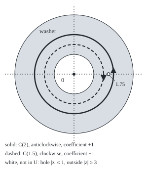

# Cauchy's theorem for cycles: a holomorphic function integrates to zero whenever the loops wind zero times round every point outside the domain

[Syllabus](../../../SYLLABUS.md) → [Complex analysis](../README.md) → [Contour Integrals and Cauchy's Theorem](../README.md#s03) → Cauchy's theorem for cycles

---

## General Overview

A round fountain has a pillar of radius 1 metre at its centre and a rim at radius 3 metres. Water pours evenly out of the pillar and runs in a thin flat sheet out to the rim, covering a washer: the ring 1 < |z| < 3 on the complex plane, centred at 0.

Write the water's velocity as u + iv (u east, v north). Here u − iv = 1/z, holomorphic (with a complex derivative) on the washer. Round a loop, (u − iv) dz multiplies out to (u dx + v dy) + i(u dy − v dx): the real part adds up the **circulation**, water running along the loop, and the imaginary part the **outflow**, water crossing it.

The circle of radius 2, run once anticlockwise, gives 2πi, about 6.283185i: no circulation, and an outflow of 6.283185 cubic metres per second per metre of depth. The circle of radius 1.5 gives the same. Neither is 0: each goes round the hole, so [Cauchy's theorem](03-cauchys-theorem.md) cannot apply.

Run the big circle forwards and the small one backwards, as one object, and the integral is 2πi − 2πi = 0: the band between the circles, holding no spring or drain, lets out the water it takes in. The pair makes a net 0 laps round the hole and round every point beyond the rim.

That object is a **cycle**: a sum of closed paths with whole-number coefficients. [Deforming a loop](04-deforming-contours-and-winding-numbers.md) matched these circles by cutting the band into hole-free pieces; this card replaces the cutting with a count of laps round the points outside the washer.

**If a function is holomorphic on an open set U (here the washer), and a cycle in U winds zero times round every point outside U, then the function integrates to zero over the cycle.**

**What kind of fact this is:** a theorem, proved here by Dixon's 1971 argument, with one lemma sketched from a textbook.

### The picture: the washer and the cycle

<p align="center"></p>

To scale, 40 pixels per unit, 0 at (150, 150); the open dot is the point 1.75.

---

## The formula

An **open set** U holds a small disc round each of its points; unlike a region, it need not be in one piece. The **winding number** $`n(\gamma, a)`$ counts the net anticlockwise laps a closed path $`\gamma`$ makes round a point $`a`$ off it ([Deforming a loop](04-deforming-contours-and-winding-numbers.md)).

A cycle $`\sigma`$ (sigma) is a list of closed paths $`\gamma_1, \dots, \gamma_m`$ with whole-number coefficients $`n_1, \dots, n_m`$: 2 means "run it twice", −1 "run it backwards". Integrals and winding numbers add up path by path:

```math
\oint_\sigma f(z)\,dz = \sum_{k=1}^{m} n_k \oint_{\gamma_k} f(z)\,dz, \qquad n(\sigma, a) = \sum_{k=1}^{m} n_k\, n(\gamma_k, a)
```

**Read it aloud:** the cycle's integral and its laps round a point are each path's, times its coefficient, added up.

The cycle is **homologous to zero in U** when $`n(\sigma, a) = 0`$ for every $`a`$ not in U. The theorem:

```math
n(\sigma, a) = 0 \text{ for every } a \notin U \quad\Longrightarrow\quad \oint_\sigma f(z)\,dz = 0 \text{ for every } f \text{ holomorphic on } U
```

**Read it aloud:** if the cycle winds zero times round everything outside U, every function holomorphic on U integrates to zero over it.

Under the same conditions ($`\sigma`$ homologous to zero in U, $`f`$ holomorphic on U), the proof gives Cauchy's integral formula for cycles, for $`z`$ in U off σ:

```math
n(\sigma, z)\, f(z) = \frac{1}{2\pi i}\oint_\sigma \frac{f(w)}{w - z}\,dw
```

C(r) is the circle of radius r round 0, run anticlockwise; the example cycle is σ = C(2) − C(1.5).

| Symbol | Plain meaning | In our example | Push it up and the answer… |
| --- | --- | --- | --- |
| $`U`$ | the open set where $`f`$ is holomorphic | the washer | — |
| $`\gamma_k`$, $`n_k`$, $`m`$ | the m closed paths and their coefficients; C(r) has radius r | C(2), +1; C(1.5), −1 | coefficient −2: not homologous to zero |
| $`\sigma`$, $`\oint_\sigma`$ | the cycle; its integral | C(2) − C(1.5); 0 for 1/z | — |
| $`n(\sigma, a)`$, $`a`$ | net laps round the point $`a`$ | 0 round 0; 1 round 1.75 | a from 0 to 1.75: laps 0 to 1 |
| $`f`$, $`g`$, $`u`$, $`v`$ | holomorphic functions; u + iv, the water's velocity | f = 1/z = u − iv; g, two holes | — |
| $`z`$, $`w`$ | the point where a value is wanted (z = x + iy); the point on the cycle | 1.75, 2.5; w on the circles | z from 1.75 to 2.5: the formula's value drops to 0 |
| $`\varphi`$, $`F`$, $`G`$, $`h`$ | Dixon's helpers | F(1.75) = 0 | — |
| $`V`$ | points off σ with zero laps | \|z\| < 1.5, \|z\| > 2 | — |

### When it holds

- **The cycle winds zero times round every point outside U.** C(2) alone winds once round 0, outside the washer: 6.283185i, not 0.
- **The condition is also necessary.** If the cycle winds round an outside point $`a`$, then 1/(z − a) gives $`2\pi i\, n(\sigma, a)`$, not 0.
- **Every path is closed, piecewise smooth and lies in U.** Off U, f may have no value; an open path has no winding number.
- **f is holomorphic on all of U.** 1/(z − 1.75) has its bad point between the circles, where the cycle winds once: 2πi, not 0.

---

## Why it works

### Step 0: one function on the whole plane

Dixon builds one function on the whole plane from integrals over σ. It is bounded and dies away far out, so [Liouville's theorem](07-liouville-and-the-fundamental-theorem-of-algebra.md) makes it 0, and that 0 says Cauchy's formula for cycles.

### Step 1: a function on U

For $`z`$ and $`w`$ in U, let $`\varphi(z, w)`$ (phi) be the difference quotient of f:

```math
\varphi(z, w) = \frac{f(w) - f(z)}{w - z}, \qquad \varphi(z, z) = f'(z)
```

Set $`F(z) = \oint_\sigma \varphi(z, w)\,dw`$ for $`z`$ in U. Near $`w = z`$ the quotient tends to $`f'(z)`$, so it has no bad point, and F is holomorphic on U (the fold below).

### Step 2: a function on V

Let V be the points off σ where the cycle winds zero times; V is open, as the laps stay fixed while z moves without crossing σ. For $`z`$ in V, set

```math
G(z) = \oint_\sigma \frac{f(w)}{w - z}\,dw
```

Every point outside U is in V, so U and V cover the plane.

### Step 3: F and G agree where both are defined

For $`z`$ in both U and V, split the quotient in two:

```math
F(z) = \oint_\sigma \frac{f(w)}{w - z}\,dw - f(z)\oint_\sigma \frac{dw}{w - z} = G(z) - 2\pi i\, n(\sigma, z)\, f(z) = G(z)
```

The last step uses $`n(\sigma, z) = 0`$ on V. So F and G glue into one function $`h`$, holomorphic on the whole plane.

### Step 4: Liouville makes h zero

Far out, every point is in V and $`h = G`$. By the ML bound ([Contour integrals](01-contour-integrals.md)), G is at most the cycle's length times the largest size of f on it, over the distance from z to the cycle, so it shrinks to 0. So h is bounded, constant by Liouville, and that constant is 0.

### Step 5: read off Cauchy's formula, then the theorem

$`h = 0`$ means $`F = 0`$ on U. Undo the split of Step 3 for any z in U off σ:

```math
\oint_\sigma \frac{f(w)}{w - z}\,dw = 2\pi i\, n(\sigma, z)\, f(z)
```

That is the formula for cycles. At z = 1.75 the cycle winds once, and the checks get 0.571429 = 1/1.75.

For the theorem, apply the formula to $`(w - z) f(w)`$, for any z in U off σ. It is holomorphic on U and 0 at $`w = z`$, so $`\oint_\sigma f(w)\,dw = 0`$.

<details>
<summary>The lemma: why F is holomorphic</summary>

φ is continuous on U × U, at w = z because f' is continuous ([Derivatives from the boundary](06-derivatives-from-the-boundary.md)). It is uniformly continuous on a small closed disc round z paired with σ, a compact (closed and bounded) set, so F is continuous.

By Morera's theorem (the same card, Step 6), F is holomorphic if it gives 0 round every small triangle Δ in a disc in U. Swap the integrals, allowed for continuous functions on a compact set: the inner one is φ(·, w) round Δ, holomorphic in z except perhaps at w, where it is continuous. A triangle missing w gives 0 by Cauchy's theorem. One holding w gives 0 too: split it so w is a corner, and its integral equals that of a tiny corner piece at w, which tends to 0 as φ stays bounded. Conway, chapter IV, section 5, gives this proof.

G is holomorphic on V the same way, since $`f(w)/(w - z)`$ is holomorphic in z off σ.

</details>

### Step 6: regions with several holes

Nothing above used the washer's shape. Take a disc of radius 4 minus two holes, the closed discs of radius 0.5 round 1.5 and −1.5. Let

```math
g(z) = \frac{1}{z - 1.5} + \frac{3}{z + 1.5}
```

with strengths 1 and 3, like two springs in the holes. The cycle is the circle of radius 3 round 0 minus a circle of radius 1 round each hole. It winds 1 − 1 = 0 times round each hole and 0 times at or beyond radius 4, so every function holomorphic there gives 0.

---

## Worked numbers, by hand

| Step | Arithmetic | Value |
| --- | --- | --- |
| C(2) alone, 1/z | one lap round 0 gives 2πi: outflow 2π, no circulation | 6.283185i |
| C(1.5) alone, 1/z | the same, any radius | 6.283185i |
| cycle's laps round 0 | 1 − 1 | 0 |
| cycle's laps beyond radius 3 | 0 − 0 | 0 |
| cycle C(2) − C(1.5), 1/z | 6.283185i − 6.283185i | **0** |
| formula at 1.75 | laps 1 − 0 = 1, times f(1.75) = 1/1.75 | **0.571429** |
| formula at 2.5 | laps 0 − 0 = 0, times f(2.5) = 0.400000 | **0** |
| two holes: big circle, g | 2πi × (1 + 3) | 25.132741i |
| small circles, g | 2πi × 1 and 2πi × 3 | 6.283185i and 18.849556i |
| big minus both small | 25.132741i − 6.283185i − 18.849556i | **0** |
| formula at 0, g | laps 1, times g(0) = −1/1.5 + 3/1.5 | **1.333333** |

The cycle sees no hole, so every holomorphic function gives 0: the band lets out the water it takes in. Between the circles it sees the point, and the formula returns f there.

### What breaks if you drop a piece

| Mistake | Comes out at | What went wrong |
| --- | --- | --- |
| Outer circle alone | 6.283185i, not 0 | One lap round 0, outside the washer |
| Inner circle added, not subtracted | 12.566371i, not 0 | Laps round 0 are 1 + 1 = 2, not 0 |
| Two holes, circle round −1.5 forgotten | 18.849556i, not 0 | Still one lap round the hole at −1.5 |

---

## Code, from first principles, and it actually runs

Two independent roads. Road one integrates f round each circle in equal steps of angle. Road two never integrates: it adds up the turns of the arrow from a point to w over 4000 steps, each read off by atan2 (the angle of a point, in (−π, π]). The checks then test the formula for cycles, Dixon's F, and the two holes.

### Python

```python
# Cauchy's theorem for cycles -- the check behind the card.  Standard library only.
# The washer 1 < |z| < 3 holds the cycle C(2) - C(1.5): the circle of radius 2
# anticlockwise, minus the circle of radius 1.5.  Road one integrates along each
# circle.  Road two never integrates: it adds up the turns of the arrow z - a.
# Then Dixon's formula, and a disc with two holes.
import cmath
PI, N, TAU = cmath.pi, 4000, 2j * cmath.pi

def ring(c, r):                       # N + 1 points once round a circle, anticlockwise
    return [c + r * cmath.exp(2j * PI * k / N) for k in range(N + 1)]

def integral(f, cycle):               # cycle: list of (whole-number coefficient, centre, radius)
    return sum(n * sum(f(z) * (z - c) * 2j * PI / N for z in ring(c, r)[:N]) for n, c, r in cycle)

def winding(cycle, a):                # road two: net turns of z - a, added step by step
    return sum(n * sum(cmath.phase((p[k + 1] - a) / (p[k] - a)) for k in range(N))
               for n, c, r in cycle for p in [ring(c, r)]) / (2 * PI)

def cl(x): return 0.0 if abs(x) < 5e-7 else x
def fmt(z): return f"{cl(z.real):.6f} {'-' if cl(z.imag) < 0 else '+'} {abs(cl(z.imag)):.6f}i"
def fig(z): return f"({150 + 40 * z.real:.0f}, {150 - 40 * z.imag:.0f})"

f = lambda z: 1 / z                                             # holomorphic on the washer
outer, inner, sigma = [(1, 0, 2.0)], [(1, 0, 1.5)], [(1, 0, 2.0), (-1, 0, 1.5)]
print(f"figure, 40 px per unit: centre {fig(0j)}, radius 1 {fig(1 + 0j)}, radius 1.5 {fig(1.5 + 0j)}, "
      f"radius 2 {fig(2j)}, radius 3 {fig(3 + 0j)}, point 1.75 {fig(1.75 + 0j)}")
for name, cyc in [("circle radius 2 alone", outer), ("circle radius 1.5 alone", inner), ("cycle C(2) - C(1.5)", sigma)]:
    I, w = integral(f, cyc), winding(cyc, 0)
    print(f"{name}: integral of 1/z = {fmt(I)}; turns round 0 = {cl(w):.6f}")
    assert abs(I / TAU - w) < 1e-9                              # the two roads agree
outside = [0, 0.5, 0.9j, 3.2, -4, 5 + 5j]
ws = [winding(sigma, a) for a in outside]
print(f"cycle's turns round 0, 0.5, 0.9i, 3.2, -4, 5 + 5i, all off the washer: {[round(w) for w in ws]}")
assert all(abs(w) < 1e-9 for w in ws) and abs(integral(f, sigma)) < 1e-12   # homologous to zero, integral 0
for z0 in [1.75, 2.5]:
    val, dix = integral(lambda w: f(w) / (w - z0), sigma) / TAU, integral(lambda w: (f(w) - f(z0)) / (w - z0), sigma)
    print(f"at {z0}: (1/2 pi i) x integral of f(w)/(w - {z0}) = {fmt(val)}; f({z0}) = {f(z0):.6f}; turns x f({z0}) = "
          f"{cl(winding(sigma, z0) * f(z0)):.6f}; Dixon's integral = {fmt(dix)}")
    assert abs(val - round(winding(sigma, z0)) / z0) < 1e-9 and abs(dix) < 1e-9
g = lambda z: 1 / (z - 1.5) + 3 / (z + 1.5)                     # two holes, strengths 1 and 3
big, east, west = [(1, 0, 3.0)], [(1, 1.5, 1.0)], [(1, -1.5, 1.0)]
sig2 = big + [(-1, 1.5, 1.0), (-1, -1.5, 1.0)]
print(f"two holes, integral of g: big circle {fmt(integral(g, big))}; round 1.5 {fmt(integral(g, east))}; "
      f"round -1.5 {fmt(integral(g, west))}")
w1, w2 = winding(sig2, 1.5), winding(sig2, -1.5)
print(f"big circle minus both small circles: integral = {fmt(integral(g, sig2))}; turns round 1.5 and -1.5: {cl(w1):.6f}, {cl(w2):.6f}")
assert abs(integral(g, big) - TAU * 4) < 1e-9 and abs(integral(g, sig2) - TAU * (w1 + 3 * w2)) < 1e-9
val0 = integral(lambda w: g(w) / w, sig2) / TAU
print(f"at 0: (1/2 pi i) x integral of g(w)/w = {fmt(val0)}; by hand -1/1.5 + 3/1.5 = {4 / 3:.6f}")
assert abs(val0 - 4 / 3) < 1e-9
m = [integral(f, outer), integral(f, [(1, 0, 2.0), (1, 0, 1.5)]), integral(g, big + [(-1, 1.5, 1.0)])]
print(f"mistake 1, outer circle alone: {fmt(m[0])}, not 0")
print(f"mistake 2, inner circle added, not subtracted: {fmt(m[1])}, not 0")
print(f"mistake 3, two holes, circle round -1.5 forgotten: {fmt(m[2])}, not 0")
assert abs(m[0] - TAU) < 1e-9 and abs(m[1] - 2 * TAU) < 1e-9 and abs(m[2] - 3 * TAU) < 1e-9
print("ALL CHECKS PASS")
```

**Ran 2026-11-23 on macOS, Python 3.14.10, standard library only. All checks passed. Output, pasted from the run:**

```
figure, 40 px per unit: centre (150, 150), radius 1 (190, 150), radius 1.5 (210, 150), radius 2 (150, 70), radius 3 (270, 150), point 1.75 (220, 150)
circle radius 2 alone: integral of 1/z = 0.000000 + 6.283185i; turns round 0 = 1.000000
circle radius 1.5 alone: integral of 1/z = 0.000000 + 6.283185i; turns round 0 = 1.000000
cycle C(2) - C(1.5): integral of 1/z = 0.000000 + 0.000000i; turns round 0 = 0.000000
cycle's turns round 0, 0.5, 0.9i, 3.2, -4, 5 + 5i, all off the washer: [0, 0, 0, 0, 0, 0]
at 1.75: (1/2 pi i) x integral of f(w)/(w - 1.75) = 0.571429 + 0.000000i; f(1.75) = 0.571429; turns x f(1.75) = 0.571429; Dixon's integral = 0.000000 + 0.000000i
at 2.5: (1/2 pi i) x integral of f(w)/(w - 2.5) = 0.000000 + 0.000000i; f(2.5) = 0.400000; turns x f(2.5) = 0.000000; Dixon's integral = 0.000000 + 0.000000i
two holes, integral of g: big circle 0.000000 + 25.132741i; round 1.5 0.000000 + 6.283185i; round -1.5 0.000000 + 18.849556i
big circle minus both small circles: integral = 0.000000 + 0.000000i; turns round 1.5 and -1.5: 0.000000, 0.000000
at 0: (1/2 pi i) x integral of g(w)/w = 1.333333 + 0.000000i; by hand -1/1.5 + 3/1.5 = 1.333333
mistake 1, outer circle alone: 0.000000 + 6.283185i, not 0
mistake 2, inner circle added, not subtracted: 0.000000 + 12.566371i, not 0
mistake 3, two holes, circle round -1.5 forgotten: 0.000000 + 18.849556i, not 0
ALL CHECKS PASS
```

### Rust

Same numbers, same labels, built with `rustc --edition 2021 -O`.

```rust
// Cauchy's theorem for cycles -- the same check as the Python, in Rust.  No crates.
// The washer 1 < |z| < 3 holds the cycle C(2) - C(1.5): the circle of radius 2
// anticlockwise, minus the circle of radius 1.5.  Road one integrates along each
// circle.  Road two never integrates: it adds up the turns of the arrow z - a.
// Then Dixon's formula, and a disc with two holes.
use std::f64::consts::PI;
use std::ops::{Add, Div, Mul, Sub};
#[derive(Clone, Copy)]
struct C { re: f64, im: f64 }
fn c(re: f64, im: f64) -> C { C { re, im } }
fn r(x: f64) -> C { c(x, 0.0) }
impl Add for C { type Output = C; fn add(self, o: C) -> C { c(self.re + o.re, self.im + o.im) } }
impl Sub for C { type Output = C; fn sub(self, o: C) -> C { c(self.re - o.re, self.im - o.im) } }
impl Mul for C { type Output = C; fn mul(self, o: C) -> C { c(self.re * o.re - self.im * o.im, self.re * o.im + self.im * o.re) } }
impl Div for C { type Output = C; fn div(self, o: C) -> C { let d = o.re * o.re + o.im * o.im;
    c((self.re * o.re + self.im * o.im) / d, (self.im * o.re - self.re * o.im) / d) } }
fn abs(z: C) -> f64 { z.re.hypot(z.im) }
const N: usize = 4000;
type Cycle = Vec<(f64, C, f64)>;  // (whole-number coefficient, centre, radius)
fn ring(cen: C, rad: f64) -> Vec<C> {  // N + 1 points once round a circle, anticlockwise
    (0..=N).map(|k| { let t = 2.0 * PI * k as f64 / N as f64; cen + c(rad * t.cos(), rad * t.sin()) }).collect()
}
fn integral(f: &dyn Fn(C) -> C, cyc: &Cycle) -> C {
    cyc.iter().fold(r(0.0), |s, &(n, cen, rad)| s + r(n) * ring(cen, rad)[..N].iter()
        .fold(r(0.0), |t, &z| t + f(z) * (z - cen) * c(0.0, 2.0 * PI / N as f64)))
}
fn winding(cyc: &Cycle, a: C) -> f64 {  // road two: net turns of z - a, added step by step
    cyc.iter().map(|&(n, cen, rad)| { let p = ring(cen, rad);
        n * (0..N).map(|k| { let q = (p[k + 1] - a) / (p[k] - a); q.im.atan2(q.re) }).sum::<f64>() }).sum::<f64>() / (2.0 * PI)
}
fn cl(x: f64) -> f64 { if x.abs() < 5e-7 { 0.0 } else { x } }
fn fmt(z: C) -> String { format!("{:.6} {} {:.6}i", cl(z.re), if cl(z.im) < 0.0 { "-" } else { "+" }, cl(z.im).abs()) }
fn fig(z: C) -> String { format!("({:.0}, {:.0})", 150.0 + 40.0 * z.re, 150.0 - 40.0 * z.im) }

fn main() {
    let tau = c(0.0, 2.0 * PI);
    let f = |z: C| r(1.0) / z;  // holomorphic on the washer
    let (outer, inner): (Cycle, Cycle) = (vec![(1.0, r(0.0), 2.0)], vec![(1.0, r(0.0), 1.5)]);
    let sigma: Cycle = vec![(1.0, r(0.0), 2.0), (-1.0, r(0.0), 1.5)];
    println!("figure, 40 px per unit: centre {}, radius 1 {}, radius 1.5 {}, radius 2 {}, radius 3 {}, point 1.75 {}",
        fig(r(0.0)), fig(r(1.0)), fig(r(1.5)), fig(c(0.0, 2.0)), fig(r(3.0)), fig(r(1.75)));
    for (name, cyc) in [("circle radius 2 alone", &outer), ("circle radius 1.5 alone", &inner), ("cycle C(2) - C(1.5)", &sigma)] {
        let (i, w) = (integral(&f, cyc), winding(cyc, r(0.0)));
        println!("{}: integral of 1/z = {}; turns round 0 = {:.6}", name, fmt(i), cl(w));
        assert!(abs(i / tau - r(w)) < 1e-9);  // the two roads agree
    }
    let outside = [r(0.0), r(0.5), c(0.0, 0.9), r(3.2), r(-4.0), c(5.0, 5.0)];
    let ws: Vec<f64> = outside.iter().map(|&a| winding(&sigma, a)).collect();
    println!("cycle's turns round 0, 0.5, 0.9i, 3.2, -4, 5 + 5i, all off the washer: {:?}", ws.iter().map(|w| w.round() as i64).collect::<Vec<_>>());
    assert!(ws.iter().all(|w| w.abs() < 1e-9) && abs(integral(&f, &sigma)) < 1e-12);  // homologous to zero, integral 0
    for z0 in [1.75, 2.5] {
        let val = integral(&|w: C| f(w) / (w - r(z0)), &sigma) / tau;
        let dix = integral(&|w: C| (f(w) - f(r(z0))) / (w - r(z0)), &sigma);
        println!("at {}: (1/2 pi i) x integral of f(w)/(w - {}) = {}; f({}) = {:.6}; turns x f({}) = {:.6}; Dixon's integral = {}",
            z0, z0, fmt(val), z0, 1.0 / z0, z0, cl(winding(&sigma, r(z0)) / z0), fmt(dix));
        assert!(abs(val - r(winding(&sigma, r(z0)).round() / z0)) < 1e-9 && abs(dix) < 1e-9);
    }
    let g = |z: C| r(1.0) / (z - r(1.5)) + r(3.0) / (z + r(1.5));  // two holes, strengths 1 and 3
    let (big, east, west): (Cycle, Cycle, Cycle) = (vec![(1.0, r(0.0), 3.0)], vec![(1.0, r(1.5), 1.0)], vec![(1.0, r(-1.5), 1.0)]);
    let sig2: Cycle = vec![(1.0, r(0.0), 3.0), (-1.0, r(1.5), 1.0), (-1.0, r(-1.5), 1.0)];
    println!("two holes, integral of g: big circle {}; round 1.5 {}; round -1.5 {}",
        fmt(integral(&g, &big)), fmt(integral(&g, &east)), fmt(integral(&g, &west)));
    let (w1, w2) = (winding(&sig2, r(1.5)), winding(&sig2, r(-1.5)));
    println!("big circle minus both small circles: integral = {}; turns round 1.5 and -1.5: {:.6}, {:.6}", fmt(integral(&g, &sig2)), cl(w1), cl(w2));
    assert!(abs(integral(&g, &big) - tau * r(4.0)) < 1e-9 && abs(integral(&g, &sig2) - tau * r(w1 + 3.0 * w2)) < 1e-9);
    let val0 = integral(&|w: C| g(w) / w, &sig2) / tau;
    println!("at 0: (1/2 pi i) x integral of g(w)/w = {}; by hand -1/1.5 + 3/1.5 = {:.6}", fmt(val0), 4.0 / 3.0);
    assert!(abs(val0 - r(4.0 / 3.0)) < 1e-9);
    let m = [integral(&f, &outer), integral(&f, &vec![(1.0, r(0.0), 2.0), (1.0, r(0.0), 1.5)]),
        integral(&g, &vec![(1.0, r(0.0), 3.0), (-1.0, r(1.5), 1.0)])];
    println!("mistake 1, outer circle alone: {}, not 0", fmt(m[0]));
    println!("mistake 2, inner circle added, not subtracted: {}, not 0", fmt(m[1]));
    println!("mistake 3, two holes, circle round -1.5 forgotten: {}, not 0", fmt(m[2]));
    assert!(abs(m[0] - tau) < 1e-9 && abs(m[1] - tau * r(2.0)) < 1e-9 && abs(m[2] - tau * r(3.0)) < 1e-9);
    println!("ALL CHECKS PASS");
}
```

**Ran 2026-11-23 on macOS, rustc 1.98.1, no crates. All checks passed. Output, pasted from the run:**

```
figure, 40 px per unit: centre (150, 150), radius 1 (190, 150), radius 1.5 (210, 150), radius 2 (150, 70), radius 3 (270, 150), point 1.75 (220, 150)
circle radius 2 alone: integral of 1/z = 0.000000 + 6.283185i; turns round 0 = 1.000000
circle radius 1.5 alone: integral of 1/z = 0.000000 + 6.283185i; turns round 0 = 1.000000
cycle C(2) - C(1.5): integral of 1/z = 0.000000 + 0.000000i; turns round 0 = 0.000000
cycle's turns round 0, 0.5, 0.9i, 3.2, -4, 5 + 5i, all off the washer: [0, 0, 0, 0, 0, 0]
at 1.75: (1/2 pi i) x integral of f(w)/(w - 1.75) = 0.571429 + 0.000000i; f(1.75) = 0.571429; turns x f(1.75) = 0.571429; Dixon's integral = 0.000000 + 0.000000i
at 2.5: (1/2 pi i) x integral of f(w)/(w - 2.5) = 0.000000 + 0.000000i; f(2.5) = 0.400000; turns x f(2.5) = 0.000000; Dixon's integral = 0.000000 + 0.000000i
two holes, integral of g: big circle 0.000000 + 25.132741i; round 1.5 0.000000 + 6.283185i; round -1.5 0.000000 + 18.849556i
big circle minus both small circles: integral = 0.000000 + 0.000000i; turns round 1.5 and -1.5: 0.000000, 0.000000
at 0: (1/2 pi i) x integral of g(w)/w = 1.333333 + 0.000000i; by hand -1/1.5 + 3/1.5 = 1.333333
mistake 1, outer circle alone: 0.000000 + 6.283185i, not 0
mistake 2, inner circle added, not subtracted: 0.000000 + 12.566371i, not 0
mistake 3, two holes, circle round -1.5 forgotten: 0.000000 + 18.849556i, not 0
ALL CHECKS PASS
```

### Lean

Lean proves the theorem and the formula for cycles on any open set U, and checks the washer and the worked numbers exactly.

- Take a cycle of closed paths in U, each made of finitely many smooth pieces. Suppose it winds zero times round every point outside U. Then every f holomorphic on U integrates to zero over it.
- Laps are counted as the integral of $`1/(w - a)`$ round each path, divided by $`2\pi i`$.
- Take the same cycle and a point $`z`$ of U off σ. Then the formula for cycles holds at $`z`$.
- C(2) and C(1.5) each give $`2\pi i`$ for 1/z, so C(2) − C(1.5) gives 0.
- The laps add up exactly: 1 − 1 = 0, 0 − 0 = 0, 1 − 0 = 1 and 1 + 1 = 2.
- For the two holes, 1 + 3 = 4 and 4 − 1 − 3 = 0 exactly.
- At 0, g(0) = −1/1.5 + 3/1.5 = 4/3 exactly.

The decimals, the two-hole integrals, the formula at 1.75 and 2.5, and the mistakes are left to the Python and Rust checks.

```lean
-- Cauchy's theorem for cycles: if a cycle of closed piecewise smooth loops in an open set U winds zero times round every point outside U, every function holomorphic on U integrates to zero over it, the cycle gives Cauchy's integral formula with its winding number, and on the washer 1 < |z| < 3 the circle of radius 2 minus the circle of radius 1.5 gives 2πi − 2πi = 0 for 1/z.
import Mathlib.MeasureTheory.Integral.CircleIntegral
import Mathlib.MeasureTheory.Integral.IntervalIntegral.Basic
import Mathlib.Analysis.Calculus.Deriv.Basic
import Mathlib.Analysis.SpecialFunctions.Trigonometric.Basic
import Mathlib.Analysis.Complex.CauchyIntegral
import Mathlib.MeasureTheory.Integral.DivergenceTheorem
import Mathlib.Analysis.Calculus.ParametricIntervalIntegral
import Mathlib.Analysis.Complex.Liouville
import Mathlib.Analysis.Complex.RemovableSingularity
import Mathlib.Analysis.SpecialFunctions.Complex.LogDeriv

open Complex MeasureTheory Set

/-- The winding number n(γ, a) of a loop γ(t), 0 ≤ t ≤ T, with velocity γ'(t), round the point a:
the integral of dz/(z − a) once round the loop, divided by 2πi. -/
noncomputable def windingNumber (γ γ' : ℝ → ℂ) (T : ℝ) (a : ℂ) : ℂ :=
  (2 * Real.pi * I)⁻¹ * ∫ t in (0 : ℝ)..T, γ' t / (γ t - a)

/-- A cycle σ is m loops γ₁, …, γₘ (loop k runs for 0 ≤ t ≤ T k with velocity γ' k) with
whole-number coefficients n₁, …, nₘ. Its winding number round a adds up each loop's,
times its coefficient: n(σ, a) = Σ nₖ n(γₖ, a). -/
noncomputable def cycleWindingNumber {m : ℕ} (γ γ' : Fin m → ℝ → ℂ) (T : Fin m → ℝ)
    (n : Fin m → ℤ) (a : ℂ) : ℂ :=
  ∑ k, (n k : ℂ) * windingNumber (γ k) (γ' k) (T k) a

/-- The integral of f over the cycle σ adds up each loop's integral, times its coefficient:
∮_σ f(z) dz = Σ nₖ ∮_{γₖ} f(z) dz. -/
noncomputable def cycleIntegral (f : ℂ → ℂ) {m : ℕ} (γ γ' : Fin m → ℝ → ℂ) (T : Fin m → ℝ)
    (n : Fin m → ℤ) : ℂ :=
  ∑ k, (n k : ℂ) * ∫ t in (0 : ℝ)..T k, f (γ k t) * γ' k t

section hc_helpers

open Filter Topology Metric Interval

lemma hc_intInt {γ' φ : ℝ → ℂ} {T : ℝ} (hT : 0 ≤ T) (hγ' : IntervalIntegrable γ' volume 0 T)
    (hφ : ContinuousOn φ (Icc 0 T)) :
    IntervalIntegrable (fun t => φ t * γ' t) volume 0 T :=
  hγ'.continuousOn_mul (by rwa [uIcc_of_le hT])

lemma hc_loop_eq_zero {γ γ' : ℝ → ℂ} {T : ℝ} {E : Finset ℝ} (hT : 0 ≤ T)
    (hγ : ContinuousOn γ (Icc 0 T))
    (hderiv : ∀ t ∈ Ioo 0 T \ (E : Set ℝ), HasDerivAt γ (γ' t) t)
    (hγ' : IntervalIntegrable γ' volume 0 T) (hclosed : γ 0 = γ T)
    (Φ φ : ℂ → ℂ) (hΦ : ∀ t ∈ Icc 0 T, HasDerivAt Φ (φ (γ t)) (γ t))
    (hφ : ContinuousOn (fun t => φ (γ t)) (Icc 0 T)) :
    ∫ t in (0:ℝ)..T, φ (γ t) * γ' t = 0 := by
  rw [integral_eq_of_hasDerivAt_off_countable_of_le (fun t => Φ (γ t)) _ hT E.countable_toSet
    ?_ ?_ (hc_intInt hT hγ' hφ)]
  · simp [hclosed]
  · intro t ht
    exact (hΦ t ht).continuousAt.comp_continuousWithinAt (hγ t ht)
  · intro t ht
    exact (hΦ t (Ioo_subset_Icc_self ht.1)).comp t (hderiv t ht)

lemma hc_dslope_continuousOn {U : Set ℂ} (hU : IsOpen U) {f : ℂ → ℂ}
    (hf : DifferentiableOn ℂ f U) :
    ContinuousOn (fun p : ℂ × ℂ => dslope f p.1 p.2) (U ×ˢ U) := by
  rintro ⟨a, b⟩ hp
  apply ContinuousAt.continuousWithinAt
  by_cases hab : a = b
  · subst hab
    have hfd : ∀ x ∈ U, HasDerivAt f (deriv f x) x := fun x hx =>
      (hf.differentiableAt (hU.mem_nhds hx)).hasDerivAt
    have hd : ContinuousAt (deriv f) a :=
      ((hf.analyticOnNhd hU) a hp.1).deriv.continuousAt
    show Tendsto _ _ _
    rw [Metric.tendsto_nhds]
    intro ε hε
    obtain ⟨δ, hδ, hδ'⟩ := Metric.continuousAt_iff.1 hd (ε / 2) (by linarith)
    obtain ⟨δ', hδ'pos, hδ'U⟩ := Metric.isOpen_iff.1 hU a hp.1
    set r := min δ δ' with hr
    have hrpos : 0 < r := lt_min hδ hδ'pos
    have hball : ball a r ⊆ U := (ball_subset_ball (min_le_right _ _)).trans hδ'U
    have hdev : ∀ x ∈ ball a r, ‖deriv f x - deriv f a‖ ≤ ε / 2 := by
      intro x hx
      have := hδ' (lt_of_lt_of_le (mem_ball.1 hx) (min_le_left _ _))
      rw [dist_eq_norm] at this
      exact this.le
    filter_upwards [prod_mem_nhds (ball_mem_nhds a hrpos) (ball_mem_nhds a hrpos)] with p hp'
    obtain ⟨x, y⟩ := p
    obtain ⟨hx, hy⟩ := hp'
    simp only [dslope_same]
    rw [dist_eq_norm]
    refine lt_of_le_of_lt ?_ (half_lt_self hε)
    by_cases hxy : y = x
    · subst hxy
      simpa [dslope_same] using hdev y hx
    · rw [dslope_of_ne f hxy, slope_def_field]
      have hg : ∀ z ∈ ball a r, HasDerivWithinAt (fun z => f z - deriv f a * z)
          (deriv f z - deriv f a) (ball a r) z := by
        intro z hz
        have := (hfd z (hball hz)).sub ((hasDerivAt_id' z).const_mul (deriv f a))
        exact (this.congr_deriv (by rw [mul_one])).hasDerivWithinAt
      have hmv := (convex_ball a r).norm_image_sub_le_of_norm_hasDerivWithin_le hg hdev hx hy
      have hne : y - x ≠ 0 := sub_ne_zero.2 hxy
      have heq : (f y - f x) / (y - x) - deriv f a
          = ((f y - deriv f a * y) - (f x - deriv f a * x)) / (y - x) := by
        field_simp; ring
      rw [heq, norm_div]
      rw [div_le_iff₀ (norm_pos_iff.2 hne)]
      exact hmv
  · have hcont : ContinuousAt (fun p : ℂ × ℂ => (f p.2 - f p.1) / (p.2 - p.1)) (a, b) := by
      apply ContinuousAt.div
      · exact ((hf.continuousOn.continuousAt (hU.mem_nhds hp.2)).comp continuousAt_snd).sub
          ((hf.continuousOn.continuousAt (hU.mem_nhds hp.1)).comp continuousAt_fst)
      · exact continuousAt_snd.sub continuousAt_fst
      · exact sub_ne_zero.2 (Ne.symm hab)
    apply hcont.congr
    filter_upwards [(isOpen_ne_fun continuous_fst continuous_snd).mem_nhds hab] with p hp
    rw [dslope_of_ne f (Ne.symm hp), slope_def_field]

lemma hc_wind_zero {γ γ' : ℝ → ℂ} {T : ℝ} {E : Finset ℝ} (hT : 0 ≤ T)
    (hγ : ContinuousOn γ (Icc 0 T))
    (hderiv : ∀ t ∈ Ioo 0 T \ (E : Set ℝ), HasDerivAt γ (γ' t) t)
    (hγ' : IntervalIntegrable γ' volume 0 T) (hclosed : γ 0 = γ T)
    (a c : ℂ) (h : ∀ t ∈ Icc 0 T, (γ t - a) * c ∈ slitPlane) :
    ∫ t in (0:ℝ)..T, (γ t - a)⁻¹ * γ' t = 0 := by
  have hne : ∀ t ∈ Icc 0 T, γ t - a ≠ 0 ∧ c ≠ 0 := fun t ht =>
    mul_ne_zero_iff.1 (slitPlane_ne_zero (h t ht))
  apply hc_loop_eq_zero hT hγ hderiv hγ' hclosed (fun w => log ((w - a) * c)) (fun w => (w - a)⁻¹)
  · intro t ht
    have := (((hasDerivAt_id' (γ t)).sub_const a).mul_const c).clog (h t ht)
    refine this.congr_deriv ?_
    have := hne t ht
    field_simp [this.1, this.2]
  · exact (hγ.sub continuousOn_const).inv₀ fun t ht => (hne t ht).1

lemma hc_wind_eq {γ γ' : ℝ → ℂ} {T : ℝ} {E : Finset ℝ} (hT : 0 ≤ T)
    (hγ : ContinuousOn γ (Icc 0 T))
    (hderiv : ∀ t ∈ Ioo 0 T \ (E : Set ℝ), HasDerivAt γ (γ' t) t)
    (hγ' : IntervalIntegrable γ' volume 0 T) (hclosed : γ 0 = γ T)
    (a b : ℂ) (h : ∀ t ∈ Icc 0 T, (γ t - a) / (γ t - b) ∈ slitPlane)
    (hb : ∀ t ∈ Icc 0 T, γ t ≠ b) :
    ∫ t in (0:ℝ)..T, (γ t - a)⁻¹ * γ' t = ∫ t in (0:ℝ)..T, (γ t - b)⁻¹ * γ' t := by
  have ha : ∀ t ∈ Icc 0 T, γ t - a ≠ 0 := fun t ht =>
    (div_ne_zero_iff.1 (slitPlane_ne_zero (h t ht))).1
  have hb' : ∀ t ∈ Icc 0 T, γ t - b ≠ 0 := fun t ht => sub_ne_zero.2 (hb t ht)
  have hca : ContinuousOn (fun t => (γ t - a)⁻¹) (Icc 0 T) :=
    (hγ.sub continuousOn_const).inv₀ ha
  have hcb : ContinuousOn (fun t => (γ t - b)⁻¹) (Icc 0 T) :=
    (hγ.sub continuousOn_const).inv₀ hb'
  have key := hc_loop_eq_zero hT hγ hderiv hγ' hclosed (fun w => log ((w - a) / (w - b)))
    (fun w => (w - a)⁻¹ - (w - b)⁻¹) ?_ (hca.sub hcb)
  · rw [← sub_eq_zero, ← intervalIntegral.integral_sub (hc_intInt hT hγ' hca)
      (hc_intInt hT hγ' hcb)]
    rw [← key]
    congr 1; ext t; ring
  · intro t ht
    have := (((hasDerivAt_id' (γ t)).sub_const a).div ((hasDerivAt_id' (γ t)).sub_const b)
      (hb' t ht)).clog (h t ht)
    refine this.congr_deriv ?_
    have h1 := ha t ht
    have h2 := hb' t ht
    simp only [Pi.div_apply]
    field_simp

lemma hc_param_diff {γ γ' : ℝ → ℂ} {T : ℝ} (hT : 0 ≤ T) (hγ : ContinuousOn γ (Icc 0 T))
    (hγ' : IntervalIntegrable γ' volume 0 T) (K : ℂ → ℂ → ℂ) {Ω : Set ℂ} (hΩ : IsOpen Ω)
    (hK : ContinuousOn (fun p : ℂ × ℂ => K p.1 p.2) ((γ '' Icc 0 T) ×ˢ Ω))
    (hKd : ∀ t ∈ Icc 0 T, DifferentiableOn ℂ (K (γ t)) Ω) {z₀ : ℂ} (hz₀ : z₀ ∈ Ω) :
    DifferentiableAt ℂ (fun z => ∫ t in (0:ℝ)..T, K (γ t) z * γ' t) z₀ := by
  obtain ⟨ε, hε, hεΩ⟩ := Metric.isOpen_iff.1 hΩ z₀ hz₀
  set R := ε / 2 with hRdef
  have hR : 0 < R := by positivity
  have hRΩ : closedBall z₀ R ⊆ Ω := (closedBall_subset_ball (half_lt_self hε)).trans hεΩ
  have hS : IsCompact (γ '' Icc 0 T) := isCompact_Icc.image_of_continuousOn hγ
  obtain ⟨M, hM⟩ := (hS.prod (isCompact_closedBall z₀ R)).exists_bound_of_continuousOn
    (hK.mono (prod_mono subset_rfl hRΩ))
  have hcontz : ∀ z ∈ Ω, ContinuousOn (fun t => K (γ t) z) (Icc 0 T) := fun z hz =>
    hK.comp (hγ.prodMk continuousOn_const) (fun t ht => ⟨mem_image_of_mem γ ht, hz⟩)
  have hint : ∀ z ∈ Ω, IntervalIntegrable (fun t => K (γ t) z * γ' t) volume 0 T :=
    fun z hz => hc_intInt hT hγ' (hcontz z hz)
  have hIoc : ∀ t ∈ Ι (0:ℝ) T, t ∈ Icc 0 T := fun t ht => by
    rw [uIoc_of_le hT] at ht; exact Ioc_subset_Icc_self ht
  set r := R / 2 with hrdef
  have hr : 0 < r := by positivity
  have hball : ∀ z ∈ ball z₀ r, closedBall z r ⊆ closedBall z₀ R := fun z hz =>
    closedBall_subset_closedBall' (by rw [mem_ball] at hz; linarith)
  have hballΩ : ball z₀ r ⊆ Ω := fun z hz =>
    hRΩ (hball z hz (mem_closedBall_self hr.le))
  -- measurability of the derivative
  have hF'meas : AEStronglyMeasurable (fun t => deriv (K (γ t)) z₀)
      (volume.restrict (Ι (0:ℝ) T)) := by
    set h : ℕ → ℂ := fun n => ((R * (1 / ((n : ℝ) + 1)) : ℝ) : ℂ) with hhdef
    have hpos : ∀ n : ℕ, 0 < R * (1 / ((n : ℝ) + 1)) := fun n => by positivity
    have hle : ∀ n : ℕ, R * (1 / ((n : ℝ) + 1)) ≤ R := fun n => by
      have : 1 / ((n : ℝ) + 1) ≤ 1 := by
        rw [div_le_one (by positivity)]; linarith [n.cast_nonneg (α := ℝ)]
      nlinarith
    have hmem : ∀ n, z₀ + h n ∈ Ω := fun n => hRΩ (by
      rw [mem_closedBall, dist_eq_norm, add_sub_cancel_left, hhdef]
      simp only [Complex.norm_real, Real.norm_eq_abs, abs_of_pos (hpos n)]
      exact hle n)
    have htend : Tendsto h atTop (𝓝[≠] 0) := by
      apply tendsto_nhdsWithin_iff.2 ⟨?_, Eventually.of_forall fun n => ?_⟩
      · have : Tendsto (fun n : ℕ => R * (1 / ((n : ℝ) + 1))) atTop (𝓝 (R * 0)) :=
          tendsto_one_div_add_atTop_nhds_zero_nat.const_mul R
        rw [mul_zero] at this
        have h2 := (Complex.continuous_ofReal.tendsto 0).comp this
        rw [Complex.ofReal_zero] at h2
        exact h2
      · simp only [mem_compl_iff, mem_singleton_iff, hhdef, Complex.ofReal_eq_zero]
        exact (hpos n).ne'
    refine aestronglyMeasurable_of_tendsto_ae atTop
      (f := fun n t => (h n)⁻¹ • (K (γ t) (z₀ + h n) - K (γ t) z₀)) (fun n => ?_) ?_
    · rw [uIoc_of_le hT]
      have hc : ContinuousOn (fun t => (h n)⁻¹ • (K (γ t) (z₀ + h n) - K (γ t) z₀))
          (Icc 0 T) :=
        (continuousOn_const (c := (h n)⁻¹)).smul ((hcontz _ (hmem n)).sub (hcontz _ hz₀))
      exact (hc.mono Ioc_subset_Icc_self).aestronglyMeasurable measurableSet_Ioc
    · rw [ae_restrict_iff' measurableSet_uIoc]
      refine Eventually.of_forall fun t ht => ?_
      exact ((hKd t (hIoc t ht)).differentiableAt
        (hΩ.mem_nhds hz₀)).hasDerivAt.tendsto_slope_zero.comp htend
  have key := intervalIntegral.hasDerivAt_integral_of_dominated_loc_of_deriv_le
    (μ := volume) (a := 0) (b := T)
    (F := fun z t => K (γ t) z * γ' t) (F' := fun z t => deriv (K (γ t)) z * γ' t) (x₀ := z₀)
    (bound := fun t => M / r * ‖γ' t‖) (s := ball z₀ r) (ball_mem_nhds z₀ hr)
    (eventually_of_mem (hΩ.mem_nhds hz₀) fun z hz =>
      (intervalIntegrable_iff.1 (hint z hz)).aestronglyMeasurable)
    (hint z₀ hz₀)
    (hF'meas.mul (intervalIntegrable_iff.1 hγ').aestronglyMeasurable) ?_
    (hγ'.norm.const_mul (M / r)) ?_
  · exact key.2.differentiableAt
  · refine Eventually.of_forall fun t ht z hz => ?_
    have htI := hIoc t ht
    rw [norm_mul]
    refine mul_le_mul_of_nonneg_right ?_ (norm_nonneg _)
    refine norm_deriv_le_of_forall_mem_sphere_norm_le hr
      ((hKd t htI).diffContOnCl_ball ((hball z hz).trans hRΩ)) fun ζ hζ => ?_
    exact hM (γ t, ζ) ⟨mem_image_of_mem γ htI, hball z hz (sphere_subset_closedBall hζ)⟩
  · refine Eventually.of_forall fun t ht z hz => ?_
    exact ((hKd t (hIoc t ht)).differentiableAt (hΩ.mem_nhds (hballΩ hz))).hasDerivAt.mul_const _

lemma hc_tendsto_zero {γ γ' : ℝ → ℂ} {T : ℝ} (hT : 0 ≤ T) (hγ : ContinuousOn γ (Icc 0 T))
    (hγ' : IntervalIntegrable γ' volume 0 T) (g : ℂ → ℂ)
    (hg : ContinuousOn (fun t => g (γ t)) (Icc 0 T)) :
    Tendsto (fun z => ∫ t in (0:ℝ)..T, g (γ t) / (γ t - z) * γ' t) (cocompact ℂ) (𝓝 0) := by
  obtain ⟨R₀, hR₀⟩ := isCompact_Icc.exists_bound_of_continuousOn hγ
  obtain ⟨M, hM⟩ := isCompact_Icc.exists_bound_of_continuousOn hg
  set C := ∫ t in (0:ℝ)..T, ‖γ' t‖
  have hnorm : Tendsto (fun z : ℂ => ‖z‖ + -R₀) (cocompact ℂ) atTop :=
    tendsto_norm_cocompact_atTop.atTop_add tendsto_const_nhds
  refine squeeze_zero_norm' (a := fun z => M * C / (‖z‖ + -R₀)) ?_ ?_
  · filter_upwards [tendsto_norm_cocompact_atTop.eventually_gt_atTop R₀] with z hz
    have hpos : 0 < ‖z‖ + -R₀ := by linarith
    have hb : ∀ t ∈ Icc 0 T, ‖g (γ t) / (γ t - z) * γ' t‖ ≤ M / (‖z‖ + -R₀) * ‖γ' t‖ := by
      intro t ht
      rw [norm_mul, norm_div]
      refine mul_le_mul_of_nonneg_right ?_ (norm_nonneg _)
      have h1 : ‖z‖ + -R₀ ≤ ‖γ t - z‖ := by
        have := norm_sub_norm_le z (γ t)
        rw [norm_sub_rev] at this
        linarith [hR₀ t ht]
      exact div_le_div₀ ((norm_nonneg _).trans (hM t ht)) (hM t ht) hpos h1
    calc ‖∫ t in (0:ℝ)..T, g (γ t) / (γ t - z) * γ' t‖
        ≤ ∫ t in (0:ℝ)..T, M / (‖z‖ + -R₀) * ‖γ' t‖ :=
          intervalIntegral.norm_integral_le_of_norm_le hT
            (Eventually.of_forall fun t ht => hb t (Ioc_subset_Icc_self ht))
            (hγ'.norm.const_mul _)
      _ = M * C / (‖z‖ + -R₀) := by
          rw [intervalIntegral.integral_const_mul]; ring
  · exact hnorm.const_div_atTop _ |>.congr (fun _ => rfl)

lemma hc_loop_decomp {γ γ' : ℝ → ℂ} {T : ℝ} (hT : 0 ≤ T) (hγ : ContinuousOn γ (Icc 0 T))
    (hγ' : IntervalIntegrable γ' volume 0 T) (f : ℂ → ℂ)
    (hfc : ContinuousOn f (γ '' Icc 0 T)) (z : ℂ) (hz : ∀ t ∈ Icc 0 T, γ t ≠ z) :
    ∫ t in (0:ℝ)..T, dslope f (γ t) z * γ' t
      = (∫ t in (0:ℝ)..T, f (γ t) / (γ t - z) * γ' t)
        - f z * ∫ t in (0:ℝ)..T, (γ t - z)⁻¹ * γ' t := by
  have hne : ∀ t ∈ Icc 0 T, γ t - z ≠ 0 := fun t ht => sub_ne_zero.2 (hz t ht)
  have hfγ : ContinuousOn (fun t => f (γ t)) (Icc 0 T) :=
    hfc.comp hγ (fun t ht => mem_image_of_mem γ ht)
  have hinv : ContinuousOn (fun t => (γ t - z)⁻¹) (Icc 0 T) :=
    (hγ.sub continuousOn_const).inv₀ hne
  have hq : ContinuousOn (fun t => f (γ t) / (γ t - z)) (Icc 0 T) :=
    hfγ.div (hγ.sub continuousOn_const) hne
  have h1 := hc_intInt hT hγ' hq
  have h2 := hc_intInt hT hγ' hinv
  have h5 := intervalIntegral.integral_sub h1 (h2.const_mul (f z))
  rw [← intervalIntegral.integral_const_mul]
  refine Eq.trans ?_ h5
  refine intervalIntegral.integral_congr fun t ht => ?_
  rw [uIcc_of_le hT] at ht
  have h3 := hne t ht
  rw [dslope_of_ne f (hz t ht).symm, slope_def_field]
  have h4 : z - γ t ≠ 0 := sub_ne_zero.2 (hz t ht).symm
  field_simp
  ring

lemma hc_main {U : Set ℂ} (hU : IsOpen U) (f : ℂ → ℂ) (hf : DifferentiableOn ℂ f U)
    {m : ℕ} (γ γ' : Fin m → ℝ → ℂ) (T : Fin m → ℝ) (E : Fin m → Finset ℝ)
    (hT : ∀ k, 0 ≤ T k)
    (hγ : ∀ k, ContinuousOn (γ k) (Icc 0 (T k)))
    (hderiv : ∀ k, ∀ t ∈ Ioo 0 (T k) \ (E k : Set ℝ), HasDerivAt (γ k) (γ' k t) t)
    (hγ' : ∀ k, IntervalIntegrable (γ' k) volume 0 (T k))
    (hclosed : ∀ k, γ k 0 = γ k (T k))
    (hin : ∀ k, ∀ t ∈ Icc 0 (T k), γ k t ∈ U)
    (n : Fin m → ℤ)
    (hhom : ∀ a ∉ U, cycleWindingNumber γ γ' T n a = 0) :
    ∀ z ∈ U, ∑ k, (n k : ℂ) * ∫ t in (0:ℝ)..T k, dslope f (γ k t) z * γ' k t = 0 := by
  classical
  set S := ⋃ k, γ k '' Icc 0 (T k) with hSdef
  have hSc : IsCompact S := isCompact_iUnion fun k => isCompact_Icc.image_of_continuousOn (hγ k)
  have hSU : S ⊆ U := iUnion_subset fun k => image_subset_iff.2 (hin k)
  have hmemS : ∀ k, ∀ t ∈ Icc 0 (T k), γ k t ∈ S := fun k t ht =>
    mem_iUnion.2 ⟨k, mem_image_of_mem _ ht⟩
  have hfc : ∀ k, ContinuousOn f (γ k '' Icc 0 (T k)) := fun k =>
    hf.continuousOn.mono (image_subset_iff.2 (hin k))
  set φ : ℂ → ℂ := fun z => ∑ k, (n k : ℂ) * ∫ t in (0:ℝ)..T k, dslope f (γ k t) z * γ' k t
    with hφdef
  set ψ : ℂ → ℂ := fun z => ∑ k, (n k : ℂ) * ∫ t in (0:ℝ)..T k, f (γ k t) / (γ k t - z) * γ' k t
    with hψdef
  set W : ℂ → ℂ := fun z => ∑ k, (n k : ℂ) * ∫ t in (0:ℝ)..T k, (γ k t - z)⁻¹ * γ' k t
    with hWdef
  have hW : ∀ z, cycleWindingNumber γ γ' T n z = (2 * Real.pi * I)⁻¹ * W z := by
    intro z
    simp only [cycleWindingNumber, windingNumber, hWdef, Finset.mul_sum]
    refine Finset.sum_congr rfl fun k _ => ?_
    have : (∫ t in (0:ℝ)..T k, γ' k t / (γ k t - z))
        = ∫ t in (0:ℝ)..T k, (γ k t - z)⁻¹ * γ' k t := by
      congr 1; ext t; rw [div_eq_inv_mul]
    rw [this]; ring
  have hA : ∀ z, z ∉ S → φ z = ψ z - f z * W z := by
    intro z hz
    have hz' : ∀ k, ∀ t ∈ Icc 0 (T k), γ k t ≠ z := fun k t ht h => hz (h ▸ hmemS k t ht)
    simp only [hφdef, hψdef, hWdef, Finset.mul_sum, ← Finset.sum_sub_distrib]
    refine Finset.sum_congr rfl fun k _ => ?_
    rw [hc_loop_decomp (hT k) (hγ k) (hγ' k) f (hfc k) z (hz' k)]
    ring
  obtain ⟨R, hR⟩ := hSc.isBounded.exists_norm_le
  have hfar : ∀ z : ℂ, max R 0 < ‖z‖ → z ∉ S ∧ W z = 0 := by
    intro z hz
    have hzR : R < ‖z‖ := lt_of_le_of_lt (le_max_left _ _) hz
    have hz0 : z ≠ 0 := norm_pos_iff.1 (lt_of_le_of_lt (le_max_right _ _) hz)
    refine ⟨fun h => absurd (hR z h) (not_le.2 hzR), ?_⟩
    simp only [hWdef]
    refine Finset.sum_eq_zero fun k _ => ?_
    rw [hc_wind_zero (hT k) (hγ k) (hderiv k) (hγ' k) (hclosed k) z (-z⁻¹) ?_, mul_zero]
    intro t ht
    have heq : (γ k t - z) * -z⁻¹ = 1 - γ k t / z := by field_simp; ring
    rw [heq, mem_slitPlane_iff]
    left
    have h1 := re_le_norm (γ k t / z)
    rw [norm_div] at h1
    have h2 : ‖γ k t‖ / ‖z‖ < 1 :=
      (div_lt_one (norm_pos_iff.2 hz0)).2 (lt_of_le_of_lt (hR _ (hmemS k t ht)) hzR)
    simp only [sub_re, one_re]
    linarith
  have hloc : ∀ z₀, z₀ ∉ S → ∀ᶠ z in 𝓝 z₀, W z = W z₀ := by
    intro z₀ hz₀
    obtain ⟨δ, hδ, hδS⟩ := Metric.isOpen_iff.1 hSc.isClosed.isOpen_compl z₀ hz₀
    filter_upwards [ball_mem_nhds z₀ hδ] with z hz
    simp only [hWdef]
    refine Finset.sum_congr rfl fun k _ => ?_
    congr 1
    refine hc_wind_eq (hT k) (hγ k) (hderiv k) (hγ' k) (hclosed k) z z₀ ?_
      (fun t ht h => hz₀ (h ▸ hmemS k t ht))
    intro t ht
    have hw := hmemS k t ht
    have hdist : δ ≤ ‖γ k t - z₀‖ := by
      by_contra hlt
      exact hδS (mem_ball.2 (by rw [dist_eq_norm]; exact not_le.1 hlt)) hw
    have hne : γ k t - z₀ ≠ 0 := norm_pos_iff.1 (lt_of_lt_of_le hδ hdist)
    have heq : (γ k t - z) / (γ k t - z₀) = 1 - (z - z₀) / (γ k t - z₀) := by
      field_simp; ring
    rw [heq, mem_slitPlane_iff]
    left
    have h1 := re_le_norm ((z - z₀) / (γ k t - z₀))
    rw [norm_div] at h1
    have h2 : ‖z - z₀‖ / ‖γ k t - z₀‖ < 1 := by
      rw [div_lt_one (norm_pos_iff.2 hne)]
      rw [mem_ball, dist_eq_norm] at hz
      linarith
    simp only [sub_re, one_re]
    linarith
  have hφd : ∀ z₀ ∈ U, DifferentiableAt ℂ φ z₀ := by
    intro z₀ hz₀
    simp only [hφdef]
    apply DifferentiableAt.fun_sum
    intro k _
    apply DifferentiableAt.const_mul
    exact hc_param_diff (hT k) (hγ k) (hγ' k) (fun w z => dslope f w z) hU
      ((hc_dslope_continuousOn hU hf).mono (prod_mono (image_subset_iff.2 (hin k)) subset_rfl))
      (fun t ht => (differentiableOn_dslope (hU.mem_nhds (hin k t ht))).2 hf) hz₀
  have hψd : ∀ z₀ ∉ S, DifferentiableAt ℂ ψ z₀ := by
    intro z₀ hz₀
    simp only [hψdef]
    apply DifferentiableAt.fun_sum
    intro k _
    apply DifferentiableAt.const_mul
    refine hc_param_diff (hT k) (hγ k) (hγ' k) (fun w z => f w / (w - z))
      hSc.isClosed.isOpen_compl ?_ ?_ hz₀
    · refine ((hfc k).comp continuousOn_fst
        (fun p (hp : p ∈ (γ k '' Icc 0 (T k)) ×ˢ Sᶜ) => hp.1)).div
        (continuousOn_fst.sub continuousOn_snd) ?_
      rintro ⟨w, z⟩ ⟨hw, hz⟩ h
      obtain ⟨t, ht, rfl⟩ := hw
      exact hz (sub_eq_zero.1 h ▸ hmemS k t ht)
    · intro t ht
      refine DifferentiableOn.div (differentiableOn_const _)
        ((differentiableOn_const _).sub differentiableOn_id) ?_
      intro z hz h
      exact hz (sub_eq_zero.1 h ▸ hmemS k t ht)
  set H : ℂ → ℂ := fun z => if z ∈ U then φ z else ψ z with hHdef
  have hHd : Differentiable ℂ H := by
    intro z₀
    by_cases hz₀ : z₀ ∈ U
    · refine (hφd z₀ hz₀).congr_of_eventuallyEq ?_
      filter_upwards [hU.mem_nhds hz₀] with z hz
      simp only [hHdef, hz, ↓reduceIte]
    · have hz₀S : z₀ ∉ S := fun h => hz₀ (hSU h)
      have hW0 : W z₀ = 0 := by
        have := hhom z₀ hz₀
        rw [hW] at this
        simpa [Real.pi_ne_zero, I_ne_zero] using this
      refine (hψd z₀ hz₀S).congr_of_eventuallyEq ?_
      filter_upwards [hloc z₀ hz₀S, hSc.isClosed.isOpen_compl.mem_nhds hz₀S] with z hz hzS
      simp only [hHdef]
      split_ifs
      · rw [hA z hzS, hz, hW0, mul_zero, sub_zero]
      · rfl
  have hHt : Tendsto H (cocompact ℂ) (𝓝 0) := by
    have hψt : Tendsto ψ (cocompact ℂ) (𝓝 0) := by
      have := tendsto_finsetSum (Finset.univ : Finset (Fin m)) fun k _ =>
        (hc_tendsto_zero (hT k) (hγ k) (hγ' k) f
          ((hfc k).comp (hγ k) (fun t ht => mem_image_of_mem _ ht))).const_mul (n k : ℂ)
      simpa [hψdef] using this
    refine hψt.congr' ?_
    filter_upwards [tendsto_norm_cocompact_atTop.eventually_gt_atTop (max R 0)] with z hz
    obtain ⟨hzS, hWz⟩ := hfar z hz
    simp only [hHdef]
    split_ifs
    · rw [hA z hzS, hWz, mul_zero, sub_zero]
    · rfl
  intro z hz
  have := hHd.apply_eq_of_tendsto_cocompact z hHt
  simpa [hHdef, hz] using this

end hc_helpers

#print axioms hc_intInt
#print axioms hc_loop_eq_zero
#print axioms hc_dslope_continuousOn
#print axioms hc_wind_zero
#print axioms hc_wind_eq
#print axioms hc_param_diff
#print axioms hc_tendsto_zero
#print axioms hc_loop_decomp
#print axioms hc_main

/-- Cauchy's theorem for cycles (the homology form). Let U be an open set and f holomorphic on all
of U. Let σ be a cycle: m closed loops γₖ(t), 0 ≤ t ≤ T k, each made of finitely many smooth pieces
(velocity γ' k off a finite set E k of corners), each lying in U, with whole-number coefficients
n k. If the cycle winds zero times round every point outside U, then the integral of f over the
cycle is zero. -/
theorem cycle_integral_eq_zero_of_winding_number_eq_zero_outside
    {U : Set ℂ} (hU : IsOpen U) (f : ℂ → ℂ) (hf : DifferentiableOn ℂ f U)
    {m : ℕ} (γ γ' : Fin m → ℝ → ℂ) (T : Fin m → ℝ) (E : Fin m → Finset ℝ)
    (hT : ∀ k, 0 ≤ T k)
    (hγ : ∀ k, ContinuousOn (γ k) (Icc 0 (T k)))
    (hderiv : ∀ k, ∀ t ∈ Ioo 0 (T k) \ (E k : Set ℝ), HasDerivAt (γ k) (γ' k t) t)
    (hγ' : ∀ k, IntervalIntegrable (γ' k) volume 0 (T k))
    (hclosed : ∀ k, γ k 0 = γ k (T k))
    (hin : ∀ k, ∀ t ∈ Icc 0 (T k), γ k t ∈ U)
    (n : Fin m → ℤ)
    (hhom : ∀ a ∉ U, cycleWindingNumber γ γ' T n a = 0) :
    cycleIntegral f γ γ' T n = 0 := by
  rcases Nat.eq_zero_or_pos m with hm | hm
  · subst hm; simp [cycleIntegral]
  set z := γ ⟨0, hm⟩ 0 with hzdef
  have hz : z ∈ U := hin _ 0 ⟨le_rfl, hT _⟩
  have hF : DifferentiableOn ℂ (fun w => (w - z) * f w) U :=
    (differentiableOn_id.sub_const z).mul hf
  have key := hc_main hU _ hF γ γ' T E hT hγ hderiv hγ' hclosed hin n hhom z hz
  have hds : ∀ w ∈ U, dslope (fun w => (w - z) * f w) w z = f w := by
    intro w hw
    by_cases hwz : z = w
    · rw [← hwz, dslope_same]
      have : HasDerivAt (fun w => (w - z) * f w) (1 * f z + (z - z) * deriv f z) z :=
        ((hasDerivAt_id' z).sub_const z).mul (hf.differentiableAt (hU.mem_nhds hz)).hasDerivAt
      rw [this.deriv]; ring
    · rw [dslope_of_ne _ hwz, slope_def_field]
      have h1 : w - z ≠ 0 := sub_ne_zero.2 (Ne.symm hwz)
      have h2 : z - w ≠ 0 := sub_ne_zero.2 hwz
      field_simp
      ring
  rw [← key]
  unfold cycleIntegral
  refine Finset.sum_congr rfl fun k _ => ?_
  congr 1
  refine intervalIntegral.integral_congr fun t ht => ?_
  rw [uIcc_of_le (hT k)] at ht
  simp only [hds _ (hin k t ht)]

/-- Cauchy's integral formula for cycles. Under the same hypotheses, for every point z of U that
lies on none of the loops, the cycle's winding number round z times f(z) equals 1/(2πi) times the
integral of f(w)/(w − z) over the cycle: n(σ, z) f(z) = (1/2πi) ∮_σ f(w)/(w − z) dw. -/
theorem cycle_winding_number_mul_eq_cauchy_integral
    {U : Set ℂ} (hU : IsOpen U) (f : ℂ → ℂ) (hf : DifferentiableOn ℂ f U)
    {m : ℕ} (γ γ' : Fin m → ℝ → ℂ) (T : Fin m → ℝ) (E : Fin m → Finset ℝ)
    (hT : ∀ k, 0 ≤ T k)
    (hγ : ∀ k, ContinuousOn (γ k) (Icc 0 (T k)))
    (hderiv : ∀ k, ∀ t ∈ Ioo 0 (T k) \ (E k : Set ℝ), HasDerivAt (γ k) (γ' k t) t)
    (hγ' : ∀ k, IntervalIntegrable (γ' k) volume 0 (T k))
    (hclosed : ∀ k, γ k 0 = γ k (T k))
    (hin : ∀ k, ∀ t ∈ Icc 0 (T k), γ k t ∈ U)
    (n : Fin m → ℤ)
    (hhom : ∀ a ∉ U, cycleWindingNumber γ γ' T n a = 0)
    (z : ℂ) (hz : z ∈ U) (hoff : ∀ k, ∀ t ∈ Icc 0 (T k), γ k t ≠ z) :
    cycleWindingNumber γ γ' T n z * f z
      = (2 * Real.pi * I)⁻¹ * cycleIntegral (fun w => f w / (w - z)) γ γ' T n := by
  have key := hc_main hU f hf γ γ' T E hT hγ hderiv hγ' hclosed hin n hhom z hz
  have hdec := fun k => hc_loop_decomp (hT k) (hγ k) (hγ' k) f
    (hf.continuousOn.mono (image_subset_iff.2 (hin k))) z (hoff k)
  simp only [hdec, mul_sub, Finset.sum_sub_distrib, sub_eq_zero] at key
  have hB : ∀ k, (∫ t in (0:ℝ)..T k, γ' k t / (γ k t - z))
      = ∫ t in (0:ℝ)..T k, (γ k t - z)⁻¹ * γ' k t := fun k => by
    congr 1; ext t; rw [div_eq_inv_mul]
  unfold cycleWindingNumber windingNumber cycleIntegral
  simp only [hB]
  rw [key, Finset.sum_mul, Finset.mul_sum]
  refine Finset.sum_congr rfl fun k _ => ?_
  ring

/-- The washer example. Round 0, the circle of radius 2 and the circle of radius 1.5, each run once
anticlockwise, each give 2πi for 1/z, so the cycle C(2) − C(1.5) gives 2πi − 2πi = 0, though
neither circle alone gives 0. -/
theorem washer_cycle_integral_inv_eq_zero :
    (∮ z in C(0, 2), z⁻¹) = 2 * Real.pi * I ∧
    (∮ z in C(0, 3 / 2), z⁻¹) = 2 * Real.pi * I ∧
    (∮ z in C(0, 2), z⁻¹) - (∮ z in C(0, 3 / 2), z⁻¹) = 0 := by
  have h1 : (∮ z in C(0, 2), z⁻¹) = 2 * Real.pi * I := by
    simpa using circleIntegral.integral_sub_inv_of_mem_ball (c := 0) (w := 0) (R := 2)
      (by simp)
  have h2 : (∮ z in C(0, 3 / 2), z⁻¹) = 2 * Real.pi * I := by
    simpa using circleIntegral.integral_sub_inv_of_mem_ball (c := 0) (w := 0) (R := 3 / 2)
      (by simp)
  exact ⟨h1, h2, by rw [h1, h2, sub_self]⟩

/-! The card's worked numbers, checked exactly. -/

-- the cycle C(2) − C(1.5) winds 1 − 1 = 0 times round 0 and 0 − 0 = 0 times beyond radius 3
example : (1 : ℤ) - 1 = 0 ∧ (0 : ℤ) - 0 = 0 := by decide

-- at 1.75 the cycle winds 1 − 0 = 1 time; adding the inner circle instead winds 1 + 1 = 2 times
example : (1 : ℤ) - 0 = 1 ∧ (1 : ℤ) + 1 = 2 := by decide

-- two holes, strengths 1 and 3: the big circle sees 1 + 3 = 4, and 4 − 1 − 3 = 0
example : (1 : ℤ) + 3 = 4 ∧ (4 : ℤ) - 1 - 3 = 0 := by decide

-- the formula at 0 for g: g(0) = −1/1.5 + 3/1.5 = 4/3
example : (-1 : ℚ) / (3 / 2) + 3 / (3 / 2) = 4 / 3 := by norm_num

#print axioms cycle_integral_eq_zero_of_winding_number_eq_zero_outside
#print axioms cycle_winding_number_mul_eq_cauchy_integral
#print axioms washer_cycle_integral_inv_eq_zero
```

**Checked 2026-11-23 on macOS, Lean 4.36.0-rc2, Mathlib v4.36.0-rc2. Every proof is complete and uses only Lean's standard axioms. Output, pasted from the run:**

```
'hc_intInt' depends on axioms: [propext, Classical.choice, Quot.sound]
'hc_loop_eq_zero' depends on axioms: [propext, Classical.choice, Quot.sound]
'hc_dslope_continuousOn' depends on axioms: [propext, Classical.choice, Quot.sound]
'hc_wind_zero' depends on axioms: [propext, Classical.choice, Quot.sound]
'hc_wind_eq' depends on axioms: [propext, Classical.choice, Quot.sound]
'hc_param_diff' depends on axioms: [propext, Classical.choice, Quot.sound]
'hc_tendsto_zero' depends on axioms: [propext, Classical.choice, Quot.sound]
'hc_loop_decomp' depends on axioms: [propext, Classical.choice, Quot.sound]
'hc_main' depends on axioms: [propext, Classical.choice, Quot.sound]
'cycle_integral_eq_zero_of_winding_number_eq_zero_outside' depends on axioms: [propext, Classical.choice, Quot.sound]
'cycle_winding_number_mul_eq_cauchy_integral' depends on axioms: [propext, Classical.choice, Quot.sound]
'washer_cycle_integral_inv_eq_zero' depends on axioms: [propext, Classical.choice, Quot.sound]
```

> [!TIP]
> **Try changing**
> - **Run the small circle twice backwards.** Guess first: is the cycle still 0? In `sigma`, change −1 to −2. The integral becomes −6.283185i, the laps round 0 become −1, and the outside-points assert stops the run.
> - **Move the point inward.** Guess first: what does the formula give at 1.25? Change `1.75` to `1.25` in the `for z0` line. The cycle winds 1 − 1 = 0 times there: 0, not f(1.25) = 0.8, and every assert passes.
> - **Make the west hole stronger.** Guess first: is the two-hole cycle still 0? Change the 3 in `g` to 5. The big circle rises to 37.699112i and the cycle still gives 0. The asserts hand-coded to strength 3 stop the run: 2πi × 4, the 4/3 at 0, and mistake 3.

---

## The usual mistake

> [!warning]
> **Checking that the loop lies in U, instead of counting its laps round the outside.** C(2) runs through the water, where 1/z is holomorphic, yet gives 6.283185i: it winds once round the hole, outside U.
>
> - **Adding a circle that should be subtracted.** C(2) + C(1.5) winds twice round 0: 12.566371i.
> - **Forgetting a hole.** Dropping the circle round −1.5 gives 18.849556i: that hole's strength 3, times 2πi.
> - **Reading the formula as "f(z), always".** At 2.5 the cycle winds zero times: 0, not f(2.5) = 0.400000.

---

## Where you meet it in real life

- **Flow round obstacles.** In flat, ideal flow u − iv is holomorphic in the water. Circulation round a bridge pier need not be 0, and on a wing it sets the lift; a cycle winding zero times round each pier gives 0.
- **Counting eigenvalues in a ring.** Contour-integral eigenvalue solvers count a matrix's eigenvalues in a ring as the outer circle's integral minus the inner one's.

> **Say it back**
> A cycle in an open set U is a sum of closed piecewise smooth paths in U with whole-number coefficients. If it winds zero times round every point outside U, every function holomorphic on U integrates to zero over it. Dixon glues two integrals into one function on the plane, and Liouville makes it zero. On the washer, C(2) − C(1.5) gives 2πi − 2πi = 0 for 1/z: the fountain's band lets out the water it takes in.

---

## What this builds on

- [Contour integrals](01-contour-integrals.md): contour integrals along piecewise smooth paths, and the ML bound in Step 4.
- [Cauchy's theorem](03-cauchys-theorem.md): zero round the lemma's small triangles.
- [Deforming a loop](04-deforming-contours-and-winding-numbers.md): the winding number, a whole number fixed while the point moves without crossing the loop.
- [Cauchy's integral formula](05-cauchys-integral-formula.md): the single-loop formula, here extended to cycles.
- [Derivatives from the boundary](06-derivatives-from-the-boundary.md): f' is continuous, and Morera's theorem, both in the lemma.
- [Liouville's theorem](07-liouville-and-the-fundamental-theorem-of-algebra.md): bounded and holomorphic everywhere means constant (Step 4).

## Where this goes next

- [Taylor series in the plane](../04-Taylor%20Series%2C%20Zeros%20and%20Rigidity/01-taylor-series-in-the-plane.md): the next shelf starts here, turning Cauchy's integral formula into a power series out to the nearest singularity.
- [Homology groups](../../17-Topology/05-Homology/02-homology-groups.md): cycles in general, where "homologous to zero" means "the rim of something filled in".
- [Laurent series](../05-Laurent%20Series%2C%20Singularities%20and%20Residues/01-laurent-series.md): the formula on outer minus inner circle, expanded in powers of z and 1/z.
- [The residue theorem](../05-Laurent%20Series%2C%20Singularities%20and%20Residues/05-the-residue-theorem.md): bad points inside, counted with their laps. That card proves it for one loop in a disc; this card carries it to any cycle homologous to zero.
- [Runge's theorem](../04-Taylor%20Series,%20Zeros%20and%20Rigidity/11-runges-theorem.md): which functions on a region with holes rational functions can approximate.

Left open: what a cycle gives when U itself holds bad points, which [The residue theorem](../05-Laurent%20Series%2C%20Singularities%20and%20Residues/05-the-residue-theorem.md) answers; meanwhile, the next shelf starts with [Taylor series in the plane](../04-Taylor%20Series%2C%20Zeros%20and%20Rigidity/01-taylor-series-in-the-plane.md), expanding Cauchy's formula into power series.

---

## Sources

Verified 2026-11-23: every link below resolves to the publisher's page.

- Dixon, John D. "A brief proof of Cauchy's integral theorem." *Proceedings of the American Mathematical Society* 29 (1971), 625–626. [doi:10.1090/S0002-9939-1971-0277699-8](https://doi.org/10.1090/S0002-9939-1971-0277699-8). The proof on this card: two integrals glued into one function, then Liouville.
- Conway, John B. *Functions of One Complex Variable I*, 2nd ed. Springer, Graduate Texts in Mathematics 11, 1978. [doi:10.1007/978-1-4612-6313-5](https://doi.org/10.1007/978-1-4612-6313-5). Chapter IV, "Complex Integration": cycles, winding numbers, and Dixon's proof with the lemma.
- Lang, Serge. *Complex Analysis*, 4th ed. Springer, Graduate Texts in Mathematics 103, 1999. [doi:10.1007/978-1-4757-3083-8](https://doi.org/10.1007/978-1-4757-3083-8). Chapter IV, "Winding Numbers and Cauchy's Theorem": the homology form and its use on regions with holes.
