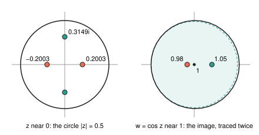

# Local normal form: near any point a non-constant holomorphic function is z to the m in disguise, so open sets go to open sets

[Syllabus](../../../SYLLABUS.md) → [Complex analysis](../README.md) → [Taylor Series, Zeros and Rigidity](../README.md#s04) → Local normal form

---

## General Overview

A 1 m pendulum bob sits 0.02 m above its lowest point, so the cosine of its angle is 1 − 0.02/1 = 0.98. Both +0.200335 and −0.200335 radians (±11.478341 degrees) give that height, so height cannot distinguish a left swing from a right swing.

Near 0, cos z = 1 − h(z)^2, where h(z) = √2 sin(z/2) has derivative 0.707107 at 0. Seen through the coordinate h, cos z near 0 is just squaring. Every nearby value other than 1 has two preimages (inputs sent to it) near 0, including complex ones: 1 + 0.1i has ±(0.313535 − 0.318802i).

Every non-constant holomorphic function (one with a complex derivative throughout a region) behaves like z ↦ z^m near each point a in a bent coordinate, yielding the **open mapping theorem** and (for m = 1) the **holomorphic inverse function theorem**. An **open set** holds a small disc about each of its points.

**Near any point a of a connected region, a non-constant holomorphic function is f(a) + h(z)^m with h a local change of coordinate, so it is m-to-1 near a, it covers a whole disc about f(a), and every open subset goes to an open set.**

**What kind of fact this is:** a theorem, proved on this card in Why it works; the open mapping and inverse function theorems follow as corollaries.

### The picture: a disc about 0 covers a disc about 1 twice

<p align="center"></p>

To scale: left, 150 units per unit, 0 at (110, 110); right, 600 units per unit, 1 at (330, 110). The image loop runs from 1 − 0.122417 to 1 + 0.127626, traced twice, enclosing the shaded disc of radius δ = 0.122417.

---

## The formula

A **region** is a connected open set in the plane. The **order** m of f at a is the index of the first non-zero Taylor coefficient of f(z) − f(a) ([Zeros and the identity theorem](03-zeros-and-the-identity-theorem.md)). A **local change of coordinate** is a holomorphic map h, one-to-one near a, with h(a) = 0 and h′(a) ≠ 0.

```math
f(z) = f(a) + h(z)^m, \qquad h(a) = 0, \quad h'(a) \neq 0
```

**Read it aloud:** near a, a holomorphic function not constant near a equals f(a) plus the m-th power of a new coordinate h starting at 0 with non-zero derivative.

For the pendulum (keeping h real on the real axis; (ih)^2 = −h^2 absorbs the minus):

```math
\cos z = 1 - h(z)^2, \qquad h(z) = \sqrt{2}\,\sin(z/2), \qquad h'(0) = \tfrac{1}{\sqrt 2} = 0.707107
```

Preimages are counted by a contour integral, the **argument principle**, proved in Step 2:

```math
N(w) = \frac{1}{2\pi i}\oint_{\lvert z - a\rvert = r} \frac{f'(z)}{f(z) - w}\,dz = m \quad \text{whenever } \lvert w - f(a)\rvert < \delta = \min_{\lvert z - a\rvert = r} \lvert f(z) - f(a)\rvert
```

**Read it aloud:** for small enough positive r, the count of preimages of w in |z − a| < r (with multiplicity) is m whenever w is closer to f(a) than the smallest gap on the circle.

| Symbol | Plain meaning | In our example | Push it up and the answer… |
| --- | --- | --- | --- |
| $`f`$, $`a`$ | holomorphic function; base point | cos z; a = 0 (or 1) | — |
| $`z`$, $`w`$, $`z(w)`$ | input; target; unique preimage (m = 1) | w = 0.98, 1 + 0.1i; z(0.550302) = 0.988070 | — |
| $`c_k`$, $`m`$ | k-th Taylor coefficient of f − f(a); order | c_1 = 0, c_2 = −0.5; m = 2 | more preimages; angles times m |
| $`g`$, $`\gamma`$ | factor in (z − a)^m g; m-th root of g(a) | g(0) = −0.5; γ^2 = −0.5 | — |
| $`h`$ | new coordinate | √2 sin(z/2); h′(0) = 0.707107 | — |
| $`r`$, $`\delta`$, $`\rho`$ | input radius; covered radius; same for h | r = 0.5; δ = 0.122417 | larger δ until a zero enters |
| $`N(w)`$, $`z_j`$, $`q`$ | preimage count; preimages; zero-free factor | 2 (0.98); 0 (0.85); 6 (r = 7) | — |

### When it holds

- **f holomorphic near a.** Real cosine on (−0.5, 0.5) has image (0.877583, 1], not open: its top end 1 is reached, with nothing beyond.
- **f not constant near a.** A constant maps every disc to one point; finite order m holds for every non-constant f on a region.
- **w close enough to f(a).** The value w = 0.85 lies farther than δ = 0.122417 from 1, and |z| < 0.5 holds no preimage: they sit at ±0.554811.
- **Positive r small enough.** On |z − a| ≤ r, f must equal f(a) only at a (and f′ ≠ 0 away from a for distinct preimages). On |z| < 7, cos equals 1 at ±2π, so 0.98 has count 6.000000, not 2.

---

## Why it works

### Step 0: the idea

Factor f(z) − f(a) = (z − a)^m g(z) with g(a) ≠ 0, take a holomorphic m-th root of g, and set h(z) = (z − a)·(that root). Then f(z) = f(a) + h(z)^m, and a zero-counting integral gives the m-to-1 and open-disc claims directly.

### Step 1: the order is a whole number

Because f is non-constant on its region, f − f(a) is not zero near a, so its first non-zero Taylor coefficient sits at a finite order m ≥ 1 ([Zeros and the identity theorem](03-zeros-and-the-identity-theorem.md)). For cos z − 1, Cauchy's coefficient integral gives c_1 = 0 and c_2 = −0.5, so m = 2.

### Step 2: a contour integral counts m preimages for every nearby value

Because zeros are isolated, pick r > 0 small enough that on |z − a| ≤ r, f equals f(a) only at a and f′ vanishes at most at a. Set δ = min |f(z) − f(a)| on |z − a| = r.

For |w − f(a)| < δ, f − w has no zero on the circle, so N(w) is defined and continuous in w. By the fold below, N(w) is an integer counting zeros of f − w inside with multiplicity. A continuous integer on a disc is constant, so N(w) = N(f(a)) = m.

For w ≠ f(a), every preimage has f′(z) ≠ 0, so each zero is simple and w has m distinct preimages in |z − a| < r. For cos at 0 with r = 0.5, δ = 1 − cos 0.5 = 0.122417 (on the real axis), and N(w) = 2.000000 for 0.98 and 1 + 0.1i.

<details>
<summary>Detailed proof: why the integral counts zeros</summary>

Let $`z_1, \dots, z_n`$ be the zeros of f − w inside the circle, repeated by order (finitely many since zeros are isolated on the closed bounded disc). Factoring them out ([Zeros and the identity theorem](03-zeros-and-the-identity-theorem.md)) gives

$`\displaystyle f(z) - w = (z - z_1)\cdots(z - z_n)\, q(z),`$

with q holomorphic and zero-free on the closed disc. Dividing the product rule by f − w yields

$`\displaystyle \frac{f'(z)}{f(z) - w} = \sum_{j=1}^{n} \frac{1}{z - z_j} + \frac{q'(z)}{q(z)}.`$

Each $`1/(z - z_j)`$ integrates to $`2\pi i`$ ([Cauchy's integral formula](../03-Contour%20Integrals%20and%20Cauchy%27s%20Theorem/05-cauchys-integral-formula.md)) and q′/q to 0 ([Cauchy's theorem](../03-Contour%20Integrals%20and%20Cauchy%27s%20Theorem/03-cauchys-theorem.md)), so N(w) = n. Multiplying by z and writing $`z/(z - z_j) = 1 + z_j/(z - z_j)`$ makes the integral of z f′/(f − w) over 2πi equal $`z_1 + \dots + z_n`$, used in Step 3 for n = 1.

</details>

### Step 3: when m = 1, the inverse is holomorphic

When m = 1, each w within δ of f(a) has one preimage z(w). By the Step 2 fold with n = 1,

```math
z(w) = \frac{1}{2\pi i}\oint_{\lvert z - a\rvert = r} \frac{z\,f'(z)}{f(z) - w}\,dz
```

The integrand is holomorphic in w, so z(w) is holomorphic with derivative 1/f′(z(w)), proving the **holomorphic inverse function theorem** without the real version used in [Conformal maps](../07-Conformal%20Maps%20and%20Harmonic%20Functions/01-conformal-maps.md). For cos at a = 1, f′(1) = −0.841471 ≠ 0 (m = 1); at w = cos 1 + 0.01 = 0.550302, the count in |z − 1| < 0.3 is 1.000000 and the integral gives 0.988070 = arccos 0.550302.

### Step 4: the normal form

Near a, g(z)/g(a) stays close to 1, so its principal logarithm is holomorphic. Fix an m-th root γ of g(a) and set

```math
h(z) = (z - a)\, \gamma\, \exp\!\Big(\tfrac{1}{m}\,\mathrm{Log}\,\tfrac{g(z)}{g(a)}\Big)
```

Then h^m = (z − a)^m g = f − f(a), h(a) = 0, and h′(a) = γ ≠ 0. By Step 3, h has a holomorphic inverse near a, so the preimages of w are the m points mapped to the m distinct m-th roots of w − f(a). For cos z = 1 − h^2, w = 0.98 gives h = ±0.141421 and angles ±0.200335; w = 1 + 0.1i gives h^2 = −0.1i and h = ±(0.223607 − 0.223607i).

<details>
<summary>Detailed proof: why the m-th root exists and h is one-to-one</summary>

Since g is continuous with g(a) ≠ 0, some disc about a has |g(z)/g(a) − 1| < 1, avoiding the negative real axis. Composing with Log ([The complex logarithm](../02-Holomorphic%20Functions/04-complex-logarithm.md)) gives a holomorphic function satisfying

$`\displaystyle \Big(\gamma\,\exp\big(\tfrac{1}{m}\mathrm{Log}\,\tfrac{g(z)}{g(a)}\big)\Big)^m = \gamma^m \,\frac{g(z)}{g(a)} = g(z),`$

so h^m = f − f(a) and h′(a) = γ ≠ 0. By Step 3, h maps some disc |z − a| < r one-to-one over |ζ| < ρ. For 0 < |w − f(a)| < ρ^m, all m distinct m-th roots of w − f(a) lie in |ζ| < ρ, giving m solutions to h(z)^m = w − f(a) in |z − a| < r.

</details>

### Step 5: the open mapping theorem

Take any open set inside the region and any point a in it, with a small disc about a inside it. By Step 2, the image of that disc contains |w − f(a)| < δ, so **the image of an open set is open**. For cos, the image of |z| < 0.5 contains |w − 1| < 0.122417, and the circle's image sits between 0.122417 and 0.127626 from 1.

[The maximum modulus principle](05-maximum-modulus-principle.md) follows at once: a covered disc about f(a) always contains points of larger modulus, so |f| has no interior peak. For cos, |cos 0| = 1 is beaten at 0.314925i, where cos(0.314925i) = cosh(0.314925) = 1.05 (arccosh 1.05 = 0.314925).

---

## Worked numbers, by hand

| Step | Arithmetic | Value |
| --- | --- | --- |
| height to cosine | 1 − 0.02/1 | 0.98 |
| order at 0 | c_1 = 0, c_2 = −0.5 | m = 2 |
| into the new coordinate | h^2 = 1 − 0.98 = 0.02 | h = ±0.141421 |
| back to the angle | sin(z/2) = ±0.141421/√2 = ±0.1, so z = ±2 asin 0.1 | ±0.200335 |
| in degrees | 0.200335 × 180/π | **±11.478341 degrees** |
| the covered disc | 1 − cos 0.5 | δ = 0.122417 |

A height of 0.02 m matches ±11.478341 degrees, and every w ≠ 1 within 0.122417 of 1 has two angles in |z| < 0.5.

### What breaks if you drop a piece

| Mistake | Comes out at | What went wrong |
| --- | --- | --- |
| m = 1 assumed at 0 | inverse integral for 0.98 gives 0.000000 + 0.000000i; count is 2 | f′(0) = 0, so m = 2 and the integral sums ±0.200335 |
| Real cosine on (−0.5, 0.5) | image (0.877583, 1], not open; maximum 1 at 0 | a real function has no complex disc to fill |
| w = 0.85, outside δ disc | count 0.000000 in \|z\| < 0.5 | preimages ±0.554811 lie outside |
| Disc sized by \|f′(0)\| × 0.5 | 0.000000, yet δ = 0.122417 | the quadratic term sets the size |

The code prints all four.

---

## Code, from first principles, and it actually runs

The code builds complex cos and sin from real trig and hyperbolic functions, checking three roads: closed forms via h, Newton's method on cos z − w = 0, and a 400-point trapezoid sum of f′/(f − w) round a circle. A 720-point search checks δ, and the contour sum also yields c_1, c_2, h′(0) and the inverse.

### Python

```python
# Local normal form and the open mapping theorem -- the check behind the card.  Standard library only.
# f(z) = cos z near 0: cos z - 1 starts with -z^2/2, so m = 2 and cos z = 1 - h(z)^2, h(z) = sqrt2 sin(z/2).
# Road one: closed forms through h.  Road two: Newton's method on cos z = w.  Road three: the argument
# principle, a trapezoid sum of f'/(f - w) round a circle, which counts preimages without finding them.
import math

def ccos(z): return complex(math.cos(z.real) * math.cosh(z.imag), -math.sin(z.real) * math.sinh(z.imag))
def csin(z): return complex(math.sin(z.real) * math.cosh(z.imag), math.cos(z.real) * math.sinh(z.imag))
def h(z): return math.sqrt(2) * csin(z / 2)                  # the new coordinate: cos z = 1 - h(z)^2

def contour(F, c, r, n=400):          # (1/2 pi i) times the integral of F(z) dz round |z - c| = r
    es = [complex(math.cos(2 * math.pi * j / n), math.sin(2 * math.pi * j / n)) for j in range(n)]
    return sum(F(c + r * e) * r * e for e in es) / n
def count(w, c=0, r=0.5): return contour(lambda z: -csin(z) / (ccos(z) - w), c, r).real
def newton(w, z):                     # repeated tangent-line steps towards a root of cos z - w
    for _ in range(50): z -= (ccos(z) - w) / (-csin(z))
    return z
def fmt(z):                           # 'a + bi', six decimals, no minus sign on a zero
    re, im = (0.0 if abs(v) < 5e-7 else v for v in (z.real, z.imag))
    return f"{re:.6f} {'-' if im < 0 else '+'} {abs(im):.6f}i"

c1, c2 = (contour(lambda z, k=k: (ccos(z) - 1) / z ** (k + 1), 0, 0.5) for k in (1, 2))
dh = contour(lambda z: h(z) / z ** 2, 0, 0.5)               # h'(0) as a Cauchy coefficient
z1, z2 = newton(0.98, 0.3 + 0j), newton(0.98, -0.3 + 0j)
u1, u2 = newton(1 + 0.1j, 0.3 - 0.3j), newton(1 + 0.1j, -0.3 + 0.3j)
ring = [0.5 * complex(math.cos(2 * math.pi * j / 720), math.sin(2 * math.pi * j / 720)) for j in range(720)]
delta, grid, top = 1 - math.cos(0.5), min(abs(ccos(z) - 1) for z in ring), max(abs(ccos(z) - 1) for z in ring)
v = newton(1.05, 0.3j)
a1 = math.cos(1) + 0.01
inv = contour(lambda z: z * -csin(z) / (ccos(z) - a1), 1, 0.3)   # the inverse, as a contour integral
inv0 = contour(lambda z: z * -csin(z) / (ccos(z) - 0.98), 0, 0.5)  # the same integral at 0, where m = 2
k = lambda x: 110 + 150 * x
print(f"figure, left 150 px per unit, 0 at (110, 110), circle radius 75, preimages of 0.98 at x {k(z2.real):.2f} and {k(z1.real):.2f}, "
      f"of 1.05 at y {110 - 150 * v.imag:.2f} and {110 + 150 * v.imag:.2f}; right 600 px per unit, 1 at (330, 110), delta radius {600 * delta:.2f}")
print(f"Taylor coefficients of cos z - 1 at 0: c1 = {fmt(c1)}, c2 = {fmt(c2)}, so m = 2")
print(f"h'(0) by contour = {fmt(dh)}; 1/sqrt2 = {1 / math.sqrt(2):.6f}")
print(f"1 m pendulum, bob 0.02 m up: cos theta = {1 - 0.02 / 1:.2f}; 2 asin(0.1) = {2 * math.asin(0.1):.6f}; "
      f"arccos 0.98 = {math.acos(0.98):.6f} rad = {math.degrees(math.acos(0.98)):.6f} degrees")
print(f"preimages of 0.98 by Newton from 0.3 and -0.3: {fmt(z1)} and {fmt(z2)}")
print(f"h at them: {fmt(h(z1))} and {fmt(h(z2))}; sqrt(1 - 0.98) = {math.sqrt(0.02):.6f}")
print(f"count of preimages of 0.98 in |z| < 0.5: {count(0.98):.6f}; in |z| < 7: {count(0.98, 0, 7):.6f}")
print(f"preimages of 1 + 0.1i: {fmt(u1)} and {fmt(u2)}; count {count(1 + 0.1j):.6f}")
print(f"h at them: {fmt(h(u1))} and {fmt(h(u2))}")
print(f"open disc: delta = 1 - cos 0.5 = {delta:.6f}; min |cos z - 1| on |z| = 0.5 = {grid:.6f}")
print(f"largest |cos z - 1| on |z| = 0.5 = {top:.6f}; cosh 0.5 - 1 = {math.cosh(0.5) - 1:.6f}")
print(f"maximum modulus: |cos 0| = 1; 1.05 is hit at {fmt(v)}; arccosh 1.05 = {math.acosh(1.05):.6f}")
print(f"inverse near a = 1: f'(1) = {-math.sin(1):.6f}; w = {a1:.6f}; count in |z - 1| < 0.3 = {count(a1, 1, 0.3):.6f}")
print(f"inverse by contour = {fmt(inv)}; arccos w = {math.acos(a1):.6f}")
print(f"break 1, m = 1 assumed at 0: the inverse integral for 0.98 gives {fmt(inv0)}, the sum of both preimages; the count says {count(0.98):.0f}")
print(f"break 2, real cos on (-0.5, 0.5): image ({math.cos(0.5):.6f}, 1], not open; real maximum 1 at 0")
print(f"break 3, w = 0.85 outside the delta disc: count {count(0.85):.6f}; its preimages +-{math.acos(0.85):.6f} lie outside")
print(f"break 4, disc sized by |f'(0)| x 0.5 = {abs(-math.sin(0)) * 0.5:.6f}, yet delta = {delta:.6f}")
assert abs(z1 - 2 * math.asin(0.1)) < 1e-12 and abs(z2 + math.acos(0.98)) < 1e-12        # Newton = closed form
assert abs(count(0.98) - 2) < 1e-9 and abs(count(1 + 0.1j) - 2) < 1e-9 and abs(count(0.85)) < 1e-9 and abs(count(0.98, 0, 7) - 6) < 1e-9
assert abs(h(u1) ** 2 - (1 - (1 + 0.1j))) < 1e-12 and abs(u1 + u2) < 1e-12              # h sends preimages to roots
assert abs(grid - delta) < 1e-12 and abs(v.imag - math.acosh(1.05)) < 1e-12           # open disc; modulus beaten
assert abs(c1) < 1e-9 and abs(dh - 1 / math.sqrt(2)) < 1e-9 and abs(top - (math.cosh(0.5) - 1)) < 1e-12 and abs(inv0 - (z1 + z2)) < 1e-9  # m = 2; h'(0); top; sum
assert abs(count(a1, 1, 0.3) - 1) < 1e-9 and abs(inv - math.acos(a1)) < 1e-9 and abs(c2 + 0.5) < 1e-9
print("ALL CHECKS PASS")
```

**Ran 2026-11-23 on macOS, Python 3.14.10, standard library only. All checks passed. Output, pasted from the run:**

```
figure, left 150 px per unit, 0 at (110, 110), circle radius 75, preimages of 0.98 at x 79.95 and 140.05, of 1.05 at y 62.76 and 157.24; right 600 px per unit, 1 at (330, 110), delta radius 73.45
Taylor coefficients of cos z - 1 at 0: c1 = 0.000000 + 0.000000i, c2 = -0.500000 + 0.000000i, so m = 2
h'(0) by contour = 0.707107 + 0.000000i; 1/sqrt2 = 0.707107
1 m pendulum, bob 0.02 m up: cos theta = 0.98; 2 asin(0.1) = 0.200335; arccos 0.98 = 0.200335 rad = 11.478341 degrees
preimages of 0.98 by Newton from 0.3 and -0.3: 0.200335 + 0.000000i and -0.200335 + 0.000000i
h at them: 0.141421 + 0.000000i and -0.141421 + 0.000000i; sqrt(1 - 0.98) = 0.141421
count of preimages of 0.98 in |z| < 0.5: 2.000000; in |z| < 7: 6.000000
preimages of 1 + 0.1i: 0.313535 - 0.318802i and -0.313535 + 0.318802i; count 2.000000
h at them: 0.223607 - 0.223607i and -0.223607 + 0.223607i
open disc: delta = 1 - cos 0.5 = 0.122417; min |cos z - 1| on |z| = 0.5 = 0.122417
largest |cos z - 1| on |z| = 0.5 = 0.127626; cosh 0.5 - 1 = 0.127626
maximum modulus: |cos 0| = 1; 1.05 is hit at 0.000000 + 0.314925i; arccosh 1.05 = 0.314925
inverse near a = 1: f'(1) = -0.841471; w = 0.550302; count in |z - 1| < 0.3 = 1.000000
inverse by contour = 0.988070 + 0.000000i; arccos w = 0.988070
break 1, m = 1 assumed at 0: the inverse integral for 0.98 gives 0.000000 + 0.000000i, the sum of both preimages; the count says 2
break 2, real cos on (-0.5, 0.5): image (0.877583, 1], not open; real maximum 1 at 0
break 3, w = 0.85 outside the delta disc: count 0.000000; its preimages +-0.554811 lie outside
break 4, disc sized by |f'(0)| x 0.5 = 0.000000, yet delta = 0.122417
ALL CHECKS PASS
```

### Rust

Same numbers, same labels, built with `rustc --edition 2021 -O`.

```rust
// Local normal form and the open mapping theorem -- the same check as the Python, in Rust.  No crates.
// f(z) = cos z near 0: cos z - 1 starts with -z^2/2, so m = 2 and cos z = 1 - h(z)^2, h(z) = sqrt2 sin(z/2).
// Road one: closed forms through h.  Road two: Newton's method on cos z = w.  Road three: the argument
// principle, a trapezoid sum of f'/(f - w) round a circle, which counts preimages without finding them.
use std::f64::consts::PI;

#[derive(Clone, Copy)]
struct C { re: f64, im: f64 }
fn c(re: f64, im: f64) -> C { C { re, im } }
fn add(a: C, b: C) -> C { c(a.re + b.re, a.im + b.im) }
fn sub(a: C, b: C) -> C { c(a.re - b.re, a.im - b.im) }
fn mul(a: C, b: C) -> C { c(a.re * b.re - a.im * b.im, a.re * b.im + a.im * b.re) }
fn div(a: C, b: C) -> C { let d = b.re * b.re + b.im * b.im; let t = mul(a, c(b.re, -b.im)); c(t.re / d, t.im / d) }
fn sc(a: C, k: f64) -> C { c(a.re * k, a.im * k) }
fn md(a: C) -> f64 { a.re.hypot(a.im) }
fn ccos(z: C) -> C { c(z.re.cos() * z.im.cosh(), -z.re.sin() * z.im.sinh()) }
fn csin(z: C) -> C { c(z.re.sin() * z.im.cosh(), z.re.cos() * z.im.sinh()) }
fn h(z: C) -> C { sc(csin(sc(z, 0.5)), 2f64.sqrt()) }                  // the new coordinate: cos z = 1 - h(z)^2
fn contour(f: &dyn Fn(C) -> C, ctr: C, r: f64) -> C {   // (1/2 pi i) times the integral of F(z) dz round |z - c| = r
    let mut s = c(0.0, 0.0);
    for j in 0..400 { let e = c((2.0 * PI * j as f64 / 400.0).cos(), (2.0 * PI * j as f64 / 400.0).sin());
        s = add(s, mul(f(add(ctr, sc(e, r))), sc(e, r))); }
    sc(s, 1.0 / 400.0)
}
fn count(w: C, ctr: C, r: f64) -> f64 { contour(&|z| div(sc(csin(z), -1.0), sub(ccos(z), w)), ctr, r).re }
fn newton(w: C, mut z: C) -> C {                         // repeated tangent-line steps towards a root of cos z - w
    for _ in 0..50 { z = sub(z, div(sub(ccos(z), w), sc(csin(z), -1.0))); }
    z
}
fn fmt(z: C) -> String {                                  // 'a + bi', six decimals, no minus sign on a zero
    let (re, im) = (if z.re.abs() < 5e-7 { 0.0 } else { z.re }, if z.im.abs() < 5e-7 { 0.0 } else { z.im });
    format!("{:.6} {} {:.6}i", re, if im < 0.0 { "-" } else { "+" }, im.abs())
}
fn main() {
    let (o, one) = (c(0.0, 0.0), c(1.0, 0.0));
    let pw = |z: C, k: i32| (0..k).fold(one, |p, _| mul(p, z));
    let c1 = contour(&|z| div(sub(ccos(z), one), pw(z, 2)), o, 0.5);
    let c2 = contour(&|z| div(sub(ccos(z), one), pw(z, 3)), o, 0.5);
    let dh = contour(&|z| div(h(z), pw(z, 2)), o, 0.5);       // h'(0) as a Cauchy coefficient
    let (w98, w1i) = (c(0.98, 0.0), c(1.0, 0.1));
    let (z1, z2) = (newton(w98, c(0.3, 0.0)), newton(w98, c(-0.3, 0.0)));
    let (u1, u2) = (newton(w1i, c(0.3, -0.3)), newton(w1i, c(-0.3, 0.3)));
    let ring: Vec<C> = (0..720).map(|j| c(0.5 * (2.0 * PI * j as f64 / 720.0).cos(), 0.5 * (2.0 * PI * j as f64 / 720.0).sin())).collect();
    let delta = 1.0 - 0.5f64.cos();
    let grid = ring.iter().map(|&z| md(sub(ccos(z), one))).fold(f64::MAX, f64::min);
    let top = ring.iter().map(|&z| md(sub(ccos(z), one))).fold(0.0, f64::max);
    let v = newton(c(1.05, 0.0), c(0.0, 0.3));
    let a1 = 1f64.cos() + 0.01;
    let inv = contour(&|z| div(mul(z, sc(csin(z), -1.0)), sub(ccos(z), c(a1, 0.0))), one, 0.3); // the inverse, as a contour integral
    let inv0 = contour(&|z| div(mul(z, sc(csin(z), -1.0)), sub(ccos(z), w98)), o, 0.5); // the same integral at 0, where m = 2
    let k = |x: f64| 110.0 + 150.0 * x;
    let (n98, n1i, n85) = (count(w98, o, 0.5), count(w1i, o, 0.5), count(c(0.85, 0.0), o, 0.5));
    println!("figure, left 150 px per unit, 0 at (110, 110), circle radius 75, preimages of 0.98 at x {:.2} and {:.2}, of 1.05 at y {:.2} and {:.2}; right 600 px per unit, 1 at (330, 110), delta radius {:.2}",
             k(z2.re), k(z1.re), 110.0 - 150.0 * v.im, 110.0 + 150.0 * v.im, 600.0 * delta);
    println!("Taylor coefficients of cos z - 1 at 0: c1 = {}, c2 = {}, so m = 2", fmt(c1), fmt(c2));
    println!("h'(0) by contour = {}; 1/sqrt2 = {:.6}", fmt(dh), 1.0 / 2f64.sqrt());
    println!("1 m pendulum, bob 0.02 m up: cos theta = {:.2}; 2 asin(0.1) = {:.6}; arccos 0.98 = {:.6} rad = {:.6} degrees",
             1.0 - 0.02 / 1.0, 2.0 * 0.1f64.asin(), 0.98f64.acos(), 0.98f64.acos().to_degrees());
    println!("preimages of 0.98 by Newton from 0.3 and -0.3: {} and {}", fmt(z1), fmt(z2));
    println!("h at them: {} and {}; sqrt(1 - 0.98) = {:.6}", fmt(h(z1)), fmt(h(z2)), 0.02f64.sqrt());
    println!("count of preimages of 0.98 in |z| < 0.5: {:.6}; in |z| < 7: {:.6}", n98, count(w98, o, 7.0));
    println!("preimages of 1 + 0.1i: {} and {}; count {:.6}", fmt(u1), fmt(u2), n1i);
    println!("h at them: {} and {}", fmt(h(u1)), fmt(h(u2)));
    println!("open disc: delta = 1 - cos 0.5 = {:.6}; min |cos z - 1| on |z| = 0.5 = {:.6}", delta, grid);
    println!("largest |cos z - 1| on |z| = 0.5 = {:.6}; cosh 0.5 - 1 = {:.6}", top, 0.5f64.cosh() - 1.0);
    println!("maximum modulus: |cos 0| = 1; 1.05 is hit at {}; arccosh 1.05 = {:.6}", fmt(v), 1.05f64.acosh());
    println!("inverse near a = 1: f'(1) = {:.6}; w = {:.6}; count in |z - 1| < 0.3 = {:.6}", -1f64.sin(), a1, count(c(a1, 0.0), one, 0.3));
    println!("inverse by contour = {}; arccos w = {:.6}", fmt(inv), a1.acos());
    println!("break 1, m = 1 assumed at 0: the inverse integral for 0.98 gives {}, the sum of both preimages; the count says {:.0}", fmt(inv0), n98);
    println!("break 2, real cos on (-0.5, 0.5): image ({:.6}, 1], not open; real maximum 1 at 0", 0.5f64.cos());
    println!("break 3, w = 0.85 outside the delta disc: count {:.6}; its preimages +-{:.6} lie outside", n85, 0.85f64.acos());
    println!("break 4, disc sized by |f'(0)| x 0.5 = {:.6}, yet delta = {:.6}", 0f64.sin().abs() * 0.5, delta);
    assert!(md(sub(z1, c(2.0 * 0.1f64.asin(), 0.0))) < 1e-12 && md(add(z2, c(0.98f64.acos(), 0.0))) < 1e-12); // Newton = closed form
    assert!((n98 - 2.0).abs() < 1e-9 && (n1i - 2.0).abs() < 1e-9 && n85.abs() < 1e-9 && (count(w98, o, 7.0) - 6.0).abs() < 1e-9);
    assert!(md(sub(mul(h(u1), h(u1)), sub(one, w1i))) < 1e-12 && md(add(u1, u2)) < 1e-12);                   // h sends preimages to roots
    assert!((grid - delta).abs() < 1e-12 && (v.im - 1.05f64.acosh()).abs() < 1e-12);                        // open disc; modulus beaten
    assert!(md(c1) < 1e-9 && md(sub(dh, c(1.0 / 2f64.sqrt(), 0.0))) < 1e-9 && (top - (0.5f64.cosh() - 1.0)).abs() < 1e-12 && md(sub(inv0, add(z1, z2))) < 1e-9); // m = 2; h'(0); top; sum
    assert!((count(c(a1, 0.0), one, 0.3) - 1.0).abs() < 1e-9 && md(sub(inv, c(a1.acos(), 0.0))) < 1e-9 && (c2.re + 0.5).abs() < 1e-9);
    println!("ALL CHECKS PASS");
}
```

**Ran 2026-11-23 on macOS, rustc 1.98.1, no crates. All checks passed. Output, pasted from the run:**

```
figure, left 150 px per unit, 0 at (110, 110), circle radius 75, preimages of 0.98 at x 79.95 and 140.05, of 1.05 at y 62.76 and 157.24; right 600 px per unit, 1 at (330, 110), delta radius 73.45
Taylor coefficients of cos z - 1 at 0: c1 = 0.000000 + 0.000000i, c2 = -0.500000 + 0.000000i, so m = 2
h'(0) by contour = 0.707107 + 0.000000i; 1/sqrt2 = 0.707107
1 m pendulum, bob 0.02 m up: cos theta = 0.98; 2 asin(0.1) = 0.200335; arccos 0.98 = 0.200335 rad = 11.478341 degrees
preimages of 0.98 by Newton from 0.3 and -0.3: 0.200335 + 0.000000i and -0.200335 + 0.000000i
h at them: 0.141421 + 0.000000i and -0.141421 + 0.000000i; sqrt(1 - 0.98) = 0.141421
count of preimages of 0.98 in |z| < 0.5: 2.000000; in |z| < 7: 6.000000
preimages of 1 + 0.1i: 0.313535 - 0.318802i and -0.313535 + 0.318802i; count 2.000000
h at them: 0.223607 - 0.223607i and -0.223607 + 0.223607i
open disc: delta = 1 - cos 0.5 = 0.122417; min |cos z - 1| on |z| = 0.5 = 0.122417
largest |cos z - 1| on |z| = 0.5 = 0.127626; cosh 0.5 - 1 = 0.127626
maximum modulus: |cos 0| = 1; 1.05 is hit at 0.000000 + 0.314925i; arccosh 1.05 = 0.314925
inverse near a = 1: f'(1) = -0.841471; w = 0.550302; count in |z - 1| < 0.3 = 1.000000
inverse by contour = 0.988070 + 0.000000i; arccos w = 0.988070
break 1, m = 1 assumed at 0: the inverse integral for 0.98 gives 0.000000 + 0.000000i, the sum of both preimages; the count says 2
break 2, real cos on (-0.5, 0.5): image (0.877583, 1], not open; real maximum 1 at 0
break 3, w = 0.85 outside the delta disc: count 0.000000; its preimages +-0.554811 lie outside
break 4, disc sized by |f'(0)| x 0.5 = 0.000000, yet delta = 0.122417
ALL CHECKS PASS
```

The two outputs match line for line.

### Lean

Lean proves the normal form, the open mapping theorem and the inverse function theorem, for every holomorphic f that meets each one's conditions.

- Take f holomorphic and not constant on a region, and a point a in it. Then f(z) = f(a) + h(z)^m near a, with m the order and h a local change of coordinate.
- Take the same f, with suitable radii r about a and δ about f(a). Then each w within δ of f(a), other than f(a), has exactly m different preimages within r of a. So the disc of radius r about a covers the whole disc of radius δ about f(a).
- Take f holomorphic and not constant on a region. Then f sends every open set inside the region to an open set.
- Take f holomorphic on an open set about a, with f′(a) ≠ 0. Then, for suitable r and δ, each w within δ of f(a) has exactly one preimage z(w) within r of a. The map w ↦ z(w) is holomorphic on that disc, with derivative 1/f′(z(w)).
- Take a whole number m ≥ 1 and a non-zero complex number u. Then u has exactly m different m-th roots.
- Take any complex z. Then cos z = 1 − h(z)^2, with h(z) = √2 sin(z/2), and (i·h)^2 = −h^2.

Every decimal, the contour integral counts, the figure and the maximum modulus example are left to the Python and Rust checks.

```lean
-- Local normal form: near any point a, a non-constant holomorphic function on a region is f(a) + h(z)^m with h a local change of coordinate, so it is m-to-1 near a and covers a disc about f(a); open sets go to open sets, and where f'(a) ≠ 0 it has a holomorphic inverse.
import Mathlib.Analysis.Complex.OpenMapping
import Mathlib.Analysis.Analytic.Order
import Mathlib.Analysis.SpecialFunctions.Trigonometric.Basic
import Mathlib.Analysis.SpecialFunctions.Sqrt
import Mathlib.Data.Set.Card
import Mathlib.Analysis.Calculus.InverseFunctionTheorem.Deriv
import Mathlib.Analysis.SpecialFunctions.Complex.Analytic
import Mathlib.Analysis.SpecialFunctions.Pow.Complex
import Mathlib.RingTheory.RootsOfUnity.Complex

open Filter Metric Set
open scoped Topology

/-- A nonzero complex number has exactly `m` different `m`-th roots. -/
theorem card_pow_eq_of_ne_zero {m : ℕ} (hm : 0 < m) {u : ℂ} (hu : u ≠ 0) :
    {ζ : ℂ | ζ ^ m = u}.ncard = m := by
  classical
  have hprim := Complex.isPrimitiveRoot_exp m hm.ne'
  have hset : {ζ : ℂ | ζ ^ m = u} = ↑(Polynomial.nthRoots m u).toFinset := by
    ext ζ; simp [Polynomial.mem_nthRoots hm]
  rw [hset, Set.ncard_coe_finset, Multiset.toFinset_card_of_nodup (hprim.nthRoots_nodup hu),
    hprim.card_nthRoots]
  have hα : (u ^ ((m : ℂ)⁻¹)) ^ m = u := Complex.cpow_nat_inv_pow u hm.ne'
  simp only [show ∃ α : ℂ, α ^ m = u from ⟨_, hα⟩, ite_true]

/-- **Local normal form.** Let `f` be holomorphic on a region `U` (an open set in one piece),
let `a` be a point of `U`, and let `f` not be constant on `U`. Then there is a whole number
`m ≥ 1`, the order of `f - f(a)` at `a`, and a local change of coordinate `h` (holomorphic at
`a`, with `h(a) = 0` and `h'(a) ≠ 0`) such that `f(z) = f(a) + h(z)^m` near `a`. Moreover there
are radii `r, δ > 0` such that every value `w` within `δ` of `f(a)`, other than `f(a)` itself,
has exactly `m` different preimages within `r` of `a`, and the disc of radius `r` about `a`
covers the whole disc of radius `δ` about `f(a)`. -/
theorem local_normal_form_m_to_one {f : ℂ → ℂ} {U : Set ℂ} {a : ℂ}
    (hU : IsOpen U) (hUc : IsPreconnected U) (ha : a ∈ U)
    (hf : DifferentiableOn ℂ f U) (hnc : ∃ z ∈ U, f z ≠ f a) :
    ∃ m : ℕ, 0 < m ∧ analyticOrderAt (fun z => f z - f a) a = (m : ℕ∞) ∧
      (∃ h : ℂ → ℂ, AnalyticAt ℂ h a ∧ h a = 0 ∧ deriv h a ≠ 0 ∧
        ∀ᶠ z in 𝓝 a, f z = f a + h z ^ m) ∧
      ∃ r > 0, ∃ δ > 0, ball a r ⊆ U ∧
        (∀ w : ℂ, w ≠ f a → w ∈ ball (f a) δ → {z | z ∈ ball a r ∧ f z = w}.ncard = m) ∧
        ball (f a) δ ⊆ f '' ball a r := by
  have hA : AnalyticOnNhd ℂ f U := hf.analyticOnNhd hU
  have hFA : AnalyticAt ℂ (fun z => f z - f a) a := (hA a ha).sub analyticAt_const
  -- the order is finite
  have hne : analyticOrderAt (fun z => f z - f a) a ≠ ⊤ := by
    intro htop
    rw [analyticOrderAt_eq_top] at htop
    have hev : f =ᶠ[𝓝 a] fun _ => f a := htop.mono fun z hz => sub_eq_zero.mp hz
    have hEq := hA.eqOn_of_preconnected_of_eventuallyEq analyticOnNhd_const hUc ha hev
    obtain ⟨z, hz, hzne⟩ := hnc
    exact hzne (hEq hz)
  obtain ⟨m, hm⟩ := ENat.ne_top_iff_exists.mp hne
  have hm0 : m ≠ 0 := by
    rintro rfl
    have := (hFA.analyticOrderAt_eq_zero).mp (by rw [← hm]; rfl)
    exact this (by simp)
  have hmpos : 0 < m := Nat.pos_of_ne_zero hm0
  obtain ⟨g, hg, hga, hgev⟩ := (hFA.analyticOrderAt_eq_natCast).mp hm.symm
  -- an m-th root of g near a
  set c : ℂ := g a ^ ((m : ℂ)⁻¹) with hc
  have hcm : c ^ m = g a := Complex.cpow_nat_inv_pow _ hm0
  have hc0 : c ≠ 0 := by
    intro h0; apply hga; rw [← hcm, h0, zero_pow hm0]
  set k : ℂ → ℂ := fun z => c * (g z / g a) ^ ((m : ℂ)⁻¹) with hk
  have hkA : AnalyticAt ℂ k a := by
    refine analyticAt_const.mul ((hg.div analyticAt_const hga).cpow analyticAt_const ?_)
    show g a / g a ∈ Complex.slitPlane
    rw [div_self hga]; exact Complex.one_mem_slitPlane
  have hkm : ∀ z, k z ^ m = g z := by
    intro z
    simp only [hk, mul_pow, Complex.cpow_nat_inv_pow _ hm0, hcm]
    field_simp
  have hka : k a = c := by simp [hk, div_self hga]
  set h : ℂ → ℂ := fun z => (z - a) * k z with hh
  have hhA : AnalyticAt ℂ h a := (analyticAt_id.sub analyticAt_const).mul hkA
  have hha : h a = 0 := by simp [hh]
  have hhd : HasDerivAt h (k a) a := by
    have := ((hasDerivAt_id a).sub_const a).mul hkA.differentiableAt.hasDerivAt
    convert this using 1
    · rfl
    · simp
  have hderiv : deriv h a ≠ 0 := by rw [hhd.deriv, hka]; exact hc0
  have hfh : ∀ᶠ z in 𝓝 a, f z = f a + h z ^ m := by
    filter_upwards [hgev] with z hz
    simp only [smul_eq_mul] at hz
    simp only [hh, mul_pow, hkm]
    linear_combination hz
  refine ⟨m, hmpos, hm.symm, ⟨h, hhA, hha, hderiv, hfh⟩, ?_⟩
  -- the counting part
  have hsd : HasStrictDerivAt h (deriv h a) a := hhA.hasStrictDerivAt
  set e := (hsd.hasStrictFDerivAt_equiv hderiv).toOpenPartialHomeomorph h with he
  have he_coe : (e : ℂ → ℂ) = h := rfl
  have hsrc : e.source ∈ 𝓝 a :=
    e.open_source.mem_nhds (hsd.hasStrictFDerivAt_equiv hderiv).mem_toOpenPartialHomeomorph_source
  have hN : U ∩ e.source ∩ {z | f z = f a + h z ^ m} ∈ 𝓝 a :=
    inter_mem (inter_mem (hU.mem_nhds ha) hsrc) hfh
  obtain ⟨r, hr, hrsub⟩ := Metric.mem_nhds_iff.mp hN
  have hopen : IsOpen (h '' ball a r) := by
    rw [← he_coe]
    exact e.isOpen_image_of_subset_source isOpen_ball
      (fun z hz => (hrsub hz).1.2)
  have h0mem : (0 : ℂ) ∈ h '' ball a r := ⟨a, mem_ball_self hr, hha⟩
  obtain ⟨ε, hε, hεsub⟩ := Metric.isOpen_iff.mp hopen 0 h0mem
  have hδ : 0 < ε ^ m := pow_pos hε m
  refine ⟨r, hr, ε ^ m, hδ, fun z hz => (hrsub hz).1.1, ?_, ?_⟩
  · -- key fact: every m-th root of w - f a is hit
    have hinj : InjOn h (ball a r) := by
      rw [← he_coe]; exact e.injOn.mono (fun z hz => (hrsub hz).1.2)
    have hroot : ∀ w ∈ ball (f a) (ε ^ m), ∀ ζ : ℂ, ζ ^ m = w - f a →
        ∃ z ∈ ball a r, h z = ζ := by
      intro w hw ζ hζ
      have hnorm : ‖ζ‖ ^ m < ε ^ m := by
        rw [← norm_pow, hζ, ← dist_eq_norm]; exact hw
      have hlt : ‖ζ‖ < ε := lt_of_pow_lt_pow_left₀ m hε.le hnorm
      obtain ⟨z, hz, hzζ⟩ := hεsub (by simpa [mem_ball, dist_zero_right] using hlt)
      exact ⟨z, hz, hzζ⟩
    intro w hw0 hw
    have himg : h '' {z | z ∈ ball a r ∧ f z = w} = {ζ : ℂ | ζ ^ m = w - f a} := by
      ext ζ
      constructor
      · rintro ⟨z, ⟨hz, hfz⟩, rfl⟩
        have := (hrsub hz).2
        simp only [mem_ofPred_eq] at this ⊢
        rw [← hfz, this]; ring
      · intro hζ
        obtain ⟨z, hz, hzζ⟩ := hroot w hw ζ hζ
        refine ⟨z, ⟨hz, ?_⟩, hzζ⟩
        have := (hrsub hz).2
        simp only [mem_ofPred_eq] at this hζ
        rw [this, hzζ, hζ]; ring
    have hinj' : InjOn h {z | z ∈ ball a r ∧ f z = w} := hinj.mono (fun z hz => hz.1)
    rw [← hinj'.ncard_image, himg]
    exact card_pow_eq_of_ne_zero hmpos (sub_ne_zero.mpr hw0)
  · intro w hw
    set ζ : ℂ := (w - f a) ^ ((m : ℂ)⁻¹)
    have hζ : ζ ^ m = w - f a := Complex.cpow_nat_inv_pow _ hm0
    have hnorm : ‖ζ‖ ^ m < ε ^ m := by
      rw [← norm_pow, hζ, ← dist_eq_norm]; exact hw
    have hlt : ‖ζ‖ < ε := lt_of_pow_lt_pow_left₀ m hε.le hnorm
    obtain ⟨z, hz, hzζ⟩ := hεsub (by simpa [mem_ball, dist_zero_right] using hlt)
    refine ⟨z, hz, ?_⟩
    have := (hrsub hz).2
    simp only [mem_ofPred_eq] at this
    rw [this, hzζ, hζ]; ring

/-- **Open mapping theorem.** A holomorphic function that is not constant on a region `U`
sends every open set inside `U` to an open set. -/
theorem open_mapping_theorem {f : ℂ → ℂ} {U : Set ℂ}
    (hU : IsOpen U) (hUc : IsPreconnected U)
    (hf : DifferentiableOn ℂ f U) (hnc : ∃ z₁ ∈ U, ∃ z₂ ∈ U, f z₁ ≠ f z₂) :
    ∀ V ⊆ U, IsOpen V → IsOpen (f '' V) := by
  have hA : AnalyticOnNhd ℂ f U := hf.analyticOnNhd hU
  rcases hA.is_constant_or_isOpen hUc with ⟨w, hw⟩ | h
  · obtain ⟨z₁, hz₁, z₂, hz₂, hne⟩ := hnc
    exact absurd ((hw z₁ hz₁).trans (hw z₂ hz₂).symm) hne
  · exact h

/-- **Holomorphic inverse function theorem** (the case `m = 1`). Let `f` be holomorphic on an
open set `U` about `a` with `f'(a) ≠ 0`. Then there are radii `r, δ > 0` such that each `w`
within `δ` of `f(a)` has exactly one preimage `z(w)` within `r` of `a`, and `w ↦ z(w)` is
holomorphic on that disc, with derivative `1 / f'(z(w))`. -/
theorem holomorphic_inverse_function_theorem {f : ℂ → ℂ} {U : Set ℂ} {a : ℂ}
    (hU : IsOpen U) (ha : a ∈ U) (hf : DifferentiableOn ℂ f U) (hf' : deriv f a ≠ 0) :
    ∃ r > 0, ∃ δ > 0, ball a r ⊆ U ∧ ∃ g : ℂ → ℂ, DifferentiableOn ℂ g (ball (f a) δ) ∧
      ∀ w ∈ ball (f a) δ, g w ∈ ball a r ∧ f (g w) = w ∧
        (∀ z ∈ ball a r, f z = w → z = g w) ∧ deriv g w = 1 / deriv f (g w) := by
  have hA : AnalyticOnNhd ℂ f U := hf.analyticOnNhd hU
  have hsd : HasStrictDerivAt f (deriv f a) a := (hA a ha).hasStrictDerivAt
  set e := (hsd.hasStrictFDerivAt_equiv hf').toOpenPartialHomeomorph f with he
  have he_coe : (e : ℂ → ℂ) = f := rfl
  have hsrc : e.source ∈ 𝓝 a :=
    e.open_source.mem_nhds (hsd.hasStrictFDerivAt_equiv hf').mem_toOpenPartialHomeomorph_source
  have hdc : ContinuousAt (deriv f) a := (hA.deriv a ha).continuousAt
  have hd0 : {z | deriv f z ≠ 0} ∈ 𝓝 a := hdc.eventually_ne hf'
  have hN : U ∩ e.source ∩ {z | deriv f z ≠ 0} ∈ 𝓝 a :=
    inter_mem (inter_mem (hU.mem_nhds ha) hsrc) hd0
  obtain ⟨r, hr, hrsub⟩ := Metric.mem_nhds_iff.mp hN
  have hopen : IsOpen (e '' ball a r) :=
    e.isOpen_image_of_subset_source isOpen_ball (fun z hz => (hrsub hz).1.2)
  have hfa : f a ∈ e '' ball a r := ⟨a, mem_ball_self hr, rfl⟩
  obtain ⟨δ, hδ, hδsub⟩ := Metric.isOpen_iff.mp hopen (f a) hfa
  have key : ∀ w ∈ ball (f a) δ, ∃ z ∈ ball a r, e.symm w = z ∧ f z = w ∧ w ∈ e.target := by
    intro w hw
    obtain ⟨z, hz, rfl⟩ := hδsub hw
    exact ⟨z, hz, e.left_inv (hrsub hz).1.2, rfl, e.map_source (hrsub hz).1.2⟩
  have hder : ∀ w ∈ ball (f a) δ, HasDerivAt e.symm (deriv f (e.symm w))⁻¹ w := by
    intro w hw
    obtain ⟨z, hz, hzw, _, htgt⟩ := key w hw
    rw [hzw]
    apply e.hasDerivAt_symm htgt (hrsub hz).2
    rw [hzw]
    exact (hA z (hrsub hz).1.1).differentiableAt.hasDerivAt
  refine ⟨r, hr, δ, hδ, fun z hz => (hrsub hz).1.1, e.symm, ?_, ?_⟩
  · intro w hw
    exact (hder w hw).differentiableAt.differentiableWithinAt
  · intro w hw
    obtain ⟨z, hz, hzw, hfz, _⟩ := key w hw
    refine ⟨hzw ▸ hz, hzw ▸ hfz, ?_, ?_⟩
    · intro z' hz' hfz'
      rw [hzw]
      have : e z' = e z := by rw [he_coe, hfz', hfz]
      exact e.injOn (hrsub hz').1.2 (hrsub hz).1.2 this
    · rw [(hder w hw).deriv, one_div]

-- The pendulum's normal form: cos z = 1 - h(z)^2 with h(z) = √2 sin(z/2).
example (z : ℂ) : Complex.cos z = 1 - ((Real.sqrt 2 : ℂ) * Complex.sin (z / 2)) ^ 2 := by
  have h2 : ((Real.sqrt 2 : ℂ)) ^ 2 = 2 := by
    rw [← Complex.ofReal_pow, Real.sq_sqrt (by norm_num)]; norm_num
  rw [mul_pow, h2, ← Complex.cos_two_mul_eq_one_sub]; ring_nf

-- The minus sign folds into the coordinate: (i h)^2 = -h^2.
example (h : ℂ) : (Complex.I * h) ^ 2 = -h ^ 2 := by
  rw [mul_pow, Complex.I_sq]; ring

#print axioms card_pow_eq_of_ne_zero
#print axioms local_normal_form_m_to_one
#print axioms open_mapping_theorem
#print axioms holomorphic_inverse_function_theorem
```

**Checked 2026-11-23 on macOS, Lean 4.36.0-rc2, Mathlib v4.36.0-rc2. Every proof is complete and uses only Lean's standard axioms. Output, pasted from the run:**

```
'card_pow_eq_of_ne_zero' depends on axioms: [propext, Classical.choice, Quot.sound]
'local_normal_form_m_to_one' depends on axioms: [propext, Classical.choice, Quot.sound]
'open_mapping_theorem' depends on axioms: [propext, Classical.choice, Quot.sound]
'holomorphic_inverse_function_theorem' depends on axioms: [propext, Classical.choice, Quot.sound]
```

> [!TIP]
> **Try changing**
> Guess first, then run it.
> - **Widen the circle.** In `count`, change `r=0.5` to `r=0.6`. Break 3 now counts 2.000000 (since ±0.554811 fits inside), failing the second assert.
> - **Coarsen the sum.** Change `n=400` to `n=12` in `contour`. The count for 1 + 0.1i reads 1.586170 and stops the run.
> - **Move w further from cos 1.** Change `+ 0.01` to `+ 0.1` in `a1`: count stays 1 and the inverse matches arccos = 0.875905.

---

## The usual mistake

> [!warning]
> **Reading the open mapping theorem off the real graph.** On the real line, cos maps (−0.5, 0.5) to (0.877583, 1], not open, with peak 1 at 0. In the plane it covers a disc about 1, hitting 1.05 at 0.314925i.
>
> - **Trusting f′(a) to size the image.** At a critical point f′(a) = 0 gives a linear guess of 0, yet δ = 0.122417 for cos at 0.
> - **Expecting one inverse at a critical point.** Near 0, arccos returns only 0.200335 for 0.98; −0.200335 is just as close.
> - **Forgetting the bound on w.** Only values within δ are sure to have m preimages near a: 0.85 has none in |z| < 0.5.

---

## Where you meet it in real life

- **Airfoil design.** The Joukowski map z + 1/z has derivative 0 at z = 1, an order-2 point. It doubles angles there, turning a smooth circle into the sharp trailing edge of a wing profile.
- **Root finding.** Where m ≥ 2, nearby equations have m roots close together, and Newton's method slows there.
- **Mapping theorems.** The open mapping theorem keeps images of regions as regions, a step in [The Riemann mapping theorem](../07-Conformal%20Maps%20and%20Harmonic%20Functions/08-riemann-mapping-theorem-and-schwarz-christoffel.md).

> **Say it back**
> Near any point a of a connected region, a non-constant holomorphic function is f(a) + h(z)^m for a local coordinate h and finite order m. Every value near f(a) other than f(a) has m distinct preimages near a, counted by a contour integral. So a disc about f(a) is covered, open sets map to open sets, and m = 1 gives a holomorphic inverse. For cos near 0, m = 2: height 0.98 fits ±0.200335.

---

## What this builds on

- [The maximum modulus principle](05-maximum-modulus-principle.md): the corollary that Step 5 re-proves as the second road named there.
- [Zeros and the identity theorem](03-zeros-and-the-identity-theorem.md): the finite order m, the non-zero factor g, and isolated zeros.
- [Cauchy's integral formula](../03-Contour%20Integrals%20and%20Cauchy%27s%20Theorem/05-cauchys-integral-formula.md): the 2πi loop integral of 1/(z − z_j) that turns the contour integral into a count.
- [The complex logarithm](../02-Holomorphic%20Functions/04-complex-logarithm.md): the principal logarithm that builds the m-th root in Step 4.

## Where this goes next

- [The argument principle](../06-Real%20Integrals%20and%20Counting%20Zeros/06-the-argument-principle.md): the general zero count, with poles as well as zeros, of which the Step 2 fold is the special case.
- [Conformal maps](../07-Conformal%20Maps%20and%20Harmonic%20Functions/01-conformal-maps.md): angles kept where m = 1, and multiplied by m where f′ = 0.
- [Phragmen-Lindelof](07-phragmen-lindelof-principle.md): the maximum modulus principle stretched to unbounded regions, with a limit on growth.
- [Normal families](10-normal-families-montel-and-hurwitz.md): Hurwitz's theorem uses the same continuous count to show that locally uniform limits of one-to-one holomorphic functions stay one-to-one or become constant.

Left open: the normal form is local, so [Conformal maps](../07-Conformal%20Maps%20and%20Harmonic%20Functions/01-conformal-maps.md) tracks angles globally and [The Riemann mapping theorem](../07-Conformal%20Maps%20and%20Harmonic%20Functions/08-riemann-mapping-theorem-and-schwarz-christoffel.md) decides which regions map one-to-one onto a disc; next on this shelf, [Phragmen-Lindelof](07-phragmen-lindelof-principle.md) extends the maximum modulus principle to unbounded strips.

---

## Sources

Verified 2026-11-23: every link below resolves to the publisher's or author's page.

- Stein, Elias M., and Rami Shakarchi. *Complex Analysis*. Princeton University Press, 2003. [Publisher page](https://press.princeton.edu/books/hardcover/9780691113852/complex-analysis). Chapter 3, section 4: argument principle, open mapping and maximum modulus.
- Conway, John B. *Functions of One Complex Variable I*, 2nd ed. Springer, Graduate Texts in Mathematics 11, 1978. [DOI](https://doi.org/10.1007/978-1-4612-6313-5). Chapter IV: open mapping theorem and local m-to-1 picture.
- Lebl, Jiří. *Guide to Cultivating Complex Analysis*. [Author page and full text](https://www.jirka.org/ca/). Free; open mapping theorem and contour inverse formula.
