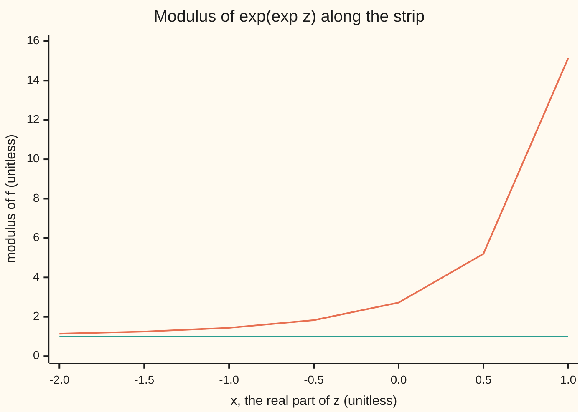
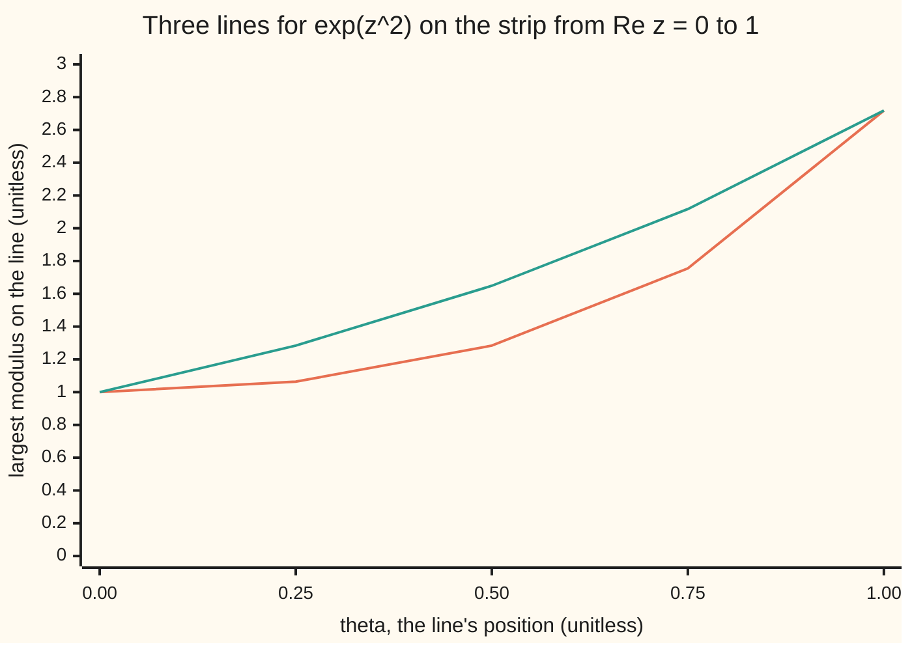

# Phragmen-Lindelof: the maximum principle on an unbounded strip, provided the function does not grow too fast

[Syllabus](../../../SYLLABUS.md) → [Complex analysis](../README.md) → [Taylor Series, Zeros and Rigidity](../README.md#s04) → Phragmen-Lindelof

---

## General Overview

Take the strip of points z = x + iy with $`\lvert y\rvert < \pi/2`$: a band of height $`\pi`$ running forever left and right. On it put $`f(z) = \exp(\exp z)`$, a holomorphic function (one with a complex derivative everywhere).

On both edges $`y = \pm\pi/2`$, the inner exponential is $`\pm i e^x`$, a pure imaginary number, so $`\lvert f\rvert = 1`$ everywhere on both edges ([The elementary functions](../02-Holomorphic%20Functions/03-exponential-sine-and-cosine-in-the-plane.md)).

Yet on the centre line, $`f(1) = e^e = 15.154262`$. [The maximum modulus principle](05-maximum-modulus-principle.md) forbids this on a bounded region, where the modulus (distance from 0) cannot exceed its edge values. The strip is unbounded, and $`\exp(\exp z)`$ slips through that gap.

The repair is a speed limit. On the strip, $`\lvert\exp(\exp z)\rvert \le \exp(e^{\lvert x\rvert})`$, reached on the centre line for $`x > 0`$.

Any holomorphic function, continuous up to both edges, that grows a little slower, like $`\exp(A e^{c\lvert x\rvert})`$ with c below 1, is caught: if $`\lvert f\rvert \le 1`$ on both edges, then $`\lvert f\rvert \le 1`$ inside. Number theorists use this to bound the Riemann zeta function between two vertical lines.

**On an unbounded strip the maximum principle still holds for every holomorphic function, continuous up to its edges, that grows slower than a double-exponential rate set by the strip's height, and $`\exp(\exp z)`$ sits exactly on that rate for height $`\pi`$, which is why it escapes.**

**What kind of fact this is:** a theorem, proved on this card in Why it works, with Hadamard's three-lines theorem as a consequence.

### The picture: one on the edges, 15 on the centre line



Orange: the centre line, y = 0, where the modulus is $`\exp(e^x)`$. Green: both edges, $`y = \pm\pi/2`$, where it is always 1.

---

## The formula

Notation first, in words. S is the strip $`\lvert \mathrm{Im}\, z\rvert < \pi/2`$; its two **edges** are the lines $`y = \pm\pi/2`$. The **growth bound** says how fast f may grow far out along the strip: A is any fixed positive number, c is the rate.

```math
\lvert f\rvert \le 1 \text{ on both edges, and } \lvert f(x+iy)\rvert \le \exp\!\left(A\, e^{c\lvert x\rvert}\right) \text{ with } c < 1 \quad\Longrightarrow\quad \lvert f\rvert \le 1 \text{ on all of } S
```

**Read it aloud:** if the modulus of f is at most 1 on both edges, and far out it stays below e raised to the power A times e to the c times the size of x, with c below 1, then the modulus of f is at most 1 everywhere on the strip.

Here f is holomorphic on S and continuous up to its edges. For $`\exp(\exp z)`$ the rate is exactly c = 1, so the theorem says nothing about it.

The consequence, **Hadamard's three-lines theorem**, applies to a bounded function f that is holomorphic on $`0 < \mathrm{Re}\, z < 1`$ and continuous up to its edges. Write $`M(\theta)`$ for the least upper bound of $`\lvert f\rvert`$ on $`\mathrm{Re}\, z = \theta`$ (its largest value, or the level it approaches), and $`M_0`$, $`M_1`$ for the two edges:

```math
M(\theta) \le M_0^{\,1-\theta}\, M_1^{\,\theta}, \qquad 0 \le \theta \le 1
```

**Read it aloud:** the largest modulus on a line between the edges is at most a weighted geometric mean of the largest moduli on the two edges.

| Symbol | Plain meaning | In our example | Push it up and the answer… |
| --- | --- | --- | --- |
| $`z = x + iy`$, $`w`$ | a point on the strip (x along, y across); a mapped point | z = 1 | — |
| $`f`$ | the holomorphic function under study | $`\exp(\exp z)`$, $`\exp(z^2)`$ | — |
| $`S`$, $`\beta`$ | the strip $`\lvert y\rvert < \pi/2`$; a sector has opening angle $`\pi/\beta`$ | height $`\pi`$ | a wider strip lowers the limit |
| $`A`$, $`c`$ | the size and rate of the growth bound | A = 1, c = 0.5 | c below 1 is required |
| $`b`$, $`\varepsilon`$, $`\delta`$, $`R`$ | the damper rate and strength; $`\cos(b\pi/2)`$; the box half-length | 0.75, 0.01, 0.382683, 22.26 | smaller $`\varepsilon`$, longer box |
| $`h`$, $`g`$ | the damper; f times the damper or $`M_0^{z-1}M_1^{-z}`$ | $`\exp(-2\varepsilon\cosh bz)`$ | — |
| $`M_0`$, $`M_1`$, $`M(\theta)`$ | the least upper bounds on the edges and middle line | 1, e, $`e^{\theta^2}`$ | larger edges, larger bound |
| $`\theta`$ | the vertical line's position, from 0 to 1 | 1/2 | shifts weight to $`M_1`$ |

### When it holds

- **Growth rate c below 1.** At c = 1, $`\exp(\exp z)`$ hits 15.154262 at z = 1 despite being 1 on the edges.
- **Rate matches the strip's height.** The limit is $`\pi`$ over the height: on $`\lvert y\rvert < \pi`$, the limit halves to 1/2, where $`\exp(\exp(z/2))`$ escapes.
- **Continuous up to the edges.** Without continuity up to the boundary, edge bounds cannot control interior points ([The maximum modulus principle](05-maximum-modulus-principle.md)).
- **Bounded is always enough.** A bounded f has rate 0, which is why three lines needs only boundedness.

---

## Why it works

### Step 0: damp the far ends, then take the damping away

A rectangle cut from the strip has top and bottom on the edges, where $`\lvert f\rvert \le 1`$, and two end walls where f may blow up: on $`\lvert x\rvert \le 2`$, $`\exp(\exp z)`$ reaches 1618.177992 at x = 2.

Multiply f by a **damper** h of modulus at most 1 that crushes the far ends faster than f can grow. Then the plain maximum principle controls the rectangle, and letting the damper fade recovers the bound on f.

### Step 1: the damper

Pick a positive rate b with $`0 < b < 1`$ and $`b > c`$, and a small $`\varepsilon > 0`$. Let

```math
h(z) = \exp\!\left(-\varepsilon\left(e^{bz} + e^{-bz}\right)\right) = \exp\!\left(-2\varepsilon\cosh bz\right).
```

The real part of $`\cosh bz`$ is $`\cosh(bx)\cos(by)`$. On the strip $`\lvert by\rvert \le b\pi/2 < \pi/2`$, so $`\cos(by) \ge \delta = \cos(b\pi/2) > 0`$. Then

```math
\lvert h(z)\rvert \le \exp\!\left(-2\varepsilon\delta\cosh bx\right) \le \exp\!\left(-\varepsilon\delta\, e^{b\lvert x\rvert}\right) \le 1.
```

**Read it aloud:** the damper never exceeds 1, and far out it dies like e to the minus a constant times e to the b times the size of x.

With A = 1, c = 0.5, b = 0.75 and $`\varepsilon = 0.01`$: $`\delta = 0.382683`$.

### Step 2: the end walls come under control

Let $`g = f h`$. On the edges, $`\lvert g\rvert \le 1 \cdot 1`$. Far out, the growth bound and Step 1 give

```math
\log\lvert g\rvert \le A\, e^{c\lvert x\rvert} - \varepsilon\delta\, e^{b\lvert x\rvert},
```

which is at most 0 once $`\lvert x\rvert \ge R = \ln\!\big(A/(\varepsilon\delta)\big)/(b - c)`$, because b beats c. With our numbers R = 22.26.

On any rectangle $`\lvert x\rvert \le L`$ with $`L \ge R`$, $`\lvert g\rvert \le 1`$ on all four sides. Because the rectangle is bounded, [The maximum modulus principle](05-maximum-modulus-principle.md) gives $`\lvert g\rvert \le 1`$ inside. Every point of the strip lies in such a rectangle, so $`\lvert g\rvert \le 1`$ on all of S.

### Step 3: take the damper away

At a fixed point, $`\lvert f\rvert \le 1/\lvert h\rvert = \exp(2\varepsilon\,\mathrm{Re}\cosh bz)`$. At z = 1 this is 1.026232 for $`\varepsilon = 0.01`$, 1.002593 for 0.001 and 1.000259 for 0.0001. Let $`\varepsilon`$ shrink to 0: $`\lvert f(z)\rvert \le 1`$.

### Step 4: why c below 1 is the exact limit

The damper needs b above c to beat f at the ends, and b below 1 so $`\cos(b\pi/2) > 0`$ keeps $`\lvert h\rvert \le 1`$ on the edges. Both hold only when c < 1.

At c = 1, $`\exp(\exp z)`$ has no damper and reaches 15.154262 at z = 1. Rescaling the strip rescales the limit, so height $`2\pi`$ allows only rates below 1/2.

<details>
<summary>The same theorem on a half-plane and on a sector</summary>

The map $`w \mapsto e^w`$ sends $`\lvert \mathrm{Im}\, w\rvert < \pi/2`$ onto the right half-plane $`\mathrm{Re}\, z > 0`$, sending the edges to the imaginary axis and $`e^{\lvert x\rvert}`$ to $`\lvert z\rvert`$ (or $`1/\lvert z\rvert`$ near 0).

So on $`\mathrm{Re}\, z > 0`$: if f is holomorphic inside, continuous up to the entire imaginary axis (including 0) with $`\lvert f\rvert \le 1`$ there, and $`\lvert f(z)\rvert \le \exp(A\lvert z\rvert^{c})`$ with c < 1, then $`\lvert f\rvert \le 1`$.

The borderline function is $`e^z`$, which is $`\exp(\exp w)`$ seen through the map: the failure case from the maximum modulus card. At z = e (w = 1) its modulus is $`e^e = 15.154262`$.

A sector of opening angle $`\pi/\beta`$ ($`\beta > 1/2`$) maps to the half-plane via $`z^\beta`$. Its angle sets the allowed growth: any holomorphic f, continuous up to both rays including 0, with growth $`\exp(A\lvert z\rvert^c)`$ and $`c < \beta`$ is caught, while $`\exp(z^\beta)`$ escapes.

</details>

### Step 5: Hadamard's three lines

Take f bounded and continuous on $`0 \le \mathrm{Re}\, z \le 1`$, holomorphic inside, with $`M_0, M_1 > 0`$. Set

```math
g(z) = f(z)\, M_0^{\,z-1}\, M_1^{\,-z}.
```

Since $`\lvert M_0^{z-1}\rvert = M_0^{x-1}`$, $`\lvert g\rvert \le 1`$ on both edges. Because g is bounded, Steps 1 to 3 (after rotating and scaling via $`w = i\pi(z - 1/2)`$) give $`\lvert g\rvert \le 1`$ inside, which reads $`\lvert f\rvert \le M_0^{1-\theta}M_1^{\theta}`$ on $`\mathrm{Re}\, z = \theta`$. (If $`M_0`$ or $`M_1`$ is 0, replace it with a tiny positive number and let it shrink: $`f = 0`$.)

Taking logarithms shows $`\log M(\theta)`$ stays below its chords on every sub-strip, so it is a **convex** function of $`\theta`$.

For $`f(z) = \exp(z^2)`$, $`\lvert f\rvert = e^{x^2 - y^2}`$ peaks at y = 0, giving $`M(\theta) = e^{\theta^2}`$, $`M_0 = 1`$ and $`M_1 = e`$. Here $`g(z) = \exp(z^2 - z)`$ has largest modulus 1, reached on the edges.

---

## Worked numbers, by hand

| Step | Arithmetic | Value |
| --- | --- | --- |
| inner exponential, top edge, x = 1 | $`e^1 (\cos\frac{\pi}{2} + i\sin\frac{\pi}{2})`$ | 2.718282i |
| modulus of f there | exponential of a pure imaginary | 1 |
| f on the centre line at x = 1 | $`\exp(e^1)`$ | **15.154262** |
| growth rate | $`\ln\ln\lvert f(x)\rvert = x`$ at x = 1, 2, 3 | 1, 2, 3: rate c = 1 |
| three lines, $`\exp(z^2)`$, edges | $`e^{0}`$ and $`e^{1}`$ | $`M_0 = 1`$, $`M_1 = 2.718282`$ |
| bound at $`\theta = 1/2`$ | $`1^{1/2} \cdot e^{1/2}`$ | 1.648721 |
| true value at $`\theta = 1/2`$ | $`e^{1/4}`$ | **1.284025** |



Orange: true $`M(\theta) = e^{\theta^2}`$ by grid search. Green: three-lines bound $`e^{\theta}`$.

### What breaks if you drop a piece

| Mistake | Comes out at | What went wrong |
| --- | --- | --- |
| No growth bound: $`\exp(\exp z)`$ | 1 on edges, 15.154262 at z = 1 | Rate c = 1 sits on the limit |
| Rate below 1 on a strip twice as tall | $`\exp(\exp(z/2))`$: 15.154262 at z = 2 | The limit there is 1/2 |
| Long rectangle, end walls ignored | 1618.177992 on x = 2 | Only the damper controls the ends |
| Arithmetic mean in three lines | 1.859141 vs 1.648721 | Weaker than the geometric mean |

---

## Code, from first principles, and it actually runs

The code builds the complex exponential from cosine and sine and checks closed forms ($`\exp(e^x)`$, $`e^{\theta^2}`$, R) against grid searches and a scan, verifying Step 1's damper bound and three-lines g on a grid.

### Python

```python
# Phragmen-Lindelof -- the check behind the card.  Standard library only.
# Strip |Im z| < pi/2, f(z) = exp(exp z).  Road one: closed forms.  Road two: complex
# arithmetic written out here and grid searches.  Then the damper of the proof, the
# half-plane, and the three-lines bound for exp(z^2) on the strip 0 <= Re z <= 1.
import math
H = math.pi / 2

def cexp(z): return math.exp(z.real) * complex(math.cos(z.imag), math.sin(z.imag))
def f(z): return cexp(cexp(z))                           # exp(exp z), built by hand
def top(h, pts): return max(((abs(h(z)), z) for z in pts), key=lambda p: p[0])  # (largest |h|, where)
def row(v, d=2): return " ".join(f"{x:.{d}f}" for x in v)

edges = [complex(k / 100, s * H) for k in range(-300, 301) for s in (1, -1)]
e_max, _ = top(f, edges)
print(f"strip |Im z| < pi/2, f = exp(exp z): largest |f| on both edges, x from -3 to 3: {e_max:.6f}")
print(f"exp z on the top edge at x = 1: {cexp(complex(1, H)).real:.6f} + {cexp(complex(1, H)).imag:.6f}i")
print(f"f(1): by hand {abs(f(1 + 0j)):.6f}; closed form e^e {math.exp(math.e):.6f}")
xs = [k / 2 for k in range(-4, 3)]
print("chart, x:", row(xs, 1))
print("chart, |f(x)| on the centre line:", row([abs(f(complex(x, 0))) for x in xs]))
print("growth: ln ln |f(x)| at x = 1, 2, 3:", row([math.log(math.log(abs(f(complex(x, 0))))) for x in (1, 2, 3)], 6))
A, c, b, eps = 1.0, 0.5, 0.75, 0.01
dl = math.cos(b * H)
print(f"damper, A = 1, c = 0.5, b = 0.75, eps = 0.01: delta = cos(b pi/2) = {dl:.6f}")
r_closed = math.log(A / (eps * dl)) / (b - c)
x = 0.0
while A * math.exp(c * x) - 2 * eps * dl * math.cosh(b * x) > 0: x += 0.001
print(f"end walls under control from |x| = R: closed form {r_closed:.2f}; scan {x:.2f}")
print("bound at z = 1 once the damper comes off, eps = 0.01, 0.001, 0.0001:",
      row([math.exp(2 * e * math.cosh(b)) for e in (0.01, 0.001, 0.0001)], 6))
hd = lambda z: cexp(-eps * (cexp(b * z) + cexp(-b * z)))   # the damper h = exp(-2 eps cosh bz), built by hand
print(f"half-plane: |e^z| at z = e is {abs(cexp(complex(math.e, 0))):.6f}, the same as |f(1)|")
g3 = lambda z: cexp(z * z)                                # three lines: exp(z^2)
ys = [k / 1000 for k in range(-3000, 3001)]
M = lambda t: top(g3, [complex(t, y) for y in ys])[0]
m0, m1 = M(0.0), M(1.0)
ths = [k / 4 for k in range(5)]
grid, bound = [M(t) for t in ths], [m0 ** (1 - t) * m1 ** t for t in ths]
print(f"three lines, exp(z^2) on 0 <= Re z <= 1: M0 = {m0:.6f}, M1 = {m1:.6f}")
print("chart, theta:", row(ths))
print("chart, M(theta) by grid search:", row(grid, 3), "| closed form e^(theta^2):", row([math.exp(t * t) for t in ths], 3))
print("chart, bound M0^(1-theta) M1^theta:", row(bound, 3))
g = lambda z: g3(z) * cexp((z - 1) * math.log(m0)) * cexp(-z * math.log(m1))  # f M0^(z-1) M1^(-z)
gm, gz = top(g, [complex(k / 100, y / 100) for k in range(101) for y in range(-300, 301)])
print(f"g = exp(z^2 - z): largest |g| on the grid {gm:.6f}, on an edge: {'yes' if gz.real in (0, 1) else 'no'}; |g(1/2)| = {abs(g(0.5 + 0j)):.6f}")
print(f"break 1, no growth limit: edges {e_max:.6f}, f(1) = {abs(f(1 + 0j)):.6f}")
f2 = lambda z: f(z / 2)
w_max = top(f2, [complex(k / 100, s * 2 * H) for k in range(-300, 301) for s in (1, -1)])[0]
print(f"break 2, strip twice as wide, exp(exp(z/2)) on |Im z| < pi: edges {w_max:.6f}, at z = 2 {abs(f2(2 + 0j)):.6f}")
rm, rz = top(f, [complex(k / 100, y * H / 50) for k in range(-200, 201) for y in range(-50, 51)])
print(f"break 3, rectangle |x| <= 2: largest |f| {rm:.6f} at x = {rz.real:.0f}, y = {abs(rz.imag):.0f}, an end wall")
print(f"break 4, arithmetic mean of M0, M1: {(m0 + m1) / 2:.6f}, against the geometric {bound[2]:.6f}; true M(1/2) {grid[2]:.6f}")
assert abs(e_max - 1) < 1e-12 and abs(abs(f(1 + 0j)) - math.exp(math.e)) < 1e-9   # edges; e^e
assert all(abs(p - math.exp(t * t)) < 1e-9 and abs(q - math.exp(t)) < 1e-9 and p <= q + 1e-12 for p, q, t in zip(grid, bound, ths))
assert abs(x - r_closed) < 0.01 and abs(dl - math.sin(math.pi / 8)) < 1e-12        # R two ways; delta = sin(pi/8)
assert all(abs(hd(complex(k / 10, y * H / 10))) <= math.exp(-eps * dl * math.exp(b * abs(k / 10))) + 1e-15
           for k in range(-300, 301) for y in range(-10, 11))                 # Step 1's damper bound
assert gm <= 1 + 1e-12 and gz.real in (0, 1) and abs(rm - math.exp(math.exp(2))) < 1e-6
print("ALL CHECKS PASS")
```

**Ran 2026-11-23 on macOS, Python 3.14.10, standard library only. All checks passed. Output, pasted from the run:**

```
strip |Im z| < pi/2, f = exp(exp z): largest |f| on both edges, x from -3 to 3: 1.000000
exp z on the top edge at x = 1: 0.000000 + 2.718282i
f(1): by hand 15.154262; closed form e^e 15.154262
chart, x: -2.0 -1.5 -1.0 -0.5 0.0 0.5 1.0
chart, |f(x)| on the centre line: 1.14 1.25 1.44 1.83 2.72 5.20 15.15
growth: ln ln |f(x)| at x = 1, 2, 3: 1.000000 2.000000 3.000000
damper, A = 1, c = 0.5, b = 0.75, eps = 0.01: delta = cos(b pi/2) = 0.382683
end walls under control from |x| = R: closed form 22.26; scan 22.26
bound at z = 1 once the damper comes off, eps = 0.01, 0.001, 0.0001: 1.026232 1.002593 1.000259
half-plane: |e^z| at z = e is 15.154262, the same as |f(1)|
three lines, exp(z^2) on 0 <= Re z <= 1: M0 = 1.000000, M1 = 2.718282
chart, theta: 0.00 0.25 0.50 0.75 1.00
chart, M(theta) by grid search: 1.000 1.064 1.284 1.755 2.718 | closed form e^(theta^2): 1.000 1.064 1.284 1.755 2.718
chart, bound M0^(1-theta) M1^theta: 1.000 1.284 1.649 2.117 2.718
g = exp(z^2 - z): largest |g| on the grid 1.000000, on an edge: yes; |g(1/2)| = 0.778801
break 1, no growth limit: edges 1.000000, f(1) = 15.154262
break 2, strip twice as wide, exp(exp(z/2)) on |Im z| < pi: edges 1.000000, at z = 2 15.154262
break 3, rectangle |x| <= 2: largest |f| 1618.177992 at x = 2, y = 0, an end wall
break 4, arithmetic mean of M0, M1: 1.859141, against the geometric 1.648721; true M(1/2) 1.284025
ALL CHECKS PASS
```

### Rust

Same numbers, same labels, built with `rustc --edition 2021 -O`.

```rust
// Phragmen-Lindelof -- the same check as the Python, in Rust.  No crates.
// Strip |Im z| < pi/2, f(z) = exp(exp z).  Road one: closed forms.  Road two: complex
// arithmetic written out here and grid searches.  Then the damper of the proof, the
// half-plane, and the three-lines bound for exp(z^2) on the strip 0 <= Re z <= 1.
use std::f64::consts::{E, PI};
const H: f64 = PI / 2.0;

#[derive(Clone, Copy)]
struct C { re: f64, im: f64 }
fn c(re: f64, im: f64) -> C { C { re, im } }
fn mul(a: C, b: C) -> C { c(a.re * b.re - a.im * b.im, a.re * b.im + a.im * b.re) }
fn sc(a: C, k: f64) -> C { c(a.re * k, a.im * k) }
fn md(a: C) -> f64 { a.re.hypot(a.im) }
fn cexp(z: C) -> C { sc(c(z.im.cos(), z.im.sin()), z.re.exp()) }
fn f(z: C) -> C { cexp(cexp(z)) }                          // exp(exp z), built by hand
fn top(h: &dyn Fn(C) -> C, pts: &[C]) -> (f64, C) {       // (largest |h|, where)
    let mut b = (md(h(pts[0])), pts[0]);
    for &z in pts { let m = md(h(z)); if m > b.0 { b = (m, z); } }
    b
}
fn row(v: &[f64], d: usize) -> String { v.iter().map(|x| format!("{:.*}", d, x)).collect::<Vec<_>>().join(" ") }
fn main() {
    let edges: Vec<C> = (-300..=300).flat_map(|k| [c(k as f64 / 100.0, H), c(k as f64 / 100.0, -H)]).collect();
    let e_max = top(&f, &edges).0;
    let f1 = md(f(c(1.0, 0.0)));
    println!("strip |Im z| < pi/2, f = exp(exp z): largest |f| on both edges, x from -3 to 3: {:.6}", e_max);
    let t = cexp(c(1.0, H));
    println!("exp z on the top edge at x = 1: {:.6} + {:.6}i", t.re, t.im);
    println!("f(1): by hand {:.6}; closed form e^e {:.6}", f1, E.exp());
    let xs: Vec<f64> = (-4..3).map(|k| k as f64 / 2.0).collect();
    println!("chart, x: {}", row(&xs, 1));
    println!("chart, |f(x)| on the centre line: {}", row(&xs.iter().map(|&x| md(f(c(x, 0.0)))).collect::<Vec<_>>(), 2));
    println!("growth: ln ln |f(x)| at x = 1, 2, 3: {}", row(&[1.0, 2.0, 3.0].map(|x| md(f(c(x, 0.0))).ln().ln()), 6));
    let (a, cc, b, eps) = (1.0f64, 0.5f64, 0.75f64, 0.01f64);
    let dl = (b * H).cos();
    println!("damper, A = 1, c = 0.5, b = 0.75, eps = 0.01: delta = cos(b pi/2) = {:.6}", dl);
    let r_closed = (a / (eps * dl)).ln() / (b - cc);
    let mut x = 0.0f64;
    while a * (cc * x).exp() - 2.0 * eps * dl * (b * x).cosh() > 0.0 { x += 0.001; }
    println!("end walls under control from |x| = R: closed form {:.2}; scan {:.2}", r_closed, x);
    println!("bound at z = 1 once the damper comes off, eps = 0.01, 0.001, 0.0001: {}",
             row(&[0.01, 0.001, 0.0001].map(|e: f64| (2.0 * e * b.cosh()).exp()), 6));
    let hd = |z: C| { let (p, q) = (cexp(sc(z, b)), cexp(sc(z, -b))); cexp(sc(c(p.re + q.re, p.im + q.im), -eps)) }; // the damper h
    let hp = md(cexp(c(E, 0.0)));
    println!("half-plane: |e^z| at z = e is {:.6}, the same as |f(1)|", hp);
    let g3 = |z: C| cexp(mul(z, z));                        // three lines: exp(z^2)
    let mm = |t: f64| top(&g3, &(-3000..=3000).map(|k| c(t, k as f64 / 1000.0)).collect::<Vec<_>>()).0;
    let (m0, m1) = (mm(0.0), mm(1.0));
    let ths: Vec<f64> = (0..5).map(|k| k as f64 / 4.0).collect();
    let grid: Vec<f64> = ths.iter().map(|&t| mm(t)).collect();
    let bound: Vec<f64> = ths.iter().map(|&t| m0.powf(1.0 - t) * m1.powf(t)).collect();
    println!("three lines, exp(z^2) on 0 <= Re z <= 1: M0 = {:.6}, M1 = {:.6}", m0, m1);
    println!("chart, theta: {}", row(&ths, 2));
    println!("chart, M(theta) by grid search: {} | closed form e^(theta^2): {}", row(&grid, 3),
             row(&ths.iter().map(|t| (t * t).exp()).collect::<Vec<_>>(), 3));
    println!("chart, bound M0^(1-theta) M1^theta: {}", row(&bound, 3));
    let g = |z: C| mul(mul(g3(z), cexp(sc(c(z.re - 1.0, z.im), m0.ln()))), cexp(sc(z, -m1.ln())));  // f M0^(z-1) M1^(-z)
    let rect: Vec<C> = (0..=100).flat_map(|k| (-300..=300).map(move |y| c(k as f64 / 100.0, y as f64 / 100.0))).collect();
    let (gm, gz) = top(&g, &rect);
    let on_edge = gz.re == 0.0 || gz.re == 1.0;
    println!("g = exp(z^2 - z): largest |g| on the grid {:.6}, on an edge: {}; |g(1/2)| = {:.6}",
             gm, if on_edge { "yes" } else { "no" }, md(g(c(0.5, 0.0))));
    println!("break 1, no growth limit: edges {:.6}, f(1) = {:.6}", e_max, f1);
    let f2 = |z: C| f(sc(z, 0.5));
    let wide: Vec<C> = (-300..=300).flat_map(|k| [c(k as f64 / 100.0, 2.0 * H), c(k as f64 / 100.0, -2.0 * H)]).collect();
    println!("break 2, strip twice as wide, exp(exp(z/2)) on |Im z| < pi: edges {:.6}, at z = 2 {:.6}",
             top(&f2, &wide).0, md(f2(c(2.0, 0.0))));
    let box2: Vec<C> = (-200..=200).flat_map(|k| (-50..=50).map(move |y| c(k as f64 / 100.0, y as f64 * H / 50.0))).collect();
    let (rm, rz) = top(&f, &box2);
    println!("break 3, rectangle |x| <= 2: largest |f| {:.6} at x = {:.0}, y = {:.0}, an end wall", rm, rz.re, rz.im.abs());
    println!("break 4, arithmetic mean of M0, M1: {:.6}, against the geometric {:.6}; true M(1/2) {:.6}", (m0 + m1) / 2.0, bound[2], grid[2]);
    assert!((e_max - 1.0).abs() < 1e-12 && (f1 - E.exp()).abs() < 1e-9);            // edges; e^e
    assert!(grid.iter().zip(&bound).zip(&ths).all(|((p, q), t)| (p - (t * t).exp()).abs() < 1e-9 && (q - t.exp()).abs() < 1e-9 && *p <= q + 1e-12));
    assert!((x - r_closed).abs() < 0.01 && (dl - (PI / 8.0).sin()).abs() < 1e-12);     // R two ways; delta = sin(pi/8)
    assert!((-300..=300).all(|k| (-10..=10).all(|y| md(hd(c(k as f64 / 10.0, y as f64 * H / 10.0)))
        <= (-eps * dl * (b * (k as f64 / 10.0).abs()).exp()).exp() + 1e-15)));              // Step 1's damper bound
    assert!(gm <= 1.0 + 1e-12 && on_edge && (rm - E.powi(2).exp()).abs() < 1e-6);
    println!("ALL CHECKS PASS");
}
```

**Ran 2026-11-23 on macOS, rustc 1.98.1, no crates. All checks passed. Output, pasted from the run:**

```
strip |Im z| < pi/2, f = exp(exp z): largest |f| on both edges, x from -3 to 3: 1.000000
exp z on the top edge at x = 1: 0.000000 + 2.718282i
f(1): by hand 15.154262; closed form e^e 15.154262
chart, x: -2.0 -1.5 -1.0 -0.5 0.0 0.5 1.0
chart, |f(x)| on the centre line: 1.14 1.25 1.44 1.83 2.72 5.20 15.15
growth: ln ln |f(x)| at x = 1, 2, 3: 1.000000 2.000000 3.000000
damper, A = 1, c = 0.5, b = 0.75, eps = 0.01: delta = cos(b pi/2) = 0.382683
end walls under control from |x| = R: closed form 22.26; scan 22.26
bound at z = 1 once the damper comes off, eps = 0.01, 0.001, 0.0001: 1.026232 1.002593 1.000259
half-plane: |e^z| at z = e is 15.154262, the same as |f(1)|
three lines, exp(z^2) on 0 <= Re z <= 1: M0 = 1.000000, M1 = 2.718282
chart, theta: 0.00 0.25 0.50 0.75 1.00
chart, M(theta) by grid search: 1.000 1.064 1.284 1.755 2.718 | closed form e^(theta^2): 1.000 1.064 1.284 1.755 2.718
chart, bound M0^(1-theta) M1^theta: 1.000 1.284 1.649 2.117 2.718
g = exp(z^2 - z): largest |g| on the grid 1.000000, on an edge: yes; |g(1/2)| = 0.778801
break 1, no growth limit: edges 1.000000, f(1) = 15.154262
break 2, strip twice as wide, exp(exp(z/2)) on |Im z| < pi: edges 1.000000, at z = 2 15.154262
break 3, rectangle |x| <= 2: largest |f| 1618.177992 at x = 2, y = 0, an end wall
break 4, arithmetic mean of M0, M1: 1.859141, against the geometric 1.648721; true M(1/2) 1.284025
ALL CHECKS PASS
```

The two outputs match line for line.

### Lean

Lean proves the strip theorem for every allowed rate, the failure of $`\exp(\exp z)`$, and three lines for every bounded f.

- Suppose f is holomorphic on S, continuous up to its edges, at most 1 on both edges, and grows with rate c below 1. Then $`\lvert f\rvert \le 1`$ on all of S.
- Take $`f(z) = \exp(\exp z)`$ on S. Then f is holomorphic, has modulus exactly 1 on both edges, and grows at rate c = 1 with A = 1.
- For $`f(z) = \exp(\exp z)`$, the modulus at z = 1 is exactly $`e^e`$, which is more than 1.
- Take f bounded and continuous on $`0 \le \mathrm{Re}\, z \le 1`$, holomorphic inside, and $`0 \le \theta \le 1`$. Then $`M(\theta) \le M_0^{\,1-\theta}\, M_1^{\,\theta}`$.

The decimals, the taller strip, the damper, the half-plane and the $`\exp(z^2)`$ example are left to the Python and Rust checks.

```lean
-- Phragmen-Lindelof: on the strip |Im z| < π/2 a holomorphic function with modulus at most 1 on both edges and growth below exp(A e^(c|x|)), c < 1, has modulus at most 1 inside; exp(exp z) shows the rate 1 fails; and Hadamard's three-lines bound holds.
import Mathlib.Analysis.Complex.PhragmenLindelof
import Mathlib.Analysis.Complex.Hadamard

open Complex Set

/-- **Phragmen-Lindelof on a strip.** Let S be the strip `|Im z| < π/2`. If f is holomorphic
on S and continuous up to its edges, `|f| ≤ 1` on both edges `Im z = ± π/2`, and
`|f(x + iy)| ≤ exp(A e^(c|x|))` on S for a fixed `A > 0` and a rate `c < 1`, then `|f| ≤ 1`
on all of S. -/
theorem phragmen_lindelof_strip (f : ℂ → ℂ)
    (hf : DiffContOnCl ℂ f {z : ℂ | |z.im| < Real.pi / 2})
    (h_top : ∀ z : ℂ, z.im = Real.pi / 2 → ‖f z‖ ≤ 1)
    (h_bot : ∀ z : ℂ, z.im = -(Real.pi / 2) → ‖f z‖ ≤ 1)
    (A c : ℝ) (hA : 0 < A) (hc : c < 1)
    (hgrowth : ∀ z : ℂ, |z.im| < Real.pi / 2 → ‖f z‖ ≤ Real.exp (A * Real.exp (c * |z.re|))) :
    ∀ z : ℂ, |z.im| < Real.pi / 2 → ‖f z‖ ≤ 1 := by
  intro z hz
  have hset : {z : ℂ | |z.im| < Real.pi / 2} = im ⁻¹' Ioo (-(Real.pi / 2)) (Real.pi / 2) := by
    ext w; simp [abs_lt]
  rw [hset] at hf
  have hz' := abs_lt.1 hz
  refine PhragmenLindelof.horizontal_strip (C := 1) hf ⟨c, ?_, A, ?_⟩ h_bot h_top hz'.1.le hz'.2.le
  · have : Real.pi / (Real.pi / 2 - -(Real.pi / 2)) = 1 := by
      field_simp; norm_num
    rw [this]; exact hc
  · refine Asymptotics.IsBigO.of_bound 1 ?_
    refine Filter.mem_inf_of_right ?_
    intro w hw
    have hw' : |w.im| < Real.pi / 2 := abs_lt.2 hw
    simp only [Real.norm_eq_abs, Real.abs_exp, one_mul]
    exact hgrowth w hw'

/-- **The growth bound is needed: `exp(exp z)` sits exactly on the rate limit.** On the strip
`|Im z| < π/2`, `f(z) = exp(exp z)` is holomorphic, has modulus 1 at every point of both edges,
grows at most like `exp(e^|x|)` (rate c = 1, A = 1), and yet `|f(1)| = e^e > 1`. -/
theorem exp_exp_escapes_strip :
    Differentiable ℂ (fun z : ℂ => Complex.exp (Complex.exp z)) ∧
    (∀ z : ℂ, z.im = Real.pi / 2 → ‖Complex.exp (Complex.exp z)‖ = 1) ∧
    (∀ z : ℂ, z.im = -(Real.pi / 2) → ‖Complex.exp (Complex.exp z)‖ = 1) ∧
    (∀ z : ℂ, |z.im| < Real.pi / 2 →
      ‖Complex.exp (Complex.exp z)‖ ≤ Real.exp (1 * Real.exp (1 * |z.re|))) ∧
    ‖Complex.exp (Complex.exp 1)‖ = Real.exp (Real.exp 1) ∧
    1 < ‖Complex.exp (Complex.exp 1)‖ := by
  have h1 : ‖Complex.exp (Complex.exp 1)‖ = Real.exp (Real.exp 1) := by
    rw [Complex.norm_exp, ← Complex.ofReal_one, Complex.exp_ofReal_re]
  refine ⟨Complex.differentiable_exp.comp Complex.differentiable_exp, ?_, ?_, ?_, h1, ?_⟩
  · intro z hz
    rw [Complex.norm_exp, Complex.exp_re, hz, Real.cos_pi_div_two, mul_zero, Real.exp_zero]
  · intro z hz
    rw [Complex.norm_exp, Complex.exp_re, hz, Real.cos_neg, Real.cos_pi_div_two, mul_zero,
      Real.exp_zero]
  · intro z _
    rw [Complex.norm_exp, Complex.exp_re, one_mul, one_mul]
    apply Real.exp_le_exp.2
    calc Real.exp z.re * Real.cos z.im ≤ Real.exp z.re * 1 :=
          mul_le_mul_of_nonneg_left (Real.cos_le_one _) (Real.exp_pos _).le
      _ = Real.exp z.re := mul_one _
      _ ≤ Real.exp |z.re| := Real.exp_le_exp.2 (le_abs_self _)
  · rw [h1]; exact Real.one_lt_exp_iff.2 (Real.exp_pos 1)

/-- **Hadamard's three-lines theorem.** Let f be bounded and continuous on the strip
`0 ≤ Re z ≤ 1` and holomorphic inside. Write `M(θ)` for the least upper bound of `|f|` on the
line `Re z = θ`. Then `M(θ) ≤ M(0)^(1-θ) · M(1)^θ` for every `0 ≤ θ ≤ 1`. -/
theorem hadamard_three_lines (f : ℂ → ℂ)
    (hf : DiffContOnCl ℂ f {z : ℂ | 0 < z.re ∧ z.re < 1})
    (hbdd : BddAbove ((fun z => ‖f z‖) '' {z : ℂ | 0 ≤ z.re ∧ z.re ≤ 1}))
    (θ : ℝ) (hθ0 : 0 ≤ θ) (hθ1 : θ ≤ 1) :
    HadamardThreeLines.sSupNormIm f θ ≤
      HadamardThreeLines.sSupNormIm f 0 ^ (1 - θ) * HadamardThreeLines.sSupNormIm f 1 ^ θ := by
  have hd : DiffContOnCl ℂ f (HadamardThreeLines.verticalStrip 0 1) := by
    convert hf using 1
    ext w; simp [HadamardThreeLines.verticalStrip]
  have hB : BddAbove ((norm ∘ f) '' HadamardThreeLines.verticalClosedStrip 0 1) := by
    convert hbdd using 1
    ext r; simp [HadamardThreeLines.verticalClosedStrip]
  have key : ∀ z : ℂ, z.re = θ → ‖f z‖ ≤
      HadamardThreeLines.sSupNormIm f 0 ^ (1 - θ) * HadamardThreeLines.sSupNormIm f 1 ^ θ := by
    intro z hz
    have hzm : z ∈ HadamardThreeLines.verticalClosedStrip 0 1 := by
      simp only [HadamardThreeLines.verticalClosedStrip, mem_preimage, mem_Icc, hz]
      exact ⟨hθ0, hθ1⟩
    have := HadamardThreeLines.norm_le_interp_of_mem_verticalClosedStrip₀₁' f hzm hd hB
      (a := HadamardThreeLines.sSupNormIm f 0) (b := HadamardThreeLines.sSupNormIm f 1)
      (fun w hw => by
        have hw' : w.re = 0 := hw
        have := HadamardThreeLines.norm_le_sSupNormIm f w
          (by simp [HadamardThreeLines.verticalClosedStrip, hw']) hB
        rwa [hw'] at this)
      (fun w hw => by
        have hw' : w.re = 1 := hw
        have := HadamardThreeLines.norm_le_sSupNormIm f w
          (by simp [HadamardThreeLines.verticalClosedStrip, hw']) hB
        rwa [hw'] at this)
    rwa [hz] at this
  unfold HadamardThreeLines.sSupNormIm
  apply csSup_le
  · exact ⟨_, mem_image_of_mem _ (show (θ : ℂ) ∈ re ⁻¹' {θ} by simp)⟩
  · rintro _ ⟨w, hw, rfl⟩
    exact key w hw

#print axioms phragmen_lindelof_strip
#print axioms exp_exp_escapes_strip
#print axioms hadamard_three_lines
```

**Checked 2026-11-23 on macOS, Lean 4.36.0-rc2, Mathlib v4.36.0-rc2. Every proof is complete and uses only Lean's standard axioms. Output, pasted from the run:**

```
'phragmen_lindelof_strip' depends on axioms: [propext, Classical.choice, Quot.sound]
'exp_exp_escapes_strip' depends on axioms: [propext, Classical.choice, Quot.sound]
'hadamard_three_lines' depends on axioms: [propext, Classical.choice, Quot.sound]
```

> [!TIP]
> **Try changing**
> Guess first, then run it.
> - **Weaken the damper.** Set `eps = 0.001`. Guess: the rectangle must grow. R becomes 31.47, by both roads.
> - **Push the rate to the limit.** Set `c = 0.74`, just under b = 0.75. Guess: R explodes, since b barely beats c. It reads 556.57.
> - **A different three-lines function.** Replace `cexp(z * z)` with `cexp(z)`. Guess: $`M(\theta) = e^{\theta}`$, so the bound is met exactly at every line. The grid row now equals the bound row, and the second assert stops the run, since $`e^{\theta^2}`$ no longer matches.

---

## The usual mistake

> [!warning]
> **Treating an unbounded strip like a bounded region.** The strip's boundary includes its far ends, which edge bounds never reach: $`\exp(\exp z)`$ is 1 on both edges and 15.154262 at z = 1.
>
> - **Forgetting the end walls.** On $`\lvert x\rvert \le 2`$, $`\exp(\exp z)`$ reaches 1618.177992 on x = 2.
> - **Using rate 1 on every strip.** The limit is $`\pi`$ over the height: on height $`2\pi`$, $`\exp(\exp(z/2))`$ escapes.
> - **The arithmetic mean in three lines.** $`(1 + e)/2 = 1.859141`$ is weaker than the geometric mean 1.648721.

---

## Where you meet it in real life

- **Signal processing and harmonic analysis.** Three lines proves the Riesz–Thorin theorem: a linear map bounded for two signal sizes is bounded for every size in between ([Interpolation](../../20-Harmonic%20analysis/06-Maximal%20Functions%20and%20Beyond/04-interpolation-riesz-thorin-and-marcinkiewicz.md)).
- **Prime numbers.** The Riemann zeta function is bounded right of $`\mathrm{Re}\, s = 1`$, and [The functional equation](../../21-Algebraic%20and%20analytic%20number%20theory/02-The%20Zeta%20Function%20and%20the%20Prime%20Number%20Theorem/02-functional-equation-proved.md) bounds it left of $`\mathrm{Re}\, s = 0`$. Phragmen-Lindelof interpolates between them, bounding zeta on the critical line by roughly the quarter power of the height.

> **Say it back**
> On an unbounded strip $`\lvert y\rvert < \pi/2`$, $`\exp(\exp z)`$ is 1 on both edges yet 15.154262 at z = 1. Any holomorphic function, continuous up to both edges, that grows at most like $`\exp(A e^{c\lvert x\rvert})`$ with c below 1 is caught: multiply by a damper that crushes the far ends, apply the maximum principle on a rectangle, then remove the damper. For a bounded holomorphic function continuous up to the edges of a strip, this gives Hadamard's three lines: the largest modulus on a middle line is at most a weighted geometric mean of the edges.

---

## What this builds on

- [The maximum modulus principle](05-maximum-modulus-principle.md): the bounded-region version applied to each rectangle; its failure case $`e^z`$ on the half-plane is this card's example.
- [The elementary functions](../02-Holomorphic%20Functions/03-exponential-sine-and-cosine-in-the-plane.md): $`e^{x+iy} = e^x(\cos y + i\sin y)`$ and cosh, building both the example and the damper.

## Where this goes next

- [Schwarz reflection](08-schwarz-reflection-principle.md): next on this shelf, extending a holomorphic function across a straight edge where its values are real rather than merely bounded.
- [Interpolation](../../20-Harmonic%20analysis/06-Maximal%20Functions%20and%20Beyond/04-interpolation-riesz-thorin-and-marcinkiewicz.md): three lines turned into bounds for linear maps under different ways of measuring a signal's size.
- [The functional equation](../../21-Algebraic%20and%20analytic%20number%20theory/02-The%20Zeta%20Function%20and%20the%20Prime%20Number%20Theorem/02-functional-equation-proved.md): the far-side bound that Phragmen-Lindelof carries across the critical strip.
- [Paley-Wiener-Schwartz](../../20-Harmonic%20analysis/02-The%20Fourier%20Transform/11-paley-wiener-schwartz-theorem.md): a signal confined to a window has an entire spectrum whose growth gives the window's width.
- [Normal families](10-normal-families-montel-and-hurwitz.md): uses uniform bounds of the kind proved here to extract convergent sub-lists.

The card leaves one question open in number theory: how large zeta really is on the critical line; the conjecture that it grows slower than every small power of the height is the Lindelöf hypothesis, unproved as of 2026-11-23. Next on the shelf, Schwarz reflection asks what happens when edge values are real instead of bounded.

---

## Sources

Verified 2026-11-23: every link below resolves to the publisher's page.

- Phragmén, E., and E. Lindelöf. "Sur une extension d'un principe classique de l'analyse…" *Acta Mathematica* 31 (1908), 381–406. [doi:10.1007/BF02415450](https://doi.org/10.1007/BF02415450). Original paper.
- Conway, John B. *Functions of One Complex Variable I*, 2nd ed. Springer, Graduate Texts in Mathematics 11, 1978. [Chapter VI, doi:10.1007/978-1-4612-6313-5_6](https://doi.org/10.1007/978-1-4612-6313-5_6). Strips, sectors and three circles.
- Grafakos, Loukas. *Classical Fourier Analysis*, 3rd ed. Springer, 2014. [Chapter 1, doi:10.1007/978-1-4939-1194-3_1](https://doi.org/10.1007/978-1-4939-1194-3_1). Three-lines lemma and Riesz–Thorin.
