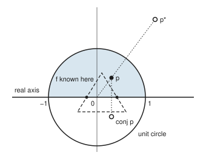

# Schwarz reflection: a function real on the real axis extends across it by its own mirror image

[Syllabus](../../../SYLLABUS.md) → [Complex analysis](../README.md) → [Taylor Series, Zeros and Rigidity](../README.md#s04) → Schwarz reflection

---

## General Overview

Suppose a function is known only on the upper half of a disc, and it is real all along the diameter, the stretch of the real axis from −1 to 1. Then its values below the axis are already decided: mirror the point, look up the value, and mirror the answer back.

Take f(z) = e^z, real on the whole real axis. Above the axis, at p = 0.3 + 0.4i, it gives 1.243302 + 0.525660i. To get a value at the mirror point 0.3 − 0.4i, flip the sign of the imaginary part: 1.243302 − 0.525660i. That is exactly e^(0.3 − 0.4i).

The payoff is Step 6: mirrors carry a map known only on a half disc to the whole plane except 1.

The axis values must be real: the constant i above mirrors to −i below, and the halves jump. From here on, mirroring in the real axis is called **reflection**, and the glued function the **reflected extension**.

**If f is holomorphic (complex-differentiable) above a stretch of the real axis, continuous up to it and real on it, then the conjugate of f at the mirror point, conj f(conj z), continues f across that stretch, and this continuation is the only one.**

**What kind of fact this is:** a theorem, proved on this card in Why it works from Morera's theorem.

### The picture: one point, two mirrors, one triangle across the seam

<p align="center"></p>

To scale: 80 units per 1, 0 at (160, 160); p at (184, 128), conj p at (184, 192), p* at (256, 32). The dashed triangle, corners (128, 184), (208, 184), (168, 120), crosses the axis at (143, 160) and (193, 160).

---

## The formula

$`\bar z`$, read "z-bar", is z mirrored in the real axis: x + iy becomes x − iy ([Conjugate and modulus](../01-Complex%20Numbers%20and%20the%20Plane/02-conjugate-and-modulus.md)). **Holomorphic** means having a complex derivative at every point of an open region. $`\Omega`$ is an open region symmetric about the real axis; $`\Omega^+`$, $`\Omega^-`$ and $`I`$ are its parts above, below and on it.

```math
F(z) = \begin{cases} f(z) & z \in \Omega^+ \cup I \\ \overline{f(\bar z)} & z \in \Omega^- \end{cases}
```

**Read it aloud:** F is f above the axis and on it; below, F mirrors the point, applies f, and mirrors the answer.

For a circle, the mirror in the unit circle is $`z^* = 1/\bar z`$: the point on the same ray from 0, at 1 over the distance.

```math
F(z) = \overline{g\left(1/\bar z\right)} \quad \text{for } |z| > 1 \text{ near the arc, when } g \text{ is real on an arc of the unit circle}
```

**Read it aloud:** outside the circle, F mirrors the point into the circle, applies g, and mirrors the answer in the real axis.

| Symbol | Plain meaning | In our example | Push it up and the answer… |
| --- | --- | --- | --- |
| $`z`$, $`x`$, $`p`$, $`h`$ | any point; a point of the real stretch; the sample point; a small step | p = 0.3 + 0.4i | — |
| $`\bar z`$, $`z^*`$ | mirror in the real axis; mirror in the unit circle | 0.3 − 0.4i; p* = 1.2 + 1.6i | — |
| $`f`$, $`f'`$, $`F`$ | the function known above; its derivative; the reflected extension | e^z; F(0.3 − 0.4i) = 1.243302 − 0.525660i | — |
| $`\Omega`$, $`\Omega^+`$, $`\Omega^-`$, $`I`$ | a region symmetric about the axis; its parts above, below and on it | the unit disc; its upper and lower halves; −1 to 1 | a longer stretch, a bigger extension |
| $`T`$, $`\varepsilon`$ | a filled triangle; how far an edge slides off the axis. Fold only: $`T_\varepsilon`$, $`\eta`$, $`\delta`$, $`L`$ | corners −0.4 − 0.3i, 0.6 − 0.3i, 0.1 + 0.5i | — |
| $`a_n`$ | the n-th Taylor coefficient of F at 0 | 1/n!: 1, 1, 0.5, 0.166667, 0.041667 | — |
| $`C`$ | the Cayley map (z − i)/(z + i): real axis to unit circle | C(p) = −0.365854 − 0.292683i | — |
| $`g`$ | the half-disc map ((1 + z)/(1 − z))^2 | g(p) = −0.183432 + 2.840237i | near 1, it grows without bound |

### When it holds

- **Real on the stretch.** Otherwise the halves do not meet: the constant i jumps to −i.
- **Continuous up to the stretch.** −1/z is real on the axis but blows up at 0, so reflection carries it across any stretch except one containing 0.
- **Conjugate the output too.** f(z̄) alone has no complex derivative.
- **The right mirror for a circle.** It is 1/z̄, not 1/z.

---

## Why it works

### Step 0: mirrors twice cancel, and a seam of zero width is invisible

Mirroring both the input and the output of a holomorphic function keeps it holomorphic: each mirror reverses turning, and two reversals cancel. And a straight seam has no area, so a function continuous across it hides no defect there that triangle integrals could see.

A power series with real coefficients shows the first fact: conjugating z conjugates each power, so the series at z̄ is the conjugate of the series at z.

### Step 1: the mirror is holomorphic below the axis

Take z in $`\Omega^-`$ and a small complex step h. Then $`\bar z`$ is in $`\Omega^+`$, and

```math
\frac{F(z+h) - F(z)}{h} = \overline{\left(\frac{f(\bar z + \bar h) - f(\bar z)}{\bar h}\right)} \;\longrightarrow\; \overline{f'(\bar z)}
```

**Read it aloud:** F's difference quotient below mirrors f's above, so it settles on the mirror of f's derivative.

### Step 2: the two halves meet on the axis

As z approaches a point x of $`I`$ from below, $`\bar z`$ approaches x from above, so F(z) approaches the conjugate of f(x). As f(x) is real, that is f(x): F is continuous across the axis. Only this step uses reality.

### Step 3: Morera's theorem removes the seam

**Morera's theorem**: a continuous function whose integral round every triangle in a disc is 0 is holomorphic there ([Derivatives from the boundary](../03-Contour%20Integrals%20and%20Cauchy%27s%20Theorem/06-derivatives-from-the-boundary.md)). Three cases of triangle $`T`$:

1. **Wholly above or below.** F is holomorphic there, so the integral is 0 by [Cauchy's theorem](../03-Contour%20Integrals%20and%20Cauchy%27s%20Theorem/03-cauchys-theorem.md).
2. **Touching the axis**, along an edge or at a corner. Lift the triangle a distance ε off the axis. The lifted triangle gives 0 by case 1, and as ε shrinks its integral tends to the original, since F is continuous.
3. **Across the axis.** The axis cuts it into a triangle and a four-sided piece (or two triangles, if it passes through a corner); a diagonal splits a four-sided piece in two. All touch the axis, so case 2 applies, and their integrals add to the whole.

So F is holomorphic on all of $`\Omega`$. On the card's triangle the glued e^z gives 0.000000. The constant i above and −i below gives −2i times the chord, −1.25i: it fails Step 2.

<details>
<summary>Detailed proof: case 2, a triangle touching the axis</summary>

Let T lie above the axis and touch it, and let $`T_\varepsilon`$ be T lifted by ε. For small ε, $`T_\varepsilon`$ lies in $`\Omega^+`$, so its integral is 0. Lifting only moves the point where F is read:

$`\displaystyle \oint_{T} F\,dz - \oint_{T_\varepsilon} F\,dz = \oint_{T} \big(F(z) - F(z + i\varepsilon)\big)\,dz`$

F is uniformly continuous near T: for every η > 0 there is δ > 0 such that points closer than δ have values closer than η. Once ε < δ, the difference is at most Lη, with L the perimeter of T. As η is arbitrary, T's integral is 0. Below the axis, lower the triangle instead.

</details>

### Step 4: the extension is forced

Any holomorphic function on the whole region that equals f above the axis is F ([Zeros and the identity theorem](03-zeros-and-the-identity-theorem.md)). F's Taylor coefficients $`a_n`$ at 0, read from a circle of radius 0.5 that is half f and half mirror, are 1, 1, 0.5, 0.166667, 0.041667: the 1/n! of e^z, all real.

### Step 5: circles, by carrying the rule through Mobius maps

A **Mobius map**, a non-constant ratio of two first-degree expressions in z, sends circles and lines to circles and lines (Ahlfors, ch. 3, sec. 3). The Cayley map C(z) = (z − i)/(z + i) sends the real axis onto the unit circle, except the point 1. It also sends mirror pairs to mirror pairs:

```math
C(\bar z) = \frac{\bar z - i}{\bar z + i} = \frac{1}{\overline{C(z)}}
```

**Read it aloud:** the Cayley map of the mirror point is the mirror, in the unit circle, of the Cayley map of the point. Proof: the conjugate of C(z) is (z̄ + i)/(z̄ − i), whose reciprocal is C(z̄). With numbers, C(p) = −0.365854 − 0.292683i and C(conj p) = −1.666667 − 1.333333i = 1/conj C(p).

So let f be holomorphic on one side of an arc, continuous up to it, with values on the arc lying on a second circle or line. Mobius maps carry both curves to the real axis, where Steps 1 to 3 apply. Carrying back turns each conjugate into the mirror in the right curve: F is f at the mirror point, mirrored in the second curve.

### Step 6: extending a map defined on a half disc

The map g(z) = ((1 + z)/(1 − z))^2 sends the upper half disc onto the upper half plane: (1 + z)/(1 − z) gives the quarter plane where both parts are positive, and squaring doubles the angle. It is real on both edges: g(0.5) = 9 on the diameter, g(e^(iπ/3)) = −3 on the arc.

- **Across the diameter**, at conj p: the conjugate of g(p) = −0.183432 + 2.840237i, namely −0.183432 − 2.840237i.
- **Across the arc**, at p* = 1/conj p = 1.2 + 1.6i: by Step 5, again the conjugate of g(p), −0.183432 − 2.840237i.

The formula g agrees at both points. Repeated mirrors carry g to the whole plane except the point 1.

---

## Worked numbers, by hand

| Step | Arithmetic | Value |
| --- | --- | --- |
| e^0.3 | power series or table | 1.349859 |
| cos 0.4, sin 0.4 | power series or table | 0.921061, 0.389418 |
| f(p) = e^(0.3 + 0.4i) | 1.349859 × (0.921061 + 0.389418i) | 1.243302 + 0.525660i |
| direct e^(0.3 − 0.4i) | 1.349859 × (0.921061 − 0.389418i) | 1.243302 − 0.525660i |
| triangle's chord on the axis | 0.4125 − (−0.2125) | 0.625 |
| non-example round the triangle | −2i × 0.625 | −1.25i |
| reflected value at 0.3 − 0.4i | conjugate of f(p) | **1.243302 − 0.525660i** |

Built only from values above the axis, the reflected extension is e^z itself.

### What breaks if you drop a piece

| Mistake | Comes out at | What went wrong |
| --- | --- | --- |
| Mirror the input only, f(z̄) | triangle gives −0.089208 + 0.545236i, not 0 | e^(z̄) has no complex derivative |
| Reflect a function not real on the axis | the constant i: triangle gives −1.25i | a jump of 2i across the seam |
| Mirror in the circle as 1/z | g at p* comes out −0.183432 + 2.840237i | the true mirror is 1/z̄; this gives the conjugate |

---

## Code, from first principles, and it actually runs

Three roads. Road one compares the mirror of e^z above with e^z below, from the real exponential, cosine and sine. Road two is Morera's test: a midpoint-rule integral of the glued function round the triangle, 0 for e^z and −2i times the chord for the jump. Road three reads the glued function's Taylor coefficients from 64 points on a circle and compares them with 1/n!. The Cayley mirrors and the half-disc map are checked against their formulas.

### Python

```python
# Schwarz reflection -- the check behind the card.  Standard library only.
# e^z is used only on or above the real axis; below it, the mirror conj f(conj z).  Road one: the
# mirror against e^z from cos and sin.  Road two: Morera, the glued function round a triangle across
# the axis.  Road three: Taylor coefficients by a Cauchy integral against 1/n!.  Then Cayley mirrors.
import math
def exp_series(z, terms=40):              # e^z from its power series
    total, term = 0j, 1 + 0j
    for n in range(1, terms + 1):
        total, term = total + term, term * z / n
    return total
def glue(f, z, mirror=True):              # f on and above the axis; below, its mirror image
    if z.imag >= 0:
        return f(z)
    return f(z.conjugate()).conjugate() if mirror else f(z.conjugate())
def around(F, corners, n=800):            # midpoint rule once round a closed polygon
    total = 0j
    for a, b in zip(corners, corners[1:] + corners[:1]):
        h = (b - a) / n
        total += sum(F(a + (k + 0.5) * h) for k in range(n)) * h
    return total

def show(w):                              # 'a + bi', six decimals, no -0.000000
    a, b = round(w.real, 6) + 0.0, round(w.imag, 6) + 0.0
    return f"{a:.6f} {'-' if b < 0 else '+'} {abs(b):.6f}i"

p = 0.3 + 0.4j
up, low = exp_series(p), glue(exp_series, p.conjugate())
direct = math.exp(0.3) * complex(math.cos(-0.4), math.sin(-0.4))
print(f"by hand: e^0.3 = {math.exp(0.3):.6f}, cos 0.4 = {math.cos(0.4):.6f}, sin 0.4 = {math.sin(0.4):.6f}")
print(f"e^z at p = 0.3 + 0.4i: {show(up)}; mirror at 0.3 - 0.4i: {show(low)}; e^(0.3 - 0.4i) = {show(direct)}")
tri = [-0.4 - 0.3j, 0.6 - 0.3j, 0.1 + 0.5j]
good, bad = around(lambda z: glue(exp_series, z), tri), around(lambda z: glue(lambda w: 1j, z), tri)
nomirror, pole = around(lambda z: glue(exp_series, z, False), tri), around(lambda z: glue(lambda w: -1 / w, z), tri)
cross = [(a + (b - a) * (a.imag / (a.imag - b.imag))).real for a, b in ((tri[0], tri[2]), (tri[1], tri[2]))]
print(f"triangle crosses the axis at {cross[0]:.6f} and {cross[1]:.6f}: chord {cross[1] - cross[0]:.6f}")
print(f"Morera triangle: glued e^z {show(good)}; i above, -i below {show(bad)}; e^(conj z) below {show(nomirror)}; -1/z {show(pole)}")
r, m = 0.5, 64
pts = [r * complex(math.cos(2 * math.pi * k / m), math.sin(2 * math.pi * k / m)) for k in range(m)]
coef = [sum(glue(exp_series, z) * z ** -n for z in pts) / m for n in range(5)]
print("Taylor coefficients of the glued function: " + ", ".join(show(a) for a in coef))
print("1/n! for n = 0..4: " + ", ".join(f"{1 / math.factorial(n):.6f}" for n in range(5)))
cay = lambda z: (z - 1j) / (z + 1j)
print(f"Cayley: C(p) = {show(cay(p))}; C(conj p) = {show(cay(p.conjugate()))}; 1/conj C(p) = {show(1 / cay(p).conjugate())}")
g = lambda z: ((1 + z) / (1 - z)) ** 2       # upper half disc onto upper half plane
star = 1 / p.conjugate()                     # p mirrored in the unit circle
arc = complex(math.cos(math.pi / 3), math.sin(math.pi / 3))
print(f"half-disc map g: g(0.5) = {show(g(0.5))}; g(e^(i pi/3)) = {show(g(arc))}; g(p) = {show(g(p))}")
print(f"  across the diameter at conj p: mirror {show(g(p).conjugate())}; formula {show(g(p.conjugate()))}")
print(f"  across the arc at p* = {show(star)}: mirror {show(g(1 / star.conjugate()).conjugate())}; "
      f"formula {show(g(star))}; 1/z for 1/conj z: {show(g(1 / star).conjugate())}")
sc = lambda z: f"({160 + 80 * z.real:.1f},{160 - 80 * z.imag:.1f})"
print("figure, p " + sc(p) + " conj p " + sc(p.conjugate()) + " p* " + sc(star) + " triangle "
      + " ".join(sc(z) for z in tri) + " crossings " + sc(complex(cross[0])) + " " + sc(complex(cross[1])))
assert abs(low - direct) < 1e-12                                          # road one
assert abs(bad - (-2j * (cross[1] - cross[0]))) < 1e-9                    # -2i times the chord
assert abs(good) < 1e-6 and abs(nomirror) > 0.1 and abs(pole + 2j * math.pi) < 1e-5  # road two: Morera
assert all(abs(coef[n] - 1 / math.factorial(n)) < 1e-12 for n in range(5))  # road three
assert abs(cay(p.conjugate()) - 1 / cay(p).conjugate()) < 1e-12           # mirror pairs kept
assert abs(g(1 / star.conjugate()).conjugate() - g(star)) < 1e-9 and abs(g(arc).imag) < 1e-9 and abs(star - p / abs(p) ** 2) < 1e-12
print("ALL CHECKS PASS")
```

**Ran 2026-11-23 on macOS, Python 3.14.10, standard library only. All checks passed. Output, pasted from the run:**

```
by hand: e^0.3 = 1.349859, cos 0.4 = 0.921061, sin 0.4 = 0.389418
e^z at p = 0.3 + 0.4i: 1.243302 + 0.525660i; mirror at 0.3 - 0.4i: 1.243302 - 0.525660i; e^(0.3 - 0.4i) = 1.243302 - 0.525660i
triangle crosses the axis at -0.212500 and 0.412500: chord 0.625000
Morera triangle: glued e^z 0.000000 + 0.000000i; i above, -i below 0.000000 - 1.250000i; e^(conj z) below -0.089208 + 0.545236i; -1/z 0.000000 - 6.283186i
Taylor coefficients of the glued function: 1.000000 + 0.000000i, 1.000000 + 0.000000i, 0.500000 + 0.000000i, 0.166667 + 0.000000i, 0.041667 + 0.000000i
1/n! for n = 0..4: 1.000000, 1.000000, 0.500000, 0.166667, 0.041667
Cayley: C(p) = -0.365854 - 0.292683i; C(conj p) = -1.666667 - 1.333333i; 1/conj C(p) = -1.666667 - 1.333333i
half-disc map g: g(0.5) = 9.000000 + 0.000000i; g(e^(i pi/3)) = -3.000000 + 0.000000i; g(p) = -0.183432 + 2.840237i
  across the diameter at conj p: mirror -0.183432 - 2.840237i; formula -0.183432 - 2.840237i
  across the arc at p* = 1.200000 + 1.600000i: mirror -0.183432 - 2.840237i; formula -0.183432 - 2.840237i; 1/z for 1/conj z: -0.183432 + 2.840237i
figure, p (184.0,128.0) conj p (184.0,192.0) p* (256.0,32.0) triangle (128.0,184.0) (208.0,184.0) (168.0,120.0) crossings (143.0,160.0) (193.0,160.0)
ALL CHECKS PASS
```

### Rust

Same numbers, same labels, built with `rustc --edition 2021 -O`.

```rust
// Schwarz reflection -- the same check as the Python, in Rust.  No crates.
// e^z is used only on or above the real axis; below it, the mirror conj f(conj z).  Road one: the
// mirror against e^z from cos and sin.  Road two: Morera, the glued function round a triangle across
// the axis.  Road three: Taylor coefficients by a Cauchy integral against 1/n!.  Then Cayley mirrors.
use std::f64::consts::PI;
use std::ops::{Add, Div, Mul, Sub};
#[derive(Clone, Copy)]
struct C { re: f64, im: f64 }
fn c(re: f64, im: f64) -> C { C { re, im } }
impl Add for C { type Output = C; fn add(self, b: C) -> C { c(self.re + b.re, self.im + b.im) } }
impl Sub for C { type Output = C; fn sub(self, b: C) -> C { c(self.re - b.re, self.im - b.im) } }
impl Mul for C { type Output = C; fn mul(self, b: C) -> C { c(self.re * b.re - self.im * b.im, self.re * b.im + self.im * b.re) } }
impl Div for C { type Output = C; fn div(self, b: C) -> C { let d = b.re * b.re + b.im * b.im; self * c(b.re / d, -b.im / d) } }
impl C { fn conj(self) -> C { c(self.re, -self.im) } fn abs(self) -> f64 { self.re.hypot(self.im) } }
fn r(x: f64) -> C { c(x, 0.0) }
fn exp_series(z: C) -> C { // e^z from its power series
    let (mut total, mut term) = (r(0.0), r(1.0));
    for n in 1..=40 { total = total + term; term = term * z / r(n as f64); }
    total
}
fn glue(f: &dyn Fn(C) -> C, z: C, mirror: bool) -> C { // f on and above the axis; below, its mirror
    if z.im >= 0.0 { f(z) } else if mirror { f(z.conj()).conj() } else { f(z.conj()) }
}
fn around(f: &dyn Fn(C) -> C, cs: &[C]) -> C { // midpoint rule once round a closed polygon
    let mut total = r(0.0);
    for i in 0..cs.len() {
        let (a, b) = (cs[i], cs[(i + 1) % cs.len()]);
        let h = (b - a) / r(800.0);
        for k in 0..800 { total = total + f(a + r(k as f64 + 0.5) * h) * h; }
    }
    total
}
fn show(w: C) -> String { // 'a + bi', six decimals, no -0.000000
    let a = format!("{:.6}", w.re);
    let a = if a == "-0.000000" { "0.000000".to_string() } else { a };
    let b = format!("{:.6}", w.im.abs());
    format!("{} {} {}i", a, if w.im < 0.0 && b != "0.000000" { '-' } else { '+' }, b)
}
fn g(z: C) -> C { let q = (r(1.0) + z) / (r(1.0) - z); q * q } // upper half disc onto upper half plane
fn cay(z: C) -> C { (z - c(0.0, 1.0)) / (z + c(0.0, 1.0)) }
fn sc(z: C) -> String { format!("({:.1},{:.1})", 160.0 + 80.0 * z.re, 160.0 - 80.0 * z.im) }

fn main() {
    let p = c(0.3, 0.4);
    let (up, low) = (exp_series(p), glue(&exp_series, p.conj(), true));
    let direct = r(0.3f64.exp()) * c((-0.4f64).cos(), (-0.4f64).sin());
    println!("by hand: e^0.3 = {:.6}, cos 0.4 = {:.6}, sin 0.4 = {:.6}", 0.3f64.exp(), 0.4f64.cos(), 0.4f64.sin());
    println!("e^z at p = 0.3 + 0.4i: {}; mirror at 0.3 - 0.4i: {}; e^(0.3 - 0.4i) = {}", show(up), show(low), show(direct));
    let tri = [c(-0.4, -0.3), c(0.6, -0.3), c(0.1, 0.5)];
    let good = around(&|z| glue(&exp_series, z, true), &tri);
    let bad = around(&|z| glue(&|_w| c(0.0, 1.0), z, true), &tri);
    let (nomirror, pole) = (around(&|z| glue(&exp_series, z, false), &tri), around(&|z| glue(&|w| r(-1.0) / w, z, true), &tri));
    let cross: Vec<f64> = [(tri[0], tri[2]), (tri[1], tri[2])].iter().map(|&(a, b)| (a + (b - a) * r(a.im / (a.im - b.im))).re).collect();
    println!("triangle crosses the axis at {:.6} and {:.6}: chord {:.6}", cross[0], cross[1], cross[1] - cross[0]);
    println!("Morera triangle: glued e^z {}; i above, -i below {}; e^(conj z) below {}; -1/z {}", show(good), show(bad), show(nomirror), show(pole));
    let m = 64;
    let pts: Vec<C> = (0..m).map(|k| r(0.5) * c((2.0 * PI * k as f64 / m as f64).cos(), (2.0 * PI * k as f64 / m as f64).sin())).collect();
    let coef: Vec<C> = (0..5).map(|n| { let mut s = r(0.0);
        for &z in &pts { let mut zn = r(1.0); for _ in 0..n { zn = zn * z; } s = s + glue(&exp_series, z, true) / zn; }
        s / r(m as f64) }).collect();
    let fact: Vec<f64> = (0..5).map(|n| 1.0 / (1..=n).product::<u64>() as f64).collect();
    println!("Taylor coefficients of the glued function: {}", coef.iter().map(|&a| show(a)).collect::<Vec<_>>().join(", "));
    println!("1/n! for n = 0..4: {}", fact.iter().map(|x| format!("{:.6}", x)).collect::<Vec<_>>().join(", "));
    println!("Cayley: C(p) = {}; C(conj p) = {}; 1/conj C(p) = {}", show(cay(p)), show(cay(p.conj())), show(r(1.0) / cay(p).conj()));
    let star = r(1.0) / p.conj();
    let arc = c((PI / 3.0).cos(), (PI / 3.0).sin());
    println!("half-disc map g: g(0.5) = {}; g(e^(i pi/3)) = {}; g(p) = {}", show(g(r(0.5))), show(g(arc)), show(g(p)));
    println!("  across the diameter at conj p: mirror {}; formula {}", show(g(p).conj()), show(g(p.conj())));
    println!("  across the arc at p* = {}: mirror {}; formula {}; 1/z for 1/conj z: {}",
        show(star), show(g(r(1.0) / star.conj()).conj()), show(g(star)), show(g(r(1.0) / star).conj()));
    println!("figure, p {} conj p {} p* {} triangle {} crossings {} {}", sc(p), sc(p.conj()), sc(star),
        tri.iter().map(|&z| sc(z)).collect::<Vec<_>>().join(" "), sc(r(cross[0])), sc(r(cross[1])));
    assert!((low - direct).abs() < 1e-12); // road one
    assert!((bad - c(0.0, -2.0 * (cross[1] - cross[0]))).abs() < 1e-9); // -2i times the chord
    assert!(good.abs() < 1e-6 && nomirror.abs() > 0.1 && (pole - c(0.0, -2.0 * PI)).abs() < 1e-5); // road two: Morera
    assert!((0..5).all(|n| (coef[n] - r(fact[n])).abs() < 1e-12)); // road three
    assert!((cay(p.conj()) - r(1.0) / cay(p).conj()).abs() < 1e-12); // mirror pairs kept
    assert!((g(r(1.0) / star.conj()).conj() - g(star)).abs() < 1e-9 && g(arc).im.abs() < 1e-9 && (star - p / r(p.abs() * p.abs())).abs() < 1e-12);
    println!("ALL CHECKS PASS");
}
```

**Ran 2026-11-23 on macOS, rustc 1.98.1, no crates. All checks passed. Output, pasted from the run:**

```
by hand: e^0.3 = 1.349859, cos 0.4 = 0.921061, sin 0.4 = 0.389418
e^z at p = 0.3 + 0.4i: 1.243302 + 0.525660i; mirror at 0.3 - 0.4i: 1.243302 - 0.525660i; e^(0.3 - 0.4i) = 1.243302 - 0.525660i
triangle crosses the axis at -0.212500 and 0.412500: chord 0.625000
Morera triangle: glued e^z 0.000000 + 0.000000i; i above, -i below 0.000000 - 1.250000i; e^(conj z) below -0.089208 + 0.545236i; -1/z 0.000000 - 6.283186i
Taylor coefficients of the glued function: 1.000000 + 0.000000i, 1.000000 + 0.000000i, 0.500000 + 0.000000i, 0.166667 + 0.000000i, 0.041667 + 0.000000i
1/n! for n = 0..4: 1.000000, 1.000000, 0.500000, 0.166667, 0.041667
Cayley: C(p) = -0.365854 - 0.292683i; C(conj p) = -1.666667 - 1.333333i; 1/conj C(p) = -1.666667 - 1.333333i
half-disc map g: g(0.5) = 9.000000 + 0.000000i; g(e^(i pi/3)) = -3.000000 + 0.000000i; g(p) = -0.183432 + 2.840237i
  across the diameter at conj p: mirror -0.183432 - 2.840237i; formula -0.183432 - 2.840237i
  across the arc at p* = 1.200000 + 1.600000i: mirror -0.183432 - 2.840237i; formula -0.183432 - 2.840237i; 1/z for 1/conj z: -0.183432 + 2.840237i
figure, p (184.0,128.0) conj p (184.0,192.0) p* (256.0,32.0) triangle (128.0,184.0) (208.0,184.0) (168.0,120.0) crossings (143.0,160.0) (193.0,160.0)
ALL CHECKS PASS
```

The two outputs match line for line.

### Lean

Lean proves the reflected extension is holomorphic and the only one, for every region and f meeting the conditions, plus the Cayley mirror rule.

- Take $`\Omega`$ open and symmetric about the axis, and f holomorphic on $`\Omega^+`$, continuous up to $`I`$ and real on $`I`$. Then the reflected extension F is holomorphic on all of $`\Omega`$.
- Suppose also $`\Omega`$ is one piece. Then any function holomorphic on all of $`\Omega`$ that equals f on $`\Omega^+`$ is F.
- Take any point z other than i and −i. Then $`C(\bar z) = 1/\overline{C(z)}`$: the Cayley map sends mirror pairs to mirror pairs.
- Take any point z. Then $`\overline{e^{\bar z}} = e^z`$: the mirror of e^z is e^z itself.
- The card's exact values check out: the constant i mirrors to −i, p* = 1.2 + 1.6i, the chord 0.625, C(p), C(conj p), g(0.5) = 9 and g(p).

The circle version, the half-disc map's extension, the triangle integrals and the Taylor coefficients are left to the Python and Rust checks.

```lean
-- Schwarz reflection: a function holomorphic above a stretch of the real axis, continuous up to it and real on it, is continued across that stretch by its mirror image conj f(conj z), this continuation is the only one, and the Cayley map sends mirror pairs in the real axis to mirror pairs in the unit circle.
import Mathlib.Analysis.Complex.HasPrimitives
import Mathlib.Analysis.Complex.CauchyIntegral
import Mathlib.Analysis.Analytic.IsolatedZeros
import Mathlib.Analysis.Complex.Exponential
import Mathlib.Tactic.NormNum
import Mathlib.Analysis.Calculus.Deriv.Star

open ComplexConjugate
open scoped Interval

open Set Metric in
/-- A point of a rectangle in a disc centred on the real axis, pushed vertically toward the axis,
stays in the disc. -/
lemma srp_mem_ball {z : ℂ} (hz : z.im = 0) {r : ℝ} {a b : ℂ}
    (h : Complex.Rectangle a b ⊆ ball z r) {u : ℂ} (hre : u.re ∈ [[a.re, b.re]])
    (him : u.im ∈ [[a.im, 0]] ∨ u.im ∈ [[0, b.im]]) : u ∈ ball z r := by
  have key : ∀ v : ℂ, v ∈ ball z r → u.re = v.re → |u.im| ≤ |v.im| → u ∈ ball z r := by
    intro v hv hre' him'
    rw [mem_ball, Complex.dist_eq_re_im] at hv ⊢
    refine lt_of_le_of_lt (Real.sqrt_le_sqrt ?_) hv
    rw [hz, hre', sub_zero, sub_zero]
    have h1 : u.im ^ 2 ≤ v.im ^ 2 := by
      rw [← sq_abs u.im, ← sq_abs v.im]
      exact pow_le_pow_left₀ (abs_nonneg _) him' 2
    linarith
  rcases him with him | him
  · refine key ⟨u.re, a.im⟩ (h ?_) rfl ?_
    · exact Complex.mem_reProdIm.mpr ⟨hre, left_mem_uIcc⟩
    · rcases mem_uIcc.mp him with ⟨h1, h2⟩ | ⟨h1, h2⟩
      · show |u.im| ≤ |a.im|
        rw [abs_of_nonpos h2, abs_of_nonpos (h1.trans h2)]; linarith
      · show |u.im| ≤ |a.im|
        rw [abs_of_nonneg h1, abs_of_nonneg (h1.trans h2)]; linarith
  · refine key ⟨u.re, b.im⟩ (h ?_) rfl ?_
    · exact Complex.mem_reProdIm.mpr ⟨hre, right_mem_uIcc⟩
    · rcases mem_uIcc.mp him with ⟨h1, h2⟩ | ⟨h1, h2⟩
      · show |u.im| ≤ |b.im|
        rw [abs_of_nonneg h1, abs_of_nonneg (h1.trans h2)]; linarith
      · show |u.im| ≤ |b.im|
        rw [abs_of_nonpos h2, abs_of_nonpos (h1.trans h2)]; linarith

#print axioms srp_mem_ball

open Set Metric in
/-- Morera step: a function continuous on a disc centred on the real axis and holomorphic at every
point of the disc off the axis has vanishing integral round every rectangle in the disc. -/
lemma srp_isConservativeOn {F : ℂ → ℂ} {z : ℂ} (hz : z.im = 0) {r : ℝ}
    (hc : ContinuousOn F (ball z r))
    (hd : ∀ w ∈ ball z r, w.im ≠ 0 → DifferentiableAt ℂ F w) :
    Complex.IsConservativeOn F (ball z r) := by
  intro a b hab
  rw [← add_eq_zero_iff_eq_neg, Complex.wedgeIntegral_add_wedgeIntegral_eq]
  -- the vertical sides are integrable on each piece
  have hvert : ∀ c : ℝ, c ∈ [[a.re, b.re]] → ∀ s t : ℝ,
      (s = a.im ∧ t = 0 ∨ s = 0 ∧ t = b.im) →
      IntervalIntegrable (fun y : ℝ => F (c + y * Complex.I)) MeasureTheory.volume s t := by
    intro c hcm s t hst
    apply ContinuousOn.intervalIntegrable
    refine hc.comp (by fun_prop) ?_
    intro y hy
    apply srp_mem_ball hz hab
    · simpa using hcm
    · simp only [Complex.add_im, Complex.ofReal_im, Complex.mul_im, Complex.ofReal_re,
        Complex.I_re, Complex.I_im, mul_zero, mul_one, zero_add, add_zero]
      rcases hst with ⟨rfl, rfl⟩ | ⟨rfl, rfl⟩
      · exact Or.inl hy
      · exact Or.inr hy
  have hrect : ∀ p q : ℂ, p.re ∈ [[a.re, b.re]] → q.re ∈ [[a.re, b.re]] →
      ((p.im = a.im ∧ q.im = 0) ∨ (p.im = 0 ∧ q.im = b.im)) →
      (∫ x : ℝ in p.re..q.re, F (x + p.im * Complex.I)) -
        (∫ x : ℝ in p.re..q.re, F (x + q.im * Complex.I)) +
        Complex.I • (∫ y : ℝ in p.im..q.im, F (q.re + y * Complex.I)) -
        Complex.I • (∫ y : ℝ in p.im..q.im, F (p.re + y * Complex.I)) = 0 := by
    intro p q hp hq hpq
    have hsub : ∀ u : ℂ, u ∈ [[p.re, q.re]] ×ℂ [[p.im, q.im]] → u ∈ ball z r := by
      intro u hu
      rw [Complex.mem_reProdIm] at hu
      apply srp_mem_ball hz hab
      · exact uIcc_subset_uIcc hp hq hu.1
      · rcases hpq with ⟨h1, h2⟩ | ⟨h1, h2⟩
        · rw [h1, h2] at hu; exact Or.inl hu.2
        · rw [h1, h2] at hu; exact Or.inr hu.2
    apply Complex.integral_boundary_rect_eq_zero_of_continuousOn_of_differentiableOn
    · exact hc.mono hsub
    · intro u hu
      have hu' : u ∈ [[p.re, q.re]] ×ℂ [[p.im, q.im]] := by
        rw [Complex.mem_reProdIm] at hu ⊢
        exact ⟨Ioo_subset_Icc_self hu.1, Ioo_subset_Icc_self hu.2⟩
      apply DifferentiableAt.differentiableWithinAt
      apply hd u (hsub u hu')
      intro h0
      rw [Complex.mem_reProdIm, h0] at hu
      obtain ⟨-, hlo, hhi⟩ := hu
      rcases hpq with ⟨h1, h2⟩ | ⟨h1, h2⟩
      · rw [h2] at hlo hhi
        rcases le_total p.im 0 with h | h
        · rw [max_eq_right h] at hhi; exact lt_irrefl _ hhi
        · rw [min_eq_right h] at hlo; exact lt_irrefl _ hlo
      · rw [h1] at hlo hhi
        rcases le_total 0 q.im with h | h
        · rw [min_eq_left h] at hlo; exact lt_irrefl _ hlo
        · rw [max_eq_left h] at hhi; exact lt_irrefl _ hhi
  have e1 := hrect a (b.re : ℂ) left_mem_uIcc (by simp) (Or.inl ⟨rfl, by simp⟩)
  have e2 := hrect (a.re : ℂ) b (by simp) right_mem_uIcc (Or.inr ⟨by simp, rfl⟩)
  simp only [Complex.ofReal_re, Complex.ofReal_im] at e1 e2
  rw [← intervalIntegral.integral_add_adjacent_intervals
      (hvert b.re right_mem_uIcc a.im 0 (Or.inl ⟨rfl, rfl⟩))
      (hvert b.re right_mem_uIcc 0 b.im (Or.inr ⟨rfl, rfl⟩)),
    ← intervalIntegral.integral_add_adjacent_intervals
      (hvert a.re left_mem_uIcc a.im 0 (Or.inl ⟨rfl, rfl⟩))
      (hvert a.re left_mem_uIcc 0 b.im (Or.inr ⟨rfl, rfl⟩))]
  simp only [smul_eq_mul] at e1 e2 ⊢
  linear_combination e1 + e2

#print axioms srp_isConservativeOn

/-- The Schwarz reflection principle, the card's main claim. Let Ω be an open region symmetric
about the real axis (the mirror conj z of every point z of Ω is in Ω). Let f be holomorphic
(complex differentiable) on Ω⁺, the part of Ω above the axis, continuous up to the stretch
I = Ω ∩ ℝ, and real on I. Then the reflected extension F, equal to f on and above the axis and
to conj f(conj z) below it, is holomorphic on all of Ω. -/
theorem schwarz_reflection_extension_holomorphic {Ω : Set ℂ} {f : ℂ → ℂ}
    (hΩ : IsOpen Ω) (hsymm : ∀ z ∈ Ω, conj z ∈ Ω)
    (hf : DifferentiableOn ℂ f (Ω ∩ {z | 0 < z.im}))
    (hcont : ContinuousOn f (Ω ∩ {z | 0 ≤ z.im}))
    (hreal : ∀ z ∈ Ω, z.im = 0 → (f z).im = 0) :
    DifferentiableOn ℂ (fun z => if 0 ≤ z.im then f z else conj (f (conj z))) Ω := by
  set F : ℂ → ℂ := fun z => if 0 ≤ z.im then f z else conj (f (conj z)) with hFdef
  have hUopen : IsOpen (Ω ∩ {z : ℂ | 0 < z.im}) :=
    hΩ.inter (isOpen_lt continuous_const Complex.continuous_im)
  -- off the axis F is holomorphic
  have hoff : ∀ w ∈ Ω, w.im ≠ 0 → DifferentiableAt ℂ F w := by
    intro w hw hw0
    rcases lt_or_gt_of_ne hw0 with hneg | hpos
    · have hcw : conj w ∈ Ω ∩ {z : ℂ | 0 < z.im} :=
        ⟨hsymm w hw, by simp only [Set.mem_ofPred_eq, Complex.conj_im]; linarith⟩
      have hd : DifferentiableAt ℂ (conj ∘ f ∘ conj) w :=
        differentiableAt_conj_conj_iff.mpr ((hf _ hcw).differentiableAt (hUopen.mem_nhds hcw))
      refine hd.congr_of_eventuallyEq ?_
      filter_upwards [(isOpen_lt Complex.continuous_im continuous_const).mem_nhds
        (show w ∈ {z : ℂ | z.im < 0} from hneg)] with u hu
      simp only [hFdef, Function.comp_apply]
      simp [not_le.mpr hu]
    · have hw' : w ∈ Ω ∩ {z : ℂ | 0 < z.im} := ⟨hw, hpos⟩
      refine ((hf _ hw').differentiableAt (hUopen.mem_nhds hw')).congr_of_eventuallyEq ?_
      filter_upwards [hUopen.mem_nhds hw'] with u hu
      simp only [hFdef]
      simp [le_of_lt (show (0:ℝ) < u.im from hu.2)]
  -- F is continuous on Ω
  have hFcont : ContinuousOn F Ω := by
    apply ContinuousOn.if
    · intro a ha
      have ha0 : a.im = 0 := by
        have := frontier_le_subset_eq continuous_const Complex.continuous_im ha.2
        exact this.symm
      have hca : conj a = a := Complex.conj_eq_iff_im.mpr ha0
      rw [hca]
      exact (Complex.conj_eq_iff_im.mpr (hreal a ha.1 ha0)).symm
    · refine hcont.mono ?_
      rw [(isClosed_le continuous_const Complex.continuous_im).closure_eq]
    · have hsub : closure {a : ℂ | ¬ 0 ≤ a.im} ⊆ {a : ℂ | a.im ≤ 0} :=
        closure_minimal (fun a ha => le_of_lt (not_le.mp ha))
          (isClosed_le Complex.continuous_im continuous_const)
      have hg : ContinuousOn (fun z => conj (f (conj z))) (Ω ∩ {a : ℂ | a.im ≤ 0}) := by
        refine Complex.continuous_conj.comp_continuousOn
          (hcont.comp Complex.continuous_conj.continuousOn ?_)
        intro a ha
        refine ⟨hsymm a ha.1, ?_⟩
        simp only [Set.mem_ofPred_eq, Complex.conj_im]
        have := ha.2; simp only [Set.mem_ofPred_eq] at this; linarith
      exact hg.mono (Set.inter_subset_inter_right _ hsub)
  intro w hw
  by_cases hw0 : w.im = 0
  · obtain ⟨r, hr, hball⟩ := Metric.isOpen_iff.mp hΩ w hw
    have hdisc : DifferentiableOn ℂ F (Metric.ball w r) :=
      (Complex.isConservativeOn_and_continuousOn_iff_isDifferentiableOn Metric.isOpen_ball).mp
        ⟨srp_isConservativeOn hw0 (hFcont.mono hball)
          (fun u hu hu0 => hoff u (hball hu) hu0), hFcont.mono hball⟩
    exact ((hdisc w (Metric.mem_ball_self hr)).differentiableAt
      (Metric.isOpen_ball.mem_nhds (Metric.mem_ball_self hr))).differentiableWithinAt
  · exact (hoff w hw hw0).differentiableWithinAt

/-- The reflected extension is the only one. On a connected open region Ω symmetric about the
real axis, with f as in the main claim, every function holomorphic on all of Ω that equals f
above the axis is the reflected extension F at every point of Ω. -/
theorem schwarz_reflection_extension_unique {Ω : Set ℂ} {f G : ℂ → ℂ}
    (hΩ : IsOpen Ω) (hconn : IsConnected Ω) (hsymm : ∀ z ∈ Ω, conj z ∈ Ω)
    (hf : DifferentiableOn ℂ f (Ω ∩ {z | 0 < z.im}))
    (hcont : ContinuousOn f (Ω ∩ {z | 0 ≤ z.im}))
    (hreal : ∀ z ∈ Ω, z.im = 0 → (f z).im = 0)
    (hG : DifferentiableOn ℂ G Ω) (hGf : Set.EqOn G f (Ω ∩ {z | 0 < z.im})) :
    Set.EqOn G (fun z => if 0 ≤ z.im then f z else conj (f (conj z))) Ω := by
  have hF := schwarz_reflection_extension_holomorphic hΩ hsymm hf hcont hreal
  have hUopen : IsOpen (Ω ∩ {z : ℂ | 0 < z.im}) :=
    hΩ.inter (isOpen_lt continuous_const Complex.continuous_im)
  -- Ω has a point strictly above the axis
  obtain ⟨z₀, hz₀⟩ : (Ω ∩ {z : ℂ | 0 < z.im}).Nonempty := by
    obtain ⟨z, hz⟩ := hconn.nonempty
    rcases lt_trichotomy z.im 0 with h | h | h
    · exact ⟨conj z, hsymm z hz, by simp only [Set.mem_ofPred_eq, Complex.conj_im]; linarith⟩
    · obtain ⟨r, hr, hball⟩ := Metric.isOpen_iff.mp hΩ z hz
      refine ⟨z + (r / 2 : ℝ) * Complex.I, hball ?_, ?_⟩
      · rw [Metric.mem_ball, dist_eq_norm, add_sub_cancel_left, norm_mul, Complex.norm_I,
          mul_one, Complex.norm_real, Real.norm_eq_abs, abs_of_pos (by positivity)]
        linarith
      · simp [h]; positivity
    · exact ⟨z, hz, h⟩
  refine (hG.analyticOnNhd hΩ).eqOn_of_preconnected_of_eventuallyEq (hF.analyticOnNhd hΩ)
    hconn.isPreconnected hz₀.1 ?_
  filter_upwards [hUopen.mem_nhds hz₀] with u hu
  have hu0 : 0 ≤ u.im := le_of_lt (show 0 < u.im from hu.2)
  rw [hGf hu]
  simp [hu0]

/-- The Cayley map C(z) = (z - i)/(z + i) sends mirror pairs to mirror pairs: C at the mirror
point conj z is the mirror of C(z) in the unit circle, 1/conj C(z). (At z = i and z = -i both
sides are 0 under Lean's convention 1/0 = 0.) -/
theorem cayley_conj_eq_circle_mirror (z : ℂ) :
    (conj z - Complex.I) / (conj z + Complex.I) =
      1 / conj ((z - Complex.I) / (z + Complex.I)) := by
  rw [map_div₀, map_sub, map_add, Complex.conj_I, one_div_div, sub_neg_eq_add, ← sub_eq_add_neg]

-- The lead example: e^z is real on the axis, and its mirror conj e^(conj z) is e^z itself.
example (z : ℂ) : conj (Complex.exp (conj z)) = Complex.exp z := by
  rw [← Complex.exp_conj, Complex.conj_conj]
-- The non-example: the constant i mirrors to -i, so the halves do not meet.
example : conj Complex.I = -Complex.I := by simp
-- p = 0.3 + 0.4i, mirrored in the unit circle: p* = 1/conj p = 1.2 + 1.6i.
example : 1 / conj ((3 : ℂ) / 10 + 4 / 10 * Complex.I) = 6 / 5 + 8 / 5 * Complex.I := by
  rw [Complex.ext_iff]; simp [Complex.div_re, Complex.div_im, Complex.normSq]; norm_num
-- The triangle crosses the axis at -0.2125 and 0.4125: chord 0.625, and -2i times it is -1.25i.
example : (33 : ℚ) / 80 - (-17 / 80) = 5 / 8 := by norm_num
example : -2 * Complex.I * ((5 : ℂ) / 8) = -(5 / 4) * Complex.I := by ring
-- Cayley map: C(p) = -15/41 - 12/41 i and C(conj p) = -5/3 - 4/3 i.
example : ((3 : ℂ) / 10 + 4 / 10 * Complex.I - Complex.I) / ((3 : ℂ) / 10 + 4 / 10 * Complex.I + Complex.I)
    = -15 / 41 - 12 / 41 * Complex.I := by
  rw [Complex.ext_iff]; simp [Complex.div_re, Complex.div_im, Complex.normSq]; norm_num
example : ((3 : ℂ) / 10 - 4 / 10 * Complex.I - Complex.I) / ((3 : ℂ) / 10 - 4 / 10 * Complex.I + Complex.I)
    = -5 / 3 - 4 / 3 * Complex.I := by
  rw [Complex.ext_iff]; simp [Complex.div_re, Complex.div_im, Complex.normSq]; norm_num
-- Half-disc map g(z) = ((1 + z)/(1 - z))^2: g(0.5) = 9 on the diameter.
example : ((1 + (1 : ℚ) / 2) / (1 - 1 / 2)) ^ 2 = 9 := by norm_num
-- g(p) = (-31 + 480i)/169, about -0.183432 + 2.840237i.
example : ((1 + ((3 : ℂ) / 10 + 4 / 10 * Complex.I)) / (1 - ((3 : ℂ) / 10 + 4 / 10 * Complex.I))) ^ 2
    = -31 / 169 + 480 / 169 * Complex.I := by
  rw [Complex.ext_iff]; simp [Complex.div_re, Complex.div_im, Complex.normSq, pow_two]; norm_num
-- Taylor coefficients 1/n! of e^z for n = 0..4 are 1, 1, 1/2, 1/6, 1/24: the factorials are 1, 1, 2, 6, 24.
example : (List.range 5).map Nat.factorial = [1, 1, 2, 6, 24] := by decide

#print axioms schwarz_reflection_extension_holomorphic
#print axioms schwarz_reflection_extension_unique
#print axioms cayley_conj_eq_circle_mirror
```

**Checked 2026-11-23 on macOS, Lean 4.36.0-rc2, Mathlib v4.36.0-rc2. Every proof is complete and uses only Lean's standard axioms. Output, pasted from the run:**

```
'srp_mem_ball' depends on axioms: [propext, Classical.choice, Quot.sound]
'srp_isConservativeOn' depends on axioms: [propext, Classical.choice, Quot.sound]
'schwarz_reflection_extension_holomorphic' depends on axioms: [propext, Classical.choice, Quot.sound]
'schwarz_reflection_extension_unique' depends on axioms: [propext, Classical.choice, Quot.sound]
'cayley_conj_eq_circle_mirror' depends on axioms: [propext, Classical.choice, Quot.sound]
```

> [!TIP]
> **Try changing**
> Guess first, then run it.
> - **Move the triangle below the axis.** Set `tri` to `[-0.4 - 0.6j, 0.6 - 0.6j, 0.1 - 0.1j]`. The jump case gives 0: a triangle off the seam never sees it. The chord assert stops it.
> - **Reflect e^(iz), not real on the axis.** In `good`, replace `exp_series` with `lambda w: exp_series(1j * w)`. The triangle gives −0.122771i; the Morera assert stops it.
> - **Another Cayley map.** Set `cay` to `(z - 2j) / (z + 2j)`. It too sends the axis to the unit circle: −1.415094 − 0.452830i both ways, and every assert passes.
> - **Too few circle points.** Set `m` to `4`. The first coefficient becomes 1.002604; the road-three assert stops it.

---

## The usual mistake

> [!warning]
> **Mirroring the input but not the output.** f(z̄) reverses turning once, so it has no complex derivative; it is the conjugate of the true extension. Round the card's triangle it gives −0.089208 + 0.545236i, not 0.
>
> - **Reflecting where f is not real.** The constant i reflects to −i, and the triangle gives −1.25i.
> - **Using 1/z as the circle's mirror.** At p* the half-disc map comes out −0.183432 + 2.840237i, the conjugate of the right value.
> - **Gluing across a blow-up.** Round the card's triangle, which holds 0, the glued −1/z gives −6.283186i, not 0.

---

## Where you meet it in real life

- **Filters and circuits.** A circuit of real resistors and capacitors has a transfer function real for real inputs. So its poles come in mirror pairs, and its response at a negative frequency is the conjugate of the positive one.
- **Polygon maps.** Reflection across each side of a polygon continues a Schwarz-Christoffel map, which is how its formula is found: [The Riemann mapping theorem](../07-Conformal%20Maps%20and%20Harmonic%20Functions/08-riemann-mapping-theorem-and-schwarz-christoffel.md).
- **Image charges.** A field near a flat conductor continues past it as a mirror copy, the image source behind the wall.

> **Say it back**
> A function holomorphic above a stretch of the real axis and real on it extends below as conj f(conj z). Mirroring twice keeps it holomorphic, and reality makes the halves meet. Morera's theorem removes the seam; the identity theorem makes the extension unique. e^z at 0.3 + 0.4i is 1.243302 + 0.525660i, and its mirror is e^z at 0.3 − 0.4i. Mobius maps carry the rule to circles, so a map known on a half disc reaches the whole plane.

---

## What this builds on

- [Analytic continuation](04-analytic-continuation.md): extending a function past where it was first given, uniquely.
- [Cauchy's theorem](../03-Contour%20Integrals%20and%20Cauchy%27s%20Theorem/03-cauchys-theorem.md): triangles wholly on one side of the axis integrate to 0, case 1 of Step 3.
- [Derivatives from the boundary](../03-Contour%20Integrals%20and%20Cauchy%27s%20Theorem/06-derivatives-from-the-boundary.md): Morera's theorem, which turns zero triangle integrals into a derivative.

## Where this goes next

- [The Riemann mapping theorem](../07-Conformal%20Maps%20and%20Harmonic%20Functions/08-riemann-mapping-theorem-and-schwarz-christoffel.md): reflection across polygon sides behind the Schwarz-Christoffel formula.
- [Mobius transformations](../07-Conformal%20Maps%20and%20Harmonic%20Functions/02-mobius-transformations-and-the-point-at-infinity.md): the full theory behind Step 5.

Reflection crosses one line or circle at a time; whether continuations along different paths agree is the question [The monodromy theorem](09-monodromy-theorem.md) answers.

---

## Sources

Verified 2026-11-23: every link below resolves to the publisher's page.

- Lebl, Jiří. *Guide to Cultivating Complex Analysis*. [Book page and free text](https://www.jirka.org/ca/). Section 10.1, the Schwarz reflection principle, proved with Morera's theorem by splitting triangles at the real line.
- Ahlfors, Lars V. *Complex Analysis*, 3rd ed. American Mathematical Society (AMS Chelsea), 2021, reprinting McGraw-Hill, 1979. [DOI 10.1090/chel/385](https://doi.org/10.1090/chel/385). Chapter 3, section 3: Mobius maps and mirror pairs. Chapter 4, section 6.5: the reflection principle, proved through harmonic functions.
