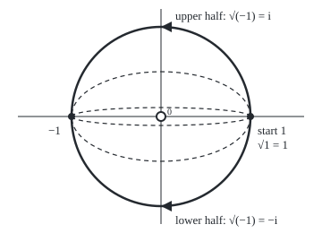

# The monodromy theorem: continuing along homotopic paths gives the same answer, so a region without holes allows only one continuation

[Syllabus](../../../SYLLABUS.md) → [Complex analysis](../README.md) → [Taylor Series, Zeros and Rigidity](../README.md#s04) → The monodromy theorem

---

## General Overview

Start at the point 1 with the square root √1 = 1. Walk to −1 along the top half of the unit circle, and carry the square root with you without any jump. You arrive with i. Walk the bottom half instead and you arrive with −i.

Same function, same start, same finish, two answers. Keep going once round the circle and √1 comes back as −1. Twice round, it is +1 again. [Branch cuts and complex powers](../02-Holomorphic%20Functions/05-branch-cuts-and-complex-powers.md) met this sign flip; this card says exactly when it can happen.

The carrying is **analytic continuation along a path**: a chain of discs along the route, each holding a power series, each agreeing with the one before where they overlap. [Analytic continuation](04-analytic-continuation.md) showed there is no choice at any step. The answer can still depend on the route.

The **monodromy theorem** says when it cannot. Two routes that slide into each other, ends held still, through routes that can all be continued, give the same answer. The two half-circles cannot slide into each other without passing through 0, and no disc of √z can sit at 0. That is the whole failure.

**Continuation along a path is forced step by step, and it does not change when the path slides without leaving the region where continuation works; so on a region with no holes, every route gives one and the same function.**

**What kind of fact this is:** a theorem, proved on this card in Why it works; continuation along a path is a definition.

### The picture: two routes from 1 to −1

<p align="center"></p>

To scale: 100 units per 1, 0 at (180, 130), the start 1 at (280, 130), the end −1 at (80, 130). The solid halves are the routes. The dashed half-ellipses, tops at (180, 80), (180, 120), (180, 140) and (180, 180), are stages of the straight slide from top to bottom. The hollow dot is 0.

---

## The formula

Notation first, in words. A **path** $`\gamma`$ is a continuous route $`\gamma(s)`$, with time $`s`$ running from 0 to 1. A **disc** $`D_j`$ has centre $`c_j`$, and $`f_j`$ is a holomorphic function on it (one with a complex derivative at every point). A chain of $`n`$ discs **continues** $`f_1`$ along $`\gamma`$ when, for times $`0 = s_0 < s_1 < \dots < s_n = 1`$:

```math
\gamma([s_{j-1}, s_j]) \subset D_j \quad \text{and} \quad f_j = f_{j+1} \text{ on } D_j \cap D_{j+1}
```

**Read it aloud:** each piece of the path lies in its own disc, and each disc's function agrees with the next one where the two discs overlap.

The function in the last disc, $`f_n`$, is the answer at the end. Two paths are **homotopic**, written $`\gamma_0 \simeq \gamma_1`$, when a family of paths $`\gamma_t`$, with slide time $`t`$ from 0 to 1, deforms one into the other continuously, all with the same two ends. The theorem:

```math
\gamma_0 \simeq \gamma_1 \text{ in } U, \ \ f \text{ continues along every } \gamma_t \implies \text{the two chains end with the same } f_n
```

**Read it aloud:** if one path slides into the other inside the region $`U`$, and the function can be carried along every path of the slide, then both paths deliver the same function at the end.

For the square root carried round the unit circle $`e^{i\theta}`$ from √1 = 1, through a total angle $`\Theta`$ (theta), and for the logarithm from log 1 = 0:

```math
\sqrt{z} \to e^{i\Theta/2}, \qquad \log z \to i\Theta
```

Upper half, $`\Theta = \pi`$: i. Lower half, $`\Theta = -\pi`$: −i. Once round, $`2\pi`$: −1. Twice round, $`4\pi`$: +1.

| Symbol | Plain meaning | In our example | Push it up and the answer… |
| --- | --- | --- | --- |
| $`\gamma`$, $`\delta`$, $`s`$ | a path; a nearby path; the time along them, 0 to 1 | the upper half-circle | — |
| $`D_j`$, $`c_j`$, $`f_j`$, $`n`$, $`\varepsilon`$ | a disc, its centre, the function on it; the number of discs; a safe distance from the discs' edges (a second chain in the fold: $`E_k`$, $`g_k`$, $`r_k`$, $`m`$) | 4 discs centred $`e^{i\pi(j-1)/4}`$, radius 1 | more discs: shorter steps |
| $`u`$ | one step, measured from the centre: $`z/c_j - 1`$ | size 0.765367 for 4 discs | past 1 the series diverges |
| $`\gamma_t`$, $`t`$, $`\simeq`$ | the paths of a slide; slide time 0 to 1; "slides into, ends held" | half-ellipses of height $`b = 1 - 2t`$ | at $`t = 1/2`$ the path hits 0 |
| $`b`$ | the height of a half-ellipse $`\cos \pi s + i b \sin \pi s`$ | 1, 0.5, 0.1, −0.1, −0.5, −1 | positive gives i, negative −i |
| $`\theta`$, $`\Theta`$ | angle on the circle; total angle turned | π, −π, 2π, 4π | each lap: √ times −1, log plus 2πi |
| $`U`$, $`F`$ | the region; the one function on it | the plane without 0; on the cut plane, $`F`$ is the principal √ | — |
| $`z`$, $`z_0`$, $`w`$ | a point; the start; the square root carried so far (in Step 4, its value at a disc's centre) | $`z = -1`$, $`z_0 = 1`$, $`w = i`$ | — |

### When it holds

- **Each step stays inside its disc.** The disc at $`c_j`$ for √z has radius $`\lvert c_j\rvert`$, the distance to 0. A step with $`\lvert u\rvert \ge 1`$ leaves the open disc, and past $`\lvert u\rvert = 1`$ the series diverges.
- **The slide stays where continuation works.** The straight slide from top half to bottom half passes through 0 at $`t = 1/2`$. No disc of √z is centred at 0, so the theorem does not apply.
- **The ends are held.** Slide the end point too, and the two answers live at different points; nothing is compared.
- **For one function on all of U: no holes, and every path continues.** The region must be **simply connected**: open, in one piece, and every loop in it shrinks to a point inside it ([Cauchy's theorem](../03-Contour%20Integrals%20and%20Cauchy%27s%20Theorem/03-cauchys-theorem.md)). The plane without 0 fails this; the plane cut along the negative real axis passes.

---

## Why it works

### Step 0: forced, and blind to small wiggles

Two facts carry the proof. First, along one path there is no choice: any two chains deliver the same final function. Second, a path that stays very close to another can use the other's chain of discs unchanged. A slide is made of small wiggles, and an answer that cannot change under a small wiggle cannot change at all.

### Step 1: the answer along one path is forced

Take two chains along the same path. At the start they hold the same function near $`\gamma(0)`$. Where a disc of one chain overlaps a disc of the other at the same moment of the path, the overlap is an intersection of two discs: convex, so in one piece. Two holomorphic functions that agree on a small patch of a connected region agree on all of it ([Zeros and the identity theorem](03-zeros-and-the-identity-theorem.md)). So agreement passes from disc to disc, all the way to the end.

<details>
<summary>Detailed proof: two chains along one path end with the same function</summary>

Let chain A have discs $`D_1, \dots, D_n`$ on time pieces $`[s_{j-1}, s_j]`$, and chain B have discs $`E_1, \dots, E_m`$ on pieces $`[r_{k-1}, r_k]`$, with $`f_1 = g_1`$ near $`\gamma(0)`$.

Claim: whenever the time pieces $`[s_{j-1}, s_j]`$ and $`[r_{k-1}, r_k]`$ overlap, $`f_j = g_k`$ on $`D_j \cap E_k`$. Induct on $`j + k`$. For $`j = k = 1`$ it is the start, spread over the convex set $`D_1 \cap E_1`$ by the identity theorem.

For larger $`j + k`$, say $`s_{j-1} \ge r_{k-1}`$, so $`s_{j-1}`$ lies in $`[r_{k-1}, r_k]`$. The point $`\gamma(s_{j-1})`$ lies in $`D_{j-1}`$, $`D_j`$ and $`E_k`$. By induction $`f_{j-1} = g_k`$ near it, and $`f_{j-1} = f_j`$ there by chain A's overlap condition. So $`f_j = g_k`$ near $`\gamma(s_{j-1})`$, and by the identity theorem on the convex set $`D_j \cap E_k`$, on all of it. The other case swaps the roles. At $`j = n`$, $`k = m`$, the two chains end with the same function near $`\gamma(1)`$.

</details>

### Step 2: a nearby path uses the same chain

Each piece $`\gamma([s_{j-1}, s_j])`$ is a closed, bounded set inside the open disc $`D_j`$, so it keeps some distance $`\varepsilon_j > 0`$ from the disc's edge. Let $`\varepsilon`$ be the smallest of them. Any path $`\delta`$ with the same ends that stays within $`\varepsilon`$ of $`\gamma`$ at every time puts each piece $`\delta([s_{j-1}, s_j])`$ inside the same $`D_j`$. The same discs and the same functions form a chain along $`\delta`$, ending with the same $`f_n`$.

### Step 3: a slide cannot change the answer

Let $`\gamma_t`$ slide $`\gamma_0`$ into $`\gamma_1`$, and suppose every $`\gamma_t`$ has a chain. The slide, as a map of $`(s, t)`$ on the unit square, is continuous on a closed, bounded set, so it is uniformly continuous: for each $`t`$ there is a width such that every $`\gamma_{t'}`$ with $`t'`$ that close stays within the $`\varepsilon`$ of Step 2 for $`\gamma_t`$. So the answer is the same for all $`t'`$ near $`t`$.

Now the set of slide times whose answer equals the answer at $`t = 0`$ is open, and so is the set where it differs. The interval [0, 1] cannot split into two disjoint non-empty open pieces. The first set holds 0, so it holds 1. **That is the monodromy theorem.**

### Step 4: why the half-circles must differ

At any point $`c \ne 0`$, the disc of radius $`\lvert c\rvert`$ round $`c`$ carries $`w\,(1 + u)^{1/2}`$, with $`u = z/c - 1`$ and w the square root of c carried so far ($`w^2 = c`$), as a convergent binomial series ([Power series in the plane](../02-Holomorphic%20Functions/02-complex-power-series.md)). So √z continues along every path that avoids 0.

Suppose the upper and lower half-circles slid into each other inside the plane without 0. Step 3 would make i equal −i. So no such slide exists. The straight slide shows where every attempt breaks: the half-ellipses of height $`b = 1 - 2t`$ all end at i while $`b > 0`$ and at −i while $`b < 0`$, and at $`t = 1/2`$ the path runs through 0. The loop made of the two halves winds once round 0, the count kept by [Deforming a loop](../03-Contour%20Integrals%20and%20Cauchy%27s%20Theorem/04-deforming-contours-and-winding-numbers.md).

### Step 5: no holes, one function

On a simply connected region $`U`$, two paths with the same ends always slide into each other: the first path, then the second run backwards, is a loop, and it shrinks. Fix a start $`z_0`$ and a function near it that continues along every path in $`U`$. Define $`F(z)`$ as the end of the continuation along any path from $`z_0`$ to $`z`$. Step 3 makes $`F`$ independent of the path. Near each $`z`$, $`F`$ equals the last disc's function, so $`F`$ is holomorphic.

Example: the plane cut along the negative real axis has no holes. A wandering path from 1 to 4i through −3 + 0.5i and −3 + 3i, never crossing the cut, delivers 1.414214 + 1.414214i, the principal √(4i).

### Step 6: what one loop does

The name is Greek for "a single course": a function is single-valued when every run round a loop brings it back unchanged, and the theorem says when that is guaranteed. A loop round 0 that cannot shrink may return a changed function. For √z one lap multiplies by −1, so two laps cancel. For log z one lap adds 2πi, and nothing cancels: 6.283185i after one lap, 12.566371i after two. For √z, carrying it along a path means choosing at each moment a w with w² = z that moves without jumps; later cards call this lifting a path through the map z ↦ z².

---

## Worked numbers, by hand

Four discs on the upper half-circle, centres 1, $`e^{i\pi/4}`$, i and $`e^{3i\pi/4}`$, each of radius 1. Each step multiplies the carried value by $`(1 + u)^{1/2}`$ with $`u = e^{i\pi/4} - 1`$, which is $`e^{i\pi/8}`$.

| Step | Arithmetic | Value |
| --- | --- | --- |
| step size | $`\lvert e^{i\pi/4} - 1\rvert = 2 \sin(\pi/8)`$ | 0.765367, inside radius 1 |
| at $`e^{i\pi/4}`$ | $`1 \times e^{i\pi/8}`$ | 0.923880 + 0.382683i |
| at i | $`e^{i\pi/4}`$ | 0.707107 + 0.707107i |
| at $`e^{3i\pi/4}`$ | $`e^{3i\pi/8}`$ | 0.382683 + 0.923880i |
| at −1, upper half | $`e^{i\pi/2}`$ | **i** |
| at −1, lower half | mirror image: $`e^{-i\pi/2}`$ | **−i** |
| once round | i, then the same four steps again: i × i | **−1** |
| twice round | (−1) × (−1) | +1 |
| log, once round | πi + πi | 6.283185i |

The two routes deliver √(−1) as i and as −i: both are square roots of −1, and the route picks one.

### What breaks if you drop a piece

| Mistake | Comes out at | What went wrong |
| --- | --- | --- |
| Principal √ recomputed at the end of the lower path | i, not −i | the principal value jumps at the cut; it is not the continuation |
| A loop expected to return √1 = 1 | −1 after one lap | the loop circles 0 and cannot shrink |
| Sliding the upper path straight onto the lower one | at $`t = 1/2`$ the path meets 0, distance 0.000000 | no disc of √z is centred at 0 |
| log expected back at 0 after a loop | 6.283185i | each lap adds 2πi |

The code prints all four.

---

## Code, from first principles, and it actually runs

Three roads to every square root, and nothing imported holds the answer. Road one walks a chain of discs, summing the binomial series $`(1 + u)^{1/2}`$ in each, with no angles and no principal values. Road two runs Newton's method (repeat $`w \to (w + z/w)/2`$) from the last value at each step, so it follows the nearest root. Road three is the closed form $`e^{i\Theta/2}`$. The log is walked by its own series and checked against $`i\Theta`$. Asserts compare the roads on four routes, the six slide stages, and the cut-plane path against the principal √ built from the angle.

### Python

```python
# Monodromy theorem -- the check behind the card.  Standard library only.
# Continue sqrt z from sqrt 1 = 1 along paths in the plane without 0.  Road one
# walks a chain of discs: each disc's series is w (1 + u)^(1/2), u = z/c - 1.
# Road two is Newton's method started from the last value.  Road three is the
# closed form e^(i theta / 2).  The log is walked the same way.
import math

def series(u, a):                      # a = 0.5: (1 + u)^(1/2); a = 0: log(1 + u)
    total, term = 0j, (1 + 0j if a else u)
    for k in range(1, 400):
        total += term
        term *= (a - k + 1) / k * u if a else -u * k / (k + 1)
    return total

def ellipse(b, theta_end, n):          # cos t + i b sin t, t from 0 to theta_end
    return [complex(math.cos(theta_end * k / n), b * math.sin(theta_end * k / n)) for k in range(n + 1)]

def walk(path):                        # sqrt by discs, sqrt by Newton, log by discs
    w, v, L, ratio = 1 + 0j, 1 + 0j, 0j, 0.0
    for c, z in zip(path, path[1:]):   # the disc at c has radius |c|, the distance to 0
        ratio = max(ratio, abs(z - c) / abs(c))
        w, L = w * series(z / c - 1, 0.5), L + series(z / c - 1, 0)
        for _ in range(30):
            v = (v + z / v) / 2
    return w, v, L, ratio

def show(w):                           # 'a + bi', six decimals, no -0.000000
    a, b = round(w.real, 6) + 0.0, round(w.imag, 6) + 0.0
    return f"{a:.6f} {'-' if b < 0 else '+'} {abs(b):.6f}i"

hand = walk(ellipse(1, math.pi, 4))
print(f"4 discs, upper half: step ratio {hand[3]:.6f}, ends at {show(hand[0])}")
print("  values at the centres: " + ", ".join(show(walk(ellipse(1, math.pi, 4)[:k + 2])[0]) for k in range(3)))
runs = {}
for name, theta in [("upper half", math.pi), ("lower half", -math.pi), ("once round", 2 * math.pi), ("twice round", 4 * math.pi)]:
    w, v, L, ratio = runs[name] = walk(ellipse(1, theta, 64 * round(abs(theta) / math.pi)))
    closed = complex(math.cos(theta / 2), math.sin(theta / 2))
    print(f"{name}: discs {show(w)}, Newton {show(v)}, e^(i theta/2) {show(closed)}, log {show(L)}")
    assert abs(w - closed) < 1e-9 and abs(v - closed) < 1e-9 and abs(L - 1j * theta) < 1e-9
for b in (1, 0.5, 0.1, -0.1, -0.5, -1):
    path = ellipse(b, math.pi, 256)
    w, v, L, ratio = walk(path)
    print(f"slide t = {(1 - b) / 2:.2f}, height b = {b:+.1f}: ends at {show(w)}, "
          f"closest to 0 {min(abs(z) for z in path):.6f}, worst step ratio {ratio:.6f}")
    assert abs(w - (1j if b > 0 else -1j)) < 1e-9 and ratio < 0.5
print(f"slide t = 0.50, height b = +0.0: passes through 0, closest {min(abs(z) for z in ellipse(0, math.pi, 256)):.6f}, no disc")
cut = [1 + 0j, -3 + 0.5j, -3 + 3j, 4j]          # a wandering path that never crosses the cut
path = [p + (q - p) * k / 64 for p, q in zip(cut, cut[1:]) for k in range(64)] + [4j]
principal = math.sqrt(4) * complex(math.cos(math.atan2(4, 0) / 2), math.sin(math.atan2(4, 0) / 2))
print(f"cut plane, 1 to 4i via -3 + 0.5i and -3 + 3i: {show(walk(path)[0])}; principal sqrt(4i) {show(principal)}")
assert abs(walk(path)[0] - principal) < 1e-9
lower_end = runs["lower half"][0]
print(f"mistake, principal sqrt(-1) at the end of the lower path: {show(1j)}, not {show(lower_end)}")
print(f"mistake, a loop taken to return 1: once round gives {show(runs['once round'][0])}; log gains 2 pi i = {show(2j * math.pi)}")
print("figure, unit circle centre (180,130) r 100; start (280,130); end (80,130); tops "
      + " ".join(f"(180,{130 - 100 * b:.0f})" for b in (1, 0.5, 0.1, -0.1, -0.5, -1)))
print("ALL CHECKS PASS")
```

**Ran 2026-11-23 on macOS, Python 3.14.10, standard library only. All checks passed. Output, pasted from the run:**

```
4 discs, upper half: step ratio 0.765367, ends at 0.000000 + 1.000000i
  values at the centres: 0.923880 + 0.382683i, 0.707107 + 0.707107i, 0.382683 + 0.923880i
upper half: discs 0.000000 + 1.000000i, Newton 0.000000 + 1.000000i, e^(i theta/2) 0.000000 + 1.000000i, log 0.000000 + 3.141593i
lower half: discs 0.000000 - 1.000000i, Newton 0.000000 - 1.000000i, e^(i theta/2) 0.000000 - 1.000000i, log 0.000000 - 3.141593i
once round: discs -1.000000 + 0.000000i, Newton -1.000000 + 0.000000i, e^(i theta/2) -1.000000 + 0.000000i, log 0.000000 + 6.283185i
twice round: discs 1.000000 + 0.000000i, Newton 1.000000 + 0.000000i, e^(i theta/2) 1.000000 + 0.000000i, log 0.000000 + 12.566371i
slide t = 0.00, height b = +1.0: ends at 0.000000 + 1.000000i, closest to 0 1.000000, worst step ratio 0.012272
slide t = 0.25, height b = +0.5: ends at 0.000000 + 1.000000i, closest to 0 0.500000, worst step ratio 0.024543
slide t = 0.45, height b = +0.1: ends at 0.000000 + 1.000000i, closest to 0 0.100000, worst step ratio 0.122715
slide t = 0.55, height b = -0.1: ends at 0.000000 - 1.000000i, closest to 0 0.100000, worst step ratio 0.122715
slide t = 0.75, height b = -0.5: ends at 0.000000 - 1.000000i, closest to 0 0.500000, worst step ratio 0.024543
slide t = 1.00, height b = -1.0: ends at 0.000000 - 1.000000i, closest to 0 1.000000, worst step ratio 0.012272
slide t = 0.50, height b = +0.0: passes through 0, closest 0.000000, no disc
cut plane, 1 to 4i via -3 + 0.5i and -3 + 3i: 1.414214 + 1.414214i; principal sqrt(4i) 1.414214 + 1.414214i
mistake, principal sqrt(-1) at the end of the lower path: 0.000000 + 1.000000i, not 0.000000 - 1.000000i
mistake, a loop taken to return 1: once round gives -1.000000 + 0.000000i; log gains 2 pi i = 0.000000 + 6.283185i
figure, unit circle centre (180,130) r 100; start (280,130); end (80,130); tops (180,30) (180,80) (180,120) (180,140) (180,180) (180,230)
ALL CHECKS PASS
```

### Rust

Same numbers, same labels, built with `rustc --edition 2021 -O`.

```rust
// Monodromy theorem -- the same check as the Python, in Rust.  No crates.
// Continue sqrt z from sqrt 1 = 1 along paths in the plane without 0.  Road one
// walks a chain of discs: each disc's series is w (1 + u)^(1/2), u = z/c - 1.
// Road two is Newton's method started from the last value.  Road three is the
// closed form e^(i theta / 2).  The log is walked the same way.
use std::f64::consts::PI;
#[derive(Clone, Copy)]
struct C { re: f64, im: f64 }
fn c(re: f64, im: f64) -> C { C { re, im } }
fn add(a: C, b: C) -> C { c(a.re + b.re, a.im + b.im) }
fn sub(a: C, b: C) -> C { c(a.re - b.re, a.im - b.im) }
fn mul(a: C, b: C) -> C { c(a.re * b.re - a.im * b.im, a.re * b.im + a.im * b.re) }
fn sc(a: C, s: f64) -> C { c(a.re * s, a.im * s) }
fn div(a: C, b: C) -> C { let d = b.re * b.re + b.im * b.im; c((a.re * b.re + a.im * b.im) / d, (a.im * b.re - a.re * b.im) / d) }
fn md(a: C) -> f64 { a.re.hypot(a.im) }

fn series(u: C, a: f64) -> C { // a = 0.5: (1 + u)^(1/2); a = 0: log(1 + u)
    let (mut total, mut term) = (c(0.0, 0.0), if a != 0.0 { c(1.0, 0.0) } else { u });
    for k in (1..400).map(|k| k as f64) {
        total = add(total, term);
        term = if a != 0.0 { sc(mul(term, u), (a - k + 1.0) / k) } else { sc(mul(term, u), -k / (k + 1.0)) };
    }
    total
}
fn ellipse(b: f64, th: f64, n: usize) -> Vec<C> { // cos t + i b sin t, t from 0 to th
    (0..=n).map(|k| { let t = th * k as f64 / n as f64; c(t.cos(), b * t.sin()) }).collect()
}
fn walk(path: &[C]) -> (C, C, C, f64) { // sqrt by discs, sqrt by Newton, log by discs
    let (mut w, mut v, mut l, mut ratio) = (c(1.0, 0.0), c(1.0, 0.0), c(0.0, 0.0), 0.0f64);
    for p in path.windows(2) { // the disc at p[0] has radius |p[0]|, the distance to 0
        let (cen, z) = (p[0], p[1]);
        ratio = ratio.max(md(sub(z, cen)) / md(cen));
        let u = sub(div(z, cen), c(1.0, 0.0));
        (w, l) = (mul(w, series(u, 0.5)), add(l, series(u, 0.0)));
        for _ in 0..30 { v = sc(add(v, div(z, v)), 0.5); }
    }
    (w, v, l, ratio)
}
fn show(w: C) -> String { // 'a + bi', six decimals, no -0.000000
    let a = format!("{:.6}", w.re).replace("-0.000000", "0.000000");
    let b = format!("{:.6}", w.im.abs());
    format!("{} {} {}i", a, if w.im < 0.0 && b != "0.000000" { '-' } else { '+' }, b)
}
fn close(a: C, b: C) -> bool { md(sub(a, b)) < 1e-9 }

fn main() {
    let hand = walk(&ellipse(1.0, PI, 4));
    println!("4 discs, upper half: step ratio {:.6}, ends at {}", hand.3, show(hand.0));
    let mids: Vec<String> = (0..3).map(|k| show(walk(&ellipse(1.0, PI, 4)[..k + 2]).0)).collect();
    println!("  values at the centres: {}", mids.join(", "));
    let mut ends = Vec::new();
    for (name, th) in [("upper half", PI), ("lower half", -PI), ("once round", 2.0 * PI), ("twice round", 4.0 * PI)] {
        let (w, v, l, _) = walk(&ellipse(1.0, th, 64 * (th.abs() / PI).round() as usize));
        let closed = c((th / 2.0).cos(), (th / 2.0).sin());
        println!("{}: discs {}, Newton {}, e^(i theta/2) {}, log {}", name, show(w), show(v), show(closed), show(l));
        assert!(close(w, closed) && close(v, closed) && close(l, c(0.0, th)));
        ends.push(w); }
    for b in [1.0, 0.5, 0.1, -0.1, -0.5, -1.0f64] {
        let path = ellipse(b, PI, 256);
        let (w, _, _, ratio) = walk(&path);
        let near = path.iter().map(|&z| md(z)).fold(f64::MAX, f64::min);
        println!("slide t = {:.2}, height b = {:+.1}: ends at {}, closest to 0 {:.6}, worst step ratio {:.6}",
            (1.0 - b) / 2.0, b, show(w), near, ratio);
        assert!(close(w, c(0.0, b.signum())) && ratio < 0.5);
    }
    let near0 = ellipse(0.0, PI, 256).iter().map(|&z| md(z)).fold(f64::MAX, f64::min);
    println!("slide t = 0.50, height b = +0.0: passes through 0, closest {:.6}, no disc", near0);
    let cut = [c(1.0, 0.0), c(-3.0, 0.5), c(-3.0, 3.0), c(0.0, 4.0)]; // never crosses the cut
    let mut path: Vec<C> = cut.windows(2).flat_map(|p| (0..64).map(move |k| add(p[0], sc(sub(p[1], p[0]), k as f64 / 64.0)))).collect();
    path.push(c(0.0, 4.0));
    let half = 4.0f64.atan2(0.0) / 2.0;
    let principal = sc(c(half.cos(), half.sin()), 4.0f64.sqrt());
    println!("cut plane, 1 to 4i via -3 + 0.5i and -3 + 3i: {}; principal sqrt(4i) {}", show(walk(&path).0), show(principal));
    assert!(close(walk(&path).0, principal));
    println!("mistake, principal sqrt(-1) at the end of the lower path: {}, not {}", show(c(0.0, 1.0)), show(ends[1]));
    println!("mistake, a loop taken to return 1: once round gives {}; log gains 2 pi i = {}", show(ends[2]), show(c(0.0, 2.0 * PI)));
    let tops: Vec<String> = [1.0, 0.5, 0.1, -0.1, -0.5, -1.0f64].iter().map(|b| format!("(180,{:.0})", 130.0 - 100.0 * b)).collect();
    println!("figure, unit circle centre (180,130) r 100; start (280,130); end (80,130); tops {}", tops.join(" "));
    println!("ALL CHECKS PASS");
}
```

**Ran 2026-11-23 on macOS, rustc 1.98.1, no crates. All checks passed. Output, pasted from the run:**

```
4 discs, upper half: step ratio 0.765367, ends at 0.000000 + 1.000000i
  values at the centres: 0.923880 + 0.382683i, 0.707107 + 0.707107i, 0.382683 + 0.923880i
upper half: discs 0.000000 + 1.000000i, Newton 0.000000 + 1.000000i, e^(i theta/2) 0.000000 + 1.000000i, log 0.000000 + 3.141593i
lower half: discs 0.000000 - 1.000000i, Newton 0.000000 - 1.000000i, e^(i theta/2) 0.000000 - 1.000000i, log 0.000000 - 3.141593i
once round: discs -1.000000 + 0.000000i, Newton -1.000000 + 0.000000i, e^(i theta/2) -1.000000 + 0.000000i, log 0.000000 + 6.283185i
twice round: discs 1.000000 + 0.000000i, Newton 1.000000 + 0.000000i, e^(i theta/2) 1.000000 + 0.000000i, log 0.000000 + 12.566371i
slide t = 0.00, height b = +1.0: ends at 0.000000 + 1.000000i, closest to 0 1.000000, worst step ratio 0.012272
slide t = 0.25, height b = +0.5: ends at 0.000000 + 1.000000i, closest to 0 0.500000, worst step ratio 0.024543
slide t = 0.45, height b = +0.1: ends at 0.000000 + 1.000000i, closest to 0 0.100000, worst step ratio 0.122715
slide t = 0.55, height b = -0.1: ends at 0.000000 - 1.000000i, closest to 0 0.100000, worst step ratio 0.122715
slide t = 0.75, height b = -0.5: ends at 0.000000 - 1.000000i, closest to 0 0.500000, worst step ratio 0.024543
slide t = 1.00, height b = -1.0: ends at 0.000000 - 1.000000i, closest to 0 1.000000, worst step ratio 0.012272
slide t = 0.50, height b = +0.0: passes through 0, closest 0.000000, no disc
cut plane, 1 to 4i via -3 + 0.5i and -3 + 3i: 1.414214 + 1.414214i; principal sqrt(4i) 1.414214 + 1.414214i
mistake, principal sqrt(-1) at the end of the lower path: 0.000000 + 1.000000i, not 0.000000 - 1.000000i
mistake, a loop taken to return 1: once round gives -1.000000 + 0.000000i; log gains 2 pi i = 0.000000 + 6.283185i
figure, unit circle centre (180,130) r 100; start (280,130); end (80,130); tops (180,30) (180,80) (180,120) (180,140) (180,180) (180,230)
ALL CHECKS PASS
```

The two outputs match line for line.

### Lean

Lean proves the monodromy theorem for every slide, the square root round the circle for every angle, and Step 5.

- Chains are exactly as in The formula. Each piece of the path lies in its own disc, and each function agrees with the next on the overlap.
- Along one path, two chains that start with the same function end with the same function.
- Suppose $`\gamma_0`$ slides into $`\gamma_1`$ with ends held, and $`f`$ continues along every path of the slide. Then any chain along $`\gamma_0`$ and any chain along $`\gamma_1`$ end with the same function.
- Take the circle $`e^{i\theta}`$ walked through a total angle $`\Theta`$, starting from the principal √ near 1. Then a chain carrying √z exists, and every such chain arrives with $`e^{i\Theta/2}`$.
- Suppose $`U`$ is simply connected, $`z_0`$ lies in $`U`$, and $`f`$ continues along every path in $`U`$ from $`z_0`$. Then one holomorphic $`F`$ on $`U`$ exists, and every such chain ends with $`F`$.
- The hand arithmetic holds exactly: i² = −1, (−i)² = −1, i × i = −1 and (−1) × (−1) = +1.

The decimals, the six slide stages, the log, the cut-plane path and the figure are left to the Python and Rust checks.

```lean
-- The monodromy theorem: analytic continuation by chains of discs gives the same final function along any two paths that slide into each other with ends held, square root carried round the unit circle through angle Θ ends at e^(iΘ/2), and on a region with no holes continuation gives one holomorphic function.
import Mathlib.Analysis.SpecialFunctions.Pow.Complex
import Mathlib.Analysis.SpecialFunctions.Trigonometric.Basic
import Mathlib.Analysis.Calculus.FDeriv.Basic
import Mathlib.Topology.Homotopy.Basic
import Mathlib.AlgebraicTopology.FundamentalGroupoid.SimplyConnected
import Mathlib.Analysis.Complex.CauchyIntegral
import Mathlib.Analysis.Analytic.Uniqueness
import Mathlib.Order.Filter.Germ.Basic
import Mathlib.Topology.LocallyConstant.Basic
import Mathlib.Analysis.Real.Pi.Bounds
import Mathlib.Analysis.SpecialFunctions.Trigonometric.Bounds

open Metric Filter Topology unitInterval
open scoped Real

/-- A chain of n discs along the path γ(x), 0 ≤ x ≤ 1: times 0 = s₀ < s₁ < ⋯ < sₙ = 1, and for
j = 1, …, n a disc Dⱼ with centre cⱼ and radius rⱼ > 0 holding a holomorphic function fⱼ, such that
the piece γ([sⱼ₋₁, sⱼ]) lies in Dⱼ, and fⱼ = fⱼ₊₁ on Dⱼ ∩ Dⱼ₊₁. The function at the end is fₙ. -/
def IsChainAlong (γ : I → ℂ) (n : ℕ) (s : ℕ → ℝ) (c : ℕ → ℂ) (r : ℕ → ℝ)
    (f : ℕ → ℂ → ℂ) : Prop :=
  0 < n ∧ s 0 = 0 ∧ s n = 1 ∧ (∀ j, j < n → s j < s (j + 1)) ∧
  (∀ j, 1 ≤ j → j ≤ n →
    0 < r j ∧ DifferentiableOn ℂ (f j) (ball (c j) (r j)) ∧
    ∀ x : I, s (j - 1) ≤ (x : ℝ) → (x : ℝ) ≤ s j → γ x ∈ ball (c j) (r j)) ∧
  ∀ j, 1 ≤ j → j < n → Set.EqOn (f j) (f (j + 1)) (ball (c j) (r j) ∩ ball (c (j + 1)) (r (j + 1)))

/-- The times of a chain increase weakly. -/
theorem IsChainAlong.s_mono {γ : I → ℂ} {n : ℕ} {s : ℕ → ℝ} {c : ℕ → ℂ} {r : ℕ → ℝ}
    {f : ℕ → ℂ → ℂ} (h : IsChainAlong γ n s c r f) {i j : ℕ} (hij : i ≤ j) (hj : j ≤ n) :
    s i ≤ s j := by
  induction j, hij using Nat.le_induction with
  | base => exact le_rfl
  | succ k hik ih => exact (ih (by omega)).trans (h.2.2.2.1 k (by omega)).le

theorem IsChainAlong.s_nonneg {γ : I → ℂ} {n : ℕ} {s : ℕ → ℝ} {c : ℕ → ℂ} {r : ℕ → ℝ}
    {f : ℕ → ℂ → ℂ} (h : IsChainAlong γ n s c r f) {j : ℕ} (hj : j ≤ n) : 0 ≤ s j := by
  have := h.s_mono (Nat.zero_le j) hj; rwa [h.2.1] at this

theorem IsChainAlong.s_le_one {γ : I → ℂ} {n : ℕ} {s : ℕ → ℝ} {c : ℕ → ℂ} {r : ℕ → ℝ}
    {f : ℕ → ℂ → ℂ} (h : IsChainAlong γ n s c r f) {j : ℕ} (hj : j ≤ n) : s j ≤ 1 := by
  have := h.s_mono hj le_rfl; rwa [h.2.2.1] at this

theorem IsChainAlong.eq_one_of_s_le_zero {γ : I → ℂ} {n : ℕ} {s : ℕ → ℝ} {c : ℕ → ℂ}
    {r : ℕ → ℝ} {f : ℕ → ℂ → ℂ} (h : IsChainAlong γ n s c r f) {k : ℕ} (hk1 : 1 ≤ k)
    (hkn : k ≤ n) (hs : s (k - 1) ≤ 0) : k = 1 := by
  by_contra hne
  have h1 : s 0 < s 1 := h.2.2.2.1 0 (by omega)
  have h2 : s 1 ≤ s (k - 1) := h.s_mono (by omega) (by omega)
  rw [h.2.1] at h1
  linarith

theorem IsChainAlong.mem_ball {γ : I → ℂ} {n : ℕ} {s : ℕ → ℝ} {c : ℕ → ℂ} {r : ℕ → ℝ}
    {f : ℕ → ℂ → ℂ} (h : IsChainAlong γ n s c r f) {j : ℕ} (hj1 : 1 ≤ j) (hjn : j ≤ n)
    {x : ℝ} (hx1 : s (j - 1) ≤ x) (hx2 : x ≤ s j) :
    γ ⟨x, (h.s_nonneg (by omega)).trans hx1, hx2.trans (h.s_le_one hjn)⟩ ∈ ball (c j) (r j) :=
  (h.2.2.2.2.1 j hj1 hjn).2.2 _ hx1 hx2

theorem IsChainAlong.end_mem {γ : I → ℂ} {n : ℕ} {s : ℕ → ℝ} {c : ℕ → ℂ} {r : ℕ → ℝ}
    {f : ℕ → ℂ → ℂ} (h : IsChainAlong γ n s c r f) : γ 1 ∈ ball (c n) (r n) :=
  (h.2.2.2.2.1 n h.1 le_rfl).2.2 1 (h.s_le_one (by omega)) (by rw [h.2.2.1]; rfl)

theorem IsChainAlong.start_mem {γ : I → ℂ} {n : ℕ} {s : ℕ → ℝ} {c : ℕ → ℂ} {r : ℕ → ℝ}
    {f : ℕ → ℂ → ℂ} (h : IsChainAlong γ n s c r f) : γ 0 ∈ ball (c 1) (r 1) :=
  (h.2.2.2.2.1 1 le_rfl h.1).2.2 0 (by rw [h.2.1]; rfl) (h.s_nonneg h.1)

/-- Identity principle on the intersection of two discs. -/
theorem eqOn_ball_inter {f g : ℂ → ℂ} {a b : ℂ} {ra rb : ℝ}
    (hf : DifferentiableOn ℂ f (ball a ra)) (hg : DifferentiableOn ℂ g (ball b rb)) {z : ℂ}
    (hz : z ∈ ball a ra ∩ ball b rb) (hfg : f =ᶠ[𝓝 z] g) :
    Set.EqOn f g (ball a ra ∩ ball b rb) := by
  have ho : IsOpen (ball a ra ∩ ball b rb) := isOpen_ball.inter isOpen_ball
  exact AnalyticOnNhd.eqOn_of_preconnected_of_eventuallyEq
    ((hf.mono Set.inter_subset_left).analyticOnNhd ho)
    ((hg.mono Set.inter_subset_right).analyticOnNhd ho)
    ((convex_ball a ra).inter (convex_ball b rb)).isPreconnected hz hfg

/-- Two chains along the same path that start with the same function end with the same
function. -/
theorem IsChainAlong.unique {γ : I → ℂ} {n : ℕ} {s : ℕ → ℝ} {c : ℕ → ℂ} {r : ℕ → ℝ}
    {f : ℕ → ℂ → ℂ} {m : ℕ} {s' : ℕ → ℝ} {c' : ℕ → ℂ} {r' : ℕ → ℝ} {g : ℕ → ℂ → ℂ}
    (hf : IsChainAlong γ n s c r f) (hg : IsChainAlong γ m s' c' r' g)
    (h0 : f 1 =ᶠ[𝓝 (γ 0)] g 1) : f n =ᶠ[𝓝 (γ 1)] g m := by
  have key : ∀ N j k, j + k = N → 1 ≤ j → j ≤ n → 1 ≤ k → k ≤ m →
      ∀ x : ℝ, s (j - 1) ≤ x → x ≤ s j → s' (k - 1) ≤ x → x ≤ s' k →
      Set.EqOn (f j) (g k) (ball (c j) (r j) ∩ ball (c' k) (r' k)) := by
    intro N
    induction N using Nat.strong_induction_on with
    | _ N ih =>
    intro j k hN hj1 hjn hk1 hkm x hx1 hx2 hx3 hx4
    have hdf := (hf.2.2.2.2.1 j hj1 hjn).2.1
    have hdg := (hg.2.2.2.2.1 k hk1 hkm).2.1
    by_cases hjk : j = 1 ∧ k = 1
    · obtain ⟨rfl, rfl⟩ := hjk
      refine eqOn_ball_inter hdf hdg ⟨hf.start_mem, hg.start_mem⟩ h0
    rcases le_total (s' (k - 1)) (s (j - 1)) with hle | hle
    · -- the f-piece starts later
      have hj2 : 2 ≤ j := by
        by_contra hj2
        have hj : j = 1 := by omega
        subst hj
        have hk : k = 1 := hg.eq_one_of_s_le_zero hk1 hkm (by simpa [hf.2.1] using hle)
        exact hjk ⟨rfl, hk⟩
      set y := s (j - 1)
      have hy1 : s (j - 1 - 1) ≤ y := hf.s_mono (by omega) (by omega)
      have hprev := ih (j - 1 + k) (by omega) (j - 1) k rfl (by omega) (by omega) hk1 hkm y hy1
        le_rfl hle (hx1.trans hx4)
      have hlink := hf.2.2.2.2.2 (j - 1) (by omega) (by omega)
      rw [show j - 1 + 1 = j by omega] at hlink
      let q : I := ⟨y, hf.s_nonneg (by omega), hf.s_le_one (by omega)⟩
      have hpy1 : γ q ∈ _ := (hf.2.2.2.2.1 (j - 1) (by omega) (by omega)).2.2 q hy1 le_rfl
      have hpy2 : γ q ∈ _ := (hf.2.2.2.2.1 j hj1 hjn).2.2 q le_rfl (hx1.trans hx2)
      have hpy3 : γ q ∈ _ := (hg.2.2.2.2.1 k hk1 hkm).2.2 q hle (hx1.trans hx4)
      have hW : ball (c (j - 1)) (r (j - 1)) ∩ ball (c j) (r j) ∩ ball (c' k) (r' k) ∈ 𝓝 (γ q) :=
        (isOpen_ball.inter isOpen_ball |>.inter isOpen_ball).mem_nhds ⟨⟨hpy1, hpy2⟩, hpy3⟩
      refine eqOn_ball_inter hdf hdg ⟨hpy2, hpy3⟩ ?_
      filter_upwards [hW] with w hw
      rw [← hlink ⟨hw.1.1, hw.1.2⟩]
      exact hprev ⟨hw.1.1, hw.2⟩
    · -- the g-piece starts later
      have hk2 : 2 ≤ k := by
        by_contra hk2
        have hk : k = 1 := by omega
        subst hk
        have hj : j = 1 := hf.eq_one_of_s_le_zero hj1 hjn (by simpa [hg.2.1] using hle)
        exact hjk ⟨hj, rfl⟩
      set y := s' (k - 1)
      have hy1 : s' (k - 1 - 1) ≤ y := hg.s_mono (by omega) (by omega)
      have hprev := ih (j + (k - 1)) (by omega) j (k - 1) rfl hj1 hjn (by omega) (by omega) y
        hle (hx3.trans hx2) hy1 le_rfl
      have hlink := hg.2.2.2.2.2 (k - 1) (by omega) (by omega)
      rw [show k - 1 + 1 = k by omega] at hlink
      let q : I := ⟨y, hg.s_nonneg (by omega), hg.s_le_one (by omega)⟩
      have hpy1 : γ q ∈ _ := (hg.2.2.2.2.1 (k - 1) (by omega) (by omega)).2.2 q hy1 le_rfl
      have hpy2 : γ q ∈ _ := (hg.2.2.2.2.1 k hk1 hkm).2.2 q le_rfl (hx3.trans hx4)
      have hpy3 : γ q ∈ _ := (hf.2.2.2.2.1 j hj1 hjn).2.2 q hle (hx3.trans hx2)
      have hW : ball (c' (k - 1)) (r' (k - 1)) ∩ ball (c' k) (r' k) ∩ ball (c j) (r j) ∈ 𝓝 (γ q) :=
        (isOpen_ball.inter isOpen_ball |>.inter isOpen_ball).mem_nhds ⟨⟨hpy1, hpy2⟩, hpy3⟩
      refine eqOn_ball_inter hdf hdg ⟨hpy3, hpy2⟩ ?_
      filter_upwards [hW] with w hw
      rw [← hlink ⟨hw.1.1, hw.1.2⟩]
      exact hprev ⟨hw.2, hw.1.1⟩
  have hn := hf.1
  have hm := hg.1
  have hE := key (n + m) n m rfl hn le_rfl hm le_rfl 1 (hf.s_le_one (by omega))
    (by rw [hf.2.2.1]) (hg.s_le_one (by omega)) (by rw [hg.2.2.1])
  filter_upwards [(isOpen_ball.inter isOpen_ball).mem_nhds ⟨hf.end_mem, hg.end_mem⟩] with w hw
  exact hE hw

/-- Tube lemma: if a continuous family of paths sends a closed set of times into an open set at
one parameter, it does so for all nearby parameters. -/
theorem eventually_mapsTo_of_closed {X : Type*} [TopologicalSpace X] {Γ : X → I → ℂ}
    (hΓ : Continuous fun p : X × I => Γ p.1 p.2) {x₀ : X} {K : Set I} (hK : IsClosed K)
    {V : Set ℂ} (hV : IsOpen V) (h : ∀ y ∈ K, Γ x₀ y ∈ V) :
    ∀ᶠ x in 𝓝 x₀, ∀ y ∈ K, Γ x y ∈ V :=
  hK.isCompact.eventually_forall_of_forall_eventually fun y hy =>
    (hΓ.continuousAt (x := (x₀, y))).eventually (hV.mem_nhds (h y hy))

/-- A chain of discs along one path of a continuous family is also a chain along every
nearby path of the family. -/
theorem IsChainAlong.eventually {X : Type*} [TopologicalSpace X] {Γ : X → I → ℂ}
    (hΓ : Continuous fun p : X × I => Γ p.1 p.2) {x₀ : X} {n : ℕ} {s : ℕ → ℝ} {c : ℕ → ℂ}
    {r : ℕ → ℝ} {f : ℕ → ℂ → ℂ} (h : IsChainAlong (Γ x₀) n s c r f) :
    ∀ᶠ x in 𝓝 x₀, IsChainAlong (Γ x) n s c r f := by
  have hall : ∀ᶠ x in 𝓝 x₀, ∀ j ∈ Set.Icc 1 n,
      ∀ y ∈ {y : I | s (j - 1) ≤ (y : ℝ) ∧ (y : ℝ) ≤ s j}, Γ x y ∈ ball (c j) (r j) := by
    rw [(Set.finite_Icc 1 n).eventually_all]
    intro j hj
    refine eventually_mapsTo_of_closed hΓ ?_ isOpen_ball ?_
    · exact (isClosed_le continuous_const continuous_subtype_val).inter
        (isClosed_le continuous_subtype_val continuous_const)
    · intro y hy
      exact (h.2.2.2.2.1 j hj.1 hj.2).2.2 y hy.1 hy.2
  filter_upwards [hall] with x hx
  refine ⟨h.1, h.2.1, h.2.2.1, h.2.2.2.1, fun j hj1 hjn => ?_, h.2.2.2.2.2⟩
  exact ⟨(h.2.2.2.2.1 j hj1 hjn).1, (h.2.2.2.2.1 j hj1 hjn).2.1,
    fun y hy1 hy2 => hx j ⟨hj1, hjn⟩ y ⟨hy1, hy2⟩⟩

/-- The branch of the square root near the unit point `e^(ia)`: `e^(ia/2) √(z e^(-ia))`. -/
noncomputable def sqrtBranch (a : ℝ) (z : ℂ) : ℂ :=
  Complex.exp ((Complex.log (z * Complex.exp (-(a : ℂ) * Complex.I)) + a * Complex.I) / 2)

theorem norm_mul_exp_neg_sub_one (a : ℝ) (z : ℂ) :
    ‖z * Complex.exp (-(a : ℂ) * Complex.I) - 1‖ = ‖z - Complex.exp (a * Complex.I)‖ := by
  have h1 : z * Complex.exp (-(a : ℂ) * Complex.I) - 1 =
      (z - Complex.exp (a * Complex.I)) * Complex.exp (-(a : ℂ) * Complex.I) := by
    rw [sub_mul, ← Complex.exp_add, show (a : ℂ) * Complex.I + -(a : ℂ) * Complex.I = 0 by ring,
      Complex.exp_zero]
  rw [h1, norm_mul, show -(a : ℂ) * Complex.I = ((-a : ℝ) : ℂ) * Complex.I by push_cast; ring,
    Complex.norm_exp_ofReal_mul_I, mul_one]

theorem re_pos_of_mem_ball_exp {a : ℝ} {z : ℂ} (hz : z ∈ ball (Complex.exp (a * Complex.I)) 1) :
    0 < (z * Complex.exp (-(a : ℂ) * Complex.I)).re := by
  rw [mem_ball, dist_eq_norm, ← norm_mul_exp_neg_sub_one] at hz
  have := Complex.abs_re_le_norm (z * Complex.exp (-(a : ℂ) * Complex.I) - 1)
  rw [Complex.sub_re, Complex.one_re] at this
  linarith [abs_le.1 this]

theorem differentiableOn_sqrtBranch (a : ℝ) :
    DifferentiableOn ℂ (sqrtBranch a) (ball (Complex.exp (a * Complex.I)) 1) := by
  intro z hz
  have hre := re_pos_of_mem_ball_exp hz
  have hd : DifferentiableAt ℂ (fun z => Complex.log (z * Complex.exp (-(a : ℂ) * Complex.I))) z :=
    (differentiableAt_id.mul_const _).clog (Complex.mem_slitPlane_iff.2 (Or.inl hre))
  exact (((hd.add_const _).div_const 2).cexp).differentiableWithinAt

theorem exp_log_branch {a : ℝ} {z : ℂ} (hz : z ∈ ball (Complex.exp (a * Complex.I)) 1) :
    Complex.exp (Complex.log (z * Complex.exp (-(a : ℂ) * Complex.I)) + a * Complex.I) = z := by
  have hre := re_pos_of_mem_ball_exp hz
  have hne : z * Complex.exp (-(a : ℂ) * Complex.I) ≠ 0 := fun h => by rw [h] at hre; simp at hre
  rw [Complex.exp_add, Complex.exp_log hne, mul_assoc, ← Complex.exp_add]
  simp

theorem abs_im_log_branch {a : ℝ} {z : ℂ} (hz : z ∈ ball (Complex.exp (a * Complex.I)) 1) :
    |(Complex.log (z * Complex.exp (-(a : ℂ) * Complex.I))).im| < π / 2 := by
  rw [Complex.log_im]
  exact Complex.abs_arg_lt_pi_div_two_iff.2 (Or.inl (re_pos_of_mem_ball_exp hz))

theorem sqrtBranch_eqOn {a b : ℝ} (hab : |a - b| < 1) :
    Set.EqOn (sqrtBranch a) (sqrtBranch b)
      (ball (Complex.exp (a * Complex.I)) 1 ∩ ball (Complex.exp (b * Complex.I)) 1) := by
  intro z hz
  have ea := exp_log_branch hz.1
  have eb := exp_log_branch hz.2
  obtain ⟨k, hk⟩ := Complex.exp_eq_exp_iff_exists_int.1 (ea.trans eb.symm)
  have him := congrArg Complex.im hk
  simp only [Complex.add_im, Complex.mul_im, Complex.ofReal_re, Complex.ofReal_im, Complex.I_re,
    Complex.I_im, Complex.intCast_re, Complex.intCast_im, Complex.re_ofNat, Complex.im_ofNat,
    mul_zero, mul_one, zero_mul, add_zero] at him
  have h2 : (2 * (π : ℂ)).re = 2 * π := by simp
  rw [h2] at him
  have ha := abs_lt.1 (abs_im_log_branch hz.1)
  have hb := abs_lt.1 (abs_im_log_branch hz.2)
  have hab' := abs_lt.1 hab
  have hpi := Real.pi_gt_three
  have hk1 : (k : ℝ) < 1 := by nlinarith
  have hk2 : (-1 : ℝ) < k := by nlinarith
  have hk0 : k = 0 := by
    have : k < 1 := by exact_mod_cast hk1
    have : -1 < k := by exact_mod_cast hk2
    omega
  subst hk0
  simp only [Int.cast_zero, zero_mul, add_zero] at hk
  simp only [sqrtBranch]
  rw [hk]

theorem norm_exp_mul_I_sub_le (u v : ℝ) :
    ‖Complex.exp (u * Complex.I) - Complex.exp (v * Complex.I)‖ ≤ |u - v| := by
  have h : Complex.exp (u * Complex.I) - Complex.exp (v * Complex.I) =
      Complex.exp (v * Complex.I) * (Complex.exp (Complex.I * ((u - v : ℝ) : ℂ)) - 1) := by
    rw [mul_sub, ← Complex.exp_add, mul_one]; push_cast; ring_nf
  rw [h, norm_mul, Complex.norm_exp_ofReal_mul_I, one_mul]
  exact (Real.norm_exp_I_mul_ofReal_sub_one_le).trans (le_of_eq (Real.norm_eq_abs _))

theorem sqrtBranch_exp {a u : ℝ} (h : |u - a| < π) :
    sqrtBranch a (Complex.exp (u * Complex.I)) = Complex.exp ((u / 2 : ℝ) * Complex.I) := by
  have h1 : Complex.exp (u * Complex.I) * Complex.exp (-(a : ℂ) * Complex.I) =
      Complex.exp (((u - a : ℝ) : ℂ) * Complex.I) := by
    rw [← Complex.exp_add]; push_cast; ring_nf
  have hb := abs_lt.1 h
  have h2 : Complex.log (Complex.exp (((u - a : ℝ) : ℂ) * Complex.I)) = ((u - a : ℝ) : ℂ) * Complex.I := by
    apply Complex.log_exp <;> simp <;> linarith
  simp only [sqrtBranch]
  rw [h1, h2]
  congr 1
  push_cast
  ring

/-- An explicit chain of discs carrying the principal square root round the circle. -/
theorem sqrt_chain (Θ : ℝ) :
    ∃ (n : ℕ) (s : ℕ → ℝ) (c : ℕ → ℂ) (r : ℕ → ℝ) (f : ℕ → ℂ → ℂ),
      IsChainAlong (fun x : I => Complex.exp ((Θ * (x : ℝ) : ℝ) * Complex.I)) n s c r f ∧
        (f 1 =ᶠ[𝓝 1] fun z => z ^ (1 / 2 : ℂ)) ∧
        f n (Complex.exp (Θ * Complex.I)) = Complex.exp ((Θ / 2 : ℝ) * Complex.I) := by
  set N : ℕ := ⌈|Θ|⌉₊ + 1 with hN
  have hNpos : (0 : ℝ) < N := by positivity
  have hΘN : |Θ| < N := by
    have := Nat.le_ceil |Θ|
    rw [hN]; push_cast; linarith
  have hδ : |Θ| / N < 1 := (div_lt_one hNpos).2 hΘN
  let s : ℕ → ℝ := fun j => (j : ℝ) / N
  let a : ℕ → ℝ := fun j => Θ * s (j - 1)
  have hstep : ∀ j, 1 ≤ j → s j - s (j - 1) = 1 / N := by
    intro j hj
    obtain ⟨i, rfl⟩ : ∃ i, j = i + 1 := ⟨j - 1, by omega⟩
    simp only [s, Nat.add_sub_cancel]
    push_cast
    field_simp
    ring
  have ha : ∀ j, 1 ≤ j → |a (j + 1) - a j| = |Θ| / N := by
    intro j hj
    have := hstep j hj
    simp only [a, Nat.add_sub_cancel]
    rw [← mul_sub, this, abs_mul, abs_div, abs_one, abs_of_pos hNpos]
    ring
  refine ⟨N, s, fun j => Complex.exp (a j * Complex.I), fun _ => 1, fun j => sqrtBranch (a j),
    ⟨by omega, by simp [s], by simp [s, hNpos.ne'], fun j _ => ?_, fun j hj1 hjn => ?_,
      fun j hj1 hjn => ?_⟩, ?_, ?_⟩
  · simp only [s]
    exact div_lt_div_of_pos_right (by push_cast; linarith) hNpos
  · refine ⟨one_pos, differentiableOn_sqrtBranch _, fun x hx1 hx2 => ?_⟩
    rw [mem_ball, dist_eq_norm]
    refine (norm_exp_mul_I_sub_le _ _).trans_lt ?_
    have hs := hstep j hj1
    simp only [a]
    rw [← mul_sub, abs_mul, abs_of_nonneg (sub_nonneg.2 hx1)]
    calc |Θ| * ((x : ℝ) - s (j - 1)) ≤ |Θ| * (1 / N) := by
          apply mul_le_mul_of_nonneg_left _ (abs_nonneg _); linarith
      _ = |Θ| / N := by ring
      _ < 1 := hδ
  · have h := sqrtBranch_eqOn (a := a j) (b := a (j + 1)) (by
      rw [abs_sub_comm, ha j hj1]; exact hδ)
    exact h
  · have h1 : a 1 = 0 := by simp [a, s]
    filter_upwards [eventually_ne_nhds (one_ne_zero : (1 : ℂ) ≠ 0)] with z hz
    simp only [h1, sqrtBranch, Complex.ofReal_zero, neg_zero, zero_mul, Complex.exp_zero,
      mul_one, add_zero]
    rw [Complex.cpow_def_of_ne_zero hz]
    ring_nf
  · apply sqrtBranch_exp
    have hNj : a N = Θ * s (N - 1) := rfl
    have hs := hstep N (by omega)
    have : Θ - a N = Θ * (1 / N) := by
      rw [hNj, ← hs, mul_sub]; simp [s, hNpos.ne']
    rw [this, abs_mul, abs_div, abs_one, abs_of_pos hNpos]
    have := Real.pi_gt_three
    calc |Θ| * (1 / N) = |Θ| / N := by ring
      _ < 1 := hδ
      _ < π := by linarith

#print axioms IsChainAlong.s_mono
#print axioms IsChainAlong.s_nonneg
#print axioms IsChainAlong.s_le_one
#print axioms IsChainAlong.eq_one_of_s_le_zero
#print axioms IsChainAlong.mem_ball
#print axioms IsChainAlong.end_mem
#print axioms IsChainAlong.start_mem
#print axioms eqOn_ball_inter
#print axioms IsChainAlong.unique
#print axioms eventually_mapsTo_of_closed
#print axioms IsChainAlong.eventually
#print axioms sqrtBranch
#print axioms norm_mul_exp_neg_sub_one
#print axioms re_pos_of_mem_ball_exp
#print axioms differentiableOn_sqrtBranch
#print axioms exp_log_branch
#print axioms abs_im_log_branch
#print axioms sqrtBranch_eqOn
#print axioms norm_exp_mul_I_sub_le
#print axioms sqrtBranch_exp
#print axioms sqrt_chain

/-- The monodromy theorem. Let the path γ₀ slide into the path γ₁ through paths γₜ(x) = H(t, x),
with both ends held still, and suppose the function f₀, given near the start, can be continued
by a chain of discs along every path γₜ of the slide. Then any chain continuing f₀ along γ₀ and
any chain continuing f₀ along γ₁ end with the same function near the common end point. -/
theorem continuation_eq_of_homotopic {γ₀ γ₁ : C(I, ℂ)} (H : γ₀.HomotopyRel γ₁ {0, 1})
    (f₀ : ℂ → ℂ)
    (hslide : ∀ t : I, ∃ (n : ℕ) (s : ℕ → ℝ) (c : ℕ → ℂ) (r : ℕ → ℝ) (f : ℕ → ℂ → ℂ),
      IsChainAlong (fun x => H (t, x)) n s c r f ∧ f 1 =ᶠ[𝓝 (H (t, 0))] f₀)
    {n : ℕ} {s : ℕ → ℝ} {c : ℕ → ℂ} {r : ℕ → ℝ} {f : ℕ → ℂ → ℂ}
    (hf : IsChainAlong γ₀ n s c r f) (hf₀ : f 1 =ᶠ[𝓝 (γ₀ 0)] f₀)
    {m : ℕ} {s' : ℕ → ℝ} {c' : ℕ → ℂ} {r' : ℕ → ℝ} {g : ℕ → ℂ → ℂ}
    (hg : IsChainAlong γ₁ m s' c' r' g) (hg₀ : g 1 =ᶠ[𝓝 (γ₁ 0)] f₀) :
    f n =ᶠ[𝓝 (γ₀ 1)] g m := by
  classical
  choose N S C R F hF hF0 using hslide
  have hend : ∀ t, H (t, 1) = γ₀ 1 := fun t => H.eq_fst t (by simp)
  have hstart : ∀ t, H (t, 0) = γ₀ 0 := fun t => H.eq_fst t (by simp)
  have hend' : γ₁ 1 = γ₀ 1 := by rw [← H.eq_snd 0 (by simp : (1 : I) ∈ ({0, 1} : Set I))]; exact hend 0
  have hstart' : γ₁ 0 = γ₀ 0 := by
    rw [← H.eq_snd 0 (by simp : (0 : I) ∈ ({0, 1} : Set I))]; exact hstart 0
  let φ : I → Germ (𝓝 (γ₀ 1)) ℂ := fun t => ↑(F t (N t))
  have hloc : IsLocallyConstant φ := by
    rw [IsLocallyConstant.iff_eventually_eq]
    intro t
    have hev := IsChainAlong.eventually (Γ := fun t x => H (t, x)) H.continuous (hF t)
    filter_upwards [hev] with t' ht'
    have h0 : F t 1 =ᶠ[𝓝 (H (t', 0))] F t' 1 := by
      have a := hF0 t
      have b := hF0 t'
      rw [hstart] at a b ⊢
      exact a.trans b.symm
    have hu := IsChainAlong.unique ht' (hF t') h0
    rw [hend] at hu
    exact Germ.coe_eq.2 hu.symm
  have hφ := hloc.apply_eq_of_preconnectedSpace 0 1
  have h0eq : (fun x => H (0, x)) = (γ₀ : I → ℂ) := funext fun x => H.apply_zero x
  have h1eq : (fun x => H (1, x)) = (γ₁ : I → ℂ) := funext fun x => H.apply_one x
  have hA : f n =ᶠ[𝓝 (γ₀ 1)] F 0 (N 0) := by
    have hc := hF 0
    have hc0 := hF0 0
    rw [h0eq] at hc
    rw [hstart] at hc0
    exact hf.unique hc (hf₀.trans hc0.symm)
  have hB : F 1 (N 1) =ᶠ[𝓝 (γ₀ 1)] g m := by
    have hc := hF 1
    have hc0 := hF0 1
    rw [h1eq] at hc
    rw [hstart, ← hstart'] at hc0
    have := hc.unique hg (hc0.trans hg₀.symm)
    rwa [hend'] at this
  exact hA.trans ((Germ.coe_eq.1 hφ).trans hB)

/-- Square root round the unit circle. Start with the principal square root near 1 (so √1 = 1)
and walk the circle e^(iθx), 0 ≤ x ≤ 1, through the total angle Θ. A chain of discs carrying √z
along this path exists, and every such chain arrives at e^(iΘ) with the value e^(iΘ/2):
i for the upper half (Θ = π), −i for the lower half (Θ = −π), −1 once round, +1 twice round. -/
theorem sqrt_continuation_round_circle (Θ : ℝ) :
    (∃ (n : ℕ) (s : ℕ → ℝ) (c : ℕ → ℂ) (r : ℕ → ℝ) (f : ℕ → ℂ → ℂ),
      IsChainAlong (fun x : I => Complex.exp ((Θ * (x : ℝ) : ℝ) * Complex.I)) n s c r f ∧
        f 1 =ᶠ[𝓝 1] fun z => z ^ (1 / 2 : ℂ)) ∧
    ∀ (n : ℕ) (s : ℕ → ℝ) (c : ℕ → ℂ) (r : ℕ → ℝ) (f : ℕ → ℂ → ℂ),
      IsChainAlong (fun x : I => Complex.exp ((Θ * (x : ℝ) : ℝ) * Complex.I)) n s c r f →
      (f 1 =ᶠ[𝓝 1] fun z => z ^ (1 / 2 : ℂ)) →
      f n (Complex.exp (Θ * Complex.I)) = Complex.exp ((Θ / 2 : ℝ) * Complex.I) := by
  obtain ⟨N, S, C, R, F, hc, h1, hend⟩ := sqrt_chain Θ
  refine ⟨⟨N, S, C, R, F, hc, h1⟩, fun n s c r f hf hf1 => ?_⟩
  have h0 : Complex.exp ((Θ * ((0 : I) : ℝ) : ℝ) * Complex.I) = 1 := by simp
  have hu := hf.unique hc (by rw [h0]; exact hf1.trans h1.symm)
  have hpt := hu.eq_of_nhds
  have h1' : Complex.exp ((Θ * ((1 : I) : ℝ) : ℝ) * Complex.I) =
      Complex.exp (Θ * Complex.I) := by simp
  rw [h1'] at hpt
  rw [hpt, hend]

/-- No holes, one function. Let U be an open, simply connected region and z₀ a point of U, and
suppose the function f₀ near z₀ can be continued by a chain of discs along every path in U that
starts at z₀. Then there is one function F, holomorphic on U, such that every chain continuing
f₀ along any path in U from z₀ ends with F near the path's end point: the answer does not
depend on the path. -/
theorem exists_continuation_of_simply_connected {U : Set ℂ} (hU : IsOpen U)
    [SimplyConnectedSpace U] {z₀ : ℂ} (hz₀ : z₀ ∈ U) (f₀ : ℂ → ℂ)
    (hcont : ∀ γ : C(I, ℂ), (∀ x, γ x ∈ U) → γ 0 = z₀ →
      ∃ (n : ℕ) (s : ℕ → ℝ) (c : ℕ → ℂ) (r : ℕ → ℝ) (f : ℕ → ℂ → ℂ),
        IsChainAlong γ n s c r f ∧ f 1 =ᶠ[𝓝 z₀] f₀) :
    ∃ F : ℂ → ℂ, DifferentiableOn ℂ F U ∧
      ∀ γ : C(I, ℂ), (∀ x, γ x ∈ U) → γ 0 = z₀ →
      ∀ (n : ℕ) (s : ℕ → ℝ) (c : ℕ → ℂ) (r : ℕ → ℝ) (f : ℕ → ℂ → ℂ),
        IsChainAlong γ n s c r f → f 1 =ᶠ[𝓝 z₀] f₀ → f n =ᶠ[𝓝 (γ 1)] F := by
  classical
  -- Path independence.
  have key : ∀ (γ γ' : C(I, ℂ)) (hγ : ∀ x, γ x ∈ U) (hγ' : ∀ x, γ' x ∈ U),
      γ 0 = z₀ → γ' 0 = z₀ → γ' 1 = γ 1 →
      ∀ (n : ℕ) (s : ℕ → ℝ) (c : ℕ → ℂ) (r : ℕ → ℝ) (f : ℕ → ℂ → ℂ),
        IsChainAlong γ n s c r f → f 1 =ᶠ[𝓝 z₀] f₀ →
      ∀ (m : ℕ) (s' : ℕ → ℝ) (c' : ℕ → ℂ) (r' : ℕ → ℝ) (g : ℕ → ℂ → ℂ),
        IsChainAlong γ' m s' c' r' g → g 1 =ᶠ[𝓝 z₀] f₀ → f n =ᶠ[𝓝 (γ 1)] g m := by
    intro γ γ' hγ hγ' h0 h0' h1 n s c r f hc hc0 m s' c' r' g hd hd0
    let P : Path (⟨z₀, hz₀⟩ : U) ⟨γ 1, hγ 1⟩ :=
      { toFun := fun x => ⟨γ x, hγ x⟩
        continuous_toFun := γ.continuous.subtype_mk _
        source' := Subtype.ext h0
        target' := rfl }
    let P' : Path (⟨z₀, hz₀⟩ : U) ⟨γ 1, hγ 1⟩ :=
      { toFun := fun x => ⟨γ' x, hγ' x⟩
        continuous_toFun := γ'.continuous.subtype_mk _
        source' := Subtype.ext h0'
        target' := Subtype.ext h1 }
    obtain ⟨Hp⟩ := SimplyConnectedSpace.paths_homotopic P P'
    let v : C(U, ℂ) := ⟨Subtype.val, continuous_subtype_val⟩
    let H : γ.HomotopyRel γ' {0, 1} :=
      (Hp.compContinuousMap v).cast (ContinuousMap.ext fun _ => rfl)
        (ContinuousMap.ext fun _ => rfl)
    have hHU : ∀ t x, H (t, x) ∈ U := fun t x => (Hp (t, x)).2
    have hH0 : ∀ t, H (t, 0) = z₀ := fun t => (H.eq_fst t (by simp)).trans h0
    refine continuation_eq_of_homotopic H f₀ (fun t => ?_) hc (h0 ▸ hc0) hd (h0' ▸ hd0)
    obtain ⟨n, s, c, r, f, h1, h2⟩ :=
      hcont ⟨fun x => H (t, x), H.continuous.comp (Continuous.prodMk_right t)⟩ (hHU t) (hH0 t)
    exact ⟨n, s, c, r, f, h1, (hH0 t).symm ▸ h2⟩
  -- A chosen path and chain to every point of U.
  have hex : ∀ z, z ∈ U → ∃ (γ : C(I, ℂ)) (n : ℕ) (s : ℕ → ℝ) (c : ℕ → ℂ) (r : ℕ → ℝ)
      (f : ℕ → ℂ → ℂ), (∀ x, γ x ∈ U) ∧ γ 0 = z₀ ∧ γ 1 = z ∧ IsChainAlong γ n s c r f ∧
        f 1 =ᶠ[𝓝 z₀] f₀ := by
    intro z hz
    let P := PathConnectedSpace.somePath (⟨z₀, hz₀⟩ : U) ⟨z, hz⟩
    let γ : C(I, ℂ) := ⟨fun x => (P x : ℂ), continuous_subtype_val.comp P.continuous⟩
    obtain ⟨n, s, c, r, f, h1, h2⟩ := hcont γ (fun x => (P x).2) (by simp [γ])
    exact ⟨γ, n, s, c, r, f, fun x => (P x).2, by simp [γ], by simp [γ], h1, h2⟩
  choose Γ N S C R Fs hmem h0 h1 hch hst using hex
  let F : ℂ → ℂ := fun z => if hz : z ∈ U then Fs z hz (N z hz) z else 0
  have main : ∀ γ : C(I, ℂ), (∀ x, γ x ∈ U) → γ 0 = z₀ →
      ∀ (n : ℕ) (s : ℕ → ℝ) (c : ℕ → ℂ) (r : ℕ → ℝ) (f : ℕ → ℂ → ℂ),
        IsChainAlong γ n s c r f → f 1 =ᶠ[𝓝 z₀] f₀ → f n =ᶠ[𝓝 (γ 1)] F := by
    intro γ hγ hγ0 n s c r f hc hc0
    let Φ : ℂ → I → ℂ := fun z x => γ x + (x : ℂ) * (z - γ 1)
    have hΦ : Continuous fun p : ℂ × I => Φ p.1 p.2 := by
      simp only [Φ]
      fun_prop
    have hΦ1 : Φ (γ 1) = γ := funext fun x => by simp [Φ]
    have hc' : IsChainAlong (Φ (γ 1)) n s c r f := by rw [hΦ1]; exact hc
    have hev1 := IsChainAlong.eventually hΦ hc'
    have hev2 : ∀ᶠ z in 𝓝 (γ 1), ∀ y ∈ (Set.univ : Set I), Φ z y ∈ U :=
      eventually_mapsTo_of_closed hΦ isClosed_univ hU (fun y _ => by rw [hΦ1]; exact hγ y)
    filter_upwards [hev1, hev2] with z hz1 hz2
    have hzU : z ∈ U := by simpa [Φ] using hz2 1 trivial
    let γz : C(I, ℂ) := ⟨Φ z, by
      have : Continuous fun x : I => Φ z x := by simp only [Φ]; fun_prop
      exact this⟩
    have hγz0 : γz 0 = z₀ := by simp [γz, Φ, hγ0]
    have hγz1 : γz 1 = z := by simp [γz, Φ]
    have := key γz (Γ z hzU) (fun x => hz2 x trivial) (hmem z hzU) hγz0 (h0 z hzU)
      ((h1 z hzU).trans hγz1.symm) n s c r f hz1 hc0 _ _ _ _ _ (hch z hzU) (hst z hzU)
    have := this.eq_of_nhds
    rw [hγz1] at this
    simp only [F, hzU, ↓reduceDIte]
    exact this
  refine ⟨F, fun z hz => ?_, main⟩
  have hE := main (Γ z hz) (hmem z hz) (h0 z hz) _ _ _ _ _ (hch z hz) (hst z hz)
  rw [h1 z hz] at hE
  have hmemb := (hch z hz).end_mem
  rw [h1 z hz] at hmemb
  have hd := ((hch z hz).2.2.2.2.1 (N z hz) (hch z hz).1 le_rfl).2.1
  exact ((hd.differentiableAt (isOpen_ball.mem_nhds hmemb)).congr_of_eventuallyEq
    hE.symm).differentiableWithinAt

-- Worked numbers: the upper half ends at i and the lower half at -i, both square roots of -1;
-- once round is i × i = -1, twice round is (-1) × (-1) = +1.
example : Complex.I ^ 2 = -1 := by norm_num
example : (-Complex.I) ^ 2 = -1 := by norm_num
example : Complex.I * Complex.I = -1 := by norm_num
example : (-1 : ℂ) * (-1) = 1 := by norm_num

#print axioms continuation_eq_of_homotopic
#print axioms sqrt_continuation_round_circle
#print axioms exists_continuation_of_simply_connected
```

**Checked 2026-11-23 on macOS, Lean 4.36.0-rc2, Mathlib v4.36.0-rc2. Every proof is complete and uses only Lean's standard axioms. Output, pasted from the run:**

```
'IsChainAlong.s_mono' depends on axioms: [propext, Classical.choice, Quot.sound]
'IsChainAlong.s_nonneg' depends on axioms: [propext, Classical.choice, Quot.sound]
'IsChainAlong.s_le_one' depends on axioms: [propext, Classical.choice, Quot.sound]
'IsChainAlong.eq_one_of_s_le_zero' depends on axioms: [propext, Classical.choice, Quot.sound]
'IsChainAlong.mem_ball' depends on axioms: [propext, Classical.choice, Quot.sound]
'IsChainAlong.end_mem' depends on axioms: [propext, Classical.choice, Quot.sound]
'IsChainAlong.start_mem' depends on axioms: [propext, Classical.choice, Quot.sound]
'eqOn_ball_inter' depends on axioms: [propext, Classical.choice, Quot.sound]
'IsChainAlong.unique' depends on axioms: [propext, Classical.choice, Quot.sound]
'eventually_mapsTo_of_closed' depends on axioms: [propext, Classical.choice, Quot.sound]
'IsChainAlong.eventually' depends on axioms: [propext, Classical.choice, Quot.sound]
'sqrtBranch' depends on axioms: [propext, Classical.choice, Quot.sound]
'norm_mul_exp_neg_sub_one' depends on axioms: [propext, Classical.choice, Quot.sound]
're_pos_of_mem_ball_exp' depends on axioms: [propext, Classical.choice, Quot.sound]
'differentiableOn_sqrtBranch' depends on axioms: [propext, Classical.choice, Quot.sound]
'exp_log_branch' depends on axioms: [propext, Classical.choice, Quot.sound]
'abs_im_log_branch' depends on axioms: [propext, Classical.choice, Quot.sound]
'sqrtBranch_eqOn' depends on axioms: [propext, Classical.choice, Quot.sound]
'norm_exp_mul_I_sub_le' depends on axioms: [propext, Classical.choice, Quot.sound]
'sqrtBranch_exp' depends on axioms: [propext, Classical.choice, Quot.sound]
'sqrt_chain' depends on axioms: [propext, Classical.choice, Quot.sound]
'continuation_eq_of_homotopic' depends on axioms: [propext, Classical.choice, Quot.sound]
'sqrt_continuation_round_circle' depends on axioms: [propext, Classical.choice, Quot.sound]
'exists_continuation_of_simply_connected' depends on axioms: [propext, Classical.choice, Quot.sound]
```

> [!TIP]
> **Try changing**
> Guess first, then run it.
> - **Too close to 0.** In `(1, 0.5, 0.1, -0.1, -0.5, -1)`, change the first `0.1` to `0.01`. The path passes 0.01 from 0, the worst step ratio is 1.227154, the series diverges, and the slide assert stops it.
> - **Three laps.** Change `4 * math.pi` to `6 * math.pi`. Odd laps flip the sign: √ ends at −1, log at 18.849556i, and every assert passes.
> - **Too few discs.** Change `ellipse(1, math.pi, 4)` to `ellipse(1, math.pi, 2)` in both places. The step ratio is 1.414214, so each step leaves its disc and the printed values run off to enormous numbers.
> - **Cube root.** Change `0.5` in `series(z / c - 1, 0.5)` to `1 / 3`. The upper half ends at 0.500000 + 0.866025i, which is $`e^{i\pi/3}`$, and the first assert stops it.

---

## The usual mistake

> [!warning]
> **Treating the square root as one function on the plane without 0.** Continuation is forced along each path, so it feels like it should give one answer at each point. It gives one answer per route up to sliding: i along the top half, −i along the bottom. The theorem only promises agreement for routes that slide into each other without crossing 0.
>
> - **Recomputing instead of carrying.** The principal √ at the end of the lower path reads i, not −i: it jumped at the cut.
> - **Expecting a loop to come home.** One lap round 0 returns √1 as −1.
> - **Sliding through the branch point.** The straight slide meets 0 at $`t = 1/2`$, distance 0.000000; a slide through a point with no disc proves nothing.
> - **Expecting the log to cancel like the root.** Two laps bring √ back to 1, but log keeps climbing: 6.283185i, then 12.566371i.

---

## Where you meet it in real life

- **Software that follows a phase.** Option-pricing codes for the Heston model take the log of a quantity that winds round 0. Following it step by step, as a chain of discs does, avoids the jump of the principal log ([Branch cuts and complex powers](../02-Holomorphic%20Functions/05-branch-cuts-and-complex-powers.md)).
- **Defining branches.** Every branch of √z or log z on a cut plane exists because of Step 5: the cut plane has no holes.
- **Solving equations by continuation.** Numerical path-tracking solvers follow each root of a polynomial system as a parameter moves. Two parameter routes round a point where roots collide can swap the roots, exactly as the half-circles swap i and −i.

> **Say it back**
> Analytic continuation along a path carries a function through a chain of overlapping discs, and the identity theorem leaves no choice at any step. A path close to another can reuse its chain, so the answer cannot change while the path slides. Hence routes that slide into each other, inside the region where continuation works, give the same answer. On a region with no holes every route agrees, and one function results. Round 0 the half-circles cannot slide into each other, so √z arrives as i or −i, a full lap turns √1 into −1, and log gains 2πi per lap.

---

## What this builds on

- [Analytic continuation](04-analytic-continuation.md): chains of discs, and uniqueness on a fixed connected region, which Step 1 applies disc by disc.
- [Branch cuts and complex powers](../02-Holomorphic%20Functions/05-branch-cuts-and-complex-powers.md): the sign flip after one loop, followed continuously, which this card explains.
- [Zeros and the identity theorem](03-zeros-and-the-identity-theorem.md): agreement on a small patch spreads over a connected region.
- [Cauchy's theorem](../03-Contour%20Integrals%20and%20Cauchy%27s%20Theorem/03-cauchys-theorem.md): the working meaning of a region with no holes.

## Where this goes next

- [Contractible and simply connected](../../17-Topology/04-Homotopy/02-contractible-and-simply-connected.md): makes "no holes" exact, and proves the annulus and the plane without 0 have holes.
- [Covering spaces](../../17-Topology/04-Homotopy/05-covering-spaces.md): continuing √z or log z is lifting a path through z ↦ z² or through the exponential, and Step 3 is homotopy lifting.

The square root needs two copies of the plane to become one function, and the log infinitely many; how to build the surface that holds them is the question this card leaves open.

---

## Sources

Verified 2026-11-23: every link below resolves to the publisher's page, except Lebl's, which goes to the author's page carrying the full text.

- Conway, John B. *Functions of One Complex Variable I*, 2nd ed. Springer, Graduate Texts in Mathematics 11, 1978. [doi:10.1007/978-1-4612-6313-5](https://doi.org/10.1007/978-1-4612-6313-5). Chapter IX: continuation along a path and the monodromy theorem.
- Lebl, Jiří. *Guide to Cultivating Complex Analysis*. [Book page and free text](https://www.jirka.org/ca/). Continuation along chains of discs and the monodromy theorem.
