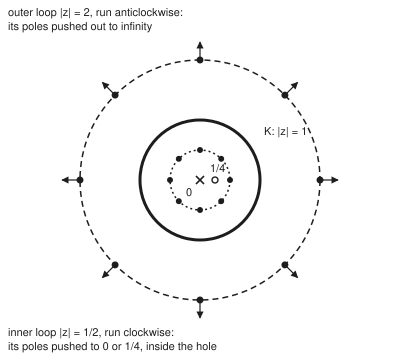

# Runge's theorem: holomorphic functions on a compact set are uniform limits of rational functions with poles you choose

[Syllabus](../../../SYLLABUS.md) → [Complex analysis](../README.md) → [Taylor Series, Zeros and Rigidity](../README.md#s04) → Runge's theorem

---

## General Overview

Take the circle of radius 1 round 0, and call it K. The function 1/z is smooth on it: no division by zero, a complex derivative at every point. Try to copy 1/z on that circle with a polynomial, the only kind of function a machine computes with adding and multiplying alone. It cannot be done. Every polynomial misses 1/z by at least 1 somewhere on the circle.

The reason is the hole. The circle surrounds the disc inside it, and 1/z has a pole at 0, in that hole. A **pole** is a point where a function blows up like one over a power of the distance. Allow one pole at 1/4, also in the hole, and 11 powers of 1/(z − 1/4) copy 1/z on the circle to within 0.000005645.

Now fill the hole: let K be the whole closed disc, rim included. The function 1/(z − 2) has its pole outside, and nothing stops a polynomial. Its degree-10 geometric series misses by at most 2^(−11) = 0.000488.

Carl Runge proved in 1885 that holes are the only obstruction. The proof turns Cauchy's integral formula into a finite sum of simple fractions, then moves each fraction's pole to wherever it is allowed to go.

**A function holomorphic on an open set round a compact set K can be matched on K, to any tolerance, by a rational function whose poles sit only at points chosen in advance, one in each hole of K; when K has no holes, polynomials do it.**

**What kind of fact this is:** a theorem, proved on this card in Why it works; Cauchy's formula for cycles, which it uses, is stated with a link to the card that proves it.

### The picture: the circle, its hole, and the poles being pushed

<p align="center"></p>

To scale: 60 units per 1, 0 at (200, 150). The circle K has radius 60, the inner loop 30, the outer loop 120, and the point 1/4 sits at (215, 150). The dots are the poles of an 8-point Riemann sum on each loop (Step 3). The outer poles go off to infinity, which makes polynomials. The inner poles can only move inside the hole.

---

## The formula

Words first. A set is **compact** when it is closed (it contains its own edge) and bounded. Its **complement** is every point of the plane not in it. A **hole** is a bounded piece of the complement: a region K surrounds and cannot be left without crossing K. A **rational function** is one polynomial divided by another; its poles are the zeros of the bottom polynomial. "Holomorphic near K" means having a complex derivative on some open set U that contains K.

Runge's theorem. Let f be holomorphic near K, and let P hold at least one point in each hole of K. Then for every tolerance ε > 0 there is a rational function R, with poles only in P, such that

```math
\max_{z \in K} \big| f(z) - R(z) \big| \;<\; \varepsilon .
```

**Read it aloud:** the worst gap anywhere on K between the function and a rational function with poles only at the chosen points can be made as small as you like.

The engine is one identity, which moves a pole from a to b:

```math
\frac{1}{z-a} \;=\; \sum_{n=0}^{\infty} \frac{(a-b)^n}{(z-b)^{n+1}}, \qquad \text{valid where } |a-b| < |z-b| .
```

**Read it aloud:** a pole at a equals a series of powers of a pole at b, wherever z is further from b than a is.

| Symbol | Plain meaning | In our example | Push it up and the answer… |
| --- | --- | --- | --- |
| $`z`$, $`n`$, $`N`$, $`j`$ | a point of K; the term counter; terms kept; a pole's power | z on the circle; N = 11 | more terms, a smaller gap |
| $`K`$ | the compact set the copy must work on | the circle $`\lvert z \rvert = 1`$, or the disc $`\lvert z \rvert \le 1`$ | a bigger K can grow new holes |
| $`f`$, $`U`$ | the function; an open set holding K where $`f`$ has a complex derivative | 1/z or $`e^z/z`$; the plane without 0 | — |
| $`P`$ | the allowed poles: one point per hole, plus infinity for the outside | 0 or 1/4 | — |
| $`R`$, $`p`$, $`\varepsilon`$ | the rational copy; a polynomial; the tolerance | $`\varepsilon`$ = 0.000488 for degree 10 | a looser $`\varepsilon`$, fewer terms |
| $`a`$, $`b`$ | the pole being moved; where it lands | 0 to 1/4; 2 to infinity | b nearer the edge of K, slower series |
| $`\Gamma`$, $`\zeta`$, $`r`$, $`\theta`$ | the cycle: loops round K outside it; a point on them; a loop's radius; its angle | radius 2 anticlockwise, radius 1/2 clockwise | — |
| $`m`$, $`w_k`$; $`d`$, $`\delta`$, $`Q`$, $`S`$, $`V`$, $`b'`$ | points per loop in a Riemann sum, and those points. Detailed proof only: distance from K to the outside of U; grid square side; a grid square; the reachable poles; a piece of the complement; a nearby pole | m = 8, 16, 32 | more points, a smaller gap |

### When it holds

- **Holomorphic, not only continuous.** On the closed disc the conjugate $`\bar z`$ (z reflected in the real axis) is continuous, but no polynomials converge to it there: their limit would be holomorphic inside ([Limits of holomorphic functions](02-uniform-limits-of-holomorphic-functions.md)). This proof also uses an open set round K, for its loops; when K has no holes, Mergelyan's theorem shows continuity on K plus holomorphy inside is enough.
- **K compact.** On the open disc $`\lvert z \rvert < 1`$, the function 1/(z − 1) is holomorphic and the complement has no hole, yet every polynomial is bounded there and 1/(z − 1) is not.
- **One chosen pole in every hole.** Miss a hole and the loop integral round it blocks the copy, as with 1/z on the circle.
- **Polynomials exactly when there are no holes.** Then every pole can be pushed to infinity. With a hole, 1/(z − a) for a in it has no polynomial copy.
- **The match is on K only.** The degree-10 copy of 1/(z − 2) is built for $`\lvert z \rvert \le 1`$; its series stops converging at $`\lvert z \rvert = 2`$.

---

## Why it works

### Step 0: write f as simple fractions, then move their poles

Cauchy's formula writes f on K as an average of simple fractions $`1/(\zeta - z)`$, with $`\zeta`$ running over loops outside K. A Riemann sum turns that average into a finite sum: a rational function with poles on the loops. Each pole can then be slid, by one geometric series per move, anywhere within its own piece of the complement. Only a hole can trap a pole.

### Step 1: why a hole blocks polynomials

Integrate round the circle $`\lvert z \rvert = 1`$. A polynomial p has an antiderivative, so its loop integral is 0 ([Antiderivatives](../03-Contour%20Integrals%20and%20Cauchy%27s%20Theorem/02-antiderivatives-and-path-independence.md)). The loop integral of 1/z is $`2\pi i`$.

Suppose $`\lvert 1/z - p(z) \rvert < 1`$ all round the circle. A loop integral is at most the length times the largest size, here $`2\pi \times 1`$. But the integral of $`1/z - p`$ is exactly $`2\pi i`$, of size $`2\pi`$. So the gap reaches 1 somewhere.

```math
\Big| \oint_{|z|=1} \Big(\frac1z - p(z)\Big)\,dz \Big| \;=\; 2\pi \;\le\; 2\pi \max_{|z|=1} \Big| \frac1z - p(z) \Big| .
```

The check tries 300 random polynomials of degree 5; the best misses by 1.129898.

### Step 2: Cauchy's formula on a cycle

A **cycle** is a finite set of closed loops, each run in a set direction. The **winding number** of a cycle round a point counts its turns round that point, anticlockwise positive.

There is always a cycle $`\Gamma`$ in U that misses K, winds once round every point of K, and winds zero times round every point outside U. For such a cycle ([Cauchy's theorem for cycles](../03-Contour%20Integrals%20and%20Cauchy%27s%20Theorem/08-homology-form-of-cauchys-theorem.md)):

```math
f(z) \;=\; \frac{1}{2\pi i} \oint_{\Gamma} \frac{f(\zeta)}{\zeta - z}\, d\zeta \qquad \text{for every } z \in K .
```

For the circle and $`e^z/z`$, $`\Gamma`$ is the circle of radius 2 run anticlockwise plus the circle of radius 1/2 run clockwise. The fold below builds $`\Gamma`$ for any K from a grid of squares.

### Step 3: Riemann sums give rational functions

On a circle of radius r, put $`\zeta = r e^{i\theta}`$, so $`d\zeta = i\zeta\, d\theta`$. Sampling m equally spaced points $`w_k`$ turns the integral into a sum:

```math
\frac{1}{2\pi i} \oint_{|\zeta| = r} \frac{f(\zeta)}{\zeta - z}\, d\zeta \;\approx\; \frac{1}{m} \sum_{k=0}^{m-1} \frac{f(w_k)\, w_k}{w_k - z} .
```

Each term is a constant over $`(w_k - z)`$: a simple pole at $`w_k`$. The distance from $`\Gamma`$ to K stays above a fixed number, so the integrand is uniformly continuous, and the sums close in on f at every point of K at once.

For $`e^z/z`$ on the circle, with m points on each loop, the worst gaps are 0.022102852 (m = 8), 0.000082957 (m = 16) and 0.000000001 (m = 32).

### Step 4: pushing a pole inside its piece

The identity under The formula moves a pole from a to b. Stopping after N terms leaves an exact remainder:

```math
\frac{1}{z-a} - \sum_{n=0}^{N-1} \frac{(a-b)^n}{(z-b)^{n+1}} \;=\; \Big(\frac{a-b}{z-b}\Big)^{N} \frac{1}{z-a} .
```

When $`\lvert a - b \rvert`$ is smaller than the distance from b to K, the bracket is below a fixed number under 1 on all of K, so the gap shrinks geometrically.

Moving 0 to 1/4 with the circle as K: $`\lvert a - b \rvert = 1/4`$ and $`\lvert z - 1/4 \rvert \ge 3/4`$, so the bracket is at most 1/3. With N = 11 the gap is at most $`3^{-11}`$ = 0.000005645, reached at z = 1.

A long move is a chain of short ones along a path inside the same piece of the complement. Powers $`1/(z-a)^j`$ move too, as products of moved copies.

### Step 5: pushing a pole to infinity

In the unbounded piece of the complement, first move the pole to some b with $`\lvert b \rvert`$ larger than every $`\lvert z \rvert`$ on K. Then a geometric series in z/b replaces it by a polynomial:

```math
\frac{1}{z-2} \;=\; -\frac12 \sum_{n=0}^{\infty} \Big(\frac z2\Big)^n, \qquad \max_{|z|\le 1}\, \Big| \frac{1}{z-2} + \frac12 \sum_{n=0}^{10} \Big(\frac z2\Big)^n \Big| \;=\; 2^{-11} .
```

The remainder is $`(z/2)^{11}/(z-2)`$. On the disc its top is $`(1/2)^{11}/1`$ = 0.000488281, at z = 1.

### Step 6: put the pieces together

Choose the Riemann sum within ε/2 of f on K. It is a finite sum of terms, each a constant over $`(w_k - z)`$. Move each term's pole, keeping that term within ε/2 divided by the number of terms, to a chosen point of its hole or to infinity. The total gap is under ε. If K has no holes, every pole went to infinity, and R is a polynomial.

<details>
<summary>Detailed proof: building the cycle, and why a pole reaches every point of its piece</summary>

**The cycle.** Let d be the distance from K to the outside of U (any positive number if U is the whole plane). Cover the plane with a grid of closed squares of side $`\delta < d/2`$. Keep the finitely many squares that meet K, each with its edge run anticlockwise.

Add their edge integrals. An edge shared by two kept squares is run once each way and cancels. What is left is a cycle $`\Gamma`$ of edges belonging to exactly one kept square. Such an edge touches no point of K, since a point of K on it would make the neighbouring square a kept one too.

For z in K inside a kept square Q, Cauchy's formula on Q gives f(z) times $`2\pi i`$, and every other kept square gives 0. Summing proves the formula of Step 2 for such z; continuity covers z on a grid line. Every kept square lies within $`\delta\sqrt2 < d`$ of K, so inside U, and a point outside U lies in no kept square: the winding number there is 0.

**Reaching the whole piece.** Fix a piece V of the complement of K and a point a in it. Let S be the set of points b in V such that $`1/(z-a)`$ is a uniform limit on K of polynomials in $`1/(z-b)`$.

S is open: if b is in S and $`\lvert b' - b \rvert`$ is less than the distance from b' to K, then $`1/(z-b)`$ is a uniform limit of polynomials in $`1/(z-b')`$ by Step 4, so b' is in S.

V without S is open by the same move run the other way. V is connected, and a is in S, so S is all of V.

For the unbounded piece, take b with $`\lvert b \rvert`$ above twice the largest $`\lvert z \rvert`$ on K: polynomials in $`1/(z-b)`$ are uniform limits of polynomials in z by Step 5.

</details>

---

## Worked numbers, by hand

| Step | Arithmetic | Value |
| --- | --- | --- |
| Loop integral of 1/z round the circle | $`2\pi i`$ | 6.283185i |
| Every polynomial's worst gap from 1/z | at least $`2\pi / 2\pi`$ | 1.000000 |
| Best of 300 random degree-5 tries | sampled on 720 points | 1.129898 |
| 1/(z − 2), degree 10, worst gap at z = 1 | $`(1/2)^{11} / \lvert 1 - 2 \rvert`$ | **0.000488281** |
| 1/z from poles at 1/4, 11 terms, at z = 1 | $`(1/4 \div 3/4)^{11} / 1`$ | **0.000005645** |
| $`e^z/z`$ by 32-point Riemann sums | on both loops | 0.000000001 |

Once the hole is filled or given a pole, the copy is as close as wanted; without either, the gap never drops below 1.

### What breaks if you drop a piece

| Mistake | Comes out at | What went wrong |
| --- | --- | --- |
| Pole moved from 0 to 1/2 in one jump | 1.000000 after 11 terms, and after 101 | $`\lvert a - b \rvert`$ = 1/2 equals the distance from 1/2 to K: the bracket reaches 1 at z = 1 |
| Taylor polynomial of 1/z about 1, degree 10 | 2048.000000 | a polynomial tries to send the pole at 0 out of the hole; the series converges only where $`\lvert z - 1 \rvert < 1`$ |
| Riemann sum of $`e^z/z`$ with the inner loop dropped | 1.000000 | the cycle no longer winds zero times round the pole at 0, so the sum copies $`e^z/z - 1/z`$ |

The code prints all three.

---

## Code, from first principles, and it actually runs

The code builds every copy and measures its worst gap by sampling K: 720 points on the circle, 792 on the disc. It takes three roads that share no arithmetic. Loop integrals give the lower bound of 1, and a random search must respect it. The geometric-series remainder predicts each pushed pole's gap, and sampling must hit it. Riemann sums of Cauchy's formula are compared with $`e^z/z`$ itself.

### Python

```python
# Runge's theorem -- the check behind the card.  Standard library only: the
# complex exponential is built from math.exp, math.cos and math.sin.
import math
TAU = 2 * math.pi

def cexp(z): return math.exp(z.real) * complex(math.cos(z.imag), math.sin(z.imag))
def ring(r, m): return [r * cexp(complex(0, TAU * k / m)) for k in range(m)]
def loop_integral(g, m=64): return sum(g(z) * 1j * z for z in ring(1, m)) * TAU / m
def worst(g, pts): return max(abs(g(z)) for z in pts)
def horner(c, z):                                  # c[0] + c[1] z + c[2] z^2 + ...
    out = 0j
    for a in reversed(c): out = out * z + a
    return out
def push(a, b, n):                                 # 1/(z - a) rebuilt from poles at b
    return lambda z: horner([(a - b) ** k for k in range(n)], 1 / (z - b)) / (z - b)
K = ring(1, 720)                                   # the circle |z| = 1
disc = [r / 10 * z for r in range(11) for z in ring(1, 72)]   # the closed disc |z| <= 1
powers = max(abs(loop_integral(lambda z, k=k: z ** k)) for k in range(5))
loop = loop_integral(lambda z: 1 / z)
print(f"loop integrals of 1, z, ..., z^4: largest size {powers:.6f}; of 1/z: {loop.imag:.6f}i, real part {abs(loop.real):.6f}")
print(f"so every polynomial misses 1/z somewhere by at least |2 pi i| / 2 pi = {abs(loop) / TAU:.6f}")
seed, best = 2026, 9.0
def rnd():                                         # a small home-made random number
    global seed
    seed = (seed * 1103515245 + 12345) % 2 ** 31
    return (seed / 2 ** 31 - 0.5) / 5     # between -0.1 and 0.1
for trial in range(300):
    c = [complex(rnd(), rnd()) for _ in range(6)]
    best = min(best, worst(lambda z: 1 / z - horner(c, z), K))
print(f"300 random polynomials of degree 5, {len(K)} points on the circle: smallest worst gap {best:.6f}")
gap_inf = worst(lambda z: 1 / (z - 2) + 0.5 * horner([1] * 11, z / 2), disc)
print(f"1/(z - 2) by its degree-10 polynomial on |z| <= 1, {len(disc)} points: worst gap {gap_inf:.9f}; 2^-11 = {2 ** -11:.9f}")
gap_hole = worst(lambda z: 1 / z - push(0, 0.25, 11)(z), K)
print(f"1/z by 11 powers of 1/(z - 1/4) on |z| = 1: worst gap {gap_hole:.9f}; 3^-11 = {3 ** -11:.9f}")
f = lambda z: cexp(z) / z
def riemann(m, inner=True):                        # Cauchy's formula on two circles, as a sum
    pts = [(w, 1) for w in ring(2, m)] + ([(w, -1) for w in ring(0.5, m)] if inner else [])
    return lambda z: sum(s * f(w) * w / (w - z) for w, s in pts) / m
gaps = [worst(lambda z: f(z) - riemann(m)(z), K) for m in (8, 16, 32)]
print("e^z/z on |z| = 1 by Riemann sums, 8, 16, 32 points per circle: worst gaps "
      + ", ".join(f"{g:.9f}" for g in gaps))
bad_push = [worst(lambda z: 1 / z - push(0, 0.5, n)(z), K) for n in (11, 101)]
bad_taylor = worst(lambda z: 1 / z - horner([(-1) ** n for n in range(11)], z - 1), K)
no_inner = worst(lambda z: f(z) - riemann(32, False)(z), K)
print(f"mistake 1, pole pushed from 0 to 1/2 in one jump: worst gap {bad_push[0]:.6f} (11 terms), {bad_push[1]:.6f} (101)")
print(f"mistake 2, Taylor polynomial of 1/z about 1, degree 10: worst gap {bad_taylor:.6f}")
print(f"mistake 3, e^z/z with the inner circle dropped, 32 points: worst gap {no_inner:.6f}")
print("figure, 60 units per 1, 0 at (200, 150): K radius 60, inner loop 30, outer loop 120, 1/4 at (215, 150)")
assert abs(loop - TAU * 1j) < 1e-9 and powers < 1e-9         # the obstruction, against 2 pi i
assert best >= 1                                            # brute force respects the bound
assert abs(gap_inf - 2 ** -11) < 1e-12                       # tail formula against sampling
assert abs(gap_hole - 3 ** -11) < 1e-12                      # the same, inside the hole
assert gaps[0] > gaps[1] > gaps[2] and gaps[2] < 1e-6        # Riemann sums close in
assert abs(bad_push[1] - 1) < 1e-9 and abs(bad_taylor - 2048) < 1e-6
print("ALL CHECKS PASS")
```

**Ran 2026-11-23 on macOS, Python 3.14.10, standard library only. All checks passed. Output, pasted from the run:**

```
loop integrals of 1, z, ..., z^4: largest size 0.000000; of 1/z: 6.283185i, real part 0.000000
so every polynomial misses 1/z somewhere by at least |2 pi i| / 2 pi = 1.000000
300 random polynomials of degree 5, 720 points on the circle: smallest worst gap 1.129898
1/(z - 2) by its degree-10 polynomial on |z| <= 1, 792 points: worst gap 0.000488281; 2^-11 = 0.000488281
1/z by 11 powers of 1/(z - 1/4) on |z| = 1: worst gap 0.000005645; 3^-11 = 0.000005645
e^z/z on |z| = 1 by Riemann sums, 8, 16, 32 points per circle: worst gaps 0.022102852, 0.000082957, 0.000000001
mistake 1, pole pushed from 0 to 1/2 in one jump: worst gap 1.000000 (11 terms), 1.000000 (101)
mistake 2, Taylor polynomial of 1/z about 1, degree 10: worst gap 2048.000000
mistake 3, e^z/z with the inner circle dropped, 32 points: worst gap 1.000000
figure, 60 units per 1, 0 at (200, 150): K radius 60, inner loop 30, outer loop 120, 1/4 at (215, 150)
ALL CHECKS PASS
```

### Rust

Same numbers, same labels, built with `rustc --edition 2021 -O`.

```rust
// Runge's theorem -- the same check as the Python, in Rust.  No crates: a small
// complex type is written here, and the exponential is built from exp, cos, sin.
use std::f64::consts::TAU;
use std::ops::{Add, Div, Mul, Sub};
#[derive(Clone, Copy)]
struct C(f64, f64);
impl Add for C { type Output = C; fn add(self, o: C) -> C { C(self.0 + o.0, self.1 + o.1) } }
impl Sub for C { type Output = C; fn sub(self, o: C) -> C { C(self.0 - o.0, self.1 - o.1) } }
impl Mul for C { type Output = C; fn mul(self, o: C) -> C { C(self.0 * o.0 - self.1 * o.1, self.0 * o.1 + self.1 * o.0) } }
impl Div for C { type Output = C; fn div(self, o: C) -> C {
    let d = o.0 * o.0 + o.1 * o.1; C((self.0 * o.0 + self.1 * o.1) / d, (self.1 * o.0 - self.0 * o.1) / d) } }
fn r(x: f64) -> C { C(x, 0.0) }
fn abs(z: C) -> f64 { z.0.hypot(z.1) }
fn cexp(z: C) -> C { let e = z.0.exp(); C(e * z.1.cos(), e * z.1.sin()) }
fn ring(rad: f64, m: usize) -> Vec<C> { (0..m).map(|k| r(rad) * cexp(C(0.0, TAU * k as f64 / m as f64))).collect() }
fn loop_integral(g: &dyn Fn(C) -> C) -> C {
    let mut s = r(0.0);
    for z in ring(1.0, 64) { s = s + g(z) * C(0.0, 1.0) * z; }
    s * r(TAU) / r(64.0)
}
fn worst(g: &dyn Fn(C) -> C, pts: &[C]) -> f64 { pts.iter().map(|&z| abs(g(z))).fold(0.0, f64::max) }
fn horner(c: &[C], z: C) -> C { c.iter().rev().fold(r(0.0), |out, &a| out * z + a) }
fn push(a: f64, b: f64, n: i32) -> impl Fn(C) -> C {   // 1/(z - a) rebuilt from poles at b
    let c: Vec<C> = (0..n).map(|k| r((a - b).powi(k))).collect();
    move |z| horner(&c, r(1.0) / (z - r(b))) / (z - r(b))
}
fn f(z: C) -> C { cexp(z) / z }
fn riemann(m: usize, inner: bool) -> impl Fn(C) -> C {  // Cauchy's formula on two circles, as a sum
    let mut pts: Vec<(C, f64)> = ring(2.0, m).into_iter().map(|w| (w, 1.0)).collect();
    if inner { pts.extend(ring(0.5, m).into_iter().map(|w| (w, -1.0))); }
    move |z| { let mut s = r(0.0); for &(w, sg) in &pts { s = s + r(sg) * f(w) * w / (w - z); } s / r(m as f64) }
}
fn main() {
    let k = ring(1.0, 720);
    let disc: Vec<C> = (0..11).flat_map(|i| ring(1.0, 72).into_iter().map(move |z| r(i as f64 / 10.0) * z)).collect();
    let powers = (0..5).map(|n| abs(loop_integral(&|z: C| (0..n).fold(r(1.0), |p, _| p * z)))).fold(0.0, f64::max);
    let lp = loop_integral(&|z: C| r(1.0) / z);
    println!("loop integrals of 1, z, ..., z^4: largest size {:.6}; of 1/z: {:.6}i, real part {:.6}", powers, lp.1, lp.0.abs());
    println!("so every polynomial misses 1/z somewhere by at least |2 pi i| / 2 pi = {:.6}", abs(lp) / TAU);
    let (mut seed, mut best) = (2026u64, 9.0f64);
    let mut rnd = || { seed = (seed * 1103515245 + 12345) % (1u64 << 31); (seed as f64 / 2f64.powi(31) - 0.5) / 5.0 };
    for _ in 0..300 {
        let c: Vec<C> = (0..6).map(|_| { let re = rnd(); C(re, rnd()) }).collect();
        best = best.min(worst(&|z: C| r(1.0) / z - horner(&c, z), &k));
    }
    println!("300 random polynomials of degree 5, {} points on the circle: smallest worst gap {:.6}", k.len(), best);
    let gap_inf = worst(&|z: C| r(1.0) / (z - r(2.0)) + r(0.5) * horner(&[r(1.0); 11], z / r(2.0)), &disc);
    println!("1/(z - 2) by its degree-10 polynomial on |z| <= 1, {} points: worst gap {:.9}; 2^-11 = {:.9}", disc.len(), gap_inf, 2f64.powi(-11));
    let p = push(0.0, 0.25, 11);
    let gap_hole = worst(&|z: C| r(1.0) / z - p(z), &k);
    println!("1/z by 11 powers of 1/(z - 1/4) on |z| = 1: worst gap {:.9}; 3^-11 = {:.9}", gap_hole, 3f64.powi(-11));
    let gaps: Vec<f64> = [8, 16, 32].iter().map(|&m| { let q = riemann(m, true); worst(&|z: C| f(z) - q(z), &k) }).collect();
    println!("e^z/z on |z| = 1 by Riemann sums, 8, 16, 32 points per circle: worst gaps {:.9}, {:.9}, {:.9}", gaps[0], gaps[1], gaps[2]);
    let bad_push: Vec<f64> = [11, 101].iter().map(|&n| { let q = push(0.0, 0.5, n); worst(&|z: C| r(1.0) / z - q(z), &k) }).collect();
    let alt: Vec<C> = (0..11).map(|n| r(if n % 2 == 0 { 1.0 } else { -1.0 })).collect();
    let bad_taylor = worst(&|z: C| r(1.0) / z - horner(&alt, z - r(1.0)), &k);
    let q = riemann(32, false);
    let no_inner = worst(&|z: C| f(z) - q(z), &k);
    println!("mistake 1, pole pushed from 0 to 1/2 in one jump: worst gap {:.6} (11 terms), {:.6} (101)", bad_push[0], bad_push[1]);
    println!("mistake 2, Taylor polynomial of 1/z about 1, degree 10: worst gap {:.6}", bad_taylor);
    println!("mistake 3, e^z/z with the inner circle dropped, 32 points: worst gap {:.6}", no_inner);
    println!("figure, 60 units per 1, 0 at (200, 150): K radius 60, inner loop 30, outer loop 120, 1/4 at (215, 150)");
    assert!(abs(lp - C(0.0, TAU)) < 1e-9 && powers < 1e-9);    // the obstruction, against 2 pi i
    assert!(best >= 1.0);                                      // brute force respects the bound
    assert!((gap_inf - 2f64.powi(-11)).abs() < 1e-12);          // tail formula against sampling
    assert!((gap_hole - 3f64.powi(-11)).abs() < 1e-12);         // the same, inside the hole
    assert!(gaps[0] > gaps[1] && gaps[1] > gaps[2] && gaps[2] < 1e-6);
    assert!((bad_push[1] - 1.0).abs() < 1e-9 && (bad_taylor - 2048.0).abs() < 1e-6);
    println!("ALL CHECKS PASS");
}
```

**Ran 2026-11-23 on macOS, rustc 1.98.1, no crates. All checks passed. Output, pasted from the run:**

```
loop integrals of 1, z, ..., z^4: largest size 0.000000; of 1/z: 6.283185i, real part 0.000000
so every polynomial misses 1/z somewhere by at least |2 pi i| / 2 pi = 1.000000
300 random polynomials of degree 5, 720 points on the circle: smallest worst gap 1.129898
1/(z - 2) by its degree-10 polynomial on |z| <= 1, 792 points: worst gap 0.000488281; 2^-11 = 0.000488281
1/z by 11 powers of 1/(z - 1/4) on |z| = 1: worst gap 0.000005645; 3^-11 = 0.000005645
e^z/z on |z| = 1 by Riemann sums, 8, 16, 32 points per circle: worst gaps 0.022102852, 0.000082957, 0.000000001
mistake 1, pole pushed from 0 to 1/2 in one jump: worst gap 1.000000 (11 terms), 1.000000 (101)
mistake 2, Taylor polynomial of 1/z about 1, degree 10: worst gap 2048.000000
mistake 3, e^z/z with the inner circle dropped, 32 points: worst gap 1.000000
figure, 60 units per 1, 0 at (200, 150): K radius 60, inner loop 30, outer loop 120, 1/4 at (215, 150)
ALL CHECKS PASS
```

The two outputs match line for line.

### Lean

Lean proves Runge's theorem for every compact K and every holomorphic f, and the circle's obstruction for every polynomial.

- Suppose f is holomorphic near K, and P holds at least one point in each hole of K. Then for every ε > 0 some rational function, with poles only in P, stays within ε of f on all of K. Its bottom polynomial is never 0 on K.
- Suppose f is holomorphic near K, and K has no holes. Then for every ε > 0 some polynomial stays within ε of f on all of K.
- Take any polynomial p. Then some point z on the circle |z| = 1 has |1/z − p(z)| ≥ 1.
- The hand arithmetic holds exactly, as fractions. That covers the gaps 2^(−11) and 3^(−11), the bracket 1/3, and the Taylor miss of 2048.

The Riemann sums, the decimals, the sampled worst gaps and the random polynomial search are left to the Python and Rust checks.

```lean
-- Runge's theorem: a function holomorphic on an open set round a compact set K is matched on K, to any tolerance, by a rational function whose poles lie only at chosen points, at least one in each hole of K, and by a polynomial when K has no holes, while on the unit circle every polynomial misses 1/z by at least 1.
import Mathlib.Analysis.Complex.Basic
import Mathlib.Analysis.Calculus.FDeriv.Basic
import Mathlib.Algebra.Polynomial.Eval.Defs
import Mathlib.Topology.Connected.Basic
import Mathlib.Topology.Bornology.Basic
import Mathlib.Tactic.NormNum
import Mathlib

open Set Polynomial

section RungeHelpers
open Complex

/-- `g` can be matched on `K` to any tolerance by `p/q` with every root of `q` in `P`. -/

def RApprox (K P : Set ℂ) (g : ℂ → ℂ) : Prop :=
  ∀ ε > 0, ∃ p q : ℂ[X], (∀ a, q.IsRoot a → a ∈ P) ∧
    ∀ z ∈ K, q.eval z ≠ 0 ∧ ‖g z - p.eval z / q.eval z‖ < ε

lemma RApprox.of_unif {K P : Set ℂ} {g : ℂ → ℂ}
    (h : ∀ ε > 0, ∃ g', RApprox K P g' ∧ ∀ z ∈ K, ‖g z - g' z‖ < ε) : RApprox K P g := by
  intro ε hε
  obtain ⟨g', hg', hgg⟩ := h (ε / 2) (by positivity)
  obtain ⟨p, q, hq, hpq⟩ := hg' (ε / 2) (by positivity)
  refine ⟨p, q, hq, fun z hz => ⟨(hpq z hz).1, ?_⟩⟩
  calc ‖g z - p.eval z / q.eval z‖ = ‖(g z - g' z) + (g' z - p.eval z / q.eval z)‖ := by
        ring_nf
    _ ≤ ‖g z - g' z‖ + ‖g' z - p.eval z / q.eval z‖ := norm_add_le _ _
    _ < ε / 2 + ε / 2 := add_lt_add (hgg z hz) (hpq z hz).2
    _ = ε := by ring

#print axioms RApprox.of_unif

lemma RApprox.congr {K P : Set ℂ} {g g' : ℂ → ℂ} (h : RApprox K P g)
    (e : ∀ z ∈ K, g z = g' z) : RApprox K P g' := by
  intro ε hε
  obtain ⟨p, q, hq, hpq⟩ := h ε hε
  exact ⟨p, q, hq, fun z hz => by rw [← e z hz]; exact hpq z hz⟩

#print axioms RApprox.congr

lemma rapprox_poly (K P : Set ℂ) (p : ℂ[X]) : RApprox K P (fun z => p.eval z) :=
  fun ε hε => ⟨p, 1, by simp [Polynomial.IsRoot], fun z _ => by simp [hε]⟩

#print axioms rapprox_poly

lemma rapprox_inv_sub {K P : Set ℂ} {b : ℂ} (hb : b ∈ P) (hbK : b ∉ K) :
    RApprox K P (fun z => (z - b)⁻¹) := by
  intro ε hε
  refine ⟨1, X - C b, fun a ha => ?_, fun z hz => ⟨?_, ?_⟩⟩
  · simp [Polynomial.IsRoot, sub_eq_zero] at ha; rw [ha]; exact hb
  · simp only [eval_sub, eval_X, eval_C]; exact sub_ne_zero.2 (fun h => hbK (h ▸ hz))
  · simp [hε]

#print axioms rapprox_inv_sub

lemma RApprox.add {K P : Set ℂ} {g h : ℂ → ℂ} (hg : RApprox K P g) (hh : RApprox K P h) :
    RApprox K P (fun z => g z + h z) := by
  intro ε hε
  obtain ⟨p1, q1, hq1, h1⟩ := hg (ε / 2) (by positivity)
  obtain ⟨p2, q2, hq2, h2⟩ := hh (ε / 2) (by positivity)
  refine ⟨p1 * q2 + p2 * q1, q1 * q2, fun a ha => ?_, fun z hz => ?_⟩
  · rw [Polynomial.IsRoot, eval_mul, mul_eq_zero] at ha
    rcases ha with ha | ha
    · exact hq1 a ha
    · exact hq2 a ha
  · obtain ⟨n1, e1⟩ := h1 z hz
    obtain ⟨n2, e2⟩ := h2 z hz
    refine ⟨by simp [n1, n2], ?_⟩
    have : g z + h z - eval z (p1 * q2 + p2 * q1) / eval z (q1 * q2) =
        (g z - eval z p1 / eval z q1) + (h z - eval z p2 / eval z q2) := by
      simp only [eval_add, eval_mul]; field_simp; ring
    rw [this]
    calc _ ≤ ‖g z - eval z p1 / eval z q1‖ + ‖h z - eval z p2 / eval z q2‖ := norm_add_le _ _
      _ < ε / 2 + ε / 2 := add_lt_add e1 e2
      _ = ε := by ring

#print axioms RApprox.add

lemma RApprox.const_mul {K P : Set ℂ} {g : ℂ → ℂ} (hg : RApprox K P g) (c : ℂ) :
    RApprox K P (fun z => c * g z) := by
  intro ε hε
  obtain ⟨p, q, hq, h1⟩ := hg (ε / (‖c‖ + 1)) (by positivity)
  refine ⟨C c * p, q, hq, fun z hz => ⟨(h1 z hz).1, ?_⟩⟩
  have e : c * g z - eval z (C c * p) / eval z q = c * (g z - eval z p / eval z q) := by
    simp only [eval_mul, eval_C]; ring
  rw [e, norm_mul]
  have h2 := (h1 z hz).2
  calc ‖c‖ * ‖g z - eval z p / eval z q‖ ≤ (‖c‖ + 1) * ‖g z - eval z p / eval z q‖ := by
        gcongr; linarith
    _ < (‖c‖ + 1) * (ε / (‖c‖ + 1)) := by gcongr
    _ = ε := by field_simp

#print axioms RApprox.const_mul

lemma RApprox.mul {K P : Set ℂ} {g h : ℂ → ℂ} {M : ℝ} (hg : RApprox K P g) (hh : RApprox K P h)
    (hM : 0 ≤ M) (hgM : ∀ z ∈ K, ‖g z‖ ≤ M) (hhM : ∀ z ∈ K, ‖h z‖ ≤ M) :
    RApprox K P (fun z => g z * h z) := by
  intro ε hε
  set η := min 1 (ε / (2 * M + 2)) with hη
  have hη0 : 0 < η := lt_min one_pos (by positivity)
  have hη1 : η ≤ 1 := min_le_left _ _
  have hη2 : η ≤ ε / (2 * M + 2) := min_le_right _ _
  obtain ⟨p1, q1, hq1, h1⟩ := hg η hη0
  obtain ⟨p2, q2, hq2, h2⟩ := hh η hη0
  refine ⟨p1 * p2, q1 * q2, fun a ha => ?_, fun z hz => ?_⟩
  · rw [Polynomial.IsRoot, eval_mul, mul_eq_zero] at ha
    rcases ha with ha | ha
    · exact hq1 a ha
    · exact hq2 a ha
  · obtain ⟨n1, e1⟩ := h1 z hz
    obtain ⟨n2, e2⟩ := h2 z hz
    refine ⟨by simp [n1, n2], ?_⟩
    set r := eval z p1 / eval z q1
    set s := eval z p2 / eval z q2
    have e : g z * h z - eval z (p1 * p2) / eval z (q1 * q2) =
        g z * (h z - s) + s * (g z - r) := by
      simp only [eval_mul, r, s]; field_simp; ring
    have hs : ‖s‖ ≤ M + 1 := by
      calc ‖s‖ = ‖h z - (h z - s)‖ := by ring_nf
        _ ≤ ‖h z‖ + ‖h z - s‖ := norm_sub_le _ _
        _ ≤ M + 1 := add_le_add (hhM z hz) (by linarith)
    rw [e]
    calc ‖g z * (h z - s) + s * (g z - r)‖ ≤ ‖g z‖ * ‖h z - s‖ + ‖s‖ * ‖g z - r‖ := by
          refine (norm_add_le _ _).trans ?_; rw [norm_mul, norm_mul]
      _ ≤ M * η + (M + 1) * η := by
          gcongr
          exact hgM z hz
      _ < (2 * M + 2) * η := by nlinarith
      _ ≤ (2 * M + 2) * (ε / (2 * M + 2)) := by gcongr
      _ = ε := by field_simp

#print axioms RApprox.mul

lemma RApprox.pow {K P : Set ℂ} {g : ℂ → ℂ} {M : ℝ} (hg : RApprox K P g) (hM : 0 ≤ M)
    (hgM : ∀ z ∈ K, ‖g z‖ ≤ M) (n : ℕ) : RApprox K P (fun z => g z ^ n) := by
  induction n with
  | zero => simpa using rapprox_poly K P 1
  | succ n ih =>
    have := RApprox.mul ih hg (M := max (M ^ n) M) (le_max_of_le_right hM)
      (fun z hz => by rw [norm_pow]; exact le_max_of_le_left (pow_le_pow_left₀ (norm_nonneg _) (hgM z hz) n))
      (fun z hz => le_max_of_le_right (hgM z hz))
    simpa [pow_succ] using this

#print axioms RApprox.pow

lemma RApprox.sum {K P : Set ℂ} {ι : Type*} (s : Finset ι) {F : ι → ℂ → ℂ}
    (h : ∀ i ∈ s, RApprox K P (F i)) : RApprox K P (fun z => ∑ i ∈ s, F i z) := by
  classical
  induction s using Finset.induction_on with
  | empty => simpa using rapprox_poly K P 0
  | insert i s hi ih =>
    have := (h i (Finset.mem_insert_self _ _)).add (ih fun j hj => h j (Finset.mem_insert_of_mem hj))
    simpa [Finset.sum_insert hi] using this

#print axioms RApprox.sum

lemma RApprox.sub {K P : Set ℂ} {g h : ℂ → ℂ} (hg : RApprox K P g) (hh : RApprox K P h) :
    RApprox K P (fun z => g z - h z) := by
  simpa [sub_eq_add_neg] using hg.add (hh.const_mul (-1))

#print axioms RApprox.sub

/-- The tail of the geometric series `u / (1 - t) = u (1 + t + t² + ...)`. -/

lemma geom_tail {u t : ℂ} {A ρ : ℝ} (hu : ‖u‖ ≤ A) (ht : ‖t‖ ≤ ρ) (hρ : ρ < 1) (N : ℕ) :
    ‖u / (1 - t) - u * ∑ n ∈ Finset.range N, t ^ n‖ ≤ A * ρ ^ N / (1 - ρ) := by
  have ht1 : t ≠ 1 := fun h => by rw [h, norm_one] at ht; linarith
  have h1t : (1 : ℂ) - t ≠ 0 := sub_ne_zero.2 (Ne.symm ht1)
  have e : u / (1 - t) - u * ∑ n ∈ Finset.range N, t ^ n = u * t ^ N / (1 - t) := by
    rw [geom_sum_eq ht1]
    have : t - 1 ≠ 0 := sub_ne_zero.2 ht1
    field_simp; ring
  rw [e, norm_div, norm_mul, norm_pow]
  have h0 : 0 < 1 - ρ := by linarith
  have h2 : 1 - ρ ≤ ‖1 - t‖ := by
    have := norm_sub_norm_le (1 : ℂ) t; rw [norm_one] at this; linarith
  have hA : 0 ≤ A := (norm_nonneg _).trans hu
  have hρ0 : 0 ≤ ρ := (norm_nonneg _).trans ht
  calc ‖u‖ * ‖t‖ ^ N / ‖1 - t‖ ≤ A * ρ ^ N / ‖1 - t‖ := by gcongr
    _ ≤ A * ρ ^ N / (1 - ρ) := by gcongr

#print axioms geom_tail

lemma exists_tail_small {A ρ ε : ℝ} (hρ0 : 0 ≤ ρ) (hρ : ρ < 1) (hε : 0 < ε) :
    ∃ N : ℕ, A * ρ ^ N / (1 - ρ) < ε := by
  have h0 : 0 < 1 - ρ := by linarith
  obtain ⟨N, hN⟩ := exists_pow_lt_of_lt_one (show 0 < ε * (1 - ρ) / (|A| + 1) by positivity) hρ
  refine ⟨N, ?_⟩
  rw [div_lt_iff₀ h0]
  calc A * ρ ^ N ≤ (|A| + 1) * ρ ^ N := by
        gcongr; exact (le_abs_self A).trans (by linarith)
    _ < (|A| + 1) * (ε * (1 - ρ) / (|A| + 1)) := by gcongr
    _ = ε * (1 - ρ) := by field_simp

#print axioms exists_tail_small

/-- **Pushing a pole.** If `1/(z-a)` can be matched, so can `1/(z-a')` for `a'` near `a`. -/

lemma rapprox_push {K P : Set ℂ} {a a' : ℂ} {r : ℝ} (ha : RApprox K P (fun z => (z - a)⁻¹))
    (hr : ∀ z ∈ K, r ≤ ‖z - a‖) (haa : ‖a' - a‖ < r) : RApprox K P (fun z => (z - a')⁻¹) := by
  have hr0 : 0 < r := lt_of_le_of_lt (norm_nonneg _) haa
  set ρ := ‖a' - a‖ / r
  have hρ0 : 0 ≤ ρ := by positivity
  have hρ1 : ρ < 1 := (div_lt_one hr0).2 haa
  have hbd : ∀ z ∈ K, ‖(z - a)⁻¹‖ ≤ r⁻¹ := fun z hz => by
    rw [norm_inv]; exact inv_anti₀ hr0 (hr z hz)
  refine RApprox.of_unif fun ε hε => ?_
  obtain ⟨N, hN⟩ := exists_tail_small (A := r⁻¹) hρ0 hρ1 hε
  refine ⟨fun z => (z - a)⁻¹ * ∑ n ∈ Finset.range N, ((a' - a) * (z - a)⁻¹) ^ n, ?_, ?_⟩
  · have := RApprox.sum (Finset.range N) (F := fun n z => (a' - a) ^ n * (z - a)⁻¹ ^ (n + 1))
      (fun n _ => (ha.pow (inv_nonneg.2 hr0.le) hbd (n + 1)).const_mul _)
    refine this.congr fun z _ => ?_
    rw [Finset.mul_sum]; refine Finset.sum_congr rfl fun n _ => by rw [mul_pow]; ring
  · intro z hz
    have hza : z - a ≠ 0 := fun h => by
      have := hr z hz; rw [h, norm_zero] at this; linarith
    have ht : ‖(a' - a) * (z - a)⁻¹‖ ≤ ρ := by
      rw [norm_mul, norm_inv, ← div_eq_mul_inv]
      exact div_le_div_of_nonneg_left (norm_nonneg _) hr0 (hr z hz)
    have e : (z - a')⁻¹ = (z - a)⁻¹ / (1 - (a' - a) * (z - a)⁻¹) := by
      have : (1 - (a' - a) * (z - a)⁻¹) = (z - a') * (z - a)⁻¹ := by field_simp; ring
      rw [this]
      by_cases h : z - a' = 0
      · simp [h]
      · field_simp
    rw [e]
    exact lt_of_le_of_lt (geom_tail (hbd z hz) ht hρ1 N) hN

#print axioms rapprox_push

/-- **A pole far out** can be pushed to infinity: `1/(z-a)` is matched by polynomials. -/

lemma rapprox_far {K P : Set ℂ} {a : ℂ} {R : ℝ} (hR : 0 ≤ R) (hK : ∀ z ∈ K, ‖z‖ ≤ R)
    (ha : R < ‖a‖) : RApprox K P (fun z => (z - a)⁻¹) := by
  have ha0 : 0 < ‖a‖ := lt_of_le_of_lt hR ha
  have ha0' : a ≠ 0 := norm_pos_iff.1 ha0
  set ρ := R / ‖a‖
  have hρ0 : 0 ≤ ρ := by positivity
  have hρ1 : ρ < 1 := (div_lt_one ha0).2 ha
  refine RApprox.of_unif fun ε hε => ?_
  obtain ⟨N, hN⟩ := exists_tail_small (A := ‖a‖⁻¹) hρ0 hρ1 hε
  refine ⟨fun z => (-a⁻¹) * ∑ n ∈ Finset.range N, (z * a⁻¹) ^ n, ?_, ?_⟩
  · have := rapprox_poly K P (∑ n ∈ Finset.range N, C (-a⁻¹ * a⁻¹ ^ n) * X ^ n)
    refine this.congr fun z _ => ?_
    rw [eval_finsetSum, Finset.mul_sum]
    refine Finset.sum_congr rfl fun n _ => ?_
    simp only [eval_mul, eval_C, eval_pow, eval_X]; ring
  · intro z hz
    have ht : ‖z * a⁻¹‖ ≤ ρ := by
      rw [norm_mul, norm_inv, ← div_eq_mul_inv]; exact div_le_div_of_nonneg_right (hK z hz) ha0.le
    have e : (z - a)⁻¹ = (-a⁻¹) / (1 - z * a⁻¹) := by
      by_cases h : z - a = 0
      · have : z = a := sub_eq_zero.1 h
        subst this; simp [ha0']
      · have : (1 - z * a⁻¹) = -(z - a) * a⁻¹ := by field_simp; ring
        rw [this]; field_simp
    rw [e]
    exact lt_of_le_of_lt (geom_tail (by rw [norm_neg, norm_inv]) ht hρ1 N) hN

#print axioms rapprox_far

/-- Every pole off `K` can be reached. -/

lemma rapprox_all_poles {K P : Set ℂ} (hK : IsCompact K)
    (hP : ∀ w ∈ Kᶜ, Bornology.IsBounded (connectedComponentIn Kᶜ w) →
      ∃ a ∈ P, a ∈ connectedComponentIn Kᶜ w) :
    ∀ w ∈ Kᶜ, RApprox K P (fun z => (z - w)⁻¹) := by
  have hKo : IsOpen Kᶜ := hK.isClosed.isOpen_compl
  -- a ball round a point off `K`, and the distance bound it gives
  have ball_of : ∀ a ∈ Kᶜ, ∃ r > 0, Metric.ball a r ⊆ Kᶜ ∧ ∀ z ∈ K, r ≤ ‖z - a‖ := by
    intro a ha
    obtain ⟨r, hr, hb⟩ := Metric.isOpen_iff.1 hKo a ha
    refine ⟨r, hr, hb, fun z hz => ?_⟩
    by_contra h; push Not at h
    exact hb (by rw [Metric.mem_ball, dist_eq_norm]; exact h) hz
  set E := {a | a ∈ Kᶜ ∧ RApprox K P (fun z => (z - a)⁻¹)}
  set F := {a | a ∈ Kᶜ ∧ ¬ RApprox K P (fun z => (z - a)⁻¹)}
  have hE : IsOpen E := by
    refine Metric.isOpen_iff.2 fun a ha => ?_
    obtain ⟨r, hr, hb, hd⟩ := ball_of a ha.1
    refine ⟨r, hr, fun a' ha' => ⟨hb ha', rapprox_push ha.2 hd ?_⟩⟩
    rwa [Metric.mem_ball, dist_eq_norm] at ha'
  have hF : IsOpen F := by
    refine Metric.isOpen_iff.2 fun a ha => ?_
    obtain ⟨r, hr, hb, hd⟩ := ball_of a ha.1
    refine ⟨r / 2, by positivity, fun a' ha' => ⟨hb (Metric.ball_subset_ball (by linarith) ha'),
      fun h => ha.2 (rapprox_push (r := r / 2) h (fun z hz => ?_) ?_)⟩⟩
    · rw [Metric.mem_ball, dist_eq_norm] at ha'
      have := hd z hz
      have h3 : ‖z - a‖ ≤ ‖z - a'‖ + ‖a' - a‖ := by
        calc ‖z - a‖ = ‖(z - a') + (a' - a)‖ := by ring_nf
          _ ≤ _ := norm_add_le _ _
      linarith
    · rw [Metric.mem_ball, dist_eq_norm] at ha'; rw [norm_sub_rev]; exact ha'
  intro w hw
  set Cw := connectedComponentIn Kᶜ w
  have hCK : Cw ⊆ Kᶜ := connectedComponentIn_subset _ _
  have hne : (Cw ∩ E).Nonempty := by
    by_cases hb : Bornology.IsBounded Cw
    · obtain ⟨a, haP, haC⟩ := hP w hw hb
      exact ⟨a, haC, hCK haC, rapprox_inv_sub haP (hCK haC)⟩
    · obtain ⟨R, hR, hKR⟩ := hK.isBounded.subset_closedBall_lt 0 0
      have : ¬ Cw ⊆ Metric.closedBall 0 R := fun h => hb (Metric.isBounded_closedBall.subset h)
      obtain ⟨a, haC, haR⟩ := Set.not_subset.1 this
      rw [Metric.mem_closedBall, dist_zero_right, not_le] at haR
      refine ⟨a, haC, hCK haC, rapprox_far hR.le (fun z hz => ?_) haR⟩
      have := hKR hz; rwa [Metric.mem_closedBall, dist_zero_right] at this
  have hsub : Cw ⊆ E := isPreconnected_connectedComponentIn.subset_left_of_subset_union hE hF
    (Set.disjoint_left.2 fun a h1 h2 => h2.2 h1.2)
    (fun a ha => by by_cases h : RApprox K P (fun z => (z - a)⁻¹)
                    · exact Or.inl ⟨hCK ha, h⟩
                    · exact Or.inr ⟨hCK ha, h⟩) hne
  exact (hsub (mem_connectedComponentIn hw)).2

#print axioms rapprox_all_poles

/-- The integral of `g` once round the rectangle `[a₁,b₁] × [a₂,b₂]`, counterclockwise. -/

noncomputable def rectI (g : ℂ → ℂ) (a₁ b₁ a₂ b₂ : ℝ) : ℂ :=
  (∫ x : ℝ in a₁..b₁, g (x + a₂ * I)) - (∫ x : ℝ in a₁..b₁, g (x + b₂ * I)) +
    I * (∫ y : ℝ in a₂..b₂, g (b₁ + y * I)) - I * ∫ y : ℝ in a₂..b₂, g (a₁ + y * I)

lemma rectI_eq_zero {g : ℂ → ℂ} {a₁ b₁ a₂ b₂ : ℝ} (h1 : a₁ ≤ b₁) (h2 : a₂ ≤ b₂)
    (hg : ∀ ζ ∈ Icc a₁ b₁ ×ℂ Icc a₂ b₂, DifferentiableAt ℂ g ζ) : rectI g a₁ b₁ a₂ b₂ = 0 := by
  have := Complex.integral_boundary_rect_eq_zero_of_differentiableOn g ⟨a₁, a₂⟩ ⟨b₁, b₂⟩
    (by simp only [uIcc_of_le h1, uIcc_of_le h2]; exact fun ζ hζ => (hg ζ hζ).differentiableWithinAt)
  simpa [rectI] using this

#print axioms rectI_eq_zero

lemma edge_mem {a₁ b₁ a₂ b₂ : ℝ} (h1 : a₁ ≤ b₁) (h2 : a₂ ≤ b₂) :
    let B := (Icc a₁ b₁ ×ℂ Icc a₂ b₂) \ (Ioo a₁ b₁ ×ℂ Ioo a₂ b₂)
    (∀ x ∈ uIcc a₁ b₁, (x : ℂ) + a₂ * I ∈ B) ∧ (∀ x ∈ uIcc a₁ b₁, (x : ℂ) + b₂ * I ∈ B) ∧
      (∀ y ∈ uIcc a₂ b₂, (b₁ : ℂ) + y * I ∈ B) ∧ (∀ y ∈ uIcc a₂ b₂, (a₁ : ℂ) + y * I ∈ B) := by
  intro B
  simp only [B, uIcc_of_le h1, uIcc_of_le h2, mem_sdiff, mem_reProdIm, mem_Icc, mem_Ioo]
  refine ⟨fun x hx => ?_, fun x hx => ?_, fun y hy => ?_, fun y hy => ?_⟩ <;> simp
  all_goals first | exact ⟨‹_›, h2⟩ | exact ⟨h1, ‹_›⟩

#print axioms edge_mem

lemma rectI_congr {g g' : ℂ → ℂ} {a₁ b₁ a₂ b₂ : ℝ} (h1 : a₁ ≤ b₁) (h2 : a₂ ≤ b₂)
    (e : EqOn g g' ((Icc a₁ b₁ ×ℂ Icc a₂ b₂) \ (Ioo a₁ b₁ ×ℂ Ioo a₂ b₂))) :
    rectI g a₁ b₁ a₂ b₂ = rectI g' a₁ b₁ a₂ b₂ := by
  obtain ⟨e1, e2, e3, e4⟩ := edge_mem h1 h2
  simp only [rectI]
  rw [intervalIntegral.integral_congr (fun x hx => e (e1 x hx)),
    intervalIntegral.integral_congr (fun x hx => e (e2 x hx)),
    intervalIntegral.integral_congr (fun x hx => e (e3 x hx)),
    intervalIntegral.integral_congr (fun x hx => e (e4 x hx))]

#print axioms rectI_congr

lemma rectI_add {g g' : ℂ → ℂ} {a₁ b₁ a₂ b₂ : ℝ} (h1 : a₁ ≤ b₁) (h2 : a₂ ≤ b₂)
    (hg : ContinuousOn g ((Icc a₁ b₁ ×ℂ Icc a₂ b₂) \ (Ioo a₁ b₁ ×ℂ Ioo a₂ b₂)))
    (hg' : ContinuousOn g' ((Icc a₁ b₁ ×ℂ Icc a₂ b₂) \ (Ioo a₁ b₁ ×ℂ Ioo a₂ b₂))) (c : ℂ) :
    rectI (fun ζ => g ζ + c * g' ζ) a₁ b₁ a₂ b₂ = rectI g a₁ b₁ a₂ b₂ + c * rectI g' a₁ b₁ a₂ b₂ := by
  obtain ⟨e1, e2, e3, e4⟩ := edge_mem h1 h2
  have ih : ∀ {k : ℂ → ℂ}, ContinuousOn k ((Icc a₁ b₁ ×ℂ Icc a₂ b₂) \ (Ioo a₁ b₁ ×ℂ Ioo a₂ b₂)) →
      IntervalIntegrable (fun x : ℝ => k (x + a₂ * I)) MeasureTheory.volume a₁ b₁ ∧
      IntervalIntegrable (fun x : ℝ => k (x + b₂ * I)) MeasureTheory.volume a₁ b₁ ∧
      IntervalIntegrable (fun y : ℝ => k (b₁ + y * I)) MeasureTheory.volume a₂ b₂ ∧
      IntervalIntegrable (fun y : ℝ => k (a₁ + y * I)) MeasureTheory.volume a₂ b₂ := by
    intro k hk
    refine ⟨?_, ?_, ?_, ?_⟩ <;> refine ContinuousOn.intervalIntegrable ?_ <;>
      refine hk.comp (Continuous.continuousOn (by fun_prop)) ?_
    exacts [e1, e2, e3, e4]
  obtain ⟨i1, i2, i3, i4⟩ := ih hg
  obtain ⟨j1, j2, j3, j4⟩ := ih hg'
  simp only [rectI]
  rw [intervalIntegral.integral_add i1 (j1.const_mul c), intervalIntegral.integral_add i2 (j2.const_mul c),
    intervalIntegral.integral_add i3 (j3.const_mul c), intervalIntegral.integral_add i4 (j4.const_mul c)]
  simp only [intervalIntegral.integral_const_mul]
  ring

#print axioms rectI_add

lemma integral_inv_affine {u v : ℂ} {a b : ℝ} (h : ∀ t ∈ uIcc a b, (t : ℂ) * v + u ∈ slitPlane) :
    ∫ t in a..b, v * ((t : ℂ) * v + u)⁻¹ = log (b * v + u) - log (a * v + u) := by
  refine intervalIntegral.integral_eq_sub_of_hasDerivAt (f := fun t : ℝ => log ((t : ℂ) * v + u))
    (fun t ht => ?_) ?_
  · have h0 : HasDerivAt (fun t : ℝ => (t : ℂ) * v + u) v t := by
      simpa using ((hasDerivAt_id t).ofReal_comp.mul_const v).add_const u
    convert h0.clog_real (h t ht) using 1
    rw [div_eq_mul_inv]
  · refine ContinuousOn.intervalIntegrable ?_
    refine continuousOn_const.mul (ContinuousOn.inv₀ (by fun_prop) fun t ht => slitPlane_ne_zero (h t ht))

#print axioms integral_inv_affine

lemma log_sub_log_neg_of_im_pos {D : ℂ} (h : 0 < D.im) : log D - log (-D) = Real.pi * I := by
  have := arg_neg_eq_arg_sub_pi_of_im_pos h
  apply Complex.ext <;> simp [Complex.log_re, Complex.log_im, this]

#print axioms log_sub_log_neg_of_im_pos

lemma log_neg_sub_log_of_im_neg {A : ℂ} (h : A.im < 0) : log (-A) - log A = Real.pi * I := by
  have := arg_neg_eq_arg_add_pi_of_im_neg h
  apply Complex.ext <;> simp [Complex.log_re, Complex.log_im, this]

#print axioms log_neg_sub_log_of_im_neg

/-- The rectangle winds once round each point inside it. -/

lemma rectI_inv {w : ℂ} {a₁ b₁ a₂ b₂ : ℝ} (hw1 : a₁ < w.re) (hw2 : w.re < b₁) (hw3 : a₂ < w.im)
    (hw4 : w.im < b₂) : rectI (fun ζ => (ζ - w)⁻¹) a₁ b₁ a₂ b₂ = 2 * Real.pi * I := by
  have hB : ∫ x : ℝ in a₁..b₁, ((x : ℂ) + a₂ * I - w)⁻¹ =
      log (b₁ + a₂ * I - w) - log (a₁ + a₂ * I - w) := by
    calc _ = ∫ x : ℝ in a₁..b₁, 1 * ((x : ℂ) * 1 + (a₂ * I - w))⁻¹ := by
            congr 1; funext x; ring
      _ = _ := integral_inv_affine fun t _ => by
            rw [mem_slitPlane_iff]; right; simp; linarith
      _ = _ := by ring_nf
  have hT : ∫ x : ℝ in a₁..b₁, ((x : ℂ) + b₂ * I - w)⁻¹ =
      log (b₁ + b₂ * I - w) - log (a₁ + b₂ * I - w) := by
    calc _ = ∫ x : ℝ in a₁..b₁, 1 * ((x : ℂ) * 1 + (b₂ * I - w))⁻¹ := by
            congr 1; funext x; ring
      _ = _ := integral_inv_affine fun t _ => by
            rw [mem_slitPlane_iff]; right; simp; linarith
      _ = _ := by ring_nf
  have hR : I * ∫ y : ℝ in a₂..b₂, ((b₁ : ℂ) + y * I - w)⁻¹ =
      log (b₁ + b₂ * I - w) - log (b₁ + a₂ * I - w) := by
    calc _ = ∫ y : ℝ in a₂..b₂, I * ((y : ℂ) * I + (b₁ - w))⁻¹ := by
            rw [← intervalIntegral.integral_const_mul]; congr 1; funext y; ring
      _ = _ := integral_inv_affine fun t _ => by
            rw [mem_slitPlane_iff]; left; simp; linarith
      _ = _ := by ring_nf
  have hL : I * ∫ y : ℝ in a₂..b₂, ((a₁ : ℂ) + y * I - w)⁻¹ =
      log (-(a₁ + b₂ * I - w)) - log (-(a₁ + a₂ * I - w)) := by
    calc _ = ∫ y : ℝ in a₂..b₂, (-I) * ((y : ℂ) * (-I) + (w - a₁))⁻¹ := by
            rw [← intervalIntegral.integral_const_mul]; congr 1; funext y
            rw [show (y : ℂ) * (-I) + (w - a₁) = -((a₁ : ℂ) + y * I - w) by ring, inv_neg]; ring
      _ = _ := integral_inv_affine fun t _ => by
            rw [mem_slitPlane_iff]; left; simp; linarith
      _ = _ := by ring_nf
  have k1 := log_sub_log_neg_of_im_pos (D := a₁ + b₂ * I - w) (by simp; linarith)
  have k2 := log_neg_sub_log_of_im_neg (A := a₁ + a₂ * I - w) (by simp; linarith)
  simp only [rectI]
  rw [hB, hT, hR, hL]
  linear_combination k1 + k2

#print axioms rectI_inv

/-- **Cauchy's formula for a rectangle.** -/

lemma rectI_cauchy {f : ℂ → ℂ} {w : ℂ} {a₁ b₁ a₂ b₂ : ℝ} (hw1 : a₁ < w.re) (hw2 : w.re < b₁)
    (hw3 : a₂ < w.im) (hw4 : w.im < b₂)
    (hf : ∀ ζ ∈ Icc a₁ b₁ ×ℂ Icc a₂ b₂, DifferentiableAt ℂ f ζ) :
    rectI (fun ζ => f ζ / (ζ - w)) a₁ b₁ a₂ b₂ = 2 * Real.pi * I * f w := by
  have h1 : a₁ ≤ b₁ := by linarith
  have h2 : a₂ ≤ b₂ := by linarith
  have hwB : ∀ ζ ∈ (Icc a₁ b₁ ×ℂ Icc a₂ b₂) \ (Ioo a₁ b₁ ×ℂ Ioo a₂ b₂), ζ ≠ w := by
    rintro ζ ⟨-, hζ⟩ rfl
    exact hζ (mem_reProdIm.2 ⟨⟨hw1, hw2⟩, ⟨hw3, hw4⟩⟩)
  have hwR : w ∈ Icc a₁ b₁ ×ℂ Icc a₂ b₂ :=
    mem_reProdIm.2 ⟨⟨hw1.le, hw2.le⟩, ⟨hw3.le, hw4.le⟩⟩
  have hds : ContinuousOn (dslope f w) (Icc a₁ b₁ ×ℂ Icc a₂ b₂) := by
    intro ζ hζ
    refine ContinuousAt.continuousWithinAt ?_
    by_cases h : ζ = w
    · subst h; exact continuousAt_dslope_same.2 (hf ζ hζ)
    · exact (continuousAt_dslope_of_ne h).2 (hf ζ hζ).continuousAt
  rw [rectI_congr (g' := fun ζ => dslope f w ζ + f w * (ζ - w)⁻¹) h1 h2 (fun ζ hζ => ?_)]
  · rw [rectI_add (g' := fun ζ => (ζ - w)⁻¹) h1 h2 (hds.mono sdiff_subset)
      (ContinuousOn.inv₀ (by fun_prop) fun ζ hζ => sub_ne_zero.2 (hwB ζ hζ)), rectI_inv hw1 hw2 hw3 hw4]
    have h0 : rectI (dslope f w) a₁ b₁ a₂ b₂ = 0 := by
      have := Complex.integral_boundary_rect_eq_zero_of_differentiable_on_off_countable (dslope f w)
        ⟨a₁, a₂⟩ ⟨b₁, b₂⟩ {w} (countable_singleton w)
        (by simpa [uIcc_of_le h1, uIcc_of_le h2] using hds)
        (fun ζ hζ => (differentiableAt_dslope_of_ne hζ.2).2
          (hf ζ (by
            have := hζ.1
            simp only [mem_reProdIm, mem_Ioo, min_eq_left h1, max_eq_right h1, min_eq_left h2,
              max_eq_right h2] at this
            exact mem_reProdIm.2 ⟨⟨this.1.1.le, this.1.2.le⟩, ⟨this.2.1.le, this.2.2.le⟩⟩)))
      simpa [rectI] using this
    rw [h0]; ring
  · have hne := hwB ζ hζ
    simp only
    rw [dslope_of_ne _ hne, slope_def_field]
    have : ζ - w ≠ 0 := sub_ne_zero.2 hne
    field_simp
    ring

#print axioms rectI_cauchy

lemma riemann_node_mem {a b : ℝ} (hab : a ≤ b) {k N : ℕ} (hk : k ≤ N) :
    a + k * ((b - a) / N) ∈ Icc a b := by
  rcases Nat.eq_zero_or_pos N with h | h
  · subst h; simp [hab]
  · have hN : (0 : ℝ) < N := by exact_mod_cast h
    have h1 : 0 ≤ (k : ℝ) * ((b - a) / N) := by
      have : 0 ≤ b - a := by linarith
      positivity
    have h2 : (k : ℝ) * ((b - a) / N) ≤ b - a := by
      calc (k : ℝ) * ((b - a) / N) ≤ N * ((b - a) / N) := by
            gcongr
        _ = b - a := by field_simp
    constructor <;> linarith

#print axioms riemann_node_mem

/-- **Riemann sums** of a jointly continuous family converge uniformly. -/

lemma riemann_unif {Ψ : ℝ → ℂ → ℂ} {a b : ℝ} (hab : a ≤ b) {T : Set ℂ} (hT : IsCompact T)
    (hΨ : ContinuousOn (fun p : ℝ × ℂ => Ψ p.1 p.2) (Icc a b ×ˢ T)) {ε : ℝ} (hε : 0 < ε) :
    ∃ N : ℕ, ∀ z ∈ T, ‖(∫ t in a..b, Ψ t z) -
      ∑ k ∈ Finset.range N, (((b - a) / N : ℝ) : ℂ) * Ψ (a + k * ((b - a) / N)) z‖ < ε := by
  have huc := (isCompact_Icc.prod hT).uniformContinuousOn_of_continuous hΨ
  set η := ε / (b - a + 1) with hη
  have hη0 : 0 < η := by
    have : 0 < b - a + 1 := by linarith
    positivity
  obtain ⟨ρ, hρ, hρu⟩ := Metric.uniformContinuousOn_iff.1 huc η hη0
  obtain ⟨N, hN⟩ := exists_nat_gt ((b - a) / ρ)
  have hN0 : (0 : ℝ) < N := lt_of_le_of_lt (div_nonneg (by linarith) hρ.le) hN
  set h := (b - a) / N with hh
  have hh0 : 0 ≤ h := div_nonneg (by linarith) hN0.le
  have hhρ : h < ρ := by
    rw [hh, div_lt_iff₀ hN0]; rw [div_lt_iff₀ hρ] at hN; linarith
  set t : ℕ → ℝ := fun k => a + k * h with ht
  refine ⟨N, fun z hz => ?_⟩
  have hcont : ContinuousOn (fun s => Ψ s z) (Icc a b) :=
    hΨ.comp (Continuous.continuousOn (f := fun s : ℝ => (s, z)) (by fun_prop)) (fun s hs => ⟨hs, hz⟩)
  have hmem : ∀ k ≤ N, t k ∈ Icc a b := fun k hk => riemann_node_mem hab hk
  have hint : ∀ k < N, IntervalIntegrable (fun s => Ψ s z) MeasureTheory.volume (t k) (t (k + 1)) :=
    fun k hk => (hcont.mono (uIcc_subset_Icc (hmem k hk.le) (hmem (k + 1) hk))).intervalIntegrable
  have ht0 : t 0 = a := by simp [ht]
  have htN : t N = b := by simp only [ht, hh]; field_simp; ring
  have hstep : ∀ k, t (k + 1) - t k = h := fun k => by simp only [ht]; push_cast; ring
  have hI : ∫ s in a..b, Ψ s z = ∑ k ∈ Finset.range N, ∫ s in t k..t (k + 1), Ψ s z := by
    rw [intervalIntegral.sum_integral_adjacent_intervals hint, ht0, htN]
  rw [hI, ← Finset.sum_sub_distrib]
  have hterm : ∀ k ∈ Finset.range N, ‖(∫ s in t k..t (k + 1), Ψ s z) - ((h : ℝ) : ℂ) * Ψ (t k) z‖
      ≤ η * h := by
    intro k hk
    have hk' := Finset.mem_range.1 hk
    have e : (∫ s in t k..t (k + 1), Ψ s z) - ((h : ℝ) : ℂ) * Ψ (t k) z =
        ∫ s in t k..t (k + 1), (Ψ s z - Ψ (t k) z) := by
      rw [intervalIntegral.integral_sub (hint k hk') intervalIntegrable_const,
        intervalIntegral.integral_const, hstep, Complex.real_smul]
    rw [e]
    have := intervalIntegral.norm_integral_le_of_norm_le_const (a := t k) (b := t (k + 1)) (C := η)
      (f := fun s => Ψ s z - Ψ (t k) z) (fun s hs => ?_)
    · rwa [hstep, abs_of_nonneg hh0] at this
    · have hs' : s ∈ Icc (t k) (t (k + 1)) := by
        rw [uIoc_of_le (by linarith [hstep k])] at hs; exact ⟨hs.1.le, hs.2⟩
      have hsab : s ∈ Icc a b := Icc_subset_Icc (hmem k hk'.le).1 (hmem (k + 1) hk').2 hs'
      have := hρu (s, z) ⟨hsab, hz⟩ (t k, z) ⟨hmem k hk'.le, hz⟩ (by
        rw [Prod.dist_eq, dist_self, Real.dist_eq, abs_of_nonneg (by linarith [hs'.1])]
        refine lt_of_le_of_lt (max_le (by linarith [hs'.2, hstep k]) hh0) hhρ)
      rw [dist_eq_norm] at this
      exact this.le
  calc _ ≤ ∑ k ∈ Finset.range N, ‖(∫ s in t k..t (k + 1), Ψ s z) - ((h : ℝ) : ℂ) * Ψ (t k) z‖ :=
        norm_sum_le _ _
    _ ≤ ∑ k ∈ Finset.range N, η * h := Finset.sum_le_sum hterm
    _ = η * (b - a) := by rw [Finset.sum_const, Finset.card_range, nsmul_eq_mul, hh]; field_simp
    _ < ε := by
        rw [hη, div_mul_eq_mul_div, div_lt_iff₀ (by linarith)]; nlinarith

#print axioms riemann_unif

lemma integral_continuousOn {Ψ : ℝ → ℂ → ℂ} {a b : ℝ} (hab : a ≤ b) {T : Set ℂ}
    (hT : IsCompact T) (hΨ : ContinuousOn (fun p : ℝ × ℂ => Ψ p.1 p.2) (Icc a b ×ˢ T)) :
    ContinuousOn (fun z => ∫ t in a..b, Ψ t z) T := by
  refine continuousOn_of_uniform_approx_of_continuousOn fun u hu => ?_
  obtain ⟨ε, hε, hεu⟩ := Metric.mem_uniformity_dist.1 hu
  obtain ⟨N, hN⟩ := riemann_unif hab hT hΨ hε
  refine ⟨_, ?_, fun z hz => hεu (by rw [dist_eq_norm]; exact hN z hz)⟩
  refine continuousOn_finsetSum _ fun k hk => continuousOn_const.mul ?_
  exact hΨ.comp (Continuous.continuousOn (f := fun z : ℂ => (a + k * ((b - a) / N), z)) (by fun_prop))
    (fun z hz => ⟨riemann_node_mem hab (Finset.mem_range.1 hk).le, hz⟩)

#print axioms integral_continuousOn

lemma rapprox_integral {K P : Set ℂ} {Ψ : ℝ → ℂ → ℂ} {a b : ℝ} (hab : a ≤ b) (hK : IsCompact K)
    (hΨ : ContinuousOn (fun p : ℝ × ℂ => Ψ p.1 p.2) (Icc a b ×ˢ K))
    (hR : ∀ t ∈ Icc a b, RApprox K P (Ψ t)) : RApprox K P (fun z => ∫ t in a..b, Ψ t z) := by
  refine RApprox.of_unif fun ε hε => ?_
  obtain ⟨N, hN⟩ := riemann_unif hab hK hΨ hε
  exact ⟨_, RApprox.sum _ fun k hk =>
    (hR _ (riemann_node_mem hab (Finset.mem_range.1 hk).le)).const_mul _, hN⟩

#print axioms rapprox_integral

/-- An edge integral `∫ f(γ)/(γ - z)` along a path that misses `K` can be matched on `K`. -/

lemma edge_rapprox {K P U : Set ℂ} {f : ℂ → ℂ} (hK : IsCompact K)
    (hpole : ∀ w ∉ K, RApprox K P (fun z => (z - w)⁻¹)) (hfc : ContinuousOn f U)
    {γ : ℝ → ℂ} (hγ : Continuous γ) {a b : ℝ} (hab : a ≤ b)
    (hγU : ∀ t ∈ Icc a b, γ t ∈ U) (hγK : ∀ t ∈ Icc a b, γ t ∉ K) :
    RApprox K P (fun z => ∫ t in a..b, f (γ t) / (γ t - z)) := by
  refine rapprox_integral (Ψ := fun t z => f (γ t) / (γ t - z)) hab hK ?_ fun t ht => ?_
  · refine ContinuousOn.div (hfc.comp (hγ.comp continuous_fst).continuousOn fun p hp => hγU _ hp.1)
      (Continuous.continuousOn (by fun_prop)) fun p hp => sub_ne_zero.2 fun h => hγK _ hp.1 (h ▸ hp.2)
  · refine ((hpole (γ t) (hγK t ht)).const_mul (-f (γ t))).congr fun z _ => ?_
    rw [div_eq_mul_inv, ← neg_sub z, inv_neg]; ring

#print axioms edge_rapprox

/-- The same edge integral is continuous at every point off the path. -/

lemma edge_continuousAt {U : Set ℂ} {f : ℂ → ℂ} (hfc : ContinuousOn f U)
    {γ : ℝ → ℂ} (hγ : Continuous γ) {a b : ℝ} (hab : a ≤ b)
    (hγU : ∀ t ∈ Icc a b, γ t ∈ U) {z₀ : ℂ} (hz₀ : ∀ t ∈ Icc a b, γ t ≠ z₀) :
    ContinuousAt (fun z => ∫ t in a..b, f (γ t) / (γ t - z)) z₀ := by
  have hc : IsClosed (γ '' Icc a b) := (isCompact_Icc.image hγ).isClosed
  obtain ⟨r, hr, hb⟩ := Metric.isOpen_iff.1 hc.isOpen_compl z₀ (by
    rintro ⟨t, ht, rfl⟩; exact hz₀ t ht rfl)
  have hT := integral_continuousOn (Ψ := fun t z => f (γ t) / (γ t - z)) hab
    (isCompact_closedBall z₀ (r / 2)) ?_
  · exact hT.continuousAt (Metric.closedBall_mem_nhds z₀ (half_pos hr))
  · refine ContinuousOn.div (hfc.comp (hγ.comp continuous_fst).continuousOn fun p hp => hγU _ hp.1)
      (Continuous.continuousOn (by fun_prop)) fun p hp => sub_ne_zero.2 fun h => ?_
    have h2 : p.2 ∈ Metric.ball z₀ r :=
      Metric.closedBall_subset_ball (half_lt_self hr) hp.2
    exact hb h2 ⟨p.1, hp.1, h⟩

#print axioms edge_continuousAt

lemma contAt_sum {ι : Type*} (s : Finset ι) {F : ι → ℂ → ℂ} {z₀ : ℂ}
    (h : ∀ i ∈ s, ContinuousAt (F i) z₀) : ContinuousAt (fun z => ∑ i ∈ s, F i z) z₀ :=
  tendsto_finsetSum s h

#print axioms contAt_sum

/-! ### The grid of squares of side `δ` -/

/-- The grid line number `k`. -/

def gr (δ : ℝ) (k : ℤ) : ℝ := k * δ

/-- The closed grid square number `s`. -/

def gsq (δ : ℝ) (s : ℤ × ℤ) : Set ℂ :=
  Icc (gr δ s.1) (gr δ (s.1 + 1)) ×ℂ Icc (gr δ s.2) (gr δ (s.2 + 1))

/-- The open grid square number `s`. -/

def ogsq (δ : ℝ) (s : ℤ × ℤ) : Set ℂ :=
  Ioo (gr δ s.1) (gr δ (s.1 + 1)) ×ℂ Ioo (gr δ s.2) (gr δ (s.2 + 1))

/-- The bottom edge of square `s`, as a function of the point `z`. -/

noncomputable def hE (f : ℂ → ℂ) (δ : ℝ) (s : ℤ × ℤ) (z : ℂ) : ℂ :=
  ∫ x : ℝ in gr δ s.1..gr δ (s.1 + 1), f (x + gr δ s.2 * I) / (x + gr δ s.2 * I - z)

/-- The left edge of square `s`, as a function of the point `z`. -/

noncomputable def vE (f : ℂ → ℂ) (δ : ℝ) (s : ℤ × ℤ) (z : ℂ) : ℂ :=
  ∫ y : ℝ in gr δ s.2..gr δ (s.2 + 1), f (gr δ s.1 + y * I) / (gr δ s.1 + y * I - z)

lemma gr_succ (δ : ℝ) (k : ℤ) : gr δ (k + 1) = gr δ k + δ := by simp [gr]; ring

#print axioms gr_succ

lemma gr_lt_gr {δ : ℝ} (hδ : 0 < δ) {m n : ℤ} : gr δ m < gr δ n ↔ m < n := by
  simp only [gr]; rw [mul_lt_mul_iff_left₀ hδ]; exact_mod_cast Iff.rfl

#print axioms gr_lt_gr

/-- A point strictly inside a grid square is on no grid line. -/

lemma not_on_grid {δ : ℝ} (hδ : 0 < δ) {x : ℝ} {m : ℤ} (h1 : gr δ m < x) (h2 : x < gr δ (m + 1))
    (n : ℤ) : x ≠ gr δ n := by
  rintro rfl
  rw [gr_lt_gr hδ] at h1 h2
  omega

#print axioms not_on_grid

/-- A point strictly inside square `s₀` lies in no other closed square. -/

lemma ogsq_gsq {δ : ℝ} (hδ : 0 < δ) {s s₀ : ℤ × ℤ} {z : ℂ} (h0 : z ∈ ogsq δ s₀) (h : z ∈ gsq δ s) :
    s = s₀ := by
  simp only [ogsq, gsq, mem_reProdIm, mem_Ioo, mem_Icc] at h0 h
  have a1 := gr_lt_gr hδ |>.1 (lt_of_lt_of_le h0.1.1 h.1.2)
  have a2 := gr_lt_gr hδ |>.1 (lt_of_le_of_lt h.1.1 h0.1.2)
  have a3 := gr_lt_gr hδ |>.1 (lt_of_lt_of_le h0.2.1 h.2.2)
  have a4 := gr_lt_gr hδ |>.1 (lt_of_le_of_lt h.2.1 h0.2.2)
  ext <;> omega

#print axioms ogsq_gsq

lemma sum_shift_sub {α β : Type*} [DecidableEq α] [AddCommGroup β] (S : Finset α) (e e' : α → α)
    (h1 : ∀ s, e' (e s) = s) (h2 : ∀ s, e (e' s) = s) (F : α → β) :
    ∑ s ∈ S, F s - ∑ s ∈ S, F (e s) =
      ∑ s ∈ S.filter (fun s => e' s ∉ S), F s - ∑ s ∈ S.filter (fun s => e s ∉ S), F (e s) := by
  rw [← Finset.sum_filter_add_sum_filter_not S (fun s => e' s ∈ S) F,
    ← Finset.sum_filter_add_sum_filter_not S (fun s => e s ∈ S) (fun s => F (e s))]
  have : ∑ s ∈ S.filter (fun s => e' s ∈ S), F s = ∑ s ∈ S.filter (fun s => e s ∈ S), F (e s) := by
    refine Finset.sum_nbij' e' e (fun s hs => ?_) (fun s hs => ?_) (fun s _ => h2 s)
      (fun s _ => h1 s) (fun s _ => by rw [h2])
    · simp only [Finset.mem_filter] at hs ⊢; exact ⟨hs.2, by rw [h2]; exact hs.1⟩
    · simp only [Finset.mem_filter] at hs ⊢; exact ⟨hs.2, by rw [h1]; exact hs.1⟩
  rw [this]; abel

#print axioms sum_shift_sub

/-- **Step A.** A function holomorphic near `K` is matched on `K` by any class that holds every
`1/(z - w)` with `w` off `K`. -/

lemma rapprox_of_holomorphic {K U P : Set ℂ} {f : ℂ → ℂ}
    (hK : IsCompact K) (hU : IsOpen U) (hKU : K ⊆ U) (hf : DifferentiableOn ℂ f U)
    (hpole : ∀ w ∉ K, RApprox K P (fun z => (z - w)⁻¹)) : RApprox K P f := by
  classical
  have hfc : ContinuousOn f U := hf.continuousOn
  have hfd : ∀ ζ ∈ U, DifferentiableAt ℂ f ζ := fun ζ hζ => hf.differentiableAt (hU.mem_nhds hζ)
  obtain ⟨r, hr, hrU⟩ := hK.exists_cthickening_subset_open hU hKU
  set δ := r / 2 with hδdef
  have hδ : 0 < δ := half_pos hr
  have hgs : ∀ k : ℤ, gr δ k ≤ gr δ (k + 1) := fun k => by rw [gr_succ]; linarith
  -- the squares that meet `K`
  have hfin : {s : ℤ × ℤ | (gsq δ s ∩ K).Nonempty}.Finite := by
    obtain ⟨R, hR⟩ := hK.isBounded.subset_closedBall 0
    set N : ℤ := ⌈R / δ⌉ + 1
    refine ((Set.finite_Icc (-N) N).prod (Set.finite_Icc (-N) N)).subset ?_
    rintro s ⟨k, hks, hkK⟩
    have hk := hR hkK
    rw [Metric.mem_closedBall, dist_zero_right] at hk
    have hre := (abs_le.1 ((Complex.abs_re_le_norm k).trans hk))
    have him := (abs_le.1 ((Complex.abs_im_le_norm k).trans hk))
    simp only [gsq, mem_reProdIm, mem_Icc] at hks
    have hc : (R / δ) ≤ ⌈R / δ⌉ := Int.le_ceil _
    have bnd : ∀ m : ℤ, gr δ m ≤ R → -R ≤ gr δ (m + 1) → -N ≤ m ∧ m ≤ N := by
      intro m h1 h2
      simp only [gr] at h1 h2
      have e1 : (m : ℝ) ≤ R / δ := by rw [le_div_iff₀ hδ]; exact h1
      have e2 : -(R / δ) - 1 ≤ (m : ℝ) := by
        have : -R / δ ≤ ((m + 1 : ℤ) : ℝ) := by rw [div_le_iff₀ hδ]; exact h2
        push_cast at this; rw [neg_div] at this; linarith
      constructor
      · have : ((-N : ℤ) : ℝ) ≤ m := by simp only [N]; push_cast; linarith
        exact_mod_cast this
      · have : (m : ℝ) ≤ ((N : ℤ) : ℝ) := by simp only [N]; push_cast; linarith
        exact_mod_cast this
    obtain ⟨b1, b2⟩ := bnd s.1 (by linarith [hks.1.1]) (by linarith [hks.1.2])
    obtain ⟨b3, b4⟩ := bnd s.2 (by linarith [hks.2.1]) (by linarith [hks.2.2])
    exact ⟨⟨b1, b2⟩, ⟨b3, b4⟩⟩
  set S := hfin.toFinset with hSdef
  have hS : ∀ s, s ∈ S ↔ (gsq δ s ∩ K).Nonempty := fun s => by rw [hSdef, Set.Finite.mem_toFinset]; rfl
  -- squares that meet `K` lie in `U`
  have hsqU : ∀ s ∈ S, gsq δ s ⊆ U := by
    intro s hs ζ hζ
    obtain ⟨k, hks, hkK⟩ := (hS s).1 hs
    refine hrU (Metric.mem_cthickening_of_dist_le ζ k r K hkK ?_)
    simp only [gsq, mem_reProdIm, mem_Icc, gr_succ] at hζ hks
    rw [dist_eq_norm]
    refine (Complex.norm_le_abs_re_add_abs_im _).trans ?_
    simp only [sub_re, sub_im]
    have := abs_le.2 (⟨by linarith, by linarith⟩ : -δ ≤ ζ.re - k.re ∧ ζ.re - k.re ≤ δ)
    have := abs_le.2 (⟨by linarith, by linarith⟩ : -δ ≤ ζ.im - k.im ∧ ζ.im - k.im ≤ δ)
    linarith
  -- the shifts up and right, and back
  set up : ℤ × ℤ → ℤ × ℤ := fun s => (s.1, s.2 + 1)
  set dn : ℤ × ℤ → ℤ × ℤ := fun s => (s.1, s.2 - 1)
  set rt : ℤ × ℤ → ℤ × ℤ := fun s => (s.1 + 1, s.2)
  set lf : ℤ × ℤ → ℤ × ℤ := fun s => (s.1 - 1, s.2)
  -- a horizontal edge between a square in `S` and one not in `S` is in `U` and misses `K`
  have hgood : ∀ t : ℤ × ℤ, (t ∈ S ∧ dn t ∉ S) ∨ (dn t ∈ S ∧ t ∉ S) →
      ∀ x ∈ Icc (gr δ t.1) (gr δ (t.1 + 1)), (x : ℂ) + gr δ t.2 * I ∈ U ∧
        (x : ℂ) + gr δ t.2 * I ∉ K := by
    intro t ht x hx
    have m1 : (x : ℂ) + gr δ t.2 * I ∈ gsq δ t :=
      mem_reProdIm.2 ⟨by simpa using hx, by simpa using hgs t.2⟩
    have m2 : (x : ℂ) + gr δ t.2 * I ∈ gsq δ (dn t) :=
      mem_reProdIm.2 ⟨by simpa [dn] using hx, by have := hgs (t.2 - 1); simpa [dn] using this⟩
    refine ⟨?_, fun hK' => ?_⟩
    · rcases ht with ht | ht
      · exact hsqU t ht.1 m1
      · exact hsqU _ ht.1 m2
    · have a1 := (hS t).2 ⟨_, m1, hK'⟩
      have a2 := (hS _).2 ⟨_, m2, hK'⟩
      rcases ht with ht | ht
      · exact ht.2 a2
      · exact ht.2 a1
  have vgood : ∀ t : ℤ × ℤ, (t ∈ S ∧ lf t ∉ S) ∨ (lf t ∈ S ∧ t ∉ S) →
      ∀ y ∈ Icc (gr δ t.2) (gr δ (t.2 + 1)), (gr δ t.1 : ℂ) + y * I ∈ U ∧
        (gr δ t.1 : ℂ) + y * I ∉ K := by
    intro t ht y hy
    have m1 : (gr δ t.1 : ℂ) + y * I ∈ gsq δ t :=
      mem_reProdIm.2 ⟨by simpa using hgs t.1, by simpa using hy⟩
    have m2 : (gr δ t.1 : ℂ) + y * I ∈ gsq δ (lf t) :=
      mem_reProdIm.2 ⟨by have := hgs (t.1 - 1); simpa [lf] using this, by simpa [lf] using hy⟩
    refine ⟨?_, fun hK' => ?_⟩
    · rcases ht with ht | ht
      · exact hsqU t ht.1 m1
      · exact hsqU _ ht.1 m2
    · have a1 := (hS t).2 ⟨_, m1, hK'⟩
      have a2 := (hS _).2 ⟨_, m2, hK'⟩
      rcases ht with ht | ht
      · exact ht.2 a2
      · exact ht.2 a1
  -- the sum of the integrals round all squares in `S`, and its form after cancelling
  set Φ : ℂ → ℂ := fun z => ∑ s ∈ S,
    rectI (fun ζ => f ζ / (ζ - z)) (gr δ s.1) (gr δ (s.1 + 1)) (gr δ s.2) (gr δ (s.2 + 1))
  set G : ℂ → ℂ := fun z =>
    (∑ s ∈ S.filter (fun s => dn s ∉ S), hE f δ s z - ∑ s ∈ S.filter (fun s => up s ∉ S), hE f δ (up s) z)
    - (∑ s ∈ S.filter (fun s => lf s ∉ S), I * vE f δ s z
        - ∑ s ∈ S.filter (fun s => rt s ∉ S), I * vE f δ (rt s) z)
  have hΦG : ∀ z, Φ z = G z := by
    intro z
    have e1 := sum_shift_sub S up dn (fun s => by simp [up, dn]) (fun s => by simp [up, dn])
      (fun s => hE f δ s z)
    have e2 := sum_shift_sub S rt lf (fun s => by simp [rt, lf]) (fun s => by simp [rt, lf])
      (fun s => I * vE f δ s z)
    simp only [G, ← e1, ← e2, Φ]
    rw [← Finset.sum_sub_distrib, ← Finset.sum_sub_distrib, ← Finset.sum_sub_distrib]
    refine Finset.sum_congr rfl fun s _ => ?_
    simp only [rectI, hE, vE, up, rt]
    ring
  -- `G` can be matched on `K`
  have hhE : ∀ t : ℤ × ℤ, (t ∈ S ∧ dn t ∉ S) ∨ (dn t ∈ S ∧ t ∉ S) →
      RApprox K P (hE f δ t) ∧ ∀ z₀, (z₀ ∈ K ∨ ∀ n : ℤ, z₀.im ≠ gr δ n) → ContinuousAt (hE f δ t) z₀ := by
    intro t ht
    have hg := hgood t ht
    refine ⟨edge_rapprox (γ := fun x : ℝ => (x : ℂ) + gr δ t.2 * I) hK hpole hfc (by fun_prop)
      (hgs _) (fun x hx => (hg x hx).1) (fun x hx => (hg x hx).2), fun z₀ hz₀ => ?_⟩
    refine edge_continuousAt (γ := fun x : ℝ => (x : ℂ) + gr δ t.2 * I) hfc (by fun_prop)
      (hgs _) (fun x hx => (hg x hx).1) fun x hx h => ?_
    rcases hz₀ with hz₀ | hz₀
    · exact (hg x hx).2 (h ▸ hz₀)
    · exact hz₀ t.2 (by rw [← h]; simp)
  have hvE : ∀ t : ℤ × ℤ, (t ∈ S ∧ lf t ∉ S) ∨ (lf t ∈ S ∧ t ∉ S) →
      RApprox K P (vE f δ t) ∧ ∀ z₀, (z₀ ∈ K ∨ ∀ n : ℤ, z₀.re ≠ gr δ n) → ContinuousAt (vE f δ t) z₀ := by
    intro t ht
    have hg := vgood t ht
    refine ⟨edge_rapprox (γ := fun y : ℝ => (gr δ t.1 : ℂ) + y * I) hK hpole hfc (by fun_prop)
      (hgs _) (fun x hx => (hg x hx).1) (fun x hx => (hg x hx).2), fun z₀ hz₀ => ?_⟩
    refine edge_continuousAt (γ := fun y : ℝ => (gr δ t.1 : ℂ) + y * I) hfc (by fun_prop)
      (hgs _) (fun x hx => (hg x hx).1) fun x hx h => ?_
    rcases hz₀ with hz₀ | hz₀
    · exact (hg x hx).2 (h ▸ hz₀)
    · exact hz₀ t.1 (by rw [← h]; simp)
  have c1 : ∀ s ∈ S.filter (fun s => dn s ∉ S), (s ∈ S ∧ dn s ∉ S) ∨ (dn s ∈ S ∧ s ∉ S) :=
    fun s hs => Or.inl (Finset.mem_filter.1 hs)
  have c2 : ∀ s ∈ S.filter (fun s => up s ∉ S), (up s ∈ S ∧ dn (up s) ∉ S) ∨ (dn (up s) ∈ S ∧ up s ∉ S) :=
    fun s hs => Or.inr ⟨by simpa [up, dn] using (Finset.mem_filter.1 hs).1, (Finset.mem_filter.1 hs).2⟩
  have c3 : ∀ s ∈ S.filter (fun s => lf s ∉ S), (s ∈ S ∧ lf s ∉ S) ∨ (lf s ∈ S ∧ s ∉ S) :=
    fun s hs => Or.inl (Finset.mem_filter.1 hs)
  have c4 : ∀ s ∈ S.filter (fun s => rt s ∉ S), (rt s ∈ S ∧ lf (rt s) ∉ S) ∨ (lf (rt s) ∈ S ∧ rt s ∉ S) :=
    fun s hs => Or.inr ⟨by simpa [rt, lf] using (Finset.mem_filter.1 hs).1, (Finset.mem_filter.1 hs).2⟩
  have hGR : RApprox K P G := by
    refine RApprox.sub (RApprox.sub ?_ ?_) (RApprox.sub ?_ ?_)
    · exact RApprox.sum _ fun s hs => (hhE s (c1 s hs)).1
    · exact RApprox.sum _ fun s hs => (hhE _ (c2 s hs)).1
    · exact RApprox.sum _ fun s hs => ((hvE s (c3 s hs)).1).const_mul I
    · exact RApprox.sum _ fun s hs => ((hvE _ (c4 s hs)).1).const_mul I
  have hGc : ∀ z₀, (z₀ ∈ K ∨ ((∀ n : ℤ, z₀.im ≠ gr δ n) ∧ ∀ n : ℤ, z₀.re ≠ gr δ n)) →
      ContinuousAt G z₀ := by
    intro z₀ hz₀
    have hh : z₀ ∈ K ∨ ∀ n : ℤ, z₀.im ≠ gr δ n := hz₀.imp id (fun h => h.1)
    have hv : z₀ ∈ K ∨ ∀ n : ℤ, z₀.re ≠ gr δ n := hz₀.imp id (fun h => h.2)
    refine ContinuousAt.sub (ContinuousAt.sub ?_ ?_) (ContinuousAt.sub ?_ ?_)
    · exact contAt_sum _ fun s hs => (hhE s (c1 s hs)).2 z₀ hh
    · exact contAt_sum _ fun s hs => (hhE _ (c2 s hs)).2 z₀ hh
    · exact contAt_sum _ fun s hs => continuousAt_const.mul ((hvE s (c3 s hs)).2 z₀ hv)
    · exact contAt_sum _ fun s hs => continuousAt_const.mul ((hvE _ (c4 s hs)).2 z₀ hv)
  -- Cauchy's formula for the whole grid, inside the open squares
  have hosq : ∀ s₀ ∈ S, ∀ z ∈ ogsq δ s₀, Φ z = 2 * Real.pi * I * f z := by
    intro s₀ hs₀ z hz
    simp only [Φ]
    rw [Finset.sum_eq_single s₀ (fun s hs hne => ?_) (fun h => absurd hs₀ h)]
    · have hz' := hz
      simp only [ogsq, mem_reProdIm, mem_Ioo] at hz'
      exact rectI_cauchy hz'.1.1 hz'.1.2 hz'.2.1 hz'.2.2 fun ζ hζ => hfd ζ (hsqU s₀ hs₀ hζ)
    · refine rectI_eq_zero (hgs _) (hgs _) fun ζ hζ => ?_
      have hζz : ζ ≠ z := fun h => hne (ogsq_gsq hδ hz (h ▸ hζ))
      exact (hfd ζ (hsqU s hs hζ)).div (differentiableAt_id.sub_const z) (sub_ne_zero.2 hζz)
  -- ... and by continuity at every point of `K`
  have hKf : ∀ z ∈ K, f z = (2 * Real.pi * I)⁻¹ * G z := by
    intro z hz
    set s₀ : ℤ × ℤ := (⌊z.re / δ⌋, ⌊z.im / δ⌋)
    have hzs : z ∈ gsq δ s₀ := by
      simp only [gsq, mem_reProdIm, mem_Icc, gr, s₀]
      push_cast
      refine ⟨⟨?_, ?_⟩, ⟨?_, ?_⟩⟩
      · have := Int.floor_le (z.re / δ); rwa [le_div_iff₀ hδ] at this
      · have := Int.lt_floor_add_one (z.re / δ); rw [div_lt_iff₀ hδ] at this; exact this.le
      · have := Int.floor_le (z.im / δ); rwa [le_div_iff₀ hδ] at this
      · have := Int.lt_floor_add_one (z.im / δ); rw [div_lt_iff₀ hδ] at this; exact this.le
    have hs₀ : s₀ ∈ S := (hS s₀).2 ⟨z, hzs, hz⟩
    have hcl : closure (ogsq δ s₀) = gsq δ s₀ := by
      simp only [ogsq, gsq, Complex.closure_reProdIm]
      rw [closure_Ioo (by have := gr_lt_gr hδ (m := s₀.1) (n := s₀.1 + 1); linarith [this.2 (by omega)]),
        closure_Ioo (by have := gr_lt_gr hδ (m := s₀.2) (n := s₀.2 + 1); linarith [this.2 (by omega)])]
    have hosqU : ogsq δ s₀ ⊆ U := fun w hw => hsqU s₀ hs₀ (by rw [← hcl]; exact subset_closure hw)
    have key := Set.EqOn.of_subset_closure (s := ogsq δ s₀) (t := insert z (ogsq δ s₀))
      (f := fun w => 2 * Real.pi * I * f w) (g := G)
      (fun w hw => by simp only; rw [← hΦG]; exact (hosq s₀ hs₀ w hw).symm)
      (fun w hw => by
        refine (continuousAt_const.mul (hfc.continuousAt (hU.mem_nhds ?_))).continuousWithinAt
        rcases hw with rfl | hw
        · exact hKU hz
        · exact hosqU hw)
      (fun w hw => by
        refine (hGc w ?_).continuousWithinAt
        rcases hw with rfl | hw
        · exact Or.inl hz
        · simp only [ogsq, mem_reProdIm, mem_Ioo] at hw
          exact Or.inr ⟨not_on_grid hδ hw.2.1 hw.2.2, not_on_grid hδ hw.1.1 hw.1.2⟩)
      (subset_insert _ _)
      (insert_subset (by rw [hcl]; exact hzs) subset_closure)
    have := key (mem_insert z _)
    simp only at this
    rw [← this]
    field_simp
  refine (hGR.const_mul (2 * Real.pi * I)⁻¹).congr fun z hz => (hKf z hz).symm

#print axioms rapprox_of_holomorphic

end RungeHelpers

/-- **Runge's theorem.** Let K be a compact set in the plane, and let f be holomorphic (have a
complex derivative) on an open set U that contains K. Let P be a set holding at least one point
in each hole of K, a hole being a bounded piece (connected component) of the complement of K.
Then for every tolerance ε > 0 there is a rational function p/q whose poles lie only in P (every
root of the bottom polynomial q is in P, and q is never 0 on K) such that |f(z) − p(z)/q(z)| < ε
at every point z of K. -/
theorem runge_rational_approximation {K U P : Set ℂ} {f : ℂ → ℂ}
    (hK : IsCompact K) (hU : IsOpen U) (hKU : K ⊆ U) (hf : DifferentiableOn ℂ f U)
    (hP : ∀ w ∈ Kᶜ, Bornology.IsBounded (connectedComponentIn Kᶜ w) →
      ∃ a ∈ P, a ∈ connectedComponentIn Kᶜ w)
    {ε : ℝ} (hε : 0 < ε) :
    ∃ p q : ℂ[X], (∀ a, q.IsRoot a → a ∈ P) ∧
      ∀ z ∈ K, q.eval z ≠ 0 ∧ ‖f z - p.eval z / q.eval z‖ < ε := by
  exact rapprox_of_holomorphic hK hU hKU hf (rapprox_all_poles hK hP) ε hε

/-- **When K has no holes, polynomials do it.** Let K be a compact set in the plane whose
complement has no bounded piece, and let f be holomorphic on an open set U that contains K.
Then for every tolerance ε > 0 there is a polynomial p with |f(z) − p(z)| < ε at every point z
of K. -/
theorem runge_polynomial_approximation_of_no_holes {K U : Set ℂ} {f : ℂ → ℂ}
    (hK : IsCompact K) (hU : IsOpen U) (hKU : K ⊆ U) (hf : DifferentiableOn ℂ f U)
    (hholes : ∀ w ∈ Kᶜ, ¬ Bornology.IsBounded (connectedComponentIn Kᶜ w))
    {ε : ℝ} (hε : 0 < ε) :
    ∃ p : ℂ[X], ∀ z ∈ K, ‖f z - p.eval z‖ < ε := by
  obtain ⟨p, q, hq, hpq⟩ := runge_rational_approximation (P := ∅) hK hU hKU hf
    (fun w hw hb => absurd hb (hholes w hw)) hε
  have hdeg : q.degree ≤ 0 := by
    by_contra h
    push Not at h
    obtain ⟨a, ha⟩ := Complex.exists_root h
    exact hq a ha
  refine ⟨C (q.coeff 0)⁻¹ * p, fun z hz => ?_⟩
  have h2 := (hpq z hz).2
  rw [eq_C_of_degree_le_zero hdeg] at h2
  simpa [eval_mul, eval_C, div_eq_inv_mul] using h2

/-- **A hole blocks polynomials.** On the circle |z| = 1, which surrounds the hole holding the
pole of 1/z at 0, every polynomial p misses 1/z by at least 1 somewhere: there is a point z with
|z| = 1 and |1/z − p(z)| ≥ 1. -/
theorem polynomial_misses_inv_on_unit_circle (p : ℂ[X]) :
    ∃ z : ℂ, ‖z‖ = 1 ∧ 1 ≤ ‖z⁻¹ - p.eval z‖ := by
  by_contra h
  push Not at h
  have hs : ∀ z ∈ Metric.sphere (0 : ℂ) 1, z ≠ 0 := fun z hz h0 => by
    rw [mem_sphere_zero_iff_norm, h0, norm_zero] at hz; exact zero_ne_one hz
  have hc1 : ContinuousOn (fun z : ℂ => z⁻¹) (Metric.sphere 0 1) :=
    continuousOn_inv₀.mono fun z hz => hs z hz
  have hc2 : ContinuousOn (fun z : ℂ => p.eval z) (Metric.sphere 0 1) :=
    p.continuous.continuousOn
  have hI : (∮ z in C(0, 1), (z⁻¹ - p.eval z)) = 2 * Real.pi * Complex.I := by
    rw [circleIntegral.integral_sub (hc1.circleIntegrable zero_le_one)
      (hc2.circleIntegrable zero_le_one)]
    have h1 : (∮ z in C(0, 1), z⁻¹) = 2 * Real.pi * Complex.I := by
      simpa using circleIntegral.integral_sub_inv_of_mem_ball (c := 0) (w := 0) (R := 1)
        (by simp)
    have h2 : (∮ z in C(0, 1), p.eval z) = 0 :=
      Complex.circleIntegral_eq_zero_of_differentiable_on_off_countable zero_le_one countable_empty
        p.continuous.continuousOn fun z _ => p.differentiable z
    rw [h1, h2, sub_zero]
  have hlt := circleIntegral.norm_integral_lt_of_norm_le_const_of_lt (f := fun z => z⁻¹ - p.eval z)
    (c := 0) (R := 1) (C := 1) one_pos (hc1.sub hc2)
    (fun z hz => (h z (mem_sphere_zero_iff_norm.1 hz)).le)
    ⟨1, by simp, h 1 (by simp)⟩
  rw [hI] at hlt
  simp [Complex.norm_real, abs_of_pos Real.pi_pos] at hlt

-- The card's exact worked numbers.
-- Pole pushed to infinity: on |z| ≤ 1 the degree-10 series of 1/(z − 2) misses by 2^(−11) at
-- z = 1, since 1/(1 − 2) + (1/2)(1 + 1/2 + ... + (1/2)^10) = −2^(−11).
example : (1 : ℚ) / (1 - 2) + 1 / 2 * ((Finset.range 11).sum fun n => (1 / 2 : ℚ) ^ n)
    = -(1 / 2) ^ 11 := by
  norm_num [Finset.sum_range_succ]
example : ((1 : ℚ) / 2) ^ 11 = 1 / 2048 := by norm_num
-- Pole moved from 0 to 1/4 on the circle: the bracket |a − b| / |z − b| is (1/4) / (3/4) = 1/3,
-- and at z = 1, 1/z minus 11 powers of 1/(z − 1/4) leaves exactly (−1/3)^11, of size 3^(−11).
example : ((1 : ℚ) / 4) / (3 / 4) = 1 / 3 := by norm_num
example : (1 : ℚ) / 1 - (Finset.range 11).sum (fun n => (0 - 1 / 4 : ℚ) ^ n / (1 - 1 / 4) ^ (n + 1))
    = (-1 / 3) ^ 11 := by
  norm_num [Finset.sum_range_succ]
example : ((1 : ℚ) / 3) ^ 11 = 1 / 177147 := by norm_num
-- The usual mistake: the degree-10 Taylor polynomial of 1/z about 1 misses by 2048 at z = −1,
-- since 1/(−1) − (1 + 2 + 4 + ... + 2^10) = −1 − 2047.
example : (1 : ℚ) / (-1) - (Finset.range 11).sum (fun n => (-1 : ℚ) ^ n * (-1 - 1) ^ n) = -2048 := by
  norm_num [Finset.sum_range_succ]

#print axioms runge_rational_approximation
#print axioms runge_polynomial_approximation_of_no_holes
#print axioms polynomial_misses_inv_on_unit_circle
```

**Checked 2026-11-23 on macOS, Lean 4.36.0-rc2, Mathlib v4.36.0-rc2. Every proof is complete and uses only Lean's standard axioms. Output, pasted from the run:**

```
'RApprox.of_unif' depends on axioms: [propext, Classical.choice, Quot.sound]
'RApprox.congr' depends on axioms: [propext, Classical.choice, Quot.sound]
'rapprox_poly' depends on axioms: [propext, Classical.choice, Quot.sound]
'rapprox_inv_sub' depends on axioms: [propext, Classical.choice, Quot.sound]
'RApprox.add' depends on axioms: [propext, Classical.choice, Quot.sound]
'RApprox.const_mul' depends on axioms: [propext, Classical.choice, Quot.sound]
'RApprox.mul' depends on axioms: [propext, Classical.choice, Quot.sound]
'RApprox.pow' depends on axioms: [propext, Classical.choice, Quot.sound]
'RApprox.sum' depends on axioms: [propext, Classical.choice, Quot.sound]
'RApprox.sub' depends on axioms: [propext, Classical.choice, Quot.sound]
'geom_tail' depends on axioms: [propext, Classical.choice, Quot.sound]
'exists_tail_small' depends on axioms: [propext, Classical.choice, Quot.sound]
'rapprox_push' depends on axioms: [propext, Classical.choice, Quot.sound]
'rapprox_far' depends on axioms: [propext, Classical.choice, Quot.sound]
'rapprox_all_poles' depends on axioms: [propext, Classical.choice, Quot.sound]
'rectI_eq_zero' depends on axioms: [propext, Classical.choice, Quot.sound]
'edge_mem' depends on axioms: [propext, Classical.choice, Quot.sound]
'rectI_congr' depends on axioms: [propext, Classical.choice, Quot.sound]
'rectI_add' depends on axioms: [propext, Classical.choice, Quot.sound]
'integral_inv_affine' depends on axioms: [propext, Classical.choice, Quot.sound]
'log_sub_log_neg_of_im_pos' depends on axioms: [propext, Classical.choice, Quot.sound]
'log_neg_sub_log_of_im_neg' depends on axioms: [propext, Classical.choice, Quot.sound]
'rectI_inv' depends on axioms: [propext, Classical.choice, Quot.sound]
'rectI_cauchy' depends on axioms: [propext, Classical.choice, Quot.sound]
'riemann_node_mem' depends on axioms: [propext, Classical.choice, Quot.sound]
'riemann_unif' depends on axioms: [propext, Classical.choice, Quot.sound]
'integral_continuousOn' depends on axioms: [propext, Classical.choice, Quot.sound]
'rapprox_integral' depends on axioms: [propext, Classical.choice, Quot.sound]
'edge_rapprox' depends on axioms: [propext, Classical.choice, Quot.sound]
'edge_continuousAt' depends on axioms: [propext, Classical.choice, Quot.sound]
'contAt_sum' depends on axioms: [propext, Classical.choice, Quot.sound]
'gr_succ' depends on axioms: [propext, Classical.choice, Quot.sound]
'gr_lt_gr' depends on axioms: [propext, Classical.choice, Quot.sound]
'not_on_grid' depends on axioms: [propext, Classical.choice, Quot.sound]
'ogsq_gsq' depends on axioms: [propext, Classical.choice, Quot.sound]
'sum_shift_sub' depends on axioms: [propext, Classical.choice, Quot.sound]
'rapprox_of_holomorphic' depends on axioms: [propext, Classical.choice, Quot.sound]
'runge_rational_approximation' depends on axioms: [propext, Classical.choice, Quot.sound]
'runge_polynomial_approximation_of_no_holes' depends on axioms: [propext, Classical.choice, Quot.sound]
'polynomial_misses_inv_on_unit_circle' depends on axioms: [propext, Classical.choice, Quot.sound]
```

> [!TIP]
> **Try changing**
> Guess first, then run it. The asserts are pinned to the card's numbers, so expect some to stop the program.
> - **More terms.** Change `[1] * 11` to `[1] * 21`. Guess the new gap for 1/(z − 2). It is $`2^{-21}`$ = 0.000000477, and the tail assert stops it.
> - **A pole nearer the centre.** Change `push(0, 0.25, 11)(z)` to `push(0, 0.125, 11)(z)`. The bracket drops to 1/7, the gap to 0.000000001, and the hole assert stops it.
> - **More Riemann points.** Change `(8, 16, 32)` to `(8, 16, 64)`. The last gap prints 0.000000000 and every assert still passes.
> - **A shorter jump.** Change `push(0, 0.5, n)` to `push(0, 0.4, n)`. The bracket is 2/3, the gap falls to 0.011561 after 11 terms, and the last assert stops it.

---

## The usual mistake

> [!warning]
> **Carrying Weierstrass's real-line theorem into the plane.** On a closed interval every continuous function is a uniform limit of polynomials. On a circle in the plane even 1/z, holomorphic all round it, is not: every polynomial misses by at least 1, because a polynomial's loop integral is 0 and 1/z's is $`2\pi i`$. The hole, not the function, is the obstruction.
>
> - **Jumping too far.** A pole moved from 0 to 1/2 in one step leaves the gap at 1.000000 however many terms are kept. Short steps along a path fix it.
> - **Expanding about a point of K.** The Taylor polynomial of 1/z about 1 reaches a gap of 2048.000000 at z = −1.
> - **Forgetting an inner loop.** Without the clockwise loop the Riemann sums of $`e^z/z`$ miss by 1.000000.
> - **Thinking the poles must stay where f has them.** Any point of the hole will do: poles at 1/4 copy 1/z to within 0.000005645.

---

## Where you meet it in real life

- **Rational approximation software.** Modern solvers for Laplace's equation on polygons place poles just outside the corners. Runge's theorem is the reason poles placed outside the region can work at all.
- **Filter design.** A filter's response is a rational function, and its poles must sit in the stable half of the plane. A closed frequency band has no holes, so Runge's theorem promises close rational fits with every pole at one chosen stable point (the fold's pole-moving argument: any point of the outside piece can replace infinity).
- **Building functions with given poles.** The Mittag-Leffler theorem constructs a function with poles at a prescribed list of points in any open region; Runge's theorem makes its correction terms converge.

> **Say it back**
> Cauchy's formula writes a holomorphic function on a compact set as an average of simple fractions with poles on loops round the set. A Riemann sum makes that a rational function. A geometric series moves each pole anywhere in its own piece of the complement, and to infinity in the outside piece, which gives polynomials. A hole traps its poles: on the circle every polynomial misses 1/z by at least 1. So poles chosen one per hole always suffice, and polynomials suffice when there are no holes.

---

## What this builds on

- [Cauchy's theorem for cycles](../03-Contour%20Integrals%20and%20Cauchy%27s%20Theorem/08-homology-form-of-cauchys-theorem.md): Cauchy's formula on a cycle of loops that winds zero times round every point outside U, used in Step 2.
- [Taylor series in the plane](01-taylor-series-in-the-plane.md): the geometric-series expansion of a simple fraction, which moves a pole to infinity in Step 5.

## Where this goes next

- [Laurent series](../05-Laurent%20Series%2C%20Singularities%20and%20Residues/01-laurent-series.md): series in negative powers; on a ring, Runge's copy is a truncated Laurent series.
- [Weierstrass and the minimax fit](../../16-Numerical%20analysis/04-Interpolation%20and%20Approximation/08-weierstrass-and-best-approximation.md): the real-line cousin, where an interval has no holes and every continuous function is a polynomial limit.
- [Mittag-Leffler](../10-Entire%20and%20Meromorphic%20Functions/04-mittag-leffler-theorem.md): functions with prescribed poles; on open regions other than the plane, its correction terms are rational functions built with Runge's theorem.

Runge needs f holomorphic on an open set round K; whether continuity on K plus holomorphy inside is enough, when K has no holes, is Mergelyan's theorem, and the answer is yes.

---

## Sources

Verified 2026-11-23: every link below resolves to the publisher's page.

- Runge, C. "Zur Theorie der eindeutigen analytischen Functionen." *Acta Mathematica* 6 (1885), 229–244. [doi:10.1007/BF02400416](https://doi.org/10.1007/BF02400416). The original paper: rational approximation with chosen poles.
- Stein, Elias M., and Rami Shakarchi. *Complex Analysis*. Princeton University Press, 2003. [Publisher page](https://press.princeton.edu/books/hardcover/9780691113852/complex-analysis). Chapter 2, section 5: Runge's theorem by Cauchy's formula, Riemann sums and pole pushing.
- Conway, John B. *Functions of One Complex Variable I*, 2nd ed. Springer, Graduate Texts in Mathematics 11, 1978. [doi:10.1007/978-1-4612-6313-5](https://doi.org/10.1007/978-1-4612-6313-5). Chapter VIII, section 1: the grid-of-squares cycle and the open-and-closed argument.
