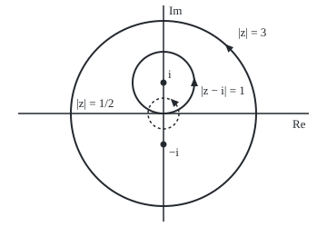

# The residue theorem: a loop integral is 2 pi i times the sum of the residues inside

[Syllabus](../../../SYLLABUS.md) → [Complex analysis](../README.md) → [Laurent Series, Singularities and Residues](../README.md#s05) → The residue theorem

---

## General Overview

Take f(z) = 1/(z^2 + 1). It is finite everywhere in the plane except at i and −i, where z^2 + 1 is zero. Think of those two points as toll booths on a free road.

Walk once anticlockwise round the circle of radius 1 centred at i, adding f(z) times each small step dz. That sum is the loop integral ([Deforming a loop](../03-Contour%20Integrals%20and%20Cauchy%27s%20Theorem/04-deforming-contours-and-winding-numbers.md)). At 64 points it comes to 3.141593: π to six decimals. Round the circle of radius 3 centred at 0, enclosing both booths, the total is 0. Round radius 1/2, enclosing neither, it is 0 again.

Each booth inside charges a fixed toll; booths outside charge nothing. From here on the booths are **poles**: points where a function blows up like one over a power of the distance. The toll at a pole is 2πi times a single number, the pole's **residue** ([Residues](04-residues.md)). The pole at i has residue −i/2, so its toll is 2πi × (−i/2) = π. The pole at −i has residue i/2 and toll −π. Round both, the tolls cancel.

**A loop integral of a function that is smooth except at a few isolated points depends only on which of those points the loop encloses: it equals 2πi times the sum of their residues.**

**What kind of fact this is:** a theorem, proved on this card in Why it works, with the full argument in a folded Detailed proof.

### The picture: three loops and two tolls

<p align="center"></p>

To scale: 34 units per 1, with 0 at (180, 125), i at (180, 91) and −i at (180, 159). Radii 34, 102 and 17 draw |z − i| = 1, |z| = 3 and the dashed |z| = 1/2; triangles show the direction. The code's fourth loop, |z + i| = 1, mirrors the first below the real axis.

---

## The formula

Reminder: a loop is written $\gamma$ (gamma), and the integral round it with a ringed integral sign. The residue at a point a, $\operatorname{Res}(f, a)$, is the coefficient of 1/(z − a) in the Laurent series of f round a ([Laurent series](01-laurent-series.md)).

$$\oint_\gamma f(z)\,dz = 2\pi i \sum_{k=1}^{m} \operatorname{Res}(f, a_k)$$

**Read it aloud:** the integral of f once anticlockwise round the loop equals two pi i times the sum of the residues at the singular points inside it.

For a loop that winds more than once, or clockwise, each residue is weighted by its winding number:

$$\oint_\gamma f(z)\,dz = 2\pi i \sum_{k=1}^{m} n(\gamma, a_k)\,\operatorname{Res}(f, a_k)$$

**Read it aloud:** each pole pays its toll once per anticlockwise turn round it.

| Symbol | Plain meaning | In our example | Push it up and the answer… |
| --- | --- | --- | --- |
| $f$, $z$ | the function, and its input point | 1/(z^2 + 1) | — |
| $\gamma$ | a closed loop, run anticlockwise | \|z − i\| = 1 | may catch more poles |
| $a$, $a_k$, $m$ | an isolated singular point; the k-th inside; their count | i; m = 1 | one more toll |
| $\operatorname{Res}(f, a)$ | the residue | −i/2 at i, i/2 at −i | a bigger toll |
| $c_n$ | Laurent coefficient of (z − a)^n; at n = −1, the residue | −i/2 at n = −1 | — |
| $\rho$, $\theta$ | small-circle radius; angle round it | 0.01; 0 to 2π | nothing changes |
| $n(\gamma, a)$ | winding number: net anticlockwise turns round a | 1; 2 run twice | the toll repeats |
| $i$, $\pi$ | i^2 = −1, a quarter turn; the half-turn angle | 2πi ≈ 6.283185i | — |

### When it holds

- **f is holomorphic (has a complex derivative) on and inside the loop, except at finitely many isolated points.** Drop this and the count means nothing: z-bar, the conjugate x − iy of z = x + iy, has no poles, yet its integral round |z| = 1 is 2πi.
- **No singular point sits on the loop itself.** The circle |z| = 1 runs through i and −i, where f is infinite; the integral along it does not exist.
- **Winding numbers count.** A simple anticlockwise loop winds once round each point inside, zero times round each outside. Run clockwise, |z − i| = 1 gives −π; twice, 2π.

---

## Why it works

### Step 0: away from the poles, a loop can be moved freely

Sliding a loop across a region where f is holomorphic leaves its integral unchanged, as proved on [Deforming a loop](../03-Contour%20Integrals%20and%20Cauchy%27s%20Theorem/04-deforming-contours-and-winding-numbers.md). So the loop can shrink until only tiny circles remain, one round each pole inside.

### Step 1: shrink the loop onto small circles

Pull |z − i| = 1 in towards i. At radius 0.01 the 64-point sum still gives 3.141593. With several poles inside, the loop is pinched into one small circle per pole, joined by thin corridors walked once each way, which cancel. What remains is the sum of the small-circle integrals.

### Step 2: on a small circle, only the 1/(z − a) term survives

Near a pole a, f is its Laurent series: terms $c_n$ times (z − a)^n, for n over all whole numbers. Walk a circle of radius $\rho$ round a: z = a + ρe^(iθ), so dz = iρe^(iθ) dθ as the angle $\theta$ runs from 0 to 2π. One term then gives

(z − a)^n dz = i ρ^(n+1) e^(i(n+1)θ) dθ.

For n other than −1, e^(i(n+1)θ) turns a whole number of times round, and the arrows cancel to 0. For n = −1 the factor is e^0 = 1, and the integral is i × 2π = 2πi, whatever the radius. So the circle keeps exactly 2πi times $c_n$ at n = −1, which is the residue.

For f = 1/((z − i)(z + i)) near i, the factor 1/(z + i) is close to 1/(2i), so the residue is 1/(2i) = −i/2.

### Step 3: add the tolls

Each small circle pays 2πi times its residue, and the loop pays their sum. For |z − i| = 1 it is 2πi × (−i/2) = −πi^2 = π.

<details>
<summary>Detailed proof</summary>

Let f be holomorphic on an open set containing the loop $\gamma$ and its inside, except at points $a_1, \dots, a_m$ inside, none on $\gamma$. Choose $\rho > 0$ so small that the closed discs of radius $\rho$ round each $a_k$ are disjoint and lie inside $\gamma$.

**Deformation.** Join $\gamma$ to each small circle by a corridor. The result is one loop: $\gamma$ anticlockwise, each small circle clockwise, each corridor twice in opposite directions, with f holomorphic on and inside it. By [Cauchy's theorem](../03-Contour%20Integrals%20and%20Cauchy%27s%20Theorem/03-cauchys-theorem.md), a holomorphic function integrates to 0 round a loop with no hole inside, so this integral is 0. The corridors cancel, so the integral round $\gamma$ is the sum of the anticlockwise small-circle integrals.

**Termwise integration.** For some radius $R > \rho$ reaching no other singular point, on the punctured disc $0 < |z - a_k| < R$, f equals its Laurent series $\sum_n c_n (z - a_k)^n$. The series converges uniformly on the circle $|z - a_k| = \rho$: for each $\varepsilon > 0$ there is an N with the partial sums over $|n| \le N$ within $\varepsilon$ of f at every point of the circle.

So the integral of f round the circle is the limit of the integrals of the partial sums, each within $2\pi\rho\,\varepsilon$ of it. Each partial sum integrates term by term, and Step 2 gives $2\pi i\, c_{-1}$ for every $N \ge 1$. Hence the small circle gives $2\pi i \operatorname{Res}(f, a_k)$.

**Winding numbers.** For a general loop lying in a disc where f is holomorphic except at the $a_k$, subtract from f the negative-power terms at each pole. The remainder has no singular points left and integrates to 0. Powers below −1 have antiderivatives and integrate to 0. Each $c_{-1}/(z - a_k)$ gives $2\pi i\, n(\gamma, a_k)\, c_{-1}$ by the definition of the winding number.

</details>

A second road, for rational functions: partial fractions ([Rational functions](03-rational-functions-and-partial-fractions.md)). Here 1/(z^2 + 1) = (1/(2i)) × (1/(z − i) − 1/(z + i)), and each 1/(z − a) round a loop gives 2πi times the winding number round a.

---

## Worked numbers, by hand

| Step | Arithmetic | Value |
| --- | --- | --- |
| Find the poles | z^2 + 1 = (z − i)(z + i) = 0 | i and −i |
| Residue at i | 1/(z + i) at z = i is 1/(2i) = −i/2, since i × (−i) = 1 | −i/2 |
| Residue at −i | 1/(z − i) at z = −i is 1/(−2i) | i/2 |
| \|z − i\| = 1 | −i at distance 2: only i inside | 2πi × (−i/2) = **π = 3.141593** |
| \|z + i\| = 1 | only −i inside | 2πi × (i/2) = −π = −3.141593 |
| \|z\| = 3 | both at distance 1, inside | 2πi × (−i/2 + i/2) = **0** |
| \|z\| = 1/2 | both at distance 1, outside | **0** |

Any loop avoiding the poles pays π times its winding number round i, minus π times its winding number round −i. Shape and size matter only through those two counts.

### What breaks if you drop a piece

| Mistake | Comes out at | What went wrong |
| --- | --- | --- |
| \|z − i\| = 1 run clockwise | −3.141593 | winding number −1 |
| Residue at i taken as 1 | 6.283185i | the factor 1/(z + i) dropped |
| Both residues summed for \|z − i\| = 1 | 0, not π | the pole at −i is outside |
| z-bar round \|z\| = 1, as if the theorem applied | 6.283185i, not 0 | z-bar is not holomorphic |

The code prints all four.

---

## Code, from first principles, and it actually runs

Two roads. Road one takes each residue by its own limit, (z − a)f(z) with the factor cancelled and z set to a, times 2πi. Road two ignores residues: it adds f(z) dz at 64 evenly spaced points round each circle, a trapezoid sum. The error of that sum on |z − i| = 1 falls from 1.2e-2 at 8 points to 4.8e-5 at 16 and 7.3e-10 at 32. The asserts check the four circles, the shrunk circle, the double turn and the z-bar break.

### Python

```python
# The residue theorem -- the check behind the card.  f(z) = 1/(z^2 + 1) has
# poles at i and -i.  Road one: each residue by its own limit, times 2 pi i.
# Road two: a trapezoid sum of f(z) dz round each circle, nothing borrowed.
import math
POLES = [1j, -1j]

def f(z):
    return 1 / (z * z + 1)

def loop(g, c, r, n, turns=1):          # trapezoid sum of g(z) dz round |z - c| = r
    total, step = 0, 2 * math.pi / n * (1 if turns > 0 else -1)
    for k in range(n * abs(turns)):
        w = complex(math.cos(k * step), math.sin(k * step))
        total += g(c + r * w) * 1j * r * w * step
    return total

def res(a):                             # (z - a) f(z) = 1/(z - b), b the other pole; let z -> a
    b = [p for p in POLES if p != a][0]
    return 1 / (a - b)

def show(z):
    re, im = round(z.real, 6) + 0.0, round(z.imag, 6) + 0.0
    return f"{re:.6f} {'-' if im < 0 else '+'} {abs(im):.6f}i"

def sci(x):
    e = math.floor(math.log10(x))
    return f"{x / 10 ** e:.1f}e{e}"

TWO_PI_I = 2j * math.pi
print(f"residue at i, by the limit: {show(res(1j))}; at -i: {show(res(-1j))}")
circles = [("|z - i| = 1", 1j, 1), ("|z + i| = 1", -1j, 1), ("|z| = 3", 0, 3), ("|z| = 1/2", 0, 0.5)]
gaps = []
for name, c, r in circles:
    inside = [a for a in POLES if abs(a - c) < r]
    theorem = TWO_PI_I * sum(res(a) for a in inside)
    direct = loop(f, c, r, 64)
    gaps.append(abs(direct - theorem))
    tag = ", ".join("i" if a == 1j else "-i" for a in inside) or "none"
    print(f"{name}: encloses {tag}; 2 pi i x residues = {show(theorem)}; trapezoid, 64 points = {show(direct)}")
errs = [abs(loop(f, 1j, 1, n) - math.pi) for n in (8, 16, 32)]
print(f"|z - i| = 1, trapezoid error at 8, 16, 32 points: {', '.join(sci(e) for e in errs)}")
tiny, big = loop(f, 1j, 0.01, 64), loop(f, 1j, 1, 64)
print(f"shrunk to |z - i| = 0.01: {show(tiny)}")
twice = loop(f, 1j, 1, 64, turns=2)
print(f"twice round |z - i| = 1: {show(twice)}")
print(f"mistake, |z - i| = 1 run clockwise: {show(loop(f, 1j, 1, 64, turns=-1))}")
print(f"mistake, residue at i taken as 1: 2 pi i x 1 = {show(TWO_PI_I)}")
print(f"mistake, |z - i| = 1 with the outside pole counted too: {show(TWO_PI_I * (res(1j) + res(-1j)))}")
conj = loop(lambda z: z.conjugate(), 0, 1, 64)
print(f"break, z-bar round |z| = 1 (no poles, not holomorphic): {show(conj)}, not 0")
s, cx, cy = 34, 180, 125
print(f"figure, {s} units per 1, 0 at ({cx}, {cy}); i at ({cx}, {cy - s}), -i at ({cx}, {cy + s}); "
      f"radii {s}, {3 * s}, {s // 2}")
assert max(gaps) < 1e-9                                  # two roads agree on all four circles
assert abs(tiny - big) < 1e-9 and errs[2] < errs[1] < errs[0]  # shrinking the loop changes nothing
assert abs(twice - 2 * TWO_PI_I * res(1j)) < 1e-9        # winding twice counts the residue twice
assert abs(conj - TWO_PI_I) < 1e-9                       # z-bar dz = i d(theta) round the unit circle
print("ALL CHECKS PASS")
```

**Ran 2026-09-28 on macOS, Python 3.14.6, standard library only. All checks passed. Output, pasted from the run:**

```
residue at i, by the limit: 0.000000 - 0.500000i; at -i: 0.000000 + 0.500000i
|z - i| = 1: encloses i; 2 pi i x residues = 3.141593 + 0.000000i; trapezoid, 64 points = 3.141593 + 0.000000i
|z + i| = 1: encloses -i; 2 pi i x residues = -3.141593 + 0.000000i; trapezoid, 64 points = -3.141593 + 0.000000i
|z| = 3: encloses i, -i; 2 pi i x residues = 0.000000 + 0.000000i; trapezoid, 64 points = 0.000000 + 0.000000i
|z| = 1/2: encloses none; 2 pi i x residues = 0.000000 + 0.000000i; trapezoid, 64 points = 0.000000 + 0.000000i
|z - i| = 1, trapezoid error at 8, 16, 32 points: 1.2e-2, 4.8e-5, 7.3e-10
shrunk to |z - i| = 0.01: 3.141593 + 0.000000i
twice round |z - i| = 1: 6.283185 + 0.000000i
mistake, |z - i| = 1 run clockwise: -3.141593 + 0.000000i
mistake, residue at i taken as 1: 2 pi i x 1 = 0.000000 + 6.283185i
mistake, |z - i| = 1 with the outside pole counted too: 0.000000 + 0.000000i
break, z-bar round |z| = 1 (no poles, not holomorphic): 0.000000 + 6.283185i, not 0
figure, 34 units per 1, 0 at (180, 125); i at (180, 91), -i at (180, 159); radii 34, 102, 17
ALL CHECKS PASS
```

### Rust

Same numbers, same labels, built with `rustc --edition 2021 -O`. Complex arithmetic is a small struct written out at the top.

```rust
// The residue theorem -- the same check as the Python, in Rust.  No crates.
// f(z) = 1/(z^2 + 1) has poles at i and -i.  Road one: each residue by its own
// limit, times 2 pi i.  Road two: a trapezoid sum of f(z) dz round each circle.
use std::f64::consts::PI;
use std::ops::{Add, Div, Mul, Sub};
#[derive(Clone, Copy, PartialEq)]
struct C { re: f64, im: f64 }
impl Add for C { type Output = C; fn add(self, o: C) -> C { C { re: self.re + o.re, im: self.im + o.im } } }
impl Sub for C { type Output = C; fn sub(self, o: C) -> C { C { re: self.re - o.re, im: self.im - o.im } } }
impl Mul for C { type Output = C; fn mul(self, o: C) -> C {
    C { re: self.re * o.re - self.im * o.im, im: self.re * o.im + self.im * o.re } } }
impl Div for C { type Output = C; fn div(self, o: C) -> C {
    let d = o.re * o.re + o.im * o.im;
    C { re: (self.re * o.re + self.im * o.im) / d, im: (self.im * o.re - self.re * o.im) / d } } }
fn c(re: f64, im: f64) -> C { C { re, im } }
fn abs(z: C) -> f64 { (z.re * z.re + z.im * z.im).sqrt() }
const I: C = C { re: 0.0, im: 1.0 };
const POLES: [C; 2] = [C { re: 0.0, im: 1.0 }, C { re: 0.0, im: -1.0 }];

fn f(z: C) -> C { c(1.0, 0.0) / (z * z + c(1.0, 0.0)) }

fn lp(g: &dyn Fn(C) -> C, cen: C, r: f64, n: usize, turns: i32) -> C {  // trapezoid sum of g(z) dz
    let step = 2.0 * PI / n as f64 * if turns > 0 { 1.0 } else { -1.0 };
    let mut total = c(0.0, 0.0);
    for k in 0..n * turns.unsigned_abs() as usize {
        let w = c((k as f64 * step).cos(), (k as f64 * step).sin());
        total = total + g(cen + c(r, 0.0) * w) * I * c(r, 0.0) * w * c(step, 0.0);
    }
    total
}

fn res(a: C) -> C {                    // (z - a) f(z) = 1/(z - b), b the other pole; let z -> a
    let b = if a == POLES[0] { POLES[1] } else { POLES[0] };
    c(1.0, 0.0) / (a - b)
}

fn show(z: C) -> String {
    let (re, im) = ((z.re * 1e6).round() / 1e6 + 0.0, (z.im * 1e6).round() / 1e6 + 0.0);
    format!("{:.6} {} {:.6}i", re, if im < 0.0 { "-" } else { "+" }, im.abs())
}

fn sci(x: f64) -> String { let e = x.log10().floor(); format!("{:.1}e{}", x / 10f64.powf(e), e as i32) }

fn main() {
    let two_pi_i = c(0.0, 2.0 * PI);
    println!("residue at i, by the limit: {}; at -i: {}", show(res(POLES[0])), show(res(POLES[1])));
    let circles = [("|z - i| = 1", POLES[0], 1.0), ("|z + i| = 1", POLES[1], 1.0),
                   ("|z| = 3", c(0.0, 0.0), 3.0), ("|z| = 1/2", c(0.0, 0.0), 0.5)];
    let mut gap: f64 = 0.0;
    for (name, cen, r) in circles {
        let inside: Vec<C> = POLES.iter().copied().filter(|&a| abs(a - cen) < r).collect();
        let theorem = inside.iter().fold(c(0.0, 0.0), |s, &a| s + two_pi_i * res(a));
        let direct = lp(&f, cen, r, 64, 1);
        gap = gap.max(abs(direct - theorem));
        let tags: Vec<&str> = inside.iter().map(|&a| if a == POLES[0] { "i" } else { "-i" }).collect();
        let tag = if tags.is_empty() { "none".to_string() } else { tags.join(", ") };
        println!("{}: encloses {}; 2 pi i x residues = {}; trapezoid, 64 points = {}", name, tag, show(theorem), show(direct));
    }
    let errs: Vec<f64> = [8, 16, 32].iter().map(|&n| abs(lp(&f, I, 1.0, n, 1) - c(PI, 0.0))).collect();
    println!("|z - i| = 1, trapezoid error at 8, 16, 32 points: {}", errs.iter().map(|&e| sci(e)).collect::<Vec<_>>().join(", "));
    let (tiny, big) = (lp(&f, I, 0.01, 64, 1), lp(&f, I, 1.0, 64, 1));
    println!("shrunk to |z - i| = 0.01: {}", show(tiny));
    let twice = lp(&f, I, 1.0, 64, 2);
    println!("twice round |z - i| = 1: {}", show(twice));
    println!("mistake, |z - i| = 1 run clockwise: {}", show(lp(&f, I, 1.0, 64, -1)));
    println!("mistake, residue at i taken as 1: 2 pi i x 1 = {}", show(two_pi_i));
    println!("mistake, |z - i| = 1 with the outside pole counted too: {}", show(two_pi_i * (res(POLES[0]) + res(POLES[1]))));
    let conj = lp(&|z: C| c(z.re, -z.im), c(0.0, 0.0), 1.0, 64, 1);
    println!("break, z-bar round |z| = 1 (no poles, not holomorphic): {}, not 0", show(conj));
    let (s, cx, cy) = (34, 180, 125);
    println!("figure, {} units per 1, 0 at ({}, {}); i at ({}, {}), -i at ({}, {}); radii {}, {}, {}",
             s, cx, cy, cx, cy - s, cx, cy + s, s, 3 * s, s / 2);
    assert!(gap < 1e-9);                                          // two roads agree on all four circles
    assert!(abs(tiny - big) < 1e-9 && errs[2] < errs[1] && errs[1] < errs[0]); // shrinking changes nothing
    assert!(abs(twice - c(2.0, 0.0) * two_pi_i * res(POLES[0])) < 1e-9); // winding twice counts it twice
    assert!(abs(conj - two_pi_i) < 1e-9);                         // z-bar dz = i d(theta) round |z| = 1
    println!("ALL CHECKS PASS");
}
```

**Ran 2026-09-28 on macOS, rustc 1.98.1, no crates. All checks passed. Output, pasted from the run:**

```
residue at i, by the limit: 0.000000 - 0.500000i; at -i: 0.000000 + 0.500000i
|z - i| = 1: encloses i; 2 pi i x residues = 3.141593 + 0.000000i; trapezoid, 64 points = 3.141593 + 0.000000i
|z + i| = 1: encloses -i; 2 pi i x residues = -3.141593 + 0.000000i; trapezoid, 64 points = -3.141593 + 0.000000i
|z| = 3: encloses i, -i; 2 pi i x residues = 0.000000 + 0.000000i; trapezoid, 64 points = 0.000000 + 0.000000i
|z| = 1/2: encloses none; 2 pi i x residues = 0.000000 + 0.000000i; trapezoid, 64 points = 0.000000 + 0.000000i
|z - i| = 1, trapezoid error at 8, 16, 32 points: 1.2e-2, 4.8e-5, 7.3e-10
shrunk to |z - i| = 0.01: 3.141593 + 0.000000i
twice round |z - i| = 1: 6.283185 + 0.000000i
mistake, |z - i| = 1 run clockwise: -3.141593 + 0.000000i
mistake, residue at i taken as 1: 2 pi i x 1 = 0.000000 + 6.283185i
mistake, |z - i| = 1 with the outside pole counted too: 0.000000 + 0.000000i
break, z-bar round |z| = 1 (no poles, not holomorphic): 0.000000 + 6.283185i, not 0
figure, 34 units per 1, 0 at (180, 125); i at (180, 91), -i at (180, 159); radii 34, 102, 17
ALL CHECKS PASS
```

The two outputs match line for line.

### Lean

Lean proves the theorem for every circle and for every closed loop inside a disc, and the small-circle step for every radius.

- Take f holomorphic on and inside a circle, except at finitely many points inside it. Its integral once anticlockwise round the circle is 2πi times the sum of their residues.
- Near each such point, f is taken to equal its Laurent series; the residue is the coefficient of 1/(z − a).
- Take f holomorphic on a disc except at finitely many points, and a closed loop of smooth pieces in the disc missing them. The integral round the loop is 2πi times the sum of residues, each weighted by its winding number.
- On a small circle round one point, only the 1/(z − a) term survives. The integral is 2πi times the residue, whatever the radius.
- The hand arithmetic for 1/(z^2 + 1) holds exactly: poles at i and −i, residues −i/2 and i/2, tolls π and −π.
- Round both poles the total is 0; twice round i gives 2π, clockwise gives −π; taking the residue as 1 gives 2πi, not π.

The trapezoid sums, their errors, the shrunk circle and the z-bar break are left to the Python and Rust checks.

<details>
<summary>The Lean proof, 512 lines</summary>

```lean
-- The residue theorem: the integral of a function, holomorphic except at finitely many isolated points, once anticlockwise round a circle that passes through none of them equals 2πi times the sum of the residues (the 1/(z - a) Laurent coefficients) at the points inside, a general loop weights each residue by its winding number, and a small circle round one point keeps only that point's 1/(z - a) term.
import Mathlib.MeasureTheory.Integral.CircleIntegral
import Mathlib.MeasureTheory.Integral.IntervalIntegral.Basic
import Mathlib.Analysis.Calculus.Deriv.Basic
import Mathlib.Analysis.SpecialFunctions.Trigonometric.Basic
import Mathlib.Analysis.Complex.CauchyIntegral
import Mathlib.Analysis.Complex.HasPrimitives
import Mathlib.Analysis.Complex.LocallyUniformLimit
import Mathlib.MeasureTheory.Integral.DivergenceTheorem
import Mathlib.Analysis.Normed.Module.FiniteDimension
import Mathlib.Analysis.Calculus.Deriv.ZPow
import Mathlib.Analysis.Normed.Group.FunctionSeries

namespace TheResidueTheorem

open Complex MeasureTheory Metric Set

/-- The regular part of a Laurent series. -/
noncomputable def Rser (c : ℤ → ℂ) (a z : ℂ) : ℂ := ∑' n : ℕ, c n * (z - a) ^ n

/-- The principal part of a Laurent series. -/
noncomputable def Pser (c : ℤ → ℂ) (a z : ℂ) : ℂ :=
  ∑' k : ℕ, c (-((k : ℤ) + 1)) * (z - a) ^ (-((k : ℤ) + 1))

lemma negSucc_injective : Function.Injective (fun k : ℕ ↦ -((k : ℤ) + 1)) := by
  intro x y hxy
  simp only [neg_inj, add_left_inj, Nat.cast_inj] at hxy
  exact hxy

lemma summable_of_laurent {f : ℂ → ℂ} {a : ℂ} {c : ℤ → ℂ} {r : ℝ}
    (hL : ∀ z : ℂ, 0 < ‖z - a‖ → ‖z - a‖ < r →
      HasSum (fun n : ℤ ↦ c n * (z - a) ^ n) (f z))
    {s : ℝ} (hs : 0 < s) (hsr : s < r) : Summable fun n : ℤ ↦ ‖c n‖ * s ^ n := by
  have h := (hL (a + s) (by simp [abs_of_pos hs, hs])
    (by simpa [abs_of_pos hs] using hsr)).summable
  rw [← summable_norm_iff] at h
  convert h using 2 with n
  simp [norm_zpow, abs_of_pos hs]

lemma summable_neg_part {c : ℤ → ℂ} {s : ℝ} (h : Summable fun n : ℤ ↦ ‖c n‖ * s ^ n) :
    Summable fun k : ℕ ↦ ‖c (-((k : ℤ) + 1))‖ * s ^ (-((k : ℤ) + 1)) :=
  h.comp_injective negSucc_injective

lemma summable_pos_part {c : ℤ → ℂ} {s : ℝ} (h : Summable fun n : ℤ ↦ ‖c n‖ * s ^ n) :
    Summable fun n : ℕ ↦ ‖c n‖ * s ^ n := by
  have := h.comp_injective Nat.cast_injective
  convert this using 2 with n
  simp [Function.comp, zpow_natCast]

lemma norm_neg_term_le {c : ℤ → ℂ} {a w : ℂ} {s : ℝ} (hs : 0 < s) (hw : s ≤ ‖w - a‖) (k : ℕ) :
    ‖c (-((k : ℤ) + 1)) * (w - a) ^ (-((k : ℤ) + 1))‖
      ≤ ‖c (-((k : ℤ) + 1))‖ * s ^ (-((k : ℤ) + 1)) := by
  rw [norm_mul, norm_zpow]
  apply mul_le_mul_of_nonneg_left _ (norm_nonneg _)
  have : (-((k : ℤ) + 1)) = -(((k + 1 : ℕ)) : ℤ) := by push_cast; ring
  rw [this, zpow_neg, zpow_neg, zpow_natCast, zpow_natCast]
  exact inv_anti₀ (pow_pos hs _) (pow_le_pow_left₀ hs.le hw _)

lemma Rser_differentiableAt {c : ℤ → ℂ} {a : ℂ} {r : ℝ}
    (hsum : ∀ s, 0 < s → s < r → Summable fun n : ℤ ↦ ‖c n‖ * s ^ n) {z : ℂ}
    (hz : ‖z - a‖ < r) : DifferentiableAt ℂ (Rser c a) z := by
  have h0 := norm_nonneg (z - a)
  set s := (‖z - a‖ + r) / 2 with hs_def
  have hs0 : 0 < s := by rw [hs_def]; linarith
  have hsr : s < r := by rw [hs_def]; linarith
  have hzs : ‖z - a‖ < s := by rw [hs_def]; linarith
  have hD : DifferentiableOn ℂ (fun w ↦ ∑' n : ℕ, c n * (w - a) ^ n) (ball a s) := by
    refine differentiableOn_tsum_of_summable_norm (summable_pos_part (hsum s hs0 hsr)) ?_
      isOpen_ball ?_
    · intro n; fun_prop
    · intro n w hw
      rw [mem_ball, dist_eq_norm] at hw
      rw [norm_mul, norm_pow]
      exact mul_le_mul_of_nonneg_left (pow_le_pow_left₀ (norm_nonneg _) hw.le n) (norm_nonneg _)
  exact hD.differentiableAt (isOpen_ball.mem_nhds (by rwa [mem_ball, dist_eq_norm]))

lemma Pser_differentiableAt {c : ℤ → ℂ} {a : ℂ} {r : ℝ} (hr : 0 < r)
    (hsum : ∀ s, 0 < s → s < r → Summable fun n : ℤ ↦ ‖c n‖ * s ^ n) {z : ℂ}
    (hz : z ≠ a) : DifferentiableAt ℂ (Pser c a) z := by
  have hz' : 0 < ‖z - a‖ := norm_pos_iff.2 (sub_ne_zero.2 hz)
  set s := min (‖z - a‖ / 2) (r / 2) with hs_def
  have hs0 : 0 < s := lt_min (by linarith) (by linarith)
  have hsr : s < r := (min_le_right _ _).trans_lt (by linarith)
  have hzs : s < ‖z - a‖ := (min_le_left _ _).trans_lt (by linarith)
  have hU : IsOpen {w : ℂ | s < ‖w - a‖} := isOpen_lt continuous_const (by fun_prop)
  have hD : DifferentiableOn ℂ
      (fun w ↦ ∑' k : ℕ, c (-((k : ℤ) + 1)) * (w - a) ^ (-((k : ℤ) + 1)))
      {w : ℂ | s < ‖w - a‖} := by
    refine differentiableOn_tsum_of_summable_norm (summable_neg_part (hsum s hs0 hsr)) ?_ hU ?_
    · intro k w hw
      have hw' : s < ‖w - a‖ := hw
      have : w - a ≠ 0 := by
        intro h; rw [h, norm_zero] at hw'; linarith
      apply DifferentiableAt.differentiableWithinAt
      apply DifferentiableAt.const_mul
      exact (differentiableAt_id.sub_const a).zpow (Or.inl this)
    · intro k w hw; exact norm_neg_term_le hs0 (le_of_lt hw) k
  exact hD.differentiableAt (hU.mem_nhds hzs)

lemma laurent_split {f : ℂ → ℂ} {a : ℂ} {c : ℤ → ℂ} {r : ℝ}
    (hL : ∀ z : ℂ, 0 < ‖z - a‖ → ‖z - a‖ < r →
      HasSum (fun n : ℤ ↦ c n * (z - a) ^ n) (f z))
    {z : ℂ} (h0 : 0 < ‖z - a‖) (h1 : ‖z - a‖ < r) :
    f z = Rser c a z + Pser c a z := by
  have h := hL z h0 h1
  have hs := h.summable
  have h1' : Summable fun n : ℕ ↦ c n * (z - a) ^ (n : ℤ) :=
    hs.comp_injective Nat.cast_injective
  have h2' : Summable fun n : ℕ ↦ c (-((n : ℤ) + 1)) * (z - a) ^ (-((n : ℤ) + 1)) :=
    hs.comp_injective negSucc_injective
  have := tsum_of_nat_of_neg_add_one (f := fun n : ℤ ↦ c n * (z - a) ^ n) h1' h2'
  rw [← h.tsum_eq, this]
  unfold Rser Pser
  simp only [zpow_natCast]

lemma intervalIntegrable_mul_deriv {γ' F : ℝ → ℂ} {T : ℝ} (hT : 0 ≤ T)
    (hγ' : IntervalIntegrable γ' volume 0 T) (hF : ContinuousOn F (Icc 0 T)) :
    IntervalIntegrable (fun t ↦ F t * γ' t) volume 0 T :=
  hγ'.continuousOn_mul (by rwa [uIcc_of_le hT])

lemma loop_integral_primitive {G g : ℂ → ℂ} {U : Set ℂ} (hG : ∀ z ∈ U, HasDerivAt G (g z) z)
    (hgc : ContinuousOn g U)
    {γ γ' : ℝ → ℂ} {T : ℝ} {E : Finset ℝ} (hT : 0 ≤ T) (hγ : ContinuousOn γ (Icc 0 T))
    (hderiv : ∀ t ∈ Ioo 0 T \ (E : Set ℝ), HasDerivAt γ (γ' t) t)
    (hγ' : IntervalIntegrable γ' volume 0 T) (hclosed : γ 0 = γ T)
    (hU : ∀ t ∈ Icc 0 T, γ t ∈ U) :
    ∫ t in (0 : ℝ)..T, g (γ t) * γ' t = 0 := by
  have hGc : ContinuousOn (fun t ↦ G (γ t)) (Icc 0 T) := by
    intro t ht
    exact (hG _ (hU t ht)).continuousAt.comp_continuousWithinAt (hγ t ht)
  have key := integral_eq_of_hasDerivAt_off_countable_of_le (fun t ↦ G (γ t))
    (fun t ↦ g (γ t) * γ' t) hT E.finite_toSet.countable hGc ?_
    (intervalIntegrable_mul_deriv hT hγ' (hgc.comp hγ (fun t ht ↦ hU t ht)))
  · rw [key, hclosed, sub_self]
  · intro t ht
    have ht' : t ∈ Icc 0 T := Ioo_subset_Icc_self ht.1
    exact (hG _ (hU t ht')).comp t (hderiv t ht)

lemma zpow_primitive (d b : ℂ) (m : ℤ) (hm : m ≠ -1) :
    ∀ z ∈ {z : ℂ | z ≠ b}, HasDerivAt (fun z ↦ d * (z - b) ^ (m + 1) / ((m : ℂ) + 1))
      (d * (z - b) ^ m) z := by
  intro z hz
  have hz' : z - b ≠ 0 := sub_ne_zero.2 hz
  have hm' : ((m : ℂ) + 1) ≠ 0 := by
    have : ((m + 1 : ℤ) : ℂ) ≠ 0 := Int.cast_ne_zero.2 (by omega)
    push_cast at this; exact this
  have h1 := ((hasDerivAt_zpow (m + 1) (z - b) (Or.inl hz')).comp z
    ((hasDerivAt_id z).sub_const b)).const_mul d |>.div_const ((m : ℂ) + 1)
  convert h1 using 1
  · rfl
  · rw [show m + 1 - 1 = m by ring]
    push_cast
    field_simp

lemma zpow_continuousOn (d b : ℂ) (m : ℤ) :
    ContinuousOn (fun z ↦ d * (z - b) ^ m) {z : ℂ | z ≠ b} := by
  intro z hz
  exact (continuousAt_const.mul ((continuousAt_id.sub continuousAt_const).zpow₀ m
    (Or.inl (sub_ne_zero.2 hz)))).continuousWithinAt

lemma loop_tsum_zero {γ γ' : ℝ → ℂ} {T : ℝ} {E : Finset ℝ} (hT : 0 ≤ T)
    (hγ : ContinuousOn γ (Icc 0 T))
    (hderiv : ∀ t ∈ Ioo 0 T \ (E : Set ℝ), HasDerivAt γ (γ' t) t)
    (hγ' : IntervalIntegrable γ' volume 0 T) (hclosed : γ 0 = γ T) (b : ℂ)
    (hoff : ∀ t ∈ Icc 0 T, γ t ≠ b)
    (d : ℕ → ℂ) (e : ℕ → ℤ) (he : ∀ k, e k ≠ -1) (u : ℕ → ℝ) (hu : Summable u)
    (hb : ∀ k, ∀ t ∈ Icc 0 T, ‖d k * (γ t - b) ^ e k‖ ≤ u k) :
    ∫ t in (0 : ℝ)..T, (∑' k, d k * (γ t - b) ^ e k) * γ' t = 0 := by
  have hcont : ∀ k, ContinuousOn (fun t ↦ d k * (γ t - b) ^ e k) (Icc 0 T) := fun k ↦
    (zpow_continuousOn (d k) b (e k)).comp hγ (fun t ht ↦ hoff t ht)
  have hint : ∀ k, IntervalIntegrable (fun t ↦ d k * (γ t - b) ^ e k * γ' t) volume 0 T :=
    fun k ↦ intervalIntegrable_mul_deriv hT hγ' (hcont k)
  have hzero : ∀ k, ∫ t in (0 : ℝ)..T, d k * (γ t - b) ^ e k * γ' t = 0 := fun k ↦
    loop_integral_primitive (g := fun z ↦ d k * (z - b) ^ e k) (zpow_primitive (d k) b (e k) (he k))
      (zpow_continuousOn (d k) b (e k)) hT hγ hderiv hγ' hclosed hoff
  have hIcc : ∀ t ∈ uIoc (0 : ℝ) T, t ∈ Icc 0 T := by
    intro t ht; rw [uIoc_of_le hT] at ht; exact Ioc_subset_Icc_self ht
  have hsum := intervalIntegral.hasSum_integral_of_dominated_convergence
    (F := fun k t ↦ d k * (γ t - b) ^ e k * γ' t)
    (f := fun t ↦ (∑' k, d k * (γ t - b) ^ e k) * γ' t)
    (fun k t ↦ u k * ‖γ' t‖) (fun k ↦ (hint k).def'.aestronglyMeasurable) ?_ ?_ ?_ ?_
  · simp only [hzero] at hsum
    exact hsum.unique hasSum_zero
  · refine fun k ↦ Filter.Eventually.of_forall fun t ht ↦ ?_
    rw [norm_mul]
    exact mul_le_mul_of_nonneg_right (hb k t (hIcc t ht)) (norm_nonneg _)
  · exact Filter.Eventually.of_forall fun t _ ↦ hu.mul_right _
  · simp_rw [tsum_mul_right]
    exact hγ'.norm.const_mul _
  · refine Filter.Eventually.of_forall fun t ht ↦ ?_
    exact (Summable.of_norm_bounded hu (fun k ↦ hb k t (hIcc t ht))).hasSum.mul_right _

lemma loop_Pser {γ γ' : ℝ → ℂ} {T : ℝ} {E : Finset ℝ} (hT : 0 ≤ T)
    (hγ : ContinuousOn γ (Icc 0 T))
    (hderiv : ∀ t ∈ Ioo 0 T \ (E : Set ℝ), HasDerivAt γ (γ' t) t)
    (hγ' : IntervalIntegrable γ' volume 0 T) (hclosed : γ 0 = γ T) (b : ℂ)
    (hoff : ∀ t ∈ Icc 0 T, γ t ≠ b) (c : ℤ → ℂ) {r : ℝ} (hr : 0 < r)
    (hsum : ∀ s, 0 < s → s < r → Summable fun n : ℤ ↦ ‖c n‖ * s ^ n) :
    ∫ t in (0 : ℝ)..T, Pser c b (γ t) * γ' t
      = c (-1) * ∫ t in (0 : ℝ)..T, γ' t / (γ t - b) := by
  obtain ⟨t0, ht0, hmin⟩ := isCompact_Icc.exists_isMinOn (nonempty_Icc.2 hT)
    ((hγ.sub continuousOn_const).norm)
  have hδ : 0 < ‖γ t0 - b‖ := norm_pos_iff.2 (sub_ne_zero.2 (hoff t0 ht0))
  set s := min ‖γ t0 - b‖ (r / 2) with hs_def
  have hs0 : 0 < s := lt_min hδ (by linarith)
  have hsr : s < r := (min_le_right _ _).trans_lt (by linarith)
  have hsγ : ∀ t ∈ Icc 0 T, s ≤ ‖γ t - b‖ := fun t ht ↦ (min_le_left _ _).trans (hmin ht)
  have hS := summable_neg_part (hsum s hs0 hsr)
  have hS1 := hS.comp_injective (add_left_injective 1)
  set d : ℕ → ℂ := fun k ↦ c (-(((k + 1 : ℕ) : ℤ) + 1)) with hd_def
  set e : ℕ → ℤ := fun k ↦ -(((k + 1 : ℕ) : ℤ) + 1) with he_def
  have hsplit : ∀ t ∈ Icc 0 T, Pser c b (γ t) * γ' t
      = c (-1) * (γ t - b)⁻¹ * γ' t + (∑' k, d k * (γ t - b) ^ e k) * γ' t := by
    intro t ht
    have hsm : Summable fun k : ℕ ↦ c (-((k : ℤ) + 1)) * (γ t - b) ^ (-((k : ℤ) + 1)) :=
      Summable.of_norm_bounded hS (fun k ↦ norm_neg_term_le hs0 (hsγ t ht) k)
    unfold Pser
    rw [hsm.tsum_eq_zero_add, add_mul]
    congr 1
    simp
  rw [intervalIntegral.integral_congr (fun t ht ↦ hsplit t (by rwa [uIcc_of_le hT] at ht))]
  have hc1 : ContinuousOn (fun t ↦ c (-1) * (γ t - b)⁻¹) (Icc 0 T) := by
    intro t ht
    exact continuousWithinAt_const.mul
      (((hγ t ht).sub continuousWithinAt_const).inv₀ (sub_ne_zero.2 (hoff t ht)))
  have hb : ∀ k, ∀ t ∈ Icc 0 T, ‖d k * (γ t - b) ^ e k‖
      ≤ ‖c (-(((k + 1 : ℕ) : ℤ) + 1))‖ * s ^ (-(((k + 1 : ℕ) : ℤ) + 1)) :=
    fun k t ht ↦ norm_neg_term_le hs0 (hsγ t ht) (k + 1)
  have hc2 : ContinuousOn (fun t ↦ ∑' k, d k * (γ t - b) ^ e k) (Icc 0 T) :=
    continuousOn_tsum (fun k ↦ (zpow_continuousOn (d k) b (e k)).comp hγ (fun t ht ↦ hoff t ht))
      hS1 hb
  rw [intervalIntegral.integral_add (intervalIntegrable_mul_deriv hT hγ' hc1)
    (intervalIntegrable_mul_deriv hT hγ' hc2)]
  rw [loop_tsum_zero hT hγ hderiv hγ' hclosed b hoff d e ?_ _ hS1 hb, add_zero]
  · rw [← intervalIntegral.integral_const_mul]
    congr 1; funext t; ring
  · intro k; simp only [he_def]; omega

lemma decomp (f : ℂ → ℂ) (S : Finset ℂ) (coeff : ℂ → ℤ → ℂ)
    (hlaurent : ∀ a ∈ S, ∃ r > 0, ∀ z : ℂ, 0 < ‖z - a‖ → ‖z - a‖ < r →
      HasSum (fun n : ℤ ↦ coeff a n * (z - a) ^ n) (f z)) :
    ∃ g : ℂ → ℂ, (∀ z, z ∉ S → f z = g z + ∑ b ∈ S, Pser (coeff b) b z) ∧
      (∀ z, (z ∈ S ∨ DifferentiableAt ℂ f z) → DifferentiableAt ℂ g z) := by
  classical
  choose! r hr hL using hlaurent
  have hsum : ∀ b ∈ S, ∀ s, 0 < s → s < r b → Summable fun n : ℤ ↦ ‖coeff b n‖ * s ^ n :=
    fun b hb s hs hsr ↦ summable_of_laurent (hL b hb) hs hsr
  have hPd : ∀ b ∈ S, ∀ z, z ≠ b → DifferentiableAt ℂ (Pser (coeff b) b) z :=
    fun b hb z hz ↦ Pser_differentiableAt (hr b hb) (hsum b hb) hz
  refine ⟨fun z ↦ if z ∈ S then Rser (coeff z) z z - ∑ b ∈ S.erase z, Pser (coeff b) b z
    else f z - ∑ b ∈ S, Pser (coeff b) b z, ?_, ?_⟩
  · intro z hz; simp [hz]
  · intro z hz
    by_cases hzS : z ∈ S
    · have hd : DifferentiableAt ℂ
          (fun w ↦ Rser (coeff z) z w - ∑ b ∈ S.erase z, Pser (coeff b) b w) z := by
        apply DifferentiableAt.sub
        · exact Rser_differentiableAt (hsum z hzS) (by simpa using hr z hzS)
        · exact DifferentiableAt.fun_sum fun b hb ↦
            hPd b (Finset.mem_of_mem_erase hb) z (Finset.ne_of_mem_erase hb).symm
      apply hd.congr_of_eventuallyEq
      have hopen : IsOpen (ball z (r z) ∩ ((S.erase z : Set ℂ))ᶜ) :=
        isOpen_ball.inter (S.erase z).finite_toSet.isClosed.isOpen_compl
      filter_upwards [hopen.mem_nhds ⟨mem_ball_self (hr z hzS), by simp⟩] with w hw
      by_cases hwz : w = z
      · subst hwz; simp [hzS]
      · have hwS : w ∉ S := fun hwS ↦ hw.2 (Finset.mem_erase.2 ⟨hwz, hwS⟩)
        have h0 : 0 < ‖w - z‖ := norm_pos_iff.2 (sub_ne_zero.2 hwz)
        have h1 : ‖w - z‖ < r z := by simpa [dist_eq_norm] using hw.1
        simp only [hwS, ite_false]
        rw [laurent_split (hL z hzS) h0 h1, ← Finset.add_sum_erase S _ hzS]
        ring
    · have hf := hz.resolve_left hzS
      have hd : DifferentiableAt ℂ (fun w ↦ f w - ∑ b ∈ S, Pser (coeff b) b w) z :=
        hf.sub (DifferentiableAt.fun_sum fun b hb ↦ hPd b hb z (fun h ↦ hzS (h ▸ hb)))
      apply hd.congr_of_eventuallyEq
      filter_upwards [S.finite_toSet.isClosed.isOpen_compl.mem_nhds hzS] with w hw
      have hw' : w ∉ S := hw
      simp [hw']

lemma circle_eq_loop (F : ℂ → ℂ) (c : ℂ) (R : ℝ) :
    (∮ z in C(c, R), F z)
      = ∫ θ in (0 : ℝ)..2 * Real.pi, F (circleMap c R θ) * deriv (circleMap c R) θ := by
  unfold circleIntegral
  congr 1; funext θ; rw [smul_eq_mul, mul_comm]

lemma circle_Pser {c b : ℂ} {R : ℝ} (hb : b ∈ ball c R) (d : ℤ → ℂ) {r : ℝ} (hr : 0 < r)
    (hsum : ∀ s, 0 < s → s < r → Summable fun n : ℤ ↦ ‖d n‖ * s ^ n) :
    (∮ z in C(c, R), Pser d b z) = 2 * Real.pi * I * d (-1) := by
  have hR : 0 < R := dist_nonneg.trans_lt hb
  have hoff : ∀ θ, circleMap c R θ ≠ b := by
    intro θ h
    have := circleMap_mem_sphere c hR.le θ
    rw [h, mem_sphere] at this; rw [mem_ball] at hb; linarith
  have hγ' : IntervalIntegrable (deriv (circleMap c R)) volume 0 (2 * Real.pi) := by
    have : deriv (circleMap c R) = fun θ ↦ circleMap 0 R θ * I := funext (deriv_circleMap c R)
    rw [this]; exact ((continuous_circleMap 0 R).mul continuous_const).intervalIntegrable _ _
  have key := loop_Pser (E := ∅) (by positivity) (continuous_circleMap c R).continuousOn
    (fun t _ ↦ by rw [deriv_circleMap]; exact hasDerivAt_circleMap c R t) hγ'
    (by simpa using (periodic_circleMap c R 0).symm) b (fun t _ ↦ hoff t) d hr hsum
  have hinv := circleIntegral.integral_sub_inv_of_mem_ball hb
  rw [circle_eq_loop] at hinv ⊢
  rw [key, mul_comm]
  congr 1
  rw [← hinv]; congr 1; funext θ; rw [div_eq_inv_mul]

lemma circle_sum {c : ℂ} {R : ℝ} (S : Finset ℂ) (F : ℂ → ℂ → ℂ)
    (h : ∀ b ∈ S, CircleIntegrable (F b) c R) :
    (∮ z in C(c, R), ∑ b ∈ S, F b z) = ∑ b ∈ S, ∮ z in C(c, R), F b z := by
  unfold circleIntegral
  simp_rw [Finset.smul_sum]
  exact intervalIntegral.integral_finsetSum fun b hb ↦ (h b hb).out

#print axioms negSucc_injective
#print axioms summable_of_laurent
#print axioms summable_neg_part
#print axioms summable_pos_part
#print axioms norm_neg_term_le
#print axioms Rser_differentiableAt
#print axioms Pser_differentiableAt
#print axioms laurent_split
#print axioms intervalIntegrable_mul_deriv
#print axioms loop_integral_primitive
#print axioms zpow_primitive
#print axioms zpow_continuousOn
#print axioms loop_tsum_zero
#print axioms loop_Pser
#print axioms decomp
#print axioms circle_eq_loop
#print axioms circle_Pser
#print axioms circle_sum

/-- The winding number n(γ, a) of a loop γ(t), 0 ≤ t ≤ T, with velocity γ'(t), round the point a:
the integral of dz/(z − a) once round the loop, divided by 2πi. -/
noncomputable def windingNumber (γ γ' : ℝ → ℂ) (T : ℝ) (a : ℂ) : ℂ :=
  (2 * Real.pi * I)⁻¹ * ∫ t in (0 : ℝ)..T, γ' t / (γ t - a)

/-- The card's main claim. Let the loop be the circle of radius R > 0 round c, run once
anticlockwise. Let f be holomorphic (have a complex derivative) at every point on and inside the
circle except at finitely many points (the finite set S), none of them on the circle itself. Near
each such point a, f equals its Laurent series ∑ coeff a n · (z − a)ⁿ over all whole numbers n on
some punctured disc 0 < |z − a| < r; the residue Res(f, a) is the coefficient of 1/(z − a), that
is coeff a (−1). Then the integral of f round the circle is 2πi times the sum of the residues at
the points inside. -/
theorem circle_integral_eq_two_pi_I_mul_sum_residues
    (f : ℂ → ℂ) (c : ℂ) (R : ℝ) (hR : 0 < R) (S : Finset ℂ)
    (hS : (S : Set ℂ) ⊆ ball c R)
    (hf : ∀ z ∈ closedBall c R \ (S : Set ℂ), DifferentiableAt ℂ f z)
    (coeff : ℂ → ℤ → ℂ)
    (hlaurent : ∀ a ∈ S, ∃ r > 0, ∀ z : ℂ, 0 < ‖z - a‖ → ‖z - a‖ < r →
      HasSum (fun n : ℤ ↦ coeff a n * (z - a) ^ n) (f z)) :
    (∮ z in C(c, R), f z) = 2 * Real.pi * I * ∑ a ∈ S, coeff a (-1) := by
  obtain ⟨g, hfg, hgd⟩ := decomp f S coeff hlaurent
  choose! r hr hL using hlaurent
  have hsum : ∀ b ∈ S, ∀ s, 0 < s → s < r b → Summable fun n : ℤ ↦ ‖coeff b n‖ * s ^ n :=
    fun b hb s hs hsr ↦ summable_of_laurent (hL b hb) hs hsr
  have hsph : ∀ z ∈ sphere c R, z ∉ S := by
    intro z hz hzS
    have h1 := hS hzS
    rw [mem_ball] at h1; rw [mem_sphere] at hz; linarith
  have hgD : ∀ z ∈ closedBall c R, DifferentiableAt ℂ g z := by
    intro z hz
    by_cases hzS : z ∈ S
    · exact hgd z (Or.inl hzS)
    · exact hgd z (Or.inr (hf z ⟨hz, hzS⟩))
  have hPc : ∀ b ∈ S, ContinuousOn (Pser (coeff b) b) (sphere c R) := by
    intro b hb z hz
    exact (Pser_differentiableAt (hr b hb) (hsum b hb)
      (fun h ↦ hsph z hz (by rw [h]; exact hb))).continuousAt.continuousWithinAt
  have hgc : ContinuousOn g (closedBall c R) :=
    fun z hz ↦ (hgD z hz).continuousAt.continuousWithinAt
  have hsumc : ContinuousOn (fun z ↦ ∑ b ∈ S, Pser (coeff b) b z) (sphere c R) :=
    continuousOn_finsetSum S hPc
  rw [circleIntegral.integral_congr (g := fun z ↦ g z + ∑ b ∈ S, Pser (coeff b) b z) hR.le
      (fun z hz ↦ hfg z (hsph z hz)),
    circleIntegral.integral_add ((hgc.mono sphere_subset_closedBall).circleIntegrable hR.le)
      (hsumc.circleIntegrable hR.le),
    circleIntegral_eq_zero_of_differentiable_on_off_countable hR.le countable_empty hgc
      (fun z hz ↦ hgD z (ball_subset_closedBall hz.1)), zero_add,
    circle_sum S _ (fun b hb ↦ (hPc b hb).circleIntegrable hR.le), Finset.mul_sum]
  exact Finset.sum_congr rfl fun b hb ↦ circle_Pser (hS hb) (coeff b) (hr b hb) (hsum b hb)

/-- Winding numbers count. Let f be holomorphic on an open disc except at finitely many points
(the finite set S) inside it, with residue coeff a (−1) at each such point a as above. Let γ(t),
0 ≤ t ≤ T, be a closed loop in the disc made of finitely many smooth pieces (velocity γ' off a
finite set of corners) that passes through none of those points. Then the integral of f round γ is
2πi times the sum of the residues, each weighted by the winding number n(γ, a): each point pays
its toll once per anticlockwise turn round it. -/
theorem loop_integral_eq_two_pi_I_mul_sum_winding_number_mul_residue
    (f : ℂ → ℂ) (c : ℂ) (R : ℝ) (S : Finset ℂ)
    (hS : (S : Set ℂ) ⊆ ball c R)
    (hf : DifferentiableOn ℂ f (ball c R \ (S : Set ℂ)))
    (coeff : ℂ → ℤ → ℂ)
    (hlaurent : ∀ a ∈ S, ∃ r > 0, ∀ z : ℂ, 0 < ‖z - a‖ → ‖z - a‖ < r →
      HasSum (fun n : ℤ ↦ coeff a n * (z - a) ^ n) (f z))
    (γ γ' : ℝ → ℂ) (T : ℝ) (E : Finset ℝ) (hT : 0 ≤ T)
    (hγ : ContinuousOn γ (Icc 0 T))
    (hderiv : ∀ t ∈ Ioo 0 T \ (E : Set ℝ), HasDerivAt γ (γ' t) t)
    (hγ' : IntervalIntegrable γ' volume 0 T)
    (hclosed : γ 0 = γ T)
    (hin : ∀ t ∈ Icc 0 T, γ t ∈ ball c R)
    (hoff : ∀ t ∈ Icc 0 T, γ t ∉ S) :
    ∫ t in (0 : ℝ)..T, f (γ t) * γ' t
      = 2 * Real.pi * I * ∑ a ∈ S, windingNumber γ γ' T a * coeff a (-1) := by
  obtain ⟨g, hfg, hgd⟩ := decomp f S coeff hlaurent
  choose! r hr hL using hlaurent
  have hsum : ∀ b ∈ S, ∀ s, 0 < s → s < r b → Summable fun n : ℤ ↦ ‖coeff b n‖ * s ^ n :=
    fun b hb s hs hsr ↦ summable_of_laurent (hL b hb) hs hsr
  have hgD : ∀ z ∈ ball c R, DifferentiableAt ℂ g z := by
    intro z hz
    by_cases hzS : z ∈ S
    · exact hgd z (Or.inl hzS)
    · exact hgd z (Or.inr (hf.differentiableAt
        ((isOpen_ball.sdiff S.finite_toSet.isClosed).mem_nhds ⟨hz, hzS⟩)))
  obtain ⟨G, hG⟩ := DifferentiableOn.isExactOn_ball
    (fun z hz ↦ (hgD z hz).differentiableWithinAt : DifferentiableOn ℂ g (ball c R))
  have hgc : ContinuousOn g (ball c R) := fun z hz ↦ (hgD z hz).continuousAt.continuousWithinAt
  have hPc : ∀ b ∈ S, ContinuousOn (fun t ↦ Pser (coeff b) b (γ t)) (Icc 0 T) := by
    intro b hb t ht
    exact (Pser_differentiableAt (hr b hb) (hsum b hb)
      (fun h ↦ hoff t ht (by rw [h]; exact hb))).continuousAt.comp_continuousWithinAt (hγ t ht)
  have hcongr : EqOn (fun t ↦ f (γ t) * γ' t)
      (fun t ↦ g (γ t) * γ' t + ∑ b ∈ S, Pser (coeff b) b (γ t) * γ' t) (uIcc 0 T) := by
    intro t ht
    rw [uIcc_of_le hT] at ht
    simp only
    rw [hfg _ (hoff t ht), add_mul, Finset.sum_mul]
  have hPsum : IntervalIntegrable (fun t ↦ ∑ b ∈ S, Pser (coeff b) b (γ t) * γ' t) volume 0 T := by
    convert IntervalIntegrable.sum S (f := fun b t ↦ Pser (coeff b) b (γ t) * γ' t)
      (fun b hb ↦ intervalIntegrable_mul_deriv hT hγ' (hPc b hb)) using 1
    funext t; simp [Finset.sum_apply]
  rw [intervalIntegral.integral_congr hcongr,
    intervalIntegral.integral_add (f := fun t ↦ g (γ t) * γ' t)
      (g := fun t ↦ ∑ b ∈ S, Pser (coeff b) b (γ t) * γ' t)
      (intervalIntegrable_mul_deriv hT hγ' (hgc.comp hγ (fun t ht ↦ hin t ht))) hPsum,
    intervalIntegral.integral_finsetSum
      (fun b hb ↦ intervalIntegrable_mul_deriv hT hγ' (hPc b hb)),
    loop_integral_primitive hG hgc hT hγ hderiv hγ' hclosed hin, zero_add, Finset.mul_sum]
  refine Finset.sum_congr rfl fun b hb ↦ ?_
  rw [loop_Pser hT hγ hderiv hγ' hclosed b (fun t ht h ↦ hoff t ht (by rw [h]; exact hb)) (coeff b) (hr b hb)
    (hsum b hb), windingNumber]
  have h2 := two_pi_I_ne_zero
  field_simp

/-- On a small circle only the 1/(z − a) term survives. If f equals its Laurent series
∑ c n · (z − a)ⁿ on the punctured disc 0 < |z − a| < r, then for every radius ρ with 0 < ρ < r the
integral of f once anticlockwise round the circle of radius ρ round a is 2πi times c (−1), the
residue, whatever ρ is. -/
theorem small_circle_integral_eq_two_pi_I_mul_residue
    (f : ℂ → ℂ) (a : ℂ) (c : ℤ → ℂ) (r : ℝ)
    (hlaurent : ∀ z : ℂ, 0 < ‖z - a‖ → ‖z - a‖ < r →
      HasSum (fun n : ℤ ↦ c n * (z - a) ^ n) (f z))
    (ρ : ℝ) (hρ : 0 < ρ) (hρr : ρ < r) :
    (∮ z in C(a, ρ), f z) = 2 * Real.pi * I * c (-1) := by
  have hr : 0 < r := hρ.trans hρr
  have hsum : ∀ s, 0 < s → s < r → Summable fun n : ℤ ↦ ‖c n‖ * s ^ n :=
    fun s hs hsr ↦ summable_of_laurent hlaurent hs hsr
  have h := circle_integral_eq_two_pi_I_mul_sum_residues f a ρ hρ {a}
    (by intro z hz; simp only [Finset.coe_singleton, mem_singleton_iff] at hz; subst hz
        exact mem_ball_self hρ)
    ?_ (fun _ ↦ c)
    (by intro b hb; rw [Finset.mem_singleton] at hb; subst hb; exact ⟨r, hr, hlaurent⟩)
  · simpa using h
  · intro z hz
    have hza : z ≠ a := by simpa using hz.2
    have hopen : IsOpen {w : ℂ | 0 < ‖w - a‖ ∧ ‖w - a‖ < r} := by
      have hcont : Continuous fun w : ℂ ↦ ‖w - a‖ := by fun_prop
      exact (isOpen_lt continuous_const hcont).inter (isOpen_lt hcont continuous_const)
    have hz' : z ∈ {w : ℂ | 0 < ‖w - a‖ ∧ ‖w - a‖ < r} :=
      ⟨norm_pos_iff.2 (sub_ne_zero.2 hza),
        lt_of_le_of_lt (by simpa [dist_eq_norm] using hz.1) hρr⟩
    have hd : DifferentiableAt ℂ (fun w ↦ Rser c a w + Pser c a w) z :=
      (Rser_differentiableAt hsum hz'.2).add (Pser_differentiableAt hr hsum hza)
    apply hd.congr_of_eventuallyEq
    filter_upwards [hopen.mem_nhds hz'] with w hw
    exact laurent_split hlaurent hw.1 hw.2

/-! The card's worked numbers for f(z) = 1/(z^2 + 1), checked exactly. -/

-- the poles: z^2 + 1 = (z − i)(z + i), zero at i and −i
example : I ^ 2 + 1 = 0 ∧ (-I) ^ 2 + 1 = 0 := by
  constructor <;> simp [I_sq]
-- near i, (z − i) f(z) = 1/(z + i), off the poles
example (z : ℂ) (h1 : z - I ≠ 0) (h2 : z + I ≠ 0) :
    (z - I) * (1 / (z ^ 2 + 1)) = 1 / (z + I) := by
  have h : z ^ 2 + 1 = (z - I) * (z + I) := by ring_nf; simp [I_sq]; ring
  rw [h]
  field_simp
-- the residues: 1/(2i) = −i/2 at i, 1/(−2i) = i/2 at −i
example : (1 : ℂ) / (I + I) = -I / 2 ∧ (1 : ℂ) / (-I - I) = I / 2 := by
  constructor <;> field_simp <;> ring_nf <;> simp [I_sq]
-- the tolls: |z − i| = 1 pays 2πi(−i/2) = π, |z + i| = 1 pays 2πi(i/2) = −π
example : 2 * Real.pi * I * (-I / 2) = Real.pi ∧ 2 * Real.pi * I * (I / 2) = -Real.pi := by
  constructor <;> ring_nf <;> simp [I_sq]
-- |z| = 3 encloses both: 2πi(−i/2 + i/2) = 0; |z| = 1/2 encloses neither: the empty sum, 0
example : 2 * Real.pi * I * (-I / 2 + I / 2) = 0 := by ring
-- twice round |z − i| = 1 gives 2π; clockwise gives −π
example : 2 * Real.pi * I * (2 * (-I / 2)) = 2 * Real.pi ∧
    2 * Real.pi * I * ((-1) * (-I / 2)) = -Real.pi := by
  constructor <;> ring_nf <;> simp [I_sq]
-- mistake: residue at i taken as 1 gives 2πi, not π (summing both residues gives the 0 above, not π)
example : 2 * Real.pi * I * 1 ≠ Real.pi := by
  intro h
  have := congrArg Complex.re h
  simp at this
  exact Real.pi_ne_zero this.symm

#print axioms circle_integral_eq_two_pi_I_mul_sum_residues
#print axioms loop_integral_eq_two_pi_I_mul_sum_winding_number_mul_residue
#print axioms small_circle_integral_eq_two_pi_I_mul_residue

end TheResidueTheorem
```

</details>

**Checked 2026-11-11 on macOS, Lean 4.36.0-rc2, Mathlib v4.36.0-rc2. Every proof is complete and uses only Lean's standard axioms. Output, pasted from the run:**

```
'TheResidueTheorem.negSucc_injective' depends on axioms: [propext, Classical.choice, Quot.sound]
'TheResidueTheorem.summable_of_laurent' depends on axioms: [propext, Classical.choice, Quot.sound]
'TheResidueTheorem.summable_neg_part' depends on axioms: [propext, Classical.choice, Quot.sound]
'TheResidueTheorem.summable_pos_part' depends on axioms: [propext, Classical.choice, Quot.sound]
'TheResidueTheorem.norm_neg_term_le' depends on axioms: [propext, Classical.choice, Quot.sound]
'TheResidueTheorem.Rser_differentiableAt' depends on axioms: [propext, Classical.choice, Quot.sound]
'TheResidueTheorem.Pser_differentiableAt' depends on axioms: [propext, Classical.choice, Quot.sound]
'TheResidueTheorem.laurent_split' depends on axioms: [propext, Classical.choice, Quot.sound]
'TheResidueTheorem.intervalIntegrable_mul_deriv' depends on axioms: [propext, Classical.choice, Quot.sound]
'TheResidueTheorem.loop_integral_primitive' depends on axioms: [propext, Classical.choice, Quot.sound]
'TheResidueTheorem.zpow_primitive' depends on axioms: [propext, Classical.choice, Quot.sound]
'TheResidueTheorem.zpow_continuousOn' depends on axioms: [propext, Classical.choice, Quot.sound]
'TheResidueTheorem.loop_tsum_zero' depends on axioms: [propext, Classical.choice, Quot.sound]
'TheResidueTheorem.loop_Pser' depends on axioms: [propext, Classical.choice, Quot.sound]
'TheResidueTheorem.decomp' depends on axioms: [propext, Classical.choice, Quot.sound]
'TheResidueTheorem.circle_eq_loop' depends on axioms: [propext, Classical.choice, Quot.sound]
'TheResidueTheorem.circle_Pser' depends on axioms: [propext, Classical.choice, Quot.sound]
'TheResidueTheorem.circle_sum' depends on axioms: [propext, Classical.choice, Quot.sound]
'TheResidueTheorem.circle_integral_eq_two_pi_I_mul_sum_residues' depends on axioms: [propext, Classical.choice, Quot.sound]
'TheResidueTheorem.loop_integral_eq_two_pi_I_mul_sum_winding_number_mul_residue' depends on axioms: [propext, Classical.choice, Quot.sound]
'TheResidueTheorem.small_circle_integral_eq_two_pi_I_mul_residue' depends on axioms: [propext, Classical.choice, Quot.sound]
```

> [!TIP]
> **Try changing**
> Guess first, then run it.
> - **Fewer points.** Change `loop(f, c, r, 64)` to `loop(f, c, r, 8)` inside the circle loop. The trapezoid misses π in the second decimal, and the first assert stops the run.
> - **Put a pole on the loop.** Give the first circle radius 2. One of its 64 points lands on −i, the sum explodes, and the first assert stops the run.
> - **Swap the sign of the residue.** Change `1 / (a - b)` to `1 / (b - a)`. Road one now says −π for |z − i| = 1; road two still says π, and the first assert stops the run.

---

## The usual mistake

> [!warning]
> **Counting every pole of the function, not the poles inside the loop.** The same f gives π, −π or 0 depending on which poles the loop surrounds. Summing both residues for |z − i| = 1 gives 0; the true value is π.
>
> - **Dropping the rest of the function.** At i the residue is 1/(2i), not 1: the factor 1/(z + i) is evaluated at the pole. Taking 1 gives 6.283185i.
> - **Losing the direction.** Clockwise reverses the sign: −3.141593 instead of π.
> - **Using the theorem where f is not holomorphic.** z-bar has no singular points, so a residue count predicts 0; its integral round |z| = 1 is 6.283185i.

---

## Where you meet it in real life

- **Integrals along the real line.** The integral of 1/(1 + x^2) over the whole real line is π, the toll at i, once a large half circle closes the line into a loop: [The semicircle contour](../06-Real%20Integrals%20and%20Counting%20Zeros/01-semicircle-contours.md).
- **Integrals of sines and cosines over a full turn.** z = e^(iθ) makes them loops round |z| = 1: [Integrals round a full turn](../06-Real%20Integrals%20and%20Counting%20Zeros/02-trigonometric-integrals-on-the-unit-circle.md).
- **Control and signal engineering.** A system's response over time is a residue sum over its poles: [Inverting a Laplace transform](../08-Transforms%20in%20Outline/07-inverse-laplace-by-residues.md).
- **Counting roots.** The residues of f′/f count the zeros of f inside a loop: [The argument principle](../06-Real%20Integrals%20and%20Counting%20Zeros/06-the-argument-principle.md).
- **The primes.** Riemann's prime-counting formula is a residue sum over the zeros of zeta: The explicit formula.

> **Say it back**
> A loop integral of a function holomorphic except at isolated points depends only on which points the loop surrounds. Shrink the loop onto small circles round them. On each, only the 1/(z − a) term survives, giving 2πi times the residue. Add them, weighted by winding number. For 1/(z^2 + 1), a loop round i pays π, round −i pays −π, round both or neither pays 0.

---

## What this builds on

- [Residues](04-residues.md): what a residue is, and how to compute one at a simple pole.
- [Deforming a loop](../03-Contour%20Integrals%20and%20Cauchy%27s%20Theorem/04-deforming-contours-and-winding-numbers.md): moving a loop without changing its integral, and the winding number that weights each residue.

## Where this goes next

- [The semicircle contour](../06-Real%20Integrals%20and%20Counting%20Zeros/01-semicircle-contours.md): real integrals closed by a half circle.
- [Integrals round a full turn](../06-Real%20Integrals%20and%20Counting%20Zeros/02-trigonometric-integrals-on-the-unit-circle.md): trigonometric integrals as loops.
- [The keyhole contour](../06-Real%20Integrals%20and%20Counting%20Zeros/05-keyhole-contours.md): loops dodging a branch cut.
- [The argument principle](../06-Real%20Integrals%20and%20Counting%20Zeros/06-the-argument-principle.md): the residues of f′/f count zeros.
- [Inverting a Laplace transform](../08-Transforms%20in%20Outline/07-inverse-laplace-by-residues.md): signals as sums over poles.
- The explicit formula: primes as a residue sum.

This card leaves one question open: how does an integral along the real line, which is not a loop, become one the theorem can price?

---

## Sources

Verified 2026-09-28: every link below resolves to the publisher's page.

- Stein, Elias M., and Rami Shakarchi. *Complex Analysis*. Princeton Lectures in Analysis II. Princeton University Press, 2003. [Publisher page](https://press.princeton.edu/books/hardcover/9780691113852/complex-analysis). Chapter 3: the residue formula, by small circles.
- Orloff, Jeremy. "Topic 8: Residue Theorem." 18.04 Complex Variables with Applications, MIT OpenCourseWare, Spring 2018. [Course notes](https://ocw.mit.edu/courses/18-04-complex-variables-with-applications-spring-2018/resources/mit18_04s18_topic8/). Free; the theorem, a proof and worked examples.
- O'Connor, J. J., and E. F. Robertson. "Augustin-Louis Cauchy." MacTutor Archive, University of St Andrews. [Biography](https://mathshistory.st-andrews.ac.uk/Biographies/Cauchy/). Dates Cauchy's calculus of residues to 1826.
