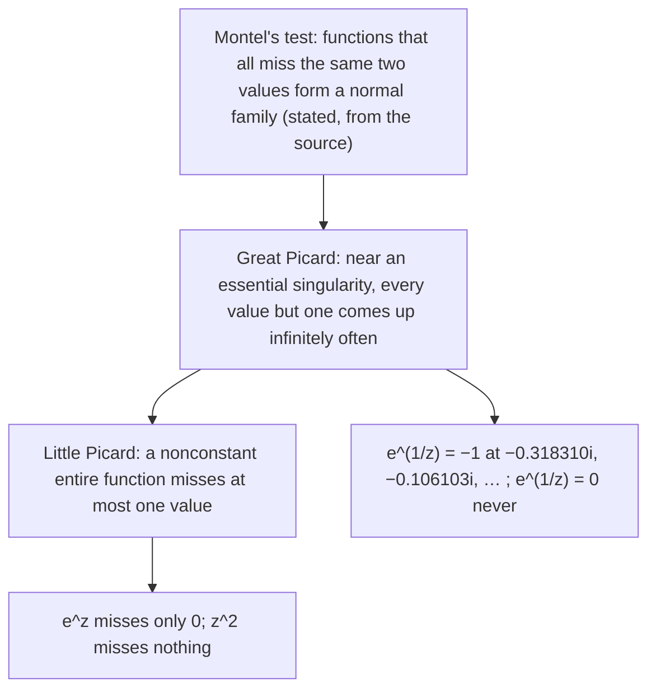

# Picard's theorems: a nonconstant entire function misses at most one value, and near an essential singularity every value but one comes up infinitely often

[Syllabus](../../../SYLLABUS.md) → [Complex analysis](../README.md) → [Laurent Series, Singularities and Residues](../README.md#s05) → Picard's theorems

---

## General Overview

Ask where e^(1/z) equals −1. Since −1 = e^(iπ), this happens exactly when 1/z is iπ plus a whole number k of turns 2πi. k = 0, 1, 2 give z = −0.318310i, −0.106103i, −0.063662i. Negative k mirrors them, with +i.

Both chains march into 0. Only 32 points lie at distance 0.01 or more from 0; every disc round 0, however small, holds infinitely many.

Now ask where e^(1/z) equals 0: nowhere, since e to any power has size e^(real part), never 0. So near 0, e^(1/z) hits −1 infinitely often and misses 0 completely.

That pattern is a law. Near an **essential singularity**, a point whose [Laurent series](01-laurent-series.md) (a power series allowing negative powers) has infinitely many negative powers, a function comes within any distance of every value ([Isolated singularities](02-classifying-singularities.md)). Picard's theorems say more: it lands on every value, infinitely often, except perhaps one.

The same holds for **entire** functions, holomorphic on the whole plane. e^z misses only 0; z^2 misses nothing; no nonconstant one misses two values.

**Near an essential singularity a function takes every complex value infinitely often, with at most one exception (great Picard); so a nonconstant entire function misses at most one value (little Picard).**

**What kind of fact this is:** two theorems, proved here: little Picard from great, and great Picard from Montel's fundamental normality test, stated with its source, not proved.

### The picture: how the proof is chained



---

## The formula

Notation first. $`\mathbb{C}`$ is the complex plane; $`f(\mathbb{C})`$ is the set of values f takes on it.

**Little Picard theorem.**

```math
f \text{ entire and not constant} \implies \mathbb{C} \setminus f(\mathbb{C}) \text{ has at most one point}
```

**Read it aloud:** the values an entire, nonconstant function never takes number zero or one.

**Great Picard theorem.** Let f be holomorphic on a punctured disc round a (a disc with its centre removed), with an essential singularity at a. Then

```math
f(z) = w \text{ for infinitely many } z \text{ with } 0 < |z - a| < r, \quad \text{for every } r > 0 \text{ and every } w \text{ but at most one}
```

**Read it aloud:** in every punctured disc round a, however small, f hits every value infinitely often, with at most one exception.

**Montel's fundamental normality test** (stated, not proved: Conway, ch. XII, the Montel–Carathéodory theorem). Holomorphic functions on an open connected set D that all miss the same two values b ≠ c form a **normal** family: every list of them has a sub-list converging evenly (one error bound for all points at once) on each closed disc inside D, to a holomorphic function or to ∞. The limit ∞ widens the definition on [Normal families](../04-Taylor%20Series%2C%20Zeros%20and%20Rigidity/10-normal-families-montel-and-hurwitz.md): the constants 2, 3, 4, … all miss 0 and 1, and converge only to ∞.

| Symbol | Plain meaning | In our example | Push it up and the answer… |
| --- | --- | --- | --- |
| $`f`$, $`z`$, $`\mathbb{C}`$ | the function; a point; the complex plane | e^(1/z); z = −0.318310i | — |
| $`f(\mathbb{C})`$ | the values f takes | e^z takes all but 0 | — |
| $`a`$, $`r`$ | the essential singularity; radius of the punctured disc | a = 0; any r > 0 | larger r: still infinitely many hits |
| $`w`$, $`u`$ | a target value; the exponent in e^u | w = −1; u = 1/z | — |
| ln, arg, Re | logarithm of a size; angle from the positive real axis; real part | ln 1 = 0, arg(−1) = π | — |
| $`z_k`$, $`k`$ | the k-th solution; a whole number | $`z_0 = -0.318310i`$ | larger k: closer to 0 |
| $`b`$, $`c`$, $`D`$ | two values a whole family misses; its open connected domain | D is 0 < \|z\| < 1 | — |
| $`f_n`$, $`n`$ | the zoomed copy f(z/2^n); the zoom step | $`f_n(z) = e^{2^n/z}`$ | larger n: wilder on \|z\| = 1/2 |

### When it holds

- **Entire, not merely holomorphic between poles.** tan misses i and −i: tan(5i) = 0.999909i is still 0.000091 short of i.
- **Nonconstant.** A constant misses every value but one.
- **Essential, not a pole.** On 0 < |z| < 1, 1/z misses every |w| ≤ 1: 1/z = 0.5 needs z = 2.000000.
- **Complex inputs.** Real sin x never reaches 2; sin z = 2 at z = 1.570796 − 1.316958i.
- **An isolated singularity.** f must be holomorphic on a whole punctured disc round a.

---

## Why it works

### Step 0: zoom in, and missing two values makes the zoom tame

Look at f through a microscope that doubles its power each step: the n-th view is $`f_n(z) = f(z/2^n)`$. If f missed two values, every view would miss them too. Montel's test then makes the views settle down, which leaves no room for an essential singularity.

### Step 1: solve e^(1/z) exactly

The logarithm undoes e^u, with one answer per whole turn ([The complex logarithm](../02-Holomorphic%20Functions/04-complex-logarithm.md)): e^u = w exactly when u = ln|w| + i(arg w + 2πk), with arg w the angle of w from the positive real axis.

For w = −1: ln 1 = 0 and arg(−1) = π, so 1/z = iπ(2k + 1), and

```math
z_k = \frac{1}{i\pi(2k + 1)} = \frac{-i}{\pi(2k + 1)}
```

For w = 0 there is no u, since |e^u| = e^(Re u) > 0, with Re u the real part of u: 0 is the one value missed.

The sizes $`|z_k|`$ for k = 0 to 5, crowding into 0:

```
z_0  ################################  0.318310
z_1  ###########                       0.106103
z_2  ######                            0.063662
z_3  #####                             0.045473
z_4  ####                              0.035368
z_5  ###                               0.028937
```

Two other roads find the same points. Newton's method on e^(1/z) + 1 from −0.3i and −0.1i lands on −0.318310i and −0.106103i. [The argument principle](../06-Real%20Integrals%20and%20Counting%20Zeros/06-the-argument-principle.md) counts zeros by how often the output winds round 0 on a loop: e^(1/z) + 1 turns 0 times on |z| = 0.5 and −6 times on |z| = 0.05, so 6 solutions lie between, as the formula says; e^(1/z) turns 0 times on both.

### Step 2: missing two values means not essential

Move a to 0 and suppose f misses b and c on the punctured disc D = {0 < |z| < 1}. The copies $`f_n`$ miss them too, so a sub-list converges evenly on the circle |z| = 1/2. A holomorphic limit bounds f on circles shrinking to 0, and the maximum modulus principle (|f| peaks on the boundary of a region) fills the rings between: 0 is removable. A limit of ∞ does the same for 1/(f − b): 0 is a pole.

For e^(1/z) the copies $`f_n(z) = e^{2^n/z}`$ on |z| = 1/2 reach 7.389056, 54.598150, 2980.957987 and sink to 0.135335, 0.018316, 0.000335 for n = 0, 1, 2: no settling, as allowed when only one value is missed.

<details>
<summary>Detailed proof of great Picard from Montel's test</summary>

Suppose, for contradiction, that f has an essential singularity at 0 yet misses b ≠ c on 0 < |z| < ρ. Rescale so ρ = 1.

On D = {0 < |z| < 1} the copies $`f_n(z) = f(z/2^n)`$ are holomorphic and miss b and c. By Montel's test a sub-list $`f_{n_1}, f_{n_2}, \dots`$ with $`n_1 < n_2 < \dots`$ converges evenly on the circle K = {|z| = 1/2}, to a holomorphic L or to ∞.

*Case L.* Let M = 1 + max of |L| on K. For large j, |f| ≤ M on the circle $`C_j = \{|z| = 2^{-n_j - 1}\}`$. On the closed ring between $`C_j`$ and $`C_{j+1}`$, |f| peaks on the two circles, so |f| ≤ M there too. These rings fill the punctured disc inside the first such circle, so f is bounded near 0 and, by Riemann's removable-singularity theorem, 0 is removable.

*Case ∞.* For large j, |f| ≥ |b| + 1 on $`C_j`$. Put h = 1/(f − b): holomorphic on D because f never equals b, and |h| ≤ 1 on those $`C_j`$. The ring argument bounds h near 0, so h extends holomorphically to 0, with h(0) = 0 since |h| → 0 on the $`C_j`$. So f = b + 1/h has a pole at 0.

Both cases contradict "essential".

*Infinitely often.* If two values $`w_1 \ne w_2`$ were each taken only finitely often near 0, a small enough ρ would leave f missing both on 0 < |z| < ρ, which the argument above forbids.

*Montel's test itself.* Conway (chapter XII) proves it from Bloch's theorem and Schottky's bound, without Picard, so nothing here is circular.

</details>

### Step 3: from great to little

Let f be entire and not constant.

- **f is a polynomial of degree 1 or more.** Then f(z) = w has a root for every w ([Liouville's theorem](../03-Contour%20Integrals%20and%20Cauchy%27s%20Theorem/07-liouville-and-the-fundamental-theorem-of-algebra.md)): z^2 = −1 at z = 1.000000i and −1.000000i.
- **f is not a polynomial.** Turn it inside out: putting 1/z for z turns its Taylor series, which has infinitely many nonzero terms, into a Laurent series of f(1/z) with infinitely many negative powers. So 0 is an essential singularity of f(1/z), and great Picard there makes f take every value but one, infinitely often, on |z| > 1.

e^z is this case, since e^(1/z) is e^z turned inside out: e^z = −1 at z = 3.141593i, spaced 6.283185i apart, and e^z is never 0 (at z = −20 its size is 0.000000002).

---

## Worked numbers, by hand

| Step | Arithmetic | Value |
| --- | --- | --- |
| e^(1/z) = −1 | −1 = e^(iπ), so 1/z = iπ(2k + 1) | z = −i/(π(2k + 1)) |
| k = 0 | −i/π | −0.318310i |
| k = 1 | −i/(3π) | −0.106103i |
| solutions in 0.05 < \|z\| < 0.5 | 2 < π\|2k + 1\| < 20, so 2k + 1 = ±1, ±3, ±5 | 6 |
| solutions with \|z\| ≥ 0.01 | π\|2k + 1\| ≤ 100, so \|2k + 1\| ≤ 31 | 32, both signs |
| e^(1/z) = 0 | \|e^u\| = e^(Re u) > 0 | **no solution: 0 is the one value missed** |

Every small disc round 0 holds infinitely many solutions of e^(1/z) = −1 and none of e^(1/z) = 0: one exception, as Picard allows.

### What breaks if you drop a piece

| Mistake | Comes out at | What went wrong |
| --- | --- | --- |
| Real inputs only | sin x never reaches 2 | sin z = 2 off the real line |
| Poles allowed | tan z misses i and −i: two values | tan is not entire |
| A pole read as essential | 1/z misses every \|w\| ≤ 1 on 0 < \|z\| < 1 | 1/z = 0.5 needs z = 2.000000 |
| "Infinitely often" for every entire function | z^2 = −1 only at ±i: 2 solutions | infinitely often needs a non-polynomial |

---

## Code, from first principles, and it actually runs

The code takes the three independent roads of Step 1 to the solutions of e^(1/z) = −1, checks the zoomed copies of Step 2 against e^(±2^(n+1)), and prints every number on the card. Rust defines its own complex struct.

### Python

```python
# Picard's theorems -- the check behind the card.  Standard library only.
# e^(1/z) near its essential singularity at 0 hits -1 infinitely often and 0 never.
# Road one solves exactly with the logarithm; road two finds the same points by
# Newton's method; road three counts them with the argument principle.
import math

def cexp(z):                                     # e^z from exp, cos and sin
    return math.exp(z.real) * complex(math.cos(z.imag), math.sin(z.imag))

def turns(F, r, N=20000):                        # how often F(z) winds round 0 as z runs once round |z| = r
    pts = [F(r * cexp(2j * math.pi * j / N)) for j in range(N + 1)]
    return round(sum(math.atan2((b / a).imag, (b / a).real) for a, b in zip(pts, pts[1:])) / (2 * math.pi))

def newton(z, steps=60):                         # root of e^(1/z) + 1, slope -e^(1/z)/z^2
    for _ in range(steps):
        z -= (cexp(1 / z) + 1) / (-cexp(1 / z) / z ** 2)
    return z

zk = {k: 1 / complex(0, math.pi * (2 * k + 1)) for k in range(-3, 6)}
print("e^(1/z) = -1 at z_k = -i/(pi(2k + 1)); |z_k| for k = 0 to 5: " + ", ".join(f"{abs(zk[k]):.6f}" for k in range(6)))
res = max(abs(cexp(1 / z) + 1) for z in zk.values())
print(f"largest |e^(1/z_k) + 1|, k = -3 to 5: {res:.9f}")
nw = [newton(complex(0, s)) for s in (-0.3, -0.1)]
print(f"Newton from -0.3i and -0.1i lands on: {nw[0].imag:.6f}i, {nw[1].imag:.6f}i")
one = lambda z: cexp(1 / z) + 1
out_t, in_t = turns(one, 0.5), turns(one, 0.05)
count = sum(1 for k in range(-50, 50) if 0.05 < 1 / (math.pi * abs(2 * k + 1)) < 0.5)
print(f"e^(1/z) + 1: turns on |z| = 0.5: {out_t}; on |z| = 0.05: {in_t}; zeros between: {out_t - in_t}; by the formula: {count}")
zero = lambda z: cexp(1 / z)
print(f"e^(1/z): turns on |z| = 0.5: {turns(zero, 0.5)}; on |z| = 0.05: {turns(zero, 0.05)}; zeros between: {turns(zero, 0.5) - turns(zero, 0.05)}")
far = sum(1 for k in range(-100, 100) if math.pi * abs(2 * k + 1) <= 100)
print(f"solutions of e^(1/z) = -1 with |z| >= 0.01: {far}; every other one lies inside |z| < 0.01")
print(f"e^z = -1 at z = {math.pi:.6f}i (k = 0), spaced {2 * math.pi:.6f}i apart; |e^z| at z = -20: {abs(cexp(-20)):.9f}, never 0")
sq = [cexp(1j * (math.pi + 2 * math.pi * k) / 2) for k in (0, 1)]          # square roots of -1 = e^(i pi)
print(f"z^2 = -1 at z = {sq[0].imag:.6f}i and {sq[1].imag:.6f}i; z^2 = w has a root for every w: z^2 misses nothing")
for n in range(3):
    s = [abs(cexp(2 ** n / (0.5 * cexp(2j * math.pi * j / 720)))) for j in range(720)]
    print(f"f_{n}(z) = e^(2^{n}/z) on |z| = 1/2: largest {max(s):.6f}, smallest {min(s):.6f}")
    assert abs(max(s) / math.exp(2 ** (n + 1)) - 1) < 1e-9 and abs(min(s) * math.exp(2 ** (n + 1)) - 1) < 1e-9
y = math.log(2 + math.sqrt(3))
s2 = (cexp(1j * complex(math.pi / 2, -y)) - cexp(-1j * complex(math.pi / 2, -y))) / 2j
print(f"mistake, real line only: sin x never reaches 2, but sin z = 2 at z = {math.pi / 2:.6f} - {y:.6f}i (check: {s2.real:.6f})")
t5 = (cexp(-5) - cexp(5)) / (1j * (cexp(-5) + cexp(5)))
print(f"mistake, poles allowed: tan z misses i and -i; tan(5i) = {t5.imag:.6f}i, still {abs(t5 - 1j):.6f} short of i")
print(f"mistake, a pole is not essential: 1/z = 0.5 needs z = {1 / 0.5:.6f}, outside 0 < |z| < 1; 1/z misses every |w| <= 1 there")
assert res < 1e-12 and abs(nw[0].imag + 1 / math.pi) < 1e-12 and abs(nw[1].imag + 1 / (3 * math.pi)) < 1e-12
assert out_t - in_t == count == 6 and turns(zero, 0.5) == turns(zero, 0.05)
assert far == 32 and max(abs(z * z + 1) for z in sq) < 1e-12 and abs(s2 - 2) < 1e-12 and abs(abs(t5 - 1j) - 2 * math.exp(-10) / (1 + math.exp(-10))) < 1e-15
print("ALL CHECKS PASS")
```

**Ran 2026-11-23 on macOS, Python 3.14.10, standard library only. All checks passed. Output, pasted from the run:**

```
e^(1/z) = -1 at z_k = -i/(pi(2k + 1)); |z_k| for k = 0 to 5: 0.318310, 0.106103, 0.063662, 0.045473, 0.035368, 0.028937
largest |e^(1/z_k) + 1|, k = -3 to 5: 0.000000000
Newton from -0.3i and -0.1i lands on: -0.318310i, -0.106103i
e^(1/z) + 1: turns on |z| = 0.5: 0; on |z| = 0.05: -6; zeros between: 6; by the formula: 6
e^(1/z): turns on |z| = 0.5: 0; on |z| = 0.05: 0; zeros between: 0
solutions of e^(1/z) = -1 with |z| >= 0.01: 32; every other one lies inside |z| < 0.01
e^z = -1 at z = 3.141593i (k = 0), spaced 6.283185i apart; |e^z| at z = -20: 0.000000002, never 0
z^2 = -1 at z = 1.000000i and -1.000000i; z^2 = w has a root for every w: z^2 misses nothing
f_0(z) = e^(2^0/z) on |z| = 1/2: largest 7.389056, smallest 0.135335
f_1(z) = e^(2^1/z) on |z| = 1/2: largest 54.598150, smallest 0.018316
f_2(z) = e^(2^2/z) on |z| = 1/2: largest 2980.957987, smallest 0.000335
mistake, real line only: sin x never reaches 2, but sin z = 2 at z = 1.570796 - 1.316958i (check: 2.000000)
mistake, poles allowed: tan z misses i and -i; tan(5i) = 0.999909i, still 0.000091 short of i
mistake, a pole is not essential: 1/z = 0.5 needs z = 2.000000, outside 0 < |z| < 1; 1/z misses every |w| <= 1 there
ALL CHECKS PASS
```

### Rust

Same numbers, same labels, built with `rustc --edition 2021 -O`.

```rust
// Picard's theorems -- the same check as the Python, in Rust.  No crates.
// e^(1/z) near its essential singularity at 0 hits -1 infinitely often and 0 never.
// Road one solves exactly with the logarithm; road two finds the same points by
// Newton's method; road three counts them with the argument principle.
use std::f64::consts::PI;
use std::ops::{Add, Div, Mul, Sub};
#[derive(Clone, Copy)]
struct C { re: f64, im: f64 }
fn c(re: f64, im: f64) -> C { C { re, im } }
impl Add for C { type Output = C; fn add(self, o: C) -> C { c(self.re + o.re, self.im + o.im) } }
impl Sub for C { type Output = C; fn sub(self, o: C) -> C { c(self.re - o.re, self.im - o.im) } }
impl Mul for C { type Output = C; fn mul(self, o: C) -> C { c(self.re * o.re - self.im * o.im, self.re * o.im + self.im * o.re) } }
impl Div for C { type Output = C; fn div(self, o: C) -> C { let d = o.re * o.re + o.im * o.im;
    c((self.re * o.re + self.im * o.im) / d, (self.im * o.re - self.re * o.im) / d) } }
fn abs(z: C) -> f64 { z.re.hypot(z.im) }
fn r(x: f64) -> C { c(x, 0.0) }
fn cexp(z: C) -> C { let m = z.re.exp(); c(m * z.im.cos(), m * z.im.sin()) }   // e^z from exp, cos and sin
fn turns(f: fn(C) -> C, rad: f64, n: usize) -> i64 {          // how often f(z) winds round 0 as z runs once round |z| = rad
    let pts: Vec<C> = (0..=n).map(|j| f(r(rad) * cexp(c(0.0, 2.0 * PI * j as f64 / n as f64)))).collect();
    let s: f64 = pts.windows(2).map(|p| { let q = p[1] / p[0]; q.im.atan2(q.re) }).sum();
    (s / (2.0 * PI)).round() as i64
}
fn newton(mut z: C) -> C {                                    // root of e^(1/z) + 1, slope -e^(1/z)/z^2
    for _ in 0..60 { let e = cexp(r(1.0) / z); z = z - (e + r(1.0)) / (r(0.0) - e / (z * z)) }
    z
}
fn one(z: C) -> C { cexp(r(1.0) / z) + r(1.0) }
fn zero(z: C) -> C { cexp(r(1.0) / z) }

fn main() {
    let zk = |k: i32| r(1.0) / c(0.0, PI * (2 * k + 1) as f64);
    let v: Vec<String> = (0..6).map(|k| format!("{:.6}", abs(zk(k)))).collect();
    println!("e^(1/z) = -1 at z_k = -i/(pi(2k + 1)); |z_k| for k = 0 to 5: {}", v.join(", "));
    let res = (-3..6).map(|k| abs(one(zk(k)))).fold(0.0, f64::max);
    println!("largest |e^(1/z_k) + 1|, k = -3 to 5: {:.9}", res);
    let nw = [newton(c(0.0, -0.3)), newton(c(0.0, -0.1))];
    println!("Newton from -0.3i and -0.1i lands on: {:.6}i, {:.6}i", nw[0].im, nw[1].im);
    let (out_t, in_t) = (turns(one, 0.5, 20000), turns(one, 0.05, 20000));
    let count = (-50..50).filter(|&k: &i32| { let a = 1.0 / (PI * (2 * k + 1).abs() as f64); 0.05 < a && a < 0.5 }).count() as i64;
    println!("e^(1/z) + 1: turns on |z| = 0.5: {}; on |z| = 0.05: {}; zeros between: {}; by the formula: {}", out_t, in_t, out_t - in_t, count);
    let (zo, zi) = (turns(zero, 0.5, 20000), turns(zero, 0.05, 20000));
    println!("e^(1/z): turns on |z| = 0.5: {}; on |z| = 0.05: {}; zeros between: {}", zo, zi, zo - zi);
    let far = (-100..100).filter(|&k: &i32| PI * (2 * k + 1).abs() as f64 <= 100.0).count();
    println!("solutions of e^(1/z) = -1 with |z| >= 0.01: {}; every other one lies inside |z| < 0.01", far);
    println!("e^z = -1 at z = {:.6}i (k = 0), spaced {:.6}i apart; |e^z| at z = -20: {:.9}, never 0", PI, 2.0 * PI, abs(cexp(r(-20.0))));
    let sq: Vec<C> = (0..2).map(|k| cexp(c(0.0, (PI + 2.0 * PI * k as f64) / 2.0))).collect();   // square roots of -1 = e^(i pi)
    println!("z^2 = -1 at z = {:.6}i and {:.6}i; z^2 = w has a root for every w: z^2 misses nothing", sq[0].im, sq[1].im);
    for n in 0..3 {
        let s: Vec<f64> = (0..720).map(|j| abs(cexp(r(2f64.powi(n)) / (r(0.5) * cexp(c(0.0, 2.0 * PI * j as f64 / 720.0)))))).collect();
        let (mx, mn) = (s.iter().cloned().fold(0.0, f64::max), s.iter().cloned().fold(f64::INFINITY, f64::min));
        println!("f_{}(z) = e^(2^{}/z) on |z| = 1/2: largest {:.6}, smallest {:.6}", n, n, mx, mn);
        let e = 2f64.powi(n + 1).exp();
        assert!((mx / e - 1.0).abs() < 1e-9 && (mn * e - 1.0).abs() < 1e-9);
    }
    let y = (2.0 + 3f64.sqrt()).ln();
    let iz = c(0.0, 1.0) * c(PI / 2.0, -y);
    let s2 = (cexp(iz) - cexp(r(0.0) - iz)) / c(0.0, 2.0);
    println!("mistake, real line only: sin x never reaches 2, but sin z = 2 at z = {:.6} - {:.6}i (check: {:.6})", PI / 2.0, y, s2.re);
    let t5 = (cexp(r(-5.0)) - cexp(r(5.0))) / (c(0.0, 1.0) * (cexp(r(-5.0)) + cexp(r(5.0))));
    println!("mistake, poles allowed: tan z misses i and -i; tan(5i) = {:.6}i, still {:.6} short of i", t5.im, abs(t5 - c(0.0, 1.0)));
    println!("mistake, a pole is not essential: 1/z = 0.5 needs z = {:.6}, outside 0 < |z| < 1; 1/z misses every |w| <= 1 there", 1.0 / 0.5);
    assert!(res < 1e-12 && (nw[0].im + 1.0 / PI).abs() < 1e-12 && (nw[1].im + 1.0 / (3.0 * PI)).abs() < 1e-12);
    assert!(out_t - in_t == count && count == 6 && zo == zi);
    assert!(far == 32 && sq.iter().all(|&z| abs(z * z + r(1.0)) < 1e-12) && abs(s2 - r(2.0)) < 1e-12);
    assert!((abs(t5 - c(0.0, 1.0)) - 2.0 * (-10f64).exp() / (1.0 + (-10f64).exp())).abs() < 1e-15);
    println!("ALL CHECKS PASS");
}
```

**Ran 2026-11-23 on macOS, rustc 1.98.1, no crates. All checks passed. Output, pasted from the run:**

```
e^(1/z) = -1 at z_k = -i/(pi(2k + 1)); |z_k| for k = 0 to 5: 0.318310, 0.106103, 0.063662, 0.045473, 0.035368, 0.028937
largest |e^(1/z_k) + 1|, k = -3 to 5: 0.000000000
Newton from -0.3i and -0.1i lands on: -0.318310i, -0.106103i
e^(1/z) + 1: turns on |z| = 0.5: 0; on |z| = 0.05: -6; zeros between: 6; by the formula: 6
e^(1/z): turns on |z| = 0.5: 0; on |z| = 0.05: 0; zeros between: 0
solutions of e^(1/z) = -1 with |z| >= 0.01: 32; every other one lies inside |z| < 0.01
e^z = -1 at z = 3.141593i (k = 0), spaced 6.283185i apart; |e^z| at z = -20: 0.000000002, never 0
z^2 = -1 at z = 1.000000i and -1.000000i; z^2 = w has a root for every w: z^2 misses nothing
f_0(z) = e^(2^0/z) on |z| = 1/2: largest 7.389056, smallest 0.135335
f_1(z) = e^(2^1/z) on |z| = 1/2: largest 54.598150, smallest 0.018316
f_2(z) = e^(2^2/z) on |z| = 1/2: largest 2980.957987, smallest 0.000335
mistake, real line only: sin x never reaches 2, but sin z = 2 at z = 1.570796 - 1.316958i (check: 2.000000)
mistake, poles allowed: tan z misses i and -i; tan(5i) = 0.999909i, still 0.000091 short of i
mistake, a pole is not essential: 1/z = 0.5 needs z = 2.000000, outside 0 < |z| < 1; 1/z misses every |w| <= 1 there
ALL CHECKS PASS
```

The two outputs match line for line.

### Lean

Picard's theorems are not in Mathlib, so Lean does not prove them; it proves the card's exact facts about e^z, e^(1/z), tan and polynomials.

- e^z = −1 exactly when z = iπ(2k + 1) for a whole number k.
- e^(1/z) = −1 exactly at z_k = 1/(iπ(2k + 1)), and e^(1/z) is never 0.
- Great Picard for e^(1/z): every nonzero value is taken infinitely often in 0 < |z| < r, however small r > 0 is.
- e^z takes the value w exactly when w ≠ 0: it misses only 0.
- tan z never equals i or −i: tan misses two values.
- A nonconstant polynomial takes every value: z^2 = w always has a root, and z^2 = −1 at i and −i.

Montel's test and the general proofs rest on the source and the fold above; every decimal and the zero counts are left to the Python and Rust checks.

```lean
-- Picard's theorems are not in Mathlib yet, so this file proves the card's examples exactly: e^z = −1 exactly at z = iπ(2k + 1), e^(1/z) = −1 exactly at z_k = 1/(iπ(2k + 1)), e^(1/z) takes every nonzero value infinitely often in every punctured disc round 0 and never takes 0, e^z misses only 0, tan misses i and −i, and a nonconstant polynomial misses nothing.
import Mathlib.Analysis.SpecialFunctions.Complex.Log
import Mathlib.Analysis.Complex.Polynomial.Basic

open Complex Polynomial
open scoped Real

/-- e^z = −1 exactly when z = iπ(2k + 1) for a whole number k: one solution per whole turn. -/
theorem exp_eq_neg_one_iff (z : ℂ) : exp z = -1 ↔ ∃ k : ℤ, z = π * I * (2 * k + 1) := by
  rw [← exp_pi_mul_I, exp_eq_exp_iff_exists_int]
  constructor
  · rintro ⟨k, hk⟩
    exact ⟨k, by rw [hk]; ring⟩
  · rintro ⟨k, rfl⟩
    exact ⟨k, by ring⟩

/-- e^(1/z) = −1 exactly at z_k = 1/(iπ(2k + 1)), one point for each whole number k. -/
theorem exp_inv_eq_neg_one_iff (z : ℂ) : exp z⁻¹ = -1 ↔ ∃ k : ℤ, z = (π * I * (2 * k + 1))⁻¹ := by
  rw [exp_eq_neg_one_iff]
  constructor
  · rintro ⟨k, hk⟩
    exact ⟨k, by rw [← hk, inv_inv]⟩
  · rintro ⟨k, rfl⟩
    exact ⟨k, inv_inv _⟩

/-- e^(1/z) never equals 0: the one value it misses. -/
theorem exp_inv_ne_zero (z : ℂ) : exp z⁻¹ ≠ 0 := exp_ne_zero _

/-- Great Picard for e^(1/z): every nonzero value w is taken infinitely often in the punctured
disc 0 < |z| < r, however small r is. -/
theorem exp_inv_takes_value_infinitely_often {w : ℂ} (hw : w ≠ 0) {r : ℝ} (hr : 0 < r) :
    {z : ℂ | 0 < ‖z‖ ∧ ‖z‖ < r ∧ exp z⁻¹ = w}.Infinite := by
  obtain ⟨K, hK⟩ := exists_nat_gt ((‖log w‖ + r⁻¹) / (2 * π))
  set u : ℕ → ℂ := fun n => log w + ((n + K : ℕ) : ℂ) * (2 * π * I) with hu
  have hbig : ∀ n, r⁻¹ < ‖u n‖ := by
    intro n
    have h2 : ‖((n + K : ℕ) : ℂ) * (2 * π * I)‖ = (n + K : ℕ) * (2 * π) := by
      rw [norm_mul, Complex.norm_natCast, norm_mul, norm_mul, Complex.norm_I, Complex.norm_real,
        Complex.norm_ofNat, Real.norm_of_nonneg Real.pi_pos.le, mul_one]
    have h3 : ‖((n + K : ℕ) : ℂ) * (2 * π * I)‖ ≤ ‖u n‖ + ‖log w‖ := by
      have := norm_sub_le (u n) (log w)
      simpa [hu] using this
    have h4 : (K : ℝ) * (2 * π) ≤ (n + K : ℕ) * (2 * π) := by
      have : (K : ℝ) ≤ (n + K : ℕ) := by exact_mod_cast Nat.le_add_left K n
      nlinarith [Real.pi_pos]
    have h5 : ‖log w‖ + r⁻¹ < K * (2 * π) := by
      rwa [div_lt_iff₀ (by positivity)] at hK
    linarith
  have hne : ∀ n, u n ≠ 0 := by
    intro n h
    have := hbig n
    rw [h, norm_zero] at this
    exact absurd this (not_lt.2 (inv_pos.2 hr).le)
  have hinj : Function.Injective (fun n => (u n)⁻¹) := by
    intro n m h
    have h1 : u n = u m := inv_injective h
    simp only [hu, add_right_inj] at h1
    have h2 : ((n + K : ℕ) : ℂ) = ((m + K : ℕ) : ℂ) :=
      mul_right_cancel₀ (by simp [Real.pi_ne_zero, I_ne_zero]) h1
    have h3 : n + K = m + K := by exact_mod_cast h2
    omega
  refine Set.infinite_of_injective_forall_mem hinj fun n => ?_
  refine ⟨?_, ?_, ?_⟩
  · simpa using hne n
  · rw [norm_inv]
    exact inv_lt_of_inv_lt₀ hr (hbig n)
  · simp only [inv_inv, hu, exp_add, exp_log hw, exp_nat_mul_two_pi_mul_I, mul_one]

/-- e^z misses only 0: it takes the value w exactly when w ≠ 0. -/
theorem exp_misses_only_zero (w : ℂ) : (∃ z, exp z = w) ↔ w ≠ 0 :=
  ⟨by rintro ⟨z, rfl⟩; exact exp_ne_zero z, fun hw => ⟨log w, exp_log hw⟩⟩

/-- tan misses both i and −i, so tan (holomorphic except at its poles) misses two values. -/
theorem tan_misses_I_and_neg_I (z : ℂ) : tan z ≠ I ∧ tan z ≠ -I := by
  rw [tan]
  by_cases hc : cos z = 0
  · rw [hc, div_zero]
    exact ⟨I_ne_zero.symm, (neg_ne_zero.2 I_ne_zero).symm⟩
  constructor
  · intro h
    have hs : sin z = I * cos z := by rw [div_eq_iff hc] at h; exact h
    exact exp_ne_zero (z * I) (by linear_combination exp_mul_I z + I * hs + cos z * I_sq)
  · intro h
    have hs : sin z = -I * cos z := by rw [div_eq_iff hc] at h; exact h
    have he := exp_mul_I (-z)
    rw [cos_neg, sin_neg] at he
    exact exp_ne_zero (-z * I) (by linear_combination he - I * hs + cos z * I_sq)

/-- A nonconstant polynomial misses nothing: p(z) = w has a root for every w. -/
theorem polynomial_misses_nothing (p : ℂ[X]) (hp : 0 < p.degree) (w : ℂ) : ∃ z, p.eval z = w := by
  obtain ⟨z, hz⟩ := Complex.exists_root (f := p - C w) (by rwa [degree_sub_C hp])
  exact ⟨z, by simpa [sub_eq_zero] using hz⟩

/-- z^2 misses nothing, and z^2 = −1 at z = i and z = −i. -/
theorem sq_misses_nothing (w : ℂ) : (∃ z : ℂ, z ^ 2 = w) ∧ I ^ 2 = -1 ∧ (-I) ^ 2 = -1 := by
  refine ⟨?_, I_sq, by rw [neg_sq, I_sq]⟩
  obtain ⟨z, hz⟩ := polynomial_misses_nothing (X ^ 2) (by simp) w
  exact ⟨z, by simpa using hz⟩

#print axioms exp_eq_neg_one_iff
#print axioms exp_inv_eq_neg_one_iff
#print axioms exp_inv_ne_zero
#print axioms exp_inv_takes_value_infinitely_often
#print axioms exp_misses_only_zero
#print axioms tan_misses_I_and_neg_I
#print axioms polynomial_misses_nothing
#print axioms sq_misses_nothing
```

**Checked 2026-11-23 on macOS, Lean 4.36.0-rc2, Mathlib v4.36.0-rc2. Every proof is complete and uses only Lean's standard axioms. Output, pasted from the run:**

```
'exp_eq_neg_one_iff' depends on axioms: [propext, Classical.choice, Quot.sound]
'exp_inv_eq_neg_one_iff' depends on axioms: [propext, Classical.choice, Quot.sound]
'exp_inv_ne_zero' depends on axioms: [propext, Classical.choice, Quot.sound]
'exp_inv_takes_value_infinitely_often' depends on axioms: [propext, Classical.choice, Quot.sound]
'exp_misses_only_zero' depends on axioms: [propext, Classical.choice, Quot.sound]
'tan_misses_I_and_neg_I' depends on axioms: [propext, Classical.choice, Quot.sound]
'polynomial_misses_nothing' depends on axioms: [propext, Classical.choice, Quot.sound]
'sq_misses_nothing' depends on axioms: [propext, Classical.choice, Quot.sound]
```

> [!TIP]
> **Try changing**
> Guess first, then run it.
> - **A smaller inner circle.** Change `turns(one, 0.05)` to `turns(one, 0.02)`. The zeros between become 16, since |2k + 1| may now reach 15, and the turn-count assert fails: the formula count still uses 0.05.
> - **A start nearer the singularity.** Change the Newton start `-0.1` to `-0.05`. It lands on −0.028937i, the solution with k = 5, and the Newton assert fails.
> - **Too few points on the loop.** Change `N=20000` to `N=8`. The output spins too fast between samples, so the count on |z| = 0.05 reads 0, not −6, and the turn-count assert fails.

---

## The usual mistake

> [!warning]
> **Reading Picard as "every value is taken".** It allows one exception, and e^z uses it: e^z is never 0. Only a second missed value is forbidden.
>
> - **Confusing Picard with Casorati–Weierstrass.** Casorati–Weierstrass gives close; Picard says that, apart from one value, close becomes equal. At z = −1/8, e^(1/z) = 0.000335 ($`f_2`$'s smallest size in Step 2) is close to 0, yet e^(1/z) is never 0.
> - **Expecting infinitely many solutions from every entire function.** z^2 = −1 has 2 solutions. "Infinitely often" needs a non-polynomial.
> - **Expecting the solutions spread everywhere.** Between |z| = 0.05 and 0.5, e^(1/z) = −1 has only 6 solutions. The rest pile up at the singularity.

---

## Where you meet it in real life

- **Equations with infinitely many complex roots.** z e^z is entire and not a polynomial, so z e^z = w has infinitely many solutions for every w but at most one: hence the infinitely many branches of its inverse, the Lambert W function.
- **Fractals of iteration.** Montel's test is the main tool for studying the Julia set of z^2 + c: the points where its repeats (the map applied again and again) fail to form a normal family.

> **Say it back**
> Near an essential singularity a function lands on every value infinitely often, with at most one exception. e^(1/z) hits −1 at −i/(π(2k + 1)) for every whole k and never hits 0. Missing two values would make the zoomed copies settle, by Montel's test, so the singularity could not be essential. An entire non-polynomial turned inside out has an essential singularity, so it misses at most one value: e^z misses only 0.

---

## What this builds on

- [Isolated singularities](02-classifying-singularities.md): essential singularities, Riemann's removable-singularity theorem, and Casorati–Weierstrass, sharpened here from "close" to "equal".
- [Normal families](../04-Taylor%20Series%2C%20Zeros%20and%20Rigidity/10-normal-families-montel-and-hurwitz.md): normal families, and Montel's theorem for a shared bound, replaced here by two missed values.
- [Liouville's theorem](../03-Contour%20Integrals%20and%20Cauchy%27s%20Theorem/07-liouville-and-the-fundamental-theorem-of-algebra.md): the polynomial case, and the first result of this kind: a nonconstant entire function cannot miss a whole disc of values, or 1/(f − w), with w the disc's centre, would be bounded.
- [The complex logarithm](../02-Holomorphic%20Functions/04-complex-logarithm.md): the exact solutions of e^u = w, one per whole turn.
- [The maximum modulus principle](../04-Taylor%20Series%2C%20Zeros%20and%20Rigidity/05-maximum-modulus-principle.md): carries a bound from circles to the rings between them.

## Where this goes next

- [The argument principle](../06-Real%20Integrals%20and%20Counting%20Zeros/06-the-argument-principle.md): counts the solutions of f(z) = w inside a loop, as the code does.

Picard says each value is hit infinitely often, but not how fast the solutions pile up as the circle grows; that rate is the subject of value-distribution theory.

---

## Sources

Verified 2026-11-23: every link below resolves to the publisher's page.

- Conway, John B. "The Range of an Analytic Function." Chapter XII of *Functions of One Complex Variable I*, 2nd ed., Springer, Graduate Texts in Mathematics 11, 1978, pp. 292–301. [doi:10.1007/978-1-4612-6313-5_12](https://doi.org/10.1007/978-1-4612-6313-5_12). Bloch's theorem, little Picard, Schottky's theorem, the Montel–Carathéodory theorem (Montel's test) and great Picard, in that order.
- Zalcman, Lawrence. "Normal families: new perspectives." *Bulletin of the American Mathematical Society* 35 (1998), 215–230. [doi:10.1090/S0273-0979-98-00755-1](https://doi.org/10.1090/S0273-0979-98-00755-1). Short proofs of the Picard theorems through normal families, and the link to Julia sets.
- O'Connor, J. J., and E. F. Robertson. "Émile Picard." MacTutor Archive, University of St Andrews. [Biography](https://mathshistory.st-andrews.ac.uk/Biographies/Picard_Emile/). Dates Picard's 1879 theorem on the values of an entire function.
