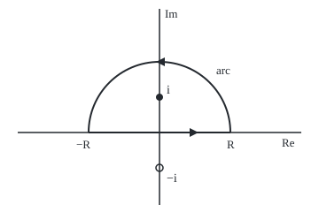

# The semicircle contour: close the real line with a big arc, let the arc vanish, and read the integral off the poles above

[Syllabus](../../../SYLLABUS.md) → [Complex analysis](../README.md) → [Real Integrals and Counting Zeros](../README.md#s06) → The semicircle contour

---

## General Overview

A lighthouse stands 1 km off a long, straight shore. Its beam turns at a steady rate. For half of each turn it faces the shore, and its spot runs along the sand: slowly at the foot, the point nearest the lamp, then ever faster towards the horizon.

At x km from the foot, the share of the half-turn landing on each kilometre is 1/(π(1 + x^2)): 0.318310 per km at the foot. The kilometre either side of the foot gets exactly half the sweep; the 2 km either side get 0.704833. The whole shore must get a share of 1, so the area under 1/(1 + x^2) over the whole real line must be π.

This card finds that area without an antiderivative. Walk the real line from −R to R and return along a half-circle of radius R above it: a closed loop. The residue theorem prices the loop from the one pole inside, at i, where 1/(1 + z^2) blows up. The half-circle's part shrinks to nothing as R grows, so the loop's value is the real integral. The same steps give π/2 for 1/(1 + x^2)^2, where the pole is double.

**For a ratio of polynomials whose bottom degree beats the top by at least 2, with no zero of the bottom on the real line, the integral over the whole real line is 2πi times the sum of the residues at the poles above the real axis.**

**What kind of fact this is:** a theorem, proved on this card in Why it works from the residue theorem and the ML bound.

### The picture: the loop at R = 2

<p align="center"></p>

To scale: 40 units per 1, 0 at (180, 150). Segment from (100.00, 150.00) to (260.00, 150.00), arc top (180.00, 70.00), pole i at (180.00, 110.00) inside, pole −i at (180.00, 190.00) outside (hollow). Triangles show the anticlockwise direction.

---

## The formula

A reminder: the residue of f at a pole a, written $\operatorname{Res}(f, a)$, is the coefficient of 1/(z − a) in f's expansion near a, and a loop integral equals 2πi times the residues inside ([The residue theorem](../05-Laurent%20Series%2C%20Singularities%20and%20Residues/05-the-residue-theorem.md)).

Let $f = p/q$ be a ratio of polynomials, q never zero on the real line, and the degree of q at least that of p plus 2. Then

$$\int_{-\infty}^{\infty} f(x)\,dx = 2\pi i \sum_{\operatorname{Im} a > 0} \operatorname{Res}(f, a).$$

**Read it aloud:** the area under f along the whole real line is 2πi times its residues above the axis.

The engine is one exact equation, true once R exceeds every pole's distance from 0:

$$\int_{-R}^{R} f(x)\,dx + \int_{C_R} f(z)\,dz = 2\pi i \sum_{\operatorname{Im} a > 0} \operatorname{Res}(f, a).$$

**Read it aloud:** segment plus arc equals the residue sum, at every finite radius.

The **ML bound** kills the arc: a path integral's size is at most M, the function's largest size on the path, times L, the path's length.

| Symbol | Plain meaning | In our example | Push it up and the answer… |
| --- | --- | --- | --- |
| $x$, $z$ | a point on the shore, in km; a point of the plane | x = 1 | — |
| $f$, $p$, $q$ | the function integrated; its top and bottom polynomials | 1/(1 + z^2), and its square | a bigger bottom degree: faster fall-off |
| $i$, $\pi$ | the quarter turn, with i^2 = −1; a half turn in radians | pole at i | — |
| $a$, $\operatorname{Im} a$ | a pole: a zero of q, where f blows up; its imaginary part, the pole's height above the real axis | i and −i | only those above the axis count |
| $R$ | the radius of the half-circle, and how far along the shore | 2, 4, 8, 16 | the arc's share shrinks |
| $C_R$, $t$ | the upper arc $z = Re^{it}$, t running from 0 to π | length 2π at R = 2 | longer arc, far smaller f |
| $M$, $L$ | the largest size of f on the arc; the arc's length πR | M ≤ 1/(R^2 − 1) | bound tends to 0 |
| $\theta$ | the beam's angle from the line to the foot, with x = tan θ | 0 at the foot | the spot runs faster |

### When it holds

- **Bottom degree at least top degree plus 2.** Then f shrinks like 1/R^2 on the arc and ML gives about π/R. With a gap of 1, as in z/(1 + z^2), the arc stays at πi for every R > 1.
- **No pole on the real line.** Otherwise the real integral itself blows up; [Poles on the path](04-indented-contours-and-principal-values.md) handles it.
- **Both tails converge on their own.** The loop gives the symmetric limit, −R to R together; the degree gap makes each tail finite, so that limit is the improper integral. For x/(1 + x^2) the symmetric limit is 0 while each tail diverges.
- **A ratio of polynomials.** For e^(ix) times a ratio with a gap of only 1, the arc needs a finer estimate: [Jordan's lemma](03-oscillatory-integrals-and-jordans-lemma.md).

---

## Why it works

### Step 0: price a loop by its poles, then make the arc vanish

The real line is not a loop, so the residue theorem cannot touch it. Close it with an arc, price the loop by its poles, and show the arc fades. What is left is the real integral.

### Step 1: close the path

Fix R larger than every pole's distance from 0. Walk the real axis from −R to R, then the arc $z = Re^{it}$ for t from 0 to π. This anticlockwise loop encloses the half-disc above the axis: poles above are inside, poles below outside. For the lighthouse, 1 + z^2 = (z − i)(z + i), so the poles are i and −i, and only i is inside once R > 1.

### Step 2: price the loop by residues

Near i, $f(z) = \frac{1}{z - i}\cdot\frac{1}{z + i}$, and the second factor is smooth there. So the residue is 1/(z + i) at z = i: 1/(2i) = −i/2. The loop is worth 2πi × (−i/2) = π for every R > 1.

For $1/(1 + z^2)^2$ the pole at i is double: $f(z) = \frac{1}{(z - i)^2}\cdot\frac{1}{(z + i)^2}$. The coefficient of 1/(z − i) is the first derivative of $(z + i)^{-2}$ at i, which is $-2/(2i)^3 = -i/4$. The loop is worth 2πi × (−i/4) = π/2.

### Step 3: bound the arc by ML

Why ML holds: a path integral is a limit of sums of f(z) times small steps Δz. Each term's size is at most M times the step's length, and the lengths add up to L.

On the arc |z| = R. The reverse triangle inequality, |u + v| ≥ |u| − |v|, gives $|1 + z^2| \ge R^2 - 1$. So M ≤ 1/(R^2 − 1), L = πR, and

$$\left|\int_{C_R} \frac{dz}{1 + z^2}\right| \le \frac{\pi R}{R^2 - 1}.$$

At R = 2 the bound is 2.094395 and the arc 0.927295; at R = 16, 0.197120 and 0.124838. The bound falls like π/R, the arc like 2/R. For the square the bound is $\pi R/(R^2 - 1)^2$.

### Step 4: let R grow

The loop's value stays fixed while the arc tends to 0, so the segment tends to the loop's value. The degree gap makes each tail finite ([Improper integrals](../../06-Calculus%20and%20analysis/04-Integrals/07-improper-integrals.md)), so the symmetric limit is the improper integral:

$$\int_{-\infty}^{\infty} \frac{dx}{1 + x^2} = \pi, \qquad \int_{-\infty}^{\infty} \frac{dx}{(1 + x^2)^2} = \frac{\pi}{2}.$$

<details>
<summary>Detailed proof: the general degree-gap case</summary>

Let p have degree m, with P the sum of the sizes of its coefficients. Let q have degree n ≥ m + 2, top coefficient b, and Q the sum of the sizes of its other coefficients. For |z| ≥ 1 the triangle inequality gives |p(z)| ≤ P|z|^m and |q(z)| ≥ |b||z|^n − Q|z|^(n−1), which is at least |b||z|^n/2 once |z| ≥ 2Q/|b|. So for large |z|

$$|f(z)| \le \frac{2P}{|b|}\,|z|^{m-n} \le \frac{C}{|z|^{2}}, \qquad C = \frac{2P}{|b|}.$$

Arc: ML gives at most πR × C/R^2 = πC/R, which tends to 0. Tails: each is at most C/R, so both converge on their own. For large R, Step 1's loop encloses exactly the poles with Im a > 0, the residue theorem fixes its value, and letting R grow gives the formula.

</details>

The lighthouse gives a second route. With x = tan θ, dx = dθ/cos^2 θ and 1 + x^2 = 1/cos^2 θ, so the first integral is the integral of 1 over θ from −π/2 to π/2, which is π; the second is the integral of cos^2 θ, π/2. The code runs both routes. A pole on the real line needs [Poles on the path](04-indented-contours-and-principal-values.md); square roots and logarithms need [The keyhole contour](05-keyhole-contours.md).

---

## Worked numbers, by hand

| Step | Arithmetic | Value |
| --- | --- | --- |
| Poles | 1 + z^2 = (z − i)(z + i) | i inside, −i outside |
| Residue at i | 1/(z + i) at z = i: 1/(2i) | −0.5i |
| Loop value | 2πi × (−0.5i) | 3.141593 |
| Check at R = 2 | segment 2.214297 + arc 0.927295 | 3.141593 |
| Lighthouse share | π/π | **1** |
| Squared: residue | −2/(2i)^3 | −0.25i |
| Squared: loop value | 2πi × (−0.25i) | **1.570796** |

So the whole shore catches the whole sweep, and squaring the curve halves its area to π/2.

### What breaks if you drop a piece

| Mistake | Comes out at | What went wrong |
| --- | --- | --- |
| Drop the arc at R = 2 | 2.214297, not 3.141593 | The arc is 0.927295 there; it vanishes only in the limit |
| Add both poles' residues | 0 | −i is outside the upper loop |
| Simple-pole rule at the double pole | −1.570796i | The residue of a double pole needs a derivative |
| Degree gap 1: z/(1 + z^2) | arc 3.141593i at R = 2 and at R = 16 | f falls only like 1/R; ML allows 3.153913 at R = 16 |

---

## Code, from first principles, and it actually runs

Both programs take three roads to π and π/2. Road one: 2πi times the residue. Road two: the real integral summed at 4000 midpoints in the beam angle θ, with x = tan θ. Road three: at R = 2, trapezoid sums along the segment and the arc, added. The four asserts: roads one and two agree; the closed loop matches road one; every arc sits under its ML bound; the arcs shrink as R doubles, while the gap-1 arc does not.

### Python

```python
# The semicircle contour -- the check behind the card.  Standard library only.
# Road one: 2 pi i times the residue at i, the one pole above the real axis.
# Road two: the lighthouse's own angle, x = tan t, summed along the real line.
# Road three: segment plus arc at finite R, each a trapezoid sum, against road one.
import math

def show(w):                                  # 'a + bi', six decimals, no -0.000000
    a, b = round(w.real, 6) + 0.0, round(w.imag, 6) + 0.0
    return f"{a:.6f} {'-' if b < 0 else '+'} {abs(b):.6f}i"
def f(z, k): return 1 / (1 + z * z) ** k      # k = 1: the lighthouse curve; k = 2: its square
def gap1(z, k): return z / (1 + z * z)        # degree gap only 1: breaks the method
def trap(g, a, b, n=20000):                   # trapezoid sum of g from a to b
    h = (b - a) / n
    return h * (sum(g(a + j * h) for j in range(1, n)) + (g(a) + g(b)) / 2)
def arc(R, k, g=f):                           # z = R e^(it), dz = i z dt, t from 0 to pi
    return trap(lambda t: g(R * complex(math.cos(t), math.sin(t)), k) * 1j * R * complex(math.cos(t), math.sin(t)), 0, math.pi)
def angle_road(k, n=4000):                    # x = tan t, dx = dt / cos^2 t, midpoints only
    h = math.pi / n
    return h * sum(f(math.tan(-math.pi / 2 + (j + 0.5) * h), k) / math.cos(-math.pi / 2 + (j + 0.5) * h) ** 2 for j in range(n))

res1 = 1 / (1j + 1j)                          # (z - i) f(z) = 1/(z + i), at z = i
res2 = -2 / (1j + 1j) ** 3                    # d/dz of 1/(z + i)^2 = -2/(z + i)^3, at z = i
road1 = (2j * math.pi * res1, 2j * math.pi * res2)
road2 = (angle_road(1), angle_road(2))
share = lambda R: trap(lambda x: f(x, 1) / math.pi, -R, R)
print(f"lighthouse: share per km at the foot {1 / math.pi:.6f}; within 1 km {share(1):.6f}; within 2 km {share(2):.6f}")
print(f"residue at i of 1/(1+z^2): {show(res1)}; of 1/(1+z^2)^2: {show(res2)}")
print(f"road 1, 2 pi i x residue: {show(road1[0])} and {show(road1[1])}")
print(f"road 2, beam angle x = tan t, 4000 steps: {road2[0]:.6f} and {road2[1]:.6f}")
print(f"share of the whole shore: {road2[0] / math.pi:.6f}")
arcs = {}
for R in (2, 4, 8, 16):
    arcs[R] = (arc(R, 1), arc(R, 2))
    ml = (math.pi * R / (R * R - 1), math.pi * R / (R * R - 1) ** 2)
    print(f"R = {R}: arc {show(arcs[R][0])} (ML {ml[0]:.6f}); squared {show(arcs[R][1])} (ML {ml[1]:.6f})")
    assert abs(arcs[R][0]) <= ml[0] and abs(arcs[R][1]) <= ml[1]
seg = (trap(lambda x: f(x, 1), -2, 2), trap(lambda x: f(x, 2), -2, 2))
print(f"R = 2 closed: segment {seg[0]:.6f} + arc = {show(seg[0] + arcs[2][0])}; squared {seg[1]:.6f} + arc = {show(seg[1] + arcs[2][1])}")
print(f"mistake, arc dropped at R = 2: {seg[0]:.6f} instead of {math.pi:.6f}")
print(f"mistake, both poles summed: {show(2j * math.pi * (res1 + 1 / (-1j - 1j)))}")
print(f"mistake, simple-pole rule at the double pole: {show(2j * math.pi / (1j + 1j) ** 2)}")
g2, g16 = arc(2, 1, gap1), arc(16, 1, gap1)
print(f"degree gap 1, z/(1+z^2): arc at R = 2 {show(g2)}, at R = 16 {show(g16)}, ML at 16 {math.pi * 256 / 255:.6f}")
o, s = (180, 150), 40                         # figure: 0 at (180, 150), 40 units per 1, R = 2
print(f"figure, segment ({o[0] - 2 * s:.2f}, {o[1]:.2f}) to ({o[0] + 2 * s:.2f}, {o[1]:.2f}), arc top ({o[0]:.2f}, {o[1] - 2 * s:.2f}), poles ({o[0]:.2f}, {o[1] - s:.2f}) and ({o[0]:.2f}, {o[1] + s:.2f})")
assert abs(road1[0] - road2[0]) < 1e-9 and abs(road1[1] - road2[1]) < 1e-9
assert abs(seg[0] + arcs[2][0] - road1[0]) < 1e-7 and abs(seg[1] + arcs[2][1] - road1[1]) < 1e-7
assert abs(arcs[16][0]) < abs(arcs[8][0]) < abs(arcs[4][0]) < abs(arcs[2][0]) and abs(g16 - g2) < 1e-7
print("ALL CHECKS PASS")
```

**Ran 2026-09-28 on macOS, Python 3.14.6, standard library only. All checks passed. Output, pasted from the run:**

```
lighthouse: share per km at the foot 0.318310; within 1 km 0.500000; within 2 km 0.704833
residue at i of 1/(1+z^2): 0.000000 - 0.500000i; of 1/(1+z^2)^2: 0.000000 - 0.250000i
road 1, 2 pi i x residue: 3.141593 + 0.000000i and 1.570796 + 0.000000i
road 2, beam angle x = tan t, 4000 steps: 3.141593 and 1.570796
share of the whole shore: 1.000000
R = 2: arc 0.927295 + 0.000000i (ML 2.094395); squared 0.063648 + 0.000000i (ML 0.698132)
R = 4: arc 0.489957 + 0.000000i (ML 0.837758); squared 0.009685 + 0.000000i (ML 0.055851)
R = 8: arc 0.248710 + 0.000000i (ML 0.398932); squared 0.001278 + 0.000000i (ML 0.006332)
R = 16: arc 0.124838 + 0.000000i (ML 0.197120); squared 0.000162 + 0.000000i (ML 0.000773)
R = 2 closed: segment 2.214297 + arc = 3.141593 + 0.000000i; squared 1.507149 + arc = 1.570796 + 0.000000i
mistake, arc dropped at R = 2: 2.214297 instead of 3.141593
mistake, both poles summed: 0.000000 + 0.000000i
mistake, simple-pole rule at the double pole: 0.000000 - 1.570796i
degree gap 1, z/(1+z^2): arc at R = 2 0.000000 + 3.141593i, at R = 16 0.000000 + 3.141593i, ML at 16 3.153913
figure, segment (100.00, 150.00) to (260.00, 150.00), arc top (180.00, 70.00), poles (180.00, 110.00) and (180.00, 190.00)
ALL CHECKS PASS
```

### Rust

Same numbers, same labels, built with `rustc --edition 2021 -O`.

```rust
// The semicircle contour -- the same check as the Python, in Rust.  No crates.
// Road one: 2 pi i times the residue at i, the one pole above the real axis.
// Road two: the lighthouse's own angle, x = tan t, summed along the real line.
// Road three: segment plus arc at finite R, each a trapezoid sum, against road one.
use std::f64::consts::PI;
#[derive(Clone, Copy)]
struct C { re: f64, im: f64 }
fn c(re: f64, im: f64) -> C { C { re, im } }
fn add(a: C, b: C) -> C { c(a.re + b.re, a.im + b.im) }
fn mul(a: C, b: C) -> C { c(a.re * b.re - a.im * b.im, a.re * b.im + a.im * b.re) }
fn div(a: C, b: C) -> C { let d = b.re * b.re + b.im * b.im; c((a.re * b.re + a.im * b.im) / d, (a.im * b.re - a.re * b.im) / d) }
fn scale(a: C, k: f64) -> C { c(a.re * k, a.im * k) }
fn abs(a: C) -> f64 { a.re.hypot(a.im) }
fn show(w: C) -> String { // 'a + bi', six decimals, no -0.000000
    let a = format!("{:.6}", w.re);
    let a = if a == "-0.000000" { "0.000000".to_string() } else { a };
    let b = format!("{:.6}", w.im.abs());
    let sign = if w.im < 0.0 && b != "0.000000" { '-' } else { '+' };
    format!("{} {} {}i", a, sign, b)
}
fn f(z: C, k: i32) -> C { // k = 1: the lighthouse curve; k = 2: its square
    let d = add(c(1.0, 0.0), mul(z, z));
    div(c(1.0, 0.0), if k == 1 { d } else { mul(d, d) })
}
fn gap1(z: C, _k: i32) -> C { div(z, add(c(1.0, 0.0), mul(z, z))) } // degree gap only 1
fn trap(g: &dyn Fn(f64) -> C, a: f64, b: f64) -> C { // trapezoid sum of g from a to b
    let n = 20000; let h = (b - a) / n as f64;
    let mut s = scale(add(g(a), g(b)), 0.5);
    for j in 1..n { s = add(s, g(a + j as f64 * h)) }
    scale(s, h)
}
fn arc(r: f64, k: i32, g: fn(C, i32) -> C) -> C { // z = R e^(it), dz = i z dt, t from 0 to pi
    trap(&|t: f64| { let z = c(r * t.cos(), r * t.sin()); mul(g(z, k), mul(c(0.0, 1.0), z)) }, 0.0, PI)
}
fn angle_road(k: i32) -> f64 { // x = tan t, dx = dt / cos^2 t, midpoints only
    let (n, h) = (4000, PI / 4000.0);
    (0..n).map(|j| { let t = -PI / 2.0 + (j as f64 + 0.5) * h; f(c(t.tan(), 0.0), k).re / t.cos().powi(2) }).sum::<f64>() * h
}
fn main() {
    let two_i = c(0.0, 2.0);
    let res1 = div(c(1.0, 0.0), two_i); // (z - i) f(z) = 1/(z + i), at z = i
    let res2 = div(c(-2.0, 0.0), mul(two_i, mul(two_i, two_i))); // d/dz of 1/(z + i)^2, at z = i
    let road1 = (mul(c(0.0, 2.0 * PI), res1), mul(c(0.0, 2.0 * PI), res2));
    let road2 = (angle_road(1), angle_road(2));
    let share = |r: f64| trap(&|x: f64| scale(f(c(x, 0.0), 1), 1.0 / PI), -r, r).re;
    println!("lighthouse: share per km at the foot {:.6}; within 1 km {:.6}; within 2 km {:.6}", 1.0 / PI, share(1.0), share(2.0));
    println!("residue at i of 1/(1+z^2): {}; of 1/(1+z^2)^2: {}", show(res1), show(res2));
    println!("road 1, 2 pi i x residue: {} and {}", show(road1.0), show(road1.1));
    println!("road 2, beam angle x = tan t, 4000 steps: {:.6} and {:.6}", road2.0, road2.1);
    println!("share of the whole shore: {:.6}", road2.0 / PI);
    let mut arcs = Vec::new();
    for r in [2.0f64, 4.0, 8.0, 16.0] {
        let a = (arc(r, 1, f), arc(r, 2, f));
        let ml = (PI * r / (r * r - 1.0), PI * r / (r * r - 1.0).powi(2));
        println!("R = {}: arc {} (ML {:.6}); squared {} (ML {:.6})", r, show(a.0), ml.0, show(a.1), ml.1);
        assert!(abs(a.0) <= ml.0 && abs(a.1) <= ml.1);
        arcs.push(a);
    }
    let seg = (trap(&|x: f64| f(c(x, 0.0), 1), -2.0, 2.0).re, trap(&|x: f64| f(c(x, 0.0), 2), -2.0, 2.0).re);
    let (cl1, cl2) = (add(c(seg.0, 0.0), arcs[0].0), add(c(seg.1, 0.0), arcs[0].1));
    println!("R = 2 closed: segment {:.6} + arc = {}; squared {:.6} + arc = {}", seg.0, show(cl1), seg.1, show(cl2));
    println!("mistake, arc dropped at R = 2: {:.6} instead of {:.6}", seg.0, PI);
    println!("mistake, both poles summed: {}", show(mul(c(0.0, 2.0 * PI), add(res1, div(c(1.0, 0.0), c(0.0, -2.0))))));
    println!("mistake, simple-pole rule at the double pole: {}", show(div(c(0.0, 2.0 * PI), mul(two_i, two_i))));
    let (g2, g16) = (arc(2.0, 1, gap1), arc(16.0, 1, gap1));
    println!("degree gap 1, z/(1+z^2): arc at R = 2 {}, at R = 16 {}, ML at 16 {:.6}", show(g2), show(g16), PI * 256.0 / 255.0);
    let (ox, oy, s) = (180.0, 150.0, 40.0); // figure: 0 at (180, 150), 40 units per 1, R = 2
    println!("figure, segment ({:.2}, {:.2}) to ({:.2}, {:.2}), arc top ({:.2}, {:.2}), poles ({:.2}, {:.2}) and ({:.2}, {:.2})",
        ox - 2.0 * s, oy, ox + 2.0 * s, oy, ox, oy - 2.0 * s, ox, oy - s, ox, oy + s);
    assert!(abs(add(road1.0, c(-road2.0, 0.0))) < 1e-9 && abs(add(road1.1, c(-road2.1, 0.0))) < 1e-9);
    assert!(abs(add(cl1, scale(road1.0, -1.0))) < 1e-7 && abs(add(cl2, scale(road1.1, -1.0))) < 1e-7);
    assert!(abs(arcs[3].0) < abs(arcs[2].0) && abs(arcs[2].0) < abs(arcs[1].0) && abs(arcs[1].0) < abs(arcs[0].0) && abs(add(g16, scale(g2, -1.0))) < 1e-7);
    println!("ALL CHECKS PASS");
}
```

**Ran 2026-09-28 on macOS, rustc 1.98.1, no crates. All checks passed. Output, pasted from the run:**

```
lighthouse: share per km at the foot 0.318310; within 1 km 0.500000; within 2 km 0.704833
residue at i of 1/(1+z^2): 0.000000 - 0.500000i; of 1/(1+z^2)^2: 0.000000 - 0.250000i
road 1, 2 pi i x residue: 3.141593 + 0.000000i and 1.570796 + 0.000000i
road 2, beam angle x = tan t, 4000 steps: 3.141593 and 1.570796
share of the whole shore: 1.000000
R = 2: arc 0.927295 + 0.000000i (ML 2.094395); squared 0.063648 + 0.000000i (ML 0.698132)
R = 4: arc 0.489957 + 0.000000i (ML 0.837758); squared 0.009685 + 0.000000i (ML 0.055851)
R = 8: arc 0.248710 + 0.000000i (ML 0.398932); squared 0.001278 + 0.000000i (ML 0.006332)
R = 16: arc 0.124838 + 0.000000i (ML 0.197120); squared 0.000162 + 0.000000i (ML 0.000773)
R = 2 closed: segment 2.214297 + arc = 3.141593 + 0.000000i; squared 1.507149 + arc = 1.570796 + 0.000000i
mistake, arc dropped at R = 2: 2.214297 instead of 3.141593
mistake, both poles summed: 0.000000 + 0.000000i
mistake, simple-pole rule at the double pole: 0.000000 - 1.570796i
degree gap 1, z/(1+z^2): arc at R = 2 0.000000 + 3.141593i, at R = 16 0.000000 + 3.141593i, ML at 16 3.153913
figure, segment (100.00, 150.00) to (260.00, 150.00), arc top (180.00, 70.00), poles (180.00, 110.00) and (180.00, 190.00)
ALL CHECKS PASS
```

The two outputs match line for line.

### Lean

Lean proves the formula for every case the card allows, the engine at every radius, and both lighthouse integrals.

- If the bottom degree beats the top by at least 2, and the bottom has no real zero, both tails converge on their own.
- For such a ratio, the integral over the whole real line is 2πi times the sum of the residues above the axis.
- For a ratio with no pole on the real line, segment plus arc equals that residue sum once R exceeds every pole's distance from 0.
- The area under 1/(1 + x^2) is π, and the area under 1/(1 + x^2)^2 is π/2.
- The hand arithmetic holds exactly: poles, both residues, both loop values, the share of 1, two mistakes and the ML bound at R = 2.

The decimals, the arc at each radius, the beam-angle route and the gap-1 example are left to the Python and Rust checks.

<details>
<summary>The Lean proof, 850 lines</summary>

```lean
-- The semicircle contour: for a ratio of polynomials p/q whose bottom degree beats the top by at least 2 and whose bottom has no real zero, the integral over the whole real line converges and equals 2πi times the sum of the residues (the 1/(z - a) Laurent coefficients) at the zeros of q above the real axis, segment plus arc already equals that sum at every radius beyond the poles, and so the area under 1/(1 + x^2) is π and under 1/(1 + x^2)^2 is π/2.
import Mathlib.Algebra.Polynomial.Roots
import Mathlib.Analysis.SpecialFunctions.ImproperIntegrals
import Mathlib.Analysis.SpecialFunctions.Complex.Circle
import Mathlib.MeasureTheory.Integral.IntervalIntegral.Basic
import Mathlib.Tactic.NormNum
import Mathlib.Analysis.Complex.CauchyIntegral
import Mathlib.Analysis.SpecialFunctions.Complex.LogDeriv
import Mathlib.MeasureTheory.Integral.IntegralEqImproper
import Mathlib.Topology.Algebra.Polynomial
import Mathlib.FieldTheory.IsAlgClosed.Basic
import Mathlib.Analysis.Complex.Polynomial.Basic

/-! The plane is `ℂ`; `I` is i and `Complex.exp` is e^z. `p.eval z / q.eval z` is the ratio
`f(z) = p(z)/q(z)` of two polynomials with complex coefficients. `q.roots.toFinset` is the set of
zeros of `q`, the places `a` where `f` may blow up; `0 < a.im` says `a` lies above the real axis.
`∫ x : ℝ, g x` is the integral over the whole real line, and `Integrable g` says it converges
absolutely, so both tails are finite on their own. `HasSum (fun n : ℤ ↦ c n * (z - a) ^ n) (f z)`
says the two-sided Laurent series `∑ c n (z - a)ⁿ`, over every whole number `n`, adds up to
`f(z)`; the residue `Res(f, a)` is its coefficient of `1/(z - a)`, that is `c (-1)`. The upper arc
`C_R` is `z = R e^(it)` for `t` from `0` to `π`, with `dz = i R e^(it) dt`. -/

open Complex Polynomial MeasureTheory

namespace SemicircleContours

/-! ### Helper lemmas for the proofs below -/

section Helpers

open Filter Topology Metric

lemma pf_extend (T : Finset ℂ) (g : ℂ → ℂ) (P : ℂ[X]) (N M : ℕ) (hNM : N ≤ M) (d : ℂ → ℕ → ℂ)
    (h : ∀ z ∉ T, g z = P.eval z + ∑ b ∈ T, ∑ k ∈ Finset.range N, d b k * ((z - b) ^ (k + 1))⁻¹) :
    ∀ z ∉ T, g z = P.eval z + ∑ b ∈ T, ∑ k ∈ Finset.range M,
      (if k < N then d b k else 0) * ((z - b) ^ (k + 1))⁻¹ := by
  intro z hz
  rw [h z hz]
  congr 1
  refine Finset.sum_congr rfl fun b _ => ?_
  rw [← Finset.sum_range_add_sum_Ico _ hNM]
  have h2 : ∑ k ∈ Finset.Ico N M, (if k < N then d b k else 0) * ((z - b) ^ (k + 1))⁻¹ = 0 :=
    Finset.sum_eq_zero fun k hk => by
      rw [Finset.mem_Ico] at hk
      simp [show ¬ k < N by omega]
  rw [h2, add_zero]
  refine Finset.sum_congr rfl fun k hk => ?_
  rw [Finset.mem_range] at hk
  simp [hk]

lemma pf_add (T : Finset ℂ) (g₁ g₂ : ℂ → ℂ)
    (h₁ : ∃ (P : ℂ[X]) (N : ℕ) (d : ℂ → ℕ → ℂ), ∀ z ∉ T,
      g₁ z = P.eval z + ∑ b ∈ T, ∑ k ∈ Finset.range N, d b k * ((z - b) ^ (k + 1))⁻¹)
    (h₂ : ∃ (P : ℂ[X]) (N : ℕ) (d : ℂ → ℕ → ℂ), ∀ z ∉ T,
      g₂ z = P.eval z + ∑ b ∈ T, ∑ k ∈ Finset.range N, d b k * ((z - b) ^ (k + 1))⁻¹) :
    ∃ (P : ℂ[X]) (N : ℕ) (d : ℂ → ℕ → ℂ), ∀ z ∉ T,
      g₁ z + g₂ z = P.eval z + ∑ b ∈ T, ∑ k ∈ Finset.range N, d b k * ((z - b) ^ (k + 1))⁻¹ := by
  obtain ⟨P₁, N₁, d₁, e₁⟩ := h₁
  obtain ⟨P₂, N₂, d₂, e₂⟩ := h₂
  have f₁ := pf_extend T g₁ P₁ N₁ (max N₁ N₂) (le_max_left _ _) d₁ e₁
  have f₂ := pf_extend T g₂ P₂ N₂ (max N₁ N₂) (le_max_right _ _) d₂ e₂
  refine ⟨P₁ + P₂, max N₁ N₂, fun b k => (if k < N₁ then d₁ b k else 0) +
    (if k < N₂ then d₂ b k else 0), fun z hz => ?_⟩
  rw [f₁ z hz, f₂ z hz, eval_add]
  simp only [add_mul, Finset.sum_add_distrib]
  ring

lemma pf_smul (T : Finset ℂ) (g : ℂ → ℂ) (c : ℂ)
    (h : ∃ (P : ℂ[X]) (N : ℕ) (d : ℂ → ℕ → ℂ), ∀ z ∉ T,
      g z = P.eval z + ∑ b ∈ T, ∑ k ∈ Finset.range N, d b k * ((z - b) ^ (k + 1))⁻¹) :
    ∃ (P : ℂ[X]) (N : ℕ) (d : ℂ → ℕ → ℂ), ∀ z ∉ T,
      c * g z = P.eval z + ∑ b ∈ T, ∑ k ∈ Finset.range N, d b k * ((z - b) ^ (k + 1))⁻¹ := by
  obtain ⟨P, N, d, e⟩ := h
  refine ⟨C c * P, N, fun b k => c * d b k, fun z hz => ?_⟩
  rw [e z hz, eval_mul, eval_C, mul_add, Finset.mul_sum]
  simp only [Finset.mul_sum, mul_assoc]

lemma pf_congr (T : Finset ℂ) (g₁ g₂ : ℂ → ℂ) (hg : ∀ z ∉ T, g₁ z = g₂ z)
    (h : ∃ (P : ℂ[X]) (N : ℕ) (d : ℂ → ℕ → ℂ), ∀ z ∉ T,
      g₁ z = P.eval z + ∑ b ∈ T, ∑ k ∈ Finset.range N, d b k * ((z - b) ^ (k + 1))⁻¹) :
    ∃ (P : ℂ[X]) (N : ℕ) (d : ℂ → ℕ → ℂ), ∀ z ∉ T,
      g₂ z = P.eval z + ∑ b ∈ T, ∑ k ∈ Finset.range N, d b k * ((z - b) ^ (k + 1))⁻¹ := by
  obtain ⟨P, N, d, e⟩ := h
  exact ⟨P, N, d, fun z hz => (hg z hz) ▸ e z hz⟩

lemma pf_sum (T : Finset ℂ) {ι : Type*} (s : Finset ι) (g : ι → ℂ → ℂ)
    (h : ∀ i ∈ s, ∃ (P : ℂ[X]) (N : ℕ) (d : ℂ → ℕ → ℂ), ∀ z ∉ T,
      g i z = P.eval z + ∑ b ∈ T, ∑ k ∈ Finset.range N, d b k * ((z - b) ^ (k + 1))⁻¹) :
    ∃ (P : ℂ[X]) (N : ℕ) (d : ℂ → ℕ → ℂ), ∀ z ∉ T,
      ∑ i ∈ s, g i z = P.eval z + ∑ b ∈ T, ∑ k ∈ Finset.range N, d b k * ((z - b) ^ (k + 1))⁻¹ := by
  classical
  induction s using Finset.induction_on with
  | empty => exact ⟨0, 0, fun _ _ => 0, fun z _ => by simp⟩
  | insert i s hi ih =>
    have := pf_add T (g i) (fun z => ∑ j ∈ s, g j z) (h i (Finset.mem_insert_self _ _))
      (ih fun j hj => h j (Finset.mem_insert_of_mem hj))
    obtain ⟨P, N, d, e⟩ := this
    exact ⟨P, N, d, fun z hz => by rw [Finset.sum_insert hi]; exact e z hz⟩

lemma pf_poly (T : Finset ℂ) (Q : ℂ[X]) :
    ∃ (P : ℂ[X]) (N : ℕ) (d : ℂ → ℕ → ℂ), ∀ z ∉ T,
      Q.eval z = P.eval z + ∑ b ∈ T, ∑ k ∈ Finset.range N, d b k * ((z - b) ^ (k + 1))⁻¹ :=
  ⟨Q, 0, fun _ _ => 0, fun z _ => by simp⟩

lemma pf_pole (T : Finset ℂ) (c : ℂ) (hc : c ∈ T) (n : ℕ) :
    ∃ (P : ℂ[X]) (N : ℕ) (d : ℂ → ℕ → ℂ), ∀ z ∉ T,
      ((z - c) ^ (n + 1))⁻¹ = P.eval z + ∑ b ∈ T, ∑ k ∈ Finset.range N, d b k * ((z - b) ^ (k + 1))⁻¹ := by
  classical
  refine ⟨0, n + 1, fun b k => if b = c ∧ k = n then 1 else 0, fun z _ => ?_⟩
  simp only [eval_zero, zero_add, ite_mul, one_mul, zero_mul]
  rw [Finset.sum_eq_single c]
  · simp
  · intro b _ hb; simp [hb]
  · intro h; exact absurd hc h

lemma pf_simple_div (T : Finset ℂ) (b c : ℂ) (hb : b ∈ T) (hc : c ∈ T) (hbc : b ≠ c) (n : ℕ) :
    ∃ (P : ℂ[X]) (N : ℕ) (d : ℂ → ℕ → ℂ), ∀ z ∉ T,
      ((z - b) ^ (n + 1))⁻¹ / (z - c) =
        P.eval z + ∑ b ∈ T, ∑ k ∈ Finset.range N, d b k * ((z - b) ^ (k + 1))⁻¹ := by
  have hcb : c - b ≠ 0 := sub_ne_zero.2 (Ne.symm hbc)
  induction n with
  | zero =>
    have := pf_smul T _ (c - b)⁻¹ (pf_add T _ _ (pf_pole T c hc 0)
      (pf_smul T _ (-1) (pf_pole T b hb 0)))
    refine pf_congr T _ _ (fun z hz => ?_) this
    have h1 : z - b ≠ 0 := sub_ne_zero.2 fun h => hz (h ▸ hb)
    have h2 : z - c ≠ 0 := sub_ne_zero.2 fun h => hz (h ▸ hc)
    field_simp
    ring
  | succ n ih =>
    have := pf_smul T _ (c - b)⁻¹ (pf_add T _ _ ih
      (pf_smul T _ (-1) (pf_pole T b hb (n + 1))))
    refine pf_congr T _ _ (fun z hz => ?_) this
    have h1 : z - b ≠ 0 := sub_ne_zero.2 fun h => hz (h ▸ hb)
    have h2 : z - c ≠ 0 := sub_ne_zero.2 fun h => hz (h ▸ hc)
    field_simp
    ring

lemma pf_div (T : Finset ℂ) (g : ℂ → ℂ) (c : ℂ) (hc : c ∈ T)
    (h : ∃ (P : ℂ[X]) (N : ℕ) (d : ℂ → ℕ → ℂ), ∀ z ∉ T,
      g z = P.eval z + ∑ b ∈ T, ∑ k ∈ Finset.range N, d b k * ((z - b) ^ (k + 1))⁻¹) :
    ∃ (P : ℂ[X]) (N : ℕ) (d : ℂ → ℕ → ℂ), ∀ z ∉ T,
      g z / (z - c) = P.eval z + ∑ b ∈ T, ∑ k ∈ Finset.range N, d b k * ((z - b) ^ (k + 1))⁻¹ := by
  classical
  obtain ⟨P, N, d, e⟩ := h
  have hP : ∃ (P' : ℂ[X]) (N : ℕ) (d : ℂ → ℕ → ℂ), ∀ z ∉ T,
      P.eval z / (z - c) =
        P'.eval z + ∑ b ∈ T, ∑ k ∈ Finset.range N, d b k * ((z - b) ^ (k + 1))⁻¹ := by
    have := pf_add T _ _ (pf_poly T (P /ₘ (X - C c))) (pf_smul T _ (P.eval c) (pf_pole T c hc 0))
    refine pf_congr T _ _ (fun z hz => ?_) this
    have h2 : z - c ≠ 0 := sub_ne_zero.2 fun h => hz (h ▸ hc)
    have key := modByMonic_add_div P (X - C c)
    rw [modByMonic_X_sub_C_eq_C_eval] at key
    conv_rhs => rw [← key]
    simp only [eval_add, eval_C, eval_mul, eval_sub, eval_X]
    field_simp
    ring
  have hT : ∀ b ∈ T, ∀ k ∈ Finset.range N, ∃ (P' : ℂ[X]) (N : ℕ) (d : ℂ → ℕ → ℂ), ∀ z ∉ T,
      ((z - b) ^ (k + 1))⁻¹ / (z - c) =
        P'.eval z + ∑ b ∈ T, ∑ k ∈ Finset.range N, d b k * ((z - b) ^ (k + 1))⁻¹ := by
    intro b hb k _
    by_cases hbc : b = c
    · subst hbc
      refine pf_congr T _ _ (fun z hz => ?_) (pf_pole T b hb (k + 1))
      have h2 : z - b ≠ 0 := sub_ne_zero.2 fun h => hz (h ▸ hb)
      field_simp
      ring
    · exact pf_simple_div T b c hb hc hbc k
  have hsum := pf_add T _ _ hP (pf_sum T T _ fun b hb =>
    pf_sum T (Finset.range N) _ fun k hk => pf_smul T _ (d b k) (hT b hb k hk))
  refine pf_congr T _ _ (fun z hz => ?_) hsum
  rw [e z hz, add_div, Finset.sum_div]
  congr 1
  refine Finset.sum_congr rfl fun b _ => ?_
  rw [Finset.sum_div]
  refine Finset.sum_congr rfl fun k _ => ?_
  ring

lemma pf_rational (p q : ℂ[X]) (hq : q ≠ 0) :
    ∃ (P : ℂ[X]) (N : ℕ) (d : ℂ → ℕ → ℂ), ∀ z ∉ q.roots.toFinset,
      p.eval z / q.eval z =
        P.eval z + ∑ b ∈ q.roots.toFinset, ∑ k ∈ Finset.range N, d b k * ((z - b) ^ (k + 1))⁻¹ := by
  classical
  set T := q.roots.toFinset
  have key : ∀ s : Multiset ℂ, s ≤ q.roots → ∃ (P : ℂ[X]) (N : ℕ) (d : ℂ → ℕ → ℂ), ∀ z ∉ T,
      p.eval z / (s.map fun b => z - b).prod =
        P.eval z + ∑ b ∈ T, ∑ k ∈ Finset.range N, d b k * ((z - b) ^ (k + 1))⁻¹ := by
    intro s
    induction s using Multiset.induction_on with
    | empty => intro _; exact pf_congr T _ _ (fun z _ => by simp) (pf_poly T p)
    | cons a s ih =>
      intro hs
      have ha : a ∈ T := Multiset.mem_toFinset.2 (Multiset.mem_of_le hs (Multiset.mem_cons_self _ _))
      have := pf_div T _ a ha (ih ((Multiset.le_cons_self s a).trans hs))
      refine pf_congr T _ _ (fun z hz => ?_) this
      rw [Multiset.map_cons, Multiset.prod_cons, div_div, mul_comm]
  have hfac := C_leadingCoeff_mul_prod_multiset_X_sub_C (IsAlgClosed.card_roots_eq_natDegree (p := q))
  have hl : q.leadingCoeff ≠ 0 := leadingCoeff_ne_zero.2 hq
  have := pf_smul T _ (q.leadingCoeff)⁻¹ (key q.roots le_rfl)
  refine pf_congr T _ _ (fun z hz => ?_) this
  conv_rhs => rw [← hfac]
  rw [eval_mul, eval_C, eval_multiset_prod, Multiset.map_map]
  simp only [Function.comp_def, eval_sub, eval_X, eval_C]
  rw [mul_comm q.leadingCoeff, ← div_div, div_eq_inv_mul (_ / _)]

lemma pf_to_prim (T : Finset ℂ) (g : ℂ → ℂ)
    (h : ∃ (P : ℂ[X]) (N : ℕ) (d : ℂ → ℕ → ℂ), ∀ z ∉ T,
      g z = P.eval z + ∑ b ∈ T, ∑ k ∈ Finset.range N, d b k * ((z - b) ^ (k + 1))⁻¹) :
    ∃ (H h : ℂ → ℂ) (e : ℂ → ℂ), (∀ z ∉ T, HasDerivAt H (h z) z ∧ ContinuousAt h z) ∧
      ∀ z ∉ T, g z = h z + ∑ b ∈ T, e b * (z - b)⁻¹ := by
  obtain ⟨P, N, d₀, e₀⟩ := h
  obtain ⟨d, e₁⟩ : ∃ d : ℂ → ℕ → ℂ, ∀ z ∉ T, g z = P.eval z + ∑ b ∈ T,
      ∑ k ∈ Finset.range (N + 1), d b k * ((z - b) ^ (k + 1))⁻¹ :=
    ⟨_, pf_extend T g P N (N + 1) (Nat.le_succ N) d₀ e₀⟩
  refine ⟨fun z => ∑ i ∈ Finset.range (P.natDegree + 1), P.coeff i * (z ^ (i + 1) / (i + 1)) +
      ∑ b ∈ T, ∑ k ∈ Finset.range N, d b (k + 1) * (-((k : ℂ) + 1))⁻¹ * ((z - b) ^ (k + 1))⁻¹,
    fun z => P.eval z + ∑ b ∈ T, ∑ k ∈ Finset.range N, d b (k + 1) * ((z - b) ^ (k + 2))⁻¹,
    fun b => d b 0, fun z hz => ⟨?_, ?_⟩, fun z hz => ?_⟩
  · have hb : ∀ b ∈ T, z - b ≠ 0 := fun b hb => sub_ne_zero.2 fun h => hz (h ▸ hb)
    beta_reduce
    rw [eval_eq_sum_range]
    refine HasDerivAt.add (HasDerivAt.fun_sum fun i _ => ?_) (HasDerivAt.fun_sum fun b hbT =>
      HasDerivAt.fun_sum fun k _ => ?_)
    · have := ((hasDerivAt_pow (i + 1) z).div_const ((i : ℂ) + 1)).const_mul (P.coeff i)
      convert this using 1
      have : (i : ℂ) + 1 ≠ 0 := by exact_mod_cast Nat.succ_ne_zero i
      field_simp
      push_cast
      ring
    · have h1 := (((hasDerivAt_id z).sub_const b).pow (k + 1)).inv
        (pow_ne_zero _ (by simpa using hb b hbT))
      have h2 := h1.const_mul (d b (k + 1) * (-((k : ℂ) + 1))⁻¹)
      convert h2 using 1
      · ext w; simp [Pi.inv_apply]
      · have : (k : ℂ) + 1 ≠ 0 := by exact_mod_cast Nat.succ_ne_zero k
        have h3 := hb b hbT
        simp only [id, Pi.pow_apply]
        field_simp
        push_cast
        ring
  · have hb : ∀ b ∈ T, z - b ≠ 0 := fun b hb => sub_ne_zero.2 fun h => hz (h ▸ hb)
    refine ContinuousAt.add P.continuous.continuousAt ?_
    refine tendsto_finsetSum _ fun b hbT => tendsto_finsetSum _ fun k _ => ?_
    refine ContinuousAt.mul continuousAt_const (ContinuousAt.inv₀ ?_ (pow_ne_zero _ (hb b hbT)))
    fun_prop
  · rw [e₁ z hz, add_assoc, ← Finset.sum_add_distrib]
    congr 1
    refine Finset.sum_congr rfl fun b _ => ?_
    rw [Finset.sum_range_succ']
    simp

lemma seg_ftc (F f : ℂ → ℂ) (R : ℝ)
    (h : ∀ x : ℝ, x ∈ Set.uIcc (-R) R → HasDerivAt F (f x) x ∧ ContinuousAt f x) :
    ∫ x in (-R)..R, f x = F R - F ↑(-R) := by
  refine intervalIntegral.integral_eq_sub_of_hasDerivAt (f := fun x : ℝ => F x)
    (fun x hx => (h x hx).1.comp_ofReal) (ContinuousOn.intervalIntegrable fun x hx => ?_)
  exact ((h x hx).2.comp continuous_ofReal.continuousAt).continuousWithinAt

lemma hasDerivAt_arc (R t : ℝ) :
    HasDerivAt (fun t : ℝ => (R : ℂ) * exp (t * I)) (I * R * exp (t * I)) t := by
  have := ((hasDerivAt_mul_const (x := (t : ℂ)) I).cexp.comp_ofReal (z := t)).const_mul (R : ℂ)
  convert this using 1
  ring

lemma arc_ftc (F f : ℂ → ℂ) (R t₀ t₁ : ℝ)
    (h : ∀ t ∈ Set.uIcc t₀ t₁, HasDerivAt F (f (R * exp (t * I))) (R * exp (t * I)) ∧
      ContinuousAt f (R * exp (t * I))) :
    ∫ t in t₀..t₁, f (R * exp (t * I)) * (I * R * exp (t * I)) =
      F (R * exp (t₁ * I)) - F (R * exp (t₀ * I)) := by
  refine intervalIntegral.integral_eq_sub_of_hasDerivAt
    (f := fun t : ℝ => F (R * exp (t * I)))
    (fun t ht => (h t ht).1.comp t (hasDerivAt_arc R t))
    (ContinuousOn.intervalIntegrable fun t ht => ?_)
  refine ContinuousAt.continuousWithinAt (ContinuousAt.mul ?_ (by fun_prop))
  exact ContinuousAt.comp (f := fun t : ℝ => (R : ℂ) * exp (t * I)) (h t ht).2
    (hasDerivAt_arc R t).continuousAt

lemma norm_arc (R t : ℝ) : ‖(R : ℂ) * exp (t * I)‖ = |R| := by
  rw [norm_mul, norm_exp_ofReal_mul_I, Complex.norm_real, Real.norm_eq_abs, mul_one]

lemma im_arc (R t : ℝ) : ((R : ℂ) * exp (t * I)).im = R * Real.sin t := by
  simp [mul_im, exp_ofReal_mul_I_re, exp_ofReal_mul_I_im]

lemma inv_contour (b : ℂ) (R : ℝ) (hb : ‖b‖ < R) (hbi : b.im ≠ 0) :
    (∫ x in (-R)..R, ((x : ℂ) - b)⁻¹) +
        (∫ t in (0 : ℝ)..Real.pi, ((R : ℂ) * exp (t * I) - b)⁻¹ * (I * R * exp (t * I))) =
      if 0 < b.im then 2 * Real.pi * I else 0 := by
  have hR : 0 < R := lt_of_le_of_lt (norm_nonneg _) hb
  have hne : ∀ t : ℝ, (R : ℂ) * exp (t * I) - b ≠ 0 := by
    intro t h
    have := norm_arc R t
    rw [sub_eq_zero.1 h, abs_of_pos hR] at this
    linarith
  have hcont : ∀ z : ℂ, z ≠ b → ContinuousAt (fun z : ℂ => (z - b)⁻¹) z := fun z hz =>
    (continuousAt_id.sub continuousAt_const).inv₀ (sub_ne_zero.2 hz)
  have hderiv : ∀ z : ℂ, z - b ∈ slitPlane →
      HasDerivAt (fun z : ℂ => log (z - b)) ((z - b)⁻¹) z := fun z hz => by
    simpa using ((hasDerivAt_id z).sub_const b).clog hz
  have hreal : ∀ x : ℝ, (x : ℂ) ≠ b := fun x h => hbi (by rw [← h]; simp)
  have hseg : ∀ x : ℝ, x ∈ Set.uIcc (-R) R → (x : ℂ) - b ∈ slitPlane →
      HasDerivAt (fun z : ℂ => log (z - b)) (((x : ℂ) - b)⁻¹) x ∧
        ContinuousAt (fun z : ℂ => (z - b)⁻¹) x := fun x _ hx => ⟨hderiv _ hx, hcont _ (hreal x)⟩
  have hS : (∀ x : ℝ, (x : ℂ) - b ∈ slitPlane) →
      ∫ x in (-R)..R, ((x : ℂ) - b)⁻¹ = log ((R : ℂ) - b) - log (((-R : ℝ) : ℂ) - b) :=
    fun hsl => seg_ftc (fun z : ℂ => log (z - b)) (fun z => (z - b)⁻¹) R
    (fun x hx => hseg x hx (hsl x))
  have harc : ∀ t₀ t₁ : ℝ, (∀ t ∈ Set.uIcc t₀ t₁, (R : ℂ) * exp (t * I) - b ∈ slitPlane) →
      ∫ t in t₀..t₁, ((R : ℂ) * exp (t * I) - b)⁻¹ * (I * R * exp (t * I)) =
        log (R * exp (t₁ * I) - b) - log (R * exp (t₀ * I) - b) := fun t₀ t₁ hsl =>
    arc_ftc (fun z : ℂ => log (z - b)) (fun z => (z - b)⁻¹) R t₀ t₁
      (fun t ht => ⟨hderiv _ (hsl t ht), hcont _ (sub_ne_zero.1 (hne t))⟩)
  have e0 : (R : ℂ) * exp (((0 : ℝ) : ℂ) * I) = R := by simp
  have epi : (R : ℂ) * exp ((Real.pi : ℂ) * I) = ((-R : ℝ) : ℂ) := by
    rw [exp_pi_mul_I]; push_cast; ring
  have e2pi : (R : ℂ) * exp (((2 * Real.pi : ℝ) : ℂ) * I) = R := by
    push_cast; rw [exp_two_pi_mul_I, mul_one]
  rcases lt_or_gt_of_ne hbi with hneg | hpos
  · -- the pole lies below: the whole contour stays in the upper half plane
    simp only [not_lt.2 hneg.le, ite_false]
    have h1 := hS fun x => by
      rw [mem_slitPlane_iff]; right; simp; linarith
    have h2 := harc 0 Real.pi fun t ht => by
      rw [Set.uIcc_of_le Real.pi_pos.le] at ht
      rw [mem_slitPlane_iff]; right
      rw [sub_im, im_arc]
      have := Real.sin_nonneg_of_nonneg_of_le_pi ht.1 ht.2
      nlinarith
    rw [h1, h2, e0, epi]
    ring
  · -- the pole lies above: compare with the full circle and the lower half
    simp only [hpos, ite_true]
    have h1 := hS fun x => by
      rw [mem_slitPlane_iff]; right; simp; linarith
    have h2 := harc Real.pi (2 * Real.pi) fun t ht => by
      rw [Set.uIcc_of_le (by linarith [Real.pi_pos])] at ht
      rw [mem_slitPlane_iff]; right
      rw [sub_im, im_arc]
      have := Real.sin_nonpos_of_nonpos_of_neg_pi_le (x := t - 2 * Real.pi) (by linarith [ht.2])
        (by linarith [ht.1])
      rw [Real.sin_sub_two_pi] at this
      nlinarith
    have hint : ∀ t₀ t₁ : ℝ, IntervalIntegrable
        (fun t : ℝ => ((R : ℂ) * exp (t * I) - b)⁻¹ * (I * R * exp (t * I))) MeasureTheory.volume
        t₀ t₁ := fun t₀ t₁ => by
      refine Continuous.intervalIntegrable ?_ _ _
      refine Continuous.mul ?_ (by fun_prop)
      exact continuous_iff_continuousAt.2 fun t =>
        ContinuousAt.comp (f := fun t : ℝ => (R : ℂ) * exp (t * I))
          (hcont _ (sub_ne_zero.1 (hne t))) (hasDerivAt_arc R t).continuousAt
    have hcirc : ∫ t in (0 : ℝ)..(2 * Real.pi),
        ((R : ℂ) * exp (t * I) - b)⁻¹ * (I * R * exp (t * I)) = 2 * Real.pi * I := by
      have := circleIntegral.integral_sub_inv_of_mem_ball (c := 0) (R := R) (w := b)
        (by simpa using hb)
      rw [circleIntegral] at this
      rw [← this]
      refine intervalIntegral.integral_congr fun t _ => ?_
      simp only [deriv_circleMap, circleMap_zero, smul_eq_mul]
      ring
    rw [← intervalIntegral.integral_add_adjacent_intervals (hint 0 Real.pi)
      (hint Real.pi (2 * Real.pi)), h2, e2pi, epi] at hcirc
    rw [h1, ← hcirc]
    ring

lemma integral_add_sum (a₀ a₁ : ℝ) (T : Finset ℂ) (e : ℂ → ℂ) (u : ℝ → ℂ) (v : ℂ → ℝ → ℂ)
    (hu : Continuous u) (hv : ∀ b ∈ T, Continuous (v b)) :
    ∫ t in a₀..a₁, (u t + ∑ b ∈ T, e b * v b t) =
      (∫ t in a₀..a₁, u t) + ∑ b ∈ T, e b * ∫ t in a₀..a₁, v b t := by
  rw [intervalIntegral.integral_add (f := u) (g := fun t => ∑ b ∈ T, e b * v b t)
    (hu.intervalIntegrable _ _)
    ((continuous_finsetSum _ fun b hb => continuous_const.mul (hv b hb)).intervalIntegrable _ _),
    intervalIntegral.integral_finsetSum (f := fun b t => e b * v b t) fun b hb =>
      (continuous_const.mul (hv b hb)).intervalIntegrable _ _]
  congr 1
  exact Finset.sum_congr rfl fun b _ => intervalIntegral.integral_const_mul _ _

lemma contAt_inv_sub (b z : ℂ) (h : z ≠ b) : ContinuousAt (fun w : ℂ => (w - b)⁻¹) z :=
  (continuousAt_id.sub continuousAt_const).inv₀ (sub_ne_zero.2 h)

lemma arc_zero (R : ℝ) : (R : ℂ) * exp (((0 : ℝ) : ℂ) * I) = R := by simp

lemma arc_pi (R : ℝ) : (R : ℂ) * exp ((Real.pi : ℂ) * I) = ((-R : ℝ) : ℂ) := by
  rw [exp_pi_mul_I]; push_cast; ring

lemma contour_eq (T : Finset ℂ) (g H h e : ℂ → ℂ)
    (hH : ∀ z ∉ T, HasDerivAt H (h z) z ∧ ContinuousAt h z)
    (hg : ∀ z ∉ T, g z = h z + ∑ b ∈ T, e b * (z - b)⁻¹) (R : ℝ)
    (hreal : ∀ x : ℝ, (x : ℂ) ∉ T) (hR : ∀ b ∈ T, ‖b‖ < R) :
    (∫ x in (-R)..R, g x) + (∫ t in (0 : ℝ)..Real.pi, g (R * exp (t * I)) * (I * R * exp (t * I))) =
      ∑ b ∈ T, e b * (if 0 < b.im then 2 * Real.pi * I else 0) := by
  have harcT : ∀ t : ℝ, (R : ℂ) * exp (t * I) ∉ T := fun t ht => by
    have := hR _ ht
    rw [norm_arc] at this
    linarith [le_abs_self R]
  have hbi : ∀ b ∈ T, b.im ≠ 0 := fun b hb him => hreal b.re (by
    convert hb using 1; exact Complex.ext rfl (by simp [him]))
  have hS : ∫ x in (-R)..R, g x = ∫ x in (-R)..R, (h x + ∑ b ∈ T, e b * ((x : ℂ) - b)⁻¹) :=
    intervalIntegral.integral_congr fun x _ => hg x (hreal x)
  have hU : ∫ t in (0 : ℝ)..Real.pi, g (R * exp (t * I)) * (I * R * exp (t * I)) =
      ∫ t in (0 : ℝ)..Real.pi, (h (R * exp (t * I)) * (I * R * exp (t * I)) +
        ∑ b ∈ T, e b * (((R : ℂ) * exp (t * I) - b)⁻¹ * (I * R * exp (t * I)))) := by
    refine intervalIntegral.integral_congr fun t _ => ?_
    rw [hg _ (harcT t), add_mul, Finset.sum_mul]
    simp only [mul_assoc]
  have hγ : Continuous fun t : ℝ => (R : ℂ) * exp (t * I) := by fun_prop
  have e1 := integral_add_sum (-R) R T e (fun x : ℝ => h x) (fun b x => ((x : ℂ) - b)⁻¹)
    (continuous_iff_continuousAt.2 fun x => (hH x (hreal x)).2.comp continuous_ofReal.continuousAt)
    (fun b hb => continuous_iff_continuousAt.2 fun x =>
      (contAt_inv_sub b x fun h => hreal x (h ▸ hb)).comp continuous_ofReal.continuousAt)
  have e2 := integral_add_sum 0 Real.pi T e
    (fun t : ℝ => h (R * exp (t * I)) * (I * R * exp (t * I)))
    (fun b t => ((R : ℂ) * exp (t * I) - b)⁻¹ * (I * R * exp (t * I)))
    ((continuous_iff_continuousAt.2 fun t => ContinuousAt.comp
      (f := fun t : ℝ => (R : ℂ) * exp (t * I)) (hH _ (harcT t)).2 hγ.continuousAt).mul
        (by fun_prop))
    (fun b hb => (continuous_iff_continuousAt.2 fun t => ContinuousAt.comp
      (f := fun t : ℝ => (R : ℂ) * exp (t * I))
      (contAt_inv_sub b ((R : ℂ) * exp (t * I)) fun h => harcT t (h ▸ hb))
        hγ.continuousAt).mul (by fun_prop))
  beta_reduce at e1 e2
  rw [hS, hU, e1, e2]
  rw [seg_ftc H h R (fun x _ => hH x (hreal x)),
    arc_ftc H h R 0 Real.pi (fun t _ => hH _ (harcT t)), arc_zero, arc_pi]
  rw [add_add_add_comm, sub_add_sub_cancel', sub_self, zero_add, ← Finset.sum_add_distrib]
  refine Finset.sum_congr rfl fun b hb => ?_
  rw [← mul_add, inv_contour b R (hR b hb) (hbi b hb)]

lemma circle_eq (T : Finset ℂ) (g H h e : ℂ → ℂ)
    (hH : ∀ z ∉ T, HasDerivAt H (h z) z ∧ ContinuousAt h z)
    (hg : ∀ z ∉ T, g z = h z + ∑ b ∈ T, e b * (z - b)⁻¹) (a : ℂ) (ha : a ∈ T) (ρ : ℝ)
    (hρ : 0 < ρ) (hsep : ∀ b ∈ T, b ≠ a → ρ < ‖b - a‖) :
    (∮ z in C(a, ρ), g z) = 2 * Real.pi * I * e a := by
  classical
  have hsph : ∀ z ∈ sphere a ρ, z ∉ T := fun z hz hzT => by
    rw [mem_sphere_iff_norm] at hz
    by_cases hza : z = a
    · rw [hza, sub_self, norm_zero] at hz; linarith
    · linarith [hsep z hzT hza]
  have hcm : ∀ θ : ℝ, circleMap a ρ θ ∉ T := fun θ =>
    hsph _ (circleMap_mem_sphere a hρ.le θ)
  have h0 := circleIntegral.integral_eq_zero_of_hasDerivWithinAt hρ.le
    (f := H) (f' := h) (fun z hz => (hH z (hsph z hz)).1.hasDerivWithinAt)
  have hb : ∀ b ∈ T, (∮ z in C(a, ρ), (z - b)⁻¹) = if b = a then 2 * Real.pi * I else 0 := by
    intro b hbT
    split_ifs with hba
    · subst hba; exact circleIntegral.integral_sub_inv_of_mem_ball (mem_ball_self hρ)
    · have hfar : ∀ z ∈ closedBall a ρ, z - b ≠ 0 := fun z hz h => by
        rw [sub_eq_zero] at h
        rw [h, mem_closedBall_iff_norm] at hz
        linarith [hsep b hbT hba]
      exact circleIntegral_eq_zero_of_differentiable_on_off_countable hρ.le Set.countable_empty
        (fun z hz => ((continuousAt_id.sub continuousAt_const).inv₀ (hfar z hz)).continuousWithinAt)
        (fun z hz => ((differentiableAt_id.sub (differentiableAt_const _)).inv
          (hfar z (ball_subset_closedBall hz.1))))
  rw [circleIntegral.integral_congr hρ.le (g := fun z => h z + ∑ b ∈ T, e b * (z - b)⁻¹)
    (fun z hz => hg z (hsph z hz))]
  simp only [circleIntegral, deriv_circleMap, smul_eq_mul] at h0 hb ⊢
  have hcmc := continuous_circleMap a ρ
  have hrw : ∀ θ : ℝ, circleMap 0 ρ θ * I * (h (circleMap a ρ θ) +
      ∑ b ∈ T, e b * (circleMap a ρ θ - b)⁻¹) = circleMap 0 ρ θ * I * h (circleMap a ρ θ) +
      ∑ b ∈ T, e b * (circleMap 0 ρ θ * I * (circleMap a ρ θ - b)⁻¹) := fun θ => by
    rw [mul_add, Finset.mul_sum]
    congr 1
    exact Finset.sum_congr rfl fun b _ => by ring
  simp_rw [hrw]
  have e1 := integral_add_sum 0 (2 * Real.pi) T e
    (fun θ => circleMap 0 ρ θ * I * h (circleMap a ρ θ))
    (fun b θ => circleMap 0 ρ θ * I * (circleMap a ρ θ - b)⁻¹)
    ((continuous_circleMap 0 ρ).mul continuous_const |>.mul
      (continuous_iff_continuousAt.2 fun θ => (hH _ (hcm θ)).2.comp hcmc.continuousAt))
    (fun b hbT => (continuous_circleMap 0 ρ).mul continuous_const |>.mul
      (continuous_iff_continuousAt.2 fun θ =>
        (contAt_inv_sub b (circleMap a ρ θ) fun h => hcm θ (h ▸ hbT)).comp hcmc.continuousAt))
  beta_reduce at e1
  rw [e1]
  rw [h0, zero_add, Finset.sum_congr rfl fun b hbT => by rw [hb b hbT]]
  simp only [mul_ite, mul_zero, Finset.sum_ite_eq', ha, ite_true]
  ring

lemma laurent_circle (f : ℂ → ℂ) (a : ℂ) (c : ℤ → ℂ) (r : ℝ)
    (hl : ∀ z : ℂ, 0 < ‖z - a‖ → ‖z - a‖ < r → HasSum (fun n : ℤ ↦ c n * (z - a) ^ n) (f z))
    (ρ : ℝ) (hρ : 0 < ρ) (hρr : ρ < r) :
    (∮ z in C(a, ρ), f z) = 2 * Real.pi * I * c (-1) := by
  have hnorm : ∀ θ : ℝ, ‖circleMap a ρ θ - a‖ = ρ := fun θ => by
    rw [circleMap_sub_center, norm_circleMap_zero, abs_of_pos hρ]
  have hsum : Summable fun n : ℤ => ‖c n‖ * ρ ^ n := by
    have := (hl (a + ρ) (by simp [abs_of_pos hρ, hρ]) (by simp [abs_of_pos hρ, hρr])).summable
    rw [← summable_norm_iff] at this
    refine this.congr fun n => ?_
    simp [norm_zpow, abs_of_pos hρ]
  have hne : ∀ θ : ℝ, circleMap a ρ θ - a ≠ 0 := fun θ h => by
    have := hnorm θ; rw [h, norm_zero] at this; linarith
  have key := intervalIntegral.hasSum_integral_of_dominated_convergence (a := 0) (b := 2 * Real.pi)
    (μ := MeasureTheory.volume)
    (F := fun (n : ℤ) (θ : ℝ) => deriv (circleMap a ρ) θ • (c n * (circleMap a ρ θ - a) ^ n))
    (f := fun θ => deriv (circleMap a ρ) θ • f (circleMap a ρ θ))
    (fun n θ => ρ * (‖c n‖ * ρ ^ n))
    (fun n => by
      refine Continuous.aestronglyMeasurable ?_
      simp only [deriv_circleMap, smul_eq_mul]
      exact ((continuous_circleMap 0 ρ).mul continuous_const).mul (continuous_const.mul
        (((continuous_circleMap a ρ).sub continuous_const).zpow₀ n fun θ => Or.inl (hne θ))))
    (fun n => MeasureTheory.ae_of_all _ fun θ _ => by
      simp only [deriv_circleMap, smul_eq_mul, norm_mul, norm_zpow, hnorm, norm_circleMap_zero,
        norm_I, abs_of_pos hρ, mul_one]
      rfl)
    (MeasureTheory.ae_of_all _ fun θ _ => hsum.mul_left ρ)
    intervalIntegrable_const
    (MeasureTheory.ae_of_all _ fun θ _ => by
      have := hl (circleMap a ρ θ) (by rw [hnorm]; exact hρ) (by rw [hnorm]; exact hρr)
      exact this.const_smul _)
  have hterm : ∀ n : ℤ, ∫ θ in (0 : ℝ)..2 * Real.pi,
      deriv (circleMap a ρ) θ • (c n * (circleMap a ρ θ - a) ^ n) =
        if n = -1 then 2 * Real.pi * I * c (-1) else 0 := by
    intro n
    have : ∫ θ in (0 : ℝ)..2 * Real.pi,
        deriv (circleMap a ρ) θ • (c n * (circleMap a ρ θ - a) ^ n) =
          c n * ∮ z in C(a, ρ), (z - a) ^ n := by
      rw [circleIntegral, ← intervalIntegral.integral_const_mul]
      refine intervalIntegral.integral_congr fun θ _ => ?_
      simp only [smul_eq_mul]
      ring
    rw [this]
    split_ifs with hn
    · subst hn
      simp_rw [zpow_neg_one]
      rw [circleIntegral.integral_sub_inv_of_mem_ball (mem_ball_self hρ)]
      ring
    · rw [circleIntegral.integral_sub_zpow_of_ne hn, mul_zero]
  simp_rw [hterm] at key
  rw [circleIntegral]
  exact key.unique (hasSum_ite_eq (-1 : ℤ) _)

lemma exists_small_radius (T : Finset ℂ) (a : ℂ) (r : ℝ) (hr : 0 < r) :
    ∃ ρ : ℝ, 0 < ρ ∧ ρ < r ∧ ∀ b ∈ T, b ≠ a → ρ < ‖b - a‖ := by
  have h1 : ∀ᶠ ρ in 𝓝[>] (0 : ℝ), 0 < ρ := self_mem_nhdsWithin
  have h2 : ∀ᶠ ρ in 𝓝[>] (0 : ℝ), ρ < r := nhdsWithin_le_nhds (eventually_lt_nhds hr)
  have h3 : ∀ᶠ ρ in 𝓝[>] (0 : ℝ), ∀ b ∈ T, b ≠ a → ρ < ‖b - a‖ := by
    rw [Filter.eventually_all_finset]
    intro b _
    by_cases hba : b = a
    · exact Filter.Eventually.of_forall fun ρ h => absurd hba h
    · have : ∀ᶠ ρ in 𝓝[>] (0 : ℝ), ρ < ‖b - a‖ :=
        nhdsWithin_le_nhds (eventually_lt_nhds (norm_pos_iff.2 (sub_ne_zero.2 hba)))
      exact this.mono fun ρ h _ => h
  obtain ⟨ρ, hρ1, hρ2, hρ3⟩ := (h1.and (h2.and h3)).exists
  exact ⟨ρ, hρ1, hρ2, hρ3⟩

lemma segment_arc_aux (p q : ℂ[X]) (hreal : ∀ x : ℝ, q.eval (x : ℂ) ≠ 0)
    (R : ℝ) (hR : ∀ a ∈ q.roots.toFinset, ‖a‖ < R)
    (coeff : ℂ → ℤ → ℂ)
    (hlaurent : ∀ a ∈ q.roots.toFinset, 0 < a.im → ∃ r > 0, ∀ z : ℂ, 0 < ‖z - a‖ → ‖z - a‖ < r →
      HasSum (fun n : ℤ ↦ coeff a n * (z - a) ^ n) (p.eval z / q.eval z)) :
    (∫ x in (-R)..R, p.eval (x : ℂ) / q.eval (x : ℂ)) +
        (∫ t in (0 : ℝ)..Real.pi,
          p.eval (R * exp (t * I)) / q.eval (R * exp (t * I)) * (I * R * exp (t * I))) =
      2 * Real.pi * I * ∑ a ∈ q.roots.toFinset.filter (fun a ↦ 0 < a.im), coeff a (-1) := by
  classical
  have hq : q ≠ 0 := by
    rintro rfl
    exact hreal 0 (by simp)
  obtain ⟨H, h, e, hH, hg⟩ := pf_to_prim q.roots.toFinset _ (pf_rational p q hq)
  have hrealT : ∀ x : ℝ, (x : ℂ) ∉ q.roots.toFinset := fun x hx =>
    hreal x ((mem_roots hq).1 (Multiset.mem_toFinset.1 hx))
  have hc := contour_eq q.roots.toFinset (fun z => p.eval z / q.eval z) H h e hH hg R hrealT hR
  beta_reduce at hc
  rw [hc, Finset.sum_filter, Finset.mul_sum]
  refine Finset.sum_congr rfl fun a ha => ?_
  split_ifs with him
  · obtain ⟨r, hr, hl⟩ := hlaurent a ha him
    obtain ⟨ρ, hρ, hρr, hsep⟩ := exists_small_radius q.roots.toFinset a r hr
    have h1 := circle_eq q.roots.toFinset (fun z => p.eval z / q.eval z) H h e hH hg a ha ρ hρ hsep
    have h2 := laurent_circle (fun z => p.eval z / q.eval z) a (coeff a) r hl ρ hρ hρr
    rw [h1] at h2
    rw [mul_left_cancel₀ two_pi_I_ne_zero h2]
    ring
  · simp

lemma norm_eval_le (p : ℂ[X]) (n : ℕ) (hn : p.natDegree ≤ n) (z : ℂ) (hz : 1 ≤ ‖z‖) :
    ‖p.eval z‖ ≤ (∑ i ∈ Finset.range (p.natDegree + 1), ‖p.coeff i‖) * ‖z‖ ^ n := by
  rw [eval_eq_sum_range, Finset.sum_mul]
  refine (norm_sum_le _ _).trans (Finset.sum_le_sum fun i hi => ?_)
  rw [norm_mul, norm_pow]
  refine mul_le_mul_of_nonneg_left (pow_le_pow_right₀ hz ?_) (norm_nonneg _)
  rw [Finset.mem_range] at hi
  omega

lemma rational_decay (p q : ℂ[X]) (hdeg : p.natDegree + 2 ≤ q.natDegree) :
    ∃ C R₀ : ℝ, 1 ≤ R₀ ∧ ∀ z : ℂ, R₀ ≤ ‖z‖ → ‖p.eval z / q.eval z‖ ≤ C / ‖z‖ ^ 2 := by
  set n := q.natDegree with hn
  have hq : q ≠ 0 := by
    rintro rfl
    simp [hn] at hdeg
  set c := q.leadingCoeff
  have hc : 0 < ‖c‖ := norm_pos_iff.2 (leadingCoeff_ne_zero.2 hq)
  set A := ∑ i ∈ Finset.range (p.natDegree + 1), ‖p.coeff i‖
  set B := ∑ i ∈ Finset.range (q.eraseLead.natDegree + 1), ‖q.eraseLead.coeff i‖
  have hB : 0 ≤ B := Finset.sum_nonneg fun _ _ => norm_nonneg _
  refine ⟨2 * A / ‖c‖, max 1 (2 * B / ‖c‖), le_max_left _ _, fun z hz => ?_⟩
  have hz1 : 1 ≤ ‖z‖ := (le_max_left _ _).trans hz
  have hzB : 2 * B / ‖c‖ ≤ ‖z‖ := (le_max_right _ _).trans hz
  have hzpos : 0 < ‖z‖ := by linarith
  have hlow : ‖c‖ / 2 * ‖z‖ ^ n ≤ ‖q.eval z‖ := by
    have hsplit := eraseLead_add_C_mul_X_pow q
    have hE := norm_eval_le q.eraseLead (n - 1) (eraseLead_natDegree_le q) z hz1
    have hq' : q.eval z = q.eraseLead.eval z + c * z ^ n := by
      have := congrArg (eval z) hsplit
      rw [eval_add, eval_mul, eval_C, eval_pow, eval_X] at this
      exact this.symm
    have hpow : ‖z‖ ^ n = ‖z‖ ^ (n - 1) * ‖z‖ := by
      rw [← pow_succ]; congr 1; omega
    have h1 : ‖c * z ^ n‖ ≤ ‖q.eval z‖ + ‖q.eraseLead.eval z‖ := by
      have : c * z ^ n = q.eval z - q.eraseLead.eval z := by rw [hq']; ring
      rw [this]
      exact norm_sub_le _ _
    rw [norm_mul, norm_pow] at h1
    have h2 : B * ‖z‖ ^ (n - 1) ≤ ‖c‖ / 2 * ‖z‖ ^ n := by
      rw [hpow, div_le_iff₀ hc] at *
      have : 0 ≤ ‖z‖ ^ (n - 1) := by positivity
      nlinarith
    linarith
  have hup := norm_eval_le p (n - 2) (by omega) z hz1
  have hqpos : 0 < ‖c‖ / 2 * ‖z‖ ^ n := by positivity
  rw [norm_div]
  calc ‖p.eval z‖ / ‖q.eval z‖ ≤ A * ‖z‖ ^ (n - 2) / (‖c‖ / 2 * ‖z‖ ^ n) :=
        div_le_div₀ (by positivity) hup hqpos hlow
    _ = 2 * A / ‖c‖ / ‖z‖ ^ 2 := by
        have : ‖z‖ ^ n = ‖z‖ ^ (n - 2) * ‖z‖ ^ 2 := by rw [← pow_add]; congr 1; omega
        rw [this]
        field_simp

lemma integrable_inv_one_add_sq_sq : Integrable (fun x : ℝ ↦ 1 / (1 + x ^ 2) ^ 2) := by
  refine integrable_inv_one_add_sq.mono'
    (continuous_const.div (by fun_prop) fun x => by positivity).aestronglyMeasurable
    (Filter.Eventually.of_forall fun x => ?_)
  have h1 : 1 ≤ 1 + x ^ 2 := by nlinarith
  rw [Real.norm_eq_abs, abs_of_nonneg (by positivity), one_div]
  exact inv_anti₀ (by positivity) (by nlinarith)

lemma integral_inv_one_add_sq_sq :
    ∫ x : ℝ, 1 / (1 + x ^ 2) ^ 2 = Real.pi / 2 := by
  have hint := integrable_inv_one_add_sq_sq
  have hderiv : ∀ x : ℝ, HasDerivAt (fun x : ℝ => x / (2 * (1 + x ^ 2)) + Real.arctan x / 2)
      (1 / (1 + x ^ 2) ^ 2) x := by
    intro x
    have hpos : (2 * (1 + x ^ 2)) ≠ 0 := by positivity
    have h1 := (hasDerivAt_id' x).div (((hasDerivAt_pow 2 x).const_add 1).const_mul 2) hpos
    have h2 := (Real.hasDerivAt_arctan x).div_const 2
    refine (h1.add h2).congr_deriv ?_
    have : (1 + x ^ 2) ≠ 0 := by positivity
    push_cast
    field_simp
    ring
  have hfrac : ∀ l : Filter ℝ, Tendsto (fun x : ℝ => x⁻¹) l (𝓝 0) → (∀ᶠ x in l, x ≠ 0) →
      Tendsto (fun x : ℝ => x / (2 * (1 + x ^ 2))) l (𝓝 0) := by
    intro l hl hne
    have : Tendsto (fun x : ℝ => x⁻¹ / (2 * (x⁻¹ ^ 2 + 1))) l (𝓝 (0 / (2 * (0 ^ 2 + 1)))) :=
      hl.div ((hl.pow 2 |>.add tendsto_const_nhds).const_mul 2) (by norm_num)
    rw [show (0 : ℝ) / (2 * (0 ^ 2 + 1)) = 0 by norm_num] at this
    refine this.congr' (hne.mono fun x hx => ?_)
    field_simp
  have htop := (hfrac atTop tendsto_inv_atTop_zero (eventually_ne_atTop 0)).add
    ((Real.tendsto_arctan_atTop.mono_right nhdsWithin_le_nhds).div_const 2)
  have hbot := (hfrac atBot tendsto_inv_atBot_zero (eventually_ne_atBot 0)).add
    ((Real.tendsto_arctan_atBot.mono_right nhdsWithin_le_nhds).div_const 2)
  rw [integral_of_hasDerivAt_of_tendsto hderiv hint hbot htop]
  ring

#print axioms pf_extend
#print axioms pf_add
#print axioms pf_smul
#print axioms pf_congr
#print axioms pf_sum
#print axioms pf_poly
#print axioms pf_pole
#print axioms pf_simple_div
#print axioms pf_div
#print axioms pf_rational
#print axioms pf_to_prim
#print axioms seg_ftc
#print axioms hasDerivAt_arc
#print axioms arc_ftc
#print axioms norm_arc
#print axioms im_arc
#print axioms inv_contour
#print axioms integral_add_sum
#print axioms contAt_inv_sub
#print axioms arc_zero
#print axioms arc_pi
#print axioms contour_eq
#print axioms circle_eq
#print axioms laurent_circle
#print axioms exists_small_radius
#print axioms segment_arc_aux
#print axioms norm_eval_le
#print axioms rational_decay
#print axioms integrable_inv_one_add_sq_sq
#print axioms integral_inv_one_add_sq_sq

end Helpers

/-- **The semicircle contour.** Let `f = p/q` be a ratio of polynomials, with the degree of the
bottom `q` at least the degree of the top `p` plus 2, and `q` never zero on the real line. Near
each zero `a` of `q` above the real axis, let `coeff a` be the coefficients of `f`'s Laurent
series on some punctured disc `0 < |z - a| < r`, so `Res(f, a) = coeff a (-1)`. Then the integral
of `f` over the whole real line converges (both tails are finite on their own) and
`∫_{-∞}^{∞} f(x) dx = 2πi ∑_{Im a > 0} Res(f, a)`. -/
theorem integral_rational_eq_two_pi_I_mul_sum_upper_residues
    (p q : ℂ[X]) (hdeg : p.natDegree + 2 ≤ q.natDegree)
    (hreal : ∀ x : ℝ, q.eval (x : ℂ) ≠ 0)
    (coeff : ℂ → ℤ → ℂ)
    (hlaurent : ∀ a ∈ q.roots.toFinset, 0 < a.im → ∃ r > 0, ∀ z : ℂ, 0 < ‖z - a‖ → ‖z - a‖ < r →
      HasSum (fun n : ℤ ↦ coeff a n * (z - a) ^ n) (p.eval z / q.eval z)) :
    Integrable (fun x : ℝ ↦ p.eval (x : ℂ) / q.eval (x : ℂ)) ∧
      ∫ x : ℝ, p.eval (x : ℂ) / q.eval (x : ℂ) =
        2 * Real.pi * I * ∑ a ∈ q.roots.toFinset.filter (fun a ↦ 0 < a.im), coeff a (-1) := by
  classical
  obtain ⟨C, R₀, hR₀, hdec⟩ := rational_decay p q hdeg
  have hC : 0 ≤ C := by
    have h := (norm_nonneg _).trans (hdec (R₀ : ℂ) (by simp [abs_of_pos (by linarith : (0 : ℝ) < R₀)]))
    have hs : 0 < ‖(R₀ : ℂ)‖ ^ 2 := by simp; positivity
    have := mul_nonneg h hs.le
    rwa [div_mul_cancel₀ _ hs.ne'] at this
  have hcont : Continuous fun x : ℝ ↦ p.eval (x : ℂ) / q.eval (x : ℂ) :=
    (p.continuous.comp continuous_ofReal).div (q.continuous.comp continuous_ofReal) hreal
  obtain ⟨M, hM⟩ := (isCompact_Icc (a := -R₀) (b := R₀)).exists_bound_of_continuousOn
    hcont.continuousOn
  have hM0 : 0 ≤ M := (norm_nonneg _).trans (hM 0 ⟨by linarith, by linarith⟩)
  have hbd : ∀ x : ℝ, ‖p.eval (x : ℂ) / q.eval (x : ℂ)‖ ≤
      (M * (1 + R₀ ^ 2) + 2 * C) * (1 + x ^ 2)⁻¹ := by
    intro x
    have hx1 : 0 < 1 + x ^ 2 := by positivity
    rw [← div_eq_mul_inv, le_div_iff₀ hx1]
    have hn := norm_nonneg (p.eval (x : ℂ) / q.eval (x : ℂ))
    by_cases hx : |x| ≤ R₀
    · have h := hM x (abs_le.1 hx)
      have hx2 : x ^ 2 ≤ R₀ ^ 2 := by
        rw [← sq_abs]; exact pow_le_pow_left₀ (abs_nonneg x) hx 2
      nlinarith
    · have hx' : R₀ < |x| := lt_of_not_ge hx
      have h := hdec (x : ℂ) (by rw [Complex.norm_real, Real.norm_eq_abs]; exact hx'.le)
      rw [Complex.norm_real, Real.norm_eq_abs, sq_abs] at h
      have hx2 : 1 ≤ x ^ 2 := by
        rw [← sq_abs]; nlinarith [abs_nonneg x]
      have h' : ‖p.eval (x : ℂ) / q.eval (x : ℂ)‖ * x ^ 2 ≤ C := by
        rwa [le_div_iff₀ (by positivity)] at h
      nlinarith [mul_nonneg hM0 (by positivity : (0 : ℝ) ≤ 1 + R₀ ^ 2)]
  have hint : Integrable fun x : ℝ ↦ p.eval (x : ℂ) / q.eval (x : ℂ) :=
    (integrable_inv_one_add_sq.const_mul _).mono' hcont.aestronglyMeasurable
      (Filter.Eventually.of_forall hbd)
  refine ⟨hint, ?_⟩
  have hS : Filter.Tendsto (fun R : ℝ ↦ ∫ x in (-R)..R, p.eval (x : ℂ) / q.eval (x : ℂ))
      Filter.atTop (nhds (∫ x : ℝ, p.eval (x : ℂ) / q.eval (x : ℂ))) :=
    intervalIntegral_tendsto_integral hint Filter.tendsto_neg_atTop_atBot Filter.tendsto_id
  have hU : Filter.Tendsto (fun R : ℝ ↦ ∫ t in (0 : ℝ)..Real.pi,
      p.eval (R * exp (t * I)) / q.eval (R * exp (t * I)) * (I * R * exp (t * I))) Filter.atTop
        (nhds 0) := by
    refine squeeze_zero_norm' ?_
      (tendsto_const_nhds.div_atTop Filter.tendsto_id :
        Filter.Tendsto (fun R : ℝ ↦ C * Real.pi / R) Filter.atTop (nhds 0))
    filter_upwards [Filter.eventually_ge_atTop R₀] with R hR
    have hRpos : 0 < R := by linarith
    have hb := intervalIntegral.norm_integral_le_of_norm_le_const (a := 0) (b := Real.pi)
      (C := C / R ^ 2 * R)
      (f := fun t : ℝ ↦ p.eval (R * exp (t * I)) / q.eval (R * exp (t * I)) * (I * R * exp (t * I)))
      (fun t _ => by
        rw [norm_mul]
        have h1 := hdec (R * exp (t * I)) (by rw [norm_arc, abs_of_pos hRpos]; exact hR)
        rw [norm_arc, abs_of_pos hRpos] at h1
        have h2 : ‖I * R * exp (t * I)‖ = R := by
          rw [mul_assoc, norm_mul, norm_I, one_mul, norm_arc, abs_of_pos hRpos]
        rw [h2]
        exact mul_le_mul_of_nonneg_right h1 hRpos.le)
    refine hb.trans (le_of_eq ?_)
    rw [sub_zero, abs_of_pos Real.pi_pos]
    field_simp
  have hev : ∀ᶠ R : ℝ in Filter.atTop,
      (2 * Real.pi * I * ∑ a ∈ q.roots.toFinset.filter (fun a ↦ 0 < a.im), coeff a (-1)) -
        (∫ t in (0 : ℝ)..Real.pi,
          p.eval (R * exp (t * I)) / q.eval (R * exp (t * I)) * (I * R * exp (t * I))) =
      ∫ x in (-R)..R, p.eval (x : ℂ) / q.eval (x : ℂ) := by
    have : ∀ᶠ R : ℝ in Filter.atTop, ∀ a ∈ q.roots.toFinset, ‖a‖ < R :=
      (Filter.eventually_all_finset _).2 fun a _ => Filter.eventually_gt_atTop _
    filter_upwards [this] with R hR
    rw [← segment_arc_aux p q hreal R hR coeff hlaurent]
    ring
  have hlim := (tendsto_const_nhds.sub hU).congr' hev
  rw [sub_zero] at hlim
  exact tendsto_nhds_unique hS hlim

/-- **The engine: segment plus arc equals the residue sum at every finite radius.** Let
`f = p/q` be a ratio of polynomials with `q` never zero on the real line, and let `R` exceed the
distance from `0` of every zero of `q`. With `Res(f, a) = coeff a (-1)` as above, the integral
along the real segment from `-R` to `R` plus the integral along the upper arc `z = R e^(it)`,
`t` from `0` to `π`, equals `2πi ∑_{Im a > 0} Res(f, a)`. -/
theorem segment_add_arc_eq_two_pi_I_mul_sum_upper_residues
    (p q : ℂ[X]) (hreal : ∀ x : ℝ, q.eval (x : ℂ) ≠ 0)
    (R : ℝ) (hR : ∀ a ∈ q.roots.toFinset, ‖a‖ < R)
    (coeff : ℂ → ℤ → ℂ)
    (hlaurent : ∀ a ∈ q.roots.toFinset, 0 < a.im → ∃ r > 0, ∀ z : ℂ, 0 < ‖z - a‖ → ‖z - a‖ < r →
      HasSum (fun n : ℤ ↦ coeff a n * (z - a) ^ n) (p.eval z / q.eval z)) :
    (∫ x in (-R)..R, p.eval (x : ℂ) / q.eval (x : ℂ)) +
        (∫ t in (0 : ℝ)..Real.pi,
          p.eval (R * exp (t * I)) / q.eval (R * exp (t * I)) * (I * R * exp (t * I))) =
      2 * Real.pi * I * ∑ a ∈ q.roots.toFinset.filter (fun a ↦ 0 < a.im), coeff a (-1) := by
  exact segment_arc_aux p q hreal R hR coeff hlaurent

/-- **The lighthouse and its square.** The area under `1/(1 + x^2)` over the whole real line
converges and is `π`, so the whole shore catches the whole sweep; the area under
`1/(1 + x^2)^2` converges and is `π/2`. -/
theorem integral_inv_one_add_sq_eq_pi_and_sq_eq_pi_div_two :
    Integrable (fun x : ℝ ↦ 1 / (1 + x ^ 2)) ∧ ∫ x : ℝ, 1 / (1 + x ^ 2) = Real.pi ∧
      Integrable (fun x : ℝ ↦ 1 / (1 + x ^ 2) ^ 2) ∧
        ∫ x : ℝ, 1 / (1 + x ^ 2) ^ 2 = Real.pi / 2 := by
  refine ⟨?_, ?_, integrable_inv_one_add_sq_sq, integral_inv_one_add_sq_sq⟩
  · simpa only [one_div] using integrable_inv_one_add_sq
  · simpa only [one_div] using integral_univ_inv_one_add_sq

/-! ### The card's worked numbers -/

-- The poles: 1 + z^2 = (z - i)(z + i), so the poles are i and -i.
example (z : ℂ) : 1 + z ^ 2 = (z - I) * (z + I) := by
  ring_nf; rw [I_sq]; ring
-- Residue at i of 1/(1 + z^2): 1/(z + i) at z = i is 1/(2i) = -i/2.
example : (1 : ℂ) / (I + I) = -I / 2 := by
  field_simp; ring_nf; rw [I_sq]; ring
-- Loop value: 2πi × (-i/2) = π.
example : 2 * (Real.pi : ℂ) * I * (-I / 2) = Real.pi := by
  ring_nf; rw [I_sq]; ring
-- Lighthouse share: π/π = 1.
example : Real.pi / Real.pi = 1 := div_self Real.pi_ne_zero
-- Squared: residue -2/(2i)^3 = -i/4, and loop value 2πi × (-i/4) = π/2.
example : (-2 : ℂ) / (2 * I) ^ 3 = -I / 4 := by
  field_simp; ring_nf; simp
example : 2 * (Real.pi : ℂ) * I * (-I / 4) = Real.pi / 2 := by
  ring_nf; rw [I_sq]; ring
-- Mistake, both poles summed: 1/(2i) + 1/(-2i) = 0, so 2πi × 0 = 0.
example : (1 : ℂ) / (2 * I) + 1 / (-2 * I) = 0 := by
  field_simp; ring
-- Mistake, simple-pole rule at the double pole: 2πi/(2i)^2 = -πi/2.
example : 2 * (Real.pi : ℂ) * I / (2 * I) ^ 2 = -(Real.pi * I) / 2 := by
  rw [mul_pow, I_sq]; ring
-- ML bound at R = 2: |1 + z^2| ≥ R^2 - 1 = 3, so M ≤ 1/3, L = 2π, and ML = 2π/3.
example : (2 : ℝ) ^ 2 - 1 = 3 := by norm_num
example : Real.pi * 2 / (2 ^ 2 - 1) = 2 * Real.pi / 3 := by ring

#print axioms integral_rational_eq_two_pi_I_mul_sum_upper_residues
#print axioms segment_add_arc_eq_two_pi_I_mul_sum_upper_residues
#print axioms integral_inv_one_add_sq_eq_pi_and_sq_eq_pi_div_two

end SemicircleContours
```

</details>

**Checked 2026-11-11 on macOS, Lean 4.36.0-rc2, Mathlib v4.36.0-rc2. Every proof is complete and uses only Lean's standard axioms. Output, pasted from the run:**

```
'SemicircleContours.pf_extend' depends on axioms: [propext, Classical.choice, Quot.sound]
'SemicircleContours.pf_add' depends on axioms: [propext, Classical.choice, Quot.sound]
'SemicircleContours.pf_smul' depends on axioms: [propext, Classical.choice, Quot.sound]
'SemicircleContours.pf_congr' depends on axioms: [propext, Classical.choice, Quot.sound]
'SemicircleContours.pf_sum' depends on axioms: [propext, Classical.choice, Quot.sound]
'SemicircleContours.pf_poly' depends on axioms: [propext, Classical.choice, Quot.sound]
'SemicircleContours.pf_pole' depends on axioms: [propext, Classical.choice, Quot.sound]
'SemicircleContours.pf_simple_div' depends on axioms: [propext, Classical.choice, Quot.sound]
'SemicircleContours.pf_div' depends on axioms: [propext, Classical.choice, Quot.sound]
'SemicircleContours.pf_rational' depends on axioms: [propext, Classical.choice, Quot.sound]
'SemicircleContours.pf_to_prim' depends on axioms: [propext, Classical.choice, Quot.sound]
'SemicircleContours.seg_ftc' depends on axioms: [propext, Classical.choice, Quot.sound]
'SemicircleContours.hasDerivAt_arc' depends on axioms: [propext, Classical.choice, Quot.sound]
'SemicircleContours.arc_ftc' depends on axioms: [propext, Classical.choice, Quot.sound]
'SemicircleContours.norm_arc' depends on axioms: [propext, Classical.choice, Quot.sound]
'SemicircleContours.im_arc' depends on axioms: [propext, Classical.choice, Quot.sound]
'SemicircleContours.inv_contour' depends on axioms: [propext, Classical.choice, Quot.sound]
'SemicircleContours.integral_add_sum' depends on axioms: [propext, Classical.choice, Quot.sound]
'SemicircleContours.contAt_inv_sub' depends on axioms: [propext, Classical.choice, Quot.sound]
'SemicircleContours.arc_zero' depends on axioms: [propext, Classical.choice, Quot.sound]
'SemicircleContours.arc_pi' depends on axioms: [propext, Classical.choice, Quot.sound]
'SemicircleContours.contour_eq' depends on axioms: [propext, Classical.choice, Quot.sound]
'SemicircleContours.circle_eq' depends on axioms: [propext, Classical.choice, Quot.sound]
'SemicircleContours.laurent_circle' depends on axioms: [propext, Classical.choice, Quot.sound]
'SemicircleContours.exists_small_radius' depends on axioms: [propext, Classical.choice, Quot.sound]
'SemicircleContours.segment_arc_aux' depends on axioms: [propext, Classical.choice, Quot.sound]
'SemicircleContours.norm_eval_le' depends on axioms: [propext, Classical.choice, Quot.sound]
'SemicircleContours.rational_decay' depends on axioms: [propext, Classical.choice, Quot.sound]
'SemicircleContours.integrable_inv_one_add_sq_sq' depends on axioms: [propext, Classical.choice, Quot.sound]
'SemicircleContours.integral_inv_one_add_sq_sq' depends on axioms: [propext, Classical.choice, Quot.sound]
'SemicircleContours.integral_rational_eq_two_pi_I_mul_sum_upper_residues' depends on axioms: [propext, Classical.choice, Quot.sound]
'SemicircleContours.segment_add_arc_eq_two_pi_I_mul_sum_upper_residues' depends on axioms: [propext, Classical.choice, Quot.sound]
'SemicircleContours.integral_inv_one_add_sq_eq_pi_and_sq_eq_pi_div_two' depends on axioms: [propext, Classical.choice, Quot.sound]
```

> [!TIP]
> **Try changing**
> Guess first, then run it.
> - **The wrong residue.** Change `res1 = 1 / (1j + 1j)` to `res1 = 1 / (1j)`. Guess the loop value: 2π. The assert comparing road one with road two stops it.
> - **Forget dz.** In `arc`, delete the factor `* 1j * R * complex(math.cos(t), math.sin(t))`. The loop misses π; the closed-loop assert stops it.
> - **A bigger radius.** Add `32` to the tuple `(2, 4, 8, 16)`. Guess the arc: about half of 0.124838, since it falls like 2/R. The asserts still pass.

---

## The usual mistake

> [!warning]
> **Dropping the arc because it "looks small".** The arc is zero only in the limit. At R = 2 it carries 0.927295 of the 3.141593. It may be dropped only once a bound such as ML shows it tends to 0, and that bound needs the degree gap of 2.
>
> - **Counting every pole.** Adding the residue at −i too gives 0; that pole is outside the loop.
> - **Using the simple-pole rule at a double pole.** Evaluating $1/(z + i)^2$ at i gives −1.570796i, not π/2.
> - **Taking the symmetric limit as the integral.** For x/(1 + x^2) it is 0, though the integral diverges.

---

## Where you meet it in real life

- **Rotating beams.** A lighthouse, or a spinning laser over a flat floor, lands with share 1/(π(1 + x^2)) per unit length; that this totals 1 is this card's integral.
- **Resonance.** Near its peak, a driven oscillator's power against frequency has this bell shape after rescaling; its total area, found by this loop, links a resonance's peak to its width.
- **Filters.** Total noise power through a filter is a ratio of polynomials integrated over all frequencies, read off the poles above the axis.
- **The next contours.** Periodic integrals go round a full turn instead: [Integrals round a full turn](02-trigonometric-integrals-on-the-unit-circle.md).

> **Say it back**
> The real line is not a loop, so close it with a half-circle above the axis. The residue theorem prices the loop from the poles inside: for 1/(1 + x^2), the pole at i with residue −i/2, so π. The arc is at most its length times the function's largest size on it, πR/(R^2 − 1), which tends to 0. So the integral is π, and the whole shore catches the whole sweep. A double pole needs a derivative, giving π/2 for the square.

---

## What this builds on

- [The residue theorem](../05-Laurent%20Series%2C%20Singularities%20and%20Residues/05-the-residue-theorem.md): a loop integral is 2πi times the residues inside.
- [Improper integrals](../../06-Calculus%20and%20analysis/04-Integrals/07-improper-integrals.md): an integral to infinity, and why each tail must converge on its own.

## Where this goes next

- [Jordan's lemma](03-oscillatory-integrals-and-jordans-lemma.md): the arc for integrals with a factor e^(ix).

For x e^(ix)/(1 + x^2) the degree gap is only 1, so the ML bound no longer kills the arc; Jordan's lemma shows why the factor e^(iz) still makes it vanish.

---

## Sources

Verified 28 Sep 2026: every link below resolves to the publisher's page, and each page names the cited work.

- Stein, Elias M., and Rami Shakarchi. *Complex Analysis*. Princeton University Press, 2003. [Publisher page](https://press.princeton.edu/books/hardcover/9780691113852/complex-analysis). Chapter 3: the residue formula and its real-integral examples.
- Orloff, Jeremy. "Topic 9: Definite integrals using the residue theorem." MIT OpenCourseWare 18.04, Spring 2018. [Course notes](https://ocw.mit.edu/courses/18-04-complex-variables-with-applications-spring-2018/resources/mit18_04s18_topic9/). Semicircle contours for rational functions, with the arc estimate.
- Lebl, Jiří. *Guide to Cultivating Complex Analysis*. [Book page and free text](https://www.jirka.org/ca/). Semicircle examples and the path-length bound.
