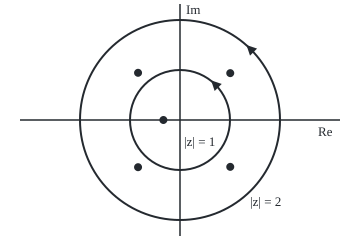

# Rouche's theorem: a dog on a short lead circles the post as often as its owner, so small changes never change the root count

[Syllabus](../../../SYLLABUS.md) → [Complex analysis](../README.md) → [Real Integrals and Counting Zeros](../README.md#s06) → Rouche's theorem

---

## General Overview

An owner walks once round a lamppost. Her dog runs about on a lead that is always shorter than her distance to the post. The dog can never reach the post, so it cannot slip round it on its own. It goes round exactly as often as she does.

Finding the five roots of z^5 + 3z + 1 = 0 takes a computer, yet the number inside the unit circle takes one line. On that circle 3z has size 3 and the rest, z^5 + 1, at most 2. So 3z is the owner, z^5 + 1 the lead, the polynomial the dog.

The owner has one root inside, at 0, so the polynomial has exactly one. On the circle of radius 2 the roles swap: z^5 has size 32 and 3z + 1 at most 7, so all five roots lie within radius 2.

Likewise z^3 − 1/8: on the unit circle z^3 has size 1, more than 1/8, so z^3 − 1/8 has three roots inside, as z^3 does. Eugène Rouché published the theorem in 1862.

**If one function is strictly bigger than a second at every point of a loop, adding the second changes nothing about how many zeros lie inside: the sum has exactly as many as the bigger function.**

**What kind of fact this is:** a theorem, proved on this card in Why it works from the argument principle.

### The picture: five roots, two circles

<p align="center"></p>

To scale: 50 units per 1, with 0 at (180, 120); the root inside sits at (163.40, 120.00). Triangles mark the anticlockwise direction. The code finds the roots; the theorem never needs them.

---

## The formula

Reminders.

- Holomorphic means having a complex derivative at every point of a region.
- A closed path's winding number round 0 counts its net anticlockwise turns about 0 ([Deforming a loop](../03-Contour%20Integrals%20and%20Cauchy%27s%20Theorem/04-deforming-contours-and-winding-numbers.md)).
- The argument principle: a function holomorphic on and inside a loop, with no zero on it, has as many zeros inside as its image of the loop winds round 0 ([The argument principle](06-the-argument-principle.md)).

Let $f$ and $g$ be holomorphic on and inside a simple closed loop $C$ (one that does not cross itself), walked once anticlockwise. Write $N$ for the number of zeros inside $C$, each counted as often as its multiplicity (z^3 has one zero, at 0, counted three times). Then

$$|g(z)| < |f(z)| \ \text{ for every } z \text{ on } C \quad\Longrightarrow\quad N(f + g) = N(f).$$

**Read it aloud:** if the added function is smaller than the main one at every point of the loop, the sum has exactly as many zeros inside as the main one.

The metaphor hands over here: the owner is f(z), the dog f(z) + g(z), the lead g(z), the lamppost 0. The proof uses one helper, the dog divided by the owner:

$$h(z) = \frac{f(z) + g(z)}{f(z)} = 1 + \frac{g(z)}{f(z)}.$$

| Symbol | Plain meaning | In our example | Push it up and the answer… |
| --- | --- | --- | --- |
| $z$ | a point of the plane | a point on the circle | — |
| $f$ | the owner: the function whose zeros are known | 3z on radius 1; z^5 on radius 2 | more margin |
| $g$ | the lead: the added function | z^5 + 1; then 3z + 1 | once it reaches f, no conclusion |
| $C$ | the loop, walked once anticlockwise | the circles of radius 1 and 2 | — |
| $N$ | zeros inside the loop, with multiplicity | 1 inside radius 1; 5 inside radius 2 | — |
| $h$ | the ratio 1 + g/f | always within 1 of the point 1 | — |
| $p$, $a_k$ | a polynomial; its coefficients | z^5 + 3z + 1; a_1 = 3, a_0 = 1 | a larger circle needed |
| $R$, $n$ | a circle's radius; a polynomial's degree | R = 1, 2, 5; n = 5 | large R holds all n roots |

### When it holds

- **Holomorphic on and inside the loop, both functions.** A pole, a point where the function blows up ([Isolated singularities](../05-Laurent%20Series%2C%20Singularities%20and%20Residues/02-classifying-singularities.md)), breaks it if it lies inside: f = 1 and g = 1/(4z) satisfy 1/4 < 1 on the unit circle, yet 1 + 1/(4z) has a zero at −0.25 while 1 has none.
- **Strict inequality at every point of the loop.** Equality lets a root sit on the loop: f = z^3 and g = −1 have equal sizes on the unit circle, and z^3 − 1 has its three roots on the circle and none inside.
- **Everywhere on the loop, not at samples.** The code's sampled gaps illustrate; the bounds 3 − 2 and 32 − 7 prove.

---

## Why it works

### Step 0: zero counts are turns, and a short lead cannot change turns

The argument principle turns zero counts into winding numbers. So it is enough to show the dog f + g winds round 0 as often as the owner f.

### Step 1: neither the owner nor the dog touches the post

On the loop |f| > |g| ≥ 0, so f is never 0 there. The reverse triangle inequality, |u + v| ≥ |u| − |v|, gives |f + g| ≥ |f| − |g| > 0, so neither is f + g, and both winding numbers make sense.

### Step 2: split the dog into owner times helper

Since f is not 0 on the loop, f + g = f · h there. Multiplying complex numbers adds their angles ([Polar form](../01-Complex%20Numbers%20and%20the%20Plane/03-polar-form-and-argument.md)), so round the loop the dog's turns are the owner's turns plus the helper's.

### Step 3: the helper never goes round 0

On the loop, |h − 1| = |g|/|f| < 1, so h stays in the disc of radius 1 about the point 1. That disc lies where the real part is positive, the right half-plane. A path there keeps its angle between −π/2 and π/2, so it closes with zero net turns. The dog's turns equal the owner's.

### Step 4: back to zeros

By the argument principle, the owner's turns are N(f) and the dog's are N(f + g). They are equal.

<details>
<summary>Detailed proof, in integrals</summary>

Let $f$ and $g$ be holomorphic on an open set containing $C$ and its inside, with |g| < |f| on $C$. Steps 1 and 2 give f + g = f · h on a neighbourhood of $C$, with $h$ holomorphic there, since f is not 0 near the loop. Differentiating the product and dividing by it:

$$\frac{(f+g)'}{f+g} = \frac{f'}{f} + \frac{h'}{h}.$$

On $C$, and by continuity on a thinner neighbourhood of it, $h$ takes values in the right half-plane. There the principal logarithm Log, built from ln|w| and the principal argument, is holomorphic with derivative 1/w, so Log h has derivative h'/h near $C$. A derivative integrates to 0 round a closed loop ([Antiderivatives](../03-Contour%20Integrals%20and%20Cauchy%27s%20Theorem/02-antiderivatives-and-path-independence.md)), so the h'/h term contributes 0. Dividing by 2πi, the argument principle's integral gives N(f + g) = N(f) + 0.

</details>

### Step 5: count the quintic's roots

For p(z) = z^5 + 3z + 1 on the unit circle, take f = 3z and g = z^5 + 1: the triangle inequality gives |g| ≤ 2 < 3 = |f|. The owner has one zero, at 0, so p has exactly one root in |z| < 1.

On radius 2, take f = z^5 and g = 3z + 1: |g| ≤ 7 < 32 = |f|. The owner has five zeros, all at 0, so all five roots lie in |z| < 2. None is on the unit circle, where |p| ≥ 3 − 2 = 1, so four lie between the circles.

### Step 6: the fundamental theorem of algebra, in two lines

Let $p$ be z^n + a_(n−1) z^(n−1) + … + a_0, with the coefficients $a_k$, and let A be the sum of their sizes |a_k|. On a circle of radius $R$ greater than both 1 and A, the lower terms have size at most A R^(n−1) < R^n = |z^n|. So $p$ has as many zeros inside as z^n: all $n$ of them.

For the quintic A = 4, so radius 5 suffices; Step 5 did better. [Liouville's theorem](../03-Contour%20Integrals%20and%20Cauchy%27s%20Theorem/07-liouville-and-the-fundamental-theorem-of-algebra.md) proves a root exists by another road; Rouché adds the count and a disc holding them.

A second proof deforms instead of dividing. For t from 0 to 1, f + t g never vanishes on the loop, so its zero count varies continuously with t. A whole number that varies continuously cannot move.

---

## Worked numbers, by hand

| Step | Arithmetic | Value |
| --- | --- | --- |
| z^3 − 1/8 on the unit circle | lead 1/8 against owner 1 | owner wins |
| its roots | owner z^3 has a triple zero at 0 | **3 inside** |
| check by de Moivre | each root has size (1/8)^(1/3) | 0.5 |
| quintic, radius 1 | lead at most 1 + 1 = 2, owner 3 | **1 root inside** |
| quintic, radius 2 | lead at most 3 × 2 + 1 = 7, owner 2^5 = 32 | **5 roots inside** |
| between the circles | 5 − 1 | **4** |
| none on the unit circle | there \|p\| ≥ 3 − 2 | at least 1 |

The code finds the real root −0.331989 and two mirror-image pairs of sizes 1.262893 and 1.374269.

### What breaks if you drop a piece

| Mistake | Comes out at | What went wrong |
| --- | --- | --- |
| Equality allowed: z^3 − 1 against z^3 | 0 roots inside, not 3 | All three roots have size 1.000000: on the loop |
| A pole in g: 1 + 1/(4z) | winds 0 times, yet 1 zero inside | The pole at 0 cancels the zero at −0.25 in the count |
| Owner z^5 on the unit circle | would claim 5 roots; truth 1 | \|3z + 1\| reaches 4 there, more than \|z^5\| = 1 |


---

## Code, from first principles, and it actually runs

Two roads. Road one walks each circle in 2000 steps and adds the dog's small turns, the angle of each step's ratio p(next)/p(this) from atan2: the winding number with no integral. Road two finds all five roots by the Durand–Kerner iteration (correct each guess by p over the product of its distances to the other guesses) and counts them by size. The cubics use de Moivre's rule: the cube roots of a positive number share one size and sit a third of a turn apart ([Powers and roots](../01-Complex%20Numbers%20and%20the%20Plane/05-powers-roots-and-roots-of-unity.md)). Four asserts demand the roads agree, every root solves its equation, and both breaks show.

### Python

```python
# Rouche's theorem -- the check behind the card.  Standard library only.
# Road one: the dog's turns, the argument of f(z) followed step by step round a circle.
# Road two: the roots themselves, by Durand-Kerner or de Moivre, counted by size.
# The inequality |g| < |f| on the circle predicts both; the asserts demand they agree.
import math

def show(w):                                  # 'a + bi', six decimals, no -0.000000
    a, b = round(w.real, 6) + 0.0, round(w.imag, 6) + 0.0
    return f"{a:.6f} {'-' if b < 0 else '+'} {abs(b):.6f}i"
def loop(R, n=2000): return [R * complex(math.cos(2 * math.pi * k / n), math.sin(2 * math.pi * k / n)) for k in range(n + 1)]
def turns(h, R):                              # net turns of h(z) round 0 as z walks |z| = R once
    w = [h(z) for z in loop(R)]
    return sum(math.atan2((b / a).imag, (b / a).real) for a, b in zip(w, w[1:])) / (2 * math.pi)
def durand_kerner(h, n):                      # all n roots of a monic polynomial, found together
    zs = [complex(0.4, 0.9) ** k for k in range(n)]
    for _ in range(500):
        new = []
        for k, z in enumerate(zs):
            d = 1
            for j, w in enumerate(zs):
                if j != k: d *= z - w
            new.append(z - h(z) / d)
        zs = new
    return sorted(zs, key=lambda z: (round(z.real, 9), z.imag))
def cube_roots(c):                            # de Moivre: the three roots of z^3 = c, c > 0
    r = c ** (1 / 3)
    return [r * complex(math.cos(2 * math.pi * k / 3), math.sin(2 * math.pi * k / 3)) for k in range(3)]
def inside(zs, R): return sum(abs(z) < R - 1e-9 for z in zs)   # a root on the circle is not inside
def fx(x): return f"{round(x, 6) + 0.0:.6f}"

p = lambda z: z ** 5 + 3 * z + 1
c3 = cube_roots(1 / 8)
print(f"z^3 - 1/8 on |z| = 1: |f| = 1.000000, |g| = {1 / 8:.6f}; root sizes {', '.join(f'{abs(z):.6f}' for z in c3)}")
print(f"z^3 - 1/8: roots inside {inside(c3, 1)}; dog's turns {turns(lambda z: z ** 3 - 1 / 8, 1):.6f}; owner z^3 turns {turns(lambda z: z ** 3, 1):.6f}")
gap1 = min(abs(3 * z) - abs(z ** 5 + 1) for z in loop(1))
gap2 = min(abs(z ** 5) - abs(3 * z + 1) for z in loop(2))
print(f"quintic, |z| = 1: owner 3z, lead z^5 + 1 at most 2 < 3; least gap on the loop {gap1:.6f}")
print(f"quintic, |z| = 2: owner z^5, lead 3z + 1 at most 7 < 32; least gap on the loop {gap2:.6f}")
t1, t2 = turns(p, 1), turns(p, 2)
print(f"dog's turns: |z| = 1 {t1:.6f}, |z| = 2 {t2:.6f}; owner's turns {turns(lambda z: 3 * z, 1):.6f} and {turns(lambda z: z ** 5, 2):.6f}")
rs = durand_kerner(p, 5)
for k, z in enumerate(rs):
    print(f"root {k + 1}: {show(z)}, size {abs(z):.6f}")
n1, n2 = inside(rs, 1), inside(rs, 2)
print(f"roots in |z| < 1: {n1}; in |z| < 2: {n2}; between the circles: {n2 - n1}; least |p| on |z| = 1: {min(abs(p(z)) for z in loop(1)):.6f}")
print(f"two-line FTA: lower coefficients' sizes sum to 4, so at R = 5 the dog turns {turns(p, 5):.6f}")
e3 = cube_roots(1)
print(f"mistake, equality: z^3 - 1 has root sizes {', '.join(f'{abs(z):.6f}' for z in e3)}; inside {inside(e3, 1)}, not 3")
zero = durand_kerner(lambda z: z + 1 / 4, 1)                   # 1 + 1/(4z) = 0 exactly when z + 1/4 = 0
tp = turns(lambda z: 1 + 1 / (4 * z), 1)
print(f"mistake, a pole: 1 + 1/(4z) turns {fx(tp)}, yet its zero {show(zero[0])} is inside; 1 has none")
print(f"mistake, wrong owner on |z| = 1: |3z + 1| reaches {max(abs(3 * z + 1) for z in loop(1)):.6f} > 1 = |z^5|; true count {n1}, not 5")
print(f"silent test: z^5 + 3z + 3 has a lead reaching 4 > 3 on |z| = 1, yet {inside(durand_kerner(lambda z: z ** 5 + 3 * z + 3, 5), 1)} root inside, as before")
print("figure, 50 units per 1, 0 at (180, 120); roots at " + ", ".join(f"({180 + 50 * z.real:.2f}, {120 - 50 * z.imag:.2f})" for z in rs))
assert round(t1) == n1 == 1 and round(t2) == n2 == 5                  # dog's turns against counted roots
assert all(abs(p(z)) < 1e-12 for z in rs) and abs(t1 - n1) < 1e-9 and abs(t2 - n2) < 1e-9
assert inside(c3, 1) == round(turns(lambda z: z ** 3 - 1 / 8, 1)) == 3 and all(abs(z ** 3 - 1 / 8) < 1e-12 for z in c3)  # de Moivre against the dog
assert inside(e3, 1) == 0 and all(abs(z ** 3 - 1) < 1e-12 for z in e3) and inside(zero, 1) == 1 != round(tp)  # both breaks show
print("ALL CHECKS PASS")
```

**Ran 2026-09-28 on macOS, Python 3.14.6, standard library only. All checks passed. Output, pasted from the run:**

```
z^3 - 1/8 on |z| = 1: |f| = 1.000000, |g| = 0.125000; root sizes 0.500000, 0.500000, 0.500000
z^3 - 1/8: roots inside 3; dog's turns 3.000000; owner z^3 turns 3.000000
quintic, |z| = 1: owner 3z, lead z^5 + 1 at most 2 < 3; least gap on the loop 1.000000
quintic, |z| = 2: owner z^5, lead 3z + 1 at most 7 < 32; least gap on the loop 25.000000
dog's turns: |z| = 1 1.000000, |z| = 2 5.000000; owner's turns 1.000000 and 5.000000
root 1: -0.839072 - 0.943852i, size 1.262893
root 2: -0.839072 + 0.943852i, size 1.262893
root 3: -0.331989 + 0.000000i, size 0.331989
root 4: 1.005067 - 0.937259i, size 1.374269
root 5: 1.005067 + 0.937259i, size 1.374269
roots in |z| < 1: 1; in |z| < 2: 5; between the circles: 4; least |p| on |z| = 1: 1.453290
two-line FTA: lower coefficients' sizes sum to 4, so at R = 5 the dog turns 5.000000
mistake, equality: z^3 - 1 has root sizes 1.000000, 1.000000, 1.000000; inside 0, not 3
mistake, a pole: 1 + 1/(4z) turns 0.000000, yet its zero -0.250000 + 0.000000i is inside; 1 has none
mistake, wrong owner on |z| = 1: |3z + 1| reaches 4.000000 > 1 = |z^5|; true count 1, not 5
silent test: z^5 + 3z + 3 has a lead reaching 4 > 3 on |z| = 1, yet 1 root inside, as before
figure, 50 units per 1, 0 at (180, 120); roots at (138.05, 167.19), (138.05, 72.81), (163.40, 120.00), (230.25, 166.86), (230.25, 73.14)
ALL CHECKS PASS
```

### Rust

Same numbers, same labels, built with `rustc --edition 2021 -O`.

```rust
// Rouche's theorem -- the same check as the Python, in Rust.  No crates.
// Road one: the dog's turns, the argument of f(z) followed step by step round a circle.
// Road two: the roots themselves, by Durand-Kerner or de Moivre, counted by size.
// The inequality |g| < |f| on the circle predicts both; the asserts demand they agree.
use std::f64::consts::PI;
use std::ops::{Add, Div, Mul, Sub};
#[derive(Clone, Copy)]
struct C { re: f64, im: f64 }
fn c(re: f64, im: f64) -> C { C { re, im } }
impl Add for C { type Output = C; fn add(self, b: C) -> C { c(self.re + b.re, self.im + b.im) } }
impl Sub for C { type Output = C; fn sub(self, b: C) -> C { c(self.re - b.re, self.im - b.im) } }
impl Mul for C { type Output = C; fn mul(self, b: C) -> C { c(self.re * b.re - self.im * b.im, self.re * b.im + self.im * b.re) } }
impl Div for C { type Output = C; fn div(self, b: C) -> C { let d = b.re * b.re + b.im * b.im; c((self.re * b.re + self.im * b.im) / d, (self.im * b.re - self.re * b.im) / d) } }
fn abs(a: C) -> f64 { a.re.hypot(a.im) }
fn pw(z: C, n: u32) -> C { (0..n).fold(c(1.0, 0.0), |acc, _| acc * z) }
fn fx(x: f64) -> String { let s = format!("{:.6}", x); if s == "-0.000000" { "0.000000".into() } else { s } }
fn show(w: C) -> String { // 'a + bi', six decimals, no -0.000000
    let b = fx(w.im.abs());
    let sign = if w.im < 0.0 && b != "0.000000" { '-' } else { '+' };
    format!("{} {} {}i", fx(w.re), sign, b)
}
fn lp(r: f64) -> Vec<C> { (0..=2000).map(|k| { let t = 2.0 * PI * k as f64 / 2000.0; c(r * t.cos(), r * t.sin()) }).collect() }
fn turns(h: &dyn Fn(C) -> C, r: f64) -> f64 { // net turns of h(z) round 0 as z walks |z| = R once
    let w: Vec<C> = lp(r).into_iter().map(|z| h(z)).collect();
    w.windows(2).map(|p| { let q = p[1] / p[0]; q.im.atan2(q.re) }).sum::<f64>() / (2.0 * PI)
}
fn durand_kerner(h: &dyn Fn(C) -> C, n: usize) -> Vec<C> { // all n roots of a monic polynomial, found together
    let mut zs: Vec<C> = (0..n).map(|k| pw(c(0.4, 0.9), k as u32)).collect();
    for _ in 0..500 {
        let old = zs.clone();
        zs = (0..n).map(|k| {
            let d = (0..n).filter(|&j| j != k).fold(c(1.0, 0.0), |acc, j| acc * (old[k] - old[j]));
            old[k] - h(old[k]) / d
        }).collect();
    }
    let key = |z: &C| ((z.re * 1e9).round(), z.im);
    zs.sort_by(|a, b| key(a).partial_cmp(&key(b)).unwrap());
    zs
}
fn cube_roots(v: f64) -> Vec<C> { // de Moivre: the three roots of z^3 = v, v > 0
    let r = v.powf(1.0 / 3.0);
    (0..3).map(|k| { let t = 2.0 * PI * k as f64 / 3.0; c(r * t.cos(), r * t.sin()) }).collect()
}
fn inside(zs: &[C], r: f64) -> usize { zs.iter().filter(|&&z| abs(z) < r - 1e-9).count() } // a root on the circle is not inside
fn sizes(zs: &[C]) -> String { zs.iter().map(|&z| format!("{:.6}", abs(z))).collect::<Vec<_>>().join(", ") }
fn main() {
    let p = |z: C| pw(z, 5) + c(3.0, 0.0) * z + c(1.0, 0.0);
    let c3 = cube_roots(1.0 / 8.0);
    println!("z^3 - 1/8 on |z| = 1: |f| = 1.000000, |g| = {:.6}; root sizes {}", 1.0 / 8.0, sizes(&c3));
    println!("z^3 - 1/8: roots inside {}; dog's turns {:.6}; owner z^3 turns {:.6}", inside(&c3, 1.0),
        turns(&|z| pw(z, 3) - c(0.125, 0.0), 1.0), turns(&|z| pw(z, 3), 1.0));
    let gap1 = lp(1.0).iter().map(|&z| abs(c(3.0, 0.0) * z) - abs(pw(z, 5) + c(1.0, 0.0))).fold(f64::MAX, f64::min);
    let gap2 = lp(2.0).iter().map(|&z| abs(pw(z, 5)) - abs(c(3.0, 0.0) * z + c(1.0, 0.0))).fold(f64::MAX, f64::min);
    println!("quintic, |z| = 1: owner 3z, lead z^5 + 1 at most 2 < 3; least gap on the loop {:.6}", gap1);
    println!("quintic, |z| = 2: owner z^5, lead 3z + 1 at most 7 < 32; least gap on the loop {:.6}", gap2);
    let (t1, t2) = (turns(&p, 1.0), turns(&p, 2.0));
    println!("dog's turns: |z| = 1 {:.6}, |z| = 2 {:.6}; owner's turns {:.6} and {:.6}", t1, t2,
        turns(&|z| c(3.0, 0.0) * z, 1.0), turns(&|z| pw(z, 5), 2.0));
    let rs = durand_kerner(&p, 5);
    for (k, &z) in rs.iter().enumerate() { println!("root {}: {}, size {:.6}", k + 1, show(z), abs(z)) }
    let (n1, n2) = (inside(&rs, 1.0), inside(&rs, 2.0));
    let least = lp(1.0).iter().map(|&z| abs(p(z))).fold(f64::MAX, f64::min);
    println!("roots in |z| < 1: {}; in |z| < 2: {}; between the circles: {}; least |p| on |z| = 1: {:.6}", n1, n2, n2 - n1, least);
    println!("two-line FTA: lower coefficients' sizes sum to 4, so at R = 5 the dog turns {:.6}", turns(&p, 5.0));
    let e3 = cube_roots(1.0);
    println!("mistake, equality: z^3 - 1 has root sizes {}; inside {}, not 3", sizes(&e3), inside(&e3, 1.0));
    let zero = durand_kerner(&|z| z + c(0.25, 0.0), 1); // 1 + 1/(4z) = 0 exactly when z + 1/4 = 0
    let tp = turns(&|z| c(1.0, 0.0) + c(1.0, 0.0) / (c(4.0, 0.0) * z), 1.0);
    println!("mistake, a pole: 1 + 1/(4z) turns {}, yet its zero {} is inside; 1 has none", fx(tp), show(zero[0]));
    let reach = lp(1.0).iter().map(|&z| abs(c(3.0, 0.0) * z + c(1.0, 0.0))).fold(0.0, f64::max);
    println!("mistake, wrong owner on |z| = 1: |3z + 1| reaches {:.6} > 1 = |z^5|; true count {}, not 5", reach, n1);
    println!("silent test: z^5 + 3z + 3 has a lead reaching 4 > 3 on |z| = 1, yet {} root inside, as before", inside(&durand_kerner(&|z| pw(z, 5) + c(3.0, 0.0) * z + c(3.0, 0.0), 5), 1.0));
    let fig: Vec<String> = rs.iter().map(|z| format!("({:.2}, {:.2})", 180.0 + 50.0 * z.re, 120.0 - 50.0 * z.im)).collect();
    println!("figure, 50 units per 1, 0 at (180, 120); roots at {}", fig.join(", "));
    assert!(t1.round() as usize == n1 && n1 == 1 && t2.round() as usize == n2 && n2 == 5); // dog's turns against counted roots
    assert!(rs.iter().all(|&z| abs(p(z)) < 1e-12) && (t1 - n1 as f64).abs() < 1e-9 && (t2 - n2 as f64).abs() < 1e-9);
    assert!(inside(&c3, 1.0) == 3 && turns(&|z| pw(z, 3) - c(0.125, 0.0), 1.0).round() == 3.0 && c3.iter().all(|&z| abs(pw(z, 3) - c(0.125, 0.0)) < 1e-12)); // de Moivre against the dog
    assert!(inside(&e3, 1.0) == 0 && e3.iter().all(|&z| abs(pw(z, 3) - c(1.0, 0.0)) < 1e-12) && inside(&zero, 1.0) == 1 && tp.round() != 1.0); // both breaks show
    println!("ALL CHECKS PASS");
}
```

**Ran 2026-09-28 on macOS, rustc 1.98.1, no crates. All checks passed. Output, pasted from the run:**

```
z^3 - 1/8 on |z| = 1: |f| = 1.000000, |g| = 0.125000; root sizes 0.500000, 0.500000, 0.500000
z^3 - 1/8: roots inside 3; dog's turns 3.000000; owner z^3 turns 3.000000
quintic, |z| = 1: owner 3z, lead z^5 + 1 at most 2 < 3; least gap on the loop 1.000000
quintic, |z| = 2: owner z^5, lead 3z + 1 at most 7 < 32; least gap on the loop 25.000000
dog's turns: |z| = 1 1.000000, |z| = 2 5.000000; owner's turns 1.000000 and 5.000000
root 1: -0.839072 - 0.943852i, size 1.262893
root 2: -0.839072 + 0.943852i, size 1.262893
root 3: -0.331989 + 0.000000i, size 0.331989
root 4: 1.005067 - 0.937259i, size 1.374269
root 5: 1.005067 + 0.937259i, size 1.374269
roots in |z| < 1: 1; in |z| < 2: 5; between the circles: 4; least |p| on |z| = 1: 1.453290
two-line FTA: lower coefficients' sizes sum to 4, so at R = 5 the dog turns 5.000000
mistake, equality: z^3 - 1 has root sizes 1.000000, 1.000000, 1.000000; inside 0, not 3
mistake, a pole: 1 + 1/(4z) turns 0.000000, yet its zero -0.250000 + 0.000000i is inside; 1 has none
mistake, wrong owner on |z| = 1: |3z + 1| reaches 4.000000 > 1 = |z^5|; true count 1, not 5
silent test: z^5 + 3z + 3 has a lead reaching 4 > 3 on |z| = 1, yet 1 root inside, as before
figure, 50 units per 1, 0 at (180, 120); roots at (138.05, 167.19), (138.05, 72.81), (163.40, 120.00), (230.25, 166.86), (230.25, 73.14)
ALL CHECKS PASS
```

The two outputs match line for line.

### Lean

Lean proves Rouché's theorem when the loop is a circle, the quintic's two root counts, and the two-line fundamental theorem of algebra.

- Let f and g be holomorphic on and inside a circle. If |g(z)| < |f(z)| at every point of the circle, then N(f + g) = N(f).
- On both sides, each zero inside the circle is counted as often as its multiplicity.
- z^5 + 3z + 1 has exactly one root inside the unit circle, and all five roots inside the circle of radius 2.
- Let p be z^n + a_(n−1) z^(n−1) + … + a_0, and A the sum of the sizes |a_k|. Inside any circle about 0 with radius greater than both 1 and A lie all n roots of p.
- The hand arithmetic holds: 2 < 3 and 7 < 32 for the bounds, 3 − 2 = 1, 5 − 1 = 4, and A = 4 < 5.
- It also checks 1/8 < 1 for z^3 − 1/8, and 4 > 1 and 4 > 3 for the failed tests.

Turn counts, root decimals, the cubics' roots and the pole are left to the Python and Rust checks.

```lean
-- Rouche's theorem: if f and g are holomorphic on and inside a circle and |g| < |f| at every point of the circle, then f + g and f have the same number of zeros inside it, counted with multiplicity; so z^5 + 3z + 1 has one root inside the unit circle and all five inside radius 2, and every monic polynomial of degree n has all n roots inside any circle of radius above 1 and above the sum of its lower coefficients' sizes.
import Mathlib.Analysis.Analytic.Order
import Mathlib.Analysis.Calculus.FDeriv.Basic
import Mathlib.Analysis.Complex.Basic
import Mathlib.Algebra.Polynomial.Roots
import Mathlib.Algebra.BigOperators.Finprod
import Mathlib.Tactic.NormNum
import Mathlib

/-! The plane is `ℂ`. The loop is the circle `Metric.sphere c R` (centre `c`, radius `R`), walked
once anticlockwise; its inside is the open disc `Metric.ball c R`. Mathlib has no inside for a
general simple closed loop, so this file states the theorem for circles, the loops all of the
card's examples use. "Holomorphic on and inside the loop" is `DifferentiableOn ℂ f
(Metric.closedBall c R)`. `analyticOrderNatAt f z` is the multiplicity of `z` as a zero of `f`
(`0` when `f z ≠ 0`), so `∑ᶠ z ∈ Metric.ball c R, analyticOrderNatAt f z` is `N(f)`, the number
of zeros inside, each counted as often as its multiplicity. For a polynomial `p`, `p.roots` lists
its roots with multiplicity, and `(p.roots.filter (‖·‖ < R)).card` counts those inside radius `R`. -/

open Polynomial

namespace RouchesTheorem

section Helpers

open Complex Metric Filter Topology Set Real

lemma aux_order_ne_top {h : ℂ → ℂ} {c : ℂ} {ρ R : ℝ} (hρ : 0 < ρ) (hρR : ρ < R)
    (hd : DifferentiableOn ℂ h (ball c R)) (hne : ∀ z ∈ sphere c ρ, h z ≠ 0) :
    ∀ z ∈ ball c R, analyticOrderAt h z ≠ ⊤ := by
  intro z hz htop
  have han : AnalyticOnNhd ℂ h (ball c R) := hd.analyticOnNhd isOpen_ball
  have h0 := han.eqOn_zero_of_preconnected_of_eventuallyEq_zero (convex_ball c R).isPreconnected hz
    (analyticOrderAt_eq_top.1 htop)
  have hmem : c + ρ ∈ sphere c ρ := by simp [abs_of_pos hρ]
  have hmem' : c + ρ ∈ ball c R := by simp [abs_of_pos hρ, hρR]
  exact hne _ hmem (h0 hmem')

lemma aux_finite {h : ℂ → ℂ} {c : ℂ} {ρ R : ℝ} (hρ : 0 < ρ) (hρR : ρ < R)
    (hd : DifferentiableOn ℂ h (ball c R)) (hne : ∀ z ∈ sphere c ρ, h z ≠ 0) :
    (ball c ρ ∩ Function.support (analyticOrderNatAt h)).Finite := by
  have han : AnalyticOnNhd ℂ h (ball c R) := hd.analyticOnNhd isOpen_ball
  have hsub : ball c ρ ∩ Function.support (analyticOrderNatAt h) ⊆
      {z ∈ closedBall c ρ | h z = 0} := by
    rintro z ⟨hz, hz'⟩
    exact ⟨ball_subset_closedBall hz, apply_eq_zero_of_analyticOrderNatAt_ne_zero hz'⟩
  refine Set.Finite.subset ?_ hsub
  by_contra hinf
  obtain ⟨x, hx, hacc⟩ := Set.Infinite.exists_accPt_of_subset_isCompact hinf
    (isCompact_closedBall c ρ) (fun z hz => hz.1)
  have hxR : x ∈ ball c R := closedBall_subset_ball hρR hx
  have hfreq : ∃ᶠ z in 𝓝[≠] x, h z = 0 :=
    (accPt_iff_frequently_nhdsNE.1 hacc).mono fun z hz => hz.2
  have h0 := han.eqOn_zero_of_preconnected_of_frequently_eq_zero
    (convex_ball c R).isPreconnected hxR hfreq
  have hmem : c + ρ ∈ sphere c ρ := by simp [abs_of_pos hρ]
  have hmem' : c + ρ ∈ ball c R := by simp [abs_of_pos hρ, hρR]
  exact hne _ hmem (h0 hmem')

lemma aux_logDeriv_diffAt {h : ℂ → ℂ} {c z : ℂ} {R : ℝ}
    (hd : DifferentiableOn ℂ h (ball c R)) (hz : z ∈ ball c R) (hne : h z ≠ 0) :
    DifferentiableAt ℂ (logDeriv h) z := by
  have hd' := (hd.deriv isOpen_ball).differentiableAt (isOpen_ball.mem_nhds hz)
  have hh := hd.differentiableAt (isOpen_ball.mem_nhds hz)
  have : logDeriv h = fun x => deriv h x / h x := rfl
  rw [this]
  exact hd'.div hh hne

lemma aux_logDeriv_contOn {h : ℂ → ℂ} {c : ℂ} {R : ℝ} {S : Set ℂ}
    (hd : DifferentiableOn ℂ h (ball c R)) (hS : S ⊆ ball c R) (hne : ∀ z ∈ S, h z ≠ 0) :
    ContinuousOn (logDeriv h) S := fun z hz =>
  (aux_logDeriv_diffAt hd (hS hz) (hne z hz)).continuousAt.continuousWithinAt

lemma aux_order_lin (a z : ℂ) :
    analyticOrderNatAt (fun w => w - a) z = if z = a then 1 else 0 := by
  have han : AnalyticAt ℂ (fun w => w - a) z := analyticAt_id.sub analyticAt_const
  split_ifs with hza
  · subst hza
    have : analyticOrderAt (fun w => w - z) z = (1 : ℕ) := by
      rw [han.analyticOrderAt_eq_natCast]
      exact ⟨fun _ => 1, analyticAt_const, one_ne_zero, Eventually.of_forall fun w => by simp⟩
    simp [analyticOrderNatAt, this]
  · have : analyticOrderAt (fun w => w - a) z = 0 :=
      analyticOrderAt_eq_zero.2 (Or.inr (sub_ne_zero.2 hza))
    simp [analyticOrderNatAt, this]

lemma aux_arg (n : ℕ) : ∀ (h : ℂ → ℂ) (c : ℂ) (ρ R : ℝ), 0 < ρ → ρ < R →
    DifferentiableOn ℂ h (ball c R) → (∀ z ∈ sphere c ρ, h z ≠ 0) →
    ∑ᶠ z ∈ ball c ρ, analyticOrderNatAt h z = n →
    (∮ z in C(c, ρ), logDeriv h z) = 2 * π * I * n := by
  induction n with
  | zero =>
    intro h c ρ R hρ hρR hd hne hsum
    have hfin := aux_finite hρ hρR hd hne
    have htop := aux_order_ne_top hρ hρR hd hne
    have han : AnalyticOnNhd ℂ h (ball c R) := hd.analyticOnNhd isOpen_ball
    have hnz : ∀ z ∈ closedBall c ρ, h z ≠ 0 := by
      intro z hz
      rcases (mem_closedBall.1 hz).lt_or_eq with hlt | heq
      · have hzb : z ∈ ball c ρ := mem_ball.2 hlt
        have hzR : z ∈ ball c R := ball_subset_ball hρR.le hzb
        have h0 : analyticOrderNatAt h z = 0 := by
          by_contra hne0
          have hmem : z ∈ ball c ρ ∩ Function.support (analyticOrderNatAt h) := ⟨hzb, hne0⟩
          rw [← finsum_mem_inter_support, finsum_mem_eq_finite_toFinset_sum _ hfin] at hsum
          exact hne0 (Finset.sum_eq_zero_iff.1 hsum z (hfin.mem_toFinset.2 hmem))
        have h0' : analyticOrderAt h z = 0 := by
          have := htop z hzR
          simp only [analyticOrderNatAt, ENat.toNat_eq_zero] at h0
          tauto
        rcases analyticOrderAt_eq_zero.1 h0' with h1 | h1
        · exact absurd (han z hzR) h1
        · exact h1
      · exact hne z (mem_sphere.2 heq)
    have hcb : closedBall c ρ ⊆ ball c R := closedBall_subset_ball hρR
    rw [Complex.circleIntegral_eq_zero_of_differentiable_on_off_countable hρ.le
      Set.countable_empty (aux_logDeriv_contOn hd hcb hnz)
      (fun z hz => aux_logDeriv_diffAt hd (hcb (ball_subset_closedBall hz.1))
        (hnz z (ball_subset_closedBall hz.1)))]
    simp
  | succ n ih =>
    intro h c ρ R hρ hρR hd hne hsum
    have hfin := aux_finite hρ hρR hd hne
    have htop := aux_order_ne_top hρ hρR hd hne
    obtain ⟨a, ha, ha0⟩ : ∃ a ∈ ball c ρ, analyticOrderNatAt h a ≠ 0 := by
      by_contra hcon
      push Not at hcon
      rw [finsum_mem_congr rfl hcon] at hsum
      simp at hsum
    have haR : a ∈ ball c R := ball_subset_ball hρR.le ha
    have hha : h a = 0 := apply_eq_zero_of_analyticOrderNatAt_ne_zero ha0
    have hkd : DifferentiableOn ℂ (dslope h a) (ball c R) :=
      (differentiableOn_dslope (isOpen_ball.mem_nhds haR)).2 hd
    have hfac : ∀ z, h z = (z - a) * dslope h a z := by
      intro z
      have := sub_smul_dslope h a z
      rw [hha, sub_zero, smul_eq_mul] at this
      exact this.symm
    generalize dslope h a = k at hkd hfac
    have hfun : h = (fun w => w - a) * k := funext hfac
    have hkne : ∀ z ∈ sphere c ρ, k z ≠ 0 := fun z hz hk0 =>
      hne z hz (by rw [hfac, hk0, mul_zero])
    have hkan : AnalyticOnNhd ℂ (k) (ball c R) := hkd.analyticOnNhd isOpen_ball
    have hlin_an : ∀ z, AnalyticAt ℂ (fun w => w - a) z :=
      fun z => analyticAt_id.sub analyticAt_const
    have hktop := aux_order_ne_top hρ hρR hkd hkne
    have hkfin := aux_finite hρ hρR hkd hkne
    have hsplit : ∀ z ∈ ball c ρ, analyticOrderNatAt h z =
        analyticOrderNatAt (fun w => w - a) z + analyticOrderNatAt (k) z := by
      intro z hz
      have hzR := ball_subset_ball hρR.le hz
      have hlt : analyticOrderAt (fun w => w - a) z ≠ ⊤ := fun ht =>
        htop z hzR (by rw [hfun]; exact analyticOrderAt_mul_eq_top_of_left ht)
      rw [hfun]
      exact analyticOrderNatAt_mul (hlin_an z) (hkan z hzR) hlt (hktop z hzR)
    have hlin_sum : ∑ᶠ z ∈ ball c ρ, analyticOrderNatAt (fun w => w - a) z = 1 := by
      rw [← finsum_mem_inter_support]
      have hset : ball c ρ ∩ Function.support (fun z => analyticOrderNatAt (fun w => w - a) z)
          = {a} := by
        ext z
        simp only [Set.mem_inter_iff, Function.mem_support, aux_order_lin, Set.mem_singleton_iff]
        constructor
        · rintro ⟨_, hz⟩
          by_contra hza
          simp [hza] at hz
        · rintro rfl
          simp [ha]
      rw [hset, finsum_mem_singleton, aux_order_lin]
      simp
    have hlinfin : (ball c ρ ∩ Function.support
        (fun z => analyticOrderNatAt (fun w => w - a) z)).Finite := by
      by_contra hinf
      rw [finsum_mem_eq_zero_of_infinite hinf] at hlin_sum
      exact zero_ne_one hlin_sum
    have hksum : ∑ᶠ z ∈ ball c ρ, analyticOrderNatAt (k) z = n := by
      rw [finsum_mem_congr rfl hsplit, finsum_mem_add_distrib' hlinfin hkfin, hlin_sum] at hsum
      omega
    have hik := ih (k) c ρ R hρ hρR hkd hkne hksum
    have hnea : ∀ z ∈ sphere c ρ, z - a ≠ 0 := by
      intro z hz hza
      rw [sub_eq_zero] at hza
      subst hza
      rw [mem_sphere] at hz
      rw [mem_ball] at ha
      linarith
    have heq : EqOn (logDeriv h) (fun z => (z - a)⁻¹ + logDeriv (k) z) (sphere c ρ) := by
      intro z hz
      have hzR : z ∈ ball c R := sphere_subset_closedBall.trans (closedBall_subset_ball hρR) hz
      rw [hfun, logDeriv_mul (f := fun w : ℂ => w - a) (g := k) z (hnea z hz) (hkne z hz)
        (by fun_prop)
        (hkd.differentiableAt (isOpen_ball.mem_nhds hzR))]
      simp [logDeriv_apply]
    have hsphR : sphere c ρ ⊆ ball c R := sphere_subset_closedBall.trans (closedBall_subset_ball hρR)
    have hint1 : CircleIntegrable (fun z => (z - a)⁻¹) c ρ := by
      apply ContinuousOn.circleIntegrable hρ.le
      exact ((continuous_id.sub continuous_const).continuousOn).inv₀ hnea
    have hint2 : CircleIntegrable (logDeriv (k)) c ρ :=
      ContinuousOn.circleIntegrable hρ.le (aux_logDeriv_contOn hkd hsphR hkne)
    rw [circleIntegral.integral_congr hρ.le heq, circleIntegral.integral_add hint1 hint2,
      circleIntegral.integral_sub_inv_of_mem_ball ha, hik]
    push_cast
    ring

lemma aux_rouche (f g : ℂ → ℂ) (c : ℂ) (R : ℝ)
    (hf : DifferentiableOn ℂ f (closedBall c R))
    (hg : DifferentiableOn ℂ g (closedBall c R))
    (hlt : ∀ z ∈ sphere c R, ‖g z‖ < ‖f z‖) :
    ∑ᶠ z ∈ ball c R, analyticOrderNatAt (f + g) z =
      ∑ᶠ z ∈ ball c R, analyticOrderNatAt f z := by
  rcases le_or_gt R 0 with hR | hR
  · simp [ball_eq_empty.2 hR]
  set K := {z ∈ closedBall c R | ‖f z‖ ≤ ‖g z‖} with hK
  have hKc : IsClosed K :=
    IsClosed.isClosed_le isClosed_closedBall hf.continuousOn.norm hg.continuousOn.norm
  have hKsub : K ⊆ ball c R := by
    rintro z ⟨hz, hz'⟩
    rcases (mem_closedBall.1 hz).lt_or_eq with h1 | h1
    · exact mem_ball.2 h1
    · exact absurd hz' (not_le.2 (hlt z (mem_sphere.2 h1)))
  obtain ⟨r, hrR, hKr⟩ := exists_lt_subset_ball hKc hKsub
  set ρ := (max r 0 + R) / 2 with hρdef
  have hρpos : 0 < ρ := by have := le_max_right r 0; rw [hρdef]; linarith
  have hrρ : r < ρ := by have := le_max_left r 0; rw [hρdef]; linarith
  have hρR : ρ < R := by
    have : max r 0 < R := max_lt hrR hR
    rw [hρdef]; linarith
  have hgood : ∀ z ∈ closedBall c R, ρ ≤ dist z c → ‖g z‖ < ‖f z‖ := by
    intro z hz hρz
    by_contra hcon
    have h1 := hKr ⟨hz, not_lt.1 hcon⟩
    rw [mem_ball] at h1
    linarith
  have hfd : DifferentiableOn ℂ f (ball c R) := hf.mono ball_subset_closedBall
  have hFd : DifferentiableOn ℂ (f + g) (ball c R) := (hf.add hg).mono ball_subset_closedBall
  have hgood' : ∀ z ∈ closedBall c R, ρ ≤ dist z c → f z ≠ 0 ∧ (f + g) z ≠ 0 := by
    intro z hz hρz
    have h1 := hgood z hz hρz
    refine ⟨fun h0 => ?_, fun h0 => ?_⟩
    · rw [h0, norm_zero] at h1
      exact (norm_nonneg _).not_gt h1
    · rw [Pi.add_apply, add_eq_zero_iff_eq_neg] at h0
      rw [h0, norm_neg] at h1
      exact lt_irrefl _ h1
  have hsph : ∀ z ∈ sphere c ρ, z ∈ closedBall c R ∧ ρ ≤ dist z c := fun z hz =>
    ⟨sphere_subset_closedBall.trans (closedBall_subset_closedBall hρR.le) hz,
      (mem_sphere.1 hz).ge⟩
  have hred : ∀ φ : ℂ → ℂ, (∀ z ∈ closedBall c R, ρ ≤ dist z c → φ z ≠ 0) →
      ∑ᶠ z ∈ ball c R, analyticOrderNatAt φ z = ∑ᶠ z ∈ ball c ρ, analyticOrderNatAt φ z := by
    intro φ hφ
    rw [← finsum_mem_inter_support, ← finsum_mem_inter_support (s := ball c ρ)]
    have hset : ball c R ∩ Function.support (analyticOrderNatAt φ) =
        ball c ρ ∩ Function.support (analyticOrderNatAt φ) := by
      ext z
      constructor
      · rintro ⟨hz, hz'⟩
        refine ⟨?_, hz'⟩
        by_contra hzρ
        rw [mem_ball, not_lt] at hzρ
        exact hφ z (ball_subset_closedBall hz) hzρ (apply_eq_zero_of_analyticOrderNatAt_ne_zero hz')
      · rintro ⟨hz, hz'⟩
        exact ⟨ball_subset_ball hρR.le hz, hz'⟩
    rw [hset]
  rw [hred (f + g) (fun z hz h' => (hgood' z hz h').2), hred f (fun z hz h' => (hgood' z hz h').1)]
  have hneF : ∀ z ∈ sphere c ρ, (f + g) z ≠ 0 := fun z hz => (hgood' z (hsph z hz).1 (hsph z hz).2).2
  have hnef : ∀ z ∈ sphere c ρ, f z ≠ 0 := fun z hz => (hgood' z (hsph z hz).1 (hsph z hz).2).1
  have h1 := aux_arg _ (f + g) c ρ R hρpos hρR hFd hneF rfl
  have h2 := aux_arg _ f c ρ R hρpos hρR hfd hnef rfl
  have hsphR : sphere c ρ ⊆ ball c R := sphere_subset_closedBall.trans (closedBall_subset_ball hρR)
  have hint1 : CircleIntegrable (logDeriv (f + g)) c ρ :=
    ContinuousOn.circleIntegrable hρpos.le (aux_logDeriv_contOn hFd hsphR hneF)
  have hint2 : CircleIntegrable (logDeriv f) c ρ :=
    ContinuousOn.circleIntegrable hρpos.le (aux_logDeriv_contOn hfd hsphR hnef)
  have hderiv : ∀ z ∈ sphere c ρ, HasDerivWithinAt (fun w => log ((f + g) w / f w))
      (logDeriv (f + g) z - logDeriv f z) (sphere c ρ) z := by
    intro z hz
    have hzR := hsphR hz
    have hFz := (hFd.differentiableAt (isOpen_ball.mem_nhds hzR)).hasDerivAt
    have hfz := (hfd.differentiableAt (isOpen_ball.mem_nhds hzR)).hasDerivAt
    have hf0 := hnef z hz
    have hF0 := hneF z hz
    have hslit : (f + g) z / f z ∈ slitPlane := by
      apply mem_slitPlane_iff.2 (Or.inl _)
      have hq : (f + g) z / f z = 1 + g z / f z := by
        rw [Pi.add_apply]; field_simp
      have hn : ‖g z / f z‖ < 1 := by
        rw [norm_div, div_lt_one (norm_pos_iff.2 hf0)]
        exact hgood z (hsph z hz).1 (hsph z hz).2
      rw [hq, add_re, one_re]
      have := abs_re_le_norm (g z / f z)
      have := neg_abs_le (g z / f z).re
      linarith
    have := (hFz.div hfz hf0).clog hslit
    convert this.hasDerivWithinAt using 1
    rw [logDeriv_apply, logDeriv_apply, Pi.div_apply]
    field_simp
  have h3 := circleIntegral.integral_eq_zero_of_hasDerivWithinAt hρpos.le hderiv
  rw [circleIntegral.integral_sub hint1 hint2, h1, h2, sub_eq_zero] at h3
  have hpi : (2 * (π : ℂ) * I) ≠ 0 := by
    simp [Real.pi_ne_zero, I_ne_zero]
  exact_mod_cast mul_left_cancel₀ hpi h3

lemma aux_order_poly (p : ℂ[X]) (hp : p ≠ 0) (z : ℂ) :
    analyticOrderNatAt (fun w => p.eval w) z = p.rootMultiplicity z := by
  obtain ⟨q, hpq, hndvd⟩ := p.exists_eq_pow_rootMultiplicity_mul_and_not_dvd hp z
  have hq : q.eval z ≠ 0 := fun h0 => hndvd (dvd_iff_isRoot.2 h0)
  have : analyticOrderAt (fun w => p.eval w) z = (p.rootMultiplicity z : ℕ) := by
    rw [(p.differentiable.analyticAt z).analyticOrderAt_eq_natCast]
    refine ⟨fun w => q.eval w, q.differentiable.analyticAt z, hq, Eventually.of_forall fun w => ?_⟩
    conv_lhs => rw [hpq]
    simp [eval_mul, eval_pow]
  simp [analyticOrderNatAt, this]

lemma aux_count_poly (p : ℂ[X]) (hp : p ≠ 0) (R : ℝ) :
    (p.roots.filter (fun z ↦ ‖z‖ < R)).card =
      ∑ᶠ z ∈ ball (0 : ℂ) R, analyticOrderNatAt (fun w => p.eval w) z := by
  classical
  simp_rw [aux_order_poly p hp, ← count_roots]
  rw [finsum_mem_eq_sum_of_inter_support_eq _ (t := (p.roots.filter (fun z ↦ ‖z‖ < R)).toFinset)]
  · rw [← Multiset.toFinset_sum_count_eq]
    refine Finset.sum_congr rfl fun z hz => ?_
    simp [(Multiset.mem_filter.1 (Multiset.mem_toFinset.1 hz)).2]
  · ext z
    simp only [Set.mem_inter_iff, mem_ball_zero_iff, Function.mem_support, Finset.mem_coe,
      Multiset.mem_toFinset, Multiset.mem_filter, ne_eq, Multiset.count_eq_zero, not_not]
    tauto

lemma aux_monic (p : ℂ[X]) (hp : p.Monic) (R : ℝ) (hR1 : 1 < R)
    (hRA : ∑ k ∈ Finset.range p.natDegree, ‖p.coeff k‖ < R) :
    (p.roots.filter (fun z ↦ ‖z‖ < R)).card = p.natDegree := by
  rw [Multiset.filter_eq_self.2, IsAlgClosed.card_roots_eq_natDegree]
  intro z hz
  have hroot : p.eval z = 0 := (mem_roots hp.ne_zero).1 hz
  by_contra hzR
  push Not at hzR
  have hz1 : 1 ≤ ‖z‖ := by linarith
  rw [hp.as_sum] at hroot
  simp only [eval_add, eval_pow, eval_X, eval_finsetSum, eval_mul, eval_C] at hroot
  generalize p.natDegree = n at hroot hRA
  have heq : z ^ n = -∑ i ∈ Finset.range n, p.coeff i * z ^ i := eq_neg_of_add_eq_zero_left hroot
  have hnorm : ‖z‖ ^ n ≤ ∑ i ∈ Finset.range n, ‖p.coeff i‖ * ‖z‖ ^ i := by
    rw [← norm_pow, heq, norm_neg]
    refine (norm_sum_le _ _).trans (le_of_eq ?_)
    simp [norm_pow]
  rcases n with _ | m
  · simp only [pow_zero, Finset.range_zero, Finset.sum_empty] at hnorm
    linarith
  · have hle : ∑ i ∈ Finset.range (m + 1), ‖p.coeff i‖ * ‖z‖ ^ i ≤
        ∑ i ∈ Finset.range (m + 1), ‖p.coeff i‖ * ‖z‖ ^ m := by
      refine Finset.sum_le_sum fun i hi => ?_
      have him : i ≤ m := Nat.lt_succ_iff.1 (Finset.mem_range.1 hi)
      exact mul_le_mul_of_nonneg_left (pow_le_pow_right₀ hz1 him) (norm_nonneg _)
    rw [← Finset.sum_mul] at hle
    have hpos : 0 < ‖z‖ ^ m := pow_pos (by linarith) m
    have hlt : (∑ i ∈ Finset.range (m + 1), ‖p.coeff i‖) * ‖z‖ ^ m < ‖z‖ * ‖z‖ ^ m :=
      mul_lt_mul_of_pos_right (by linarith) hpos
    rw [pow_succ] at hnorm
    linarith

lemma aux_quintic :
    (((X ^ 5 + C 3 * X + 1 : ℂ[X]).roots.filter (fun z ↦ ‖z‖ < 1)).card = 1) ∧
      (((X ^ 5 + C 3 * X + 1 : ℂ[X]).roots.filter (fun z ↦ ‖z‖ < 2)).card = 5) := by
  have hmon : (X ^ 5 + C 3 * X + 1 : ℂ[X]).Monic := by monicity!
  have hdeg : (X ^ 5 + C 3 * X + 1 : ℂ[X]).natDegree = 5 := by compute_degree!
  constructor
  · rw [aux_count_poly _ hmon.ne_zero]
    have hfg : (fun w => (X ^ 5 + C 3 * X + 1 : ℂ[X]).eval w) =
        (fun w => (C 3 * X : ℂ[X]).eval w) + (fun w => (X ^ 5 + 1 : ℂ[X]).eval w) := by
      funext w
      simp
      ring
    rw [hfg, aux_rouche]
    · rw [← aux_count_poly _ (by simp)]
      simp [Multiset.filter_singleton]
    · exact (Polynomial.differentiable _).differentiableOn
    · exact (Polynomial.differentiable _).differentiableOn
    · intro z hz
      rw [mem_sphere_zero_iff_norm] at hz
      simp only [eval_add, eval_pow, eval_X, eval_one, eval_mul, eval_C]
      have h1 : ‖z ^ 5 + 1‖ ≤ 2 := by
        refine (norm_add_le _ _).trans ?_
        simp [norm_pow, hz]
        norm_num
      have h2 : ‖(3 : ℂ) * z‖ = 3 := by simp [hz]
      linarith
  · rw [Multiset.filter_eq_self.2, IsAlgClosed.card_roots_eq_natDegree, hdeg]
    intro z hz
    have hroot := (mem_roots hmon.ne_zero).1 hz
    simp only [IsRoot, eval_add, eval_pow, eval_X, eval_one, eval_mul, eval_C] at hroot
    by_contra h
    push Not at h
    have heq : z ^ 5 = -(3 * z + 1) := by linear_combination hroot
    have h1 : ‖z‖ ^ 5 = ‖3 * z + 1‖ := by rw [← norm_pow, heq, norm_neg]
    have h2 : ‖3 * z + 1‖ ≤ 3 * ‖z‖ + 1 := (norm_add_le _ _).trans (by simp)
    have h3 : (2 : ℝ) ^ 4 ≤ ‖z‖ ^ 4 := pow_le_pow_left₀ (by norm_num) h 4
    have h4 : ‖z‖ ^ 5 = ‖z‖ * ‖z‖ ^ 4 := by ring
    nlinarith

end Helpers

#print axioms aux_order_ne_top
#print axioms aux_finite
#print axioms aux_logDeriv_diffAt
#print axioms aux_logDeriv_contOn
#print axioms aux_order_lin
#print axioms aux_arg
#print axioms aux_rouche
#print axioms aux_order_poly
#print axioms aux_count_poly
#print axioms aux_monic
#print axioms aux_quintic

/-- **Rouché's theorem.** Let `f` and `g` be holomorphic on and inside a circle. If `|g(z)| < |f(z)|`
at every point `z` of the circle, then the sum `f + g` has exactly as many zeros inside the circle
as `f`, each zero counted as often as its multiplicity: `N(f + g) = N(f)`. -/
theorem zero_count_add_eq_zero_count_of_norm_lt_on_circle
    (f g : ℂ → ℂ) (c : ℂ) (R : ℝ)
    (hf : DifferentiableOn ℂ f (Metric.closedBall c R))
    (hg : DifferentiableOn ℂ g (Metric.closedBall c R))
    (hlt : ∀ z ∈ Metric.sphere c R, ‖g z‖ < ‖f z‖) :
    ∑ᶠ z ∈ Metric.ball c R, analyticOrderNatAt (f + g) z =
      ∑ᶠ z ∈ Metric.ball c R, analyticOrderNatAt f z := by
  exact aux_rouche f g c R hf hg hlt

/-- **The quintic.** `z^5 + 3z + 1` has exactly one root inside the unit circle and all five of
its roots, counted with multiplicity, inside the circle of radius 2. -/
theorem quintic_one_root_in_unit_disc_and_five_in_radius_two :
    (((X ^ 5 + C 3 * X + 1 : ℂ[X]).roots.filter (fun z ↦ ‖z‖ < 1)).card = 1) ∧
      (((X ^ 5 + C 3 * X + 1 : ℂ[X]).roots.filter (fun z ↦ ‖z‖ < 2)).card = 5) := by
  exact aux_quintic

/-- **The fundamental theorem of algebra, in two lines.** Let `p = z^n + a_(n−1) z^(n−1) + … + a_0`
be a monic polynomial of degree `n`, and let `A = |a_0| + … + |a_(n−1)|`. On any circle of radius
`R` greater than both 1 and `A`, `p` has as many zeros inside as `z^n`: all `n` of them, counted
with multiplicity. -/
theorem monic_all_roots_in_disc_of_radius_gt_one_and_gt_coeff_sum
    (p : ℂ[X]) (hp : p.Monic) (R : ℝ) (hR1 : 1 < R)
    (hRA : ∑ k ∈ Finset.range p.natDegree, ‖p.coeff k‖ < R) :
    (p.roots.filter (fun z ↦ ‖z‖ < R)).card = p.natDegree := by
  exact aux_monic p hp R hR1 hRA

/-! The card's worked numbers. -/

-- Quintic on radius 1: the lead z^5 + 1 has size at most 1 + 1 = 2, less than the owner |3z| = 3.
example : (1 : ℕ) + 1 = 2 ∧ (2 : ℕ) < 3 := by norm_num
-- No root on the unit circle: there |p| ≥ 3 − 2 = 1.
example : (3 : ℤ) - 2 = 1 := by norm_num
-- Quintic on radius 2: the lead 3z + 1 has size at most 3 × 2 + 1 = 7, less than |z^5| = 2^5 = 32.
example : 3 * 2 + 1 = 7 ∧ 2 ^ 5 = 32 ∧ 7 < 32 := by norm_num
-- Between the circles: 5 − 1 = 4 roots.
example : (5 : ℕ) - 1 = 4 := by norm_num
-- Two-line FTA for the quintic: A = 1 + 3 = 4, so radius 5 suffices (5 > 1 and 5 > 4).
example : (1 : ℕ) + 3 = 4 ∧ 1 < 5 ∧ 4 < 5 := by norm_num
-- z^3 − 1/8 on the unit circle: the lead 1/8 is less than the owner 1.
example : (1 : ℚ) / 8 < 1 := by norm_num
-- Wrong owner z^5 on |z| = 1: |3z + 1| reaches 3 + 1 = 4 > 1.
example : (3 : ℕ) + 1 = 4 ∧ 1 < 4 := by norm_num
-- Silent test: z^5 + 3z + 3 has a lead z^5 + 3 reaching 1 + 3 = 4 > 3.
example : (1 : ℕ) + 3 = 4 ∧ 3 < 4 := by norm_num

#print axioms zero_count_add_eq_zero_count_of_norm_lt_on_circle
#print axioms quintic_one_root_in_unit_disc_and_five_in_radius_two
#print axioms monic_all_roots_in_disc_of_radius_gt_one_and_gt_coeff_sum

end RouchesTheorem
```

**Checked 2026-11-11 on macOS, Lean 4.36.0-rc2, Mathlib v4.36.0-rc2. Every proof is complete and uses only Lean's standard axioms. Output, pasted from the run:**

```
'RouchesTheorem.aux_order_ne_top' depends on axioms: [propext, Classical.choice, Quot.sound]
'RouchesTheorem.aux_finite' depends on axioms: [propext, Classical.choice, Quot.sound]
'RouchesTheorem.aux_logDeriv_diffAt' depends on axioms: [propext, Classical.choice, Quot.sound]
'RouchesTheorem.aux_logDeriv_contOn' depends on axioms: [propext, Classical.choice, Quot.sound]
'RouchesTheorem.aux_order_lin' depends on axioms: [propext, Classical.choice, Quot.sound]
'RouchesTheorem.aux_arg' depends on axioms: [propext, Classical.choice, Quot.sound]
'RouchesTheorem.aux_rouche' depends on axioms: [propext, Classical.choice, Quot.sound]
'RouchesTheorem.aux_order_poly' depends on axioms: [propext, Classical.choice, Quot.sound]
'RouchesTheorem.aux_count_poly' depends on axioms: [propext, Classical.choice, Quot.sound]
'RouchesTheorem.aux_monic' depends on axioms: [propext, Classical.choice, Quot.sound]
'RouchesTheorem.aux_quintic' depends on axioms: [propext, Classical.choice, Quot.sound]
'RouchesTheorem.zero_count_add_eq_zero_count_of_norm_lt_on_circle' depends on axioms: [propext, Classical.choice, Quot.sound]
'RouchesTheorem.quintic_one_root_in_unit_disc_and_five_in_radius_two' depends on axioms: [propext, Classical.choice, Quot.sound]
'RouchesTheorem.monic_all_roots_in_disc_of_radius_gt_one_and_gt_coeff_sum' depends on axioms: [propext, Classical.choice, Quot.sound]
```

> [!TIP]
> **Try changing**
> Guess first, then run it.
> - **A stronger owner.** Change `3 * z` in `p` to `5 * z`. Guess: counts 1 and 5 again, since both leads stay shorter. The asserts pass.
> - **A failed test.** Change the `+ 1` in `p` to `+ 3`. Rouché is silent, since the lead reaches 4 against 3. Guess the count: still 1; the asserts pass.
> - **Too few steps.** Change `n=2000` in `loop` to `n=8`. At radius 2 each step turns z^5 more than half a turn, atan2 reads it the short way, the turns print −3 and the first assert stops it.

---

## The usual mistake

> [!warning]
> **Reading a failed comparison as a changed count.** Rouché is one-way. When the lead is not shorter everywhere, the theorem is silent: z^5 + 3z + 3 fails the test against 3z on the unit circle, yet still has exactly one root inside. Try another split or another loop.
>
> - **Letting equality through.** z^3 − 1 against z^3 has |g| = |f| on the unit circle; its roots sit on the circle, 0 inside, not 3.
> - **Forgetting multiplicity.** z^3's zero at 0 counts three times; counted once, it predicts 1 root of z^3 − 1/8, not 3.
> - **A pole in the lead.** 1 + 1/(4z) winds 0 times yet has a zero at −0.25: winding counts zeros minus poles.

---

## Where you meet it in real life

- **Control systems.** A feedback loop is stable when its characteristic polynomial has no roots in the right half-plane; Rouché shows small gain changes keep that count, and the Nyquist criterion is the argument principle at work.
- **Numerical root finding.** Before the hunt, a comparison on a circle says how many roots to seek and where: all five of z^5 + 3z + 1 within radius 2.
- **Inverse transforms.** The poles of a Laplace transform decide whether a response dies away; [Inverting a Laplace transform](../08-Transforms%20in%20Outline/07-inverse-laplace-by-residues.md) reads each one as an exponential.

> **Say it back**
> A dog on a lead shorter than its owner's distance to a post goes round the post as often as she does. If |g| < |f| at every point of a loop, the ratio 1 + g/f stays in the right half-plane and never turns round 0. So f + g winds round 0 as often as f, and by the argument principle has as many zeros inside. So z^5 + 3z + 1 has one root inside the unit circle and all five inside radius 2.

---

## What this builds on

- [The argument principle](06-the-argument-principle.md): zeros inside a loop equal the image's winding number.

## Where this goes next

- [Inverting a Laplace transform](../08-Transforms%20in%20Outline/07-inverse-laplace-by-residues.md): where poles lie decides whether a system settles, the question root counts answer.
- [Zeta's zeros and the primes](../09-Special%20Functions%20and%20the%20Zeta%20Function/09-zeros-of-zeta-and-the-primes.md): counting zeros in a region, for a function with infinitely many.
- [Nyquist and margins](../../13-Engineering%20mathematics/03-Feedback%20Control/06-nyquist-criterion-and-stability-margins.md): the same count of turns as a stability test for feedback loops.

Left open: one large circle holds all the roots of a polynomial, but how do you count the zeros of a function that has infinitely many?

---

## Sources

Verified 28 Sep 2026: every link below resolves to the publisher's page, and each page names the cited work.

- Stein, Elias M., and Rami Shakarchi. *Complex Analysis*. Princeton University Press, 2003. [Publisher page](https://press.princeton.edu/books/hardcover/9780691113852/complex-analysis). Chapter 3: the argument principle and Rouché.
- Lebl, Jiří. *Guide to Cultivating Complex Analysis*. [Author's page and free text](https://www.jirka.org/ca/). Section 5.4: Rouché's theorem.
- Orloff, Jeremy. "Topic 11: Argument Principle." MIT OpenCourseWare 18.04, Spring 2018. [Course notes](https://ocw.mit.edu/courses/18-04-complex-variables-with-applications-spring-2018/resources/mit18_04s18_topic11/). Rouché's theorem, the same quintic, and the Nyquist criterion.
