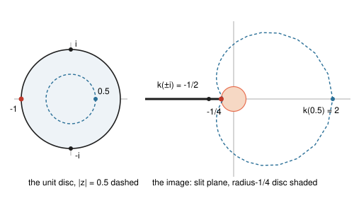

# Univalent maps: Koebe's quarter theorem, and when a Riemann map reaches the boundary

[Syllabus](../../../SYLLABUS.md) → [Complex analysis](../README.md) → [Conformal Maps and Harmonic Functions](../README.md#s07) → Univalent maps

---

## General Overview

The Koebe function $`k(z) = z/(1 - z)^2`$ sends the unit disc (the points less than 1 from 0) onto the whole plane with one cut: the ray of real numbers from −1/4 leftwards. It is **univalent**: one-to-one, no two disc points sharing an image.

Walk from 0 towards −1: k(−0.5) = −0.222222, k(−0.9) = −0.249307, k(−0.99) = −0.249994. The image creeps towards −1/4 and never passes it.

Its power series is $`z + 2z^2 + 3z^3 + \cdots`$. This card proves that its 2 and its nearest missed point, at distance 1/4, are the worst any univalent map that starts like $`z`$ can do.

At the rim, a Riemann map onto a region bounded by a closed curve that never meets itself matches each rim point to one boundary point. The Koebe cut fails that test: each cut point but the tip is reached twice.

**A one-to-one holomorphic map of the unit disc with f(0) = 0 and f'(0) = 1 has $`\lvert a_2\rvert \le 2`$ and covers every point closer than 1/4 to 0, and the Koebe function, which misses −1/4, shows that neither number can be improved.**

**What kind of fact this is:** theorems. The area theorem, Bieberbach's bound and the quarter theorem are proved in Why it works; Carathéodory's theorem is stated from Pommerenke (chapter 2), its proof sketched.

### The picture: the disc and its slit image

<p align="center"></p>

To scale: 70 units per unit length. The dashed circle |z| = 0.5 goes to the dashed loop through k(0.5) = 2. The shaded disc of radius 1/4 touches the cut at −1/4.

---

## The formula

Notation first, in words. $`\mathbb{D}`$ is the unit disc. The class **S** holds every univalent, holomorphic (complex-differentiable) map $`f`$ of $`\mathbb{D}`$ with $`f(0) = 0`$ and $`f'(0) = 1`$. Shifting and scaling put any univalent map in S.

Each f in S has a power series with first coefficient 1:

```math
f(z) = z + a_2 z^2 + a_3 z^3 + \cdots
```

**The area theorem.** Let $`g(\zeta) = \zeta + b_0 + b_1\zeta^{-1} + b_2\zeta^{-2} + \cdots`$ be univalent on $`\lvert\zeta\rvert > 1`$, the outside of the disc. Then

```math
\sum_{n \ge 1} n\,\lvert b_n\rvert^2 \le 1
```

**Read it aloud:** the coefficients of the inverse powers, each squared and weighted by its power, add to at most one.

**Bieberbach's bound and Koebe's quarter theorem.** For every f in S,

```math
\lvert a_2\rvert \le 2, \qquad f(\mathbb{D}) \supset \{\, w : \lvert w\rvert < 1/4 \,\}
```

**Read it aloud:** the second coefficient is at most 2 in size, and the image contains every point closer to 0 than one quarter.

**The extreme case.** The Koebe function, written two ways:

```math
k(z) = \frac{z}{(1 - z)^2} = \frac{1}{4}\left[\left(\frac{1 + z}{1 - z}\right)^2 - 1\right] = z + 2z^2 + 3z^3 + \cdots
```

| Symbol | Plain meaning | In our example | Push it up and the answer… |
| --- | --- | --- | --- |
| $`\mathbb{D}`$, $`z`$, $`c`$, $`\Omega`$ | the unit disc; points in it; a region with a Jordan-curve boundary | z = −0.9, c = 0.5 | z near the rim: image near the boundary |
| S, $`f`$ | univalent maps with $`f(0) = 0`$, $`f'(0) = 1`$; one of them | $`k`$, and $`z/(1 - z)`$ | — |
| $`a_n`$ | the coefficient of $`z^n`$ in $`f`$ | $`a_n = n`$ for $`k`$ | larger $`\lvert a_2\rvert`$: the image comes closer to 0 |
| $`k`$ | the Koebe function | misses −1/4 | — |
| $`w`$, $`u`$, $`F`$ | a value $`f`$ misses; the Möbius step's variable; the map $`wf/(w - f)`$, again in S | w = −0.25; new $`a_2`$ = −2 | — |
| $`h`$, $`g`$, $`\zeta`$ | the square-root map $`\sqrt{f(z^2)}`$; the map $`1/h(1/\zeta)`$ outside the disc; a point there | $`g(\zeta) = \zeta - 1/\zeta`$ | — |
| $`b_n`$, $`r`$, $`A(r)`$, $`v`$, $`t`$ | coefficients of $`g`$, from $`b_0`$; a radius above 1; the area $`g`$ misses inside the curve $`g(\lvert\zeta\rvert = r)`$, whose point at angle t is v | $`b_1 = -1`$; A(2) = 11.780972 | larger r: larger A(r) |
| $`\theta`$ | the angle of a rim point $`e^{i\theta}`$ | ±π/2 both go to −1/2 | θ toward ±π: image toward −1/4 |

### When it holds

- **One-to-one.** Drop it and both bounds fail: $`(e^{10z} - 1)/10`$ has $`a_2 = 5`$ and misses −0.1, because it takes the value 0 twice.
- **The scale $`f'(0) = 1`$.** The radius 1/4 scales with $`\lvert f'(0)\rvert`$: k/10 misses a point at distance 0.025000.
- **Measured from f(0).** Round f(c), first send 0 to c by a disc map from [Schwarz-Pick](09-schwarz-pick-and-the-hyperbolic-disc.md): the radius becomes $`\lvert f'(c)\rvert(1 - \lvert c\rvert^2)/4`$, and round k(0.5) = 2 that is 12 × 0.75/4 = 2.25, exactly the distance to the tip.
- **Carathéodory needs a Jordan curve** (a closed curve that never meets itself: no crossing, no touching). The slit plane's edge touches itself: the rim points $`\pm i`$ both go to −1/2.

---

## Why it works

### Step 0: area cannot be negative

Turn a univalent map inside out, so it lives outside the disc. Each circle $`\lvert\zeta\rvert = r`$ goes to a closed curve, and the map misses everything inside it. That missed area is a signed sum of squared coefficients, and it cannot be negative.

### Step 1: the area theorem

Green's theorem (the area inside a closed curve equals a line integral round it) gives the area. Products of different powers $`e^{int}`$ average to zero round the circle, so only squared terms survive:

```math
A(r) = \pi\left(r^2 - \sum_{n \ge 1} n\,\lvert b_n\rvert^2 r^{-2n}\right) \ge 0
```

Let r fall to 1 and the area theorem follows. For $`g(\zeta) = \zeta - 1/\zeta`$ the curve is an ellipse with half-axes $`r - 1/r`$ and $`r + 1/r`$, so A(2) = 11.780972. At r = 1 it squashes flat onto the segment from −2i to 2i, area 0: equality.

<details>
<summary>Detailed proof: the area formula</summary>

Write $`v = g(re^{it})`$ for t from 0 to 2π. The area inside the curve is the line integral

$`\displaystyle A(r) = \frac{1}{2i}\oint \bar v\, dv = \frac{1}{2}\int_0^{2\pi} \bar v \left(r e^{it} - \sum_{n \ge 1} n\, b_n r^{-n} e^{-int}\right) dt.`$

Here $`\bar v = r e^{-it} + \bar b_0 + \sum \bar b_n r^{-n} e^{int}`$. The integral of $`e^{imt}`$ over a full turn is 2π when m = 0 and 0 otherwise. So only two kinds of product survive: $`r e^{-it}`$ times $`r e^{it}`$, giving $`2\pi r^2`$, and $`\bar b_n r^{-n} e^{int}`$ times $`-n b_n r^{-n} e^{-int}`$, giving $`-2\pi n\lvert b_n\rvert^2 r^{-2n}`$. Halving gives the formula.

</details>

### Step 2: Bieberbach's bound, by a square root

Take f in S. Since f is one-to-one and f(0) = 0, f(z)/z never vanishes, so $`f(z^2)/z^2`$ has a square root that equals 1 at 0. Put

```math
h(z) = \sqrt{f(z^2)} = z + \tfrac{1}{2} a_2 z^3 + \cdots, \qquad g(\zeta) = \frac{1}{h(1/\zeta)} = \zeta - \frac{a_2}{2}\,\zeta^{-1} + \cdots
```

h is z times a function of $`z^2`$: odd, and 0 only at 0. It is one-to-one: $`h(z_1) = h(z_2)`$ forces $`z_1^2 = z_2^2`$, and $`z_1 = -z_2`$ would make both values 0, so both are 0. So g is univalent outside the disc, with $`b_1 = -a_2/2`$. The area theorem keeps $`\lvert b_1\rvert \le 1`$, so $`\lvert a_2\rvert \le 2`$.

For the Koebe function, $`h(z) = z/(1 - z^2)`$ and $`g(\zeta) = \zeta - 1/\zeta`$: $`b_1 = -1`$, the bound met exactly.

### Step 3: Koebe's quarter, from the bound

Suppose f in S misses a value w. Follow f by the Möbius map $`u \mapsto wu/(w - u)`$ ([Mobius transformations](02-mobius-transformations-and-the-point-at-infinity.md)), which is one-to-one and finite wherever $`u \ne w`$:

```math
F = \frac{w f}{w - f} = f\left(1 + \frac{f}{w} + \cdots\right) = z + \left(a_2 + \frac{1}{w}\right) z^2 + \cdots
```

F is in S, so Step 2 applies twice: $`\lvert a_2 + 1/w\rvert \le 2`$ and $`\lvert a_2\rvert \le 2`$. Then $`\lvert 1/w\rvert \le 4`$, so $`\lvert w\rvert \ge 1/4`$. Every missed value lies at least 1/4 from 0.

For k missing −0.25, F has $`a_2 = 2 - 4 = -2`$: the bound is met, and $`F = z/(1 + z)^2`$ is k turned half round.

### Step 4: why the Koebe function is extreme

Read the second form of k as three steps:

1. $`(1 + z)/(1 - z)`$ sends the disc onto the right half plane (a Möbius map).
2. Squaring opens the right half plane onto the plane minus the ray $`(-\infty, 0]`$.
3. Subtracting 1 and dividing by 4 moves the ray's tip to −1/4.

Each step is one-to-one, so k is in S. Its series gives $`a_2 = 2`$, and k misses −1/4: both theorems are sharp.

Bieberbach conjectured in 1916 that $`\lvert a_n\rvert \le n`$ for all n; Louis de Branges proved it in 1985.

### Step 5: Carathéodory's theorem, and the Koebe rim

**Carathéodory's theorem.** If a bounded region $`\Omega`$ is bounded by a Jordan curve, every Riemann map of $`\mathbb{D}`$ onto $`\Omega`$ extends to a continuous one-to-one map of the closed disc onto $`\Omega`$ with its boundary.

The proof's shape: a length-area estimate finds short arcs across the region near each boundary point. A Jordan curve never meets itself, so points close in the plane are close along it: a short arc's ends are joined by a short piece of boundary, the arc cuts off a small piece, and the map settles to one boundary value at each rim point.

On the Koebe rim the formula is exact. From $`(1 - e^{i\theta})^2 = -4\sin^2(\theta/2)\,e^{i\theta}`$:

```math
k(e^{i\theta}) = -\frac{1}{4\sin^2(\theta/2)}, \qquad e^{i\theta} \neq 1
```

θ and −θ give the same point, so each cut point but the tip is reached twice, once from each side: k(0.99i) = −0.499949 + 0.005025i lies just above the cut, k(−0.99i) just below.

---

## Worked numbers, by hand

| Step | Arithmetic | Value |
| --- | --- | --- |
| series of k | $`z\,\frac{d}{dz}\frac{1}{1 - z} = \sum n z^n`$ | $`a_2`$ = **2** |
| near −1 | k(−0.99) = −0.99/1.99² | −0.249994 |
| rim point −1 | k(−1) = −1/(4 sin²(π/2)) | **−0.25** |
| square-root map | $`h = z/(1 - z^2)`$, $`g = \zeta - 1/\zeta`$ | $`b_1`$ = −1 |
| area at r = 2 | π(4 − 1/4) | 11.780972 |
| area at r = 1.01 | π(1.01² − 1.01⁻²), nearly flat | 0.125048 |
| missed value −1/4 | new $`a_2`$ = 2 + 1/(−0.25) | −2, size 2 |
| rim at ±π/2 | −1/(4 × 1/2) | **−0.5**, twice |

k meets the bound $`\lvert a_2\rvert \le 2`$ twice, directly and through its omitted-value map: it sits on the edge of both theorems.

### What breaks if you drop a piece

| Mistake | Comes out at | What went wrong |
| --- | --- | --- |
| Not one-to-one: $`(e^{10z} - 1)/10`$ | $`a_2`$ = 5; misses −0.1 | 0 and 0.2πi both go to 0 |
| Scale dropped: k/10 | missed point at 0.025000 | the radius is $`\lvert f'(0)\rvert/4`$ |
| Bound misread as $`\lvert a_2\rvert \le 1`$ | promised radius 0.500000 | k has $`a_2 = 2`$ and misses −0.25 |

---

## Code, from first principles, and it actually runs

Every claim takes two roads: coefficients by the closed form n and a circle average; areas by the area formula and a shoelace sum (a polygon's area from its corners); the nearest missed point by a search and the formula at z = −0.999; rim values directly and by the sine formula; $`b_1`$ of g built from k against $`-a_2/2`$; the radius round 2 by the chain rule and a search.

### Python

```python
# Koebe's quarter theorem -- the check behind the card.  Standard library only.  The Koebe
# function k(z) = z/(1 - z)^2 is tested twice over: coefficients by closed form and by an
# average round a circle, areas by the area formula and by a polygon (shoelace) sum, the
# nearest missed point by formula and by a search, boundary values by formula and directly.
import cmath, math
def k(z): return z / (1 - z) ** 2
def coeffs(f, n, r=0.5, m=256):             # a_j = average of f(r e^it) e^(-ijt), over r^j
    ts = [2 * math.pi * s / m for s in range(m)]
    return [sum(f(r * cmath.exp(1j * t)) * cmath.exp(-1j * j * t) for t in ts) / m / r ** j
            for j in range(1, n + 1)]
def area(g, r, m=4000):                     # shoelace sum round the image of |zeta| = r
    w = [g(r * cmath.exp(2j * math.pi * s / m)) for s in range(m)]
    return sum((w[s - 1].conjugate() * w[s]).imag for s in range(m)) / 2
def nearest(f, r=0.999, m=7200):            # smallest |f| on the circle |z| = r
    return min(abs(f(r * cmath.exp(2j * math.pi * s / m))) for s in range(m))
def fx(x): return f"{0.0 if abs(x) < 5e-7 else x:.6f}"
def fz(z): return f"{fx(z.real)} {'-' if z.imag < -5e-7 else '+'} {fx(abs(z.imag))}i"
def koebe_miss(f, w): return lambda z: w * f(z) / (w - f(z))   # in S again if f never hits w
a = coeffs(k, 5)
def g(zeta): s = cmath.sqrt(k(zeta ** -2)); return 1 / s if (s * zeta).real > 0 else -1 / s  # 1/h(1/zeta), h(z) = sqrt(k(z^2)), Re h(z)/z > 0
b1 = sum(g(2 * cmath.exp(2j * math.pi * s / 256)) * cmath.exp(2j * math.pi * s / 256)
         for s in range(256)) / 256 * 2       # the 1/zeta coefficient, averaged on |zeta| = 2
radii = [2.0, 1.1, 1.01]
shoe = [area(g, r) for r in radii]
form = [math.pi * (r * r - r ** -2) for r in radii]
near_k, near_h, near_2 = nearest(k), nearest(lambda z: z / (1 - z)), nearest(lambda z: k(z) - k(0.5))
dk, mv = 1.5 / 0.5 ** 3, coeffs(lambda z: k((z + 0.5) / (1 + 0.5 * z)), 1)[0]   # k'(0.5) = (1 + z)/(1 - z)^3; k after phi_-0.5
f2 = [coeffs(koebe_miss(k, -0.25), 2)[1], coeffs(koebe_miss(lambda z: z / (1 - z), -0.5), 2)[1]]
thetas = [math.pi, math.pi / 2, -math.pi / 2, math.pi / 3, -math.pi / 3]
direct = [k(cmath.exp(1j * t)) for t in thetas]
closed = [-1 / (4 * math.sin(t / 2) ** 2) for t in thetas]
e10 = lambda z: (cmath.exp(10 * z) - 1) / 10
q, ox = 70, 330
print(f"figure, {q} px per unit; disc centre (100, 140), radius {q}; image origin ({ox}, 140); "
      f"tip ({ox - q / 4}, 140); quarter disc radius {q / 4}; k(0.5) at ({ox + q * k(0.5):.1f}, 140); "
      f"k(0.5i) at ({ox + q * k(0.5j).real:.1f}, {140 - q * k(0.5j).imag:.1f}); k(i) at ({ox + q * k(1j).real:.1f}, 140)")
print("coefficients a_1..a_5 by circle average:", " ".join(fx(c.real) for c in a))
print(f"k(0.5) = {fx(k(0.5))}; k(-0.5) = {fx(k(-0.5))}; k(-0.9) = {fx(k(-0.9))}; k(-0.99) = {fx(k(-0.99))}")
print(f"area theorem for g(zeta) = 1/h(1/zeta) = zeta - 1/zeta: b_1 = {fx(b1.real)}, sum n|b_n|^2 = {fx(abs(b1) ** 2)}")
for r, s, f in zip(radii, shoe, form):
    print(f"area missed inside g(|zeta| = {r:g}): shoelace {s:.6f}; pi(r^2 - r^-2) {f:.6f}")
print(f"nearest image point on |z| = 0.999: k {near_k:.9f}; z/(1 - z) {near_h:.6f}")
print(f"round k(0.5): |k'(0.5)| = {dk:.6f}; 1 - 0.5^2 = {1 - 0.5 ** 2:.6f}; derivative of k(phi_-0.5) at 0 = {abs(mv):.6f}; radius {abs(mv) / 4:.6f}; search {near_2:.6f}")
print(f"omitted-value map: k misses -0.25, new a_2 = {fx(f2[0].real)} (2 + 1/w = {fx(2 - 4)}); "
      f"z/(1 - z) misses -0.5, new a_2 = {fx(f2[1].real)} (1 + 1/w = {fx(1 - 2)})")
print("rim, theta = pi, pi/2, -pi/2, pi/3, -pi/3: k =", "; ".join(fz(w) for w in direct))
print("rim, closed form -1/(4 sin^2(theta/2)):", " ".join(fx(c) for c in closed))
print(f"two sides of the slit: k(0.99i) = {fz(k(0.99j))}; k(-0.99i) = {fz(k(-0.99j))}")
print(f"break 1, (e^(10z) - 1)/10: a_2 = {fx(coeffs(e10, 2)[1].real)}; misses -0.1; "
      f"f(0) = {fz(e10(0))}, f(0.2 pi i) = {fz(e10(0.2j * math.pi))}")
print(f"break 2, k/10: nearest missed point {nearest(lambda z: k(z) / 10):.6f}")
print(f"break 3, bound |a_2| <= 1 would promise radius {1 / (1 + 1):.6f}; k misses -0.25")
assert all(abs(c - j) < 1e-9 for j, c in zip(range(1, 6), a))        # average = closed form n
assert all(abs(s - f) < 1e-5 * f for s, f in zip(shoe, form))       # shoelace = area theorem
assert abs(near_k - 0.999 / 1.999 ** 2) < 1e-12 and near_k > 0.2499  # search = formula, >= 1/4
assert abs(abs(mv) - dk * 0.75) < 1e-9 and abs(near_2 - abs(mv) / 4) < 1e-6   # chain rule; radius = search
assert abs(b1 + a[1] / 2) < 1e-9                                     # b_1 = -a_2/2, as in Step 2
assert abs(f2[0] + 2) < 1e-9 and abs(f2[1] + 1) < 1e-9               # new a_2 = a_2 + 1/w
assert all(abs(d - c) < 1e-9 for d, c in zip(direct, closed))        # rim = slit, two-to-one
print("ALL CHECKS PASS")
```

**Ran 2026-11-23 on macOS, Python 3.14.10, standard library only. All checks passed. Output, pasted from the run:**

```
figure, 70 px per unit; disc centre (100, 140), radius 70; image origin (330, 140); tip (312.5, 140); quarter disc radius 17.5; k(0.5) at (470.0, 140); k(0.5i) at (307.6, 123.2); k(i) at (295.0, 140)
coefficients a_1..a_5 by circle average: 1.000000 2.000000 3.000000 4.000000 5.000000
k(0.5) = 2.000000; k(-0.5) = -0.222222; k(-0.9) = -0.249307; k(-0.99) = -0.249994
area theorem for g(zeta) = 1/h(1/zeta) = zeta - 1/zeta: b_1 = -1.000000, sum n|b_n|^2 = 1.000000
area missed inside g(|zeta| = 2): shoelace 11.780968; pi(r^2 - r^-2) 11.780972
area missed inside g(|zeta| = 1.1): shoelace 1.204969; pi(r^2 - r^-2) 1.204970
area missed inside g(|zeta| = 1.01): shoelace 0.125048; pi(r^2 - r^-2) 0.125048
nearest image point on |z| = 0.999: k 0.249999937; z/(1 - z) 0.499750
round k(0.5): |k'(0.5)| = 12.000000; 1 - 0.5^2 = 0.750000; derivative of k(phi_-0.5) at 0 = 9.000000; radius 2.250000; search 2.250000
omitted-value map: k misses -0.25, new a_2 = -2.000000 (2 + 1/w = -2.000000); z/(1 - z) misses -0.5, new a_2 = -1.000000 (1 + 1/w = -1.000000)
rim, theta = pi, pi/2, -pi/2, pi/3, -pi/3: k = -0.250000 + 0.000000i; -0.500000 + 0.000000i; -0.500000 + 0.000000i; -1.000000 + 0.000000i; -1.000000 + 0.000000i
rim, closed form -1/(4 sin^2(theta/2)): -0.250000 -0.500000 -0.500000 -1.000000 -1.000000
two sides of the slit: k(0.99i) = -0.499949 + 0.005025i; k(-0.99i) = -0.499949 - 0.005025i
break 1, (e^(10z) - 1)/10: a_2 = 5.000000; misses -0.1; f(0) = 0.000000 + 0.000000i, f(0.2 pi i) = 0.000000 + 0.000000i
break 2, k/10: nearest missed point 0.025000
break 3, bound |a_2| <= 1 would promise radius 0.500000; k misses -0.25
ALL CHECKS PASS
```

### Rust

Same numbers, same labels, built with `rustc --edition 2021 -O`.

```rust
// Koebe's quarter theorem -- the same check as the Python, in Rust.  No crates.  The Koebe
// function k(z) = z/(1 - z)^2 is tested twice over: coefficients by closed form and by an
// average round a circle, areas by the area formula and by a polygon (shoelace) sum, the
// nearest missed point by formula and by a search, boundary values by formula and directly.
use std::f64::consts::PI;
#[derive(Clone, Copy)] struct C { re: f64, im: f64 }
fn c(re: f64, im: f64) -> C { C { re, im } }
fn add(a: C, b: C) -> C { c(a.re + b.re, a.im + b.im) }
fn sub(a: C, b: C) -> C { c(a.re - b.re, a.im - b.im) }
fn mul(a: C, b: C) -> C { c(a.re * b.re - a.im * b.im, a.re * b.im + a.im * b.re) }
fn div(a: C, b: C) -> C { let d = b.re * b.re + b.im * b.im; let t = mul(a, c(b.re, -b.im)); c(t.re / d, t.im / d) }
fn sc(a: C, s: f64) -> C { c(a.re * s, a.im * s) }
fn md(a: C) -> f64 { a.re.hypot(a.im) }
fn cis(t: f64) -> C { c(t.cos(), t.sin()) }                           // e^(it)
fn cexp(z: C) -> C { sc(cis(z.im), z.re.exp()) }
fn csqrt(z: C) -> C { sc(cis(z.im.atan2(z.re) / 2.0), md(z).sqrt()) }   // principal square root
fn k(z: C) -> C { let d = sub(c(1.0, 0.0), z); div(z, mul(d, d)) }
fn coeffs(f: &dyn Fn(C) -> C, n: usize) -> Vec<C> {   // a_j = average of f(r e^it) e^(-ijt), over r^j
    let (r, m) = (0.5, 256);
    (1..=n).map(|j| {
        let mut s = c(0.0, 0.0);
        for q in 0..m { let t = 2.0 * PI * q as f64 / m as f64; s = add(s, mul(f(sc(cis(t), r)), cis(-(j as f64) * t))); }
        sc(s, 1.0 / m as f64 / r.powi(j as i32))
    }).collect()
}
fn area(g: &dyn Fn(C) -> C, r: f64) -> f64 {           // shoelace sum round the image of |zeta| = r
    let m = 4000;
    let w: Vec<C> = (0..m).map(|q| g(sc(cis(2.0 * PI * q as f64 / m as f64), r))).collect();
    (0..m).map(|q| { let p = w[(q + m - 1) % m]; p.re * w[q].im - p.im * w[q].re }).sum::<f64>() / 2.0
}
fn nearest(f: &dyn Fn(C) -> C) -> f64 {                // smallest |f| on the circle |z| = 0.999
    (0..7200).map(|q| md(f(sc(cis(2.0 * PI * q as f64 / 7200.0), 0.999)))).fold(f64::INFINITY, f64::min)
}
fn fx(x: f64) -> String { format!("{:.6}", if x.abs() < 5e-7 { 0.0 } else { x }) }
fn fz(z: C) -> String { format!("{} {} {}i", fx(z.re), if z.im < -5e-7 { "-" } else { "+" }, fx(z.im.abs())) }
fn miss(f: &'static dyn Fn(C) -> C, w: f64) -> impl Fn(C) -> C {   // in S again if f never hits w
    move |z| { let v = f(z); div(sc(v, w), sub(c(w, 0.0), v)) }
}
fn half(z: C) -> C { div(z, sub(c(1.0, 0.0), z)) }                   // z/(1 - z), onto a half plane
fn main() {
    let a = coeffs(&k, 5);
    let g = |z: C| { let s = csqrt(k(div(c(1.0, 0.0), mul(z, z)))); div(c(if mul(s, z).re > 0.0 { 1.0 } else { -1.0 }, 0.0), s) };   // 1/h(1/zeta), h(z) = sqrt(k(z^2)), Re h(z)/z > 0
    let mut b1 = c(0.0, 0.0);
    for q in 0..256 { let e = cis(2.0 * PI * q as f64 / 256.0); b1 = add(b1, sc(mul(g(sc(e, 2.0)), e), 2.0 / 256.0)); }
    let radii = [2.0, 1.1, 1.01];
    let shoe: Vec<f64> = radii.iter().map(|&r| area(&g, r)).collect();
    let form: Vec<f64> = radii.iter().map(|&r: &f64| PI * (r * r - r.powi(-2))).collect();
    let (near_k, near_h, near_2) = (nearest(&k), nearest(&half), nearest(&|z| sub(k(z), k(c(0.5, 0.0)))));
    let (dk, mv) = (1.5 / 0.5f64.powi(3), coeffs(&|z| k(div(add(z, c(0.5, 0.0)), add(c(1.0, 0.0), sc(z, 0.5)))), 1)[0]);   // k'(0.5); k after phi_-0.5
    let f2 = [coeffs(&miss(&k, -0.25), 2)[1], coeffs(&miss(&half, -0.5), 2)[1]];
    let thetas = [PI, PI / 2.0, -PI / 2.0, PI / 3.0, -PI / 3.0];
    let direct: Vec<C> = thetas.iter().map(|&t| k(cis(t))).collect();
    let closed: Vec<f64> = thetas.iter().map(|&t| -1.0 / (4.0 * (t / 2.0).sin().powi(2))).collect();
    let e10 = |z: C| sc(sub(cexp(sc(z, 10.0)), c(1.0, 0.0)), 0.1);
    let (q, ox, k5, ki) = (70.0, 330.0, k(c(0.0, 0.5)), k(c(0.0, 1.0)));
    println!("figure, {} px per unit; disc centre (100, 140), radius {}; image origin ({}, 140); tip ({}, 140); quarter disc radius {}; k(0.5) at ({:.1}, 140); k(0.5i) at ({:.1}, {:.1}); k(i) at ({:.1}, 140)", q, q, ox, ox - q / 4.0, q / 4.0, ox + q * k(c(0.5, 0.0)).re, ox + q * k5.re, 140.0 - q * k5.im, ox + q * ki.re);
    println!("coefficients a_1..a_5 by circle average: {}", a.iter().map(|z| fx(z.re)).collect::<Vec<_>>().join(" "));
    let kr = |x: f64| fx(k(c(x, 0.0)).re);
    println!("k(0.5) = {}; k(-0.5) = {}; k(-0.9) = {}; k(-0.99) = {}", kr(0.5), kr(-0.5), kr(-0.9), kr(-0.99));
    println!("area theorem for g(zeta) = 1/h(1/zeta) = zeta - 1/zeta: b_1 = {}, sum n|b_n|^2 = {}", fx(b1.re), fx(md(b1).powi(2)));
    for i in 0..3 { println!("area missed inside g(|zeta| = {}): shoelace {:.6}; pi(r^2 - r^-2) {:.6}", radii[i], shoe[i], form[i]); }
    println!("nearest image point on |z| = 0.999: k {:.9}; z/(1 - z) {:.6}", near_k, near_h);
    println!("round k(0.5): |k'(0.5)| = {:.6}; 1 - 0.5^2 = {:.6}; derivative of k(phi_-0.5) at 0 = {:.6}; radius {:.6}; search {:.6}", dk, 1.0 - 0.5f64.powi(2), md(mv), md(mv) / 4.0, near_2);
    println!("omitted-value map: k misses -0.25, new a_2 = {} (2 + 1/w = {}); z/(1 - z) misses -0.5, new a_2 = {} (1 + 1/w = {})",
             fx(f2[0].re), fx(2.0 - 4.0), fx(f2[1].re), fx(1.0 - 2.0));
    println!("rim, theta = pi, pi/2, -pi/2, pi/3, -pi/3: k = {}", direct.iter().map(|&w| fz(w)).collect::<Vec<_>>().join("; "));
    println!("rim, closed form -1/(4 sin^2(theta/2)): {}", closed.iter().map(|&x| fx(x)).collect::<Vec<_>>().join(" "));
    println!("two sides of the slit: k(0.99i) = {}; k(-0.99i) = {}", fz(k(c(0.0, 0.99))), fz(k(c(0.0, -0.99))));
    println!("break 1, (e^(10z) - 1)/10: a_2 = {}; misses -0.1; f(0) = {}, f(0.2 pi i) = {}", fx(coeffs(&e10, 2)[1].re), fz(e10(c(0.0, 0.0))), fz(e10(c(0.0, 0.2 * PI))));
    println!("break 2, k/10: nearest missed point {:.6}", nearest(&|z| sc(k(z), 0.1)));
    println!("break 3, bound |a_2| <= 1 would promise radius {:.6}; k misses -0.25", 1.0 / (1.0 + 1.0));
    assert!(a.iter().enumerate().all(|(j, z)| md(sub(*z, c(j as f64 + 1.0, 0.0))) < 1e-9));   // average = n
    assert!(shoe.iter().zip(&form).all(|(s, f)| (s - f).abs() < 1e-5 * f));                 // shoelace = area theorem
    assert!((near_k - 0.999 / 1.999f64.powi(2)).abs() < 1e-12 && near_k > 0.2499);           // search = formula
    assert!((md(mv) - dk * 0.75).abs() < 1e-9 && (near_2 - md(mv) / 4.0).abs() < 1e-6);       // chain rule; radius = search
    assert!(md(add(b1, sc(a[1], 0.5))) < 1e-9);                                               // b_1 = -a_2/2, Step 2
    assert!(md(add(f2[0], c(2.0, 0.0))) < 1e-9 && md(add(f2[1], c(1.0, 0.0))) < 1e-9);       // a_2 + 1/w
    assert!(direct.iter().zip(&closed).all(|(d, x)| md(sub(*d, c(*x, 0.0))) < 1e-9));         // rim = slit
    println!("ALL CHECKS PASS");
}
```

**Ran 2026-11-23 on macOS, rustc 1.98.1, no crates. All checks passed. Output, pasted from the run:**

```
figure, 70 px per unit; disc centre (100, 140), radius 70; image origin (330, 140); tip (312.5, 140); quarter disc radius 17.5; k(0.5) at (470.0, 140); k(0.5i) at (307.6, 123.2); k(i) at (295.0, 140)
coefficients a_1..a_5 by circle average: 1.000000 2.000000 3.000000 4.000000 5.000000
k(0.5) = 2.000000; k(-0.5) = -0.222222; k(-0.9) = -0.249307; k(-0.99) = -0.249994
area theorem for g(zeta) = 1/h(1/zeta) = zeta - 1/zeta: b_1 = -1.000000, sum n|b_n|^2 = 1.000000
area missed inside g(|zeta| = 2): shoelace 11.780968; pi(r^2 - r^-2) 11.780972
area missed inside g(|zeta| = 1.1): shoelace 1.204969; pi(r^2 - r^-2) 1.204970
area missed inside g(|zeta| = 1.01): shoelace 0.125048; pi(r^2 - r^-2) 0.125048
nearest image point on |z| = 0.999: k 0.249999937; z/(1 - z) 0.499750
round k(0.5): |k'(0.5)| = 12.000000; 1 - 0.5^2 = 0.750000; derivative of k(phi_-0.5) at 0 = 9.000000; radius 2.250000; search 2.250000
omitted-value map: k misses -0.25, new a_2 = -2.000000 (2 + 1/w = -2.000000); z/(1 - z) misses -0.5, new a_2 = -1.000000 (1 + 1/w = -1.000000)
rim, theta = pi, pi/2, -pi/2, pi/3, -pi/3: k = -0.250000 + 0.000000i; -0.500000 + 0.000000i; -0.500000 + 0.000000i; -1.000000 + 0.000000i; -1.000000 + 0.000000i
rim, closed form -1/(4 sin^2(theta/2)): -0.250000 -0.500000 -0.500000 -1.000000 -1.000000
two sides of the slit: k(0.99i) = -0.499949 + 0.005025i; k(-0.99i) = -0.499949 - 0.005025i
break 1, (e^(10z) - 1)/10: a_2 = 5.000000; misses -0.1; f(0) = 0.000000 + 0.000000i, f(0.2 pi i) = 0.000000 + 0.000000i
break 2, k/10: nearest missed point 0.025000
break 3, bound |a_2| <= 1 would promise radius 0.500000; k misses -0.25
ALL CHECKS PASS
```

The two outputs match line for line.

### Lean

Lean proves the area theorem, Bieberbach's bound and the quarter theorem for every map in S, and that the Koebe function is extreme.

- Take g univalent outside the disc, with coefficients $`b_n`$ as in the area theorem. Then every partial sum of $`n\,\lvert b_n\rvert^2`$ is at most 1.
- Take f in S. Then $`\lvert a_2\rvert \le 2`$, and the image of the disc holds every point closer to 0 than 1/4.
- The Koebe function k is in S, and its $`a_2`$ is exactly 2.
- k maps the disc onto the plane minus the ray from −1/4 leftwards, so it misses −1/4.
- The hand arithmetic holds exactly: k(−1) = −1/4, k(0.5) = 2 and k(i) = −1/2.
- The omitted-value map's new $`a_2`$ is −2, and the radius round k(0.5) = 2 is 2.25.

The areas A(r), the rim values, the breaks and the figure are left to the Python and Rust checks; Carathéodory's theorem stays unproved.

```lean
-- Univalent maps: a one-to-one holomorphic map f of the unit disc with f(0) = 0 and f'(0) = 1 has second coefficient at most 2 in size and covers the disc of radius 1/4 round 0, by the area theorem, and the Koebe function z/(1 - z)^2, with second coefficient 2 and image the plane minus the ray from -1/4 leftwards, shows both bounds are best.
import Mathlib.Analysis.Calculus.IteratedDeriv.Defs
import Mathlib.Analysis.Calculus.Deriv.Basic
import Mathlib.Analysis.Complex.Basic
import Mathlib.Analysis.Normed.Group.InfiniteSum
import Mathlib.Algebra.BigOperators.Intervals
import Mathlib.Tactic.NormNum
import Mathlib

open Set Metric

section KoebeHelpers

open MeasureTheory Filter Topology

lemma coeff_bound {g : ℂ → ℂ} {b : ℕ → ℂ}
    (hg : ∀ ζ : ℂ, 1 < ‖ζ‖ → HasSum (fun n : ℕ => b n * ζ⁻¹ ^ n) (g ζ - ζ)) {ρ : ℝ} (hρ : 1 < ρ) :
    ∃ M, 0 ≤ M ∧ ∀ n, ‖b n‖ ≤ M * ρ ^ n := by
  have hρ0 : 0 < ρ := by linarith
  have hs := (hg (ρ : ℂ) (by rwa [Complex.norm_real, Real.norm_of_nonneg hρ0.le])).summable
  have ht := hs.tendsto_atTop_zero.norm
  obtain ⟨M, hM⟩ := ht.bddAbove_range
  refine ⟨max M 0, le_max_right _ _, fun n => ?_⟩
  have h1 := hM ⟨n, rfl⟩
  simp only [norm_mul, norm_pow, norm_inv, Complex.norm_real, Real.norm_of_nonneg hρ0.le] at h1
  have hpow : 0 < ρ ^ n := pow_pos hρ0 n
  calc ‖b n‖ = ‖b n‖ * ρ⁻¹ ^ n * ρ ^ n := by rw [inv_pow, mul_assoc, inv_mul_cancel₀ hpow.ne', mul_one]
    _ ≤ max M 0 * ρ ^ n := by gcongr; exact h1.trans (le_max_left _ _)

lemma coeff_summable {g : ℂ → ℂ} {b : ℕ → ℂ}
    (hg : ∀ ζ : ℂ, 1 < ‖ζ‖ → HasSum (fun n : ℕ => b n * ζ⁻¹ ^ n) (g ζ - ζ)) {σ : ℝ} (hσ : 1 < σ)
    (k : ℕ) : Summable (fun n : ℕ => (n : ℝ) ^ k * ‖b n‖ * σ⁻¹ ^ n) := by
  obtain ⟨M, hM0, hM⟩ := coeff_bound hg (ρ := (1 + σ) / 2) (by linarith)
  have hσ0 : 0 < σ := by linarith
  have hq : ‖(1 + σ) / 2 / σ‖ < 1 := by
    rw [Real.norm_of_nonneg (by positivity), div_lt_one hσ0]; linarith
  refine Summable.of_nonneg_of_le (fun n => by positivity) (fun n => ?_)
    ((summable_pow_mul_geometric_of_norm_lt_one k hq).mul_left M)
  have := hM n
  calc (n : ℝ) ^ k * ‖b n‖ * σ⁻¹ ^ n ≤ (n : ℝ) ^ k * (M * ((1 + σ) / 2) ^ n) * σ⁻¹ ^ n := by gcongr
    _ = M * ((n : ℝ) ^ k * ((1 + σ) / 2 / σ) ^ n) := by rw [div_pow ((1 + σ) / 2) σ n, inv_pow]; ring

def dcoef (b : ℕ → ℂ) : ℕ → ℂ
  | 0 => 1
  | n + 1 => -(n : ℂ) * b n

lemma hasDerivAt_inv_pow (n : ℕ) {ζ : ℂ} (hζ : ζ ≠ 0) :
    HasDerivAt (fun w : ℂ => w⁻¹ ^ n) (-(n : ℂ) * ζ⁻¹ ^ (n + 1)) ζ := by
  have h := (hasDerivAt_inv hζ).pow n
  convert h using 1
  rcases n with _ | n
  · simp
  · simp only [Nat.cast_add, Nat.cast_one, Nat.add_sub_cancel]
    rw [← inv_pow]
    ring

lemma deriv_series {g : ℂ → ℂ} {b : ℕ → ℂ}
    (hg : ∀ ζ : ℂ, 1 < ‖ζ‖ → HasSum (fun n : ℕ => b n * ζ⁻¹ ^ n) (g ζ - ζ)) {ζ : ℂ}
    (hζ : 1 < ‖ζ‖) :
    HasDerivAt g (deriv g ζ) ζ ∧ HasSum (fun k : ℕ => dcoef b k * ζ⁻¹ ^ k) (deriv g ζ) := by
  set ρ : ℝ := (1 + ‖ζ‖) / 2 with hρdef
  have hρ1 : 1 < ρ := by rw [hρdef]; linarith
  have hρ0 : 0 < ρ := by linarith
  set U : Set ℂ := {w | ρ < ‖w‖} with hUdef
  have hUo : IsOpen U := isOpen_lt continuous_const continuous_norm
  have hζU : ζ ∈ U := by show ρ < ‖ζ‖; rw [hρdef]; linarith
  have hU0 : ∀ w ∈ U, w ≠ 0 := fun w hw h => by
    have : ρ < ‖w‖ := hw
    rw [h, norm_zero] at this; linarith
  let F : ℕ → ℂ → ℂ := fun n w => b n * w⁻¹ ^ n
  have hFd : ∀ n, DifferentiableOn ℂ (F n) U := fun n w hw =>
    ((hasDerivAt_inv_pow n (hU0 w hw)).differentiableAt.const_mul (b n)).differentiableWithinAt
  have hu : Summable (fun n : ℕ => ‖b n‖ * ρ⁻¹ ^ n) := by
    simpa using coeff_summable hg hρ1 0
  have hFle : ∀ n w, w ∈ U → ‖F n w‖ ≤ ‖b n‖ * ρ⁻¹ ^ n := by
    intro n w hw
    have hw' : ρ < ‖w‖ := hw
    simp only [F, norm_mul, norm_pow, norm_inv]
    gcongr
  have hT := Complex.differentiableOn_tsum_of_summable_norm hu hFd hUo hFle
  have hS := Complex.hasSum_deriv_of_summable_norm hu hFd hUo hFle hζU
  have heq : g =ᶠ[𝓝 ζ] fun w => w + ∑' n, F n w := by
    filter_upwards [hUo.mem_nhds hζU] with w hw
    have hw' : ρ < ‖w‖ := hw
    rw [(hg w (by linarith)).tsum_eq]; ring
  have hD : HasDerivAt g (1 + deriv (fun w => ∑' n, F n w) ζ) ζ :=
    ((hasDerivAt_id ζ).add ((hT.differentiableAt (hUo.mem_nhds hζU)).hasDerivAt)).congr_of_eventuallyEq heq
  refine ⟨hD.differentiableAt.hasDerivAt, ?_⟩
  rw [hD.deriv]
  have hdF : ∀ n, deriv (F n) ζ = -(n : ℂ) * b n * ζ⁻¹ ^ (n + 1) := fun n => by
    rw [((hasDerivAt_inv_pow n (hU0 ζ hζU)).const_mul (b n)).deriv]; ring
  simp_rw [hdF] at hS
  rw [← hasSum_nat_add_iff' 1]
  simpa [dcoef, Finset.sum_range_one] using hS

lemma det_smulRight_complex (c : ℂ) :
    ((ContinuousLinearMap.smulRight (1 : ℂ →L[ℂ] ℂ) c).restrictScalars ℝ).det = ‖c‖ ^ 2 := by
  have : (((ContinuousLinearMap.smulRight (1 : ℂ →L[ℂ] ℂ) c).restrictScalars ℝ : ℂ →L[ℝ] ℂ) :
      ℂ →ₗ[ℝ] ℂ) = Algebra.lmul ℝ ℂ c := by
    ext x; simp [mul_comm]
  rw [ContinuousLinearMap.det, this, ← Algebra.norm_apply, Algebra.norm_complex_apply,
    Complex.normSq_eq_norm_sq]

noncomputable def ellMap (a : ℝ) (c : ℂ) : ℂ →ₗ[ℝ] ℂ :=
  LinearMap.mulLeft ℝ (a : ℂ) + (LinearMap.mulLeft ℝ c) ∘ₗ Complex.conjAe.toLinearMap

lemma ellMap_apply (a : ℝ) (c x : ℂ) : ellMap a c x = a * x + c * (starRingEnd ℂ) x := by
  simp [ellMap]

lemma det_ellMap (a : ℝ) (c : ℂ) : LinearMap.det (ellMap a c) = a ^ 2 - ‖c‖ ^ 2 := by
  rw [← LinearMap.det_toMatrix Complex.basisOneI, Matrix.det_fin_two]
  simp [LinearMap.toMatrix_apply, ellMap_apply, Complex.sq_norm, Complex.normSq_apply]
  ring

lemma volume_ellipse (a : ℝ) (c v : ℂ) (h : ‖c‖ ≤ a) :
    volume ((fun x => v + x) '' (ellMap a c '' ball 0 1)) =
      ENNReal.ofReal ((a ^ 2 - ‖c‖ ^ 2) * Real.pi) := by
  rw [image_add_left, measure_preimage_add, Measure.addHaar_image_linearMap, det_ellMap,
    Complex.volume_ball]
  have h0 : 0 ≤ a ^ 2 - ‖c‖ ^ 2 := by nlinarith [norm_nonneg c]
  rw [abs_of_nonneg h0, ENNReal.ofReal_one, one_pow, one_mul, ← ENNReal.ofReal_coe_nnreal,
    NNReal.coe_real_pi, ← ENNReal.ofReal_mul h0]

lemma mem_ellipse {a : ℝ} {c y : ℂ} (hD : 0 < a ^ 2 - ‖c‖ ^ 2)
    (h : ‖(a : ℂ) * y - c * (starRingEnd ℂ) y‖ < a ^ 2 - ‖c‖ ^ 2) :
    y ∈ ellMap a c '' ball 0 1 := by
  set D : ℝ := a ^ 2 - ‖c‖ ^ 2 with hDdef
  have hD' : (D : ℂ) ≠ 0 := by exact_mod_cast hD.ne'
  refine ⟨((a : ℂ) * y - c * (starRingEnd ℂ) y) / D, ?_, ?_⟩
  · rw [mem_ball_zero_iff, norm_div, Complex.norm_real, Real.norm_of_nonneg hD.le,
      div_lt_one hD]
    exact h
  · rw [ellMap_apply]
    have hcc : c * (starRingEnd ℂ) c = (‖c‖ ^ 2 : ℝ) := by
      rw [Complex.mul_conj']; push_cast; ring
    have hDc : (D : ℂ) = (a : ℂ) ^ 2 - (‖c‖ ^ 2 : ℝ) := by rw [hDdef]; push_cast; ring
    simp only [map_div₀, map_sub, map_mul, Complex.conj_ofReal, Complex.conj_conj]
    field_simp
    rw [hDc]
    linear_combination (-(y : ℂ)) * hcc

/-- The real inequality behind the ellipse containment. -/
lemma ell_ineq {s t β C δ : ℝ} (ht1 : 1 ≤ t) (hts : t < s - δ) (hβ : 0 ≤ β) (hC : 0 ≤ C)
    (hs1 : 1 ≤ s) (hsβ : 4 * β ≤ s) (hsC : 8 * C < s) (hδ : δ = (16 * C + 1) / s ^ 2) :
    t * (s - β ^ 2 / (s * t ^ 2)) + β * (s - t ^ 2 / s) / t + (s + β / s) * (C / t ^ 2) <
      s ^ 2 - β ^ 2 / s ^ 2 := by
  have hs0 : 0 < s := by linarith
  have ht0 : 0 < t := by linarith
  have hδ0 : 0 < δ := by rw [hδ]; positivity
  set X := s - t with hX
  have hX0 : δ < X := by rw [hX]; linarith
  have hid : t * (s - β ^ 2 / (s * t ^ 2)) + β * (s - t ^ 2 / s) / t =
      (s ^ 2 - β ^ 2 / s ^ 2) - X * (s + β ^ 2 / (s ^ 2 * t) - β / t - β / s) := by
    rw [hX]; field_simp; ring
  have hbr : s / 2 ≤ s + β ^ 2 / (s ^ 2 * t) - β / t - β / s := by
    have h1 : β / t ≤ β := div_le_self hβ ht1
    have h2 : β / s ≤ β := div_le_self hβ hs1
    have h3 : 0 ≤ β ^ 2 / (s ^ 2 * t) := by positivity
    linarith
  have hβs : β / s ≤ s := by
    rw [div_le_iff₀ hs0]; nlinarith
  have hkey : 4 * C < X * t ^ 2 := by
    rcases le_or_gt t (s / 2) with h | h
    · have : s / 2 ≤ X := by rw [hX]; linarith
      have ht2 : 1 ≤ t ^ 2 := by nlinarith
      nlinarith
    · have ht2 : s ^ 2 / 4 < t ^ 2 := by nlinarith
      have : δ * (s ^ 2 / 4) = (16 * C + 1) / 4 := by rw [hδ]; field_simp
      have h5 : δ * (s ^ 2 / 4) ≤ X * t ^ 2 := by
        apply mul_le_mul hX0.le ht2.le (by positivity) (by linarith)
      linarith
  have hR : (s + β / s) * (C / t ^ 2) ≤ 2 * s * (C / t ^ 2) := by
    gcongr; linarith
  have hR2 : 2 * s * (C / t ^ 2) < X * (s / 2) := by
    rw [mul_div_assoc', div_lt_iff₀ (by positivity)]
    nlinarith
  have hX0' : 0 < X := by linarith
  have := mul_le_mul_of_nonneg_left hbr hX0'.le
  linarith

def annulus (r S : ℝ) : Set ℂ := {ζ | r < ‖ζ‖ ∧ ‖ζ‖ < S}

lemma annulus_measurableSet (r S : ℝ) : MeasurableSet (annulus r S) :=
  ((isOpen_lt continuous_const continuous_norm).inter
    (isOpen_lt continuous_norm continuous_const)).measurableSet

lemma annulus_volume_lt_top (r S : ℝ) : volume (annulus r S) < ⊤ :=
  (measure_mono (fun ζ (h : ζ ∈ annulus r S) => (mem_ball_zero_iff.mpr h.2))).trans_lt
    measure_ball_lt_top

lemma annulus_ne_zero {r S : ℝ} (hr : 0 ≤ r) {ζ : ℂ} (h : ζ ∈ annulus r S) : ζ ≠ 0 := by
  intro h0; have := h.1; rw [h0, norm_zero] at this; linarith

lemma integrableOn_annulus {E : Type*} [NormedAddCommGroup E] {r S : ℝ} {h : ℂ → E}
    (hc : ContinuousOn h (annulus r S)) {B : ℝ}
    (hb : ∀ ζ ∈ annulus r S, ‖h ζ‖ ≤ B) : IntegrableOn h (annulus r S) := by
  have : IsFiniteMeasure (volume.restrict (annulus r S)) :=
    isFiniteMeasure_restrict.mpr (annulus_volume_lt_top r S).ne
  exact Integrable.of_bound (hc.aestronglyMeasurable (annulus_measurableSet r S)) B
    (ae_restrict_of_forall_mem (annulus_measurableSet r S) hb)

lemma continuousOn_inv_pow {r S : ℝ} (hr : 0 ≤ r) (k : ℕ) :
    ContinuousOn (fun ζ : ℂ => ζ⁻¹ ^ k) (annulus r S) :=
  (continuousOn_inv₀.mono fun _ hζ => annulus_ne_zero hr hζ).pow k

lemma norm_inv_pow_le {r S : ℝ} (hr : 0 < r) (k : ℕ) {ζ : ℂ} (h : ζ ∈ annulus r S) :
    ‖ζ⁻¹ ^ k‖ ≤ r⁻¹ ^ k := by
  rw [norm_pow, norm_inv]
  gcongr
  exact h.1.le

lemma annulus_orth {r S : ℝ} {j k : ℕ} (hjk : j ≠ k) :
    ∫ ζ in annulus r S, (starRingEnd ℂ) (ζ⁻¹ ^ j) * ζ⁻¹ ^ k = 0 := by
  have hd0 : ((j : ℝ) - k) ≠ 0 := by rw [sub_ne_zero]; exact_mod_cast hjk
  set u : Circle := Circle.exp (Real.pi / ((j : ℝ) - k)) with hu
  set R := rotation u
  have hmp : MeasurePreserving R volume volume := R.measurePreserving
  have hme : MeasurableEmbedding R := R.toHomeomorph.measurableEmbedding
  have hpre : R ⁻¹' annulus r S = annulus r S := by
    ext ζ; simp [annulus, R, rotation_apply]
  set G : ℂ → ℂ := fun ζ => (starRingEnd ℂ) (ζ⁻¹ ^ j) * ζ⁻¹ ^ k with hGdef
  have key := hmp.setIntegral_preimage_emb hme G (annulus r S)
  rw [hpre] at key
  have hu1 : (starRingEnd ℂ) (u : ℂ)⁻¹ = u := by
    have h1 : (starRingEnd ℂ) (u : ℂ) * u = 1 := by
      rw [Complex.conj_mul', Circle.norm_coe]; simp
    rw [map_inv₀]; exact inv_eq_of_mul_eq_one_right h1
  have hfac : (u : ℂ) ^ j * (u : ℂ)⁻¹ ^ k = -1 := by
    rw [hu, Circle.coe_exp, ← Complex.exp_neg, ← Complex.exp_nat_mul, ← Complex.exp_nat_mul,
      ← Complex.exp_add]
    have : (j : ℂ) * (↑(Real.pi / ((j : ℝ) - k)) * Complex.I) +
        (k : ℂ) * -(↑(Real.pi / ((j : ℝ) - k)) * Complex.I) = Real.pi * Complex.I := by
      have hd0' : ((j : ℂ) - k) ≠ 0 := by exact_mod_cast hd0
      push_cast
      field_simp
      ring
    rw [this, Complex.exp_pi_mul_I]
  have hG : ∀ ζ, G (R ζ) = -G ζ := by
    intro ζ
    simp only [hGdef, R, rotation_apply, mul_inv, mul_pow, map_mul, map_pow, hu1]
    rw [← neg_one_mul, ← hfac]; ring
  simp only [hG, integral_neg] at key
  -- key : -∫ G = ∫ G
  have : (2 : ℂ) * ∫ ζ in annulus r S, G ζ = 0 := by linear_combination -key
  simpa using this

lemma norm_le_of_hasSum_annulus {r S : ℝ} (hr : 0 < r) {q : ℕ → ℂ} {H : ℂ → ℂ}
    (hq : Summable (fun k => ‖q k‖ * r⁻¹ ^ k))
    (hH : ∀ ζ ∈ annulus r S, HasSum (fun k => q k * ζ⁻¹ ^ k) (H ζ)) {ζ : ℂ}
    (hζ : ζ ∈ annulus r S) : ‖H ζ‖ ≤ ∑' k, ‖q k‖ * r⁻¹ ^ k := by
  rw [← (hH ζ hζ).tsum_eq]
  refine (norm_tsum_le_tsum_norm ?_).trans (Summable.tsum_le_tsum (fun k => ?_) ?_ hq)
  · refine hq.of_nonneg_of_le (fun k => norm_nonneg _) (fun k => ?_)
    rw [norm_mul]; gcongr; exact norm_inv_pow_le hr k hζ
  · rw [norm_mul]; gcongr; exact norm_inv_pow_le hr k hζ
  · refine hq.of_nonneg_of_le (fun k => norm_nonneg _) (fun k => ?_)
    rw [norm_mul]; gcongr; exact norm_inv_pow_le hr k hζ

lemma continuousOn_of_hasSum_annulus {r S : ℝ} (hr : 0 < r) {q : ℕ → ℂ} {H : ℂ → ℂ}
    (hq : Summable (fun k => ‖q k‖ * r⁻¹ ^ k))
    (hH : ∀ ζ ∈ annulus r S, HasSum (fun k => q k * ζ⁻¹ ^ k) (H ζ)) :
    ContinuousOn H (annulus r S) := by
  have hcont : ContinuousOn (fun ζ => ∑' k, q k * ζ⁻¹ ^ k) (annulus r S) := by
    refine continuousOn_tsum (fun k => (continuousOn_inv_pow hr.le k).const_smul (q k)) hq ?_
    intro k ζ hζ
    rw [norm_mul]; gcongr; exact norm_inv_pow_le hr k hζ
  exact hcont.congr fun ζ hζ => (hH ζ hζ).tsum_eq.symm

/-- Inner product of `ζ⁻¹ ^ j` with a series in powers of `ζ⁻¹` over the annulus. -/
lemma annulus_coeff {r S : ℝ} (hr : 0 < r) {q : ℕ → ℂ} {H : ℂ → ℂ}
    (hq : Summable (fun k => ‖q k‖ * r⁻¹ ^ k))
    (hH : ∀ ζ ∈ annulus r S, HasSum (fun k => q k * ζ⁻¹ ^ k) (H ζ)) (j : ℕ) :
    ∫ ζ in annulus r S, (starRingEnd ℂ) (ζ⁻¹ ^ j) * H ζ =
      q j * ∫ ζ in annulus r S, (starRingEnd ℂ) (ζ⁻¹ ^ j) * ζ⁻¹ ^ j := by
  have hA := annulus_measurableSet r S
  have hint : ∀ k, Integrable (fun ζ => (starRingEnd ℂ) (ζ⁻¹ ^ j) * (q k * ζ⁻¹ ^ k))
      (volume.restrict (annulus r S)) := by
    intro k
    refine integrableOn_annulus (B := r⁻¹ ^ j * (‖q k‖ * r⁻¹ ^ k)) ?_ ?_
    · exact (continuous_star.comp_continuousOn (continuousOn_inv_pow hr.le j)).mul
        ((continuousOn_inv_pow hr.le k).const_smul (q k))
    · intro ζ hζ
      rw [norm_mul, norm_mul, RCLike.norm_conj]
      gcongr
      · exact norm_inv_pow_le hr j hζ
      · exact norm_inv_pow_le hr k hζ
  have hsum : Summable (fun k => ∫ ζ in annulus r S,
      ‖(starRingEnd ℂ) (ζ⁻¹ ^ j) * (q k * ζ⁻¹ ^ k)‖) := by
    refine (hq.mul_left (r⁻¹ ^ j * volume.real (annulus r S))).of_nonneg_of_le
      (fun k => integral_nonneg fun _ => norm_nonneg _) (fun k => ?_)
    have h1 := norm_setIntegral_le_of_norm_le_const (annulus_volume_lt_top r S)
      (f := fun ζ => ‖(starRingEnd ℂ) (ζ⁻¹ ^ j) * (q k * ζ⁻¹ ^ k)‖)
      (C := r⁻¹ ^ j * (‖q k‖ * r⁻¹ ^ k)) (fun ζ hζ => by
        rw [norm_norm, norm_mul, norm_mul, RCLike.norm_conj]
        gcongr
        · exact norm_inv_pow_le hr j hζ
        · exact norm_inv_pow_le hr k hζ)
    calc _ ≤ _ := le_abs_self _
      _ = _ := (Real.norm_eq_abs _).symm
      _ ≤ _ := h1
      _ = _ := by ring
  calc ∫ ζ in annulus r S, (starRingEnd ℂ) (ζ⁻¹ ^ j) * H ζ
      = ∫ ζ in annulus r S, ∑' k, (starRingEnd ℂ) (ζ⁻¹ ^ j) * (q k * ζ⁻¹ ^ k) :=
        setIntegral_congr_fun hA fun ζ hζ => ((hH ζ hζ).mul_left _).tsum_eq.symm
    _ = ∑' k, ∫ ζ in annulus r S, (starRingEnd ℂ) (ζ⁻¹ ^ j) * (q k * ζ⁻¹ ^ k) :=
        (integral_tsum_of_summable_integral_norm hint hsum).symm
    _ = ∑' k, if k = j then q j * ∫ ζ in annulus r S, (starRingEnd ℂ) (ζ⁻¹ ^ j) * ζ⁻¹ ^ j
          else 0 := by
        refine tsum_congr fun k => ?_
        have : ∀ ζ, (starRingEnd ℂ) (ζ⁻¹ ^ j) * (q k * ζ⁻¹ ^ k) =
            q k * ((starRingEnd ℂ) (ζ⁻¹ ^ j) * ζ⁻¹ ^ k) := fun ζ => by ring
        simp_rw [this, integral_const_mul]
        split_ifs with h
        · subst h; rfl
        · rw [annulus_orth (Ne.symm h), mul_zero]
    _ = _ := tsum_ite_eq _ _

lemma annulus_bessel {r S : ℝ} (hr : 0 < r) {p : ℕ → ℂ} {F : ℂ → ℂ}
    (hp : Summable (fun k => ‖p k‖ * r⁻¹ ^ k))
    (hF : ∀ ζ ∈ annulus r S, HasSum (fun k => p k * ζ⁻¹ ^ k) (F ζ)) (M : ℕ) :
    ∑ k ∈ Finset.range M, ‖p k‖ ^ 2 * (∫ ζ in annulus r S, ‖ζ⁻¹ ^ k‖ ^ 2) ≤
      ∫ ζ in annulus r S, ‖F ζ‖ ^ 2 := by
  classical
  set A := annulus r S with hAdef
  have hA : MeasurableSet A := annulus_measurableSet r S
  set P : ℂ → ℂ := fun ζ => ∑ k ∈ Finset.range M, p k * ζ⁻¹ ^ k with hPdef
  set pM : ℕ → ℂ := fun k => if k ∈ Finset.range M then p k else 0 with hpMdef
  have hpM : Summable (fun k => ‖pM k‖ * r⁻¹ ^ k) :=
    hp.of_nonneg_of_le (fun k => by positivity) (fun k => by
      simp only [pM]; split_ifs
      · exact le_rfl
      · simp; positivity)
  have hP : ∀ ζ ∈ A, HasSum (fun k => pM k * ζ⁻¹ ^ k) (P ζ) := by
    intro ζ _
    have := hasSum_sum_of_ne_finset_zero (L := SummationFilter.unconditional ℕ) (s := Finset.range M)
      (f := fun k => pM k * ζ⁻¹ ^ k) (fun k hk => by simp only [pM, hk, ↓reduceIte, zero_mul])
    convert this using 1
    exact Finset.sum_congr rfl fun k hk => by simp only [pM, hk, ↓reduceIte]
  set W : ℕ → ℝ := fun k => ∫ ζ in A, ‖ζ⁻¹ ^ k‖ ^ 2 with hWdef
  have hW : ∀ k, (∫ ζ in A, (starRingEnd ℂ) (ζ⁻¹ ^ k) * ζ⁻¹ ^ k) = (W k : ℂ) := by
    intro k
    simp_rw [Complex.conj_mul', ← Complex.ofReal_pow]
    exact integral_ofReal
  have hI : ∀ H1 H2 : ℂ → ℂ, ∀ B1 B2 : ℝ, ContinuousOn H1 A → ContinuousOn H2 A →
      (∀ ζ ∈ A, ‖H1 ζ‖ ≤ B1) → (∀ ζ ∈ A, ‖H2 ζ‖ ≤ B2) →
      Integrable (fun ζ => (starRingEnd ℂ) (H1 ζ) * H2 ζ) (volume.restrict A) := by
    intro H1 H2 B1 B2 hc1 hc2 hb1 hb2
    refine integrableOn_annulus (B := B1 * B2) ((continuous_star.comp_continuousOn hc1).mul hc2) ?_
    intro ζ hζ
    rw [norm_mul, RCLike.norm_conj]
    exact mul_le_mul (hb1 ζ hζ) (hb2 ζ hζ) (norm_nonneg _) ((norm_nonneg _).trans (hb1 ζ hζ))
  have hPH : ∀ (q : ℕ → ℂ) (H : ℂ → ℂ), Summable (fun k => ‖q k‖ * r⁻¹ ^ k) →
      (∀ ζ ∈ A, HasSum (fun k => q k * ζ⁻¹ ^ k) (H ζ)) →
      ∫ ζ in A, (starRingEnd ℂ) (P ζ) * H ζ =
        ∑ k ∈ Finset.range M, (starRingEnd ℂ) (p k) * q k * W k := by
    intro q H hq hH
    have hHc := continuousOn_of_hasSum_annulus hr hq hH
    have hHb := fun ζ hζ => norm_le_of_hasSum_annulus hr hq hH (ζ := ζ) hζ
    have : ∀ ζ, (starRingEnd ℂ) (P ζ) * H ζ = ∑ k ∈ Finset.range M,
        (starRingEnd ℂ) (p k) * ((starRingEnd ℂ) (ζ⁻¹ ^ k) * H ζ) := by
      intro ζ
      simp only [P, map_sum, map_mul, Finset.sum_mul]
      exact Finset.sum_congr rfl fun k _ => by ring
    simp_rw [this]
    rw [integral_finsetSum]
    · refine Finset.sum_congr rfl fun k _ => ?_
      rw [integral_const_mul, annulus_coeff hr hq hH k, hW]; ring
    · intro k _
      exact (hI (fun ζ => ζ⁻¹ ^ k) H _ _ (continuousOn_inv_pow hr.le k) hHc
        (fun ζ hζ => norm_inv_pow_le hr k hζ) hHb).const_mul _
  set T : ℝ := ∑ k ∈ Finset.range M, ‖p k‖ ^ 2 * W k with hTdef
  have h1 : ∫ ζ in A, (starRingEnd ℂ) (P ζ) * F ζ = T := by
    rw [hPH p F hp hF, hTdef]; push_cast
    exact Finset.sum_congr rfl fun k _ => by rw [Complex.conj_mul']
  have h2 : ∫ ζ in A, (starRingEnd ℂ) (P ζ) * P ζ = T := by
    rw [hPH pM P hpM hP, hTdef]; push_cast
    exact Finset.sum_congr rfl fun k hk => by simp only [pM, hk, ↓reduceIte]; rw [Complex.conj_mul']
  have h3 : ∫ ζ in A, (starRingEnd ℂ) (F ζ) * P ζ = T := by
    have : ∀ ζ, (starRingEnd ℂ) (F ζ) * P ζ = (starRingEnd ℂ) ((starRingEnd ℂ) (P ζ) * F ζ) := by
      intro ζ; simp [mul_comm]
    simp_rw [this]
    rw [integral_conj, h1, Complex.conj_ofReal]
  have hFc := continuousOn_of_hasSum_annulus hr hp hF
  have hFb := fun ζ hζ => norm_le_of_hasSum_annulus hr hp hF (ζ := ζ) hζ
  have hPc := continuousOn_of_hasSum_annulus hr hpM hP
  have hPb := fun ζ hζ => norm_le_of_hasSum_annulus hr hpM hP (ζ := ζ) hζ
  have iFF := hI F F _ _ hFc hFc hFb hFb
  have iFP := hI F P _ _ hFc hPc hFb hPb
  have iPF := hI P F _ _ hPc hFc hPb hFb
  have iPP := hI P P _ _ hPc hPc hPb hPb
  have hFF : ∫ ζ in A, (starRingEnd ℂ) (F ζ) * F ζ = ((∫ ζ in A, ‖F ζ‖ ^ 2 : ℝ) : ℂ) := by
    simp_rw [Complex.conj_mul', ← Complex.ofReal_pow]
    exact integral_ofReal
  have key : (((∫ ζ in A, ‖F ζ - P ζ‖ ^ 2 : ℝ)) : ℂ) = ((∫ ζ in A, ‖F ζ‖ ^ 2 : ℝ) : ℂ) - T := by
    have e0 : ((∫ ζ in A, ‖F ζ - P ζ‖ ^ 2 : ℝ) : ℂ) =
        ∫ ζ in A, ((‖F ζ - P ζ‖ ^ 2 : ℝ) : ℂ) := integral_ofReal.symm
    rw [e0]
    have : ∀ ζ, ((‖F ζ - P ζ‖ ^ 2 : ℝ) : ℂ) = ((starRingEnd ℂ) (F ζ) * F ζ -
        (starRingEnd ℂ) (F ζ) * P ζ) - ((starRingEnd ℂ) (P ζ) * F ζ -
        (starRingEnd ℂ) (P ζ) * P ζ) := by
      intro ζ; push_cast; rw [← Complex.conj_mul', map_sub]; ring
    simp_rw [this]
    have i1 : Integrable (fun ζ => (starRingEnd ℂ) (F ζ) * F ζ - (starRingEnd ℂ) (F ζ) * P ζ)
        (volume.restrict A) := iFF.sub iFP
    have i2 : Integrable (fun ζ => (starRingEnd ℂ) (P ζ) * F ζ - (starRingEnd ℂ) (P ζ) * P ζ)
        (volume.restrict A) := iPF.sub iPP
    rw [integral_sub i1 i2, integral_sub iFF iFP, integral_sub iPF iPP,
      hFF, h1, h2, h3]
    ring
  have key' : (∫ ζ in A, ‖F ζ - P ζ‖ ^ 2) = (∫ ζ in A, ‖F ζ‖ ^ 2) - T := by
    exact_mod_cast key
  have hnn : 0 ≤ ∫ ζ in A, ‖F ζ - P ζ‖ ^ 2 := integral_nonneg fun _ => by positivity
  linarith

lemma annulus_radial {r S : ℝ} (hr : 0 < r) (hrS : r ≤ S) (k : ℕ) :
    ∫ ζ in annulus r S, ‖ζ⁻¹ ^ k‖ ^ 2 = 2 * Real.pi * ∫ y in r..S, y * y⁻¹ ^ (2 * k) := by
  rw [← integral_indicator (annulus_measurableSet r S)]
  have h : (annulus r S).indicator (fun ζ : ℂ => ‖ζ⁻¹ ^ k‖ ^ 2) =
      fun ζ => (Ioo r S).indicator (fun y : ℝ => y⁻¹ ^ (2 * k)) ‖ζ‖ := by
    ext ζ
    by_cases hζ : ζ ∈ annulus r S
    · have hζ' : ‖ζ‖ ∈ Ioo r S := hζ
      rw [indicator_of_mem hζ, indicator_of_mem hζ', norm_pow, norm_inv, ← pow_mul, mul_comm]
    · have hζ' : ‖ζ‖ ∉ Ioo r S := hζ
      rw [indicator_of_notMem hζ, indicator_of_notMem hζ']
  rw [h, integral_fun_norm_addHaar volume (fun y : ℝ => (Ioo r S).indicator (fun y : ℝ => y⁻¹ ^ (2 * k)) y)]
  have hb : volume.real (ball (0 : ℂ) 1) = Real.pi := by
    simp [Measure.real, Complex.volume_ball]
  rw [Complex.finrank_real_complex, hb]
  have h2 : (fun y : ℝ => y ^ (2 - 1) • (Ioo r S).indicator (fun y : ℝ => y⁻¹ ^ (2 * k)) y) =
      (Ioo r S).indicator (fun y => y * y⁻¹ ^ (2 * k)) := by
    ext y
    by_cases hy : y ∈ Ioo r S
    · simp [indicator_of_mem hy]
    · simp [indicator_of_notMem hy]
  rw [h2, setIntegral_indicator measurableSet_Ioo,
    inter_eq_right.mpr (fun y (hy : y ∈ Ioo r S) => (mem_Ioi.mpr (hr.trans hy.1))),
    intervalIntegral.integral_of_le hrS, integral_Ioc_eq_integral_Ioo]
  simp only [nsmul_eq_mul, smul_eq_mul, Nat.cast_ofNat]
  ring

lemma radial_zero {r S : ℝ} (hr : 0 < r) (hrS : r ≤ S) :
    ∫ ζ in annulus r S, ‖ζ⁻¹ ^ 0‖ ^ 2 = Real.pi * (S ^ 2 - r ^ 2) := by
  rw [annulus_radial hr hrS]
  simp only [mul_zero, pow_zero, mul_one, integral_id]
  ring

lemma radial_succ {r S : ℝ} (hr : 0 < r) (hrS : r ≤ S) {n : ℕ} (hn : n ≠ 0) :
    ∫ ζ in annulus r S, ‖ζ⁻¹ ^ (n + 1)‖ ^ 2 =
      Real.pi * (r⁻¹ ^ (2 * n) - S⁻¹ ^ (2 * n)) / n := by
  rw [annulus_radial hr hrS]
  have hn' : (n : ℝ) ≠ 0 := by exact_mod_cast hn
  have hderiv : ∀ y ∈ uIcc r S, HasDerivAt (fun y : ℝ => -(y⁻¹ ^ (2 * n)) / (2 * n))
      (y⁻¹ ^ (2 * n + 1)) y := by
    intro y hy
    have hy0 : y ≠ 0 := by
      rw [uIcc_of_le hrS] at hy; exact (hr.trans_le hy.1).ne'
    have := (((hasDerivAt_inv hy0).pow (2 * n)).neg).div_const (2 * (n : ℝ))
    convert this using 1
    obtain ⟨m, rfl⟩ : ∃ m, n = m + 1 := Nat.exists_eq_succ_of_ne_zero hn
    rw [show 2 * (m + 1) - 1 = 2 * m + 1 by omega]
    simp only [inv_pow]
    push_cast
    field_simp
    ring
  have hcongr : ∫ y in r..S, y * y⁻¹ ^ (2 * (n + 1)) = ∫ y in r..S, y⁻¹ ^ (2 * n + 1) := by
    refine intervalIntegral.integral_congr fun y hy => ?_
    have hy0 : y ≠ 0 := by
      rw [uIcc_of_le hrS] at hy; exact (hr.trans_le hy.1).ne'
    rw [show 2 * (n + 1) = (2 * n + 1) + 1 by ring, pow_succ, mul_comm, mul_assoc,
      inv_mul_cancel₀ hy0, mul_one]
  rw [hcongr, intervalIntegral.integral_eq_sub_of_hasDerivAt hderiv]
  · field_simp
    ring
  · refine ContinuousOn.intervalIntegrable ?_
    intro y hy
    have hy0 : y ≠ 0 := by
      rw [uIcc_of_le hrS] at hy; exact (hr.trans_le hy.1).ne'
    exact ((continuousAt_inv₀ hy0).pow _).continuousWithinAt

lemma tail_summable {g : ℂ → ℂ} {b : ℕ → ℂ}
    (hg : ∀ ζ : ℂ, 1 < ‖ζ‖ → HasSum (fun n : ℕ => b n * ζ⁻¹ ^ n) (g ζ - ζ)) {r : ℝ}
    (hr : 1 < r) : Summable (fun n => ‖b (n + 2)‖ * r⁻¹ ^ n) := by
  have h := (summable_nat_add_iff 2).mpr (coeff_summable hg hr 0)
  have hr0 : r ≠ 0 := by positivity
  refine (h.mul_left (r ^ 2)).congr fun n => ?_
  simp only [pow_zero, one_mul, pow_add, inv_pow]
  field_simp

lemma tail_bound {g : ℂ → ℂ} {b : ℕ → ℂ}
    (hg : ∀ ζ : ℂ, 1 < ‖ζ‖ → HasSum (fun n : ℕ => b n * ζ⁻¹ ^ n) (g ζ - ζ)) {r : ℝ}
    (hr : 1 < r) {ζ : ℂ} (hζ : r < ‖ζ‖) :
    ‖g ζ - ζ - b 0 - b 1 * ζ⁻¹‖ ≤ (∑' n, ‖b (n + 2)‖ * r⁻¹ ^ n) / ‖ζ‖ ^ 2 := by
  have hζ1 : 1 < ‖ζ‖ := hr.trans hζ
  have h2 : HasSum (fun n => b (n + 2) * ζ⁻¹ ^ (n + 2)) (g ζ - ζ - b 0 - b 1 * ζ⁻¹) := by
    have := (hasSum_nat_add_iff' 2).mpr (hg ζ hζ1)
    convert this using 1
    simp [Finset.sum_range_succ]
    ring
  have hsum := tail_summable hg hr
  have hr0 : 0 < r := by linarith
  have ht0 : 0 < ‖ζ‖ := by linarith
  have hbound : ∀ n, ‖b (n + 2) * ζ⁻¹ ^ (n + 2)‖ ≤ ‖b (n + 2)‖ * r⁻¹ ^ n / ‖ζ‖ ^ 2 := by
    intro n
    rw [norm_mul, norm_pow, norm_inv, pow_add, mul_div_assoc, div_eq_mul_inv, ← inv_pow ‖ζ‖ 2]
    gcongr
  rw [← h2.tsum_eq]
  calc ‖∑' n, b (n + 2) * ζ⁻¹ ^ (n + 2)‖ ≤ ∑' n, ‖b (n + 2) * ζ⁻¹ ^ (n + 2)‖ :=
        norm_tsum_le_tsum_norm ((hsum.div_const (‖ζ‖ ^ 2)).of_nonneg_of_le
          (fun n => norm_nonneg _) hbound)
    _ ≤ ∑' n, ‖b (n + 2)‖ * r⁻¹ ^ n / ‖ζ‖ ^ 2 :=
        Summable.tsum_le_tsum hbound ((hsum.div_const (‖ζ‖ ^ 2)).of_nonneg_of_le
          (fun n => norm_nonneg _) hbound) (hsum.div_const _)
    _ = _ := tsum_div_const

lemma image_subset_ellipse {g : ℂ → ℂ} {b : ℕ → ℂ}
    (hg : ∀ ζ : ℂ, 1 < ‖ζ‖ → HasSum (fun n : ℕ => b n * ζ⁻¹ ^ n) (g ζ - ζ)) {r s : ℝ}
    (hr : 1 < r) (hs1 : 1 ≤ s) (hsβ : 4 * ‖b 1‖ ≤ s)
    (hsC : 8 * (∑' n, ‖b (n + 2)‖ * r⁻¹ ^ n) < s) :
    g '' annulus r (s - (16 * (∑' n, ‖b (n + 2)‖ * r⁻¹ ^ n) + 1) / s ^ 2) ⊆
      (fun x => b 0 + x) '' (ellMap s (b 1 / s) '' ball 0 1) := by
  rintro _ ⟨ζ, hζ, rfl⟩
  set C := ∑' n, ‖b (n + 2)‖ * r⁻¹ ^ n with hCdef
  set β := ‖b 1‖ with hβdef
  set t := ‖ζ‖ with htdef
  have hC0 : 0 ≤ C := tsum_nonneg fun n => by positivity
  have hβ0 : 0 ≤ β := norm_nonneg _
  have hs0 : 0 < s := by linarith
  have ht1 : 1 ≤ t := (hr.trans hζ.1).le
  have ht0 : 0 < t := by linarith
  have hδ0 : 0 < (16 * C + 1) / s ^ 2 := by positivity
  have hts : t < s := by have := hζ.2; linarith
  have hnorm : ‖b 1 / (s : ℂ)‖ = β / s := by
    rw [norm_div, Complex.norm_real, Real.norm_of_nonneg hs0.le]
  refine ⟨g ζ - b 0, ?_, by ring⟩
  have hD : s ^ 2 - (β / s) ^ 2 = s ^ 2 - β ^ 2 / s ^ 2 := by rw [div_pow]
  apply mem_ellipse
  · rw [hnorm, hD]
    have h1 : β ^ 2 < s ^ 2 := by nlinarith
    have h2 : s ^ 2 ≤ s ^ 2 * s ^ 2 := le_mul_of_one_le_right (sq_nonneg _) (by nlinarith)
    have : β ^ 2 / s ^ 2 < s ^ 2 := by
      rw [div_lt_iff₀ (by positivity)]; linarith
    linarith
  rw [hnorm, hD]
  set R := g ζ - ζ - b 0 - b 1 * ζ⁻¹ with hRdef
  have hRb : ‖R‖ ≤ C / t ^ 2 := tail_bound hg hr hζ.1
  have hζ0 : ζ ≠ 0 := norm_pos_iff.mp ht0
  have hcz : (starRingEnd ℂ) ζ = ((t ^ 2 : ℝ) : ℂ) * ζ⁻¹ := by
    have := Complex.conj_mul' ζ
    field_simp
    rw [this]; push_cast; ring
  have hcb : b 1 * (starRingEnd ℂ) (b 1) = ((β ^ 2 : ℝ) : ℂ) := by
    rw [Complex.mul_conj']; push_cast; ring
  have hE : (s : ℂ) * (g ζ - b 0) - b 1 / s * (starRingEnd ℂ) (g ζ - b 0) =
      ζ * ((s - β ^ 2 / (s * t ^ 2) : ℝ) : ℂ) + b 1 * ζ⁻¹ * ((s - t ^ 2 / s : ℝ) : ℂ) +
        ((s : ℂ) * R - b 1 / s * (starRingEnd ℂ) R) := by
    have hy : g ζ - b 0 = ζ + b 1 * ζ⁻¹ + R := by rw [hRdef]; ring
    rw [hy]
    simp only [map_add, map_mul, map_inv₀, hcz]
    have ht0' : ((t : ℝ) : ℂ) ≠ 0 := by exact_mod_cast ht0.ne'
    have hs0' : ((s : ℝ) : ℂ) ≠ 0 := by exact_mod_cast hs0.ne'
    push_cast
    field_simp
    push_cast at hcb
    linear_combination (-ζ ^ 2) * hcb
  rw [hE]
  have hc1 : 0 ≤ s - β ^ 2 / (s * t ^ 2) := by
    have ht2 : 1 ≤ t ^ 2 := by nlinarith
    have h2 : β ^ 2 ≤ s ^ 2 := by nlinarith
    have h3 : s ^ 2 ≤ s * (s * t ^ 2) := by nlinarith [mul_le_mul_of_nonneg_left ht2 (sq_nonneg s)]
    rw [sub_nonneg, div_le_iff₀ (by positivity)]; nlinarith
  have hc2 : 0 ≤ s - t ^ 2 / s := by
    rw [sub_nonneg, div_le_iff₀ hs0]; nlinarith
  have hn1 : ‖ζ * ((s - β ^ 2 / (s * t ^ 2) : ℝ) : ℂ)‖ = t * (s - β ^ 2 / (s * t ^ 2)) := by
    rw [norm_mul, Complex.norm_real, Real.norm_of_nonneg hc1]
  have hn2 : ‖b 1 * ζ⁻¹ * ((s - t ^ 2 / s : ℝ) : ℂ)‖ = β * (s - t ^ 2 / s) / t := by
    rw [norm_mul, norm_mul, Complex.norm_real, Real.norm_of_nonneg hc2, norm_inv]; ring
  have hn3 : ‖(s : ℂ) * R - b 1 / s * (starRingEnd ℂ) R‖ ≤ (s + β / s) * (C / t ^ 2) := by
    calc _ ≤ ‖(s : ℂ) * R‖ + ‖b 1 / s * (starRingEnd ℂ) R‖ := norm_sub_le _ _
      _ = (s + β / s) * ‖R‖ := by
        rw [norm_mul, norm_mul, RCLike.norm_conj, Complex.norm_real, Real.norm_of_nonneg hs0.le,
          hnorm]; ring
      _ ≤ _ := by gcongr
  calc _ ≤ ‖ζ * ((s - β ^ 2 / (s * t ^ 2) : ℝ) : ℂ) + b 1 * ζ⁻¹ * ((s - t ^ 2 / s : ℝ) : ℂ)‖ +
        ‖(s : ℂ) * R - b 1 / s * (starRingEnd ℂ) R‖ := norm_add_le _ _
    _ ≤ t * (s - β ^ 2 / (s * t ^ 2)) + β * (s - t ^ 2 / s) / t + (s + β / s) * (C / t ^ 2) := by
        gcongr
        exact (norm_add_le _ _).trans (by rw [hn1, hn2])
    _ < _ := ell_ineq ht1 hζ.2 hβ0 hC0 hs1 hsβ hsC rfl

lemma volume_image_eq {g : ℂ → ℂ} {b : ℕ → ℂ}
    (hg : ∀ ζ : ℂ, 1 < ‖ζ‖ → HasSum (fun n : ℕ => b n * ζ⁻¹ ^ n) (g ζ - ζ)) {A : Set ℂ}
    (hA : MeasurableSet A) (hA1 : A ⊆ {ζ : ℂ | 1 < ‖ζ‖}) (hinj : InjOn g A) :
    volume (g '' A) = ∫⁻ ζ in A, ENNReal.ofReal (‖deriv g ζ‖ ^ 2) := by
  rw [← lintegral_abs_det_fderiv_eq_addHaar_image volume hA
    (f' := fun ζ => (ContinuousLinearMap.smulRight (1 : ℂ →L[ℂ] ℂ) (deriv g ζ)).restrictScalars ℝ)
    (fun ζ hζ => ((deriv_series hg (hA1 hζ)).1.hasFDerivAt.restrictScalars ℝ).hasFDerivWithinAt)
    hinj]
  refine setLIntegral_congr_fun hA (fun ζ _ => ?_)
  rw [det_smulRight_complex, abs_of_nonneg (by positivity)]

lemma dcoef_summable {g : ℂ → ℂ} {b : ℕ → ℂ}
    (hg : ∀ ζ : ℂ, 1 < ‖ζ‖ → HasSum (fun n : ℕ => b n * ζ⁻¹ ^ n) (g ζ - ζ)) {r : ℝ}
    (hr : 1 < r) : Summable (fun k => ‖dcoef b k‖ * r⁻¹ ^ k) := by
  rw [← summable_nat_add_iff 1]
  refine ((coeff_summable hg hr 1).mul_left r⁻¹).congr fun n => ?_
  simp only [dcoef, norm_mul, norm_neg, Complex.norm_natCast, pow_succ]
  ring

lemma area_key {g : ℂ → ℂ} {b : ℕ → ℂ}
    (hg : ∀ ζ : ℂ, 1 < ‖ζ‖ → HasSum (fun n : ℕ => b n * ζ⁻¹ ^ n) (g ζ - ζ))
    (hinj : InjOn g {ζ : ℂ | 1 < ‖ζ‖}) {r s S : ℝ} (hr : 1 < r) (hs1 : 1 ≤ s)
    (hsβ : 4 * ‖b 1‖ ≤ s) (hsC : 8 * (∑' n, ‖b (n + 2)‖ * r⁻¹ ^ n) < s)
    (hS : S = s - (16 * (∑' n, ‖b (n + 2)‖ * r⁻¹ ^ n) + 1) / s ^ 2) (hrS : r ≤ S) (N : ℕ) :
    Real.pi * (S ^ 2 - r ^ 2) + ∑ n ∈ Finset.range N,
      Real.pi * n * ‖b n‖ ^ 2 * (r⁻¹ ^ (2 * n) - S⁻¹ ^ (2 * n)) ≤ Real.pi * s ^ 2 := by
  have hr0 : 0 < r := by linarith
  have hs0 : 0 < s := by linarith
  set A := annulus r S with hAdef
  have hA : MeasurableSet A := annulus_measurableSet r S
  have hA1 : A ⊆ {ζ : ℂ | 1 < ‖ζ‖} := fun ζ h => hr.trans h.1
  have hvol := volume_image_eq hg hA hA1 (hinj.mono hA1)
  have hsub := image_subset_ellipse hg hr hs1 hsβ hsC
  rw [← hS] at hsub
  have hnorm : ‖b 1 / (s : ℂ)‖ ≤ s := by
    rw [norm_div, Complex.norm_real, Real.norm_of_nonneg hs0.le, div_le_iff₀ hs0]; nlinarith
  have hle := (measure_mono hsub).trans_eq (volume_ellipse s (b 1 / s) (b 0) hnorm)
  have hF : ∀ ζ ∈ A, HasSum (fun k => dcoef b k * ζ⁻¹ ^ k) (deriv g ζ) :=
    fun ζ h => (deriv_series hg (hA1 h)).2
  have hp := dcoef_summable hg hr
  have hcont := continuousOn_of_hasSum_annulus hr0 hp hF
  have hint : Integrable (fun ζ => ‖deriv g ζ‖ ^ 2) (volume.restrict A) :=
    integrableOn_annulus (hcont.norm.pow 2) (B := (∑' k, ‖dcoef b k‖ * r⁻¹ ^ k) ^ 2)
      (fun ζ hζ => by
        rw [norm_pow, norm_norm]
        exact pow_le_pow_left₀ (norm_nonneg _) (norm_le_of_hasSum_annulus hr0 hp hF hζ) 2)
  rw [hvol, ← ofReal_integral_eq_lintegral_ofReal hint (ae_of_all _ fun _ => by positivity)] at hle
  have hD0 : 0 ≤ (s ^ 2 - ‖b 1 / (s : ℂ)‖ ^ 2) * Real.pi := by
    have : ‖b 1 / (s : ℂ)‖ ^ 2 ≤ s ^ 2 := pow_le_pow_left₀ (norm_nonneg _) hnorm 2
    have := Real.pi_pos
    nlinarith
  rw [ENNReal.ofReal_le_ofReal_iff hD0] at hle
  have hbes := annulus_bessel hr0 hp hF (N + 1)
  rw [Finset.sum_range_succ'] at hbes
  have h0 : ‖dcoef b 0‖ ^ 2 * ∫ ζ in annulus r S, ‖ζ⁻¹ ^ 0‖ ^ 2 =
      Real.pi * (S ^ 2 - r ^ 2) := by
    rw [radial_zero hr0 hrS]; simp [dcoef]
  have hsucc : ∀ n ∈ Finset.range N, ‖dcoef b (n + 1)‖ ^ 2 *
      (∫ ζ in annulus r S, ‖ζ⁻¹ ^ (n + 1)‖ ^ 2) =
        Real.pi * n * ‖b n‖ ^ 2 * (r⁻¹ ^ (2 * n) - S⁻¹ ^ (2 * n)) := by
    intro n _
    rcases eq_or_ne n 0 with rfl | hn
    · simp [dcoef]
    · rw [radial_succ hr0 hrS hn]
      simp only [dcoef, norm_mul, norm_neg, Complex.norm_natCast]
      have hn' : (n : ℝ) ≠ 0 := by exact_mod_cast hn
      field_simp
  rw [Finset.sum_congr rfl hsucc, h0] at hbes
  have : (s ^ 2 - ‖b 1 / (s : ℂ)‖ ^ 2) * Real.pi ≤ Real.pi * s ^ 2 := by
    have := Real.pi_pos
    nlinarith [sq_nonneg ‖b 1 / (s : ℂ)‖]
  linarith

lemma area_weighted {g : ℂ → ℂ} {b : ℕ → ℂ}
    (hg : ∀ ζ : ℂ, 1 < ‖ζ‖ → HasSum (fun n : ℕ => b n * ζ⁻¹ ^ n) (g ζ - ζ))
    (hinj : InjOn g {ζ : ℂ | 1 < ‖ζ‖}) {r ε : ℝ} (hr : 1 < r) (hε : 0 < ε) (N : ℕ) :
    ∑ n ∈ Finset.range N, (n : ℝ) * ‖b n‖ ^ 2 * r⁻¹ ^ (2 * n) ≤ r ^ 2 + ε := by
  set C := ∑' n, ‖b (n + 2)‖ * r⁻¹ ^ n with hCdef
  set β := ‖b 1‖ with hβdef
  set T := ∑ n ∈ Finset.range N, (n : ℝ) * ‖b n‖ ^ 2 with hTdef
  have hC0 : 0 ≤ C := tsum_nonneg fun n => by positivity
  have hβ0 : 0 ≤ β := norm_nonneg _
  have hT0 : 0 ≤ T := Finset.sum_nonneg fun n _ => by positivity
  set s := max (max (max 1 (4 * β)) (16 * C + 1)) (max (2 * r + 2) ((32 * C + 2 + 4 * T) / ε))
    with hsdef
  have hs1 : 1 ≤ s := le_max_of_le_left (le_max_of_le_left (le_max_left _ _))
  have hsβ : 4 * β ≤ s := le_max_of_le_left (le_max_of_le_left (le_max_right _ _))
  have hsC' : 16 * C + 1 ≤ s := le_max_of_le_left (le_max_right _ _)
  have hsr : 2 * r + 2 ≤ s := le_max_of_le_right (le_max_left _ _)
  have hsε : (32 * C + 2 + 4 * T) / ε ≤ s := le_max_of_le_right (le_max_right _ _)
  have hs0 : 0 < s := by linarith
  have hsC : 8 * C < s := by linarith
  set δ := (16 * C + 1) / s ^ 2 with hδdef
  set S := s - δ with hSdef
  have hδ0 : 0 ≤ δ := by positivity
  have hδ1 : δ ≤ 1 / s := by
    rw [hδdef, div_le_div_iff₀ (by positivity) hs0]; nlinarith
  have h1s : 1 / s ≤ 1 := by rw [div_le_one hs0]; exact hs1
  have hS1 : s - 1 ≤ S := by linarith
  have hrS : r ≤ S := by linarith
  have hS0 : 0 < S := by linarith
  have hSs : s / 2 ≤ S := by linarith
  have key := area_key hg hinj hr hs1 hsβ hsC hSdef hrS N
  -- split the sum
  have hsplit : ∑ n ∈ Finset.range N, Real.pi * n * ‖b n‖ ^ 2 * (r⁻¹ ^ (2 * n) - S⁻¹ ^ (2 * n)) =
      Real.pi * (∑ n ∈ Finset.range N, (n : ℝ) * ‖b n‖ ^ 2 * r⁻¹ ^ (2 * n)) -
        Real.pi * (∑ n ∈ Finset.range N, (n : ℝ) * ‖b n‖ ^ 2 * S⁻¹ ^ (2 * n)) := by
    rw [Finset.mul_sum, Finset.mul_sum, ← Finset.sum_sub_distrib]
    exact Finset.sum_congr rfl fun n _ => by ring
  rw [hsplit] at key
  have hpi := Real.pi_pos
  have key' : ∑ n ∈ Finset.range N, (n : ℝ) * ‖b n‖ ^ 2 * r⁻¹ ^ (2 * n) ≤
      r ^ 2 + (s ^ 2 - S ^ 2) + ∑ n ∈ Finset.range N, (n : ℝ) * ‖b n‖ ^ 2 * S⁻¹ ^ (2 * n) := by
    have : Real.pi * (∑ n ∈ Finset.range N, (n : ℝ) * ‖b n‖ ^ 2 * r⁻¹ ^ (2 * n)) ≤
        Real.pi * (r ^ 2 + (s ^ 2 - S ^ 2) +
          ∑ n ∈ Finset.range N, (n : ℝ) * ‖b n‖ ^ 2 * S⁻¹ ^ (2 * n)) := by nlinarith
    exact le_of_mul_le_mul_left this hpi
  -- the error terms
  have hSinv : S⁻¹ ≤ 1 := inv_le_one_of_one_le₀ (by linarith)
  have hSinv0 : 0 ≤ S⁻¹ := by positivity
  have htail : ∑ n ∈ Finset.range N, (n : ℝ) * ‖b n‖ ^ 2 * S⁻¹ ^ (2 * n) ≤ T * S⁻¹ ^ 2 := by
    rw [hTdef, Finset.sum_mul]
    refine Finset.sum_le_sum fun n _ => ?_
    rcases eq_or_ne n 0 with rfl | hn
    · simp
    · have : S⁻¹ ^ (2 * n) ≤ S⁻¹ ^ 2 := pow_le_pow_of_le_one hSinv0 hSinv (by omega)
      have h0 : 0 ≤ (n : ℝ) * ‖b n‖ ^ 2 := by positivity
      exact mul_le_mul_of_nonneg_left this h0
  have hS2 : S⁻¹ ^ 2 ≤ 4 / s := by
    rw [inv_pow, inv_le_comm₀ (by positivity) (by positivity)]
    rw [inv_div, div_le_iff₀ (by norm_num : (0:ℝ) < 4)]
    nlinarith
  have hss : s ^ 2 - S ^ 2 ≤ 2 * (16 * C + 1) / s := by
    have : s ^ 2 - S ^ 2 = δ * (2 * s - δ) := by rw [hSdef]; ring
    rw [this]
    have : δ * (2 * s - δ) ≤ δ * (2 * s) := by nlinarith
    calc _ ≤ δ * (2 * s) := this
      _ = 2 * (16 * C + 1) / s := by rw [hδdef]; field_simp
  have herr : 2 * (16 * C + 1) / s + T * (4 / s) ≤ ε := by
    rw [mul_div_assoc', ← add_div, div_le_iff₀ hs0]
    rw [div_le_iff₀ hε] at hsε
    linarith
  have hT4 : T * S⁻¹ ^ 2 ≤ T * (4 / s) := mul_le_mul_of_nonneg_left hS2 hT0
  linarith

lemma area_theorem_aux {g : ℂ → ℂ} {b : ℕ → ℂ}
    (hg : ∀ ζ : ℂ, 1 < ‖ζ‖ → HasSum (fun n : ℕ => b n * ζ⁻¹ ^ n) (g ζ - ζ))
    (hinj : InjOn g {ζ : ℂ | 1 < ‖ζ‖}) (N : ℕ) :
    ∑ n ∈ Finset.range N, (n : ℝ) * ‖b n‖ ^ 2 ≤ 1 := by
  set T := ∑ n ∈ Finset.range N, (n : ℝ) * ‖b n‖ ^ 2 with hTdef
  have hbound : ∀ r : ℝ, 1 < r → T ≤ (r ^ 2 + (r - 1)) * r ^ (2 * N) := by
    intro r hr
    have hr0 : 0 < r := by linarith
    have hw := area_weighted hg hinj hr (by linarith : (0 : ℝ) < r - 1) N
    have hrinv0 : 0 ≤ r⁻¹ := by positivity
    have hrinv1 : r⁻¹ ≤ 1 := inv_le_one_of_one_le₀ hr.le
    have hlow : T * r⁻¹ ^ (2 * N) ≤
        ∑ n ∈ Finset.range N, (n : ℝ) * ‖b n‖ ^ 2 * r⁻¹ ^ (2 * n) := by
      rw [hTdef, Finset.sum_mul]
      refine Finset.sum_le_sum fun n hn => ?_
      have : r⁻¹ ^ (2 * N) ≤ r⁻¹ ^ (2 * n) :=
        pow_le_pow_of_le_one hrinv0 hrinv1 (by have := Finset.mem_range.mp hn; omega)
      exact mul_le_mul_of_nonneg_left this (by positivity)
    have hpos : 0 < r ^ (2 * N) := by positivity
    have : T * r⁻¹ ^ (2 * N) * r ^ (2 * N) = T := by
      rw [mul_assoc, inv_pow, inv_mul_cancel₀ hpos.ne', mul_one]
    calc T = T * r⁻¹ ^ (2 * N) * r ^ (2 * N) := this.symm
      _ ≤ (r ^ 2 + (r - 1)) * r ^ (2 * N) := by gcongr; linarith
  have hlim : Tendsto (fun r : ℝ => (r ^ 2 + (r - 1)) * r ^ (2 * N)) (𝓝[>] 1) (𝓝 1) := by
    have hc : Continuous (fun r : ℝ => (r ^ 2 + (r - 1)) * r ^ (2 * N)) := by fun_prop
    have := hc.tendsto 1
    simp only [one_pow, sub_self, add_zero, mul_one] at this
    exact tendsto_nhdsWithin_of_tendsto_nhds this
  exact ge_of_tendsto hlim (eventually_nhdsWithin_of_forall fun r hr => hbound r hr)

/-- A holomorphic logarithm of a nonvanishing holomorphic function on the unit disc. -/
lemma exists_log_disc {F : ℂ → ℂ} (hF : DifferentiableOn ℂ F (ball 0 1)) (hF0 : F 0 = 1)
    (hne : ∀ z ∈ ball (0 : ℂ) 1, F z ≠ 0) :
    ∃ L : ℂ → ℂ, L 0 = 0 ∧ (∀ z ∈ ball (0 : ℂ) 1, HasDerivAt L (deriv F z / F z) z) ∧
      ∀ z ∈ ball (0 : ℂ) 1, F z = Complex.exp (L z) := by
  have hF' : DifferentiableOn ℂ (deriv F) (ball 0 1) := hF.deriv isOpen_ball
  have hG : DifferentiableOn ℂ (fun z => deriv F z / F z) (ball 0 1) := hF'.div hF hne
  obtain ⟨L, hL0, hL⟩ := hG.isExactOn_ball.with_val_at 0 0
  refine ⟨L, hL0, hL, ?_⟩
  have hφd : ∀ z ∈ ball (0 : ℂ) 1, HasDerivAt (fun z => F z * Complex.exp (-L z)) 0 z := by
    intro z hz
    have h1 := (hF.differentiableAt (isOpen_ball.mem_nhds hz)).hasDerivAt
    have h2 := ((hL z hz).neg).cexp
    convert h1.mul h2 using 1
    field_simp [hne z hz]
    ring
  intro z hz
  have := isOpen_ball.is_const_of_deriv_eq_zero (convex_ball (0 : ℂ) 1).isPreconnected
    (fun z hz => (hφd z hz).differentiableAt.differentiableWithinAt)
    (fun z hz => (hφd z hz).deriv) hz (mem_ball_self one_pos)
  simp only [hF0, hL0, neg_zero, Complex.exp_zero, mul_one] at this
  have he : Complex.exp (-L z) * Complex.exp (L z) = 1 := by
    rw [← Complex.exp_add]; simp
  calc F z = F z * Complex.exp (-L z) * Complex.exp (L z) := by rw [mul_assoc, he, mul_one]
    _ = Complex.exp (L z) := by rw [this, one_mul]

/-- The core estimate: if `z F(z)` is one-to-one on the disc and `F(0) = 1` then `|F'(0)| ≤ 2`. -/
lemma bieberbach_core {F : ℂ → ℂ} (hF : DifferentiableOn ℂ F (ball 0 1)) (hF0 : F 0 = 1)
    (hinj : InjOn (fun z => z * F z) (ball 0 1)) : ‖deriv F 0‖ ≤ 2 := by
  have hne : ∀ z ∈ ball (0 : ℂ) 1, F z ≠ 0 := by
    intro z hz h
    rcases eq_or_ne z 0 with rfl | hz0
    · rw [hF0] at h; exact one_ne_zero h
    · have := hinj hz (mem_ball_self one_pos) (show z * F z = 0 * F 0 by rw [h]; ring)
      exact hz0 this
  obtain ⟨L, hL0, hL, hFL⟩ := exists_log_disc hF hF0 hne
  set Q : ℂ → ℂ := fun w => Complex.exp (-L w / 2) with hQdef
  have hQd : ∀ w ∈ ball (0 : ℂ) 1, HasDerivAt Q (-(deriv F w / F w) / 2 * Q w) w := by
    intro w hw
    have := (((hL w hw).neg).div_const 2).cexp
    convert this using 1; simp only [hQdef, Pi.neg_apply]; ring
  have hQdiff : DifferentiableOn ℂ Q (ball 0 1) :=
    fun w hw => (hQd w hw).differentiableAt.differentiableWithinAt
  have hQ0 : Q 0 = 1 := by simp [hQdef, hL0]
  have hQ'0 : deriv Q 0 = -deriv F 0 / 2 := by
    rw [(hQd 0 (mem_ball_self one_pos)).deriv, hQ0, hF0]; ring
  -- coefficients
  set c : ℕ → ℂ := fun k => (k.factorial : ℂ)⁻¹ * iteratedDeriv k Q 0 with hcdef
  have hc0 : c 0 = 1 := by simp [hcdef, hQ0]
  have hc1 : c 1 = -deriv F 0 / 2 := by simp [hcdef, hQ'0]
  set b : ℕ → ℂ := fun n => if Odd n then c ((n + 1) / 2) else 0 with hbdef
  set g : ℂ → ℂ := fun ζ => ζ * Q (ζ⁻¹ ^ 2) with hgdef
  have hmem : ∀ ζ : ℂ, 1 < ‖ζ‖ → ζ⁻¹ ^ 2 ∈ ball (0 : ℂ) 1 := by
    intro ζ hζ
    rw [mem_ball_zero_iff, norm_pow, norm_inv]
    have h1 : ‖ζ‖⁻¹ < 1 := inv_lt_one_of_one_lt₀ hζ
    have h0 : 0 ≤ ‖ζ‖⁻¹ := by positivity
    nlinarith
  have hζ0 : ∀ ζ : ℂ, 1 < ‖ζ‖ → ζ ≠ 0 := fun ζ hζ h => by
    rw [h, norm_zero] at hζ; linarith
  have hg : ∀ ζ : ℂ, 1 < ‖ζ‖ → HasSum (fun n : ℕ => b n * ζ⁻¹ ^ n) (g ζ - ζ) := by
    intro ζ hζ
    have hT := Complex.hasSum_taylorSeries_on_ball hQdiff (hmem ζ hζ)
    simp only [sub_zero, smul_eq_mul] at hT
    have hT' : HasSum (fun k => ζ * (c k * (ζ⁻¹ ^ 2) ^ k)) (g ζ) := by
      have := hT.mul_left ζ
      convert this using 2 with k
      simp only [hcdef]; ring
    have hT'' := (hasSum_nat_add_iff' 1).mpr hT'
    simp only [Finset.sum_range_one, hc0, pow_zero, mul_one] at hT''
    have hodd : HasSum (fun k => c (k + 1) * ζ⁻¹ ^ (2 * k + 1)) (g ζ - ζ) := by
      have hfun : (fun k => c (k + 1) * ζ⁻¹ ^ (2 * k + 1)) =
          (fun k => ζ * (c (k + 1) * (ζ⁻¹ ^ 2) ^ (k + 1))) := by
        funext k
        calc c (k + 1) * ζ⁻¹ ^ (2 * k + 1)
            = c (k + 1) * ζ⁻¹ ^ (2 * k + 1) * (ζ⁻¹ * ζ) := by
              rw [inv_mul_cancel₀ (hζ0 ζ hζ), mul_one]
          _ = ζ * (c (k + 1) * (ζ⁻¹ ^ 2) ^ (k + 1)) := by ring
      rw [hfun]; exact hT''
    have hinjf : Function.Injective (fun k : ℕ => 2 * k + 1) := fun a b h => by
      simp only at h; omega
    rw [← hinjf.hasSum_iff]
    · convert hodd using 2 with k
      simp only [Function.comp_apply, hbdef, show Odd (2 * k + 1) from odd_two_mul_add_one k,
        ↓reduceIte]
      congr 2; omega
    · intro n hn
      have : ¬ Odd n := by
        rintro ⟨k, rfl⟩; exact hn ⟨k, rfl⟩
      simp [hbdef, this]
  have hginj : InjOn g {ζ : ℂ | 1 < ‖ζ‖} := by
    intro ζ1 h1 ζ2 h2 heq
    have h1' : 1 < ‖ζ1‖ := h1
    have h2' : 1 < ‖ζ2‖ := h2
    have key : ∀ ζ : ℂ, 1 < ‖ζ‖ → g ζ ^ 2 * (ζ⁻¹ ^ 2 * F (ζ⁻¹ ^ 2)) = 1 := by
      intro ζ hζ
      rw [hFL _ (hmem ζ hζ)]
      simp only [hgdef, hQdef]
      rw [mul_pow, ← Complex.exp_nat_mul]
      have : ((2 : ℕ) : ℂ) * (-L (ζ⁻¹ ^ 2) / 2) = -L (ζ⁻¹ ^ 2) := by push_cast; ring
      rw [this]
      have he : Complex.exp (-L (ζ⁻¹ ^ 2)) * Complex.exp (L (ζ⁻¹ ^ 2)) = 1 := by
        rw [← Complex.exp_add]; simp
      have hz := hζ0 ζ hζ
      calc ζ ^ 2 * Complex.exp (-L (ζ⁻¹ ^ 2)) * (ζ⁻¹ ^ 2 * Complex.exp (L (ζ⁻¹ ^ 2)))
          = (ζ ^ 2 * ζ⁻¹ ^ 2) * (Complex.exp (-L (ζ⁻¹ ^ 2)) * Complex.exp (L (ζ⁻¹ ^ 2))) := by
            ring
        _ = 1 := by rw [he, mul_one, ← mul_pow, mul_inv_cancel₀ hz, one_pow]
    have hgne : ∀ ζ : ℂ, 1 < ‖ζ‖ → g ζ ≠ 0 := by
      intro ζ hζ h
      have := key ζ hζ
      rw [h] at this; simp at this
    have e1 := key ζ1 h1'
    have e2 := key ζ2 h2'
    rw [heq] at e1
    have hsq : ζ1⁻¹ ^ 2 * F (ζ1⁻¹ ^ 2) = ζ2⁻¹ ^ 2 * F (ζ2⁻¹ ^ 2) := by
      have hg2 : g ζ2 ^ 2 ≠ 0 := pow_ne_zero 2 (hgne ζ2 h2')
      exact mul_left_cancel₀ hg2 (e1.trans e2.symm)
    have hz2 : ζ1⁻¹ ^ 2 = ζ2⁻¹ ^ 2 := hinj (hmem ζ1 h1') (hmem ζ2 h2') hsq
    have hsq' : ζ1 ^ 2 = ζ2 ^ 2 := by
      have := congrArg (·⁻¹) hz2
      simpa [inv_pow] using this
    rcases sq_eq_sq_iff_eq_or_eq_neg.mp hsq' with h | h
    · exact h
    · exfalso
      have : g ζ1 = -g ζ2 := by
        simp only [hgdef, h, inv_neg, neg_sq, neg_mul]
      rw [heq] at this
      have : g ζ2 = 0 := by linear_combination this / 2
      exact hgne ζ2 h2' this
  have harea := area_theorem_aux hg hginj 2
  simp only [Finset.sum_range_succ, Finset.sum_range_zero, Nat.cast_zero, zero_mul, zero_add,
    Nat.cast_one, one_mul] at harea
  have hb1 : b 1 = -deriv F 0 / 2 := by
    simp only [hbdef, odd_one, ↓reduceIte]; exact hc1
  rw [hb1, norm_div, norm_neg, Complex.norm_ofNat] at harea
  nlinarith [norm_nonneg (deriv F 0)]

/-- The second coefficient of `f = z F(z)` is `F'(0)`. -/
lemma iteratedDeriv_two_mul_id {F : ℂ → ℂ} (hF : DifferentiableOn ℂ F (ball 0 1)) :
    iteratedDeriv 2 (fun z => z * F z) 0 / 2 = deriv F 0 := by
  have hF' : DifferentiableOn ℂ (deriv F) (ball 0 1) := hF.deriv isOpen_ball
  have h0 : (0 : ℂ) ∈ ball (0 : ℂ) 1 := mem_ball_self one_pos
  have heq : deriv (fun z => z * F z) =ᶠ[nhds 0] fun z => F z + z * deriv F z := by
    filter_upwards [isOpen_ball.mem_nhds h0] with z hz
    have : HasDerivAt (fun z => z * F z) (1 * F z + z * deriv F z) z :=
      (hasDerivAt_id z).mul (hF.differentiableAt (isOpen_ball.mem_nhds hz)).hasDerivAt
    rw [this.deriv]; simp
  rw [iteratedDeriv_succ, iteratedDeriv_one, heq.deriv_eq]
  have h1 := (hF.differentiableAt (isOpen_ball.mem_nhds h0)).hasDerivAt
  have h2 : HasDerivAt (fun z => z * deriv F z) (1 * deriv F 0 + 0 * deriv (deriv F) 0) 0 :=
    (hasDerivAt_id (0 : ℂ)).mul (hF'.differentiableAt (isOpen_ball.mem_nhds h0)).hasDerivAt
  have h3 : HasDerivAt (fun z => F z + z * deriv F z)
      (deriv F 0 + (1 * deriv F 0 + 0 * deriv (deriv F) 0)) 0 := h1.add h2
  rw [h3.deriv]
  simp

/-- Points of the unit disc: `(1 + z)/(1 - z)` lies in the right half plane. -/
lemma cayley_re_pos {z : ℂ} (hz : z ∈ ball (0 : ℂ) 1) : 0 < ((1 + z) / (1 - z)).re := by
  have h : ‖z‖ < 1 := mem_ball_zero_iff.mp hz
  have h2 : z.re ^ 2 + z.im ^ 2 < 1 := by
    have := Complex.sq_norm z
    rw [Complex.normSq_apply] at this
    nlinarith [norm_nonneg z]
  have hne : 1 - z ≠ 0 := by
    intro h0; rw [sub_eq_zero] at h0; rw [← h0, norm_one] at h; exact lt_irrefl _ h
  have hpos : 0 < Complex.normSq (1 - z) := Complex.normSq_pos.mpr hne
  rw [Complex.div_re]
  simp only [Complex.add_re, Complex.one_re, Complex.sub_re, Complex.add_im, Complex.one_im,
    Complex.sub_im]
  rw [← add_div]
  apply div_pos _ hpos
  nlinarith

lemma koebe_sq {z : ℂ} (hz : z ∈ ball (0 : ℂ) 1) :
    4 * (z / (1 - z) ^ 2) + 1 = ((1 + z) / (1 - z)) ^ 2 := by
  have hne : 1 - z ≠ 0 := by
    intro h0; rw [sub_eq_zero] at h0
    have h := mem_ball_zero_iff.mp hz; rw [← h0, norm_one] at h; exact lt_irrefl _ h
  field_simp
  ring

end KoebeHelpers

#print axioms coeff_bound
#print axioms coeff_summable
#print axioms hasDerivAt_inv_pow
#print axioms deriv_series
#print axioms det_smulRight_complex
#print axioms ellMap_apply
#print axioms det_ellMap
#print axioms volume_ellipse
#print axioms mem_ellipse
#print axioms ell_ineq
#print axioms annulus_measurableSet
#print axioms annulus_volume_lt_top
#print axioms annulus_ne_zero
#print axioms integrableOn_annulus
#print axioms continuousOn_inv_pow
#print axioms norm_inv_pow_le
#print axioms annulus_orth
#print axioms norm_le_of_hasSum_annulus
#print axioms continuousOn_of_hasSum_annulus
#print axioms annulus_coeff
#print axioms annulus_bessel
#print axioms annulus_radial
#print axioms radial_zero
#print axioms radial_succ
#print axioms tail_summable
#print axioms tail_bound
#print axioms image_subset_ellipse
#print axioms volume_image_eq
#print axioms dcoef_summable
#print axioms area_key
#print axioms area_weighted
#print axioms area_theorem_aux
#print axioms exists_log_disc
#print axioms bieberbach_core
#print axioms iteratedDeriv_two_mul_id
#print axioms cayley_re_pos
#print axioms koebe_sq

/-- Bieberbach's bound and Koebe's quarter theorem, the card's main claim. Let f be holomorphic
(complex differentiable) and one-to-one on the unit disc, with f(0) = 0 and f'(0) = 1, so that
f(z) = z + a₂ z² + a₃ z³ + ... with a₂ = f''(0)/2. Then |a₂| ≤ 2, and the image of the disc
contains every point closer to 0 than 1/4. -/
theorem bieberbach_bound_and_koebe_quarter {f : ℂ → ℂ}
    (hf : DifferentiableOn ℂ f (ball 0 1)) (hinj : InjOn f (ball 0 1))
    (h0 : f 0 = 0) (h1 : deriv f 0 = 1) :
    ‖iteratedDeriv 2 f 0 / 2‖ ≤ 2 ∧ ball (0 : ℂ) (1 / 4) ⊆ f '' ball 0 1 := by
  set F := dslope f 0 with hFdef
  have hFd : DifferentiableOn ℂ F (ball 0 1) :=
    (Complex.differentiableOn_dslope (ball_mem_nhds 0 one_pos)).mpr hf
  have hF0 : F 0 = 1 := by rw [hFdef, dslope_same, h1]
  have hfF : f = fun z => z * F z := by
    funext z
    have := sub_smul_dslope f 0 z
    rw [h0, sub_zero, sub_zero, smul_eq_mul] at this
    exact this.symm
  have hinjF : InjOn (fun z => z * F z) (ball 0 1) := by rw [← hfF]; exact hinj
  have hbound : ‖deriv F 0‖ ≤ 2 := bieberbach_core hFd hF0 hinjF
  have ha2 : iteratedDeriv 2 f 0 / 2 = deriv F 0 := by
    rw [hfF]; exact iteratedDeriv_two_mul_id hFd
  refine ⟨by rw [ha2]; exact hbound, ?_⟩
  intro w hw
  by_contra hnot
  have hw0 : w ≠ 0 := by
    rintro rfl; exact hnot ⟨0, mem_ball_self one_pos, h0⟩
  have hfw : ∀ z ∈ ball (0 : ℂ) 1, w - f z ≠ 0 := by
    intro z hz h; exact hnot ⟨z, hz, (sub_eq_zero.mp h).symm⟩
  set Fw : ℂ → ℂ := fun z => w * F z / (w - f z) with hFwdef
  have hFwd : DifferentiableOn ℂ Fw (ball 0 1) :=
    (hFd.const_mul w).div ((differentiableOn_const w).sub hf) hfw
  have hFw0 : Fw 0 = 1 := by simp [hFwdef, hF0, h0, hw0]
  have hinjw : InjOn (fun z => z * Fw z) (ball 0 1) := by
    intro z1 hz1 z2 hz2 heq
    have e : ∀ z, z * Fw z = w * f z / (w - f z) := by
      intro z; simp only [hFwdef]; rw [hfF]; ring
    simp only at heq
    rw [e, e, div_eq_div_iff (hfw z1 hz1) (hfw z2 hz2)] at heq
    have : w * w * (f z1 - f z2) = 0 := by linear_combination heq
    have hf12 : f z1 = f z2 := by
      rcases mul_eq_zero.mp this with h | h
      · exact absurd h (mul_ne_zero hw0 hw0)
      · exact sub_eq_zero.mp h
    exact hinj hz1 hz2 hf12
  have hbw := bieberbach_core hFwd hFw0 hinjw
  have hm : (0 : ℂ) ∈ ball (0 : ℂ) 1 := mem_ball_self one_pos
  have hdF := (hFd.differentiableAt (isOpen_ball.mem_nhds hm)).hasDerivAt
  have hdf := (hf.differentiableAt (isOpen_ball.mem_nhds hm)).hasDerivAt
  have hdFw : HasDerivAt Fw ((w * deriv F 0 * (w - f 0) - w * F 0 * (0 - deriv f 0)) /
      (w - f 0) ^ 2) 0 :=
    (hdF.const_mul w).div ((hasDerivAt_const (0 : ℂ) w).sub hdf) (hfw 0 hm)
  have hFw' : deriv Fw 0 = deriv F 0 + 1 / w := by
    rw [hdFw.deriv, h0, h1, hF0]
    field_simp
    ring
  rw [hFw'] at hbw
  have h4 : ‖1 / w‖ ≤ 4 := by
    calc ‖1 / w‖ = ‖(deriv F 0 + 1 / w) - deriv F 0‖ := by ring_nf
      _ ≤ ‖deriv F 0 + 1 / w‖ + ‖deriv F 0‖ := norm_sub_le _ _
      _ ≤ 4 := by linarith
  rw [norm_div, norm_one, div_le_iff₀ (norm_pos_iff.mpr hw0)] at h4
  have : ‖w‖ < 1 / 4 := mem_ball_zero_iff.mp hw
  linarith

/-- The area theorem. Let g be one-to-one on the outside of the unit disc, |ζ| > 1, with
g(ζ) = ζ + b₀ + b₁ ζ⁻¹ + b₂ ζ⁻² + ... there. Then the coefficients of the inverse powers,
each squared in size and weighted by its power, add to at most 1: every partial sum of
n |bₙ|² is at most 1. -/
theorem area_theorem {g : ℂ → ℂ} {b : ℕ → ℂ}
    (hg : ∀ ζ : ℂ, 1 < ‖ζ‖ → HasSum (fun n : ℕ => b n * ζ⁻¹ ^ n) (g ζ - ζ))
    (hinj : InjOn g {ζ : ℂ | 1 < ‖ζ‖}) (N : ℕ) :
    ∑ n ∈ Finset.range N, (n : ℝ) * ‖b n‖ ^ 2 ≤ 1 := by
  exact area_theorem_aux hg hinj N

/-- The Koebe function k(z) = z/(1 - z)² is the extreme case: it is holomorphic and one-to-one
on the unit disc with k(0) = 0 and k'(0) = 1, its second coefficient is exactly 2, and it maps
the disc onto the plane minus the ray of real numbers from -1/4 leftwards, so it misses -1/4.
Neither the 2 nor the 1/4 can be improved. -/
theorem koebe_function_extremal :
    let k : ℂ → ℂ := fun z => z / (1 - z) ^ 2
    DifferentiableOn ℂ k (ball 0 1) ∧ InjOn k (ball 0 1) ∧ k 0 = 0 ∧ deriv k 0 = 1 ∧
    iteratedDeriv 2 k 0 / 2 = 2 ∧
    k '' ball 0 1 = {w : ℂ | ¬ (w.im = 0 ∧ w.re ≤ -1 / 4)} ∧
    (-1 / 4 : ℂ) ∉ k '' ball 0 1 := by
  intro k
  have hne : ∀ z ∈ ball (0 : ℂ) 1, 1 - z ≠ 0 := by
    intro z hz h0; rw [sub_eq_zero] at h0
    have h := mem_ball_zero_iff.mp hz; rw [← h0, norm_one] at h; exact lt_irrefl _ h
  have hm : (0 : ℂ) ∈ ball (0 : ℂ) 1 := mem_ball_self one_pos
  have hK : DifferentiableOn ℂ (fun z : ℂ => 1 / (1 - z) ^ 2) (ball 0 1) :=
    (differentiableOn_const 1).div (((differentiableOn_const 1).sub differentiableOn_id).pow 2)
      (fun z hz => pow_ne_zero 2 (hne z hz))
  have hkK : k = fun z => z * (1 / (1 - z) ^ 2) := by
    funext z; simp only [k]; ring
  have hdiff : DifferentiableOn ℂ k (ball 0 1) := by
    rw [hkK]; exact differentiableOn_id.mul hK
  have himage : k '' ball 0 1 = {w : ℂ | ¬ (w.im = 0 ∧ w.re ≤ -1 / 4)} := by
    ext w
    constructor
    · rintro ⟨z, hz, rfl⟩ ⟨him, hre⟩
      have hu := cayley_re_pos hz
      have hsq := koebe_sq hz
      set u := (1 + z) / (1 - z)
      have h1 : (u ^ 2).im = 0 := by
        rw [← hsq]; simp only [k] at him; simp [him]
      have h2 : (u ^ 2).re ≤ 0 := by
        rw [← hsq]; simp only [k] at hre; simp; linarith
      rw [pow_two, Complex.mul_im] at h1
      rw [pow_two, Complex.mul_re] at h2
      have hui : u.im = 0 := by
        have : u.re * u.im = 0 := by linarith
        rcases mul_eq_zero.mp this with h | h
        · linarith
        · exact h
      rw [hui] at h2
      nlinarith
    · intro hw
      simp only [mem_ofPred_eq, not_and, not_le] at hw
      set v : ℂ := 4 * w + 1 with hvdef
      have hslit : v ∈ Complex.slitPlane := by
        rw [Complex.mem_slitPlane_iff]
        by_cases him : w.im = 0
        · left; have := hw him; simp [hvdef, him]; linarith
        · right; simp [hvdef, him]
      have hv0 : v ≠ 0 := Complex.slitPlane_ne_zero hslit
      set u : ℂ := Complex.exp (Complex.log v / 2) with hudef
      have hu2 : u ^ 2 = v := by
        rw [hudef, ← Complex.exp_nat_mul]
        push_cast
        rw [show (2 : ℂ) * (Complex.log v / 2) = Complex.log v by ring, Complex.exp_log hv0]
      have hure : 0 < u.re := by
        rw [hudef, Complex.exp_re]
        apply mul_pos (Real.exp_pos _)
        apply Real.cos_pos_of_mem_Ioo
        have harg := (Complex.mem_slitPlane_iff_arg.mp hslit).1
        have h1 := Complex.neg_pi_lt_arg v
        have h2 := Complex.arg_le_pi v
        have h3 : v.arg < Real.pi := lt_of_le_of_ne h2 harg
        have : (Complex.log v / 2).im = v.arg / 2 := by
          simp [Complex.log_im]
        rw [this]
        constructor <;> linarith
      have hu1 : u + 1 ≠ 0 := by
        intro h; have := congrArg Complex.re h; simp at this; linarith
      refine ⟨(u - 1) / (u + 1), ?_, ?_⟩
      · rw [mem_ball_zero_iff, norm_div, div_lt_one (norm_pos_iff.mpr hu1)]
        have e1 := Complex.sq_norm (u - 1)
        have e2 := Complex.sq_norm (u + 1)
        rw [Complex.normSq_apply] at e1 e2
        simp only [Complex.sub_re, Complex.one_re, Complex.sub_im, Complex.one_im,
          Complex.add_re, Complex.add_im] at e1 e2
        have : ‖u - 1‖ ^ 2 < ‖u + 1‖ ^ 2 := by rw [e1, e2]; nlinarith
        exact lt_of_pow_lt_pow_left₀ 2 (norm_nonneg _) this
      · simp only [k]
        have h1z : 1 - (u - 1) / (u + 1) = 2 / (u + 1) := by field_simp; ring
        rw [h1z]
        field_simp
        have : w = (v - 1) / 4 := by rw [hvdef]; ring
        rw [this, ← hu2]
        ring
  refine ⟨hdiff, ?_, by simp [k], ?_, ?_, himage, ?_⟩
  · intro z1 hz1 z2 hz2 heq
    simp only [k] at heq
    rw [div_eq_div_iff (pow_ne_zero 2 (hne z1 hz1)) (pow_ne_zero 2 (hne z2 hz2))] at heq
    have hfac : (z1 - z2) * (1 - z1 * z2) = 0 := by linear_combination heq
    have h12 : 1 - z1 * z2 ≠ 0 := by
      intro h
      have h' : z1 * z2 = 1 := (sub_eq_zero.mp h).symm
      have : ‖z1 * z2‖ = 1 := by rw [h', norm_one]
      rw [norm_mul] at this
      have a := mem_ball_zero_iff.mp hz1
      have b := mem_ball_zero_iff.mp hz2
      nlinarith [norm_nonneg z1, norm_nonneg z2]
    rcases mul_eq_zero.mp hfac with h | h
    · exact sub_eq_zero.mp h
    · exact absurd h h12
  · have := (hasDerivAt_id (0 : ℂ)).div
        (((hasDerivAt_const (0 : ℂ) (1 : ℂ)).sub (hasDerivAt_id 0)).pow 2) (by norm_num)
    have hd : HasDerivAt k 1 0 := by
      convert this using 1
      · funext z; simp [k]
      · simp
    rw [hd.deriv]
  · rw [hkK, iteratedDeriv_two_mul_id hK]
    have := (hasDerivAt_const (0 : ℂ) (1 : ℂ)).div
        (((hasDerivAt_const (0 : ℂ) (1 : ℂ)).sub (hasDerivAt_id 0)).pow 2) (by norm_num)
    have hd : HasDerivAt (fun z : ℂ => 1 / (1 - z) ^ 2) 2 0 := by
      convert this using 1
      · funext z; simp
      · simp
    rw [hd.deriv]
  · rw [himage]
    simp only [mem_ofPred_eq, not_and, not_le, not_forall, not_lt]
    refine ⟨by simp, by norm_num⟩

-- k(-1) = -1/(1 + 1)² = -1/4: the rim point -1 lands on the tip of the cut.
example : (-1 : ℂ) / (1 - (-1)) ^ 2 = -1 / 4 := by norm_num

-- k(1/2) = (1/2)/(1/2)² = 2.
example : (1 / 2 : ℂ) / (1 - 1 / 2) ^ 2 = 2 := by norm_num

-- k(i) = i/(1 - i)² = -1/2: the rim points i and -i both land on -1/2.
example : Complex.I / (1 - Complex.I) ^ 2 = -1 / 2 := by
  have h : (1 - Complex.I) ^ 2 = -2 * Complex.I := by ring_nf; norm_num; ring
  rw [h]; field_simp

-- The omitted-value map for k missing -1/4 has new a₂ = 2 + 1/(-1/4) = -2.
example : (2 : ℚ) + 1 / (-1 / 4) = -2 := by norm_num

-- Round k(1/2) = 2 the covered radius is |k'(1/2)| (1 - (1/2)²)/4 = 12 × 3/4 / 4 = 9/4.
example : (12 : ℚ) * (1 - (1 / 2) ^ 2) / 4 = 9 / 4 := by norm_num

#print axioms bieberbach_bound_and_koebe_quarter
#print axioms area_theorem
#print axioms koebe_function_extremal
```

**Checked 2026-11-23 on macOS, Lean 4.36.0-rc2, Mathlib v4.36.0-rc2. Every proof is complete and uses only Lean's standard axioms. Output, pasted from the run:**

```
'coeff_bound' depends on axioms: [propext, Classical.choice, Quot.sound]
'coeff_summable' depends on axioms: [propext, Classical.choice, Quot.sound]
'hasDerivAt_inv_pow' depends on axioms: [propext, Classical.choice, Quot.sound]
'deriv_series' depends on axioms: [propext, Classical.choice, Quot.sound]
'det_smulRight_complex' depends on axioms: [propext, Classical.choice, Quot.sound]
'ellMap_apply' depends on axioms: [propext, Classical.choice, Quot.sound]
'det_ellMap' depends on axioms: [propext, Classical.choice, Quot.sound]
'volume_ellipse' depends on axioms: [propext, Classical.choice, Quot.sound]
'mem_ellipse' depends on axioms: [propext, Classical.choice, Quot.sound]
'ell_ineq' depends on axioms: [propext, Classical.choice, Quot.sound]
'annulus_measurableSet' depends on axioms: [propext, Classical.choice, Quot.sound]
'annulus_volume_lt_top' depends on axioms: [propext, Classical.choice, Quot.sound]
'annulus_ne_zero' depends on axioms: [propext, Classical.choice, Quot.sound]
'integrableOn_annulus' depends on axioms: [propext, Classical.choice, Quot.sound]
'continuousOn_inv_pow' depends on axioms: [propext, Classical.choice, Quot.sound]
'norm_inv_pow_le' depends on axioms: [propext, Classical.choice, Quot.sound]
'annulus_orth' depends on axioms: [propext, Classical.choice, Quot.sound]
'norm_le_of_hasSum_annulus' depends on axioms: [propext, Classical.choice, Quot.sound]
'continuousOn_of_hasSum_annulus' depends on axioms: [propext, Classical.choice, Quot.sound]
'annulus_coeff' depends on axioms: [propext, Classical.choice, Quot.sound]
'annulus_bessel' depends on axioms: [propext, Classical.choice, Quot.sound]
'annulus_radial' depends on axioms: [propext, Classical.choice, Quot.sound]
'radial_zero' depends on axioms: [propext, Classical.choice, Quot.sound]
'radial_succ' depends on axioms: [propext, Classical.choice, Quot.sound]
'tail_summable' depends on axioms: [propext, Classical.choice, Quot.sound]
'tail_bound' depends on axioms: [propext, Classical.choice, Quot.sound]
'image_subset_ellipse' depends on axioms: [propext, Classical.choice, Quot.sound]
'volume_image_eq' depends on axioms: [propext, Classical.choice, Quot.sound]
'dcoef_summable' depends on axioms: [propext, Classical.choice, Quot.sound]
'area_key' depends on axioms: [propext, Classical.choice, Quot.sound]
'area_weighted' depends on axioms: [propext, Classical.choice, Quot.sound]
'area_theorem_aux' depends on axioms: [propext, Classical.choice, Quot.sound]
'exists_log_disc' depends on axioms: [propext, Classical.choice, Quot.sound]
'bieberbach_core' depends on axioms: [propext, Classical.choice, Quot.sound]
'iteratedDeriv_two_mul_id' depends on axioms: [propext, Classical.choice, Quot.sound]
'cayley_re_pos' depends on axioms: [propext, Classical.choice, Quot.sound]
'koebe_sq' depends on axioms: [propext, Classical.choice, Quot.sound]
'bieberbach_bound_and_koebe_quarter' depends on axioms: [propext, Classical.choice, Quot.sound]
'area_theorem' depends on axioms: [propext, Classical.choice, Quot.sound]
'koebe_function_extremal' depends on axioms: [propext, Classical.choice, Quot.sound]
```

> [!TIP]
> **Try changing**
> Guess first, then run it.
> - **A gentler map.** In `e10`, change both 10s to 2. No two disc points differ by πi, so this map is one-to-one. Break 1 reads $`a_2`$ = 1.000000, inside the bound; its label goes stale, as this map misses −0.5.
> - **Closer to the rim.** Set `r=0.999` to `r=0.9999` in `nearest`. The search reads 0.249999999, nearer 1/4; the third assert stops the run, since its formula still uses 0.999.
> - **Swap in the half-plane map.** Make `k` return `z / (1 - z)`. Every coefficient reads 1.000000; the first assert stops the run.

---

## The usual mistake

> [!warning]
> **Reading 1/4 as each map's reach instead of a floor for all.** Most maps in S cover more: $`z/(1 - z)`$ misses nothing closer than 0.5 (search: 0.499750). Only k and its turns reach the quarter.
>
> - **Forgetting the scale.** The radius is $`\lvert f'(0)\rvert/4`$; k/10 misses a point at 0.025000.
> - **Forgetting one-to-one.** $`(e^{10z} - 1)/10`$ has $`a_2`$ = 5 and misses −0.1.
> - **Expecting every boundary to be reached one-to-one.** On the slit plane, θ = π/3 and −π/3 both land on −1.

---

## Where you meet it in real life

- **Flow past a flat plate.** $`\zeta - 1/\zeta`$ from Step 2 sends the outside of a circle onto the plane minus a segment, the map behind ideal flow past a thin plate.
- **Heat in a plate.** [Solving by mapping](07-solving-boundary-problems-by-mapping.md) carries a plate's edge temperatures to the disc and back; Carathéodory matches each edge point to one rim point.

> **Say it back**
> S holds the one-to-one holomorphic maps of the unit disc that start like z. Turned inside out, such a map misses an area that cannot be negative. A square root turns that into $`\lvert a_2\rvert \le 2`$, and a Möbius step into a covered disc of radius 1/4. The Koebe function, with $`a_2 = 2`$, misses −1/4: both are best. For a region bounded by a Jordan curve the Riemann map extends one-to-one to the rim; the Koebe slit is reached twice.

---

## What this builds on

- [The Riemann mapping theorem](08-riemann-mapping-theorem-and-schwarz-christoffel.md): the maps of the disc onto regions whose rim behaviour this card studies.
- [Laurent series](../05-Laurent%20Series%2C%20Singularities%20and%20Residues/01-laurent-series.md): the series in inverse powers of $`\zeta`$ that the area theorem bounds.
- [Schwarz-Pick](09-schwarz-pick-and-the-hyperbolic-disc.md): the disc's self-maps, which move any point to 0.

## Where this goes next

- [Fourier series](../08-Transforms%20in%20Outline/01-fourier-series-in-complex-form.md): the next shelf starts here: a repeating signal written as a sum of spinning arrows e^(inx), each coefficient an average.
- [Jordan curve theorem](../../17-Topology/03-Surfaces%20and%20Manifolds/05-jordan-curve-theorem.md): why a closed curve that never meets itself has one inside and one outside, the fact Carathéodory's theorem leans on.

Left open: how the boundary map behaves when the boundary is wilder than a Jordan curve, which leads to prime ends; the next shelf turns from boundary maps to breaking repeating signals into spinning arrows in [Fourier series](../08-Transforms%20in%20Outline/01-fourier-series-in-complex-form.md).

---

## Sources

Verified 2026-11-23: every link below resolves to the publisher's page.

- Duren, Peter L. *Univalent Functions*. Springer, Grundlehren 259, 1983. [Publisher page](https://link.springer.com/book/9780387907956). Chapter 2: the area theorem, Bieberbach's bound and the quarter theorem.
- Pommerenke, Christian. *Boundary Behaviour of Conformal Maps*. Springer, Grundlehren 299, 1992. [DOI](https://doi.org/10.1007/978-3-662-02770-7). Chapter 2: Carathéodory's theorem and its proof.
- de Branges, Louis. "A proof of the Bieberbach conjecture." *Acta Mathematica* 154 (1985), 137–152. [DOI](https://doi.org/10.1007/BF02392821). The bound $`\lvert a_n\rvert \le n`$ for every n.
