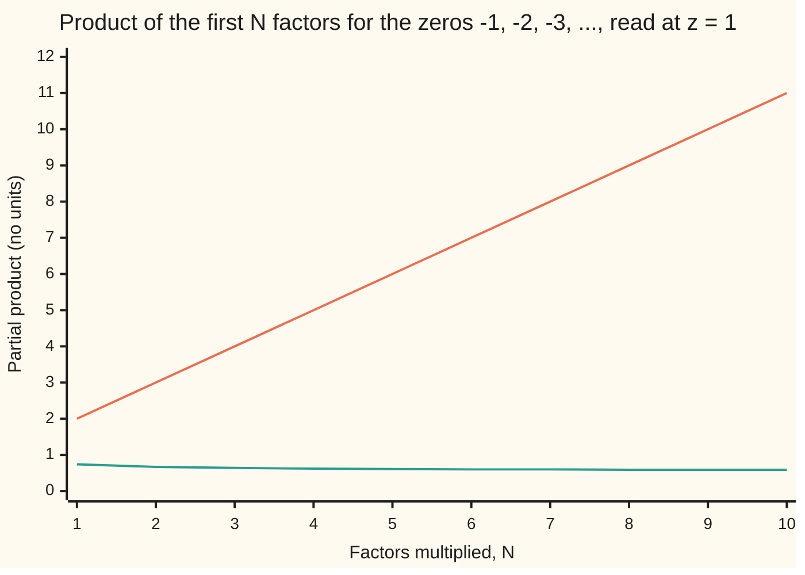

# Weierstrass factorization: any list of zeros running off to infinity belongs to an entire function

[Syllabus](../../../SYLLABUS.md) → [Complex analysis](../README.md) → [Entire and Meromorphic Functions](../README.md#s10) → Weierstrass factorization

---

## General Overview

Ask for a function that is zero at −1, −2, −3 and so on, and nowhere else. For finitely many zeros, a polynomial does it: one factor per zero. So try one factor 1 + z/n per zero −n, and multiply them all.

At z = 1 the factors are 2, 3/2, 4/3, …, and the product after N factors is exactly N + 1: 11, 101, 1001. It never settles. Each factor misses 1 by 1/n, and those misses add up to infinity.

Weierstrass fixed this. Multiply each factor by a correcting exponential, e^(−z/n), which is never zero, so no zero is added or lost. At z = 1 the corrected product reads 0.735759, 0.587974, 0.564250, 0.561740 after 1, 10, 100, 1000 factors, and settles on e^(−γ) = 0.561459. Here γ = 0.577216 is Euler's constant.

The same trick works for any list of zeros that runs off to infinity. And every entire function (holomorphic, that is, complex-differentiable, on the whole plane) other than 0 is e^g times a power of z times such a product.

**One corrected factor per zero multiplies to an entire function with exactly those zeros, for any list running off to infinity, and every entire function except 0 is a zero-free factor e^g times a power of z times such a product.**

**What kind of fact this is:** a theorem, proved on this card in Why it works; the example's value 1/(zΓ(z)e^(γz)) is derived there from Gauss's product for gamma.

### The picture: plain factors against corrected factors at z = 1



Orange: plain factors 1 + 1/n, climbing to N + 1. Green: corrected factors (1 + 1/n)e^(−1/n), flattening towards 0.561459.

---

## The formula

An **elementary factor** of degree p is 1 − w times the exponential of the first p terms of w + w^2/2 + w^3/3 + …. Degree 0 is the plain factor.

```math
E_0(w) = 1 - w, \qquad E_p(w) = (1 - w)\, e^{\,w + w^2/2 + \cdots + w^p/p}
```

**Read it aloud:** E p of w is one minus w, times e to the first p terms of w plus w squared over two and so on.

It is zero only at w = 1, since an exponential is never zero, so for $`a_n \ne 0`$, $`E_p(z/a_n)`$ is zero only at z = a_n. Weierstrass's theorem:

```math
f(z) = e^{g(z)}\, z^m \prod_{n=1}^{\infty} E_{p_n}\!\left(\frac{z}{a_n}\right)
```

**Read it aloud:** any entire function f other than 0 is e to an entire function g, times z to the m, times one elementary factor per nonzero zero (a finite product if finitely many).

The example takes $`a_n = -n`$ and $`p_n = 1`$, so each factor is $`E_1(-z/n) = (1 + z/n)e^{-z/n}`$:

```math
P(z) = \prod_{n=1}^{\infty}\left(1 + \frac{z}{n}\right)e^{-z/n} = \frac{1}{z\,\Gamma(z)\,e^{\gamma z}}
```

**Read it aloud:** the corrected product over the zeros minus one, minus two, and so on, is one over z times gamma of z times e to the gamma z.

| Symbol | Plain meaning | In our example | Push it up and the answer… |
| --- | --- | --- | --- |
| $`E_p(w)`$ | elementary factor: 1 − w with a correcting exponential | $`E_1(w) = (1 - w)e^{w}`$ | closer to 1 for small w |
| $`p`$, $`p_n`$ | the factor's degree; the degree used for zero n | 1 for every n | more zero lists are covered |
| $`z`$, $`w`$, $`r`$ | a point of the plane; the scaled point z/a_n; a disc radius | z = 1, 1/2, 1/4 + i/2; w = −z/n | — |
| $`a_n`$, $`n`$, $`N`$ | the n-th nonzero zero, repeated by its order; factors kept | −n; N = 1000 | — |
| $`m`$ | order of the zero at 0, or 0 if f(0) ≠ 0 | 1 for 1/Γ | — |
| $`f`$, $`g`$ | the function factored; e^g is its zero-free part | f = 1/Γ; g = γz | e^g grows |
| $`P(z)`$ | the product of the elementary factors | P(1) = 0.561459 | — |
| $`\Gamma`$, $`\gamma`$, $`H_N`$ | the gamma function; Euler's constant; 1 + 1/2 + … + 1/N | Γ(1) = 1; γ = 0.577216 | H_N grows like ln N |

### When it holds

- **The zeros must run off to infinity, or be finitely many.** Only finitely many, counted with multiplicity, lie in any disc; a finite list gives a finite product. Zeros piling up at a finite point, such as 1/n at 0, force an entire function to be 0 everywhere ([Zeros and the identity theorem](../04-Taylor%20Series%2C%20Zeros%20and%20Rigidity/03-zeros-and-the-identity-theorem.md)).
- **Repeat each zero by its order.** A double zero takes two factors; one factor gives a single zero.
- **The degrees must grow with the crowding.** It suffices that $`(r/\lvert a_n\rvert)^{p_n+1}`$ has a finite total for every $`r > 0`$; $`p_n = 0`$ works only when $`\sum 1/\lvert a_n\rvert`$ is finite. With zeros at −√n and p = 1 the product sinks toward 0: 0.001386 by N = 10^6.
- **The zeros do not fix f.** e^g is any entire function with no zeros, so e^z/Γ(z) has the same zeros as 1/Γ(z).

---

## Why it works

### Step 0: cancel the part of each factor that does not shrink fast enough

The plain factor 1 + z/n has logarithm about z/n, and those add to infinity. Multiplying by e^(−z/n) subtracts that first-order part. The log of the corrected factor is about −z^2/(2n^2), and those sizes add to a finite total. So the product settles, by the test in [Infinite products](../09-Special%20Functions%20and%20the%20Zeta%20Function/01-infinite-products.md).

### Step 1: one bound for every elementary factor

For $`\lvert w\rvert \le 1`$:

```math
\lvert 1 - E_p(w)\rvert \le \lvert w\rvert^{p+1}
```

**Read it aloud:** the factor misses 1 by at most the size of w to the power p plus one.

So degree p makes the miss shrink like the (p + 1)-th power. The code samples the disc for p = 0, 1, 2: the largest ratio is 1.000000 each time, reached at w = 1.

<details>
<summary>Detailed proof of the bound</summary>

For $`p = 0`$, $`1 - E_0(w) = w`$. For $`p \ge 1`$, differentiate. The exponent's derivative is $`1 + w + \cdots + w^{p-1}`$, and $`(1 - w)(1 + w + \cdots + w^{p-1}) = 1 - w^p`$. So

$`\displaystyle E_p'(w) = -w^p\, e^{\,w + w^2/2 + \cdots + w^p/p}.`$

Being $`w^p`$ times e to a polynomial with positive coefficients, $`-E_p'(w)`$ has a power series with no negative coefficients. So $`1 - E_p(w) = \sum_{k \ge p+1} c_k w^k`$ with every $`c_k \ge 0`$; there is no term below $`w^{p+1}`$ because $`E_p(0) = 1`$ and $`E_p'`$ starts at $`w^p`$.

For $`\lvert w\rvert \le 1`$, $`\lvert w^k\rvert \le \lvert w\rvert^{p+1}`$ when k ≥ p + 1, so

$`\displaystyle \lvert 1 - E_p(w)\rvert \le \lvert w\rvert^{p+1}\sum_{k} c_k = \lvert w\rvert^{p+1}\,(1 - E_p(1)) = \lvert w\rvert^{p+1}.`$

</details>

### Step 2: the product converges for any zeros running off to infinity

Fix a disc |z| ≤ r. Only finitely many a_n lie within 2r, since the list runs off to infinity. For the rest, w = z/a_n has size at most r/|a_n| ≤ 1/2. Step 1 gives a miss of at most $`(r/\lvert a_n\rvert)^{p_n+1}`$.

The choice $`p_n = n - 1`$ always works: past the first few factors the miss is at most $`(1/2)^n`$, a finite total. Sparser zeros allow a fixed p; for a_n = −n, p = 1 gives misses of at most r^2/n^2.

One bound serves the whole disc, so the product is holomorphic there ([Infinite products](../09-Special%20Functions%20and%20the%20Zeta%20Function/01-infinite-products.md), Step 4). Every disc is covered, so the product is entire. A convergent product (factors tending to 1, nonzero tail limit; tending to 0 counts as diverging) is zero only where a factor is: exactly at the a_n.

### Step 3: every entire function factors this way

Let f be entire and not identically 0. Its zeros are isolated, so each disc holds finitely many; list the nonzero ones by size, repeated by order. Let m be the order at 0, and P the product from Step 2.

The quotient h = f/(z^m P) has the same zeros with the same orders on top and bottom. Each one cancels, so h is entire and never zero.

A zero-free entire function has an entire logarithm. h′/h is entire, so it has an entire antiderivative g₀. Then h e^(−g₀) has derivative 0, so it is a nonzero constant e^c ([The complex logarithm](../02-Holomorphic%20Functions/04-complex-logarithm.md)). With g = g₀ + c, h = e^g, and f = e^g z^m P.

### Step 4: the example is the reciprocal of gamma

Gauss's product ([The gamma function](../09-Special%20Functions%20and%20the%20Zeta%20Function/02-gamma-function.md)) gives 1/Γ(z) as the limit of z(1 + z/1)(1 + z/2)⋯(1 + z/N) times N^(−z). Write N^(−z) as e^(−z ln N), and insert e^(−z/n)e^(z/n) for each n:

```math
\frac{1}{\Gamma(z)} = \lim_{N\to\infty} z\, e^{z(H_N - \ln N)} \prod_{n=1}^{N}\left(1 + \frac{z}{n}\right)e^{-z/n}
```

Here $`H_N = 1 + 1/2 + \cdots + 1/N`$, and $`H_N - \ln N`$ tends to γ. So 1/Γ(z) = e^(γz) z P(z). This is Step 3 in action: 1/Γ is entire, m = 1, the zeros are −n, and g(z) = γz.

At z = 1 the partial product telescopes to (N + 1)e^(−H_N).

### Step 5: sine is the same product paired up

Pair the factor for zero n with the one for −n. The exponentials cancel:

```math
\left(1 - \frac{z}{n}\right)e^{z/n}\cdot\left(1 + \frac{z}{n}\right)e^{-z/n} = 1 - \frac{z^2}{n^2}
```

So P(z)P(−z) is the sine product of [Infinite products](../09-Special%20Functions%20and%20the%20Zeta%20Function/01-infinite-products.md) divided by πz: sin(πz)/(πz). Paired, the plain factors converge: sine needs no correction.

---

## Worked numbers, by hand

| Step | Arithmetic | Value |
| --- | --- | --- |
| Plain, 10 factors | 2 × 3/2 × … × 11/10 | 11 |
| Corrected, 1 factor | 2 × e^(−1) | 0.735759 |
| Corrected, 10 factors | 11 × e^(−H_10), with H_10 = 1 + 1/2 + … + 1/10 | 0.587974 |
| Corrected, 1000 factors | 1001 × e^(−H_1000) | 0.561740 |
| The limit | (N + 1)e^(−H_N) → e^(−γ), as H_N − ln(N + 1) → γ | **0.561459** |
| Rebuild 1/Γ at z = 1 | e^γ × 1 × P(1) = 1.781072 × 0.561459 | **1** = 1/Γ(1) |
| Rebuild 1/Γ at z = 1/2 | e^(γ/2) × 1/2 × P(1/2), with P(1/2) = 0.845501 | **0.564190** = 1/√π |

With e^g restored, the product rebuilds 1/Γ exactly.

### What breaks if you drop a piece

| Mistake | Comes out at | What went wrong |
| --- | --- | --- |
| Plain factors 1 + z/n | 11, 101, 1001 at z = 1 | the misses 1/n add to infinity |
| e^g dropped | z P(z) = 0.561459 at z = 1, not 1/Γ(1) = 1 | zeros fix f only up to e^g |
| Zeros at −√n with p = 1 | 0.129740, 0.013776, 0.001386 at N = 10^2, 10^4, 10^6 | the misses 1/n add to infinity; p = 2 settles: 1.735793, 1.838518, 1.849537 |

---

## Code, from first principles, and it actually runs

Nothing imported holds a gamma function. Road one multiplies 100,000 elementary factors and adds the tail through its logarithm. Road two is 1/(zΓ(z)e^(γz)), with Γ(z) and γ each an area summed by trapezoids after t = e^u; it multiplies no factors. They agree at 1, 1/2 and 1/4 + i/2. It also checks the telescoped form, the paired product against sin(πz)/(πz) and Step 1's bound.

### Python

```python
# Weierstrass factorization -- the check behind the card.  Standard library only.
# Zeros at -1, -2, -3, ...  Road one multiplies the factors E_1(z/a_n) = (1 + z/n) e^(-z/n), tail added
# through its log.  Road two is 1/(z Gamma(z) e^(gamma z)), with Gamma(z) and Euler's constant gamma
# each an area summed by trapezoids after t = e^u; road two multiplies no factors.
import math, cmath

def E(p, w):                                   # elementary factor (1 - w) e^(w + w^2/2 + ... + w^p/p)
    return (1 - w) * cmath.exp(sum(w ** k / k for k in range(1, p + 1)))
def P(z, N=100000):                            # road one: N factors E_1(-z/n), tail e^(-z^2/2N)
    p = 1
    for n in range(1, N + 1):
        p *= E(1, -z / n)
    return p * cmath.exp(-z * z / (2 * N))
def area(f, lo=-150.0, hi=5.0, h=0.05):        # trapezoids in u; both ends are negligible
    return h * sum(f(lo + k * h) for k in range(round((hi - lo) / h) + 1))
gam = -area(lambda u: u * math.exp(u - math.exp(u)))       # gamma = -(area under ln t e^(-t))
def road2(z):                                  # Gamma(z) = area under t^(z-1) e^(-t)
    return 1 / (z * area(lambda u: cmath.exp(z * u - math.exp(u))) * cmath.exp(gam * z))
def show(w):                                   # 'a + bi', six decimals, no -0.000000
    a, b = round(w.real, 6) + 0.0, round(w.imag, 6) + 0.0
    return f"{a:.6f} {'-' if b < 0 else '+'} {abs(b):.6f}i"
def partial(p, a, Ns):                         # partial products of E_p(1/a(n)) at z = 1, kept at each N in Ns
    q, out = 1.0, []
    for n in range(1, max(Ns) + 1):
        q *= E(p, -1 / a(n)).real
        if n in Ns: out.append(q)
    return out

plain = partial(0, lambda n: n, [10, 100, 1000])
fixed = partial(1, lambda n: n, [1, 10, 100, 1000])
H = lambda N: sum(1 / n for n in range(1, N + 1))
by_hand = [(N + 1) * math.exp(-H(N)) for N in (1, 10, 100, 1000)]
print("plain factors (1 + 1/n), N = 10, 100, 1000: " + ", ".join(f"{x:.6f}" for x in plain))
print("factors (1 + 1/n) e^(-1/n), N = 1, 10, 100, 1000: " + ", ".join(f"{x:.6f}" for x in fixed))
print("the same as (N + 1) e^(-H_N): " + ", ".join(f"{x:.6f}" for x in by_hand))
print("chart, plain, N = 1-10: " + ", ".join(f"{x:.0f}" for x in partial(0, lambda n: n, list(range(1, 11)))))
print("chart, corrected, N = 1-10: " + ", ".join(f"{x:.2f}" for x in partial(1, lambda n: n, list(range(1, 11)))))
print(f"Euler's constant gamma, by area: {gam:.6f}; e^(-gamma) = {math.exp(-gam):.6f}; e^gamma = {math.exp(gam):.6f}")
pts = [1, 0.5, complex(0.25, 0.5)]
r1, r2 = [P(z) for z in pts], [road2(z) for z in pts]
for z, a, b in zip(["1", "1/2", "1/4 + i/2"], r1, r2):
    print(f"z = {z}: product, road one {show(a)}; road two {show(b)}")
paired, sine = r1[2] * P(-pts[2]), cmath.sin(math.pi * pts[2]) / (math.pi * pts[2])
print(f"paired, P(z) P(-z) at 1/4 + i/2: {show(paired)}; sin(pi z)/(pi z): {show(sine)}")
grid = [r / 20 * cmath.exp(2j * math.pi * k / 72) for r in range(1, 21) for k in range(72)]
ratio = [max(abs(1 - E(p, w)) / abs(w) ** (p + 1) for w in grid) for p in (0, 1, 2)]
print("lemma, largest |1 - E_p(w)| / |w|^(p+1) on |w| <= 1, p = 0, 1, 2: " + ", ".join(f"{x:.6f}" for x in ratio))
rebuilt = math.exp(gam / 2) * 0.5 * r1[1].real
print(f"1/Gamma rebuilt, e^(gamma z) z P(z) at z = 1/2: {rebuilt:.6f}; 1/sqrt(pi) = {1 / math.sqrt(math.pi):.6f}")
print(f"mistake, e^g dropped: z P(z) at z = 1 is {r1[0].real:.6f}, not 1/Gamma(1) = 1")
e1, e2 = (partial(p, math.sqrt, [100, 10000, 1000000]) for p in (1, 2))
print("mistake, zeros at -sqrt(n), N = 10^2, 10^4, 10^6, with E_1: " + ", ".join(f"{x:.6f}" for x in e1)
      + "; with E_2: " + ", ".join(f"{x:.6f}" for x in e2))
assert all(abs(a - b) < 1e-8 for a, b in zip(r1, r2))                # the product meets 1/(z Gamma e^(gamma z))
assert abs(paired - sine) < 1e-8                                      # paired factors rebuild the sine product
assert abs(rebuilt - 1 / math.sqrt(math.pi)) < 1e-8                   # e^g z^m P is 1/Gamma
assert all(abs(a - b) < 1e-12 for a, b in zip(fixed, by_hand))        # the telescoping by hand
assert max(ratio) <= 1 + 1e-12 and plain[-1] > 1000                   # the lemma; plain factors diverge
assert e1[-1] < e1[0] / 50 and e2[2] - e2[1] < (e2[1] - e2[0]) / 5   # E_1 sinks for -sqrt(n), E_2 settles
print("ALL CHECKS PASS")
```

**Ran 2026-11-27 on macOS, Python 3.14.10, standard library only. All checks passed. Output, pasted from the run:**

```
plain factors (1 + 1/n), N = 10, 100, 1000: 11.000000, 101.000000, 1001.000000
factors (1 + 1/n) e^(-1/n), N = 1, 10, 100, 1000: 0.735759, 0.587974, 0.564250, 0.561740
the same as (N + 1) e^(-H_N): 0.735759, 0.587974, 0.564250, 0.561740
chart, plain, N = 1-10: 2, 3, 4, 5, 6, 7, 8, 9, 10, 11
chart, corrected, N = 1-10: 0.74, 0.67, 0.64, 0.62, 0.61, 0.60, 0.60, 0.59, 0.59, 0.59
Euler's constant gamma, by area: 0.577216; e^(-gamma) = 0.561459; e^gamma = 1.781072
z = 1: product, road one 0.561459 + 0.000000i; road two 0.561459 + 0.000000i
z = 1/2: product, road one 0.845501 + 0.000000i; road two 0.845501 + 0.000000i
z = 1/4 + i/2: product, road one 1.079794 - 0.219530i; road two 1.079794 - 0.219530i
paired, P(z) P(-z) at 1/4 + i/2: 1.280570 - 0.489242i; sin(pi z)/(pi z): 1.280570 - 0.489242i
lemma, largest |1 - E_p(w)| / |w|^(p+1) on |w| <= 1, p = 0, 1, 2: 1.000000, 1.000000, 1.000000
1/Gamma rebuilt, e^(gamma z) z P(z) at z = 1/2: 0.564190; 1/sqrt(pi) = 0.564190
mistake, e^g dropped: z P(z) at z = 1 is 0.561459, not 1/Gamma(1) = 1
mistake, zeros at -sqrt(n), N = 10^2, 10^4, 10^6, with E_1: 0.129740, 0.013776, 0.001386; with E_2: 1.735793, 1.838518, 1.849537
ALL CHECKS PASS
```

### Rust

Same numbers and labels, built with `rustc --edition 2021 -O`.

```rust
// Weierstrass factorization -- the same check as the Python, in Rust.  No crates.
// Zeros at -1, -2, -3, ...  Road one multiplies the factors E_1(z/a_n) = (1 + z/n) e^(-z/n), tail added
// through its log.  Road two is 1/(z Gamma(z) e^(gamma z)), with Gamma(z) and Euler's constant gamma
// each an area summed by trapezoids after t = e^u; road two multiplies no factors.
use std::f64::consts::PI;
#[derive(Clone, Copy)]
struct C { re: f64, im: f64 }
fn c(re: f64, im: f64) -> C { C { re, im } }
fn add(a: C, b: C) -> C { c(a.re + b.re, a.im + b.im) }
fn mul(a: C, b: C) -> C { c(a.re * b.re - a.im * b.im, a.re * b.im + a.im * b.re) }
fn sc(a: C, k: f64) -> C { c(a.re * k, a.im * k) }
fn inv(a: C) -> C { let d = a.re * a.re + a.im * a.im; c(a.re / d, -a.im / d) }
fn abs(a: C) -> f64 { a.re.hypot(a.im) }
fn cexp(w: C) -> C { c(w.re.exp() * w.im.cos(), w.re.exp() * w.im.sin()) }
fn e_p(p: i32, w: C) -> C { // elementary factor (1 - w) e^(w + w^2/2 + ... + w^p/p)
    let (s, _) = (1..=p).fold((c(0.0, 0.0), c(1.0, 0.0)), |(s, wk), k| (add(s, sc(mul(wk, w), 1.0 / k as f64)), mul(wk, w)));
    mul(c(1.0 - w.re, -w.im), cexp(s))
}
fn prod(z: C, n: usize) -> C { // road one: n factors E_1(-z/k), tail e^(-z^2/2n)
    let mut p = c(1.0, 0.0);
    for k in 1..=n { p = mul(p, e_p(1, sc(z, -1.0 / k as f64))) }
    mul(p, cexp(sc(mul(z, z), -1.0 / (2.0 * n as f64))))
}
fn area(f: &dyn Fn(f64) -> C) -> C { // trapezoids in u from -150 to 5; both ends are negligible
    let mut s = c(0.0, 0.0);
    for k in 0..=3100 { s = add(s, f(-150.0 + k as f64 * 0.05)) }
    sc(s, 0.05)
}
fn show(w: C) -> String { // 'a + bi', six decimals, no -0.000000
    let (a, b) = (format!("{:.6}", w.re).replace("-0.000000", "0.000000"), format!("{:.6}", w.im.abs()));
    format!("{} {} {}i", a, if w.im < 0.0 && b != "0.000000" { '-' } else { '+' }, b)
}
fn partial(p: i32, a: &dyn Fn(f64) -> f64, ns: &[usize]) -> Vec<f64> { // E_p(1/a(n)) at z = 1, kept at each N in ns
    let (mut q, mut out) = (1.0, vec![]);
    for n in 1..=*ns.iter().max().unwrap() {
        q *= e_p(p, c(-1.0 / a(n as f64), 0.0)).re;
        if ns.contains(&n) { out.push(q) }
    }
    out
}
fn join(v: &[f64], d: usize) -> String { v.iter().map(|x| format!("{:.*}", d, x)).collect::<Vec<_>>().join(", ") }
fn main() {
    let id = |n: f64| n;
    let (plain, fixed) = (partial(0, &id, &[10, 100, 1000]), partial(1, &id, &[1, 10, 100, 1000]));
    let by_hand: Vec<f64> = [1usize, 10, 100, 1000].iter().map(|&n| (n as f64 + 1.0) * (-(1..=n).map(|k| 1.0 / k as f64).sum::<f64>()).exp()).collect();
    let ten = [1usize, 2, 3, 4, 5, 6, 7, 8, 9, 10];
    println!("plain factors (1 + 1/n), N = 10, 100, 1000: {}", join(&plain, 6));
    println!("factors (1 + 1/n) e^(-1/n), N = 1, 10, 100, 1000: {}", join(&fixed, 6));
    println!("the same as (N + 1) e^(-H_N): {}", join(&by_hand, 6));
    println!("chart, plain, N = 1-10: {}", join(&partial(0, &id, &ten), 0));
    println!("chart, corrected, N = 1-10: {}", join(&partial(1, &id, &ten), 2));
    let gam = -area(&|u: f64| c(u * (u - u.exp()).exp(), 0.0)).re; // gamma = -(area under ln t e^(-t))
    println!("Euler's constant gamma, by area: {:.6}; e^(-gamma) = {:.6}; e^gamma = {:.6}", gam, (-gam).exp(), gam.exp());
    let road2 = |z: C| inv(mul(mul(z, area(&|u: f64| cexp(c(z.re * u - u.exp(), z.im * u)))), cexp(sc(z, gam))));
    let pts = [c(1.0, 0.0), c(0.5, 0.0), c(0.25, 0.5)];
    let (r1, r2): (Vec<C>, Vec<C>) = (pts.iter().map(|&z| prod(z, 100000)).collect(), pts.iter().map(|&z| road2(z)).collect());
    for (i, z) in ["1", "1/2", "1/4 + i/2"].iter().enumerate() {
        println!("z = {}: product, road one {}; road two {}", z, show(r1[i]), show(r2[i]));
    }
    let (z0, paired) = (pts[2], mul(r1[2], prod(sc(pts[2], -1.0), 100000)));
    let s = sc(add(cexp(c(-PI * z0.im, PI * z0.re)), sc(cexp(c(PI * z0.im, -PI * z0.re)), -1.0)), 0.5); // i sin(pi z)
    let sine = mul(c(s.im, -s.re), inv(sc(z0, PI)));
    println!("paired, P(z) P(-z) at 1/4 + i/2: {}; sin(pi z)/(pi z): {}", show(paired), show(sine));
    let grid: Vec<C> = (1..=20).flat_map(|r| (0..72).map(move |k| sc(cexp(c(0.0, 2.0 * PI * k as f64 / 72.0)), r as f64 / 20.0))).collect();
    let ratio: Vec<f64> = (0..3).map(|p| grid.iter().map(|&w| abs(add(c(1.0, 0.0), sc(e_p(p, w), -1.0))) / abs(w).powi(p + 1)).fold(0.0, f64::max)).collect();
    println!("lemma, largest |1 - E_p(w)| / |w|^(p+1) on |w| <= 1, p = 0, 1, 2: {}", join(&ratio, 6));
    let rebuilt = (gam / 2.0).exp() * 0.5 * r1[1].re;
    println!("1/Gamma rebuilt, e^(gamma z) z P(z) at z = 1/2: {:.6}; 1/sqrt(pi) = {:.6}", rebuilt, 1.0 / PI.sqrt());
    println!("mistake, e^g dropped: z P(z) at z = 1 is {:.6}, not 1/Gamma(1) = 1", r1[0].re);
    let big = [100usize, 10000, 1000000];
    let (e1, e2) = (partial(1, &|n: f64| n.sqrt(), &big), partial(2, &|n: f64| n.sqrt(), &big));
    println!("mistake, zeros at -sqrt(n), N = 10^2, 10^4, 10^6, with E_1: {}; with E_2: {}", join(&e1, 6), join(&e2, 6));
    assert!((0..3).all(|i| abs(add(r1[i], sc(r2[i], -1.0))) < 1e-8)); // the product meets 1/(z Gamma e^(gamma z))
    assert!(abs(add(paired, sc(sine, -1.0))) < 1e-8); // paired factors rebuild the sine product
    assert!((rebuilt - 1.0 / PI.sqrt()).abs() < 1e-8); // e^g z^m P is 1/Gamma
    assert!(fixed.iter().zip(&by_hand).all(|(a, b)| (a - b).abs() < 1e-12)); // the telescoping by hand
    assert!(ratio.iter().all(|&r| r <= 1.0 + 1e-12) && plain[2] > 1000.0); // the lemma; plain factors diverge
    assert!(e1[2] < e1[0] / 50.0 && e2[2] - e2[1] < (e2[1] - e2[0]) / 5.0); // E_1 sinks for -sqrt(n), E_2 settles
    println!("ALL CHECKS PASS");
}
```

**Ran 2026-11-27 on macOS, rustc 1.98.1, no crates. All checks passed. Output, pasted from the run:**

```
plain factors (1 + 1/n), N = 10, 100, 1000: 11.000000, 101.000000, 1001.000000
factors (1 + 1/n) e^(-1/n), N = 1, 10, 100, 1000: 0.735759, 0.587974, 0.564250, 0.561740
the same as (N + 1) e^(-H_N): 0.735759, 0.587974, 0.564250, 0.561740
chart, plain, N = 1-10: 2, 3, 4, 5, 6, 7, 8, 9, 10, 11
chart, corrected, N = 1-10: 0.74, 0.67, 0.64, 0.62, 0.61, 0.60, 0.60, 0.59, 0.59, 0.59
Euler's constant gamma, by area: 0.577216; e^(-gamma) = 0.561459; e^gamma = 1.781072
z = 1: product, road one 0.561459 + 0.000000i; road two 0.561459 + 0.000000i
z = 1/2: product, road one 0.845501 + 0.000000i; road two 0.845501 + 0.000000i
z = 1/4 + i/2: product, road one 1.079794 - 0.219530i; road two 1.079794 - 0.219530i
paired, P(z) P(-z) at 1/4 + i/2: 1.280570 - 0.489242i; sin(pi z)/(pi z): 1.280570 - 0.489242i
lemma, largest |1 - E_p(w)| / |w|^(p+1) on |w| <= 1, p = 0, 1, 2: 1.000000, 1.000000, 1.000000
1/Gamma rebuilt, e^(gamma z) z P(z) at z = 1/2: 0.564190; 1/sqrt(pi) = 0.564190
mistake, e^g dropped: z P(z) at z = 1 is 0.561459, not 1/Gamma(1) = 1
mistake, zeros at -sqrt(n), N = 10^2, 10^4, 10^6, with E_1: 0.129740, 0.013776, 0.001386; with E_2: 1.735793, 1.838518, 1.849537
ALL CHECKS PASS
```

### Lean

Lean proves the factorization for every entire function except 0, and the product for every list of zeros running off to infinity.

- Take any entire function f other than 0. Then f = e^g z^m P, with g entire and m the order of the zero at 0.
- Here P multiplies one elementary factor per nonzero zero of f, repeated by its order, and converges on every disc.
- Take nonzero a_n, repeats allowed, running off to infinity. Then the factors E_(n−1)(z/a_n) converge on every disc to an entire function P.
- That P is zero exactly at the a_n, each zero's order being how often it appears in the list.
- Take any degrees p_n whose sizes (r/|a_n|)^(p_n+1) have a finite total for every r. Then the product converges the same way, with the same zeros.
- Take any complex z. Then z e^(γz) times the first N factors (1 + z/n)e^(−z/n) tends to 1/Γ(z).
- Plain factors at z = 1 give exactly 11 and 101, and the first corrected factor is 2e^(−1).
- Every elementary factor is zero at w = 1, and Step 5 holds: pairing the factors for n and −n gives 1 − z^2/n^2.

Every decimal, Step 1's bound, the chart, the sine product and the −√n failure are left to the Python and Rust checks.

```lean
-- Weierstrass factorization: every entire function other than 0 is e^g times z^m times a locally uniformly convergent product of elementary factors over its nonzero zeros, any list of nonzero zeros running off to infinity is the zero list of such a product, and 1/Γ(z) is z e^(γz) times the product of (1 + z/n)e^(−z/n).
import Mathlib.Analysis.SpecialFunctions.Gamma.Beta
import Mathlib.NumberTheory.Harmonic.EulerMascheroni
import Mathlib.Analysis.Analytic.Order
import Mathlib.Topology.Algebra.InfiniteSum.UniformOn
import Mathlib.SetTheory.Cardinal.Finite
import Mathlib.Tactic.NormNum
import Mathlib.Analysis.SpecialFunctions.Complex.LogBounds
import Mathlib.Analysis.Normed.Module.MultipliableUniformlyOn
import Mathlib.Analysis.Complex.LocallyUniformLimit
import Mathlib.Analysis.Complex.HasPrimitives
import Mathlib.Analysis.Meromorphic.NormalForm
import Mathlib.Analysis.Complex.CauchyIntegral

open Complex Filter Topology Finset

/-- The elementary factor of degree p: E_p(w) = (1 − w) · e^(w + w^2/2 + ⋯ + w^p/p).
Degree 0 is the plain factor 1 − w. -/
noncomputable def elementaryFactor (p : ℕ) (w : ℂ) : ℂ :=
  (1 - w) * Complex.exp (∑ k ∈ Icc 1 p, w ^ k / (k : ℂ))

/-- The logarithm of an elementary factor near 0. -/
noncomputable def efLog (p : ℕ) (w : ℂ) : ℂ :=
  Complex.log (1 - w) + ∑ k ∈ Icc 1 p, w ^ k / (k : ℂ)

lemma ef_differentiable (p : ℕ) : Differentiable ℂ (elementaryFactor p) := by
  unfold elementaryFactor; fun_prop

#print axioms ef_differentiable

lemma ef_eq_exp (p : ℕ) {w : ℂ} (hw : ‖w‖ < 1) : elementaryFactor p w = Complex.exp (efLog p w) := by
  have h1 : (1 : ℂ) - w ≠ 0 := by
    intro h; rw [sub_eq_zero] at h; rw [← h] at hw; simp at hw
  rw [efLog, Complex.exp_add, Complex.exp_log h1, elementaryFactor]

#print axioms ef_eq_exp

lemma logTaylor_neg_eq (p : ℕ) (w : ℂ) :
    logTaylor (p + 1) (-w) = -∑ k ∈ Icc 1 p, w ^ k / (k : ℂ) := by
  induction p with
  | zero => simp [logTaylor]
  | succ p ih =>
    rw [logTaylor_succ, Pi.add_apply, ih, Finset.sum_Icc_succ_top (by omega)]
    have : ((-1 : ℂ) ^ (p + 1 + 1) * (-w) ^ (p + 1)) = -(w ^ (p + 1)) := by
      rw [neg_pow w, ← mul_assoc, ← pow_add]
      have : p + 1 + 1 + (p + 1) = 2 * (p + 1) + 1 := by ring
      rw [this, pow_succ, pow_mul]; norm_num
    simp only [this]
    push_cast
    ring

#print axioms logTaylor_neg_eq

lemma efLog_bound (p : ℕ) {w : ℂ} (hw : ‖w‖ ≤ 1 / 2) : ‖efLog p w‖ ≤ 2 * ‖w‖ ^ (p + 1) := by
  have hw1 : ‖-w‖ < 1 := by rw [norm_neg]; linarith
  have h := Complex.norm_log_sub_logTaylor_le p hw1
  rw [logTaylor_neg_eq, norm_neg, sub_neg_eq_add, ← sub_eq_add_neg] at h
  rw [efLog]
  refine h.trans ?_
  have h0 : 0 ≤ ‖w‖ ^ (p + 1) := by positivity
  have h2 : (1 - ‖w‖)⁻¹ ≤ 2 := by
    rw [inv_le_comm₀ (by linarith) (by norm_num)]; linarith
  have h3 : (1 : ℝ) ≤ p + 1 := by have := p.cast_nonneg (α := ℝ); linarith
  calc ‖w‖ ^ (p + 1) * (1 - ‖w‖)⁻¹ / (p + 1) ≤ ‖w‖ ^ (p + 1) * (1 - ‖w‖)⁻¹ :=
        div_le_self (by have : 0 < 1 - ‖w‖ := by linarith
                        positivity) h3
    _ ≤ ‖w‖ ^ (p + 1) * 2 := mul_le_mul_of_nonneg_left h2 h0
    _ = 2 * ‖w‖ ^ (p + 1) := by ring

#print axioms efLog_bound

lemma efLog_differentiableAt (p : ℕ) {w : ℂ} (hw : ‖w‖ < 1) : DifferentiableAt ℂ (efLog p) w := by
  have hs : 1 - w ∈ slitPlane := by
    rw [sub_eq_add_neg]; exact mem_slitPlane_of_norm_lt_one (by rwa [norm_neg])
  unfold efLog
  refine DifferentiableAt.add ?_ ?_
  · exact (differentiableAt_const _ |>.sub differentiableAt_id).clog hs
  · fun_prop

#print axioms efLog_differentiableAt

lemma ef_order (p : ℕ) {a : ℂ} (ha : a ≠ 0) (w : ℂ) :
    analyticOrderAt (fun z => elementaryFactor p (z / a)) w = if a = w then 1 else 0 := by
  have hA : AnalyticAt ℂ (fun z => elementaryFactor p (z / a)) w :=
    ((ef_differentiable p).comp (differentiable_id.div_const a)).analyticAt w
  split_ifs with h
  · subst h
    have := (hA.analyticOrderAt_eq_natCast (n := 1)).mpr
      ⟨fun z => (-a⁻¹) * Complex.exp (∑ k ∈ Icc 1 p, (z / a) ^ k / (k : ℂ)), by fun_prop,
        mul_ne_zero (neg_ne_zero.mpr (inv_ne_zero ha)) (Complex.exp_ne_zero _),
        Eventually.of_forall fun z => by
          simp only [elementaryFactor, pow_one, smul_eq_mul]; field_simp; ring⟩
    simpa using this
  · rw [analyticOrderAt_eq_zero]
    right
    simp only [elementaryFactor]
    refine mul_ne_zero ?_ (Complex.exp_ne_zero _)
    intro h'
    rw [sub_eq_zero, eq_div_iff ha, one_mul] at h'
    exact h h'

#print axioms ef_order

lemma order_prod {ι : Type*} (s : Finset ι) (f : ι → ℂ → ℂ) (w : ℂ)
    (h : ∀ i ∈ s, AnalyticAt ℂ (f i) w) :
    analyticOrderAt (fun z => ∏ i ∈ s, f i z) w = ∑ i ∈ s, analyticOrderAt (f i) w := by
  classical
  induction s using Finset.induction_on with
  | empty =>
    simp only [Finset.prod_empty, Finset.sum_empty]
    rw [analyticOrderAt_eq_zero]; right; simp
  | insert j s hj ih =>
    simp only [Finset.prod_insert hj, Finset.sum_insert hj]
    rw [← ih (fun i hi => h i (Finset.mem_insert_of_mem hi))]
    exact analyticOrderAt_mul (h j (Finset.mem_insert_self j s))
      (Finset.analyticAt_fun_prod s fun i hi => h i (Finset.mem_insert_of_mem hi))

#print axioms order_prod

lemma tendstoUniformlyOn_mul_left_bdd {β α : Type*} {l : Filter β} {s : Set α}
    {G : β → α → ℂ} {g A : α → ℂ} {B : ℝ} (hB : ∀ x ∈ s, ‖A x‖ ≤ B)
    (h : TendstoUniformlyOn G g l s) :
    TendstoUniformlyOn (fun n x => A x * G n x) (fun x => A x * g x) l s := by
  rw [Metric.tendstoUniformlyOn_iff] at h ⊢
  intro ε hε
  have hB' : 0 < |B| + 1 := by positivity
  filter_upwards [h (ε / (|B| + 1)) (div_pos hε hB')] with n hn x hx
  rw [dist_eq_norm, ← mul_sub, norm_mul]
  have h1 := hn x hx
  rw [dist_eq_norm] at h1
  calc ‖A x‖ * ‖g x - G n x‖ ≤ (|B| + 1) * ‖g x - G n x‖ :=
        mul_le_mul_of_nonneg_right (by linarith [hB x hx, le_abs_self B]) (norm_nonneg _)
    _ < (|B| + 1) * (ε / (|B| + 1)) := mul_lt_mul_of_pos_left h1 hB'
    _ = ε := by field_simp

#print axioms tendstoUniformlyOn_mul_left_bdd

section Core

variable {ι : Type*} (a : ι → ℂ) (p : ι → ℕ)

lemma finite_small (ha : ∀ i, a i ≠ 0)
    (hs : ∀ R : ℝ, Summable (fun i => (R / ‖a i‖) ^ (p i + 1))) (R : ℝ) :
    {i | ‖a i‖ ≤ R}.Finite := by
  have h := (hs R).tendsto_cofinite_zero.eventually (gt_mem_nhds (zero_lt_one' ℝ))
  rw [Filter.eventually_cofinite] at h
  refine h.subset fun i (hi : ‖a i‖ ≤ R) => ?_
  simp only [Set.mem_ofPred_eq, not_lt]
  have hai : 0 < ‖a i‖ := norm_pos_iff.mpr (ha i)
  exact one_le_pow₀ ((one_le_div hai).mpr hi)

#print axioms finite_small

lemma local_struct (ha : ∀ i, a i ≠ 0)
    (hs : ∀ R : ℝ, Summable (fun i => (R / ‖a i‖) ^ (p i + 1))) (R : ℝ) (hR : 0 < R) :
    ∃ F : Finset ι, ∃ S : ℂ → ℂ, (∀ i, a i ∈ Metric.ball (0 : ℂ) R → i ∈ F) ∧
      DifferentiableOn ℂ S (Metric.ball 0 R) ∧
      TendstoUniformlyOn (fun t z => ∏ i ∈ t, elementaryFactor (p i) (z / a i))
        (fun z => (∏ i ∈ F, elementaryFactor (p i) (z / a i)) * Complex.exp (S z)) atTop
        (Metric.ball 0 R) := by
  classical
  set F := (finite_small a p ha hs (2 * R)).toFinset with hFdef
  have hF : ∀ i, i ∈ F ↔ ‖a i‖ ≤ 2 * R := fun i => by simp [hFdef]
  set Lf : ι → ℂ → ℂ := fun i z => if i ∈ F then 0 else efLog (p i) (z / a i) with hLf
  set u : ι → ℝ := fun i => 2 * (R / ‖a i‖) ^ (p i + 1) with hu_def
  have hu : Summable u := (hs R).mul_left 2
  have hsmall : ∀ i, i ∉ F → ∀ z ∈ Metric.ball (0 : ℂ) R,
      ‖z / a i‖ ≤ R / ‖a i‖ ∧ R / ‖a i‖ ≤ 1 / 2 := by
    intro i hi z hz
    rw [hF, not_le] at hi
    rw [Metric.mem_ball, dist_zero_right] at hz
    have hai : 0 < ‖a i‖ := by linarith
    refine ⟨?_, ?_⟩
    · rw [norm_div]; exact div_le_div_of_nonneg_right hz.le hai.le
    · rw [div_le_iff₀ hai]; linarith
  have hbound : ∀ i z, z ∈ Metric.ball (0 : ℂ) R → ‖Lf i z‖ ≤ u i := by
    intro i z hz
    by_cases hi : i ∈ F
    · simp only [hLf, hi, ite_true, norm_zero, hu_def]; positivity
    · simp only [hLf, hi, ite_false, hu_def]
      obtain ⟨h1, h2⟩ := hsmall i hi z hz
      refine (efLog_bound (p i) (h1.trans h2)).trans ?_
      gcongr
  set S : ℂ → ℂ := fun z => ∑' i, Lf i z with hS_def
  have hS : TendstoUniformlyOn (fun t z => ∑ i ∈ t, Lf i z) S atTop (Metric.ball 0 R) :=
    tendstoUniformlyOn_tsum hu hbound
  have hLdiff : ∀ i, DifferentiableOn ℂ (Lf i) (Metric.ball 0 R) := by
    intro i
    by_cases hi : i ∈ F
    · simp only [hLf, hi, ite_true]; exact differentiableOn_const _
    · simp only [hLf, hi, ite_false]
      intro z hz
      obtain ⟨h1, h2⟩ := hsmall i hi z hz
      have : ‖z / a i‖ < 1 := by linarith
      exact ((efLog_differentiableAt (p i) this).comp z
        (differentiableAt_id.div_const (a i))).differentiableWithinAt
  have hSdiff : DifferentiableOn ℂ S (Metric.ball 0 R) :=
    hS.tendstoLocallyUniformlyOn.differentiableOn
      (Eventually.of_forall fun t => DifferentiableOn.fun_sum fun i _ => hLdiff i)
      Metric.isOpen_ball
  have hSbdd : BddAbove ((fun x => (S x).re) '' Metric.ball 0 R) := by
    refine ⟨∑' i, u i, ?_⟩
    rintro _ ⟨z, hz, rfl⟩
    exact (Complex.re_le_norm _).trans (tsum_of_norm_bounded hu.hasSum fun i => hbound i z hz)
  have hexp := hS.comp_cexp hSbdd
  set A : ℂ → ℂ := fun z => ∏ i ∈ F, elementaryFactor (p i) (z / a i) with hA_def
  have hAc : Continuous A :=
    continuous_finsetProd F fun i _ =>
      (ef_differentiable (p i)).continuous.comp (continuous_id.div_const (a i))
  obtain ⟨B, hB⟩ := (isCompact_closedBall (0 : ℂ) R).exists_bound_of_continuousOn hAc.continuousOn
  have hmul := tendstoUniformlyOn_mul_left_bdd (A := A)
    (fun x hx => hB x (Metric.ball_subset_closedBall hx)) hexp
  refine ⟨F, S, fun i hi => ?_, hSdiff, hmul.congr ?_⟩
  · rw [hF]; rw [Metric.mem_ball, dist_zero_right] at hi; linarith
  · filter_upwards [eventually_ge_atTop F] with t ht z hz
    simp only [Function.comp_apply, hA_def]
    have hfac : ∀ i, elementaryFactor (p i) (z / a i) =
        (if i ∈ F then elementaryFactor (p i) (z / a i) else 1) * Complex.exp (Lf i z) := by
      intro i
      by_cases hi : i ∈ F
      · simp [hLf, hi]
      · simp only [hLf, hi, ite_false, one_mul]
        obtain ⟨h1, h2⟩ := hsmall i hi z hz
        exact ef_eq_exp (p i) (by linarith)
    rw [Complex.exp_sum]
    conv_rhs => rw [Finset.prod_congr rfl fun i _ => hfac i, Finset.prod_mul_distrib,
      ← Finset.prod_filter, Finset.filter_mem_eq_inter, Finset.inter_eq_right.mpr ht]

#print axioms local_struct

theorem core_product (ha : ∀ i, a i ≠ 0)
    (hs : ∀ R : ℝ, Summable (fun i => (R / ‖a i‖) ^ (p i + 1))) :
    ∃ P : ℂ → ℂ,
      HasProdLocallyUniformlyOn (fun i z => elementaryFactor (p i) (z / a i)) P Set.univ ∧
      Differentiable ℂ P ∧
      ∀ w, analyticOrderAt P w = ENat.card {i // a i = w} := by
  classical
  set P : ℂ → ℂ := fun z => ∏' i, elementaryFactor (p i) (z / a i) with hP
  have key : ∀ R : ℝ, 0 < R → ∃ F : Finset ι, ∃ S : ℂ → ℂ,
      (∀ i, a i ∈ Metric.ball (0 : ℂ) R → i ∈ F) ∧
      DifferentiableOn ℂ S (Metric.ball 0 R) ∧
      TendstoUniformlyOn (fun t z => ∏ i ∈ t, elementaryFactor (p i) (z / a i)) P atTop
        (Metric.ball 0 R) ∧
      Set.EqOn P (fun z => (∏ i ∈ F, elementaryFactor (p i) (z / a i)) * Complex.exp (S z))
        (Metric.ball 0 R) := by
    intro R hR
    obtain ⟨F, S, hF, hSd, hT⟩ := local_struct a p ha hs R hR
    have hEq : Set.EqOn P (fun z => (∏ i ∈ F, elementaryFactor (p i) (z / a i)) *
        Complex.exp (S z)) (Metric.ball 0 R) := by
      intro z hz
      have h1 : HasProd (fun i => elementaryFactor (p i) (z / a i))
          ((∏ i ∈ F, elementaryFactor (p i) (z / a i)) * Complex.exp (S z)) :=
        hT.tendsto_at hz
      exact h1.tprod_eq
    exact ⟨F, S, hF, hSd, hT.congr_right hEq.symm, hEq⟩
  refine ⟨P, ?_, ?_, ?_⟩
  · refine tendstoLocallyUniformlyOn_of_forall_exists_nhds fun x _ => ?_
    obtain ⟨F, S, -, -, hT, -⟩ := key (‖x‖ + 1) (by positivity)
    refine ⟨Metric.ball 0 (‖x‖ + 1), nhdsWithin_le_nhds
      (Metric.isOpen_ball.mem_nhds (by simp)), hT⟩
  · intro w
    obtain ⟨F, S, -, hSd, -, hEq⟩ := key (‖w‖ + 1) (by positivity)
    have hw : Metric.ball (0 : ℂ) (‖w‖ + 1) ∈ 𝓝 w := Metric.isOpen_ball.mem_nhds (by simp)
    refine DifferentiableAt.congr_of_eventuallyEq ?_ (Filter.eventually_of_mem hw hEq)
    refine DifferentiableAt.mul ?_ ((hSd.differentiableAt hw).cexp)
    exact (Finset.analyticAt_fun_prod F fun i _ =>
      ((ef_differentiable (p i)).comp (differentiable_id.div_const (a i))).analyticAt w).differentiableAt
  · intro w
    obtain ⟨F, S, hF, hSd, -, hEq⟩ := key (‖w‖ + 1) (by positivity)
    have hwb : w ∈ Metric.ball (0 : ℂ) (‖w‖ + 1) := by simp
    have hw : Metric.ball (0 : ℂ) (‖w‖ + 1) ∈ 𝓝 w := Metric.isOpen_ball.mem_nhds hwb
    rw [analyticOrderAt_congr (Filter.eventually_of_mem hw hEq)]
    have hAi : ∀ i ∈ F, AnalyticAt ℂ (fun z => elementaryFactor (p i) (z / a i)) w := fun i _ =>
      ((ef_differentiable (p i)).comp (differentiable_id.div_const (a i))).analyticAt w
    have hA := Finset.analyticAt_fun_prod F hAi
    have hT : AnalyticAt ℂ (fun z => Complex.exp (S z)) w :=
      (hSd.cexp).analyticAt hw
    have hmul := analyticOrderAt_mul hA hT
    have hT0 : analyticOrderAt (fun z => Complex.exp (S z)) w = 0 :=
      analyticOrderAt_eq_zero.mpr (Or.inr (Complex.exp_ne_zero _))
    rw [show (fun z => (∏ i ∈ F, elementaryFactor (p i) (z / a i)) * Complex.exp (S z)) =
      (fun z => ∏ i ∈ F, elementaryFactor (p i) (z / a i)) * (fun z => Complex.exp (S z)) from rfl,
      hmul, hT0, add_zero, order_prod F _ w hAi]
    simp_rw [ef_order (p _) (ha _) w]
    rw [Finset.sum_boole]
    have e : {i // a i = w} ≃ (F.filter (fun i => a i = w)) :=
      Equiv.subtypeEquivRight fun i => by
        simp only [Finset.mem_filter, iff_and_self]
        intro h; exact hF i (h ▸ hwb)
    rw [ENat.card_congr e, ENat.card_eq_coe_fintype_card, Fintype.card_coe]

#print axioms core_product

end Core

lemma entire_exists_log (h : ℂ → ℂ) (hd : Differentiable ℂ h) (hne : ∀ z, h z ≠ 0) :
    ∃ g : ℂ → ℂ, Differentiable ℂ g ∧ ∀ z, h z = Complex.exp (g z) := by
  have hq : Differentiable ℂ (fun z => deriv h z / h z) := fun z =>
    ((hd.analyticAt z).deriv.differentiableAt).div (hd z) (hne z)
  obtain ⟨G, hG⟩ := hq.isExactOn_univ
  have hk : ∀ z, HasDerivAt (fun z => h z * Complex.exp (-G z)) 0 z := by
    intro z
    have h1 := (hd z).hasDerivAt.mul ((hG z (Set.mem_univ z)).neg.cexp)
    convert h1 using 1
    have := hne z
    field_simp
    ring
  have hkd : Differentiable ℂ (fun z => h z * Complex.exp (-G z)) := fun z => (hk z).differentiableAt
  have hc := is_const_of_deriv_eq_zero hkd (fun z => (hk z).deriv)
  set c := h 0 * Complex.exp (-G 0) with hc_def
  have hc0 : c ≠ 0 := mul_ne_zero (hne 0) (Complex.exp_ne_zero _)
  refine ⟨fun z => G z + Complex.log c, ?_, fun z => ?_⟩
  · exact fun z => ((hG z (Set.mem_univ z)).differentiableAt).add_const _
  · have hz := hc z 0
    rw [Complex.exp_add, Complex.exp_log hc0, hc_def, ← hz, mul_comm (h z), ← mul_assoc,
      ← Complex.exp_add, add_neg_cancel, Complex.exp_zero, one_mul]

#print axioms entire_exists_log

lemma entire_div_same_order (f q : ℂ → ℂ) (hf : Differentiable ℂ f) (hq : Differentiable ℂ q)
    (hord : ∀ w, analyticOrderAt q w = analyticOrderAt f w)
    (hntop : ∀ w, analyticOrderAt f w ≠ ⊤) :
    ∃ h : ℂ → ℂ, Differentiable ℂ h ∧ (∀ z, h z ≠ 0) ∧ ∀ z, f z = h z * q z := by
  set k : ℂ → ℂ := f / q with hk_def
  have hkm : MeromorphicOn k Set.univ := fun w _ =>
    (hf.analyticAt w).meromorphicAt.div (hq.analyticAt w).meromorphicAt
  have hko : ∀ w, meromorphicOrderAt k w = 0 := by
    intro w
    rw [hk_def, meromorphicOrderAt_div (hf.analyticAt w).meromorphicAt (hq.analyticAt w).meromorphicAt,
      (hf.analyticAt w).meromorphicOrderAt_eq, (hq.analyticAt w).meromorphicOrderAt_eq, hord w]
    obtain ⟨n, hn⟩ := ENat.ne_top_iff_exists.mp (hntop w)
    rw [← hn]
    simp only [ENat.map_natCast]
    norm_cast; simp
  set h := toMeromorphicNFOn k Set.univ with hh_def
  have hNF : ∀ w, MeromorphicNFAt h w := fun w =>
    meromorphicNFOn_toMeromorphicNFOn k Set.univ (Set.mem_univ w)
  have hho : ∀ w, meromorphicOrderAt h w = 0 := fun w => by
    rw [hh_def, meromorphicOrderAt_toMeromorphicNFOn hkm (Set.mem_univ w), hko w]
  have hha : ∀ w, AnalyticAt ℂ h w := fun w =>
    (hNF w).meromorphicOrderAt_nonneg_iff_analyticAt.mp (by rw [hho w])
  have hh0 : ∀ w, h w ≠ 0 := fun w => (hNF w).meromorphicOrderAt_eq_zero_iff.mp (hho w)
  refine ⟨h, fun w => (hha w).differentiableAt, hh0, fun w => ?_⟩
  -- f and h * q agree on a punctured neighbourhood of w
  have hqne : ∀ᶠ z in 𝓝[≠] w, q z ≠ 0 := by
    rcases (hq.analyticAt w).eventually_eq_zero_or_eventually_ne_zero with h1 | h1
    · exact absurd (analyticOrderAt_eq_top.mpr h1) (by rw [hord w]; exact hntop w)
    · exact h1
  have heq : (fun z => h z * q z) =ᶠ[𝓝[≠] w] f := by
    filter_upwards [hkm.toMeromorphicNFOn_eq_self_on_nhdsNE (Set.mem_univ w), hqne] with z h1 h2
    rw [← hh_def] at h1
    rw [h1, hk_def, Pi.div_apply, div_mul_cancel₀ _ h2]
  have t1 : Tendsto f (𝓝[≠] w) (𝓝 (f w)) :=
    (hf w).continuousAt.tendsto.mono_left nhdsWithin_le_nhds
  have t2 : Tendsto (fun z => h z * q z) (𝓝[≠] w) (𝓝 (h w * q w)) :=
    (((hha w).continuousAt).mul (hq w).continuousAt).tendsto.mono_left nhdsWithin_le_nhds
  exact tendsto_nhds_unique t1 (t2.congr' heq)

#print axioms entire_div_same_order

/-- The fibre of the first projection of a sigma type over a point. -/
def sigmaFiberEquiv {α : Type*} (β : α → Type*) (a0 : α) :
    {i : Σ a, β a // i.1 = a0} ≃ β a0 where
  toFun i := i.2 ▸ i.1.2
  invFun k := ⟨⟨a0, k⟩, rfl⟩
  left_inv := by rintro ⟨⟨a, k⟩, rfl⟩; rfl
  right_inv := fun _ => rfl

lemma gamma_partial_eq (z : ℂ) (N : ℕ) (hN : N ≠ 0) :
    z * Complex.exp (Real.eulerMascheroniConstant * z) *
        ∏ n ∈ range N, elementaryFactor 1 (z / (-((n : ℂ) + 1))) =
      (GammaSeq z N)⁻¹ *
        Complex.exp (z * ((Real.eulerMascheroniConstant : ℂ) -
          (((harmonic N : ℚ) : ℝ) - Real.log N : ℝ))) := by
  have hE : ∀ n : ℕ, elementaryFactor 1 (z / (-((n : ℂ) + 1))) =
      (1 + z / ((n : ℂ) + 1)) * Complex.exp (-(z * ((n : ℂ) + 1)⁻¹)) := by
    intro n
    simp only [elementaryFactor, Finset.Icc_self, Finset.sum_singleton, pow_one, Nat.cast_one,
      div_one]
    simp only [div_neg, sub_neg_eq_add]
    simp only [div_eq_mul_inv]
  simp_rw [hE]
  rw [Finset.prod_mul_distrib, ← Complex.exp_sum, GammaSeq, inv_div, Finset.prod_range_succ',
    cpow_def_of_ne_zero (by exact_mod_cast hN), ← Complex.natCast_log]
  have hfac : ((N.factorial : ℕ) : ℂ) = ∏ n ∈ range N, ((n : ℂ) + 1) := by
    rw [← Finset.prod_range_add_one_eq_factorial]; push_cast; rfl
  have hprod : ∏ n ∈ range N, (z + ((n + 1 : ℕ) : ℂ)) =
      (∏ n ∈ range N, ((n : ℂ) + 1)) * ∏ n ∈ range N, (1 + z / ((n : ℂ) + 1)) := by
    rw [← Finset.prod_mul_distrib]
    refine Finset.prod_congr rfl fun n _ => ?_
    have : (n : ℂ) + 1 ≠ 0 := by exact_mod_cast Nat.succ_ne_zero n
    field_simp; push_cast; ring
  have hsum : ∑ n ∈ range N, -(z * ((n : ℂ) + 1)⁻¹) = -(z * (((harmonic N : ℚ) : ℝ) : ℂ)) := by
    rw [harmonic]; push_cast; rw [Finset.mul_sum, ← Finset.sum_neg_distrib]
  rw [hprod, hfac, hsum]
  have hP : ∏ n ∈ range N, ((n : ℂ) + 1) ≠ 0 :=
    Finset.prod_ne_zero_iff.mpr fun n _ => by exact_mod_cast Nat.succ_ne_zero n
  simp only [Nat.cast_zero, add_zero]
  push_cast
  generalize ((harmonic N : ℚ) : ℂ) = H
  generalize Complex.log (N : ℂ) = L
  generalize (Real.eulerMascheroniConstant : ℂ) = g
  have hx : Complex.exp (z * (g - (H - L))) =
      Complex.exp (g * z) * Complex.exp (-(z * H)) * Complex.exp (L * z) := by
    rw [← Complex.exp_add, ← Complex.exp_add]; ring_nf
  rw [hx]
  have hL : Complex.exp (L * z) ≠ 0 := Complex.exp_ne_zero _
  field_simp

#print axioms gamma_partial_eq

/-- **Weierstrass factorization.** Let f be an entire function (complex-differentiable on the
whole plane) that is not 0 everywhere. Then there are a list of nonzero points a_i, in which each
nonzero zero w of f appears exactly as many times as its order and nothing else appears, degrees
p_i, and an entire function g, such that the product of the elementary factors E_{p_i}(z/a_i)
converges, locally uniformly on the whole plane, to a function P, and
f(z) = e^(g(z)) · z^m · P(z) for every z, where m is the order of the zero of f at 0
(m = 0 when f(0) ≠ 0). -/
theorem weierstrass_factorization (f : ℂ → ℂ) (hf : Differentiable ℂ f) (hne : ∃ z, f z ≠ 0) :
    ∃ (ι : Type) (a : ι → ℂ) (p : ι → ℕ) (P g : ℂ → ℂ),
      (∀ i, a i ≠ 0) ∧
      (∀ w, w ≠ 0 → ENat.card {i // a i = w} = analyticOrderAt f w) ∧
      HasProdLocallyUniformlyOn (fun i z => elementaryFactor (p i) (z / a i)) P Set.univ ∧
      Differentiable ℂ g ∧
      ∀ z, f z = Complex.exp (g z) * z ^ analyticOrderNatAt f 0 * P z := by
  classical
  obtain ⟨z0, hz0⟩ := hne
  have hfa : AnalyticOnNhd ℂ f Set.univ := fun z _ => hf.analyticAt z
  have hntop : ∀ w, analyticOrderAt f w ≠ ⊤ := fun w =>
    hfa.analyticOrderAt_ne_top_of_isPreconnected isPreconnected_univ (Set.mem_univ z0)
      (Set.mem_univ w) (by rw [analyticOrderAt_eq_zero.mpr (Or.inr hz0)]; exact ENat.zero_ne_top)
  have hfin : ∀ R : ℝ, {w : ℂ | f w = 0 ∧ ‖w‖ ≤ R}.Finite := by
    intro R
    have hcod := hfa.preimage_zero_mem_codiscrete hz0
    have := (isCompact_closedBall (0 : ℂ) R).finite_sdiff_of_mem_codiscreteWithin
      (codiscreteWithin_mono (Set.subset_univ _) hcod)
    refine this.subset ?_
    rintro w ⟨h1, h2⟩
    simp [h1, h2]
  set Z := {w : ℂ // w ≠ 0 ∧ f w = 0}
  have hZc : Countable Z := by
    have : {w : ℂ | w ≠ 0 ∧ f w = 0}.Countable := by
      refine (Set.countable_iUnion fun n : ℕ => (hfin n).countable).mono ?_
      rintro w ⟨-, hw⟩
      obtain ⟨n, hn⟩ := exists_nat_ge ‖w‖
      exact Set.mem_iUnion.mpr ⟨n, hw, hn⟩
    exact this.to_subtype
  set ι := Σ w : Z, Fin (analyticOrderNatAt f w.1)
  obtain ⟨e, he⟩ := Countable.exists_injective_nat ι
  set a : ι → ℂ := fun i => i.1.1
  have ha : ∀ i, a i ≠ 0 := fun i => i.1.2.1
  have hs : ∀ R : ℝ, Summable (fun i => (R / ‖a i‖) ^ (e i + 1)) := by
    intro R
    have hZfin : {w : Z | ‖w.1‖ ≤ 2 * |R|}.Finite :=
      ((hfin (2 * |R|)).preimage Subtype.val_injective.injOn).subset fun w hw => ⟨w.2.2, hw⟩
    have hιfin : {i : ι | ‖a i‖ ≤ 2 * |R|}.Finite :=
      (hZfin.preimage' (f := Sigma.fst) fun b _ =>
        (Set.finite_range (Sigma.mk (β := fun w : Z => Fin (analyticOrderNatAt f w.1)) b)).subset
          (by rintro ⟨x, k⟩ (rfl : x = b); exact ⟨k, rfl⟩)).subset fun i hi => hi
    refine Summable.of_norm_bounded_eventually (g := fun i : ι => (1 / 2 : ℝ) ^ (e i + 1))
      ((summable_geometric_of_lt_one (by norm_num) (by norm_num)).comp_injective
        ((add_left_injective 1).comp he)) ?_
    filter_upwards [hιfin.compl_mem_cofinite] with i hi
    simp only [Set.mem_compl_iff, Set.mem_ofPred_eq, not_le] at hi
    have hai : 0 < ‖a i‖ := by linarith [abs_nonneg R]
    rw [norm_pow, Real.norm_eq_abs, abs_div, abs_norm]
    exact pow_le_pow_left₀ (by positivity) (by rw [div_le_iff₀ hai]; linarith) _
  obtain ⟨P, hPprod, hPd, hPord⟩ := core_product a e ha hs
  have hcard : ∀ w, w ≠ 0 → ENat.card {i // a i = w} = analyticOrderAt f w := by
    intro w hw
    by_cases hfw : f w = 0
    · set w' : Z := ⟨w, hw, hfw⟩
      have e1 : {i // a i = w} ≃ {i : ι // i.1 = w'} :=
        Equiv.subtypeEquivRight fun i => by
          simp only [a, w']
          exact ⟨fun h => Subtype.ext h, fun h => congrArg Subtype.val h⟩
      rw [ENat.card_congr (e1.trans (sigmaFiberEquiv _ w')), ENat.card_eq_coe_fintype_card,
        Fintype.card_fin, Nat.cast_analyticOrderNatAt (hntop w)]
    · rw [analyticOrderAt_eq_zero.mpr (Or.inr hfw)]
      have : IsEmpty {i // a i = w} := ⟨fun ⟨i, hi⟩ => hfw (hi ▸ i.1.2.2)⟩
      exact (ENat.card_eq_zero_iff_empty _).mpr this
  set m := analyticOrderNatAt f 0
  set q : ℂ → ℂ := fun z => z ^ m * P z with hq_def
  have hqd : Differentiable ℂ q := (differentiable_id.pow m).mul hPd
  have hord : ∀ w, analyticOrderAt q w = analyticOrderAt f w := by
    intro w
    have hpow : AnalyticAt ℂ (fun z : ℂ => z ^ m) w := (differentiable_id.pow m).analyticAt w
    rw [show q = (fun z : ℂ => z ^ m) * P from rfl, analyticOrderAt_mul hpow (hPd.analyticAt w),
      hPord w]
    by_cases hw : w = 0
    · subst hw
      have h1 : analyticOrderAt (fun z : ℂ => z ^ m) 0 = m := by
        refine (hpow.analyticOrderAt_eq_natCast).mpr ⟨fun _ => 1, analyticAt_const, one_ne_zero,
          Eventually.of_forall fun z => by simp⟩
      have h2 : ENat.card {i // a i = 0} = 0 := by
        have : IsEmpty {i // a i = 0} := ⟨fun ⟨i, hi⟩ => ha i hi⟩
        exact (ENat.card_eq_zero_iff_empty _).mpr this
      rw [h1, h2, add_zero, Nat.cast_analyticOrderNatAt (hntop 0)]
    · have h1 : analyticOrderAt (fun z : ℂ => z ^ m) w = 0 :=
        analyticOrderAt_eq_zero.mpr (Or.inr (pow_ne_zero _ hw))
      rw [h1, zero_add, hcard w hw]
  obtain ⟨h, hhd, hh0, hfh⟩ := entire_div_same_order f q hf hqd hord hntop
  obtain ⟨g, hgd, hg⟩ := entire_exists_log h hhd hh0
  refine ⟨ι, a, e, P, g, ha, hcard, hPprod, hgd, fun z => ?_⟩
  rw [hfh z, hg z, hq_def, mul_assoc]

/-- **Any list of zeros running off to infinity belongs to an entire function.** Let a_0, a_1,
a_2, … be nonzero complex numbers, repeats allowed, with |a_n| → ∞. Then the product of the
elementary factors E_n(z/a_n) (the card's choice p_n = n − 1 when the list starts at n = 1)
converges, locally uniformly on the whole plane, to an entire function P whose zeros are exactly
the a_n: at every point w, the order of the zero of P equals the number of times w appears in the
list. -/
theorem elementary_product_has_prescribed_zeros (a : ℕ → ℂ) (ha : ∀ n, a n ≠ 0)
    (h_inf : Tendsto (fun n => ‖a n‖) atTop atTop) :
    ∃ P : ℂ → ℂ,
      HasProdLocallyUniformlyOn (fun n z => elementaryFactor n (z / a n)) P Set.univ ∧
      Differentiable ℂ P ∧
      ∀ w, analyticOrderAt P w = ENat.card {n // a n = w} := by
  refine core_product a (fun n => n) ha fun R => ?_
  refine Summable.of_norm_bounded_eventually (g := fun n : ℕ => (1 / 2 : ℝ) ^ (n + 1))
    ((summable_geometric_of_lt_one (by norm_num) (by norm_num)).comp_injective
      (add_left_injective 1)) ?_
  rw [Nat.cofinite_eq_atTop]
  filter_upwards [tendsto_atTop.mp h_inf (2 * |R| + 1)] with n hn
  have hai : 0 < ‖a n‖ := by linarith [abs_nonneg R]
  rw [norm_pow, Real.norm_eq_abs, abs_div, abs_norm]
  exact pow_le_pow_left₀ (by positivity) (by rw [div_le_iff₀ hai]; linarith) _

/-- **The card's example: the zeros −1, −2, −3, … give 1/Γ.** For every complex z, the partial
products z · e^(γz) · E_1(z/(−1)) · E_1(z/(−2)) ⋯ E_1(z/(−N)), where
E_1(z/(−n)) = (1 + z/n)e^(−z/n) and γ is Euler's constant, tend to 1/Γ(z) as N grows. -/
theorem one_div_gamma_eq_weierstrass_product (z : ℂ) :
    Tendsto (fun N => z * Complex.exp (Real.eulerMascheroniConstant * z) *
        ∏ n ∈ range N, elementaryFactor 1 (z / (-((n : ℂ) + 1))))
      atTop (𝓝 (Complex.Gamma z)⁻¹) := by
  have hE : Tendsto (fun N : ℕ => Complex.exp (z * ((Real.eulerMascheroniConstant : ℂ) -
          (((harmonic N : ℚ) : ℝ) - Real.log N : ℝ)))) atTop (𝓝 1) := by
    have h1 : Tendsto (fun N : ℕ => (((harmonic N : ℚ) : ℝ) - Real.log N : ℝ)) atTop
        (𝓝 Real.eulerMascheroniConstant) := Real.tendsto_harmonic_sub_log
    have h2 := ((Complex.continuous_ofReal.tendsto _).comp h1)
    have h3 : Tendsto (fun N : ℕ => z * ((Real.eulerMascheroniConstant : ℂ) -
          (((harmonic N : ℚ) : ℝ) - Real.log N : ℝ))) atTop (𝓝 (z * (Real.eulerMascheroniConstant - Real.eulerMascheroniConstant : ℂ))) :=
      tendsto_const_nhds.mul (tendsto_const_nhds.sub h2)
    have h4 := (Complex.continuous_exp.tendsto _).comp h3
    simp only [sub_self, mul_zero, Complex.exp_zero] at h4
    exact h4
  have hG : Tendsto (fun N => (GammaSeq z N)⁻¹) atTop (𝓝 (Complex.Gamma z)⁻¹) := by
    by_cases hz : ∃ m : ℕ, z = -m
    · obtain ⟨m, rfl⟩ := hz
      rw [Complex.Gamma_neg_nat_eq_zero, inv_zero]
      refine tendsto_const_nhds.congr' ?_
      filter_upwards [eventually_ge_atTop m] with N hN
      rw [GammaSeq, Finset.prod_eq_zero (i := m) (by simp; omega) (by simp), div_zero, inv_zero]
    · push Not at hz
      exact (GammaSeq_tendsto_Gamma z).inv₀ (Complex.Gamma_ne_zero hz)
  have := hG.mul hE
  rw [mul_one] at this
  refine this.congr' ?_
  filter_upwards [eventually_ne_atTop 0] with N hN
  exact (gamma_partial_eq z N hN).symm

-- Plain factors 1 + 1/n at z = 1 telescope to N + 1: 11 and 101 after 10 and 100 factors.
example : ∏ n ∈ range 10, (1 + 1 / ((n : ℚ) + 1)) = 11 := by
  norm_num [Finset.prod_range_succ]
example : ∏ n ∈ range 100, (1 + 1 / ((n : ℚ) + 1)) = 101 := by
  norm_num [Finset.prod_range_succ]
-- The first corrected factor at z = 1 is E_1(−1) = 2e^(−1), the card's 0.735759.
example : elementaryFactor 1 (-1) = 2 * Complex.exp (-1) := by
  norm_num [elementaryFactor]
-- Each elementary factor is zero at w = 1.
example (p : ℕ) : elementaryFactor p 1 = 0 := by
  simp [elementaryFactor]
-- Step 5: pairing the factors for the zeros n and −n cancels the exponentials.
example (z : ℂ) (n : ℕ) :
    elementaryFactor 1 (z / n) * elementaryFactor 1 (z / (-(n : ℂ))) = 1 - z ^ 2 / (n : ℂ) ^ 2 := by
  simp only [elementaryFactor, Finset.Icc_self, Finset.sum_singleton, pow_one, Nat.cast_one, div_one]
  rw [mul_mul_mul_comm, ← Complex.exp_add, div_neg, add_neg_cancel, Complex.exp_zero, mul_one]
  ring

#print axioms weierstrass_factorization
#print axioms elementary_product_has_prescribed_zeros
#print axioms one_div_gamma_eq_weierstrass_product
```

**Checked 2026-11-23 on macOS, Lean 4.36.0-rc2, Mathlib v4.36.0-rc2. Every proof is complete and uses only Lean's standard axioms. Output, pasted from the run:**

```
'ef_differentiable' depends on axioms: [propext, Classical.choice, Quot.sound]
'ef_eq_exp' depends on axioms: [propext, Classical.choice, Quot.sound]
'logTaylor_neg_eq' depends on axioms: [propext, Classical.choice, Quot.sound]
'efLog_bound' depends on axioms: [propext, Classical.choice, Quot.sound]
'efLog_differentiableAt' depends on axioms: [propext, Classical.choice, Quot.sound]
'ef_order' depends on axioms: [propext, Classical.choice, Quot.sound]
'order_prod' depends on axioms: [propext, Classical.choice, Quot.sound]
'tendstoUniformlyOn_mul_left_bdd' depends on axioms: [propext, Classical.choice, Quot.sound]
'finite_small' depends on axioms: [propext, Classical.choice, Quot.sound]
'local_struct' depends on axioms: [propext, Classical.choice, Quot.sound]
'core_product' depends on axioms: [propext, Classical.choice, Quot.sound]
'entire_exists_log' depends on axioms: [propext, Classical.choice, Quot.sound]
'entire_div_same_order' depends on axioms: [propext, Classical.choice, Quot.sound]
'gamma_partial_eq' depends on axioms: [propext, Classical.choice, Quot.sound]
'weierstrass_factorization' depends on axioms: [propext, Classical.choice, Quot.sound]
'elementary_product_has_prescribed_zeros' depends on axioms: [propext, Classical.choice, Quot.sound]
'one_div_gamma_eq_weierstrass_product' depends on axioms: [propext, Classical.choice, Quot.sound]
```

> [!TIP]
> **Try changing**
> Guess first, then run it.
> - **A higher degree.** In `P`, change `E(1, -z / n)` to `E(2, -z / n)`. Same zeros, but the first assert stops it: degree 2 adds an e^g factor.
> - **Outside the disc.** In `grid`, change `r / 20` to `r / 10`, so |w| reaches 2. The fifth assert stops it: Step 1's bound holds only for |w| ≤ 1.
> - **Both degrees high enough.** In the last mistake, change `(1, 2)` to `(2, 3)`. Both settle, so the last assert stops it.

---

## The usual mistake

> [!warning]
> **Multiplying the plain factors 1 + z/n.** Factors tending to 1 do not suffice: at z = 1 the product is 11, 101, 1001 after 10, 100, 1000 factors. The correcting exponential makes it converge.
>
> - **Dropping e^g.** The zeros fix the product, not the function: z P(z) at z = 1 is 0.561459, while 1/Γ(1) = 1.
> - **One degree for every list.** Zeros at −√n are too dense for p = 1: the product diverges to 0 (0.001386 by N = 10^6), though no factor is zero.
> - **Stopping early.** 1000 factors give 0.561740, not the limit 0.561459; road one adds the tail.

---

## Where you meet it in real life

- **Sampling signals.** The sinc pulse sin(πt)/(πt), which rebuilds a sampled signal, is zero at every nonzero whole-number sample time. Step 5 writes it as the product over those zeros.
- **Special-function software.** The product shows 1/Γ is entire, so libraries offer reciprocal gamma as a function defined everywhere.
- **The primes.** The constant e^(−γ) = 0.561459 returns in Mertens' third theorem: the product of 1 − 1/p over primes up to x is about e^(−γ)/ln x ([Mertens' theorems](../../21-Algebraic%20and%20analytic%20number%20theory/01-Arithmetic%20Functions%20Again/09-mertens-theorems.md)).
- **Zeta's zeros.** Number theory links zeta's zeros to the primes through a product over those zeros: [Hadamard factorization](03-hadamard-factorization-theorem.md).

> **Say it back**
> Multiplying plain factors 1 + z/n diverges, because the misses 1/n add to infinity. Each elementary factor carries an exponential that cancels its slow part and adds no zero. Then the product converges for any zeros running off to infinity. Dividing a nonzero entire function by z^m and its product over nonzero zeros leaves a zero-free function e^g. For the zeros −1, −2, −3, … the product is 1/(zΓ(z)e^(γz)), which reads 0.561459 at z = 1.

---

## What this builds on

- [Infinite products](../09-Special%20Functions%20and%20the%20Zeta%20Function/01-infinite-products.md): the convergence test and the holomorphic product (Steps 0 and 2); the sine product (Step 5).
- [The gamma function](../09-Special%20Functions%20and%20the%20Zeta%20Function/02-gamma-function.md): Gauss's product, which turns into the example (Step 4).
- [Zeros and the identity theorem](../04-Taylor%20Series%2C%20Zeros%20and%20Rigidity/03-zeros-and-the-identity-theorem.md): zeros are isolated and come with an order (Step 3).
- [The complex logarithm](../02-Holomorphic%20Functions/04-complex-logarithm.md): a nonzero constant has a logarithm, which completes e^g (Step 3).

## Where this goes next

- [Jensen's formula](02-jensens-formula-and-order-of-growth.md): how fast an entire function grows limits how many zeros it can have.
- [Hadamard factorization](03-hadamard-factorization-theorem.md): for entire functions of limited growth, one fixed degree p serves every factor and g is a polynomial.
- [Mittag-Leffler](04-mittag-leffler-theorem.md): the same construction for poles, building a meromorphic function with any prescribed poles running off to infinity.

The question this card leaves open: g can be any entire function, so what does the growth of f say about g and the degrees p_n?

---

## Sources

Verified 2026-11-23: every link below resolves to the publisher's page.

- Stein, Elias M., and Rami Shakarchi. *Complex Analysis*. Princeton University Press, 2003. [Publisher page](https://press.princeton.edu/books/hardcover/9780691113852/complex-analysis). Chapter 5, section 4: Weierstrass infinite products and the elementary factors.
- Ahlfors, Lars V. *Complex Analysis*, 3rd ed. American Mathematical Society (AMS Chelsea), 2021, reprinting McGraw-Hill, 1979. [DOI 10.1090/chel/385](https://doi.org/10.1090/chel/385). Chapter 5, section 2: the product theorem and canonical products.
- NIST Digital Library of Mathematical Functions. "§5.8 Infinite Products." [DLMF 5.8](https://dlmf.nist.gov/5.8). Formula 5.8.2: 1/Γ(z) = z e^(γz) times the product of (1 + z/k)e^(−z/k).
- O'Connor, J. J., and E. F. Robertson. "Karl Weierstrass." MacTutor Archive, University of St Andrews. [Biography](https://mathshistory.st-andrews.ac.uk/Biographies/Weierstrass/). His work on entire functions and functions defined by infinite products.
