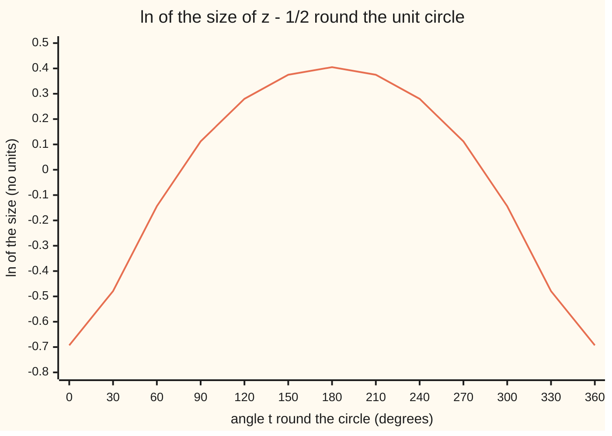
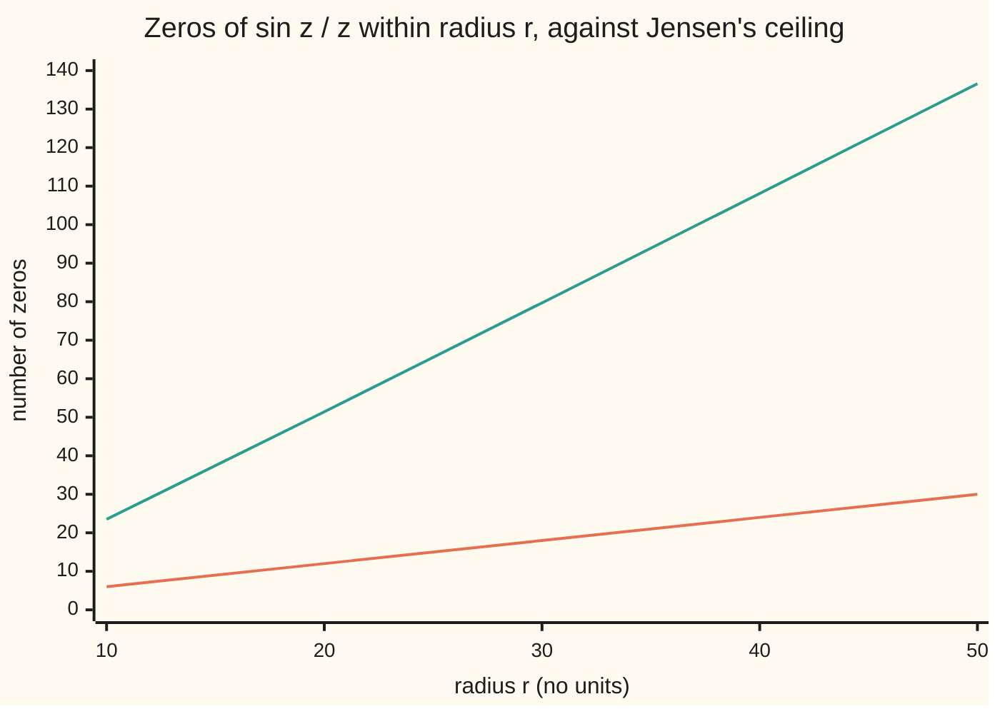

# Jensen's formula: the average of log |f| round a circle counts the zeros inside, so slow growth means few zeros

[Syllabus](../../../SYLLABUS.md) → [Complex analysis](../README.md) → [Entire and Meromorphic Functions](../README.md#s10) → Jensen's formula

---

## General Overview

Take the polynomial $`f(z) = z - 1/2`$ and walk once round the unit circle $`\lvert z\rvert = 1`$. At each point, write down $`\ln\lvert f\rvert`$, the natural log of the size of the output. At angle 0 the size is 1/2, so the log is −0.693. Halfway round, at −1, the size is 3/2 and the log is 0.405.

Average those logs over the whole walk. The answer is exactly 0. But at the centre, $`\ln\lvert f(0)\rvert = \ln(1/2) = -0.693147`$. A function with no zeros would have its circle average equal to its centre value. This one misses by 0.693147, which is $`\ln 2`$.

That gap is not an accident. The zero at 1/2 sits inside the circle, and a zero at distance 1/2 from the centre always costs $`\ln(1/(1/2)) = \ln 2`$. Every zero inside adds its own cost. So the circle average, minus the centre value, measures the zeros inside.

Turn that round and it limits zeros. Each zero pushes the average up, but the average can never exceed the log of the largest value on the circle. A function that grows slowly cannot hold many zeros. $`\sin z`$ grows like $`e^{r}`$ and has about $`2r/\pi`$ zeros within radius r; $`e^{z^2}`$ grows like $`e^{r^2}`$ and has none.

**The average of ln|f| round a circle equals ln|f(0)| plus ln(R/|a|) for each zero a inside, so a function whose size grows like exp(r^ρ) has at most a constant times r^ρ zeros within radius r.**

**What kind of fact this is:** a theorem, proved on this card in Why it works; the zero bound follows from it in two lines.

### The picture: the logs round the circle cancel



The single line is $`\ln\lvert e^{it} - 1/2\rvert`$. The dip near angle 0, close to the zero, and the hump near 180 degrees balance exactly: the average is 0, not the centre value −0.693.

---

## The formula

Notation first, in words. An **entire function** is one that is holomorphic (complex-differentiable) at every point of the plane, such as a polynomial, $`\sin z`$ or $`e^{z^2}`$. The zeros inside the circle of radius R are $`a_1, a_2, \dots`$, a double zero listed twice.

```math
\frac{1}{2\pi}\int_0^{2\pi} \ln\lvert f(Re^{it})\rvert\,dt \;=\; \ln\lvert f(0)\rvert + \sum_{\lvert a_k\rvert < R} \ln\frac{R}{\lvert a_k\rvert}
```

**Read it aloud:** the average of ln|f| round the circle is the log of the size at the centre, plus, for each zero inside, the log of the radius over that zero's distance from the centre.

Every correction term is positive, since $`\lvert a_k\rvert < R`$. Growth is measured by $`M(r)`$, the largest size of f on the circle $`\lvert z\rvert = r`$. The **order** of an entire function is the power of r in the exponent of its growth:

```math
\rho = \limsup_{r\to\infty} \frac{\ln \ln M(r)}{\ln r}, \qquad n(r) \;\le\; \frac{\ln M(2r) - \ln\lvert f(0)\rvert}{\ln 2} \;\le\; C\, r^{\rho+\varepsilon}
```

**Read it aloud:** the order is how the double log of the largest size compares with the log of the radius; the number of zeros within radius r is at most the log-growth on the doubled circle over ln 2, and so at most a constant times r to the power order plus a little.

Here lim sup (the limit superior) means the largest value the ratio keeps returning to as r grows.

| Symbol | Plain meaning | In our example | Push it up and the answer… |
| --- | --- | --- | --- |
| $`f`$, $`z = x + iy`$ | the function, holomorphic on the closed disk; a point of the plane, with its real and imaginary parts | z − 1/2; sin z / z | — |
| $`R`$, $`r`$, $`t`$ | the circle's radius in the formula; a radius in the bound; the angle round the circle, in radians | 1, then 10; 10 to 50 | each zero's term grows |
| $`a_k`$, $`n(r)`$ | the zeros inside the circle, repeated by multiplicity; how many have size below r | 1/2; ±π, ±2π, ±3π, so n(10) = 6 | a zero nearer 0 costs more |
| $`\ln`$, $`\sinh`$ | the natural log of a positive number; the hyperbolic sine, sinh s = (e^s − e^(−s))/2 for a real number s | ln 2 = 0.693147; ln sinh 10 = 9.306853 | — |
| $`M(r)`$ | the largest size of f on the circle of radius r | ln M(10) = 9.306853 for sin z | room for more zeros |
| $`\rho`$, $`\varepsilon`$, $`C`$ | the order: the power of r in ln M(r); any small slack in that power; a constant depending on f and the slack | 1 for sin z; 2 for e^(z^2) | room for more zeros |
| $`g`$, $`\zeta`$ | in the proof: f with its zeros divided out; a point on the unit circle | — | — |
| $`d`$ | a polynomial's degree | 1 for z − 1/2 | more zeros, still order 0 |

### When it holds

- **f holomorphic on the whole closed disk.** A pole counts with the opposite sign: for 1/(z − 1/2), adding ln 2 like a zero gives 1.386294, but the circle average is 0.
- **f(0) is not 0.** Otherwise ln|f(0)| is minus infinity. For sin z, divide by z first: sin z / z equals 1 at 0.
- **Zeros counted with multiplicity.** For (z − 1/2)^2, one ln 2 gives −0.693147; the circle gives 0, which needs ln 2 twice.
- **Finite order, for the zero bound.** For a function such as e^(e^z), ln ln M(r) grows like r, the order is infinite, and the bound says nothing.

---

## Why it works

### Step 0: without zeros, ln|f| is a mean-value function

Where f has no zeros, a branch of log f exists on a disk ([The complex logarithm](../02-Holomorphic%20Functions/04-complex-logarithm.md)), and $`\ln\lvert f\rvert`$ is its real part. The real part of a holomorphic function is harmonic: it equals its average round any circle ([Mean value and maximum principle](../07-Conformal%20Maps%20and%20Harmonic%20Functions/05-mean-value-and-maximum-principle-for-harmonic-functions.md)). So a zero-free f has circle average exactly $`\ln\lvert f(0)\rvert`$. Zeros are where the log blows up to minus infinity, and the proof prices each one.

### Step 1: one zero costs ln(R/|a|)

Take a single factor z − a with $`\lvert a\rvert < R`$. On the circle, pull out R:

```math
\lvert Re^{it} - a\rvert = R\,\Big\lvert 1 - \tfrac{a}{R}e^{-it}\Big\rvert
```

The factor $`1 - (a/R)\zeta`$ has no zero for $`\lvert\zeta\rvert \le 1`$, so by Step 0 the average of its log size round the unit circle is its centre value, ln 1 = 0. As t runs round, $`\zeta = e^{-it}`$ runs round that circle too. So the average of $`\ln\lvert Re^{it} - a\rvert`$ is ln R.

At the centre, the factor has size |a|. The gap between average and centre is ln R − ln|a| = ln(R/|a|). For z − 1/2 on the unit circle: average ln 1 = 0, centre ln(1/2) = −0.693147, gap ln 2 = 0.693147.

### Step 2: factor out every zero

A holomorphic f has only finitely many zeros in the closed disk, since zeros cannot pile up ([Zeros and the identity theorem](../04-Taylor%20Series%2C%20Zeros%20and%20Rigidity/03-zeros-and-the-identity-theorem.md)). Divide them out: $`f(z) = g(z)\,(z - a_1)\cdots(z - a_n)`$ with g holomorphic and zero-free.

The log of a product is the sum of the logs. Average each piece: Step 0 gives ln|g(0)| for g, and Step 1 gives ln R for each factor. At the centre the pieces give ln|g(0)| plus ln|a_k| for each k. Subtract, and the formula appears.

On sin z / z at R = 10, the six zeros ±π, ±2π, ±3π give twice ln(10/π) + ln(10/2π) + ln(10/3π) = 2 × (1.157855 + 0.464708 + 0.059243) = 3.363612. The circle average, summed at 4,096 points, is 3.363612.

<details>
<summary>Zeros on the circle itself</summary>

The proof above assumes no zero sits on |z| = R. The formula still holds when one does. With $`\lvert a\rvert = R`$, the Step 1 term $`\ln\lvert 1 - (a/R)e^{-it}\rvert`$ dips to minus infinity at one angle, but only like the log of the distance to that angle, so its integral is finite and still equals 0. Shrink R slightly, apply the formula, and let R grow back.

</details>

### Step 3: a ceiling on the number of zeros

Apply the formula on the circle of radius 2r. Each zero with |a| < r has 2r/|a| > 2, so it adds more than ln 2. The other zeros add positive amounts, so dropping them keeps the inequality. The average of ln|f| is at most ln M(2r), since no value exceeds the largest. So

```math
n(r)\,\ln 2 \;\le\; \ln M(2r) - \ln\lvert f(0)\rvert
```

That is the middle of the second formula.

For sin z / z, the largest size on $`\lvert z\rvert = 2r`$ is $`\sinh(2r)/(2r)`$, reached on the imaginary axis. Here sinh is the hyperbolic sine, $`\sinh s = (e^{s} - e^{-s})/2`$, which is about $`e^{s}/2`$ for large s. At r = 10 the ceiling is 23.5 zeros; the true count is 6.



Orange: the true count, by the argument principle. Green: the ceiling (ln M(2r) − ln|f(0)|)/ln 2. Both grow in a straight line, because sin z has order 1.

<details>
<summary>Why the largest size of sin z on |z| = r is sinh r</summary>

With z = x + iy, $`\lvert\sin z\rvert^2 = \sin^2 x + \sinh^2 y`$. On the circle, $`x^2 + y^2 = r^2`$. Use $`\sin^2 x \le x^2`$. Then use the identity $`\sinh^2 r - \sinh^2 y = \sinh(r - \lvert y\rvert)\,\sinh(r + \lvert y\rvert)`$ and the fact $`\sinh u \ge u`$ for $`u \ge 0`$: the product is at least $`(r - \lvert y\rvert)(r + \lvert y\rvert) = r^2 - y^2 = x^2`$. So $`\sin^2 x + \sinh^2 y \le x^2 + \sinh^2 y \le \sinh^2 r`$, with equality at x = 0.

</details>

### Step 4: order turns the ceiling into a power of r

If the order is ρ, then for any slack ε > 0 and all large r, $`\ln M(r) \le r^{\rho+\varepsilon}`$. That is what the lim sup says. Put it into Step 3: n(r) is at most $`((2r)^{\rho+\varepsilon} - \ln\lvert f(0)\rvert)/\ln 2`$, which is at most $`C\,r^{\rho+\varepsilon}`$.

The examples fit:

- **sin z:** ln M(r) = ln sinh r, about r. The ratio ln ln M(r)/ln r reads 0.9688, 0.9985, 0.9999 at r = 10, 100, 1000, so the order is 1. Its zeros are the multiples of π: 63 within radius 100, against 2r/π = 63.66.
- **e^(z^2):** its size on the circle is e^(x^2 − y^2), largest at e^(r^2). The ratio is 2.0000 at every radius: order 2. It has no zeros at all. The bound is a ceiling, not a count.
- **A polynomial of degree d:** M(r) grows like r^d, so ln M(r) grows like ln r and the order is 0. It has d zeros, a finite number.

---

## Worked numbers, by hand

The polynomial z − 1/2 on the unit circle, then sin z / z on the circle of radius 10.

| Step | Arithmetic | Value |
| --- | --- | --- |
| log size at angle 0 | ln(1 − 1/2) | −0.693 |
| log size at angle 180 degrees | ln(1 + 1/2) | 0.405 |
| circle average | 4,096 points, summed | 0.000000 |
| centre value | ln(1/2) | −0.693147 |
| the one correction | ln(1/(1/2)) | **0.693147** |
| sin z / z, R = 10: corrections | ln(10/π), ln(10/2π), ln(10/3π) | 1.157855, 0.464708, 0.059243 |
| Jensen's right side | 0 + 2 × their sum | **3.363612** |
| the circle average | 4,096 points, summed | 3.363612 |

The centre plus one ln 2 for the zero at 1/2 reproduces the average exactly; for sin z / z, six zeros give six corrections and the same match.

### What breaks if you drop a piece

| Mistake | Comes out at | What went wrong |
| --- | --- | --- |
| Treating ln\|f\| as mean-value, ignoring the zero | −0.693147, against 0 | The zero at 1/2 makes ln\|f\| fail to be harmonic |
| (z − 1/2)^2 with its zero counted once | −0.693147, against 0 | A double zero costs ln 2 twice |
| The pole of 1/(z − 1/2) added like a zero | 1.386294, against 0 | Poles subtract their term |
| Judging sin z's growth on the real line only | largest size 1.000000, yet 63 zeros within 100 | Order is measured on whole circles |

The code prints all four.

---

## Code, from first principles, and it actually runs

The code reaches each answer by two roads. Road one sums ln|f| at 4,096 equally spaced points round the circle. Road two adds ln|f(0)| and the corrections ln(R/|a|) for the known zeros: 1/2, then ±π, ±2π, ±3π. The argument principle, counting how many times sin z turns round 0 as z walks the circle ([The argument principle](../06-Real%20Integrals%20and%20Counting%20Zeros/06-the-argument-principle.md)), confirms that exactly six zeros of sin z / z lie within radius 10. The growth M(r) is found by sampling 3,600 points and compared with sinh r, and the zero counts are compared with 2 × the whole part of r/π.

### Python

```python
# Jensen's formula and order of growth -- the check behind the card.  Standard
# library only.  Road one: the circle average of ln|f|, summed at N points.
# Road two: ln|f(0)| plus ln(R/|a|) for each known zero a, their number checked
# by the argument principle.  Then the order of sin z and e^(z^2), and the zero bound.
import math
N = 4096
def circ(r, n, k): t = 2 * math.pi * k / n; return r * math.cos(t), r * math.sin(t)
def avg(lnf, r, n=N): return sum(lnf(*circ(r, n, k)) for k in range(n)) / n
def lnsin(x, y):            # ln|sin z| = ln sqrt(sin^2 x + sinh^2 y), written so e^|y| cannot overflow
    e = math.exp(-2 * abs(y)); return abs(y) + 0.5 * math.log(math.sin(x) ** 2 * e + ((1 - e) / 2) ** 2)
def lnsinc(x, y): return lnsin(x, y) - 0.5 * math.log(x * x + y * y)           # ln|sin z / z|
def lnlin(x, y): return 0.5 * math.log((x - 0.5) ** 2 + y * y)                # ln|z - 1/2|
def winding(r, n):          # turns of sin z round |z| = r: arg = atan2(cos x tanh y, sin x)
    tot, prev = 0.0, None
    for k in range(n + 1):
        x, y = circ(r, n, k)
        a = math.atan2(math.cos(x) * math.tanh(y), math.sin(x))
        if prev is not None: tot += (a - prev + math.pi) % (2 * math.pi) - math.pi
        prev = a
    return round(tot / (2 * math.pi))
def zeros(r): return winding(r, 64 * int(r) + 256) - 1      # zeros of sin z / z: drop the one at 0
def lnM(r, g=lnsin, n=3600): return max(g(*circ(r, n, k)) for k in range(n))   # ln of max |g| on |z| = r
def f6(v): return f"{0.0 if abs(v) < 5e-7 else v:.6f}"
print("chart, ln|e^(it) - 1/2| at t = 0, 30, ..., 360 degrees:",
      " ".join(f"{lnlin(*circ(1, 12, k)):.3f}" for k in range(13)))
a1, ln2 = avg(lnlin, 1), math.log(2)
print(f"z - 1/2 on |z| = 1: circle average {f6(a1)}; ln|f(0)| = {f6(math.log(0.5))}; correction ln 2 = {f6(ln2)}")
R, n10 = 10.0, zeros(10)
terms = [math.log(R / (k * math.pi)) for k in range(1, 4)]
a10, j10 = avg(lnsinc, R), 0.0 + 2 * sum(terms)               # ln|f(0)| = ln 1 = 0
print(f"sin z / z on |z| = 10: zeros inside by the argument principle {n10}, at +-pi, +-2pi, +-3pi")
print("  ln(10/pi), ln(10/2pi), ln(10/3pi) = " + ", ".join(f6(v) for v in terms))
print(f"  circle average {f6(a10)}; Jensen: 0 + 2 x their sum = {f6(j10)}")
rs = [10, 100, 1000]
osin = [math.log(lnM(r)) / math.log(r) for r in rs]
oexp = [math.log(lnM(r, lambda x, y: x * x - y * y)) / math.log(r) for r in rs]   # ln|e^(z^2)| = x^2 - y^2
print("order estimate ln ln M(r) / ln r at r = 10, 100, 1000: sin z " + " ".join(f"{v:.4f}" for v in osin)
      + "; e^(z^2) " + " ".join(f"{v:.4f}" for v in oexp))
print(f"  ln M(10) by sampling {f6(lnM(10))}; ln sinh 10 = {f6(math.log(math.sinh(10)))}")
big = [zeros(r) + 1 for r in (100, 1000)]
print(f"zeros of sin z in |z| < 100 and 1000: {big[0]} and {big[1]}; 2r/pi = {200 / math.pi:.2f} and {2000 / math.pi:.2f}")
radii = [10, 20, 30, 40, 50]
cnt = [zeros(r) for r in radii]
bnd = [(lnM(2 * r) - math.log(2 * r)) / ln2 for r in radii]   # (ln M(2r) - ln|f(0)|) / ln 2, f(0) = 1
print("chart, zeros of sin z / z in |z| < r, r = 10..50:", " ".join(map(str, cnt)))
print("chart, Jensen bound (ln M(2r) - ln|f(0)|) / ln 2:", " ".join(f"{v:.1f}" for v in bnd))
sq, inv = avg(lambda x, y: 2 * lnlin(x, y), 1), avg(lambda x, y: -lnlin(x, y), 1)
print(f"mistake 1, no correction: Jensen would give ln|f(0)| = {f6(-ln2)}, the circle gives {f6(a1)}")
print(f"mistake 2, (z - 1/2)^2 counted once: {f6(2 * -ln2 + ln2)}; circle {f6(sq)}; counted twice {f6(2 * -ln2 + 2 * ln2)}")
print(f"mistake 3, pole of 1/(z - 1/2) added like a zero: {f6(ln2 + ln2)}; circle {f6(inv)}; subtracted {f6(ln2 - ln2)}")
print(f"mistake 4, size on the real line only: largest |sin x| for -100 <= x <= 100 is "
      f"{max(abs(math.sin(x / 100)) for x in range(-10000, 10001)):.6f}, yet {big[0]} zeros in |z| < 100")
assert abs(a1 - (lnlin(0, 0) + math.log(1 / 0.5))) < 1e-9 and abs(a10 - j10) < 1e-9   # two roads agree
assert n10 == 6 and cnt == [2 * int(r / math.pi) for r in radii] and big == [63, 637]
assert all(c <= b and abs(b - (math.log(math.sinh(2 * r) / (2 * r))) / ln2) < 1e-9 for c, b, r in zip(cnt, bnd, radii))
assert abs(lnM(10) - math.log(math.sinh(10))) < 1e-9
assert abs(osin[2] - 1) < 0.001 and abs(oexp[0] - 2) < 1e-9 and abs(sq) < 1e-9 and abs(inv) < 1e-9
print("ALL CHECKS PASS")
```

**Ran 2026-11-23 on macOS, Python 3.14.10, standard library only. All checks passed. Output, pasted from the run:**

```
chart, ln|e^(it) - 1/2| at t = 0, 30, ..., 360 degrees: -0.693 -0.479 -0.144 0.112 0.280 0.375 0.405 0.375 0.280 0.112 -0.144 -0.479 -0.693
z - 1/2 on |z| = 1: circle average 0.000000; ln|f(0)| = -0.693147; correction ln 2 = 0.693147
sin z / z on |z| = 10: zeros inside by the argument principle 6, at +-pi, +-2pi, +-3pi
  ln(10/pi), ln(10/2pi), ln(10/3pi) = 1.157855, 0.464708, 0.059243
  circle average 3.363612; Jensen: 0 + 2 x their sum = 3.363612
order estimate ln ln M(r) / ln r at r = 10, 100, 1000: sin z 0.9688 0.9985 0.9999; e^(z^2) 2.0000 2.0000 2.0000
  ln M(10) by sampling 9.306853; ln sinh 10 = 9.306853
zeros of sin z in |z| < 100 and 1000: 63 and 637; 2r/pi = 63.66 and 636.62
chart, zeros of sin z / z in |z| < r, r = 10..50: 6 12 18 24 30
chart, Jensen bound (ln M(2r) - ln|f(0)|) / ln 2: 23.5 51.4 79.7 108.1 136.6
mistake 1, no correction: Jensen would give ln|f(0)| = -0.693147, the circle gives 0.000000
mistake 2, (z - 1/2)^2 counted once: -0.693147; circle 0.000000; counted twice 0.000000
mistake 3, pole of 1/(z - 1/2) added like a zero: 1.386294; circle 0.000000; subtracted 0.000000
mistake 4, size on the real line only: largest |sin x| for -100 <= x <= 100 is 1.000000, yet 63 zeros in |z| < 100
ALL CHECKS PASS
```

### Rust

Same numbers, same labels, built with `rustc --edition 2021 -O`. Rust has no complex type, so every complex value is a pair (x, y).

```rust
// Jensen's formula and order of growth -- the same check as the Python, in Rust.
// No crates.  Road one: the circle average of ln|f|, summed at N points.  Road
// two: ln|f(0)| plus ln(R/|a|) for each known zero a, their number checked by the
// argument principle.  Then the order of sin z and e^(z^2), and the zero bound.
use std::f64::consts::PI;
const N: usize = 4096;
fn circ(r: f64, n: usize, k: usize) -> (f64, f64) { let t = 2.0 * PI * k as f64 / n as f64; (r * t.cos(), r * t.sin()) }
fn avg(lnf: &dyn Fn(f64, f64) -> f64, r: f64, n: usize) -> f64 {
    (0..n).map(|k| { let (x, y) = circ(r, n, k); lnf(x, y) }).sum::<f64>() / n as f64
}
fn lnsin(x: f64, y: f64) -> f64 {  // ln|sin z| = ln sqrt(sin^2 x + sinh^2 y), written so e^|y| cannot overflow
    let e = (-2.0 * y.abs()).exp(); y.abs() + 0.5 * (x.sin().powi(2) * e + ((1.0 - e) / 2.0).powi(2)).ln()
}
fn lnsinc(x: f64, y: f64) -> f64 { lnsin(x, y) - 0.5 * (x * x + y * y).ln() }   // ln|sin z / z|
fn lnlin(x: f64, y: f64) -> f64 { 0.5 * ((x - 0.5).powi(2) + y * y).ln() }      // ln|z - 1/2|
fn winding(r: f64, n: usize) -> i64 {  // turns of sin z round |z| = r: arg = atan2(cos x tanh y, sin x)
    let (mut tot, mut prev) = (0.0, None::<f64>);
    for k in 0..=n {
        let (x, y) = circ(r, n, k);
        let a = (x.cos() * y.tanh()).atan2(x.sin());
        if let Some(p) = prev { tot += (a - p + PI).rem_euclid(2.0 * PI) - PI; }
        prev = Some(a);
    }
    (tot / (2.0 * PI)).round() as i64
}
fn zeros(r: f64) -> i64 { winding(r, 64 * r as usize + 256) - 1 }   // zeros of sin z / z: drop the one at 0
fn lnm(r: f64, g: &dyn Fn(f64, f64) -> f64) -> f64 {               // ln of max |g| on |z| = r
    (0..3600).map(|k| { let (x, y) = circ(r, 3600, k); g(x, y) }).fold(f64::MIN, f64::max)
}
fn f6(v: f64) -> String { format!("{:.6}", if v.abs() < 5e-7 { 0.0 } else { v }) }
fn join(v: &[f64], d: usize) -> String { v.iter().map(|x| format!("{:.*}", d, x)).collect::<Vec<_>>().join(" ") }
fn main() {
    let chart: Vec<f64> = (0..13).map(|k| { let (x, y) = circ(1.0, 12, k); lnlin(x, y) }).collect();
    println!("chart, ln|e^(it) - 1/2| at t = 0, 30, ..., 360 degrees: {}", join(&chart, 3));
    let (a1, ln2) = (avg(&lnlin, 1.0, N), 2f64.ln());
    println!("z - 1/2 on |z| = 1: circle average {}; ln|f(0)| = {}; correction ln 2 = {}", f6(a1), f6(0.5f64.ln()), f6(ln2));
    let (r10, n10) = (10.0, zeros(10.0));
    let terms: Vec<f64> = (1..4).map(|k| (r10 / (k as f64 * PI)).ln()).collect();
    let (a10, j10) = (avg(&lnsinc, r10, N), 0.0 + 2.0 * terms.iter().sum::<f64>());   // ln|f(0)| = ln 1 = 0
    println!("sin z / z on |z| = 10: zeros inside by the argument principle {}, at +-pi, +-2pi, +-3pi", n10);
    println!("  ln(10/pi), ln(10/2pi), ln(10/3pi) = {}", terms.iter().map(|&v| f6(v)).collect::<Vec<_>>().join(", "));
    println!("  circle average {}; Jensen: 0 + 2 x their sum = {}", f6(a10), f6(j10));
    let rs = [10.0f64, 100.0, 1000.0];
    let osin: Vec<f64> = rs.iter().map(|&r| lnm(r, &lnsin).ln() / r.ln()).collect();
    let oexp: Vec<f64> = rs.iter().map(|&r| lnm(r, &|x, y| x * x - y * y).ln() / r.ln()).collect();   // ln|e^(z^2)| = x^2 - y^2
    println!("order estimate ln ln M(r) / ln r at r = 10, 100, 1000: sin z {}; e^(z^2) {}", join(&osin, 4), join(&oexp, 4));
    println!("  ln M(10) by sampling {}; ln sinh 10 = {}", f6(lnm(10.0, &lnsin)), f6(10f64.sinh().ln()));
    let big = [zeros(100.0) + 1, zeros(1000.0) + 1];
    println!("zeros of sin z in |z| < 100 and 1000: {} and {}; 2r/pi = {:.2} and {:.2}", big[0], big[1], 200.0 / PI, 2000.0 / PI);
    let radii = [10.0f64, 20.0, 30.0, 40.0, 50.0];
    let cnt: Vec<i64> = radii.iter().map(|&r| zeros(r)).collect();
    let bnd: Vec<f64> = radii.iter().map(|&r| (lnm(2.0 * r, &lnsin) - (2.0 * r).ln()) / ln2).collect();   // f(0) = 1
    println!("chart, zeros of sin z / z in |z| < r, r = 10..50: {}", cnt.iter().map(|c| c.to_string()).collect::<Vec<_>>().join(" "));
    println!("chart, Jensen bound (ln M(2r) - ln|f(0)|) / ln 2: {}", join(&bnd, 1));
    let (sq, inv) = (avg(&|x, y| 2.0 * lnlin(x, y), 1.0, N), avg(&|x, y| -lnlin(x, y), 1.0, N));
    println!("mistake 1, no correction: Jensen would give ln|f(0)| = {}, the circle gives {}", f6(-ln2), f6(a1));
    println!("mistake 2, (z - 1/2)^2 counted once: {}; circle {}; counted twice {}", f6(2.0 * -ln2 + ln2), f6(sq), f6(2.0 * -ln2 + 2.0 * ln2));
    println!("mistake 3, pole of 1/(z - 1/2) added like a zero: {}; circle {}; subtracted {}", f6(ln2 + ln2), f6(inv), f6(ln2 - ln2));
    let real = (-10000..=10000).map(|x| (x as f64 / 100.0).sin().abs()).fold(0.0, f64::max);
    println!("mistake 4, size on the real line only: largest |sin x| for -100 <= x <= 100 is {:.6}, yet {} zeros in |z| < 100", real, big[0]);
    assert!((a1 - (lnlin(0.0, 0.0) + (1.0f64 / 0.5).ln())).abs() < 1e-9 && (a10 - j10).abs() < 1e-9);   // two roads agree
    assert!(n10 == 6 && cnt.iter().zip(radii.iter()).all(|(&c, &r)| c == 2 * (r / PI) as i64) && big == [63, 637]);
    assert!(cnt.iter().zip(bnd.iter()).zip(radii.iter())
        .all(|((&c, &b), &r)| (c as f64) <= b && (b - ((2.0 * r).sinh() / (2.0 * r)).ln() / ln2).abs() < 1e-9));
    assert!((lnm(10.0, &lnsin) - 10f64.sinh().ln()).abs() < 1e-9);
    assert!((osin[2] - 1.0).abs() < 0.001 && (oexp[0] - 2.0).abs() < 1e-9 && sq.abs() < 1e-9 && inv.abs() < 1e-9);
    println!("ALL CHECKS PASS");
}
```

**Ran 2026-11-23 on macOS, rustc 1.98.1, no crates. All checks passed. Output, pasted from the run:**

```
chart, ln|e^(it) - 1/2| at t = 0, 30, ..., 360 degrees: -0.693 -0.479 -0.144 0.112 0.280 0.375 0.405 0.375 0.280 0.112 -0.144 -0.479 -0.693
z - 1/2 on |z| = 1: circle average 0.000000; ln|f(0)| = -0.693147; correction ln 2 = 0.693147
sin z / z on |z| = 10: zeros inside by the argument principle 6, at +-pi, +-2pi, +-3pi
  ln(10/pi), ln(10/2pi), ln(10/3pi) = 1.157855, 0.464708, 0.059243
  circle average 3.363612; Jensen: 0 + 2 x their sum = 3.363612
order estimate ln ln M(r) / ln r at r = 10, 100, 1000: sin z 0.9688 0.9985 0.9999; e^(z^2) 2.0000 2.0000 2.0000
  ln M(10) by sampling 9.306853; ln sinh 10 = 9.306853
zeros of sin z in |z| < 100 and 1000: 63 and 637; 2r/pi = 63.66 and 636.62
chart, zeros of sin z / z in |z| < r, r = 10..50: 6 12 18 24 30
chart, Jensen bound (ln M(2r) - ln|f(0)|) / ln 2: 23.5 51.4 79.7 108.1 136.6
mistake 1, no correction: Jensen would give ln|f(0)| = -0.693147, the circle gives 0.000000
mistake 2, (z - 1/2)^2 counted once: -0.693147; circle 0.000000; counted twice 0.000000
mistake 3, pole of 1/(z - 1/2) added like a zero: 1.386294; circle 0.000000; subtracted 0.000000
mistake 4, size on the real line only: largest |sin x| for -100 <= x <= 100 is 1.000000, yet 63 zeros in |z| < 100
ALL CHECKS PASS
```

The two outputs match line for line.

### Lean

Lean proves Jensen's formula and both zero bounds for every function meeting the conditions in When it holds.

- Suppose f is holomorphic on the closed disk of radius R, with $`f(0) \ne 0`$. Then the circle average of $`\ln\lvert f\rvert`$ equals $`\ln\lvert f(0)\rvert`$ plus $`\ln(R/\lvert a\rvert)`$ for each zero a inside, counted with multiplicity.
- Suppose f is holomorphic on the closed disk of radius 2r, with $`f(0) \ne 0`$. Then $`n(r) \le (\ln M(2r) - \ln\lvert f(0)\rvert)/\ln 2`$.
- Suppose f is entire with order at most ρ, and $`f(0) \ne 0`$. Then for each ε > 0 some constant C gives $`n(r) \le C\, r^{\rho+\varepsilon}`$ for all large r.
- The correction for the zero of z − 1/2 on the unit circle is ln(1/(1/2)) = ln 2.

The worked numbers, the zero counts, the orders and the mistakes table are left to the Python and Rust checks.

```lean
-- Jensen's formula: the average of ln|f| round a circle equals ln|f(0)| plus ln(R/|a|) for each zero a inside, so a bound on |f| on the doubled circle bounds the zeros within radius r, and finite order gives at most C r^(ρ+ε) of them.
import Mathlib.Analysis.Complex.JensenFormula
import Mathlib.Analysis.SpecialFunctions.Pow.Real
import Mathlib.Analysis.Complex.AbsMax
import Mathlib.Analysis.Complex.Liouville

open Filter Metric Real MeromorphicOn

/-- **Jensen's formula.** Let `f` be holomorphic on the whole closed disk of radius `R > 0`
about 0, with `f(0) ≠ 0`. Then the average of `ln |f|` round the circle `|z| = R`,
`(1/(2π)) ∫₀^{2π} ln |f(R e^{it})| dt`, equals `ln |f(0)|` plus `ln (R / |a|)` for each zero
`a` with `|a| < R`, each zero counted with its multiplicity (`divisor f (ball 0 R) a` is the
multiplicity of the zero at `a` inside the open disk, and 0 elsewhere). -/
theorem jensen_formula {f : ℂ → ℂ} {R : ℝ} (hR : 0 < R)
    (hf : AnalyticOnNhd ℂ f (closedBall (0 : ℂ) R)) (h0 : f 0 ≠ 0) :
    (1 / (2 * π)) * ∫ t in (0 : ℝ)..2 * π, Real.log ‖f (R * Complex.exp (t * Complex.I))‖
      = Real.log ‖f 0‖ + ∑ᶠ a, (divisor f (ball (0 : ℂ) R) a : ℝ) * Real.log (R / ‖a‖) := by
  have hf' : AnalyticOnNhd ℂ f (closedBall (0 : ℂ) |R|) := by rwa [abs_of_pos hR]
  have J := hf'.circleAverage_log_norm hR.ne' h0
  rw [circleAverage_def, abs_of_pos hR] at J
  simp only [circleMap, zero_add, smul_eq_mul] at J
  rw [one_div, J, add_comm]
  congr 1
  refine finsum_congr fun u => ?_
  rw [zero_sub, norm_neg, ← div_eq_mul_inv]
  by_cases hu : u ∈ ball (0 : ℂ) R
  · rw [hf.divisor_apply (ball_subset_closedBall hu),
      (hf.mono ball_subset_closedBall).divisor_apply hu]
  · rw [Function.locallyFinsuppWithin.apply_eq_zero_of_notMem _ hu]
    by_cases hu' : u ∈ closedBall (0 : ℂ) R
    · have : ‖u‖ = R := by
        simp only [mem_ball, mem_closedBall, dist_zero_right, not_lt] at hu hu'
        linarith
      rw [this, div_self hR.ne', Real.log_one]; simp
    · rw [Function.locallyFinsuppWithin.apply_eq_zero_of_notMem _ hu']

/-- **Slow growth means few zeros.** Let `f` be holomorphic on the closed disk of radius `2r`
about 0, with `f(0) ≠ 0`, and let `M` bound `|f|` on the circle `|z| = 2r` (for example
`M = M(2r)`, the largest size of `f` there). Then `n(r)`, the number of zeros with `|a| < r`
counted with multiplicity, satisfies `n(r) ≤ (ln M − ln |f(0)|) / ln 2`. -/
theorem zero_count_le_log_growth_div_log_two {f : ℂ → ℂ} {r M : ℝ} (hr : 0 < r)
    (hf : AnalyticOnNhd ℂ f (closedBall (0 : ℂ) (2 * r))) (h0 : f 0 ≠ 0)
    (hM : ∀ z : ℂ, ‖z‖ = 2 * r → ‖f z‖ ≤ M) :
    (∑ᶠ a, (divisor f (ball (0 : ℂ) r) a : ℝ)) ≤ (Real.log M - Real.log ‖f 0‖) / Real.log 2 := by
  have h2r : (2 * r) ≠ 0 := by positivity
  -- maximum modulus: ‖f 0‖ ≤ M
  have hf0M : ‖f 0‖ ≤ M := by
    refine Complex.norm_le_of_forall_mem_frontier_norm_le (U := ball (0 : ℂ) (2 * r))
      isBounded_ball ?_ ?_ ?_
    · exact hf.differentiableOn.diffContOnCl_ball subset_rfl
    · intro z hz
      rw [frontier_ball _ h2r, mem_sphere_iff_norm, sub_zero] at hz
      exact hM z hz
    · rw [closure_ball _ h2r]; simp; positivity
  have hf0 : 0 < ‖f 0‖ := norm_pos_iff.mpr h0
  have hMpos : 0 < M := hf0.trans_le hf0M
  set g : ℂ → ℂ := ((M : ℂ)⁻¹) • f with hg
  have hMc : ((M : ℂ)⁻¹) ≠ 0 := by
    simp [hMpos.ne']
  have hg_an : AnalyticOnNhd ℂ g (closedBall (0 : ℂ) |2 * r|) := by
    rw [abs_of_pos (by positivity)]
    exact fun z hz => (hf z hz).const_smul
  have hg0 : g 0 ≠ 0 := by simp [hg, hMpos.ne', h0]
  have hg_bound : ∀ z ∈ sphere (0 : ℂ) |2 * r|, ‖g z‖ ≤ 1 := by
    intro z hz
    rw [abs_of_pos (by positivity), mem_sphere_iff_norm, sub_zero] at hz
    simp only [hg, Pi.smul_apply, smul_eq_mul, norm_mul, norm_inv, Complex.norm_real,
      Real.norm_eq_abs, abs_of_pos hMpos]
    rw [inv_mul_le_iff₀ hMpos, mul_one]
    exact hM z hz
  have key := hg_an.sum_divisor_le (r := r) (by simp [hr.ne'])
    (by rw [abs_of_pos hr, abs_of_pos (by positivity)]; linarith) le_rfl hg0 hg_bound
  rw [divisor_const_smul hMc] at key
  have hlog : Real.log (1 / ‖g 0‖) / Real.log (2 * r / r)
      = (Real.log M - Real.log ‖f 0‖) / Real.log 2 := by
    have : 2 * r / r = 2 := by field_simp
    rw [this]
    congr 1
    simp only [hg, Pi.smul_apply, smul_eq_mul, norm_mul, norm_inv, Complex.norm_real,
      Real.norm_eq_abs, abs_of_pos hMpos]
    rw [one_div, Real.log_inv, Real.log_mul (by positivity) hf0.ne', Real.log_inv]
    ring
  rw [hlog] at key
  refine le_trans ?_ key
  have hfin := (divisor f (closedBall (0 : ℂ) |r|)).finiteSupport (isCompact_closedBall _ _)
  have hcast := map_finsum (Int.castRingHom ℝ) hfin
  simp only [eq_intCast] at hcast
  rw [hcast]
  refine finsum_le_finsum ?_ ?_ fun u => ?_
  · exact hfin.subset fun u hu => by
      simp only [Function.mem_support, ne_eq, Int.cast_eq_zero] at hu ⊢
      by_contra h
      apply hu
      by_cases hb : u ∈ ball (0 : ℂ) r
      · have hsub : ball (0 : ℂ) r ⊆ closedBall (0 : ℂ) |r| := by
          rw [abs_of_pos hr]; exact ball_subset_closedBall
        have hc : closedBall (0 : ℂ) |r| ⊆ closedBall (0 : ℂ) (2 * r) := by
          rw [abs_of_pos hr]; exact closedBall_subset_closedBall (by linarith)
        rw [← divisor_restrict ((hf.mono hc).meromorphicOn) hsub,
          Function.locallyFinsuppWithin.restrict_apply]
        simpa [hb] using h
      · exact Function.locallyFinsuppWithin.apply_eq_zero_of_notMem _ hb
  · exact hfin.subset fun u hu => by simpa using hu
  · have hc : closedBall (0 : ℂ) |r| ⊆ closedBall (0 : ℂ) (2 * r) := by
      rw [abs_of_pos hr]; exact closedBall_subset_closedBall (by linarith)
    have hsub : ball (0 : ℂ) r ⊆ closedBall (0 : ℂ) |r| := by
      rw [abs_of_pos hr]; exact ball_subset_closedBall
    simp only [Int.cast_le]
    rw [← divisor_restrict ((hf.mono hc).meromorphicOn) hsub,
      Function.locallyFinsuppWithin.restrict_apply]
    split_ifs
    · exact le_rfl
    · exact (hf.mono hc).divisor_nonneg u

/-- **Order bounds the zero count.** Let `f` be entire with `f(0) ≠ 0` and of order at most `ρ`,
in the card's form: for every slack `ε > 0` and all large `r`, `ln M(r) ≤ r^(ρ+ε)`, that is,
`ln |f(z)| ≤ r^(ρ+ε)` on the whole circle `|z| = r`. Then for every `ε > 0` there is a constant
`C` with `n(r) ≤ C r^(ρ+ε)` for all large `r`, where `n(r)` counts the zeros with `|a| < r`
with multiplicity. -/
theorem zero_count_le_const_mul_rpow_of_order_le {f : ℂ → ℂ} {ρ : ℝ}
    (hf : Differentiable ℂ f) (h0 : f 0 ≠ 0)
    (hρ : ∀ ε > 0, ∀ᶠ r in atTop, ∀ z : ℂ, ‖z‖ = r → Real.log ‖f z‖ ≤ r ^ (ρ + ε)) :
    ∀ ε > 0, ∃ C : ℝ, ∀ᶠ r in atTop,
      (∑ᶠ a, (divisor f (ball (0 : ℂ) r) a : ℝ)) ≤ C * r ^ (ρ + ε) := by
  intro ε hε
  obtain ⟨R0, hR0⟩ := eventually_atTop.mp (hρ ε hε)
  set s := ρ + ε with hs
  -- size bound from the log bound
  have hnorm : ∀ z : ℂ, R0 ≤ ‖z‖ → ‖f z‖ ≤ Real.exp (‖z‖ ^ s) := by
    intro z hz
    by_cases hfz : f z = 0
    · rw [hfz, norm_zero]; exact (Real.exp_pos _).le
    · have hpos : 0 < ‖f z‖ := norm_pos_iff.mpr hfz
      rw [← Real.exp_log hpos]
      exact Real.exp_le_exp.mpr (hR0 _ hz z rfl)
  by_cases hs0 : 0 < s
  · refine ⟨(2 ^ s + |Real.log ‖f 0‖|) / Real.log 2, ?_⟩
    filter_upwards [eventually_ge_atTop (max R0 1)] with r hr
    have hr1 : 1 ≤ r := le_of_max_le_right hr
    have hrR0 : R0 ≤ r := le_of_max_le_left hr
    have hr0 : 0 < r := by linarith
    have key := zero_count_le_log_growth_div_log_two (M := Real.exp ((2 * r) ^ s)) hr0
      (fun z _ => hf.analyticAt z) h0 (fun z hz => by
        have := hnorm z (by rw [hz]; linarith)
        rwa [hz] at this)
    rw [Real.log_exp] at key
    refine key.trans ?_
    have hlog2 : 0 < Real.log 2 := Real.log_pos (by norm_num)
    rw [div_mul_eq_mul_div]
    gcongr
    rw [Real.mul_rpow (by norm_num) hr0.le, add_mul]
    have h1 : 1 ≤ r ^ s := Real.one_le_rpow hr1 hs0.le
    have h2 : -Real.log ‖f 0‖ ≤ |Real.log ‖f 0‖| := neg_le_abs _
    nlinarith [abs_nonneg (Real.log ‖f 0‖)]
  · push Not at hs0
    -- f is bounded, hence constant by Liouville
    obtain ⟨B, hB⟩ := (isCompact_closedBall (0 : ℂ) (max R0 1)).exists_bound_of_continuousOn
      hf.continuous.continuousOn
    have hbdd : Bornology.IsBounded (Set.range f) := by
      rw [isBounded_iff_forall_norm_le]
      refine ⟨max B (Real.exp 1), ?_⟩
      rintro _ ⟨z, rfl⟩
      by_cases hz : ‖z‖ ≤ max R0 1
      · exact (hB z (by simpa using hz)).trans (le_max_left _ _)
      · push Not at hz
        refine (hnorm z (le_of_max_le_left hz.le)).trans ((Real.exp_le_exp.mpr ?_).trans
          (le_max_right _ _))
        exact Real.rpow_le_one_of_one_le_of_nonpos (le_of_max_le_right hz.le) hs0
    have hconst : f = fun _ => f 0 := funext fun z => hf.apply_eq_apply_of_bounded hbdd z 0
    refine ⟨0, Eventually.of_forall fun r => ?_⟩
    rw [hconst, divisor_const]
    simp

-- The card's correction for the zero of z - 1/2 on the unit circle: ln(1/(1/2)) = ln 2.
example : Real.log (1 / (1 / 2 : ℝ)) = Real.log 2 := by norm_num

#print axioms jensen_formula
#print axioms zero_count_le_log_growth_div_log_two
#print axioms zero_count_le_const_mul_rpow_of_order_le
```

**Checked 2026-11-23 on macOS, Lean 4.36.0-rc2, Mathlib v4.36.0-rc2. Every proof is complete and uses only Lean's standard axioms. Output, pasted from the run:**

```
'jensen_formula' depends on axioms: [propext, Classical.choice, Quot.sound]
'zero_count_le_log_growth_div_log_two' depends on axioms: [propext, Classical.choice, Quot.sound]
'zero_count_le_const_mul_rpow_of_order_le' depends on axioms: [propext, Classical.choice, Quot.sound]
```

> [!TIP]
> **Try changing**
> Guess first, then run it.
> - **Move the zero outside.** In `lnlin`, change `x - 0.5` to `x - 2`. Guess the circle average. It becomes 0.693147 = ln 2 = ln|f(0)|: no zero inside, no correction. The first assert stops it, since the correction is still pinned to a zero at 1/2.
> - **A bigger circle, same zeros.** Set `R, n10 = 12.0, zeros(12)`. 4π lies beyond 12, so the zeros are still the six. Both roads now give 4.457542, and every assert passes. The labels still say 10.
> - **Faster growth.** In the `oexp` line, replace `x * x - y * y` with `x ** 3 - 3 * x * y * y`, the real part of z^3. The order reads 3.0000, and the last assert stops it.

---

## The usual mistake

> [!warning]
> **Taking the circle average of ln|f| to be ln|f(0)|.** That is the mean value property, and it holds only where ln|f| is harmonic, which fails at every zero. For z − 1/2 it predicts −0.693147; the circle gives 0. The zeros always push the average up, never down.
>
> - **Counting a repeated zero once.** (z − 1/2)^2 then gives −0.693147, not 0.
> - **Giving a pole the sign of a zero.** For 1/(z − 1/2) that gives 1.386294; the circle gives 0.
> - **Measuring growth along the real line.** |sin x| never exceeds 1.000000 there, yet sin z has 63 zeros within radius 100.
> - **Reading the ceiling as a count.** e^(z^2) has order 2 and no zeros at all.

---

## Where you meet it in real life

- **Bounding polynomial factors in computer algebra.** Apply Jensen's formula on the unit circle to a polynomial: the average of the log of its size is ln of its leading coefficient plus ln|a| for each root outside the circle. That quantity, the Mahler measure, bounds the coefficients of any factor, and factoring programs use the bound to know how much precision the factor search needs.
- **Control engineering.** Bode's sensitivity integral is Jensen's formula moved to a half-plane. For a typical feedback loop it says that an unstable plant forces the integral of the log of the sensitivity over all frequencies to be positive: pushing errors down at some frequencies pushes them up at others.
- **Counting the zeros of zeta.** The count of zeros of the Riemann zeta function up to a given height uses Jensen's bound to control an error term ([Counting the zeros](../../21-Algebraic%20and%20analytic%20number%20theory/02-The%20Zeta%20Function%20and%20the%20Prime%20Number%20Theorem/08-counting-the-zeros-riemann-von-mangoldt.md)).

> **Say it back**
> Away from zeros, ln|f| is harmonic, so its circle average equals its centre value. Each zero a inside the circle of radius R raises the average by ln(R/|a|). So the average minus ln|f(0)| measures the zeros inside. The average cannot pass the log of the largest size, so a function of order ρ has at most a constant times r^(ρ+ε) zeros within radius r. sin z, order 1, has about 2r/π; e^(z^2), order 2, has none.

---

## What this builds on

- [Mean value and maximum principle](../07-Conformal%20Maps%20and%20Harmonic%20Functions/05-mean-value-and-maximum-principle-for-harmonic-functions.md): a harmonic function equals its circle average, the fact each zero spoils.
- [The complex logarithm](../02-Holomorphic%20Functions/04-complex-logarithm.md): ln|f| is the real part of a branch of log f, so it is harmonic where f has no zeros.
- [Weierstrass factorization](01-weierstrass-factorization-theorem.md): an entire function can be built from any list of zeros; this card says how many zeros a given growth allows.

## Where this goes next

- [Hadamard factorization](03-hadamard-factorization-theorem.md): for finite order, the zero bound makes the Weierstrass product simple, and f is that product times a power of z and e to a polynomial of degree at most ρ.
- [Counting the zeros](../../21-Algebraic%20and%20analytic%20number%20theory/02-The%20Zeta%20Function%20and%20the%20Prime%20Number%20Theorem/08-counting-the-zeros-riemann-von-mangoldt.md): Jensen's bound at work on the zeta function.
- [Paley-Wiener-Schwartz](../../20-Harmonic%20analysis/02-The%20Fourier%20Transform/11-paley-wiener-schwartz-theorem.md): a signal confined to a window has an entire spectrum whose growth gives the window's width.
- [Zero-density estimates](../../21-Algebraic%20and%20analytic%20number%20theory/02-The%20Zeta%20Function%20and%20the%20Prime%20Number%20Theorem/11-zero-density-estimates-and-primes-in-short-intervals.md): counting the zeros that might sit off the line, and what that buys for primes in short intervals.

Left open: the bound limits zeros from above, but when does a function of order ρ have nearly r^ρ zeros, and when does it have none, like e^(z^2)?

---

## Sources

Verified 2026-11-23: every link below resolves to the publisher's page.

- Jensen, J. L. W. V. "Sur un nouvel et important théorème de la théorie des fonctions." *Acta Mathematica* 22 (1899): 359–364. [doi:10.1007/BF02417878](https://doi.org/10.1007/BF02417878). The original statement and proof.
- Stein, Elias M., and Rami Shakarchi. *Complex Analysis*. Princeton University Press, 2003. [Publisher page](https://press.princeton.edu/books/hardcover/9780691113852/complex-analysis). Chapter 5 proves Jensen's formula, defines the order of growth and derives the zero bound.
- Mahler, Kurt. "On Some Inequalities for Polynomials in Several Variables." *Journal of the London Mathematical Society* s1-37 (1962): 341–344. [doi:10.1112/jlms/s1-37.1.341](https://doi.org/10.1112/jlms/s1-37.1.341). The measure of a polynomial built from Jensen's formula, used for coefficient bounds.
