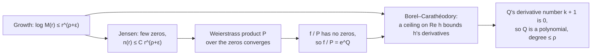

# Hadamard factorization: a nonzero entire function of finite order is its zeros times e to a polynomial

[Syllabus](../../../SYLLABUS.md) → [Complex analysis](../README.md) → [Entire and Meromorphic Functions](../README.md#s10) → Hadamard factorization

---

## General Overview

The function sin(πz) is zero at every whole number: 0, ±1, ±2, and so on. Euler guessed in 1734 that it is nothing but those zeros multiplied together: πz times (1 − z²/1²)(1 − z²/2²)(1 − z²/3²)…. At z = 1/2 the guess says the product of 1 − 1/(4n²) is 2/π = 0.636620; partial products creep down from 0.651953 (ten factors) to 0.636779 (a thousand).

Zeros alone never fix a function. Multiplying by e to anything keeps the same zeros: e^z sin(πz) reads 1.648721 at z = 1/2, not 1. The real question is which "e to something" hides in front of the product.

Hadamard's theorem answers it. If a nonzero entire function grows slowly enough, the hidden factor is e to a **polynomial**, with degree capped by the growth rate. For sin(πz) that leaves e^(az + b), and oddness plus the slope at 0 force a = 0 and e^b = 1. For the completed zeta function ξ, the same theorem builds the product over zeta's zeros that prime-number theory runs on.

**A nonzero entire function of finite order equals a power of z, times a product over its nonzero zeros made convergent by small exponential factors, times e to a polynomial whose degree is at most the order.**

**What kind of fact this is:** a theorem, proved on this card in Why it works for every finite order, then applied to sine and to ξ.

### The picture: how the proof is built



---

## The formula

An **entire function** is holomorphic (complex-differentiable) everywhere. Let $`M(r)`$ be the largest value of $`\lvert f(z)\rvert`$ on $`\lvert z\rvert = r`$; log means ln. The **order** $`\rho`$ is the smallest nonnegative number such that $`\log M(r) \le r^{\rho + \varepsilon}`$ for each $`\varepsilon > 0`$ and large $`r`$ ([Jensen's formula](02-jensens-formula-and-order-of-growth.md)). For sine, $`\rho = 1`$.

The **elementary factor** of degree $`k`$ keeps long products convergent ([Weierstrass factorization](01-weierstrass-factorization-theorem.md)):

```math
E_k(u) = (1 - u)\, \exp\!\left(u + \frac{u^2}{2} + \cdots + \frac{u^k}{k}\right), \qquad E_0(u) = 1 - u
```

**Hadamard's theorem.** Let $`f`$ be a nonzero entire function of finite order $`\rho \ge 0`$, with a zero of order $`m`$ at 0 ($`m = 0`$ if $`f(0) \ne 0`$) and nonzero zeros $`a_1, a_2, \ldots`$, each listed as often as it repeats. Let $`k`$ be the largest whole number not above $`\rho`$ (a cap on the product's **genus**). Then

```math
f(z) = z^m\, e^{Q(z)} \prod_{n} E_k\!\left(\frac{z}{a_n}\right), \qquad Q \text{ a polynomial of degree at most } \rho
```

**Read it aloud:** f is z to the m, times e to a polynomial of degree at most the order, times one elementary factor of degree k for each nonzero zero (a finite product, or 1, if there are finitely many or none).

For sin(πz): $`\rho = 1`$, $`k = 1`$, $`m = 1`$, and pairing $`\pm n`$ cancels the exponentials into $`1 - z^2/n^2`$. Writing $`e^{Q(z)} = \pi e^{az + b}`$:

```math
\sin(\pi z) = e^{az + b}\, \pi z \prod_{n=1}^{\infty}\left(1 - \frac{z^2}{n^2}\right), \qquad a = 0, \quad e^b = 1
```

**Read it aloud:** sine of π z is e to a z plus b, times π z, times one minus z squared over n squared for every n; here a is 0 and e to the b is 1.

| Symbol | Plain meaning | In our example | Push it up and the answer… |
| --- | --- | --- | --- |
| $`f`$, $`z`$, $`s`$ | entire function; complex point (s for ξ) | sin(πz); z = 1/2 | — |
| $`a_n`$, $`m`$ | nonzero zeros; zero order at 0 | ±1, ±2, …; m = 1 | — |
| $`M(r)`$, $`n(r)`$, $`R`$ | max $`\lvert f\rvert`$ on $`\lvert z\rvert = r`$; zeros with $`\lvert a\rvert \le r`$; large radius | log M(100)/100 = 3.134661; n(10) = 20 | — |
| $`\rho`$, $`\varepsilon`$ | order; any small margin | ρ = 1 | more zeros, higher-degree Q |
| $`k`$, $`E_k`$ | factor degree (largest integer ≤ ρ); elementary factor | k = 1; (1 − u)e^u | longer correction per factor |
| $`P`$; $`Q`$; $`a`$, $`b`$ | zero product; exponent polynomial; sine's coefficients | z ∏(1 − z²/n²); a = 0, e^b = 1 | — |
| $`\xi`$, $`A`$, $`B`$, $`\gamma`$ | completed zeta; ξ's Q = A + Bs; Euler's constant | e^A = 0.5, B = −0.023096, γ = 0.577216 | — |

### When it holds

- **Entire, not identically zero, and of finite order.** The zero function has no such factorization, and $`e^{e^z}`$ has infinite order with non-polynomial exponent $`e^z`$.
- **The degree k must be big enough.** Sine's zeros have $`\sum 1/\lvert n\rvert`$ = 14.9709 by $`\lvert n\rvert`$ = 1000, still growing, so unpaired $`k = 0`$ factors do not converge (pairing ±n rescues sine). With $`k = 1`$ the sum $`\sum 1/n^2`$ converges (3.287869 by $`\lvert n\rvert`$ = 1000).
- **It caps the degree, not the coefficients.** Other facts, here oddness and the slope at 0, must pin a and b.

---

## Why it works

### Step 0: divide out the zeros, then the growth limits what is left

Build a product $`P`$ with $`f`$'s zeros, so $`f/P = e^{Q}`$ for an entire $`Q`$. Growth of $`f`$ caps, from above, the real part of a logarithm of $`f`$ with its nearby zeros divided out. That one-sided bound forces $`Q`$ differentiated $`k + 1`$ times to be zero, so $`Q`$ is a polynomial of degree at most $`k`$.

### Step 1: Jensen says the zeros are sparse, so the product converges

By Jensen's formula with $`R = er`$, $`n(r) \le \log M(er) - \log\lvert f(0)\rvert`$ when $`f(0) \ne 0`$. For $`\sin(\pi z)/(\pi z)`$, there are 20 zeros in $`\lvert z\rvert \le 10`$ against Jensen's ceiling 80.26.

In general $`n(r) \le C r^{\rho + \varepsilon}`$, so $`\sum \lvert a_n\rvert^{-s}`$ converges for every $`s > \rho`$, including $`s = k + 1`$. Thus $`P(z) = z^m \prod E_k(z/a_n)`$ converges.

### Step 2: no zeros means a logarithm

A zero-free entire function has an entire logarithm $`Q`$ ([The complex logarithm](../02-Holomorphic%20Functions/04-complex-logarithm.md)), so $`f = P e^{Q}`$.

### Step 3: the growth bounds the real part of a local logarithm

Fix a large radius $`R \ge 1`$. Divide $`f`$ by $`z^m`$ and by the factors $`(1 - z/a_n)`$ with $`\lvert a_n\rvert \le R`$, giving $`g_R`$. On $`\lvert z\rvert = 2R`$ each removed factor has size at least 1, so $`\lvert g_R\rvert \le M(2R)`$. [The maximum modulus principle](../04-Taylor%20Series%2C%20Zeros%20and%20Rigidity/05-maximum-modulus-principle.md) carries the bound inside. Since $`g_R`$ has no zeros in $`\lvert z\rvert \le R`$, $`h = \log g_R`$ is holomorphic there with $`\mathrm{Re}\, h \le \log M(2R) \le (2R)^{\rho+\varepsilon}`$.

### Step 4: Borel–Carathéodory turns a one-sided bound into a full one

The **Borel–Carathéodory inequality**: if $`h`$ is holomorphic on $`\lvert z\rvert \le R`$ ($`R > 0`$) and $`\mathrm{Re}\, h \le U`$, then

```math
\lvert h^{(j)}(z)\rvert \le \frac{2^{j+2}\, j!\, (U - \mathrm{Re}\, h(0))}{R^j} \qquad (\lvert z\rvert \le R/2,\ j \ge 1)
```

**Read it aloud:** on the inner half disc, h's derivative number j is at most a fixed multiple of how far its real part can climb, over R to the j.

The real part alone fixes every Taylor coefficient, and $`U - \mathrm{Re}\, h \ge 0`$ lets its average bound them all.

<details>
<summary>Detailed proof of Borel–Carathéodory</summary>

Write $`h(z) = \sum c_\ell z^\ell`$. On $`\lvert z\rvert = R`$, for $`\ell \ge 1`$, the Fourier coefficient of the real part, with the constant $`U`$ integrating to 0 against $`e^{-i\ell\theta}`$, gives

$`\displaystyle c_\ell R^\ell = -\frac{1}{\pi}\int_0^{2\pi} \bigl(U - \mathrm{Re}\, h(Re^{i\theta})\bigr) e^{-i\ell\theta}\, d\theta.`$

Since $`U - \mathrm{Re}\, h \ge 0`$ has average $`U - \mathrm{Re}\, h(0)`$, we get $`\lvert c_\ell\rvert R^\ell \le 2(U - \mathrm{Re}\, h(0))`$. Differentiating the series $`j`$ times on $`\lvert z\rvert \le R/2`$ and using $`\sum_{t \ge 0}\binom{t+j}{j}2^{-t} = 2^{j+1}`$ gives the bound in Step 4.

</details>

### Step 5: the derivative number k + 1 of Q is zero

Locally, away from the zeros, differentiate $`\log f = m\log z + \sum_{\lvert a_n\rvert \le R}\log(1 - z/a_n) + h`$ $`k + 1`$ times:

```math
(\log f)^{(k+1)}(z) = (-1)^k k!\,\frac{m}{z^{k+1}} + (-1)^k k! \sum_{\lvert a_n\rvert \le R} \frac{1}{(z - a_n)^{k+1}} + h^{(k+1)}(z)
```

With $`U = (2R)^{\rho+\varepsilon}`$ and fixed $`\mathrm{Re}\, h(0) = \log\lvert f^{(m)}(0)/m!\rvert`$, Step 4 bounds $`\lvert h^{(k+1)}\rvert`$ by a constant times $`R^{\rho + \varepsilon - k - 1}`$, which shrinks to 0 as $`R`$ grows because $`k + 1 > \rho`$. The sum over zeros converges by Step 1.

Since $`\log E_k(u)`$ differs from $`\log(1 - u)`$ by a degree-$`k`$ polynomial (killed by $`k + 1`$ derivatives), $`(\log P)^{(k+1)}`$ equals the same sum. Thus $`Q^{(k+1)} = 0`$, so $`Q`$ is a polynomial of degree at most $`k \le \rho`$.

For sine ($`k = 1`$), the second derivative of $`\log\sin(\pi z)`$ is $`-\pi^2/\sin^2(\pi z) = -\sum_{n} 1/(z - n)^2`$. At z = 1/2 both sides are −9.869604; at z = 1/3 both are −13.159473.

### Step 6: sine's two constants

Two facts fix $`e^{az + b}`$:

1. **Oddness.** Both $`\sin(\pi z)`$ and $`\pi z \prod(1 - z^2/n^2)`$ are odd, so $`e^{-az + b} = e^{az + b}`$ for every $`z`$, forcing $`a = 0`$.
2. **Slope at 0.** Near 0, $`\sin(\pi z) \approx \pi z`$ against $`e^{b}\pi z`$, forcing $`e^{b} = 1`$.

Fitted from the product at z = 0.3 and 0.7, the checks give a = 0.000000 and e^b = 1.000000.

### Step 7: the completed zeta function

The **completed zeta function** is

```math
\xi(s) = \tfrac12\, s(s-1)\, \pi^{-s/2}\, \Gamma(s/2)\, \zeta(s)
```

**Read it aloud:** xi is zeta times a gamma factor, a power of π, and s(s − 1)/2.

By [Continuing zeta](../09-Special%20Functions%20and%20the%20Zeta%20Function/08-continuing-zeta-and-the-functional-equation.md) and [Stirling's formula](../09-Special%20Functions%20and%20the%20Zeta%20Function/04-stirlings-formula.md), $`\xi`$ is entire, satisfies $`\xi(s) = \xi(1 - s)`$, has only zeta's zeros in $`0 < \mathrm{Re}\, s < 1`$, and has order 1. Those zeros are too dense for $`k = 0`$ (about $`(T/2\pi)\log(T/2\pi)`$ up to height $`T`$, so $`\sum 1/\lvert a_n\rvert`$ diverges). Hadamard gives

```math
\xi(s) = e^{A + Bs} \prod_{n}\left(1 - \frac{s}{a_n}\right) e^{s/a_n}, \qquad e^{A} = \xi(0) = \tfrac12, \quad B = -1 - \frac{\gamma}{2} + \frac{\ln 4\pi}{2}
```

The mirror gives $`e^{A} = \xi(0) = \xi(1) = 1/2`$, and the log-derivative at 0 gives $`B = \xi'(0)/\xi(0) = -\xi'(1)/\xi(1) = -0.023096`$.

---

## Worked numbers, by hand

| Step | Arithmetic | Value |
| --- | --- | --- |
| order of sin(πz) | log M(100)/100, with M(r) = sinh(πr) | 3.134661, near π: ρ = 1 |
| product degree | Σ 1/n² finite; Σ 1/n over ±n up to 1000 is 14.9709, still growing | k = 1 |
| pair the factors | (1 − z/n)e^(z/n) × (1 + z/n)e^(−z/n) | 1 − z²/n² |
| Q″ = 0 at z = 1/2 | −π²/sin²(π/2) against −Σ 1/(1/2 − n)² | −9.869604 both |
| a | oddness | 0 |
| e^b | slope at 0: e^b π = π | 1 |
| z = 1/2 | sin(π/2) = 1 = (π/2) × Π(1 − 1/(4n²)) | **Π = 2/π = 0.636620** |
| partial products | N = 10, 100, 1000 | 0.651953, 0.638205, 0.636779 |
| ξ's constants | ξ(0) = 1/2; −1 − 0.577216/2 + ln(4π)/2 | e^A = 0.5, B = −0.023096 |

Sine's zeros rebuild it; at z = 1/2 that gives Wallis's product, 2/π.

### What breaks if you drop a piece

| Mistake | Comes out at | What went wrong |
| --- | --- | --- |
| Positive zeros only, no e^(z/n) | 0.017839 at z = 1/2, still falling | Σ 1/n diverges, so the k = 0 product sinks to 0 |
| Matching zeros, ignoring e^Q | e^z sin(πz) reads 1.648721 at 1/2, not 1 | Zeros leave e^Q free; oddness forces a = 0 |
| Dropping the π | z × product = 0.318310 at 1/2, not 1 | The slope at 0 fixes e^b π = π |

---

## Code, from first principles, and it actually runs

Each key number is checked by two independent roads: circle sampling against sinh for the order and Jensen's bound, closed form against a 200,000-zero sum for Step 5, fitting a and b against sine, and B from Euler's constant against the slope of $`\log\xi`$.

### Python

```python
# Hadamard factorization -- the check behind the card.  Imports only math.
# sin(pi z) has order 1, so it is e^(az + b) pi z times the product of
# (1 - z^2/n^2); the code finds a = 0 and b = 0, checks the second-derivative
# identity the proof rests on, reads off Wallis, then does the same for xi.
from math import pi, sin, sinh, log, exp, cos
N = 1000

def prod(z, n=N):                    # pi z times the first n paired factors
    p = pi * z
    for k in range(1, n + 1):
        p *= 1 - z * z / (k * k)
    return p * exp(-z * z / (n + 0.5))   # the tail's size, about z^2/(n + 1/2)

def logmax(r, steps=20000):          # largest log|sin(pi z)| on |z| = r, by sampling
    best = 0.0
    for j in range(steps + 1):
        x, y = r * cos(pi * j / steps), r * sin(pi * j / steps)
        best = max(best, 0.5 * log(sin(pi * x) ** 2 + sinh(pi * y) ** 2))
    return best

def zero_sum(z, n=100000):           # minus the sum over every integer of 1/(z - n)^2
    s = sum(1 / (z - k) ** 2 + 1 / (z + k) ** 2 for k in range(1, n + 1))
    return -(1 / z ** 2 + s + 2 / (n + 0.5))

def lgam(x):                         # log Gamma: shift up 8, then Stirling's series
    s = -sum(log(x + k) for k in range(8)); y = x + 8
    return s + (y - 0.5) * log(y) - y + 0.5 * log(2 * pi) + 1 / (12 * y) - 1 / (360 * y ** 3) + 1 / (1260 * y ** 5)

def log_xi(s, n=20):                 # log xi(s), with (s - 1) zeta(s) by Euler-Maclaurin
    t = sum(k ** -s for k in range(1, n)) + n ** -s / 2 + s * n ** (-s - 1) / 12 - s * (s + 1) * (s + 2) * n ** (-s - 3) / 720
    return log(s / 2) + log((s - 1) * t + n ** (1 - s)) - s / 2 * log(pi) + lgam(s / 2)

print(f"log M(r)/r at r = 10, 100: {logmax(10) / 10:.6f}, {logmax(100) / 100:.6f}; closed form {log(sinh(10 * pi)) / 10:.6f}, {log(sinh(100 * pi)) / 100:.6f}")
jb = 10 * exp(1) * pi - log(2) - log(10 * exp(1) * pi)
print(f"zeros of sin(pi z)/(pi z) in |z| <= 10: 20; Jensen's bound {jb:.2f}")
print(f"sum of 1/|n| over 0 < |n| <= {N}: {2 * sum(1 / k for k in range(1, N + 1)):.4f}; of 1/n^2: {2 * sum(1 / k ** 2 for k in range(1, N + 1)):.6f}")
for z in (0.5, 1 / 3):
    print(f"second log-derivative at z = {z:.4f}: -pi^2/sin^2 = {-(pi / sin(pi * z)) ** 2:.6f}, zero sum = {zero_sum(z):.6f}")
a = (log(sin(0.7 * pi) / prod(0.7)) - log(sin(0.3 * pi) / prod(0.3))) / 0.4
b = log(sin(0.3 * pi) / prod(0.3)) - 0.3 * a
print(f"fitted from the product at z = 0.3 and 0.7: a = {abs(a):.6f}, e^b = {exp(b):.6f}")
w = [prod(0.5, n) / (pi / 2) * exp(0.25 / (n + 0.5)) for n in (10, 100, 1000)]
print(f"Wallis partial products, N = 10, 100, 1000: {w[0]:.6f}, {w[1]:.6f}, {w[2]:.6f}")
print(f"tail-corrected at N = 1000: {prod(0.5) / (pi / 2):.6f}; 2/pi = {2 / pi:.6f}")
xi1 = exp(log_xi(1.0))
gam = sum(1 / k for k in range(1, 10001)) - log(10000) - 1 / 20000 + 1 / (12 * 10000 ** 2)
B1, B2 = -1 - gam / 2 + log(4 * pi) / 2, -(log_xi(1.001) - log_xi(0.999)) / 0.002
print(f"xi(0) = xi(1) = {xi1:.6f}, so e^A = {xi1:.6f}")
print(f"Euler's constant from 1 + 1/2 + ... + 1/n - ln n: {gam:.6f}")
print(f"B = -1 - gamma/2 + ln(4 pi)/2 = {B1:.6f}; B from the slope of ln xi at 1: {B2:.6f}")
q = exp(sum(log(1 - 0.5 / k) for k in range(1, N + 1)))
print(f"mistake 1, positive zeros only, no e^(z/n): product at 1/2 = {q:.6f} and falling")
print(f"mistake 2, e^z sin(pi z) has the same zeros: at 1/2 it reads {exp(0.5) * sin(pi / 2):.6f}, not 1")
print(f"mistake 3, dropping the pi: z times the product at 1/2 = {0.5 * 2 / pi:.6f}, not 1")
assert abs(logmax(10) - log(sinh(10 * pi))) < 1e-6 and abs(logmax(10 * exp(1)) - log(10 * exp(1) * pi) - jb) < 1e-6
assert abs(zero_sum(0.5) + pi ** 2) < 1e-9 and abs(zero_sum(1 / 3) + 4 * pi ** 2 / 3) < 1e-9
assert abs(a) < 1e-6 and abs(exp(b) - 1) < 1e-6 and abs(prod(0.5) / (pi / 2) - 2 / pi) < 1e-7
assert abs(xi1 - 0.5) < 1e-9 and abs(B1 - B2) < 1e-6 and B1 < 0
print("ALL CHECKS PASS")
```

**Ran 2026-11-23 on macOS, Python 3.14.10, standard library only. All checks passed. Output, pasted from the run:**

```
log M(r)/r at r = 10, 100: 3.072278, 3.134661; closed form 3.072278, 3.134661
zeros of sin(pi z)/(pi z) in |z| <= 10: 20; Jensen's bound 80.26
sum of 1/|n| over 0 < |n| <= 1000: 14.9709; of 1/n^2: 3.287869
second log-derivative at z = 0.5000: -pi^2/sin^2 = -9.869604, zero sum = -9.869604
second log-derivative at z = 0.3333: -pi^2/sin^2 = -13.159473, zero sum = -13.159473
fitted from the product at z = 0.3 and 0.7: a = 0.000000, e^b = 1.000000
Wallis partial products, N = 10, 100, 1000: 0.651953, 0.638205, 0.636779
tail-corrected at N = 1000: 0.636620; 2/pi = 0.636620
xi(0) = xi(1) = 0.500000, so e^A = 0.500000
Euler's constant from 1 + 1/2 + ... + 1/n - ln n: 0.577216
B = -1 - gamma/2 + ln(4 pi)/2 = -0.023096; B from the slope of ln xi at 1: -0.023096
mistake 1, positive zeros only, no e^(z/n): product at 1/2 = 0.017839 and falling
mistake 2, e^z sin(pi z) has the same zeros: at 1/2 it reads 1.648721, not 1
mistake 3, dropping the pi: z times the product at 1/2 = 0.318310, not 1
ALL CHECKS PASS
```

### Rust

Same numbers, same labels, built with `rustc --edition 2021 -O`.

```rust
// Hadamard factorization -- the same check as the Python, in Rust.  No crates.
// sin(pi z) has order 1, so it is e^(az + b) pi z times the product of
// (1 - z^2/n^2); the code finds a = 0 and b = 0, checks the second-derivative
// identity the proof rests on, reads off Wallis, then does the same for xi.
use std::f64::consts::{E, PI};
const N: usize = 1000;

fn prod(z: f64, n: usize) -> f64 {           // pi z times the first n paired factors
    let mut p = PI * z;
    for k in 1..=n { p *= 1.0 - z * z / (k * k) as f64 }
    p * (-z * z / (n as f64 + 0.5)).exp()     // the tail's size, about z^2/(n + 1/2)
}

fn logmax(r: f64) -> f64 {                   // largest log|sin(pi z)| on |z| = r, by sampling
    let steps = 20000;
    let mut best: f64 = 0.0;
    for j in 0..=steps {
        let t = PI * j as f64 / steps as f64;
        let (x, y) = (r * t.cos(), r * t.sin());
        best = best.max(0.5 * ((PI * x).sin().powi(2) + (PI * y).sinh().powi(2)).ln());
    }
    best
}

fn zero_sum(z: f64) -> f64 {                 // minus the sum over every integer of 1/(z - n)^2
    let n = 100000;
    let s: f64 = (1..=n).map(|k| { let k = k as f64; 1.0 / (z - k).powi(2) + 1.0 / (z + k).powi(2) }).sum();
    -(1.0 / (z * z) + s + 2.0 / (n as f64 + 0.5))
}

fn lgam(x: f64) -> f64 {                     // log Gamma: shift up 8, then Stirling's series
    let s: f64 = -(0..8).map(|k| (x + k as f64).ln()).sum::<f64>();
    let y = x + 8.0;
    s + (y - 0.5) * y.ln() - y + 0.5 * (2.0 * PI).ln() + 1.0 / (12.0 * y) - 1.0 / (360.0 * y.powi(3)) + 1.0 / (1260.0 * y.powi(5))
}

fn log_xi(s: f64) -> f64 {                   // log xi(s), with (s - 1) zeta(s) by Euler-Maclaurin
    let n = 20.0_f64;
    let t: f64 = (1..20).map(|k| (k as f64).powf(-s)).sum::<f64>() + n.powf(-s) / 2.0 + s * n.powf(-s - 1.0) / 12.0
        - s * (s + 1.0) * (s + 2.0) * n.powf(-s - 3.0) / 720.0;
    (s / 2.0).ln() + ((s - 1.0) * t + n.powf(1.0 - s)).ln() - s / 2.0 * PI.ln() + lgam(s / 2.0)
}

fn main() {
    println!("log M(r)/r at r = 10, 100: {:.6}, {:.6}; closed form {:.6}, {:.6}", logmax(10.0) / 10.0, logmax(100.0) / 100.0,
             (10.0 * PI).sinh().ln() / 10.0, (100.0 * PI).sinh().ln() / 100.0);
    let jb = 10.0 * E * PI - 2f64.ln() - (10.0 * E * PI).ln();
    println!("zeros of sin(pi z)/(pi z) in |z| <= 10: 20; Jensen's bound {:.2}", jb);
    let h: f64 = (1..=N).map(|k| 1.0 / k as f64).sum();
    let q2: f64 = (1..=N).map(|k| 1.0 / (k * k) as f64).sum();
    println!("sum of 1/|n| over 0 < |n| <= {}: {:.4}; of 1/n^2: {:.6}", N, 2.0 * h, 2.0 * q2);
    for z in [0.5, 1.0 / 3.0] {
        println!("second log-derivative at z = {:.4}: -pi^2/sin^2 = {:.6}, zero sum = {:.6}", z, -(PI / (PI * z).sin()).powi(2), zero_sum(z));
    }
    let a = (((0.7 * PI).sin() / prod(0.7, N)).ln() - ((0.3 * PI).sin() / prod(0.3, N)).ln()) / 0.4;
    let b = ((0.3 * PI).sin() / prod(0.3, N)).ln() - 0.3 * a;
    println!("fitted from the product at z = 0.3 and 0.7: a = {:.6}, e^b = {:.6}", a.abs(), b.exp());
    let w: Vec<f64> = [10, 100, 1000].iter().map(|&n| prod(0.5, n) / (PI / 2.0) * (0.25 / (n as f64 + 0.5)).exp()).collect();
    println!("Wallis partial products, N = 10, 100, 1000: {:.6}, {:.6}, {:.6}", w[0], w[1], w[2]);
    println!("tail-corrected at N = 1000: {:.6}; 2/pi = {:.6}", prod(0.5, N) / (PI / 2.0), 2.0 / PI);
    let xi1 = log_xi(1.0).exp();
    let gam = (1..=10000).map(|k| 1.0 / k as f64).sum::<f64>() - 10000f64.ln() - 1.0 / 20000.0 + 1.0 / (12.0 * 1e8);
    let (b1, b2) = (-1.0 - gam / 2.0 + (4.0 * PI).ln() / 2.0, -(log_xi(1.001) - log_xi(0.999)) / 0.002);
    println!("xi(0) = xi(1) = {:.6}, so e^A = {:.6}", xi1, xi1);
    println!("Euler's constant from 1 + 1/2 + ... + 1/n - ln n: {:.6}", gam);
    println!("B = -1 - gamma/2 + ln(4 pi)/2 = {:.6}; B from the slope of ln xi at 1: {:.6}", b1, b2);
    let q = (1..=N).map(|k| (1.0 - 0.5 / k as f64).ln()).sum::<f64>().exp();
    println!("mistake 1, positive zeros only, no e^(z/n): product at 1/2 = {:.6} and falling", q);
    println!("mistake 2, e^z sin(pi z) has the same zeros: at 1/2 it reads {:.6}, not 1", 0.5f64.exp() * (PI / 2.0).sin());
    println!("mistake 3, dropping the pi: z times the product at 1/2 = {:.6}, not 1", 0.5 * 2.0 / PI);
    assert!((logmax(10.0) - (10.0 * PI).sinh().ln()).abs() < 1e-6 && (logmax(10.0 * E) - (10.0 * E * PI).ln() - jb).abs() < 1e-6);
    assert!((zero_sum(0.5) + PI * PI).abs() < 1e-9 && (zero_sum(1.0 / 3.0) + 4.0 * PI * PI / 3.0).abs() < 1e-9);
    assert!(a.abs() < 1e-6 && (b.exp() - 1.0).abs() < 1e-6 && (prod(0.5, N) / (PI / 2.0) - 2.0 / PI).abs() < 1e-7);
    assert!((xi1 - 0.5).abs() < 1e-9 && (b1 - b2).abs() < 1e-6 && b1 < 0.0);
    println!("ALL CHECKS PASS");
}
```

**Ran 2026-11-23 on macOS, rustc 1.98.1, no crates. All checks passed. Output, pasted from the run:**

```
log M(r)/r at r = 10, 100: 3.072278, 3.134661; closed form 3.072278, 3.134661
zeros of sin(pi z)/(pi z) in |z| <= 10: 20; Jensen's bound 80.26
sum of 1/|n| over 0 < |n| <= 1000: 14.9709; of 1/n^2: 3.287869
second log-derivative at z = 0.5000: -pi^2/sin^2 = -9.869604, zero sum = -9.869604
second log-derivative at z = 0.3333: -pi^2/sin^2 = -13.159473, zero sum = -13.159473
fitted from the product at z = 0.3 and 0.7: a = 0.000000, e^b = 1.000000
Wallis partial products, N = 10, 100, 1000: 0.651953, 0.638205, 0.636779
tail-corrected at N = 1000: 0.636620; 2/pi = 0.636620
xi(0) = xi(1) = 0.500000, so e^A = 0.500000
Euler's constant from 1 + 1/2 + ... + 1/n - ln n: 0.577216
B = -1 - gamma/2 + ln(4 pi)/2 = -0.023096; B from the slope of ln xi at 1: -0.023096
mistake 1, positive zeros only, no e^(z/n): product at 1/2 = 0.017839 and falling
mistake 2, e^z sin(pi z) has the same zeros: at 1/2 it reads 1.648721, not 1
mistake 3, dropping the pi: z times the product at 1/2 = 0.318310, not 1
ALL CHECKS PASS
```

### Lean

Lean proves Hadamard's theorem for every entire function except 0 of finite order, then sine's two constants and Wallis's product.

- Take f entire and not 0, and ρ ≥ 0 with $`\log M(r) \le r^{\rho+\varepsilon}`$ for each ε > 0 once r is large. Then $`f(z) = z^m e^{Q(z)} \prod E_k(z/a_n)`$, with k the largest whole number not above ρ.
- Here m is the order of the zero at 0, and the other zeros a_n are listed as often as they repeat.
- The product over the zeros converges, and Q is a polynomial of degree at most ρ.
- Take complex a and b in sine's product, e^(az + b) πz ∏(1 − z²/n²). Then it equals sin(πz) for every z exactly when a = 0 and e^b = 1.
- At z = 1/2 the product of (1 − 1/(4n²)) over n ≥ 1 is 2/π.
- The nonzero whole numbers from −10 to 10 number 20, the zero count in Step 1.
- For sine, ρ = 1 gives the factor degree k = 1.

Sine's order, Jensen's bound, every decimal, ξ and the mistakes table are left to the Python and Rust checks.

```lean
-- Hadamard factorization: an entire function of finite order ρ is z^m times e to a polynomial of degree at most ρ times a product of elementary factors over its other zeros, and for sin(πz) this gives Euler's product with a = 0 and e^b = 1.
import Mathlib.Analysis.Analytic.Order
import Mathlib.Analysis.SpecialFunctions.Trigonometric.EulerSineProd
import Mathlib.Analysis.Real.Pi.Wallis
import Mathlib.Algebra.Polynomial.Eval.Defs
import Mathlib.Analysis.Complex.JensenFormula
import Mathlib.Analysis.Complex.BorelCaratheodory
import Mathlib.Analysis.Complex.Liouville
import Mathlib.Analysis.Complex.TaylorSeries
import Mathlib.Analysis.Complex.HasPrimitives
import Mathlib.Analysis.Complex.AbsMax
import Mathlib.Analysis.Complex.LocallyUniformLimit
import Mathlib.Analysis.Meromorphic.FactorizedRational
import Mathlib.Analysis.SpecialFunctions.Complex.LogBounds
import Mathlib.Analysis.SpecialFunctions.Log.Summable
import Mathlib.Analysis.Normed.Group.Tannery
import Mathlib.Topology.Algebra.InfiniteSum.Real
import Mathlib.Analysis.SpecialFunctions.Log.Base

open Filter Topology Complex

/-- The elementary factor of degree `k`: `E_k(u) = (1 - u) exp(u + u²/2 + ⋯ + u^k/k)`,
so `E_0(u) = 1 - u`. -/
noncomputable def elementaryFactor (k : ℕ) (u : ℂ) : ℂ :=
  (1 - u) * Complex.exp (∑ j ∈ Finset.Icc 1 k, u ^ j / (j : ℂ))

/-- The zeros of `f` away from 0, each listed as often as it repeats: the pair `(w, i)` is
in the set when `w ≠ 0` and `i` is less than the order of the zero of `f` at `w`. -/
def nonzeroZeros (f : ℂ → ℂ) : Set (ℂ × ℕ) :=
  {p | p.1 ≠ 0 ∧ p.2 < analyticOrderNatAt f p.1}

lemma hz_logTaylor_neg_eq (k : ℕ) (u : ℂ) :
    Complex.logTaylor (k + 1) (-u) = -∑ j ∈ Finset.Icc 1 k, u ^ j / (j : ℂ) := by
  unfold Complex.logTaylor
  rw [Finset.sum_range_succ', ← Finset.sum_neg_distrib]
  have : Finset.Icc 1 k = Finset.Ico 1 (k + 1) := rfl
  rw [this, Finset.sum_Ico_eq_sum_range]
  simp only [Nat.add_sub_cancel, CharP.cast_eq_zero, div_zero, add_zero]
  refine Finset.sum_congr rfl (fun j _ => ?_)
  push_cast
  rw [neg_pow, pow_succ (-1 : ℂ) (j + 1)]
  ring_nf
  rw [pow_mul']; simp

lemma hz_norm_ell_le (k : ℕ) {u : ℂ} (hu : ‖u‖ ≤ 1 / 2) :
    ‖Complex.log (1 - u) + ∑ j ∈ Finset.Icc 1 k, u ^ j / (j : ℂ)‖ ≤ 2 * ‖u‖ ^ (k + 1) := by
  have h1 : ‖-u‖ < 1 := by rw [norm_neg]; linarith
  have h := Complex.norm_log_sub_logTaylor_le k h1
  rw [hz_logTaylor_neg_eq, norm_neg, sub_neg_eq_add, ← sub_eq_add_neg] at h
  refine h.trans ?_
  have h2 : (1 - ‖u‖)⁻¹ ≤ 2 := by
    rw [inv_le_comm₀ (by linarith) (by norm_num)]; linarith
  have h3 : (0:ℝ) ≤ ‖u‖ ^ (k + 1) := by positivity
  have h4 : (1:ℝ) ≤ (k:ℝ) + 1 := by have := (Nat.cast_nonneg k : (0:ℝ) ≤ k); linarith
  calc ‖u‖ ^ (k + 1) * (1 - ‖u‖)⁻¹ / (↑k + 1) ≤ ‖u‖ ^ (k + 1) * (1 - ‖u‖)⁻¹ := by
        apply div_le_self (mul_nonneg h3 (inv_nonneg.mpr (by linarith))) h4
    _ ≤ ‖u‖ ^ (k + 1) * 2 := mul_le_mul_of_nonneg_left h2 h3
    _ = 2 * ‖u‖ ^ (k + 1) := by ring

lemma hz_elementaryFactor_eq_exp (k : ℕ) {u : ℂ} (hu : ‖u‖ < 1) :
    elementaryFactor k u =
      Complex.exp (Complex.log (1 - u) + ∑ j ∈ Finset.Icc 1 k, u ^ j / (j : ℂ)) := by
  have h : (1 : ℂ) - u ≠ 0 := by
    intro h
    have : u = 1 := by linear_combination -h
    rw [this] at hu; simp at hu
  rw [elementaryFactor, Complex.exp_add, Complex.exp_log h]

lemma hz_norm_elementaryFactor_sub_one_le (k : ℕ) {u : ℂ} (hu : ‖u‖ ≤ 1 / 2) :
    ‖elementaryFactor k u - 1‖ ≤ 4 * ‖u‖ ^ (k + 1) := by
  rw [hz_elementaryFactor_eq_exp k (by linarith)]
  have hb := hz_norm_ell_le k hu
  have h1 : 2 * ‖u‖ ^ (k + 1) ≤ 1 := by
    have : ‖u‖ ^ (k + 1) ≤ ‖u‖ ^ 1 :=
      pow_le_pow_of_le_one (norm_nonneg _) (by linarith) (by omega)
    linarith [pow_one ‖u‖]
  calc _ ≤ 2 * ‖Complex.log (1 - u) + ∑ j ∈ Finset.Icc 1 k, u ^ j / (j : ℂ)‖ :=
        Complex.norm_exp_sub_one_le (hb.trans h1)
    _ ≤ 4 * ‖u‖ ^ (k + 1) := by linarith

lemma hz_differentiableAt_ell (k : ℕ) {u : ℂ} (hu : ‖u‖ < 1) :
    DifferentiableAt ℂ
      (fun w => Complex.log (1 - w) + ∑ j ∈ Finset.Icc 1 k, w ^ j / (j : ℂ)) u := by
  have hs : (1 - u) ∈ Complex.slitPlane := by
    rw [sub_eq_add_neg]; apply Complex.mem_slitPlane_of_norm_lt_one; rwa [norm_neg]
  apply DifferentiableAt.add
  · exact ((differentiableAt_const _).sub differentiableAt_id).clog hs
  · fun_prop


lemma hz_order_ne_top {f : ℂ → ℂ} (hf : Differentiable ℂ f) (hf0 : ∃ z, f z ≠ 0) (w : ℂ) :
    analyticOrderAt f w ≠ ⊤ := by
  intro h
  rw [analyticOrderAt_eq_top] at h
  have han : AnalyticOnNhd ℂ f Set.univ := fun z _ => hf.analyticAt z
  have := han.eqOn_zero_of_preconnected_of_eventuallyEq_zero isPreconnected_univ
    (Set.mem_univ w) h
  obtain ⟨z, hz⟩ := hf0
  exact hz (this (Set.mem_univ z))

lemma hz_divisor_eq {f : ℂ → ℂ} (hf : Differentiable ℂ f) (hf0 : ∃ z, f z ≠ 0) {U : Set ℂ}
    {u : ℂ} (hu : u ∈ U) : MeromorphicOn.divisor f U u = (analyticOrderNatAt f u : ℤ) := by
  have han : AnalyticOnNhd ℂ f U := fun z _ => hf.analyticAt z
  rw [MeromorphicOn.AnalyticOnNhd.divisor_apply han hu, ← Nat.cast_analyticOrderNatAt (hz_order_ne_top hf hf0 u)]
  simp

lemma hz_count_le_finsum {f : ℂ → ℂ} (hf : Differentiable ℂ f) (hf0 : ∃ z, f z ≠ 0)
    (c : ℂ) (r R' : ℝ) (hsub : Metric.closedBall (0 : ℂ) r ⊆ Metric.closedBall c R') :
    {p : nonzeroZeros f | ‖p.1.1‖ ≤ r}.Finite ∧
    (({p : nonzeroZeros f | ‖p.1.1‖ ≤ r}.ncard : ℕ) : ℝ) ≤
      ((∑ᶠ u, MeromorphicOn.divisor f (Metric.closedBall c R') u : ℤ) : ℝ) := by
  classical
  set D := MeromorphicOn.divisor f (Metric.closedBall c R') with hD
  have hfin : D.support.Finite := D.finiteSupport (isCompact_closedBall c R')
  have han : AnalyticOnNhd ℂ f (Metric.closedBall c R') := fun z _ => hf.analyticAt z
  set T : Finset (ℂ × ℕ) := hfin.toFinset.biUnion
    (fun u => (Finset.range (D u).toNat).image (fun i => (u, i))) with hT
  have hmem : ∀ p : nonzeroZeros f, ‖p.1.1‖ ≤ r → p.1 ∈ T := by
    intro p hp
    obtain ⟨hne, hlt⟩ := p.2
    have hu : p.1.1 ∈ Metric.closedBall c R' := hsub (by simpa using hp)
    have hDu : D p.1.1 = analyticOrderNatAt f p.1.1 := hz_divisor_eq hf hf0 hu
    simp only [hT, Finset.mem_biUnion, Finset.mem_image, Finset.mem_range]
    refine ⟨p.1.1, ?_, p.1.2, ?_, rfl⟩
    · rw [Set.Finite.mem_toFinset, Function.mem_support, hDu]; omega
    · rw [hDu]; simpa using hlt
  have hsubT : Subtype.val '' {p : nonzeroZeros f | ‖p.1.1‖ ≤ r} ⊆ (T : Set (ℂ × ℕ)) := by
    rintro _ ⟨p, hp, rfl⟩
    exact hmem p hp
  have hfinS : {p : nonzeroZeros f | ‖p.1.1‖ ≤ r}.Finite := by
    apply Set.Finite.of_finite_image (T.finite_toSet.subset hsubT)
    exact Subtype.val_injective.injOn
  refine ⟨hfinS, ?_⟩
  have h1 : {p : nonzeroZeros f | ‖p.1.1‖ ≤ r}.ncard ≤ T.card := by
    rw [← Set.ncard_image_of_injective _ Subtype.val_injective, ← Set.ncard_coe_finset]
    exact Set.ncard_le_ncard hsubT T.finite_toSet
  have h2 : T.card ≤ ∑ u ∈ hfin.toFinset, (D u).toNat := by
    refine Finset.card_biUnion_le.trans (Finset.sum_le_sum fun u _ => ?_)
    exact Finset.card_image_le.trans (by simp)
  have h3 : ((∑ᶠ u, D u : ℤ) : ℝ) = ∑ u ∈ hfin.toFinset, ((D u).toNat : ℝ) := by
    rw [finsum_eq_sum _ hfin]
    push_cast
    refine Finset.sum_congr rfl (fun u _ => ?_)
    have : 0 ≤ D u := MeromorphicOn.AnalyticOnNhd.divisor_nonneg han u
    exact_mod_cast (Int.toNat_of_nonneg this).symm
  rw [h3]
  calc (({p : nonzeroZeros f | ‖p.1.1‖ ≤ r}.ncard : ℕ) : ℝ) ≤ ((∑ u ∈ hfin.toFinset, (D u).toNat : ℕ) : ℝ) := by
        exact_mod_cast h1.trans h2
    _ = _ := by push_cast; rfl

lemma hz_zeros_finite {f : ℂ → ℂ} (hf : Differentiable ℂ f) (hf0 : ∃ z, f z ≠ 0) (r : ℝ) :
    {p : nonzeroZeros f | ‖p.1.1‖ ≤ r}.Finite :=
  (hz_count_le_finsum hf hf0 0 r r le_rfl).1

lemma hz_count_bound {f : ℂ → ℂ} (hf : Differentiable ℂ f) (hf0 : ∃ z, f z ≠ 0) {σ : ℝ}
    (hσ : 0 ≤ σ)
    (hb : ∀ᶠ R in atTop, ∀ z : ℂ, ‖z‖ ≤ R → ‖f z‖ ≤ Real.exp (R ^ σ)) :
    ∃ C r0 : ℝ, ∀ r ≥ r0,
      (({p : nonzeroZeros f | ‖p.1.1‖ ≤ r}.ncard : ℕ) : ℝ) ≤ C * r ^ σ := by
  obtain ⟨c, hc⟩ := hf0
  obtain ⟨R1, hR1⟩ := eventually_atTop.mp hb
  refine ⟨(5 ^ σ + |Real.log ‖f c‖|) / Real.log 2, max (max ‖c‖ 1) R1, fun r hr => ?_⟩
  have hrc : ‖c‖ ≤ r := le_trans (le_trans (le_max_left _ _) (le_max_left _ _)) hr
  have hr1 : 1 ≤ r := le_trans (le_trans (le_max_right _ _) (le_max_left _ _)) hr
  have hrR1 : R1 ≤ r := le_trans (le_max_right _ _) hr
  have hsub : Metric.closedBall (0 : ℂ) r ⊆ Metric.closedBall c (2 * r) := by
    intro u hu
    rw [Metric.mem_closedBall, dist_zero_right] at hu
    rw [Metric.mem_closedBall, dist_eq_norm]
    calc ‖u - c‖ ≤ ‖u‖ + ‖c‖ := norm_sub_le _ _
      _ ≤ 2 * r := by linarith
  obtain ⟨-, hcount⟩ := hz_count_le_finsum hf ⟨c, hc⟩ c r (2 * r) hsub
  have hr0 : 0 < r := by linarith
  have hJ := AnalyticOnNhd.sum_divisor_le (c := c) (r := 2 * r) (R := 4 * r)
    (M := Real.exp ((5 * r) ^ σ)) (f := f) (by rw [abs_of_pos (by linarith)]; linarith)
    (by rw [abs_of_pos (by linarith), abs_of_pos (by linarith)]; linarith)
    (Real.one_le_exp (by positivity)) (fun z _ => hf.analyticAt z) hc ?_
  · rw [abs_of_pos (by linarith : (0:ℝ) < 2 * r)] at hJ
    have hfc : 0 < ‖f c‖ := norm_pos_iff.mpr hc
    rw [Real.log_div (Real.exp_pos _).ne' hfc.ne', Real.log_exp,
      show 4 * r / (2 * r) = 2 by field_simp; norm_num] at hJ
    have hl2 : 0 < Real.log 2 := Real.log_pos (by norm_num)
    have hrs : 1 ≤ r ^ σ := Real.one_le_rpow hr1 hσ
    have h5 : (5 * r) ^ σ = 5 ^ σ * r ^ σ := Real.mul_rpow (by norm_num) hr0.le
    refine hcount.trans (hJ.trans ?_)
    rw [div_mul_eq_mul_div, div_le_div_iff_of_pos_right hl2, h5]
    have := neg_abs_le (Real.log ‖f c‖)
    nlinarith [abs_nonneg (Real.log ‖f c‖)]
  · intro z hz
    rw [mem_sphere_iff_norm, abs_of_pos (by linarith : (0:ℝ) < 4 * r)] at hz
    apply hR1 (5 * r) (by linarith)
    calc ‖z‖ = ‖(z - c) + c‖ := by rw [sub_add_cancel]
      _ ≤ ‖z - c‖ + ‖c‖ := norm_add_le _ _
      _ ≤ 5 * r := by linarith


lemma hz_summable_of_count {ι : Type*} (a : ι → ℝ) (ha : ∀ i, 0 < a i) (s : ℕ) {σ C r0 : ℝ}
    (hσ : σ < s) (hfin : ∀ r, {i | a i ≤ r}.Finite)
    (hcount : ∀ r ≥ r0, (({i | a i ≤ r}.ncard : ℕ) : ℝ) ≤ C * r ^ σ) :
    Summable (fun i => (a i)⁻¹ ^ s) := by
  set J : ι → ℕ := fun i => ⌈Real.logb 2 (a i)⌉₊ with hJ
  have hJle : ∀ i, a i ≤ 2 ^ (J i) := by
    intro i
    have : Real.logb 2 (a i) ≤ (J i : ℝ) := Nat.le_ceil _
    rw [Real.logb_le_iff_le_rpow (by norm_num) (ha i)] at this
    simpa [Real.rpow_natCast] using this
  have hJgt : ∀ i, 1 ≤ J i → (2 : ℝ) ^ (J i - 1) < a i := by
    intro i hi
    have : ((J i - 1 : ℕ) : ℝ) < Real.logb 2 (a i) := Nat.lt_ceil.mp (show J i - 1 < J i by omega)
    rw [Real.lt_logb_iff_rpow_lt (by norm_num) (ha i)] at this
    simpa [Real.rpow_natCast] using this
  have hnn : 0 ≤ fun i => (a i)⁻¹ ^ s := fun i => by
    simp only [Pi.zero_apply]; exact pow_nonneg (inv_nonneg.mpr (ha i).le) _
  have hfib : ∀ j, ({i | J i = j} : Set ι).Finite := fun j =>
    (hfin (2 ^ j)).subset (fun i hi => by
      simp only [Set.mem_ofPred_eq] at hi ⊢; rw [← hi]; exact hJle i)
  rw [summable_partition hnn (s := fun j => {i | J i = j})
    (fun i => ⟨J i, rfl, fun j hj => hj.symm⟩)]
  refine ⟨fun j => ?_, ?_⟩
  · have := (hfib j).to_subtype
    exact Summable.of_finite
  set q : ℝ := 2 ^ σ / 2 ^ s with hq
  have h2s : (0:ℝ) < 2 ^ s := by positivity
  have hq0 : 0 ≤ q := by positivity
  have hq1 : q < 1 := by
    rw [hq, div_lt_one h2s, ← Real.rpow_natCast]
    exact Real.rpow_lt_rpow_of_exponent_lt (by norm_num) hσ
  obtain ⟨N, hN⟩ := pow_unbounded_of_one_lt r0 (by norm_num : (1:ℝ) < 2)
  refine Summable.of_norm_bounded_eventually_nat
    ((summable_geometric_of_lt_one hq0 hq1).mul_left (C * 2 ^ s)) ?_
  filter_upwards [eventually_ge_atTop (max 1 N)] with j hj
  have hj1 : 1 ≤ j := le_trans (le_max_left _ _) hj
  have hjN : N ≤ j := le_trans (le_max_right _ _) hj
  have := (hfib j).to_subtype
  rw [Real.norm_of_nonneg (tsum_nonneg fun i => pow_nonneg (inv_nonneg.mpr (ha _).le) _)]
  have hterm : ∀ i : ({i | J i = j} : Set ι), (a i)⁻¹ ^ s ≤ ((2 : ℝ) ^ (j - 1))⁻¹ ^ s := by
    rintro ⟨i, hi⟩
    simp only [Set.mem_ofPred_eq] at hi
    have := hJgt i (by omega)
    rw [hi] at this
    exact pow_le_pow_left₀ (inv_nonneg.mpr (ha i).le)
      ((inv_le_inv₀ (ha i) (by positivity)).mpr this.le) s
  calc ∑' i : ({i | J i = j} : Set ι), (a i)⁻¹ ^ s
      ≤ ∑' _ : ({i | J i = j} : Set ι), ((2 : ℝ) ^ (j - 1))⁻¹ ^ s :=
        Summable.tsum_le_tsum hterm Summable.of_finite Summable.of_finite
    _ = (({i | J i = j} : Set ι).ncard : ℝ) * ((2 : ℝ) ^ (j - 1))⁻¹ ^ s := by
        rw [tsum_const, Nat.card_coe_set_eq, nsmul_eq_mul]
    _ ≤ (C * ((2:ℝ) ^ j) ^ σ) * ((2 : ℝ) ^ (j - 1))⁻¹ ^ s := by
        gcongr
        calc (({i | J i = j} : Set ι).ncard : ℝ) ≤ (({i | a i ≤ (2:ℝ) ^ j} : Set ι).ncard : ℝ) := by
              have hsub : ({i | J i = j} : Set ι) ⊆ {i | a i ≤ (2:ℝ) ^ j} := fun i hi => by
                simp only [Set.mem_ofPred_eq] at hi ⊢; rw [← hi]; exact hJle i
              exact_mod_cast Set.ncard_le_ncard hsub (hfin _)
          _ ≤ C * ((2:ℝ) ^ j) ^ σ := hcount _ (by
              have : (2:ℝ) ^ N ≤ 2 ^ j := pow_le_pow_right₀ (by norm_num) hjN
              linarith)
    _ = C * 2 ^ s * q ^ j := by
        have e1 : ((2:ℝ) ^ j) ^ σ = (2 ^ σ) ^ j := by
          rw [← Real.rpow_natCast, ← Real.rpow_mul (by norm_num), mul_comm,
            Real.rpow_mul (by norm_num), Real.rpow_natCast]
        have e2 : ((2 : ℝ) ^ (j - 1))⁻¹ ^ s = 2 ^ s * ((2 ^ s) ^ j)⁻¹ := by
          have : (2:ℝ) ^ j = 2 ^ (j - 1) * 2 := by
            rw [← pow_succ]; congr 1; omega
          rw [← pow_mul, mul_comm s j, pow_mul, this, mul_pow, inv_pow]
          field_simp
        rw [e1, e2, hq, div_pow]
        field_simp

lemma hz_bound_of_growth {f : ℂ → ℂ} (hf : Differentiable ℂ f) {σ : ℝ}
    (hg : ∀ᶠ r in atTop, ∀ z : ℂ, ‖z‖ = r → Real.log ‖f z‖ ≤ r ^ σ) :
    ∀ᶠ R in atTop, ∀ z : ℂ, ‖z‖ ≤ R → ‖f z‖ ≤ Real.exp (R ^ σ) := by
  filter_upwards [hg, eventually_gt_atTop 0] with R hR hR0 z hz
  apply Complex.norm_le_of_forall_mem_frontier_norm_le (U := Metric.ball 0 R)
    Metric.isBounded_ball hf.diffContOnCl
  · intro w hw
    rw [frontier_ball 0 hR0.ne', mem_sphere_iff_norm, sub_zero] at hw
    by_cases h : f w = 0
    · rw [h, norm_zero]; exact (Real.exp_pos _).le
    · rw [← Real.exp_log (norm_pos_iff.mpr h)]
      exact Real.exp_le_exp.mpr (hR w hw)
  · rw [closure_ball 0 hR0.ne']; simpa using hz

lemma hz_summable_zeros {f : ℂ → ℂ} (ρ : ℝ) (hf : Differentiable ℂ f) (hf0 : ∃ z, f z ≠ 0)
    (hρ : 0 ≤ ρ)
    (hgrowth : ∀ ε > 0, ∀ᶠ r in atTop, ∀ z : ℂ, ‖z‖ = r → Real.log ‖f z‖ ≤ r ^ (ρ + ε)) :
    Summable (fun p : nonzeroZeros f => ‖p.1.1‖⁻¹ ^ (⌊ρ⌋₊ + 1)) := by
  have hlt : ρ < (⌊ρ⌋₊ : ℝ) + 1 := Nat.lt_floor_add_one ρ
  set ε : ℝ := ((⌊ρ⌋₊ : ℝ) + 1 - ρ) / 2 with hε
  have hε0 : 0 < ε := by rw [hε]; linarith
  have hb := hz_bound_of_growth hf (hgrowth ε hε0)
  obtain ⟨C, r0, hC⟩ := hz_count_bound hf hf0 (by linarith : 0 ≤ ρ + ε) hb
  refine hz_summable_of_count (fun p : nonzeroZeros f => ‖p.1.1‖) (fun p => norm_pos_iff.mpr p.2.1)
    (⌊ρ⌋₊ + 1) (σ := ρ + ε) (C := C) (r0 := r0) ?_ (hz_zeros_finite hf hf0) hC
  push_cast; rw [hε]; linarith

lemma hz_multipliable {f : ℂ → ℂ} (k : ℕ)
    (hsum : Summable (fun p : nonzeroZeros f => ‖p.1.1‖⁻¹ ^ (k + 1)))
    (hfin : ∀ r, {p : nonzeroZeros f | ‖p.1.1‖ ≤ r}.Finite) (z : ℂ) :
    Multipliable (fun p : nonzeroZeros f => elementaryFactor k (z / p.1.1)) := by
  have e : (fun p : nonzeroZeros f => elementaryFactor k (z / p.1.1)) =
      fun p => 1 + (elementaryFactor k (z / p.1.1) - 1) := by
    funext p; ring
  rw [e]
  apply multipliable_one_add_of_summable
  refine Summable.of_norm_bounded_eventually (hsum.mul_left (4 * ‖z‖ ^ (k + 1))) ?_
  filter_upwards [(hfin (2 * ‖z‖)).eventually_cofinite_notMem] with p hp
  simp only [not_le] at hp
  have hpa : 0 < ‖p.1.1‖ := norm_pos_iff.mpr p.2.1
  have hu : ‖z / p.1.1‖ ≤ 1 / 2 := by
    rw [norm_div, div_le_iff₀ hpa]; linarith
  rw [norm_norm]
  calc ‖elementaryFactor k (z / p.1.1) - 1‖ ≤ 4 * ‖z / p.1.1‖ ^ (k + 1) :=
        hz_norm_elementaryFactor_sub_one_le k hu
    _ = 4 * ‖z‖ ^ (k + 1) * ‖p.1.1‖⁻¹ ^ (k + 1) := by
        rw [norm_div, div_eq_mul_inv, mul_pow]; ring

lemma hz_Lterm_bound {f : ℂ → ℂ} (k : ℕ) {R : ℝ} {z : ℂ} (hz : ‖z‖ ≤ R)
    (p : nonzeroZeros f) :
    ‖(if ‖p.1.1‖ ≤ 2 * R then (0 : ℂ) else
        Complex.log (1 - z / p.1.1) + ∑ j ∈ Finset.Icc 1 k, (z / p.1.1) ^ j / (j : ℂ))‖ ≤
      2 * ‖z‖ ^ (k + 1) * (if ‖p.1.1‖ ≤ 2 * R then 0 else ‖p.1.1‖⁻¹ ^ (k + 1)) := by
  split_ifs with h
  · simp
  · rw [not_le] at h
    have hpa : 0 < ‖p.1.1‖ := norm_pos_iff.mpr p.2.1
    have hu : ‖z / p.1.1‖ ≤ 1 / 2 := by
      rw [norm_div, div_le_iff₀ hpa]; linarith
    calc _ ≤ 2 * ‖z / p.1.1‖ ^ (k + 1) := hz_norm_ell_le k hu
      _ = _ := by rw [norm_div, div_eq_mul_inv, mul_pow]; ring

lemma hz_Lterm_summable {f : ℂ → ℂ} (k : ℕ)
    (hsum : Summable (fun p : nonzeroZeros f => ‖p.1.1‖⁻¹ ^ (k + 1))) (R : ℝ) (z : ℂ)
    (hz : ‖z‖ ≤ R) :
    Summable (fun p : nonzeroZeros f => if ‖p.1.1‖ ≤ 2 * R then (0 : ℂ) else
        Complex.log (1 - z / p.1.1) + ∑ j ∈ Finset.Icc 1 k, (z / p.1.1) ^ j / (j : ℂ)) := by
  refine Summable.of_norm_bounded (hsum.mul_left (2 * ‖z‖ ^ (k + 1))) (fun p => ?_)
  refine (hz_Lterm_bound k hz p).trans ?_
  gcongr
  split_ifs <;> simp

lemma hz_prod_split {f : ℂ → ℂ} (k : ℕ)
    (hsum : Summable (fun p : nonzeroZeros f => ‖p.1.1‖⁻¹ ^ (k + 1)))
    (hfin : ∀ r, {p : nonzeroZeros f | ‖p.1.1‖ ≤ r}.Finite) {R : ℝ} {z : ℂ} (hz : ‖z‖ ≤ R) :
    ∏' p : nonzeroZeros f, elementaryFactor k (z / p.1.1) =
      (∏ p ∈ (hfin (2 * R)).toFinset, elementaryFactor k (z / p.1.1)) *
        Complex.exp (∑' p : nonzeroZeros f, if ‖p.1.1‖ ≤ 2 * R then (0 : ℂ) else
          Complex.log (1 - z / p.1.1) + ∑ j ∈ Finset.Icc 1 k, (z / p.1.1) ^ j / (j : ℂ)) := by
  classical
  have h1 := (hz_Lterm_summable k hsum R z hz).hasSum.cexp
  have h2 : HasProd (fun p : nonzeroZeros f =>
      if ‖p.1.1‖ ≤ 2 * R then elementaryFactor k (z / p.1.1) else 1)
      (∏ p ∈ (hfin (2 * R)).toFinset, elementaryFactor k (z / p.1.1)) := by
    have := hasProd_prod_of_ne_finset_one (L := SummationFilter.unconditional _)
      (s := (hfin (2 * R)).toFinset)
      (f := fun p : nonzeroZeros f =>
        if ‖p.1.1‖ ≤ 2 * R then elementaryFactor k (z / p.1.1) else 1) (by
        intro p hp
        rw [Set.Finite.mem_toFinset, Set.mem_ofPred_eq] at hp
        simp [hp])
    convert this using 1
    refine Finset.prod_congr rfl (fun p hp => ?_)
    rw [Set.Finite.mem_toFinset, Set.mem_ofPred_eq] at hp
    simp [hp]
  have h3 := h2.mul h1
  have h4 : HasProd (fun p : nonzeroZeros f => elementaryFactor k (z / p.1.1))
      ((∏ p ∈ (hfin (2 * R)).toFinset, elementaryFactor k (z / p.1.1)) *
        Complex.exp (∑' p : nonzeroZeros f, if ‖p.1.1‖ ≤ 2 * R then (0 : ℂ) else
          Complex.log (1 - z / p.1.1) + ∑ j ∈ Finset.Icc 1 k, (z / p.1.1) ^ j / (j : ℂ))) := by
    convert h3 using 1
    funext p
    simp only [Function.comp_apply]
    split_ifs with h
    · simp
    · rw [not_le] at h
      have hpa : 0 < ‖p.1.1‖ := norm_pos_iff.mpr p.2.1
      have hu : ‖z / p.1.1‖ < 1 := by
        rw [norm_div, div_lt_one hpa]; linarith [norm_nonneg z]
      rw [one_mul, hz_elementaryFactor_eq_exp k hu]
  exact h4.tprod_eq

lemma hz_L_differentiableOn {f : ℂ → ℂ} (k : ℕ)
    (hsum : Summable (fun p : nonzeroZeros f => ‖p.1.1‖⁻¹ ^ (k + 1))) (R : ℝ) :
    DifferentiableOn ℂ (fun z => ∑' p : nonzeroZeros f, if ‖p.1.1‖ ≤ 2 * R then (0 : ℂ) else
        Complex.log (1 - z / p.1.1) + ∑ j ∈ Finset.Icc 1 k, (z / p.1.1) ^ j / (j : ℂ))
      (Metric.ball 0 R) := by
  refine differentiableOn_tsum_of_summable_norm (hsum.mul_left (2 * R ^ (k + 1)))
    (fun p => ?_) Metric.isOpen_ball (fun p w hw => ?_)
  · by_cases h : ‖p.1.1‖ ≤ 2 * R
    · simp only [h, ↓reduceIte]; exact differentiableOn_const _
    · simp only [h, ↓reduceIte]
      rw [not_le] at h
      intro w hw
      rw [Metric.mem_ball, dist_zero_right] at hw
      have hpa : 0 < ‖p.1.1‖ := norm_pos_iff.mpr p.2.1
      have hu : ‖w / p.1.1‖ < 1 := by
        rw [norm_div, div_lt_one hpa]; linarith [norm_nonneg w]
      have := hz_differentiableAt_ell k hu
      exact (this.comp w (by fun_prop : DifferentiableAt ℂ (fun x : ℂ => x / p.1.1) w)
        ).differentiableWithinAt
  · rw [Metric.mem_ball, dist_zero_right] at hw
    refine (hz_Lterm_bound k hw.le p).trans ?_
    have h0 : (0:ℝ) ≤ if ‖p.1.1‖ ≤ 2 * R then 0 else ‖p.1.1‖⁻¹ ^ (k + 1) := by
      split_ifs <;> positivity
    have h1 : (if ‖p.1.1‖ ≤ 2 * R then 0 else ‖p.1.1‖⁻¹ ^ (k + 1)) ≤ ‖p.1.1‖⁻¹ ^ (k + 1) := by
      split_ifs <;> simp
    have h2 : ‖w‖ ^ (k + 1) ≤ R ^ (k + 1) := pow_le_pow_left₀ (norm_nonneg _) hw.le _
    have hR : 0 < R := lt_of_le_of_lt (norm_nonneg _) hw
    calc 2 * ‖w‖ ^ (k + 1) * (if ‖p.1.1‖ ≤ 2 * R then 0 else ‖p.1.1‖⁻¹ ^ (k + 1))
        ≤ 2 * R ^ (k + 1) * ‖p.1.1‖⁻¹ ^ (k + 1) := by gcongr

lemma hz_tail_tendsto {f : ℂ → ℂ} (k : ℕ)
    (hsum : Summable (fun p : nonzeroZeros f => ‖p.1.1‖⁻¹ ^ (k + 1))) :
    Tendsto (fun R : ℝ => ∑' p : nonzeroZeros f,
      if ‖p.1.1‖ ≤ 2 * R then (0 : ℝ) else ‖p.1.1‖⁻¹ ^ (k + 1)) atTop (𝓝 0) := by
  have := tendsto_tsum_of_dominated_convergence (𝓕 := atTop) (g := fun _ : nonzeroZeros f => (0:ℝ))
    (f := fun (R : ℝ) (p : nonzeroZeros f) =>
      if ‖p.1.1‖ ≤ 2 * R then (0 : ℝ) else ‖p.1.1‖⁻¹ ^ (k + 1)) hsum ?_ ?_
  · simpa using this
  · intro p
    apply tendsto_const_nhds.congr'
    filter_upwards [eventually_ge_atTop (‖p.1.1‖ / 2)] with R hR
    have : ‖p.1.1‖ ≤ 2 * R := by linarith
    simp [this]
  · refine Eventually.of_forall (fun R p => ?_)
    split_ifs <;> simp

lemma hz_eq_of_codiscrete {U : Set ℂ} {φ χ : ℂ → ℂ} (h : φ =ᶠ[Filter.codiscreteWithin U] χ)
    {z : ℂ} (hz : U ∈ 𝓝 z) (hφ : ContinuousAt φ z) (hχ : ContinuousAt χ z) : φ z = χ z := by
  have hzU : z ∈ U := mem_of_mem_nhds hz
  have h1 := (mem_codiscreteWithin.mp h) z hzU
  rw [Filter.disjoint_principal_right] at h1
  have h2 : φ =ᶠ[𝓝[≠] z] χ := by
    filter_upwards [h1, nhdsWithin_le_nhds hz] with w hw hwU
    by_contra hne
    exact hw ⟨hwU, hne⟩
  exact tendsto_nhds_unique ((hφ.tendsto.mono_left nhdsWithin_le_nhds).congr' h2)
    (hχ.tendsto.mono_left nhdsWithin_le_nhds)

lemma hz_fiber_card {f : ℂ → ℂ} (F : Finset (nonzeroZeros f)) (u : ℂ) (hu : u ≠ 0)
    (hF : ∀ p : nonzeroZeros f, p.1.1 = u → p ∈ F) :
    (F.filter (fun p => p.1.1 = u)).card = analyticOrderNatAt f u := by
  rw [← Finset.card_range (analyticOrderNatAt f u)]
  refine Finset.card_bij (fun p _ => p.1.2) ?_ ?_ ?_
  · intro p hp
    rw [Finset.mem_filter] at hp
    rw [Finset.mem_range, ← hp.2]
    exact p.2.2
  · intro p hp q hq hpq
    rw [Finset.mem_filter] at hp hq
    apply Subtype.ext
    exact Prod.ext (hp.2.trans hq.2.symm) hpq
  · intro i hi
    rw [Finset.mem_range] at hi
    refine ⟨⟨(u, i), hu, hi⟩, ?_, rfl⟩
    rw [Finset.mem_filter]
    exact ⟨hF _ rfl, rfl⟩

lemma hz_local_factor {f : ℂ → ℂ} (hf : Differentiable ℂ f) (hf0 : ∃ z, f z ≠ 0)
    (hfin : ∀ r, {p : nonzeroZeros f | ‖p.1.1‖ ≤ r}.Finite) {R : ℝ} (hR : 0 < R) :
    ∃ ψ : ℂ → ℂ, DifferentiableOn ℂ ψ (Metric.ball 0 (5 * R)) ∧
      (∀ z ∈ Metric.closedBall (0 : ℂ) (2 * R), ψ z ≠ 0) ∧
      ∀ z ∈ Metric.ball (0 : ℂ) (5 * R), f z = z ^ analyticOrderNatAt f 0 *
        (∏ p ∈ (hfin (2 * R)).toFinset, (1 - z / p.1.1)) * ψ z := by
  classical
  set U := Metric.closedBall (0 : ℂ) (5 * R) with hU
  set D := MeromorphicOn.divisor f U with hD
  have han : AnalyticOnNhd ℂ f U := fun z _ => hf.analyticAt z
  have hM : MeromorphicOn f U := han.meromorphicOn
  have h₂ : ∀ u : U, meromorphicOrderAt f u ≠ ⊤ := by
    intro u
    rw [(hf.analyticAt u).meromorphicOrderAt_eq]
    have := hz_order_ne_top hf hf0 u
    rw [← Nat.cast_analyticOrderNatAt this]
    simp
  have h₃ : D.support.Finite := D.finiteSupport (isCompact_closedBall _ _)
  obtain ⟨g, hg_an, hg_ne, hg_eq⟩ := MeromorphicOn.extract_zeros_poles hM h₂ h₃
  set S := h₃.toFinset with hS
  set ord := fun u => analyticOrderNatAt f u with hord
  have hDS : ∀ u ∈ S, D u = (ord u : ℤ) := by
    intro u hu
    have hu' : u ∈ U := by
      by_contra hn
      rw [hS, Set.Finite.mem_toFinset, Function.mem_support] at hu
      exact hu (Function.locallyFinsuppWithin.apply_eq_zero_of_notMem D hn)
    exact hz_divisor_eq hf hf0 hu'
  have hprod : (∏ᶠ u, (· - u) ^ D u) = fun x => ∏ u ∈ S, (x - u) ^ ord u := by
    rw [Function.FactorizedRational.finprod_eq_fun h₃]
    funext x
    rw [finprod_eq_prod_of_mulSupport_subset (s := S)]
    · refine Finset.prod_congr rfl (fun u hu => ?_)
      rw [hDS u hu, zpow_natCast]
    · intro u hu
      rw [Function.mem_mulSupport] at hu
      rw [hS, Finset.mem_coe, Set.Finite.mem_toFinset, Function.mem_support]
      intro h0; apply hu; rw [h0, zpow_zero]
  -- f = (∏ (z - u)^ord u) * g on the open ball
  have hfeq : ∀ z ∈ Metric.ball (0 : ℂ) (5 * R), f z = (∏ u ∈ S, (z - u) ^ ord u) * g z := by
    intro z hz
    have hzU : U ∈ 𝓝 z := by
      rw [hU]; exact mem_of_superset (Metric.isOpen_ball.mem_nhds hz) Metric.ball_subset_closedBall
    have := hz_eq_of_codiscrete hg_eq hzU (hf.continuous.continuousAt) ?_
    · rw [this, Pi.smul_apply', hprod, smul_eq_mul]
    · rw [hprod]
      have hgc : ContinuousAt g z := (hg_an z (Metric.ball_subset_closedBall hz)).continuousAt
      exact (ContinuousAt.smul (by fun_prop) hgc)
  -- split the product
  set F := (hfin (2 * R)).toFinset with hF
  set S1 := S.filter (fun u => u ≠ 0 ∧ ‖u‖ ≤ 2 * R) with hS1
  set S2 := S.filter (fun u => ¬ ‖u‖ ≤ 2 * R) with hS2
  refine ⟨fun z => g z * (∏ u ∈ S2, (z - u) ^ ord u) * ∏ u ∈ S1, (-u) ^ ord u, ?_, ?_, ?_⟩
  · intro z hz
    have hg : DifferentiableAt ℂ g z := (hg_an z (Metric.ball_subset_closedBall hz)).differentiableAt
    apply DifferentiableAt.differentiableWithinAt
    fun_prop
  · intro z hz
    rw [Metric.mem_closedBall, dist_zero_right] at hz
    have hzU : z ∈ U := by
      rw [hU, Metric.mem_closedBall, dist_zero_right]; linarith
    refine mul_ne_zero (mul_ne_zero (hg_ne ⟨z, hzU⟩) ?_) ?_
    · rw [Finset.prod_ne_zero_iff]
      intro u hu
      rw [hS2, Finset.mem_filter] at hu
      apply pow_ne_zero
      intro h0
      rw [sub_eq_zero] at h0
      rw [← h0] at hu
      exact hu.2 hz
    · rw [Finset.prod_ne_zero_iff]
      intro u hu
      rw [hS1, Finset.mem_filter] at hu
      exact pow_ne_zero _ (neg_ne_zero.mpr hu.2.1)
  · intro z hz
    rw [hfeq z hz]
    -- the zero at the origin
    have h0part : ∏ u ∈ S.filter (fun u => u = 0), (z - u) ^ ord u = z ^ analyticOrderNatAt f 0 := by
      rw [Finset.prod_filter, Finset.prod_ite_eq']
      split_ifs with h0
      · simp [hord]
      · have h0U : (0 : ℂ) ∈ U := by rw [hU]; simp; positivity
        have : D 0 = 0 := by
          rw [hS, Set.Finite.mem_toFinset, Function.mem_support, not_not] at h0; exact h0
        rw [hz_divisor_eq hf hf0 h0U] at this
        have : analyticOrderNatAt f 0 = 0 := by exact_mod_cast this
        rw [this, pow_zero]
    -- the zeros in the small ball
    have h1part : ∏ u ∈ S1, (z - u) ^ ord u =
        (∏ p ∈ F, (1 - z / p.1.1)) * ∏ u ∈ S1, (-u) ^ ord u := by
      have e1 : ∏ u ∈ S1, (z - u) ^ ord u = ∏ u ∈ S1, ((1 - z / u) ^ ord u * (-u) ^ ord u) := by
        refine Finset.prod_congr rfl (fun u hu => ?_)
        rw [hS1, Finset.mem_filter] at hu
        have hu0 : u ≠ 0 := hu.2.1
        rw [← mul_pow]; congr 1; field_simp; ring
      rw [e1, Finset.prod_mul_distrib]
      congr 1
      symm
      rw [← Finset.prod_fiberwise_of_maps_to (s := F) (t := S1) (g := fun p => p.1.1)]
      · refine Finset.prod_congr rfl (fun u hu => ?_)
        rw [hS1, Finset.mem_filter] at hu
        rw [Finset.prod_congr rfl (fun p hp => by rw [(Finset.mem_filter.mp hp).2]),
          Finset.prod_const]
        congr 1
        apply hz_fiber_card F u hu.2.1
        intro p hp
        rw [hF, Set.Finite.mem_toFinset, Set.mem_ofPred_eq, hp]
        exact hu.2.2
      · intro p hp
        rw [hF, Set.Finite.mem_toFinset, Set.mem_ofPred_eq] at hp
        rw [hS1, Finset.mem_filter, hS, Set.Finite.mem_toFinset, Function.mem_support]
        refine ⟨?_, p.2.1, hp⟩
        have hpU : p.1.1 ∈ U := by
          rw [hU, Metric.mem_closedBall, dist_zero_right]; linarith
        rw [hz_divisor_eq hf hf0 hpU]
        have := p.2.2
        omega
    have hsplit : ∏ u ∈ S, (z - u) ^ ord u = (∏ u ∈ S.filter (fun u => u = 0), (z - u) ^ ord u) *
        ((∏ u ∈ S1, (z - u) ^ ord u) * ∏ u ∈ S2, (z - u) ^ ord u) := by
      rw [← Finset.prod_filter_mul_prod_filter_not S (fun u => u = 0)]
      congr 1
      rw [← Finset.prod_filter_mul_prod_filter_not (S.filter fun u => ¬u = 0)
        (fun u => ‖u‖ ≤ 2 * R)]
      rw [Finset.filter_filter, Finset.filter_filter, hS1, hS2]
      congr 1
      congr 1; ext u; simp only [Finset.mem_filter]; constructor
      · rintro ⟨h1, _, h3⟩; exact ⟨h1, h3⟩
      · rintro ⟨h1, h3⟩
        refine ⟨h1, ?_, h3⟩
        rintro rfl; simp at h3; linarith
    rw [hsplit, h0part, h1part]
    ring

lemma hz_limit_eq {f : ℂ → ℂ} {m : ℕ} {R : ℝ} (hR : 0 < R) {A ψ : ℂ → ℂ}
    (hA : ContinuousAt A 0) (hA0 : A 0 = 1) (hψ : ContinuousAt ψ 0)
    (heq : ∀ z ∈ Metric.ball (0 : ℂ) R, f z = z ^ m * A z * ψ z) :
    limUnder (𝓝[≠] (0 : ℂ)) (fun z => f z / z ^ m) = ψ 0 := by
  apply Tendsto.limUnder_eq
  have h1 : Tendsto (fun z => A z * ψ z) (𝓝[≠] 0) (𝓝 (ψ 0)) := by
    have := (hA.mul hψ).tendsto.mono_left (nhdsWithin_le_nhds (s := {(0 : ℂ)}ᶜ))
    rw [Pi.mul_apply, hA0, one_mul] at this
    exact this
  refine h1.congr' ?_
  filter_upwards [self_mem_nhdsWithin, nhdsWithin_le_nhds (Metric.ball_mem_nhds 0 hR)] with z hz hzb
  rw [heq z hzb]
  have : z ^ m ≠ 0 := pow_ne_zero _ hz
  field_simp

lemma hz_poly_iteratedDeriv {ι : Type*} (F : Finset ι) (a : ι → ℂ) (k n : ℕ) (hn : k < n) :
    iteratedDeriv n (fun z : ℂ => ∑ p ∈ F, ∑ j ∈ Finset.Icc 1 k, (z / a p) ^ j / (j : ℂ)) 0
      = 0 := by
  rw [iteratedDeriv_fun_sum (fun p _ => by fun_prop)]
  refine Finset.sum_eq_zero (fun p _ => ?_)
  rw [iteratedDeriv_fun_sum (fun j _ => by fun_prop)]
  refine Finset.sum_eq_zero (fun j hj => ?_)
  rw [Finset.mem_Icc] at hj
  have e : (fun z : ℂ => (z / a p) ^ j / (j : ℂ)) = fun z => ((j : ℂ)⁻¹ * (a p ^ j)⁻¹) * z ^ j := by
    funext z; rw [div_pow]; ring
  rw [e, iteratedDeriv_const_mul_field, iteratedDeriv_fun_pow_zero]
  simp [show n ≠ j by omega]

lemma hz_Q_unique {f : ℂ → ℂ} (hf : Differentiable ℂ f) (hf0 : ∃ z, f z ≠ 0) {m : ℕ}
    {P : ℂ → ℂ} {r : ℝ} (hr : 0 < r) {Q1 Q2 : ℂ → ℂ}
    (h1 : DifferentiableOn ℂ Q1 (Metric.ball 0 r)) (h2 : DifferentiableOn ℂ Q2 (Metric.ball 0 r))
    (he1 : ∀ z ∈ Metric.ball (0 : ℂ) r, f z = z ^ m * Complex.exp (Q1 z) * P z)
    (he2 : ∀ z ∈ Metric.ball (0 : ℂ) r, f z = z ^ m * Complex.exp (Q2 z) * P z)
    (h0 : Q1 0 = Q2 0) : Set.EqOn Q1 Q2 (Metric.ball 0 r) := by
  have hne : ∀ᶠ z in 𝓝[≠] (0 : ℂ), f z ≠ 0 := by
    rcases (hf.analyticAt 0).eventually_eq_zero_or_eventually_ne_zero with h | h
    · exact absurd (analyticOrderAt_eq_top.mpr h) (hz_order_ne_top hf hf0 0)
    · exact h
  have hexp : Set.EqOn (fun z => Complex.exp (Q1 z)) (fun z => Complex.exp (Q2 z))
      (Metric.ball 0 r) := by
    apply AnalyticOnNhd.eqOn_of_preconnected_of_frequently_eq
      (h1.analyticOnNhd Metric.isOpen_ball).cexp (h2.analyticOnNhd Metric.isOpen_ball).cexp
      (convex_ball 0 r).isPreconnected (Metric.mem_ball_self hr)
    apply Eventually.frequently
    filter_upwards [hne, nhdsWithin_le_nhds (Metric.ball_mem_nhds 0 hr)] with z hz hzb
    have e := (he1 z hzb).symm.trans (he2 z hzb)
    have hzP : z ^ m * P z ≠ 0 := by
      intro h0'; apply hz; rw [he1 z hzb]
      calc z ^ m * Complex.exp (Q1 z) * P z = (z ^ m * P z) * Complex.exp (Q1 z) := by ring
        _ = 0 := by rw [h0', zero_mul]
    have : (z ^ m * P z) * Complex.exp (Q1 z) = (z ^ m * P z) * Complex.exp (Q2 z) := by
      linear_combination e
    exact mul_left_cancel₀ hzP this
  apply IsOpen.eqOn_of_deriv_eq Metric.isOpen_ball (convex_ball 0 r).isPreconnected h1 h2 _
    (Metric.mem_ball_self hr) h0
  intro z hz
  have hd1 : HasDerivAt (fun w => Complex.exp (Q1 w)) (Complex.exp (Q1 z) * deriv Q1 z) z :=
    ((h1.differentiableAt (Metric.isOpen_ball.mem_nhds hz)).hasDerivAt).cexp
  have hd2 : HasDerivAt (fun w => Complex.exp (Q2 w)) (Complex.exp (Q2 z) * deriv Q2 z) z :=
    ((h2.differentiableAt (Metric.isOpen_ball.mem_nhds hz)).hasDerivAt).cexp
  have hev : (fun w => Complex.exp (Q1 w)) =ᶠ[𝓝 z] (fun w => Complex.exp (Q2 w)) := by
    filter_upwards [Metric.isOpen_ball.mem_nhds hz] with w hw using hexp hw
  have hd1' := hd1.congr_of_eventuallyEq hev.symm
  have := hd1'.unique hd2
  have hz' : Complex.exp (Q1 z) = Complex.exp (Q2 z) := hexp hz
  rw [hz'] at this
  exact mul_left_cancel₀ (Complex.exp_ne_zero _) this

lemma hz_local_log {f : ℂ → ℂ} (hf : Differentiable ℂ f) (hf0 : ∃ z, f z ≠ 0) (k : ℕ) {σ : ℝ}
    (hsum : Summable (fun p : nonzeroZeros f => ‖p.1.1‖⁻¹ ^ (k + 1)))
    (hfin : ∀ r, {p : nonzeroZeros f | ‖p.1.1‖ ≤ r}.Finite) {R : ℝ} (hR : 2 ≤ R)
    (hM : ∀ z : ℂ, ‖z‖ ≤ 4 * R → ‖f z‖ ≤ Real.exp ((4 * R) ^ σ)) :
    ∃ Q : ℂ → ℂ, DifferentiableOn ℂ Q (Metric.ball 0 R) ∧
      (∀ z ∈ Metric.ball (0 : ℂ) R, f z = z ^ analyticOrderNatAt f 0 * Complex.exp (Q z) *
        ∏' p : nonzeroZeros f, elementaryFactor k (z / p.1.1)) ∧
      Q 0 = Complex.log (limUnder (𝓝[≠] (0 : ℂ)) (fun z => f z / z ^ analyticOrderNatAt f 0)) ∧
      ∀ n, k < n → ‖iteratedDeriv n Q 0‖ ≤ n.factorial *
        (((4 * R) ^ σ + 2 * ‖Q 0‖ + 2 * (R / 2) ^ (k + 1) *
          ∑' p : nonzeroZeros f, if ‖p.1.1‖ ≤ 2 * R then (0 : ℝ) else ‖p.1.1‖⁻¹ ^ (k + 1))
          / (R / 2) ^ n) := by
  classical
  have hR0 : 0 < R := by linarith
  obtain ⟨ψ, hψd, hψne, hψeq⟩ := hz_local_factor hf hf0 hfin hR0
  set m := analyticOrderNatAt f 0 with hm
  set F := (hfin (2 * R)).toFinset with hF
  set A : ℂ → ℂ := fun z => ∏ p ∈ F, (1 - z / p.1.1) with hA
  -- bound on ψ by the maximum principle
  have hψb : ∀ z : ℂ, ‖z‖ ≤ 4 * R → ‖ψ z‖ ≤ Real.exp ((4 * R) ^ σ) := by
    intro z hz
    have hdc : DiffContOnCl ℂ ψ (Metric.ball 0 (4 * R)) := by
      apply DifferentiableOn.diffContOnCl
      rw [closure_ball 0 (by positivity)]
      exact hψd.mono (Metric.closedBall_subset_ball (by linarith))
    apply Complex.norm_le_of_forall_mem_frontier_norm_le Metric.isBounded_ball hdc
    · intro w hw
      rw [frontier_ball 0 (by positivity), mem_sphere_iff_norm, sub_zero] at hw
      have hw5 : w ∈ Metric.ball (0 : ℂ) (5 * R) := by
        rw [Metric.mem_ball, dist_zero_right]; linarith
      have hfw := hψeq w hw5
      have hA1 : 1 ≤ ‖∏ p ∈ F, (1 - w / p.1.1)‖ := by
        rw [norm_prod]
        calc (1 : ℝ) = ∏ p ∈ F, (1 : ℝ) := by simp
          _ ≤ ∏ p ∈ F, ‖1 - w / p.1.1‖ := by
            refine Finset.prod_le_prod₀ (fun _ _ => zero_le_one) (fun p hp => ?_)
            rw [hF, Set.Finite.mem_toFinset, Set.mem_ofPred_eq] at hp
            have hpa : 0 < ‖p.1.1‖ := norm_pos_iff.mpr p.2.1
            have h2 : 2 ≤ ‖w / p.1.1‖ := by
              rw [norm_div, le_div_iff₀ hpa]; linarith
            have := norm_sub_norm_le (w / p.1.1) 1
            rw [norm_one, norm_sub_rev] at this
            linarith
      have hm1 : 1 ≤ ‖w ^ m‖ := by
        rw [norm_pow, hw]; exact one_le_pow₀ (by linarith)
      calc ‖ψ w‖ ≤ ‖w ^ m‖ * ‖∏ p ∈ F, (1 - w / p.1.1)‖ * ‖ψ w‖ := by
            have : 1 ≤ ‖w ^ m‖ * ‖∏ p ∈ F, (1 - w / p.1.1)‖ := by nlinarith
            nlinarith [norm_nonneg (ψ w)]
        _ = ‖f w‖ := by rw [hfw, norm_mul, norm_mul]
        _ ≤ _ := hM w hw.le
    · rw [closure_ball 0 (by positivity)]; simpa using hz
  -- a logarithm of ψ on the ball of radius 2R
  have hψd2 : DifferentiableOn ℂ ψ (Metric.ball 0 (2 * R)) :=
    hψd.mono (Metric.ball_subset_ball (by linarith))
  have hψne2 : ∀ z ∈ Metric.ball (0 : ℂ) (2 * R), ψ z ≠ 0 :=
    fun z hz => hψne z (Metric.ball_subset_closedBall hz)
  have hld : DifferentiableOn ℂ (fun z => deriv ψ z / ψ z) (Metric.ball 0 (2 * R)) :=
    ((hψd.deriv Metric.isOpen_ball).mono (Metric.ball_subset_ball (by linarith))).div hψd2 hψne2
  obtain ⟨G0, hG0⟩ := hld.isExactOn_ball
  have hψ0 : ψ 0 ≠ 0 := hψne2 0 (Metric.mem_ball_self (by linarith))
  have hconst : Set.EqOn (fun z => ψ z * Complex.exp (-G0 z))
      (fun _ => ψ 0 * Complex.exp (-G0 0)) (Metric.ball 0 (2 * R)) := by
    have hG0d : DifferentiableOn ℂ G0 (Metric.ball 0 (2 * R)) :=
      fun z hz => (hG0 z hz).differentiableAt.differentiableWithinAt
    apply IsOpen.eqOn_of_deriv_eq Metric.isOpen_ball (convex_ball 0 _).isPreconnected
      (hψd2.mul (hG0d.neg.cexp)) (differentiableOn_const _) _
      (Metric.mem_ball_self (by linarith)) rfl
    intro z hz
    have hψz := (hψd2.differentiableAt (Metric.isOpen_ball.mem_nhds hz)).hasDerivAt
    have h := hψz.mul (hG0 z hz).neg.cexp
    rw [h.deriv, deriv_const]
    have := hψne2 z hz
    field_simp
    ring
  set G : ℂ → ℂ := fun z => Complex.log (ψ 0) + (G0 z - G0 0) with hG
  have hGexp : ∀ z ∈ Metric.ball (0 : ℂ) (2 * R), Complex.exp (G z) = ψ z := by
    intro z hz
    have h : ψ z * Complex.exp (-G0 z) = ψ 0 * Complex.exp (-G0 0) := hconst hz
    have e : ψ z = ψ z * Complex.exp (-G0 z) * Complex.exp (G0 z) := by
      rw [mul_assoc, ← Complex.exp_add, neg_add_cancel, Complex.exp_zero, mul_one]
    simp only [hG]
    rw [Complex.exp_add, Complex.exp_log hψ0]
    conv_rhs => rw [e, h, mul_assoc, ← Complex.exp_add]
    congr 2; ring
  have hGd : DifferentiableOn ℂ G (Metric.ball 0 (2 * R)) := by
    intro z hz
    exact (((hG0 z hz).differentiableAt.sub_const _).const_add _).differentiableWithinAt
  have hG0' : G 0 = Complex.log (ψ 0) := by simp [hG]
  have hc0 : limUnder (𝓝[≠] (0 : ℂ)) (fun z => f z / z ^ m) = ψ 0 := by
    apply hz_limit_eq (R := 5 * R) (by linarith) (A := A) (by fun_prop) (by simp [hA])
      ((hψd.differentiableAt (Metric.ball_mem_nhds 0 (by linarith))).continuousAt)
    intro z hz; exact hψeq z hz
  -- the real part of G is bounded above
  set M := (4 * R) ^ σ with hMdef
  have hMpos : 0 < M := Real.rpow_pos_of_pos (by linarith) _
  have hGre : Set.MapsTo G (Metric.ball 0 (2 * R)) {w | w.re ≤ M} := by
    intro z hz
    simp only [Set.mem_ofPred_eq]
    have h1 := hψb z (by rw [Metric.mem_ball, dist_zero_right] at hz; linarith)
    rw [← hGexp z hz, Complex.norm_exp] at h1
    exact Real.exp_le_exp.mp h1
  -- the tail sum
  set L : ℂ → ℂ := fun z => ∑' p : nonzeroZeros f, if ‖p.1.1‖ ≤ 2 * R then (0 : ℂ) else
      Complex.log (1 - z / p.1.1) + ∑ j ∈ Finset.Icc 1 k, (z / p.1.1) ^ j / (j : ℂ) with hL
  set T : ℝ := ∑' p : nonzeroZeros f, if ‖p.1.1‖ ≤ 2 * R then (0 : ℝ) else ‖p.1.1‖⁻¹ ^ (k + 1)
    with hT
  have hTsum : Summable (fun p : nonzeroZeros f =>
      if ‖p.1.1‖ ≤ 2 * R then (0 : ℝ) else ‖p.1.1‖⁻¹ ^ (k + 1)) := by
    refine Summable.of_nonneg_of_le (fun p => ?_) (fun p => ?_) hsum
    · split_ifs <;> positivity
    · split_ifs <;> simp
  have hLb : ∀ z : ℂ, ‖z‖ ≤ R → ‖L z‖ ≤ 2 * ‖z‖ ^ (k + 1) * T := by
    intro z hz
    calc ‖L z‖ ≤ ∑' p : nonzeroZeros f, 2 * ‖z‖ ^ (k + 1) *
          (if ‖p.1.1‖ ≤ 2 * R then (0 : ℝ) else ‖p.1.1‖⁻¹ ^ (k + 1)) := by
          apply tsum_of_norm_bounded (hTsum.mul_left _).hasSum
          intro p; exact hz_Lterm_bound k hz p
      _ = 2 * ‖z‖ ^ (k + 1) * T := tsum_mul_left
  have hLd := hz_L_differentiableOn k hsum R
  have hL0 : L 0 = 0 := by
    simp only [hL]
    have : ∀ p : nonzeroZeros f, (if ‖p.1.1‖ ≤ 2 * R then (0 : ℂ) else
        Complex.log (1 - 0 / p.1.1) + ∑ j ∈ Finset.Icc 1 k, (0 / p.1.1) ^ j / (j : ℂ)) = 0 := by
      intro p
      split_ifs
      · rfl
      · rw [zero_div, sub_zero, Complex.log_one, zero_add]
        exact Finset.sum_eq_zero (fun j hj => by
          rw [Finset.mem_Icc] at hj; simp [zero_pow (by omega : j ≠ 0)])
    simp only [this, tsum_zero]
  -- the polynomial part
  set poly : ℂ → ℂ := fun z => ∑ p ∈ F, ∑ j ∈ Finset.Icc 1 k, (z / p.1.1) ^ j / (j : ℂ)
    with hpoly
  have hpoly0 : poly 0 = 0 := by
    simp only [hpoly]
    refine Finset.sum_eq_zero (fun p _ => Finset.sum_eq_zero (fun j hj => ?_))
    rw [Finset.mem_Icc] at hj
    simp [zero_pow (by omega : j ≠ 0)]
  have hpolyd : Differentiable ℂ poly := by simp only [hpoly]; fun_prop
  have hQ0 : G 0 - poly 0 - L 0 = Complex.log (ψ 0) := by rw [hpoly0, hL0, hG0']; ring
  refine ⟨fun z => G z - poly z - L z, ?_, ?_, ?_, ?_⟩
  · exact ((hGd.mono (Metric.ball_subset_ball (by linarith))).sub
      hpolyd.differentiableOn).sub hLd
  · intro z hz
    have hzR : ‖z‖ ≤ R := by rw [Metric.mem_ball, dist_zero_right] at hz; exact hz.le
    rw [hz_prod_split k hsum hfin hzR]
    have hz5 : z ∈ Metric.ball (0 : ℂ) (5 * R) := Metric.ball_subset_ball (by linarith) hz
    have hz2 : z ∈ Metric.ball (0 : ℂ) (2 * R) := Metric.ball_subset_ball (by linarith) hz
    rw [hψeq z hz5, ← hGexp z hz2]
    have hE : ∏ p ∈ F, elementaryFactor k (z / p.1.1) = A z * Complex.exp (poly z) := by
      simp only [elementaryFactor, hA, hpoly]
      rw [Finset.prod_mul_distrib, Complex.exp_sum]
    rw [hE]
    have key : Complex.exp (G z - poly z - L z) * (Complex.exp (poly z) * Complex.exp (L z)) =
        Complex.exp (G z) := by
      rw [← Complex.exp_add, ← Complex.exp_add]; ring_nf
    calc z ^ m * A z * Complex.exp (G z) = z ^ m * A z * (Complex.exp (G z - poly z - L z) *
        (Complex.exp (poly z) * Complex.exp (L z))) := by rw [key]
      _ = _ := by ring
  · show G 0 - poly 0 - L 0 = _
    rw [hQ0, hc0]
  · intro n hn
    show ‖iteratedDeriv n (fun z => G z - poly z - L z) 0‖ ≤ n.factorial *
      (((4 * R) ^ σ + 2 * ‖G 0 - poly 0 - L 0‖ + 2 * (R / 2) ^ (k + 1) * T) / (R / 2) ^ n)
    rw [hQ0]
    have e : (fun z => G z - poly z - L z) = fun z => (G z - L z) - poly z := by
      funext z; ring
    have hV : DifferentiableOn ℂ (fun z => G z - L z) (Metric.ball 0 R) :=
      (hGd.mono (Metric.ball_subset_ball (by linarith))).sub hLd
    have hVan : AnalyticAt ℂ (fun z => G z - L z) 0 :=
      hV.analyticAt (Metric.ball_mem_nhds 0 hR0)
    rw [e, iteratedDeriv_fun_sub hVan.contDiffAt (hpolyd.contDiff (n := n)).contDiffAt]
    have hp0 := hz_poly_iteratedDeriv F (fun p => p.1.1) k n hn
    simp only [hpoly] at hp0 ⊢
    rw [hp0, sub_zero, mul_div_assoc']
    apply Complex.norm_iteratedDeriv_le_of_forall_mem_sphere_norm_le n (by linarith)
    · apply DifferentiableOn.diffContOnCl
      rw [closure_ball 0 (by linarith)]
      exact hV.mono (Metric.closedBall_subset_ball (by linarith))
    · intro z hz
      rw [mem_sphere_iff_norm, sub_zero] at hz
      have hz2 : z ∈ Metric.ball (0 : ℂ) (2 * R) := by
        rw [Metric.mem_ball, dist_zero_right]; linarith
      have hBC := Complex.borelCaratheodory hMpos hGd hGre (by linarith) hz2
      rw [hz, hG0'] at hBC
      have hBC' : ‖G z‖ ≤ M + 2 * ‖Complex.log (ψ 0)‖ := by
        refine hBC.trans ?_
        have : 2 * M * (R / 2) / (2 * R - R / 2) + ‖Complex.log (ψ 0)‖ * (2 * R + R / 2) /
            (2 * R - R / 2) = (2 / 3) * M + (5 / 3) * ‖Complex.log (ψ 0)‖ := by
          field_simp; ring
        rw [this]; nlinarith [norm_nonneg (Complex.log (ψ 0))]
      have hLz := hLb z (by rw [hz]; linarith)
      rw [hz] at hLz
      calc ‖G z - L z‖ ≤ ‖G z‖ + ‖L z‖ := norm_sub_le _ _
        _ ≤ _ := by linarith

/-- **Hadamard's theorem.** Let `f` be entire, not identically zero, of finite order `ρ`:
for every `ε > 0`, `log |f(z)| ≤ r^(ρ+ε)` on the circle `|z| = r` once `r` is large.
Let `m` be the order of its zero at 0 and `k = ⌊ρ⌋` (the largest whole number not above `ρ`).
Then `f(z) = z^m e^{Q(z)} ∏ E_k(z / a_n)`, the product running over the other zeros `a_n`
counted with multiplicity and converging, with `Q` a polynomial of degree at most `ρ`. -/
theorem hadamard_factorization (f : ℂ → ℂ) (ρ : ℝ)
    (hf : Differentiable ℂ f) (hf0 : ∃ z, f z ≠ 0) (hρ : 0 ≤ ρ)
    (hgrowth : ∀ ε > 0, ∀ᶠ r in atTop, ∀ z : ℂ, ‖z‖ = r → Real.log ‖f z‖ ≤ r ^ (ρ + ε)) :
    ∃ Q : Polynomial ℂ, (Q.natDegree : ℝ) ≤ ρ ∧
      ∀ z : ℂ, Multipliable (fun p : nonzeroZeros f => elementaryFactor ⌊ρ⌋₊ (z / p.1.1)) ∧
        f z = z ^ analyticOrderNatAt f 0 * Complex.exp (Q.eval z) *
          ∏' p : nonzeroZeros f, elementaryFactor ⌊ρ⌋₊ (z / p.1.1) := by
  classical
  set k := ⌊ρ⌋₊ with hk
  have hsum := hz_summable_zeros ρ hf hf0 hρ hgrowth
  have hfin := hz_zeros_finite hf hf0
  have hlt : ρ < (k : ℝ) + 1 := Nat.lt_floor_add_one ρ
  set ε : ℝ := ((k : ℝ) + 1 - ρ) / 2 with hε
  have hε0 : 0 < ε := by rw [hε]; linarith
  set σ := ρ + ε with hσ
  have hσk : σ < (k : ℝ) + 1 := by rw [hσ, hε]; linarith
  obtain ⟨R1, hR1⟩ := eventually_atTop.mp (hz_bound_of_growth hf (hgrowth ε hε0))
  set R0 := max 2 R1 with hR0
  have hR02 : 2 ≤ R0 := le_max_left _ _
  have hloc := fun (R : ℝ) (hR : R0 ≤ R) => hz_local_log (σ := σ) hf hf0 k hsum hfin
    (le_trans hR02 hR) (fun z hz => hR1 (4 * R) (by
      have := le_max_right 2 R1; linarith) z hz)
  choose! Qf hQd hQe hQ0 hQb using hloc
  set ℓ0 := Complex.log (limUnder (𝓝[≠] (0 : ℂ)) (fun z => f z / z ^ analyticOrderNatAt f 0))
    with hℓ0
  have hR0pos : 0 < R0 := by linarith
  -- all the local logarithms agree near the origin
  have hder : ∀ R, R0 ≤ R → ∀ n, iteratedDeriv n (Qf R) 0 = iteratedDeriv n (Qf R0) 0 := by
    intro R hR n
    have huniq := hz_Q_unique hf hf0 (r := R0) hR0pos
      ((hQd R hR).mono (Metric.ball_subset_ball hR)) (hQd R0 le_rfl)
      (fun z hz => hQe R hR z (Metric.ball_subset_ball hR hz)) (hQe R0 le_rfl)
      (by rw [hQ0 R hR, hQ0 R0 le_rfl])
    apply Filter.EventuallyEq.iteratedDeriv_eq
    filter_upwards [Metric.ball_mem_nhds 0 hR0pos] with z hz using huniq hz
  -- the Taylor coefficients beyond degree k vanish
  have hvan : ∀ n, k < n → iteratedDeriv n (Qf R0) 0 = 0 := by
    intro n hn
    set T : ℝ → ℝ := fun R => ∑' p : nonzeroZeros f,
      if ‖p.1.1‖ ≤ 2 * R then (0 : ℝ) else ‖p.1.1‖⁻¹ ^ (k + 1) with hT
    set B : ℝ → ℝ := fun R => n.factorial *
      (4 ^ σ * 2 ^ (k + 1) * R ^ (-((k : ℝ) + 1 - σ)) + 4 * ‖ℓ0‖ / R + 2 * T R) with hB
    have hTnn : ∀ R, 0 ≤ T R := fun R => tsum_nonneg (fun p => by split_ifs <;> positivity)
    have hbound : ∀ R, R0 ≤ R → ‖iteratedDeriv n (Qf R0) 0‖ ≤ B R := by
      intro R hR
      have hR2 : 2 ≤ R := le_trans hR02 hR
      have hRpos : 0 < R := by linarith
      rw [← hder R hR n]
      refine (hQb R hR n hn).trans ?_
      rw [hQ0 R hR]
      simp only [hB]
      refine mul_le_mul_of_nonneg_left ?_ (Nat.cast_nonneg _)
      change ((4 * R) ^ σ + 2 * ‖ℓ0‖ + 2 * (R / 2) ^ (k + 1) * T R) / (R / 2) ^ n ≤ _
      have h1 : 1 ≤ R / 2 := by linarith
      have hpk : (R / 2) ^ (k + 1) ≤ (R / 2) ^ n := pow_le_pow_right₀ h1 hn
      have hpk0 : 0 < (R / 2) ^ (k + 1) := by positivity
      have hnum : 0 ≤ (4 * R) ^ σ + 2 * ‖ℓ0‖ + 2 * (R / 2) ^ (k + 1) * T R := by
        have := hTnn R; positivity
      calc ((4 * R) ^ σ + 2 * ‖ℓ0‖ + 2 * (R / 2) ^ (k + 1) * T R) / (R / 2) ^ n
          ≤ ((4 * R) ^ σ + 2 * ‖ℓ0‖ + 2 * (R / 2) ^ (k + 1) * T R) / (R / 2) ^ (k + 1) :=
            div_le_div_of_nonneg_left hnum hpk0 hpk
        _ = (4 * R) ^ σ / (R / 2) ^ (k + 1) + 2 * ‖ℓ0‖ / (R / 2) ^ (k + 1) + 2 * T R := by
            field_simp
        _ ≤ 4 ^ σ * 2 ^ (k + 1) * R ^ (-((k : ℝ) + 1 - σ)) + 4 * ‖ℓ0‖ / R + 2 * T R := by
            have e1 : (4 * R) ^ σ / (R / 2) ^ (k + 1) =
                4 ^ σ * 2 ^ (k + 1) * R ^ (-((k : ℝ) + 1 - σ)) := by
              rw [Real.mul_rpow (by norm_num) hRpos.le, div_pow,
                show -((k : ℝ) + 1 - σ) = σ - ((k + 1 : ℕ) : ℝ) by push_cast; ring,
                Real.rpow_sub hRpos, Real.rpow_natCast]
              field_simp
            have e2 : 2 * ‖ℓ0‖ / (R / 2) ^ (k + 1) ≤ 4 * ‖ℓ0‖ / R := by
              have h3 : R / 2 ≤ (R / 2) ^ (k + 1) := le_self_pow₀ h1 (by omega)
              calc 2 * ‖ℓ0‖ / (R / 2) ^ (k + 1) ≤ 2 * ‖ℓ0‖ / (R / 2) :=
                    div_le_div_of_nonneg_left (by positivity) (by positivity) h3
                _ = 4 * ‖ℓ0‖ / R := by field_simp; ring
            rw [e1]; linarith
    have htend : Tendsto B atTop (𝓝 0) := by
      have h1 : Tendsto (fun R : ℝ => R ^ (-((k : ℝ) + 1 - σ))) atTop (𝓝 0) :=
        tendsto_rpow_neg_atTop (by linarith)
      have h2 : Tendsto (fun R : ℝ => 4 * ‖ℓ0‖ / R) atTop (𝓝 0) :=
        tendsto_const_nhds.div_atTop tendsto_id
      have h3 := hz_tail_tendsto k hsum
      have := ((h1.const_mul (4 ^ σ * 2 ^ (k + 1))).add h2).add (h3.const_mul 2)
      have := this.const_mul (n.factorial : ℝ)
      simpa [hB, hT] using this
    have hle : ‖iteratedDeriv n (Qf R0) 0‖ ≤ 0 :=
      ge_of_tendsto htend (eventually_atTop.mpr ⟨R0, hbound⟩)
    exact norm_le_zero_iff.mp hle
  -- the polynomial
  refine ⟨∑ n ∈ Finset.range (k + 1),
    Polynomial.C (iteratedDeriv n (Qf R0) 0 / (n.factorial : ℂ)) * Polynomial.X ^ n, ?_,
    fun z => ⟨hz_multipliable k hsum hfin z, ?_⟩⟩
  · have hdeg : (∑ n ∈ Finset.range (k + 1),
        Polynomial.C (iteratedDeriv n (Qf R0) 0 / (n.factorial : ℂ)) * Polynomial.X ^ n).natDegree
        ≤ k := by
      apply Polynomial.natDegree_sum_le_of_forall_le
      intro n hn
      rw [Finset.mem_range] at hn
      exact (Polynomial.natDegree_C_mul_X_pow_le _ _).trans (by omega)
    calc _ ≤ (k : ℝ) := by exact_mod_cast hdeg
      _ ≤ ρ := Nat.floor_le hρ
  · set R := max R0 (‖z‖ + 1) with hRdef
    have hR : R0 ≤ R := le_max_left _ _
    have hzR : z ∈ Metric.ball (0 : ℂ) R := by
      rw [Metric.mem_ball, dist_zero_right]
      exact lt_of_lt_of_le (by linarith) (le_max_right _ _)
    rw [hQe R hR z hzR]
    congr 3
    rw [← Complex.taylorSeries_eq_on_ball' hzR (hQd R hR)]
    rw [tsum_eq_sum (s := Finset.range (k + 1))]
    · rw [Polynomial.eval_finsetSum]
      refine Finset.sum_congr rfl (fun n _ => ?_)
      simp only [Polynomial.eval_mul, Polynomial.eval_C, Polynomial.eval_pow, Polynomial.eval_X,
        sub_zero, hder R hR n]
      ring
    · intro n hn
      rw [Finset.mem_range, not_lt] at hn
      rw [hder R hR n, hvan n (by omega)]
      simp

/-- **Sine's two constants.** `sin(πz) = e^{az+b} πz ∏_{n ≥ 1} (1 - z²/n²)` for every `z`
exactly when `a = 0` and `e^b = 1`: Euler's sine product holds, and oddness and the slope
at 0 rule out every other choice of `a` and `b`. -/
theorem sin_pi_hadamard_form_iff (a b : ℂ) :
    (∀ z : ℂ, Tendsto (fun N : ℕ => Complex.exp (a * z + b) * ((Real.pi : ℂ) * z) *
        ∏ n ∈ Finset.range N, ((1 : ℂ) - z ^ 2 / ((n : ℂ) + 1) ^ 2))
      atTop (𝓝 (Complex.sin (Real.pi * z)))) ↔ a = 0 ∧ Complex.exp b = 1 := by
  constructor
  · intro h
    -- exp(a z + b) * sin(π z) = sin(π z)
    have key : ∀ z : ℂ, Complex.exp (a * z + b) * Complex.sin (Real.pi * z)
        = Complex.sin (Real.pi * z) := by
      intro z
      have h1 := (Complex.tendsto_euler_sin_prod z).const_mul (Complex.exp (a * z + b))
      refine tendsto_nhds_unique ?_ (h z)
      simpa only [mul_assoc] using h1
    have hexp : ∀ x : ℝ, 0 < x → x < 1 → Complex.exp (a * x + b) = 1 := by
      intro x hx0 hx1
      have hs : Complex.sin (Real.pi * x) ≠ 0 := by
        rw [← Complex.ofReal_mul, ← Complex.ofReal_sin]
        exact_mod_cast (Real.sin_pos_of_pos_of_lt_pi (by positivity)
          (by nlinarith [Real.pi_pos])).ne'
      have := key x
      have h2 : (Complex.exp (a * x + b) - 1) * Complex.sin (Real.pi * x) = 0 := by
        rw [sub_mul, this, one_mul, sub_self]
      rcases mul_eq_zero.mp h2 with h3 | h3
      · exact sub_eq_zero.mp h3
      · exact absurd h3 hs
    set t : ℝ := 1 / (8 * (‖a‖ + 1)) with ht
    have ht0 : 0 < t := by positivity
    have ht1 : t ≤ 1 / 8 := by
      rw [ht]; apply div_le_div_of_nonneg_left (by norm_num) (by norm_num)
      nlinarith [norm_nonneg a]
    have hE1 := hexp (1 / 4 + t) (by positivity) (by linarith)
    have hE2 := hexp (1 / 4) (by norm_num) (by norm_num)
    have hat : Complex.exp (a * t) = 1 := by
      have : a * ((1/4 + t : ℝ) : ℂ) + b = a * t + (a * ((1/4 : ℝ) : ℂ) + b) := by
        push_cast; ring
      rw [this, Complex.exp_add, hE2, mul_one] at hE1
      exact hE1
    obtain ⟨n, hn⟩ := Complex.exp_eq_one_iff.mp hat
    have hn0 : n = 0 := by
      by_contra hne
      have h1 : (1 : ℝ) ≤ |(n : ℝ)| := by
        have : (1 : ℤ) ≤ |n| := Int.one_le_abs hne
        exact_mod_cast this
      have h2 : ‖a * (t : ℂ)‖ = |(n : ℝ)| * (2 * Real.pi) := by
        rw [hn]; simp [Complex.norm_I, abs_of_pos Real.pi_pos]
      have h3 : ‖a * (t : ℂ)‖ ≤ 1 / 8 := by
        rw [norm_mul, Complex.norm_real, Real.norm_eq_abs, abs_of_pos ht0]
        rw [ht]
        rw [mul_one_div, div_le_div_iff₀ (by positivity) (by norm_num)]
        nlinarith [norm_nonneg a]
      nlinarith [Real.two_le_pi]
    rw [hn0] at hn
    simp only [Int.cast_zero, zero_mul] at hn
    have ha : a = 0 := by
      rcases mul_eq_zero.mp hn with h | h
      · exact h
      · exact absurd h (by exact_mod_cast ht0.ne')
    refine ⟨ha, ?_⟩
    simpa [ha] using hE2
  · rintro ⟨rfl, hb⟩ z
    simpa [hb, mul_assoc] using Complex.tendsto_euler_sin_prod z


/-- **Wallis's product.** At `z = 1/2` the sine product reads
`∏_{n ≥ 1} (1 - 1/(4n²)) = 2/π`. -/
theorem wallis_prod_eq_two_div_pi :
    Tendsto (fun N : ℕ => ∏ n ∈ Finset.range N, ((1 : ℝ) - 1 / (4 * ((n : ℝ) + 1) ^ 2)))
      atTop (𝓝 (2 / Real.pi)) := by
  have h := (Real.tendsto_euler_sin_prod (1 / 2)).const_mul (2 / Real.pi)
  have hpi : Real.pi ≠ 0 := Real.pi_ne_zero
  have e : Real.sin (Real.pi * (1 / 2)) = 1 := by
    rw [mul_one_div]; exact Real.sin_pi_div_two
  rw [e, mul_one] at h
  refine h.congr (fun N => ?_)
  rw [← mul_assoc]
  have : 2 / Real.pi * (Real.pi * (1 / 2)) = 1 := by field_simp
  rw [this, one_mul]
  refine Finset.prod_congr rfl (fun n _ => ?_)
  field_simp
  ring


/-- sin(πz)/(πz) has 20 zeros with `|z| ≤ 10`: the nonzero integers from −10 to 10. -/
example : ((Finset.Icc (-10 : ℤ) 10).filter (· ≠ 0)).card = 20 := by decide

/-- For sine the order is 1, so the factor degree is `k = ⌊1⌋ = 1`. -/
example : ⌊(1 : ℝ)⌋₊ = 1 := by norm_num

#print axioms hz_logTaylor_neg_eq
#print axioms hz_norm_ell_le
#print axioms hz_elementaryFactor_eq_exp
#print axioms hz_norm_elementaryFactor_sub_one_le
#print axioms hz_differentiableAt_ell
#print axioms hz_order_ne_top
#print axioms hz_divisor_eq
#print axioms hz_count_le_finsum
#print axioms hz_zeros_finite
#print axioms hz_count_bound
#print axioms hz_summable_of_count
#print axioms hz_bound_of_growth
#print axioms hz_summable_zeros
#print axioms hz_multipliable
#print axioms hz_Lterm_bound
#print axioms hz_Lterm_summable
#print axioms hz_prod_split
#print axioms hz_L_differentiableOn
#print axioms hz_tail_tendsto
#print axioms hz_eq_of_codiscrete
#print axioms hz_fiber_card
#print axioms hz_local_factor
#print axioms hz_limit_eq
#print axioms hz_poly_iteratedDeriv
#print axioms hz_Q_unique
#print axioms hz_local_log
#print axioms hadamard_factorization
#print axioms sin_pi_hadamard_form_iff
#print axioms wallis_prod_eq_two_div_pi
```

**Checked 2026-11-23 on macOS, Lean 4.36.0-rc2, Mathlib v4.36.0-rc2. Every proof is complete and uses only Lean's standard axioms. Output, pasted from the run:**

```
'hz_logTaylor_neg_eq' depends on axioms: [propext, Classical.choice, Quot.sound]
'hz_norm_ell_le' depends on axioms: [propext, Classical.choice, Quot.sound]
'hz_elementaryFactor_eq_exp' depends on axioms: [propext, Classical.choice, Quot.sound]
'hz_norm_elementaryFactor_sub_one_le' depends on axioms: [propext, Classical.choice, Quot.sound]
'hz_differentiableAt_ell' depends on axioms: [propext, Classical.choice, Quot.sound]
'hz_order_ne_top' depends on axioms: [propext, Classical.choice, Quot.sound]
'hz_divisor_eq' depends on axioms: [propext, Classical.choice, Quot.sound]
'hz_count_le_finsum' depends on axioms: [propext, Classical.choice, Quot.sound]
'hz_zeros_finite' depends on axioms: [propext, Classical.choice, Quot.sound]
'hz_count_bound' depends on axioms: [propext, Classical.choice, Quot.sound]
'hz_summable_of_count' depends on axioms: [propext, Classical.choice, Quot.sound]
'hz_bound_of_growth' depends on axioms: [propext, Classical.choice, Quot.sound]
'hz_summable_zeros' depends on axioms: [propext, Classical.choice, Quot.sound]
'hz_multipliable' depends on axioms: [propext, Classical.choice, Quot.sound]
'hz_Lterm_bound' depends on axioms: [propext, Classical.choice, Quot.sound]
'hz_Lterm_summable' depends on axioms: [propext, Classical.choice, Quot.sound]
'hz_prod_split' depends on axioms: [propext, Classical.choice, Quot.sound]
'hz_L_differentiableOn' depends on axioms: [propext, Classical.choice, Quot.sound]
'hz_tail_tendsto' depends on axioms: [propext, Classical.choice, Quot.sound]
'hz_eq_of_codiscrete' depends on axioms: [propext, Classical.choice, Quot.sound]
'hz_fiber_card' depends on axioms: [propext, Classical.choice, Quot.sound]
'hz_local_factor' depends on axioms: [propext, Classical.choice, Quot.sound]
'hz_limit_eq' depends on axioms: [propext, Classical.choice, Quot.sound]
'hz_poly_iteratedDeriv' depends on axioms: [propext, Classical.choice, Quot.sound]
'hz_Q_unique' depends on axioms: [propext, Classical.choice, Quot.sound]
'hz_local_log' depends on axioms: [propext, Classical.choice, Quot.sound]
'hadamard_factorization' depends on axioms: [propext, Classical.choice, Quot.sound]
'sin_pi_hadamard_form_iff' depends on axioms: [propext, Classical.choice, Quot.sound]
'wallis_prod_eq_two_div_pi' depends on axioms: [propext, Classical.choice, Quot.sound]
```

> [!TIP]
> **Try changing**
> Guess first, then run it.
> - **Fit somewhere else.** In the line for `a`, change both `0.7`s to `0.9` and `0.4` to `0.6`. Still a = 0.000000 and e^b = 1.000000.
> - **Drop the tail estimate.** In `prod`, return `p` alone. The product reads 0.636779, and the third assert stops it.
> - **Fewer zeta terms.** Set `n=5` in `log_xi`. B reads −0.023095, still within the assert.

---

## The usual mistake

> [!warning]
> **Thinking the zeros fix the function.** Any function times $`e^{g}`$ keeps its zeros. The function e^z sin(πz) vanishes at every integer, yet at z = 1/2 it reads 1.648721, not 1.
>
> - **Order 1 does not mean Σ 1/|zero| converges.** For sine it is 14.9709 by 1000 and growing. Positive zeros with no e^(z/n) give 0.017839 at 1/2, and falling.
> - **Forgetting the constant in front.** z times the product reads 0.318310 at z = 1/2, not 1. The slope at 0 demands π z.

---

## Where you meet it in real life

- **Prime-number theory.** The log-derivative of ξ's product writes ζ′/ζ as a sum over zeta's zeros, which drives [The zero-free region](../../21-Algebraic%20and%20analytic%20number%20theory/02-The%20Zeta%20Function%20and%20the%20Prime%20Number%20Theorem/03-the-zero-free-region.md) and [The explicit formula](../../21-Algebraic%20and%20analytic%20number%20theory/02-The%20Zeta%20Function%20and%20the%20Prime%20Number%20Theorem/07-the-explicit-formula.md).
- **Sums of reciprocal powers.** Step 5's identity, π²/sin²(πz) = Σ 1/(z − n)², is the derivative of the cotangent expansion, the standard road to sums like Σ 1/n² = π²/6.

> **Say it back**
> Zeros fix a nonzero entire function only up to a factor e^Q. With finite order ρ, Jensen makes the zeros sparse, so a product of genus at most ρ converges. Dividing it out leaves e^Q, and Borel–Carathéodory makes Q a polynomial of degree at most ρ. For sin(πz), oddness and the slope at 0 make a = 0 and e^b = 1: Euler's product, and Wallis's 2/π. For ξ it gives e^(A + Bs) with e^A = 1/2 and B = −0.023096.

---

## What this builds on

- [Jensen's formula](02-jensens-formula-and-order-of-growth.md): the order, and the zero count n(r) ≤ C r^(ρ+ε) that Step 1 uses.
- [Weierstrass factorization](01-weierstrass-factorization-theorem.md): the elementary factors E_k and why their product converges.
- [Infinite products](../09-Special%20Functions%20and%20the%20Zeta%20Function/01-infinite-products.md): the convergence test for products, and Euler's sine product proved by the cotangent.
- [Continuing zeta](../09-Special%20Functions%20and%20the%20Zeta%20Function/08-continuing-zeta-and-the-functional-equation.md): zeta on the whole plane, its pole and trivial zeros, and the mirror s to 1 − s.

## Where this goes next

- [Mittag-Leffler](04-mittag-leffler-theorem.md): the same build for poles instead of zeros, a meromorphic function from its principal parts.
- [The zero-free region](../../21-Algebraic%20and%20analytic%20number%20theory/02-The%20Zeta%20Function%20and%20the%20Prime%20Number%20Theorem/03-the-zero-free-region.md): ξ's product turned into a bound on ζ′/ζ near the edge of the strip.
- [The explicit formula](../../21-Algebraic%20and%20analytic%20number%20theory/02-The%20Zeta%20Function%20and%20the%20Prime%20Number%20Theorem/07-the-explicit-formula.md): the prime count as one wave per zero, read from the same product.
- [Counting the zeros](../../21-Algebraic%20and%20analytic%20number%20theory/02-The%20Zeta%20Function%20and%20the%20Prime%20Number%20Theorem/08-counting-the-zeros-riemann-von-mangoldt.md): the zero count up to height T that Step 7 quotes.

Hadamard says how sparse the zeros are, not where they lie: whether all of ξ's zeros sit on the line Re s = 1/2 is the Riemann hypothesis, still open.

---

## Sources

Verified 2026-11-23: every link below resolves to the publisher's page.

- Hadamard, Jacques. "Étude sur les propriétés des fonctions entières et en particulier d'une fonction considérée par Riemann." *Journal de Mathématiques Pures et Appliquées*, 4e série, 9 (1893), 171–215. [Numdam](http://www.numdam.org/item/JMPA_1893_4_9__171_0/). The original theorem, made for ξ.
- Davenport, Harold. *Multiplicative Number Theory*, 2nd ed., revised by H. L. Montgomery. Springer, Graduate Texts in Mathematics 74, 1980. [DOI](https://doi.org/10.1007/978-1-4757-5927-3). Chapter 11 covers entire functions of order 1; chapter 12 gives ξ's product and B.
- Stein, Elias M., and Rami Shakarchi. *Complex Analysis*. Princeton University Press, 2003. [Publisher page](https://press.princeton.edu/books/hardcover/9780691113852/complex-analysis). Chapter 5: order, Jensen's bound on the zeros, and Hadamard's theorem in general.
