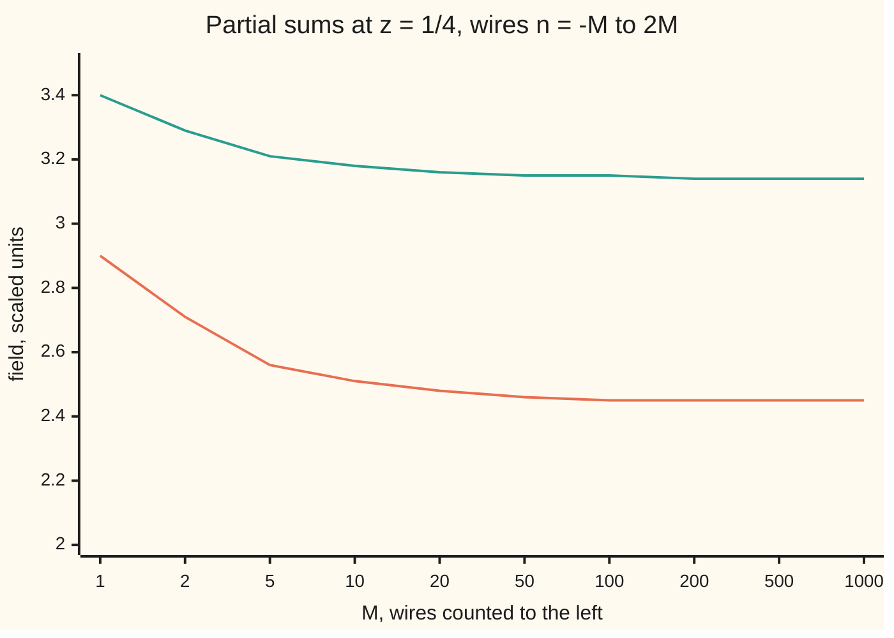

# Mittag-Leffler: put poles and principal parts wherever you like, as long as they run off to infinity

[Syllabus](../../../SYLLABUS.md) → [Complex analysis](../README.md) → [Entire and Meromorphic Functions](../README.md#s10) → Mittag-Leffler

---

## General Overview

A wire chamber, a particle detector, holds a flat row of thin parallel wires at equal charge, 1 mm apart. In a cross-section, each wire is a point on the real line, at every whole number n.

The wire at n adds $`1/(z - n)`$ to the field at the point z, in scaled units, with the field written as one complex number: its x part minus i times its y part.

Summed out to the right, that diverges like the harmonic series: far wires add about $`-1/n`$. Paired, n with −n, they settle, but the total depends on the order: twice as many wires right as left settles ln 2 lower, the true field of that lopsided chamber.

The fix: subtract from each wire's term its own value at 0, $`-1/n`$. The blow-up at the wire stays; far from it the corrected term shrinks like $`1/n^2`$, and the sum settles, in any order, on $`\pi\cot(\pi z)`$. The constant corrections cancel in ±n pairs, so this is the row's field.

Midway between two wires, at z = 1/2, the field is 0 by symmetry, and $`\cot(\pi/2) = 0`$ agrees. A quarter of the way along, at z = 1/4, the field is π = 3.141593, pointing away from the nearer wire.

Mittag-Leffler's theorem says this trick always works. A **meromorphic** function is holomorphic (complex-differentiable) except at isolated poles; any poles running off to infinity, with any blow-up terms, belong to one.

**Choose poles that run off to infinity and a blow-up term (principal part) at each; subtract from each enough of its own Taylor polynomial at 0 (the start of its power series), and the sum converges to a meromorphic function with exactly those poles and blow-up terms, unique up to adding an entire function (one with no poles).**

**What kind of fact this is:** a theorem, proved on this card in Why it works, together with the two expansions of the cotangent and of $`\pi^2/\sin^2(\pi z)`$.

### The picture: the raw sum depends on the order



Orange: the raw terms $`1/(z - n)`$, settling near π − ln 2 = 2.448445. Green: the corrected terms, settling on π = 3.141593.

---

## The formula

- A **pole** $`a_k`$ is a point where the function blows up; k counts the poles. "Run off to infinity" means only finitely many poles lie in any disc.
- The **principal part** $`P_k`$ at $`a_k`$ is the blow-up term: a finite sum of constants over powers of $`(z - a_k)`$, the negative powers of the Laurent series there ([Laurent series](../05-Laurent%20Series%2C%20Singularities%20and%20Residues/01-laurent-series.md)).
- The **correction** $`q_k`$ is the Taylor polynomial of $`P_k`$ at 0, up to the power $`d_k`$; a pole at 0 gets none. It is a polynomial, so it adds no poles.
- An **entire** function is holomorphic on the whole plane.

```math
f(z) = \sum_{k} \bigl(P_k(z) - q_k(z)\bigr) + h(z)
```

**Read it aloud:** the function is the sum, over every pole, of its principal part minus that part's own Taylor polynomial at 0, plus any entire function.

For the wires, $`a_k = n`$, $`P_k = 1/(z - n)`$ and $`q_k = -1/n`$. Pairing n with −n gives the cotangent; differentiating gives a series needing no correction:

```math
\pi\cot(\pi z) = \frac{1}{z} + \sum_{n=1}^{\infty} \frac{2z}{z^2 - n^2}, \qquad \frac{\pi^2}{\sin^2(\pi z)} = \sum_{n=-\infty}^{\infty} \frac{1}{(z - n)^2}
```

**Read it aloud:** the row's field is 1/z plus, for each wire pair at ±n, 2z over z² − n²; and π² over sine squared is the plain sum of every wire's term squared.

| Symbol | Plain meaning | In our example | Push it up and the answer… |
| --- | --- | --- | --- |
| $`z`$ | the point where the field is read | 1/2, 1/4, 2i | nearer a wire, blows up |
| $`a_k`$, $`k`$, $`n`$ | the poles, their counter, a whole number | the wire at n | — |
| $`P_k`$ | the principal part at $`a_k`$ | $`1/(z - n)`$ | — |
| $`q_k`$, $`d_k`$ | the Taylor polynomial of $`P_k`$ at 0, and its highest power | $`-1/n`$, power 0 | the corrected term shrinks faster |
| $`f`$, $`g`$, $`\cot`$ | the function built; a rival with the same poles; cos over sin | $`\pi\cot(\pi z)`$ | — |
| $`h`$, $`D`$ | an entire function: the freedom left; Step 4's difference | 0 | moves f, keeps the poles |
| $`M`$, $`K`$ | how many wires, or poles, are counted | 1000; 100000 | partial sums settle |
| $`R`$ | radius of a disc round 0 | any | needs more poles handled one by one |

### When it holds

- **The poles run off to infinity.** If they crowded to a point, such as $`1/k`$ crowding to 0, that point would be a singularity that is not isolated, and no meromorphic function on the plane has one.
- **The corrections are polynomials.** Anything with poles of its own would add poles.
- **The power $`d_k`$ is high enough.** Power 0 suffices for the wires. For poles at $`\sqrt{k}`$, power 0 leaves a sum that keeps falling, from −5.903105 to −7.057805 as K grows from 10⁴ to 10⁵; power 1 settles.
- **The answer is fixed only up to h.** Adding $`e^z`$ keeps every pole and principal part; pinning down the cotangent needs period 1, boundedness and oddness.
- **The whole plane.** Other open regions work too, with rational corrections, through [Runge's theorem](../04-Taylor%20Series%2C%20Zeros%20and%20Rigidity/11-runges-theorem.md).

---

## Why it works

### Step 0: a far pole looks smooth near 0

Near 0, the far wire's term $`1/(z - 1000)`$ is smooth and close to its value at 0. Subtract that value: the term becomes tiny near 0, and the blow-up at 1000 is untouched.

### Step 1: how much to subtract

A principal part at $`a_k`$ is holomorphic on the disc of radius $`|a_k|`$ round 0, and on the half-size disc $`|z| \le |a_k|/2`$ its Taylor terms shrink at least like powers of 1/2 times a polynomial factor (the binomial series of each negative power). Some power $`d_k`$ makes the error after $`q_k`$ at most $`2^{-k}`$ there; those bounds add to at most 1.

For a wire, the geometric series does it by hand. If $`|z| \le R`$ and $`|n| \ge 2R`$:

```math
\Bigl|\frac{1}{z - n} + \frac{1}{n}\Bigr| = \frac{|z|}{|n|\,|z - n|} \le \frac{2R}{n^2}
```

**Read it aloud:** past twice the disc's radius, each corrected term is at most 2R over n squared; these bounds have a finite total.

### Step 2: the corrected sum converges, and its poles are the chosen ones

Fix a disc $`|z| \le R`$. Only finitely many poles have $`|a_k| \le 2R`$. Every other corrected term is holomorphic on the disc and at most $`2^{-k}`$ there.

Those bounds add to at most 1, so the M-test (bounds with a finite total force uniform convergence) makes that part of the sum converge uniformly on the disc ([Uniform convergence](../../06-Calculus%20and%20analysis/06-Series/07-uniform-convergence.md)). A uniform limit of holomorphic functions is holomorphic ([Limits of holomorphic functions](../04-Taylor%20Series%2C%20Zeros%20and%20Rigidity/02-uniform-limits-of-holomorphic-functions.md)).

The finitely many remaining terms are each $`P_k`$ minus a polynomial, so inside the disc f has exactly those poles and principal parts. Every R works.

### Step 3: two answers differ by an entire function

Suppose g has the same poles and principal parts. At each pole, f − g has its principal parts cancel, so it has a removable singularity ([Isolated singularities](../05-Laurent%20Series%2C%20Singularities%20and%20Residues/02-classifying-singularities.md)). Filled in, f − g is entire: that is h.

In the finite case, [Rational functions](../05-Laurent%20Series%2C%20Singularities%20and%20Residues/03-rational-functions-and-partial-fractions.md), fading far out forced h = 0.

### Step 4: the squared series is exactly $`\pi^2/\sin^2(\pi z)`$

Near n, $`\sin(\pi z)`$ behaves like $`\pm\pi(z - n)`$, and the expansion is even about n, so $`\pi^2/\sin^2(\pi z)`$ has principal part exactly $`1/(z - n)^2`$. Summing these needs no correction, since $`1/n^2`$ has a finite total.

By Step 3 the two differ by an entire function D. Both repeat with period 1, so D does too. D is continuous and tends to 0 far above and below the row, so it is bounded on the strip of real parts 0 to 1, and so, by the period, on the whole plane. By [Liouville's theorem](../03-Contour%20Integrals%20and%20Cauchy%27s%20Theorem/07-liouville-and-the-fundamental-theorem-of-algebra.md) D is constant, and that constant is its far-away value, 0.

### Step 5: integrate back to the cotangent

The derivative of $`\pi\cot(\pi z)`$ is $`-\pi^2/\sin^2(\pi z)`$. The corrected wire series may be differentiated term by term (Step 2's uniform convergence allows it), and gives $`-\sum 1/(z - n)^2`$.

Equal derivatives mean the two differ by a constant. Both are odd: putting −z in place of z flips the sign. So the constant is 0, and $`\pi\cot(\pi z) = 1/z + \sum 2z/(z^2 - n^2)`$.

[Infinite products](../09-Special%20Functions%20and%20the%20Zeta%20Function/01-infinite-products.md) reaches the same expansion by the residue theorem, as the logarithmic derivative of the sine product $`\sin(\pi z) = \pi z \prod (1 - z^2/n^2)`$.

### Step 6: π²/6 falls out at z = 0

Expand near 0: $`\sin(\pi z) = \pi z(1 - \pi^2 z^2/6 + \dots)`$, so $`\pi^2/\sin^2(\pi z) = 1/z^2 + \pi^2/3 + \dots`$.

Remove the n = 0 term, $`1/z^2`$, from both sides and set z = 0. The tail gives $`\sum_{n \ne 0} 1/n^2`$, which counts each n twice. So $`2\sum_{n \ge 1} 1/n^2 = \pi^2/3`$, and the sum of $`1/n^2`$ is $`\pi^2/6`$ = 1.644934.

---

## Worked numbers, by hand

At z = 1/2, the pair at n and −n gives $`2z/(z^2 - n^2) = 1/(1/4 - n^2)`$. That splits as $`-\bigl(1/(n - 1/2) - 1/(n + 1/2)\bigr)`$, so the pairs telescope.

| Step | Arithmetic | Value |
| --- | --- | --- |
| wire at 0 | 1/z at z = 1/2 | 2 |
| pairs n = 1, 2, 3 | 1/(1/4 − n²) | −1.333333, −0.266667, −0.114286 |
| pairs to n = 1000, telescoped | −(2 − 1/1000.5), exactly −4000/2001 | −1.999000 |
| all pairs | the leftover 1/1000.5 shrinks to 0 | −2 |
| field midway | 2 − 2 | **0, and π cot(π/2) = 0** |
| field at z = 1/4 | series to 100000 pairs, with tail | **3.141593 = π** |
| field at z = 2i | −i(π coth 2π), coth = cosh/sinh | −i × 3.141615 |
| squared series at 1/4 | sum of 1/(1/4 − n)² | 19.739209 = 2π² |
| tail at z = 0 | π²/3, then halve | **1.644934 = π²/6** |

Midway the wires cancel. At z = 2i the field is almost exactly π, pointing up: far away the row acts like a charged sheet, whose field does not fade.

### What breaks if you drop a piece

| Mistake | Comes out at | What went wrong |
| --- | --- | --- |
| No correction, wires n = 0 to 1000 only | −3.993866 at z = 1/4, still sliding | the raw sum diverges like a logarithm |
| No correction, wires −M to 2M | 2.449070 at M = 1000, heading to 2.448445, not π | the raw sum depends on the order |
| Power 0 for poles at $`\sqrt{k}`$ | −4.741116, −5.903105, −7.057805 at K = 10³, 10⁴, 10⁵ | power too low; power 1 gives −0.998381, −1.009302, −1.012732 |
| π²/3 read as the sum of 1/n² | 3.289868, not 1.644934 | the tail counts n and −n |

---

## Code, from first principles, and it actually runs

Each program reaches the field by three roads: the corrected series with its tail estimated, the closed form π cos/sin, and exact telescoping fractions at z = 1/2. It also checks the squared series, the period, the field above the row, and π²/6 two ways.

### Python

```python
# Mittag-Leffler's theorem: the check behind the card.  Python standard library
# only.  A row of charged wires sits at every whole number n; the wire at n adds
# 1/(z - n) to the field at z.  The sum diverges until each term has its value
# at 0 subtracted; then it is pi cot(pi z), and its derivative gives pi^2/6.
import math
from fractions import Fraction
N = 100000                                       # wires counted on each side
f6 = lambda x: f"{round(x, 6) + 0.0:.6f}"         # six decimals, never -0.000000
def cot_series(z, n=N):                          # road one: 1/z + sum of 2z/(z^2 - k^2), plus its tail
    return 1 / z + sum(2 * z / (z * z - k * k) for k in range(1, n + 1)) - 2 * z / (n + 0.5)
def sq_series(z, n=N):                           # sum over all k of 1/(z - k)^2, plus its tail
    return sum(1 / (z - k) ** 2 for k in range(-n, n + 1)) + 2 / (n + 0.5)
pcot = lambda z: math.pi * math.cos(math.pi * z) / math.sin(math.pi * z)   # road two: the closed form
tele = sum(Fraction(1, 1) / (Fraction(k * k) - Fraction(1, 4)) for k in range(1, 1001))   # road three
print(f"z = 0.5, midway: series {f6(cot_series(0.5))}; pi cot(pi z) {f6(pcot(0.5))}")
print("pairs n = 1, 2, 3 at z = 0.5, 1/(1/4 - n^2): " + ", ".join(f6(1 / (0.25 - k * k)) for k in (1, 2, 3)))
print(f"sum of 1/(n^2 - 1/4) to n = 1000, exact: {tele} = 2 - 1/1000.5 = {f6(float(tele))}")
assert tele == 2 - Fraction(2, 2001) and abs(cot_series(0.5)) < 1e-9
for z in (0.25, 0.1):
    print(f"z = {z}: series {f6(cot_series(z))}; pi cot(pi z) {f6(pcot(z))}")
    assert abs(cot_series(z) - pcot(z)) < 1e-9
y = 2.0                                         # straight above the wire at 0: z = 2i
above = 1 / y + sum(2 * y / (y * y + k * k) for k in range(1, N + 1)) + 2 * y / (N + 0.5)
coth = math.pi * (math.exp(2 * math.pi * y) + 1) / (math.exp(2 * math.pi * y) - 1)
print(f"z = 2i: field -i x {f6(above)}; pi coth(2 pi) = {f6(coth)}; a flat sheet gives pi = {f6(math.pi)}")
assert abs(above - coth) < 1e-9
s2 = sq_series(0.25)
print(f"z = 0.25: sum of 1/(z - n)^2 {f6(s2)}; pi^2/sin^2(pi z) {f6((math.pi / math.sin(math.pi / 4)) ** 2)}")
print(f"one step along the row: cot series at 1.25 minus at 0.25 = {f6(cot_series(1.25) - cot_series(0.25))}")
assert abs(s2 - 2 * math.pi ** 2) < 1e-9 and abs(cot_series(1.25) - cot_series(0.25)) < 1e-6
basel = sum(1 / (k * k) for k in range(1, N + 1)) + 1 / (N + 0.5)
near0 = (math.pi / math.sin(math.pi * 1e-3)) ** 2 - 1e6
print(f"pi^2/sin^2(pi z) - 1/z^2 at z = 0.001: {f6(near0)}; pi^2/3 = {f6(math.pi ** 2 / 3)}")
print(f"sum of 1/n^2: {f6(basel)}; half of pi^2/3 = pi^2/6 = {f6(math.pi ** 2 / 6)}")
assert abs(near0 - math.pi ** 2 / 3) < 1e-4 and abs(basel - math.pi ** 2 / 6) < 1e-12
Ms = (1, 2, 5, 10, 20, 50, 100, 200, 500, 1000)  # chart: wires n = -M ... 2M, lopsided
raw = [sum(1 / (0.25 - k) for k in range(-M, 2 * M + 1)) for M in Ms]
fix = [4 + sum(1 / (0.25 - k) + 1 / k for k in range(-M, 2 * M + 1) if k) for M in Ms]
print("chart, raw sum at z = 0.25, n = -M ... 2M: " + ", ".join(f"{v:.2f}" for v in raw))
print("chart, corrected sum, same wires: " + ", ".join(f"{v:.2f}" for v in fix))
assert abs(raw[-1] - (math.pi - math.log(2))) < 1e-3 and abs(fix[-1] - math.pi) < 1e-3
one = sum(1 / (0.25 - k) for k in range(0, 1001))
print(f"mistake, raw sum over n = 0 ... 1000 only: {f6(one)}; raw limit for n = -M ... 2M: "
      f"{f6(raw[-1])}, near pi - ln 2 = {f6(math.pi - math.log(2))}")
print(f"mistake, pi^2/3 read as the sum of 1/n^2: {f6(math.pi ** 2 / 3)}, not {f6(math.pi ** 2 / 6)}")
d0 = lambda K: sum(0.5 / (math.sqrt(k) * (0.5 - math.sqrt(k))) for k in range(1, K + 1))
d1 = lambda K: sum(0.25 / (k * (0.5 - math.sqrt(k))) for k in range(1, K + 1))
Ks = (1000, 10000, 100000)
print("poles at sqrt(k), z = 0.5, K = 1000, 10000, 100000: degree-0 fix "
      + ", ".join(f6(d0(K)) for K in Ks) + "; degree-1 fix " + ", ".join(f6(d1(K)) for K in Ks))
assert abs((d0(Ks[1]) - d0(Ks[2])) - 0.5 * math.log(10)) < 0.01 and abs(d1(Ks[1]) - d1(Ks[2])) < 0.005
print("ALL CHECKS PASS")
```

**Ran 2026-11-23 on macOS, Python 3.14.10, standard library only. All checks passed. Output, pasted from the run:**

```
z = 0.5, midway: series 0.000000; pi cot(pi z) 0.000000
pairs n = 1, 2, 3 at z = 0.5, 1/(1/4 - n^2): -1.333333, -0.266667, -0.114286
sum of 1/(n^2 - 1/4) to n = 1000, exact: 4000/2001 = 2 - 1/1000.5 = 1.999000
z = 0.25: series 3.141593; pi cot(pi z) 3.141593
z = 0.1: series 9.668828; pi cot(pi z) 9.668828
z = 2i: field -i x 3.141615; pi coth(2 pi) = 3.141615; a flat sheet gives pi = 3.141593
z = 0.25: sum of 1/(z - n)^2 19.739209; pi^2/sin^2(pi z) 19.739209
one step along the row: cot series at 1.25 minus at 0.25 = 0.000000
pi^2/sin^2(pi z) - 1/z^2 at z = 0.001: 3.289875; pi^2/3 = 3.289868
sum of 1/n^2: 1.644934; half of pi^2/3 = pi^2/6 = 1.644934
chart, raw sum at z = 0.25, n = -M ... 2M: 2.90, 2.71, 2.56, 2.51, 2.48, 2.46, 2.45, 2.45, 2.45, 2.45
chart, corrected sum, same wires: 3.40, 3.29, 3.21, 3.18, 3.16, 3.15, 3.15, 3.14, 3.14, 3.14
mistake, raw sum over n = 0 ... 1000 only: -3.993866; raw limit for n = -M ... 2M: 2.449070, near pi - ln 2 = 2.448445
mistake, pi^2/3 read as the sum of 1/n^2: 3.289868, not 1.644934
poles at sqrt(k), z = 0.5, K = 1000, 10000, 100000: degree-0 fix -4.741116, -5.903105, -7.057805; degree-1 fix -0.998381, -1.009302, -1.012732
ALL CHECKS PASS
```

### Rust

Same numbers, same labels, built with `rustc --edition 2021 -O`.

```rust
// Mittag-Leffler's theorem: the same check as the Python, in Rust.  No crates.
// A row of charged wires sits at every whole number n; the wire at n adds
// 1/(z - n) to the field at z.  The sum diverges until each term has its value
// at 0 subtracted; then it is pi cot(pi z), and its derivative gives pi^2/6.
use std::f64::consts::PI;
const N: i64 = 100000;                           // wires counted on each side
fn f6(x: f64) -> String { format!("{:.6}", (x * 1e6).round() / 1e6 + 0.0) }   // never -0.000000
fn cot_series(z: f64) -> f64 {                   // road one: 1/z + sum of 2z/(z^2 - k^2), plus its tail
    1.0 / z + (1..=N).map(|k| { let k = k as f64; 2.0 * z / (z * z - k * k) }).sum::<f64>() - 2.0 * z / (N as f64 + 0.5)
}
fn sq_series(z: f64) -> f64 {                    // sum over all k of 1/(z - k)^2, plus its tail
    (-N..=N).map(|k| 1.0 / ((z - k as f64) * (z - k as f64))).sum::<f64>() + 2.0 / (N as f64 + 0.5)
}
fn pcot(z: f64) -> f64 { PI * (PI * z).cos() / (PI * z).sin() }               // road two: the closed form
fn gcd(a: i128, b: i128) -> i128 { if b == 0 { a } else { gcd(b, a % b) } }
fn sum_to(m: i64, f: &dyn Fn(f64) -> f64) -> f64 { (-m..=2 * m).map(|k| f(k as f64)).sum() }
fn main() {
    let (mut a, mut b) = (0i128, 1i128);         // road three: exact fractions, 1/(k^2 - 1/4) = 4/(4k^2 - 1)
    for k in 1..=1000i128 {
        let d = 4 * k * k - 1;
        a = a * d + 4 * b; b *= d;
        let g = gcd(a, b); a /= g; b /= g;
    }
    println!("z = 0.5, midway: series {}; pi cot(pi z) {}", f6(cot_series(0.5)), f6(pcot(0.5)));
    let pairs: Vec<String> = [1.0, 2.0, 3.0].iter().map(|&k: &f64| f6(1.0 / (0.25 - k * k))).collect();
    println!("pairs n = 1, 2, 3 at z = 0.5, 1/(1/4 - n^2): {}", pairs.join(", "));
    println!("sum of 1/(n^2 - 1/4) to n = 1000, exact: {}/{} = 2 - 1/1000.5 = {}", a, b, f6(a as f64 / b as f64));
    assert!(a * 2001 == 4000 * b && cot_series(0.5).abs() < 1e-9);
    for z in [0.25, 0.1] {
        println!("z = {}: series {}; pi cot(pi z) {}", z, f6(cot_series(z)), f6(pcot(z)));
        assert!((cot_series(z) - pcot(z)).abs() < 1e-9);
    }
    let y = 2.0;                                 // straight above the wire at 0: z = 2i
    let above = 1.0 / y + (1..=N).map(|k| { let k = k as f64; 2.0 * y / (y * y + k * k) }).sum::<f64>() + 2.0 * y / (N as f64 + 0.5);
    let e = (2.0 * PI * y).exp();
    let coth = PI * (e + 1.0) / (e - 1.0);
    println!("z = 2i: field -i x {}; pi coth(2 pi) = {}; a flat sheet gives pi = {}", f6(above), f6(coth), f6(PI));
    assert!((above - coth).abs() < 1e-9);
    let s2 = sq_series(0.25);
    let sq = PI / (PI / 4.0).sin();
    println!("z = 0.25: sum of 1/(z - n)^2 {}; pi^2/sin^2(pi z) {}", f6(s2), f6(sq * sq));
    println!("one step along the row: cot series at 1.25 minus at 0.25 = {}", f6(cot_series(1.25) - cot_series(0.25)));
    assert!((s2 - 2.0 * PI * PI).abs() < 1e-9 && (cot_series(1.25) - cot_series(0.25)).abs() < 1e-6);
    let basel = (1..=N).map(|k| 1.0 / (k as f64 * k as f64)).sum::<f64>() + 1.0 / (N as f64 + 0.5);
    let s = PI / (PI * 1e-3).sin();
    let near0 = s * s - 1e6;
    println!("pi^2/sin^2(pi z) - 1/z^2 at z = 0.001: {}; pi^2/3 = {}", f6(near0), f6(PI * PI / 3.0));
    println!("sum of 1/n^2: {}; half of pi^2/3 = pi^2/6 = {}", f6(basel), f6(PI * PI / 6.0));
    assert!((near0 - PI * PI / 3.0).abs() < 1e-4 && (basel - PI * PI / 6.0).abs() < 1e-12);
    let ms = [1, 2, 5, 10, 20, 50, 100, 200, 500, 1000];   // chart: wires n = -M ... 2M, lopsided
    let raw: Vec<f64> = ms.iter().map(|&m| sum_to(m, &|k| 1.0 / (0.25 - k))).collect();
    let fix: Vec<f64> = ms.iter().map(|&m| 4.0 + sum_to(m, &|k| if k == 0.0 { 0.0 } else { 1.0 / (0.25 - k) + 1.0 / k })).collect();
    let show = |v: &Vec<f64>| v.iter().map(|x| format!("{:.2}", x)).collect::<Vec<_>>().join(", ");
    println!("chart, raw sum at z = 0.25, n = -M ... 2M: {}", show(&raw));
    println!("chart, corrected sum, same wires: {}", show(&fix));
    assert!((raw[9] - (PI - 2f64.ln())).abs() < 1e-3 && (fix[9] - PI).abs() < 1e-3);
    let one: f64 = (0..=1000).map(|k| 1.0 / (0.25 - k as f64)).sum();
    println!("mistake, raw sum over n = 0 ... 1000 only: {}; raw limit for n = -M ... 2M: {}, near pi - ln 2 = {}",
             f6(one), f6(raw[9]), f6(PI - 2f64.ln()));
    println!("mistake, pi^2/3 read as the sum of 1/n^2: {}, not {}", f6(PI * PI / 3.0), f6(PI * PI / 6.0));
    let d0 = |kk: i64| (1..=kk).map(|k| { let r = (k as f64).sqrt(); 0.5 / (r * (0.5 - r)) }).sum::<f64>();
    let d1 = |kk: i64| (1..=kk).map(|k| 0.25 / (k as f64 * (0.5 - (k as f64).sqrt()))).sum::<f64>();
    let ks = [1000, 10000, 100000];
    let j = |f: &dyn Fn(i64) -> f64| ks.iter().map(|&k| f6(f(k))).collect::<Vec<_>>().join(", ");
    println!("poles at sqrt(k), z = 0.5, K = 1000, 10000, 100000: degree-0 fix {}; degree-1 fix {}", j(&d0), j(&d1));
    assert!(((d0(ks[1]) - d0(ks[2])) - 0.5 * 10f64.ln()).abs() < 0.01 && (d1(ks[1]) - d1(ks[2])).abs() < 0.005);
    println!("ALL CHECKS PASS");
}
```

**Ran 2026-11-23 on macOS, rustc 1.98.1, no crates. All checks passed. Output, pasted from the run:**

```
z = 0.5, midway: series 0.000000; pi cot(pi z) 0.000000
pairs n = 1, 2, 3 at z = 0.5, 1/(1/4 - n^2): -1.333333, -0.266667, -0.114286
sum of 1/(n^2 - 1/4) to n = 1000, exact: 4000/2001 = 2 - 1/1000.5 = 1.999000
z = 0.25: series 3.141593; pi cot(pi z) 3.141593
z = 0.1: series 9.668828; pi cot(pi z) 9.668828
z = 2i: field -i x 3.141615; pi coth(2 pi) = 3.141615; a flat sheet gives pi = 3.141593
z = 0.25: sum of 1/(z - n)^2 19.739209; pi^2/sin^2(pi z) 19.739209
one step along the row: cot series at 1.25 minus at 0.25 = 0.000000
pi^2/sin^2(pi z) - 1/z^2 at z = 0.001: 3.289875; pi^2/3 = 3.289868
sum of 1/n^2: 1.644934; half of pi^2/3 = pi^2/6 = 1.644934
chart, raw sum at z = 0.25, n = -M ... 2M: 2.90, 2.71, 2.56, 2.51, 2.48, 2.46, 2.45, 2.45, 2.45, 2.45
chart, corrected sum, same wires: 3.40, 3.29, 3.21, 3.18, 3.16, 3.15, 3.15, 3.14, 3.14, 3.14
mistake, raw sum over n = 0 ... 1000 only: -3.993866; raw limit for n = -M ... 2M: 2.449070, near pi - ln 2 = 2.448445
mistake, pi^2/3 read as the sum of 1/n^2: 3.289868, not 1.644934
poles at sqrt(k), z = 0.5, K = 1000, 10000, 100000: degree-0 fix -4.741116, -5.903105, -7.057805; degree-1 fix -0.998381, -1.009302, -1.012732
ALL CHECKS PASS
```

The two outputs match line for line.

### Lean

Lean proves the theorem for any poles that run off to infinity, both expansions, and the numbers at z = 1/2.

- Take distinct poles $`a_k`$ that run off to infinity, with any principal part $`P_k`$ at each. Then some powers $`d_k`$ make the terms $`P_k - q_k`$ add up in any order, away from the poles.
- Take the same poles and powers. Then the sum $`f`$ is holomorphic away from the poles, and near each $`a_k`$ it is $`P_k`$ plus a holomorphic function.
- Suppose $`g`$ is holomorphic away from the poles, with the same principal parts. Then $`g = f + h`$ away from the poles, for some entire function $`h`$.
- Take z not a whole number. Then $`\pi\cot(\pi z)`$ equals $`1/z`$ plus the sum over $`n \ge 1`$ of $`2z/(z^2 - n^2)`$.
- Take z not a whole number. Then the plain sum of $`1/(z - n)^2`$ over every whole number n, in any order, is $`\pi^2/\sin^2(\pi z)`$.
- Take z = 1/2. Then the pairs n = 1, 2, 3 give −4/3, −4/15 and −4/35.
- Each pair splits as the telescoping difference above, checked for n = 1 to 20. The pairs to n = 1000 add to exactly −4000/2001.

Step 6, the field at 2i, the poles at $`\sqrt{k}`$ and the decimals are left to the Python and Rust checks.

```lean
-- Mittag-Leffler: poles that run off to infinity, each with any chosen principal part, are the poles of one function built by subtracting from each principal part its Taylor polynomial at 0, that function is unique up to adding an entire function, and the integer poles give the series for pi cot(pi z) and pi^2/sin^2(pi z).
import Mathlib.Analysis.SpecialFunctions.Trigonometric.Cotangent
import Mathlib.Analysis.Calculus.IteratedDeriv.Defs
import Mathlib.Analysis.Analytic.Basic
import Mathlib.Tactic.NormNum

open Complex Filter Topology Real

/-- The principal part at the pole `a k`: a finite sum of constants `c k j` over the powers
`(z - a k) ^ (j + 1)`, for `j` below the order `m k`. -/
noncomputable def principalPart {ι : Type*} (a : ι → ℂ) (m : ι → ℕ) (c : ι → ℕ → ℂ)
    (k : ι) (z : ℂ) : ℂ :=
  ∑ j ∈ Finset.range (m k), c k j / (z - a k) ^ (j + 1)

/-- The correction `q k`: the Taylor polynomial at 0 of the principal part at `a k`, up to the
power `d k`. A pole at 0 gets no correction. -/
noncomputable def taylorCorrection {ι : Type*} (a : ι → ℂ) (m : ι → ℕ) (c : ι → ℕ → ℂ)
    (d : ι → ℕ) (k : ι) (z : ℂ) : ℂ :=
  if a k = 0 then 0 else
    ∑ i ∈ Finset.range (d k + 1),
      iteratedDeriv i (principalPart a m c k) 0 / (i.factorial : ℂ) * z ^ i

/-- Helper: the Taylor polynomials at 0 of a function differentiable on the disc of radius `r`
approach it uniformly on the disc of radius `r / 2`. -/
theorem ml_taylor_unif (P : ℂ → ℂ) (r : ℝ) (hr : 0 < r)
    (hP : DifferentiableOn ℂ P (Metric.ball 0 r)) (ε : ℝ) (hε : 0 < ε) :
    ∃ D : ℕ, ∀ z : ℂ, ‖z‖ < r / 2 →
      ‖P z - ∑ i ∈ Finset.range (D + 1), iteratedDeriv i P 0 / (i.factorial : ℂ) * z ^ i‖ < ε := by
  have hR0 : (0 : ℝ) ≤ 3 * r / 4 := by positivity
  have hR2 : (0 : ℝ) ≤ r / 2 := by positivity
  set R : NNReal := (3 * r / 4).toNNReal with hRdef
  have hRc : (R : ℝ) = 3 * r / 4 := Real.coe_toNNReal _ hR0
  have hR : (0 : NNReal) < R := by
    rw [← NNReal.coe_lt_coe, hRc]; simp; positivity
  have hcl : DifferentiableOn ℂ P (Metric.closedBall 0 R) :=
    hP.mono (Metric.closedBall_subset_ball (by rw [hRc]; linarith))
  have hb := hcl.hasFPowerSeriesOnBall hR
  have han : AnalyticAt ℂ P 0 := hb.analyticAt
  have heq := hb.hasFPowerSeriesAt.eq_formalMultilinearSeries han.hasFPowerSeriesAt
  rw [heq] at hb
  have hu := hb.tendstoUniformlyOn (r' := (r / 2).toNNReal) (by
    rw [ENNReal.coe_lt_coe, ← NNReal.coe_lt_coe, hRc, Real.coe_toNNReal _ hR2]; linarith)
  rw [Metric.tendstoUniformlyOn_iff] at hu
  obtain ⟨N, hN⟩ := eventually_atTop.1 (hu ε hε)
  refine ⟨N, fun z hz => ?_⟩
  have := hN (N + 1) (by omega) z (by simpa [Real.coe_toNNReal _ hR2] using hz)
  rw [dist_eq_norm] at this
  simpa [FormalMultilinearSeries.partialSum, FormalMultilinearSeries.ofScalars_apply_eq,
    mul_comm] using this

#print axioms ml_taylor_unif

/-- Helper: a principal part is complex-differentiable away from its pole. -/
theorem ml_principalPart_differentiableAt {ι : Type*} (a : ι → ℂ) (m : ι → ℕ)
    (c : ι → ℕ → ℂ) (k : ι) (w : ℂ) (hw : w ≠ a k) :
    DifferentiableAt ℂ (principalPart a m c k) w := by
  have hne : w - a k ≠ 0 := sub_ne_zero.2 hw
  show DifferentiableAt ℂ (fun z => ∑ j ∈ Finset.range (m k), c k j / (z - a k) ^ (j + 1)) w
  apply DifferentiableAt.fun_sum
  intro j _
  exact (differentiableAt_const _).div ((differentiableAt_id.sub_const _).pow _)
    (pow_ne_zero _ hne)

#print axioms ml_principalPart_differentiableAt

/-- Helper: a Taylor correction is a polynomial, so it is differentiable everywhere. -/
theorem ml_taylorCorrection_differentiable {ι : Type*} (a : ι → ℂ) (m : ι → ℕ)
    (c : ι → ℕ → ℂ) (d : ι → ℕ) (k : ι) : Differentiable ℂ (taylorCorrection a m c d k) := by
  by_cases h : a k = 0
  · have : taylorCorrection a m c d k = fun _ => 0 := by
      funext z; rw [taylorCorrection, if_pos h]
    rw [this]; exact differentiable_const _
  · have : taylorCorrection a m c d k = fun z => ∑ i ∈ Finset.range (d k + 1),
        iteratedDeriv i (principalPart a m c k) 0 / (i.factorial : ℂ) * z ^ i := by
      funext z; rw [taylorCorrection, if_neg h]
    rw [this]; fun_prop

#print axioms ml_taylorCorrection_differentiable

/-- Helper: poles that run off to infinity are isolated, so near any point there are no
poles except possibly the point itself. -/
theorem ml_eventually_not_mem_range {ι : Type*} (a : ι → ℂ)
    (hfin : ∀ R : ℝ, {k | ‖a k‖ ≤ R}.Finite) (z : ℂ) :
    ∀ᶠ w in 𝓝[≠] z, w ∉ Set.range a := by
  set S := {k | ‖a k‖ ≤ ‖z‖ + 1}
  have hF : ((a '' S) \ {z}).Finite := ((hfin _).image a).subset Set.sdiff_subset
  have h1 : ((a '' S) \ {z})ᶜ ∈ 𝓝 z := hF.isClosed.isOpen_compl.mem_nhds (fun h => h.2 rfl)
  have h2 : Metric.ball z 1 ∈ 𝓝 z := Metric.ball_mem_nhds z one_pos
  filter_upwards [nhdsWithin_le_nhds h1, nhdsWithin_le_nhds h2, self_mem_nhdsWithin]
    with w hw1 hw2 hw3
  rintro ⟨k, rfl⟩
  apply hw1
  refine ⟨⟨k, ?_, rfl⟩, hw3⟩
  rw [Metric.mem_ball, dist_eq_norm] at hw2
  show ‖a k‖ ≤ ‖z‖ + 1
  have := norm_sub_norm_le (a k) z
  linarith

#print axioms ml_eventually_not_mem_range

/-- Helper: the set of poles is closed, so its complement is a neighbourhood of each of its
points. -/
theorem ml_compl_range_mem_nhds {ι : Type*} (a : ι → ℂ)
    (hfin : ∀ R : ℝ, {k | ‖a k‖ ≤ R}.Finite) (z : ℂ) (hz : z ∉ Set.range a) :
    (Set.range a)ᶜ ∈ 𝓝 z := by
  have := eventually_nhdsWithin_iff.1 (ml_eventually_not_mem_range a hfin z)
  filter_upwards [this] with w hw
  by_cases hwz : w = z
  · rw [hwz]; exact hz
  · exact hw hwz

#print axioms ml_compl_range_mem_nhds

/-- Helper: split a series into finitely many chosen terms and a tail that is uniformly
bounded by a summable sequence on an open set; the tail is then differentiable there. -/
theorem ml_split_sum {ι : Type*} [DecidableEq ι] (T : ι → ℂ → ℂ) (ε : ι → ℝ) (hε : Summable ε)
    (Fs : Finset ι) (U : Set ℂ) (hU : IsOpen U)
    (hdiff : ∀ k ∉ Fs, DifferentiableOn ℂ (T k) U)
    (hbd : ∀ k ∉ Fs, ∀ w ∈ U, ‖T k w‖ ≤ ε k) (hε0 : ∀ k, 0 ≤ ε k) :
    DifferentiableOn ℂ (fun w => ∑' k, if k ∈ Fs then 0 else T k w) U ∧
    ∀ w ∈ U, Summable (fun k => T k w) ∧
      ∑' k, T k w = ∑ k ∈ Fs, T k w + ∑' k, (if k ∈ Fs then 0 else T k w) := by
  have hb : ∀ k, ∀ w ∈ U, ‖(if k ∈ Fs then 0 else T k w)‖ ≤ ε k := by
    intro k w hw
    by_cases hk : k ∈ Fs
    · simp [hk, hε0 k]
    · simp only [hk, if_false]; exact hbd k hk w hw
  refine ⟨?_, fun w hw => ?_⟩
  · apply differentiableOn_tsum_of_summable_norm hε _ hU hb
    intro k
    by_cases hk : k ∈ Fs
    · simp only [hk, if_true]; exact differentiableOn_const _
    · simp only [hk, if_false]; exact hdiff k hk
  · have hs2 : Summable (fun k => if k ∈ Fs then 0 else T k w) :=
      Summable.of_norm_bounded hε (fun k => hb k w hw)
    have hs1 : Summable (fun k => if k ∈ Fs then T k w else 0) := by
      apply summable_of_ne_finset_zero (s := Fs)
      intro k hk; simp [hk]
    have hsplit : (fun k => T k w) =
        fun k => (if k ∈ Fs then T k w else 0) + (if k ∈ Fs then 0 else T k w) := by
      funext k; by_cases hk : k ∈ Fs <;> simp [hk]
    have hsum1 : ∑' k, (if k ∈ Fs then T k w else 0) = ∑ k ∈ Fs, T k w := by
      rw [tsum_eq_sum (s := Fs) (fun k hk => by simp [hk])]
      exact Finset.sum_congr rfl (fun k hk => by simp [hk])
    refine ⟨by rw [hsplit]; exact hs1.add hs2, ?_⟩
    calc ∑' k, T k w = ∑' k, ((if k ∈ Fs then T k w else 0) + (if k ∈ Fs then 0 else T k w)) :=
          tsum_congr (fun k => by by_cases hk : k ∈ Fs <;> simp [hk])
      _ = _ := by rw [hs1.tsum_add hs2, hsum1]

#print axioms ml_split_sum

/-- Mittag-Leffler's theorem on the whole plane. Choose distinct poles `a k` that run off to
infinity (only finitely many in any disc) and a principal part at each. Then for some choice of
powers `d k`, the corrected terms `P k - q k` add up, in any order, at every point that is not a
pole; the sum `f` is complex-differentiable off the poles, and near each pole `a k` it is that
pole's principal part plus a function analytic there. Any other function `F` with the same poles
and principal parts differs from `f` by an entire function `h`. -/
theorem mittag_leffler_taylor_corrected_sum {ι : Type*} (a : ι → ℂ)
    (ha : Function.Injective a) (hfin : ∀ R : ℝ, {k | ‖a k‖ ≤ R}.Finite)
    (m : ι → ℕ) (c : ι → ℕ → ℂ) :
    ∃ d : ι → ℕ,
      (∀ z ∉ Set.range a,
        Summable fun k => principalPart a m c k z - taylorCorrection a m c d k z) ∧
      DifferentiableOn ℂ
        (fun z => ∑' k, (principalPart a m c k z - taylorCorrection a m c d k z))
        (Set.range a)ᶜ ∧
      (∀ k, ∃ g : ℂ → ℂ, AnalyticAt ℂ g (a k) ∧ ∀ᶠ z in 𝓝[≠] a k,
        ∑' i, (principalPart a m c i z - taylorCorrection a m c d i z) =
          principalPart a m c k z + g z) ∧
      (∀ F : ℂ → ℂ, DifferentiableOn ℂ F (Set.range a)ᶜ →
        (∀ k, ∃ g : ℂ → ℂ, AnalyticAt ℂ g (a k) ∧
          ∀ᶠ z in 𝓝[≠] a k, F z = principalPart a m c k z + g z) →
        ∃ h : ℂ → ℂ, Differentiable ℂ h ∧ ∀ z ∉ Set.range a,
          F z = ∑' i, (principalPart a m c i z - taylorCorrection a m c d i z) + h z) := by
  classical
  -- the poles are countable, so give them summable weights `ε k`
  have hcount : Countable ι := by
    have hU : (Set.univ : Set ι) = ⋃ n : ℕ, {k | ‖a k‖ ≤ n} := by
      ext k
      simp only [Set.mem_univ, Set.mem_iUnion, Set.mem_setOf_eq, true_iff]
      exact exists_nat_ge _
    exact Set.countable_univ_iff.1 (hU ▸ Set.countable_iUnion fun n => (hfin n).countable)
  obtain ⟨e, he⟩ := Countable.exists_injective_nat ι
  have hε0 : ∀ k, 0 < ((1 : ℝ) / 2) ^ (e k) := fun k => by positivity
  have hεs : Summable fun k => ((1 : ℝ) / 2) ^ (e k) := summable_geometric_two.comp_injective he
  -- choose the degrees `d k`
  have hex : ∀ k, ∃ D : ℕ, a k ≠ 0 → ∀ z : ℂ, ‖z‖ < ‖a k‖ / 2 →
      ‖principalPart a m c k z - ∑ i ∈ Finset.range (D + 1),
        iteratedDeriv i (principalPart a m c k) 0 / (i.factorial : ℂ) * z ^ i‖ <
          ((1 : ℝ) / 2) ^ (e k) := by
    intro k
    by_cases h : a k = 0
    · exact ⟨0, fun h' => absurd h h'⟩
    · have hr : 0 < ‖a k‖ := norm_pos_iff.2 h
      have hP : DifferentiableOn ℂ (principalPart a m c k) (Metric.ball 0 ‖a k‖) := by
        intro w hw
        apply DifferentiableAt.differentiableWithinAt
        apply ml_principalPart_differentiableAt
        rintro rfl
        simp at hw
      obtain ⟨D, hD⟩ := ml_taylor_unif _ _ hr hP _ (hε0 k)
      exact ⟨D, fun _ => hD⟩
  choose d hd using hex
  refine ⟨d, ?_⟩
  -- the corrected terms are small on the disc of half the pole's radius
  have hTb : ∀ k z, ‖z‖ < ‖a k‖ / 2 →
      ‖principalPart a m c k z - taylorCorrection a m c d k z‖ ≤ ((1 : ℝ) / 2) ^ (e k) := by
    intro k z hz
    have hak : a k ≠ 0 := by
      intro h; rw [h, norm_zero] at hz; linarith [norm_nonneg z]
    rw [taylorCorrection, if_neg hak]
    exact (hd k hak z hz).le
  have hTd : ∀ k w, w ≠ a k →
      DifferentiableAt ℂ (fun z => principalPart a m c k z - taylorCorrection a m c d k z) w :=
    fun k w hw => (ml_principalPart_differentiableAt a m c k w hw).sub
      (ml_taylorCorrection_differentiable a m c d k w)
  -- on the disc of radius `R`, split off the finitely many poles with `‖a k‖ ≤ 2 R`
  have hsplitR : ∀ R : ℝ, 0 < R → ∃ Fs : Finset ι, (∀ k, ‖a k‖ ≤ 2 * R → k ∈ Fs) ∧
      DifferentiableOn ℂ (fun w => ∑' k, if k ∈ Fs then 0 else
        (principalPart a m c k w - taylorCorrection a m c d k w)) (Metric.ball 0 R) ∧
      ∀ w ∈ Metric.ball (0 : ℂ) R,
        Summable (fun k => principalPart a m c k w - taylorCorrection a m c d k w) ∧
        ∑' k, (principalPart a m c k w - taylorCorrection a m c d k w) =
          ∑ k ∈ Fs, (principalPart a m c k w - taylorCorrection a m c d k w) +
          ∑' k, (if k ∈ Fs then 0 else
            (principalPart a m c k w - taylorCorrection a m c d k w)) := by
    intro R hR
    refine ⟨(hfin (2 * R)).toFinset, fun k hk => by simpa using hk, ?_⟩
    have hout : ∀ k ∉ (hfin (2 * R)).toFinset, 2 * R < ‖a k‖ := by
      intro k hk; simpa using hk
    exact ml_split_sum (fun k z => principalPart a m c k z - taylorCorrection a m c d k z)
      _ hεs _ _ Metric.isOpen_ball
      (fun k hk w hw => (hTd k w (by
          intro h; have := hout k hk; rw [mem_ball_zero_iff, h] at hw; linarith)
        ).differentiableWithinAt)
      (fun k hk w hw => hTb k w (by
        have := hout k hk; rw [mem_ball_zero_iff] at hw; linarith))
      (fun k => (hε0 k).le)
  -- local form of the sum near any point
  have hloc : ∀ z : ℂ, ∃ Fs : Finset ι, ∃ G : ℂ → ℂ, (∀ k, ‖a k‖ ≤ ‖z‖ + 1 → k ∈ Fs) ∧
      AnalyticAt ℂ G z ∧ ∀ᶠ w in 𝓝 z,
        ∑' k, (principalPart a m c k w - taylorCorrection a m c d k w) =
          ∑ k ∈ Fs, (principalPart a m c k w - taylorCorrection a m c d k w) + G w := by
    intro z
    obtain ⟨Fs, hFs, hG, hS⟩ := hsplitR (‖z‖ + 1) (by positivity)
    have hzb : z ∈ Metric.ball (0 : ℂ) (‖z‖ + 1) := by rw [mem_ball_zero_iff]; linarith
    refine ⟨Fs, _, fun k hk => hFs k (by linarith [norm_nonneg z]),
      hG.analyticAt (Metric.isOpen_ball.mem_nhds hzb), ?_⟩
    filter_upwards [Metric.isOpen_ball.mem_nhds hzb] with w hw
    exact (hS w hw).2
  have h1 : ∀ z ∉ Set.range a,
      Summable fun k => principalPart a m c k z - taylorCorrection a m c d k z := by
    intro z _
    obtain ⟨Fs, -, -, hS⟩ := hsplitR (‖z‖ + 1) (by positivity)
    exact (hS z (by rw [mem_ball_zero_iff]; linarith)).1
  have h2 : DifferentiableOn ℂ
      (fun z => ∑' k, (principalPart a m c k z - taylorCorrection a m c d k z))
      (Set.range a)ᶜ := by
    intro z hz
    obtain ⟨Fs, G, -, hG, hev⟩ := hloc z
    apply DifferentiableAt.differentiableWithinAt
    refine DifferentiableAt.congr_of_eventuallyEq ?_ hev
    apply DifferentiableAt.add _ hG.differentiableAt
    apply DifferentiableAt.fun_sum
    intro k _
    exact hTd k z (fun h => hz ⟨k, h.symm⟩)
  have h3 : ∀ k, ∃ g : ℂ → ℂ, AnalyticAt ℂ g (a k) ∧ ∀ᶠ z in 𝓝[≠] a k,
      ∑' i, (principalPart a m c i z - taylorCorrection a m c d i z) =
        principalPart a m c k z + g z := by
    intro k
    obtain ⟨Fs, G, hFs, hG, hev⟩ := hloc (a k)
    have hk : k ∈ Fs := hFs k (by linarith)
    refine ⟨fun w => ∑ i ∈ Fs.erase k,
      (principalPart a m c i w - taylorCorrection a m c d i w) -
        taylorCorrection a m c d k w + G w, ?_, ?_⟩
    · apply AnalyticAt.fun_add _ hG
      apply AnalyticAt.fun_sub _ ((ml_taylorCorrection_differentiable a m c d k).analyticAt (a k))
      apply Finset.analyticAt_fun_sum
      intro i hi
      have hne : a k ≠ a i := fun h => (Finset.ne_of_mem_erase hi) (ha h).symm
      have hdo : DifferentiableOn ℂ
          (fun w => principalPart a m c i w - taylorCorrection a m c d i w) {a i}ᶜ :=
        fun w hw => (hTd i w hw).differentiableWithinAt
      exact hdo.analyticAt (isOpen_compl_singleton.mem_nhds hne)
    · filter_upwards [nhdsWithin_le_nhds hev] with w hw
      rw [hw, ← Finset.add_sum_erase Fs
        (fun i => principalPart a m c i w - taylorCorrection a m c d i w) hk]
      ring
  have h4 : ∀ F : ℂ → ℂ, DifferentiableOn ℂ F (Set.range a)ᶜ →
      (∀ k, ∃ g : ℂ → ℂ, AnalyticAt ℂ g (a k) ∧
        ∀ᶠ z in 𝓝[≠] a k, F z = principalPart a m c k z + g z) →
      ∃ h : ℂ → ℂ, Differentiable ℂ h ∧ ∀ z ∉ Set.range a,
        F z = ∑' i, (principalPart a m c i z - taylorCorrection a m c d i z) + h z := by
    intro F hFd hF
    choose gF hgFa hgFe using hF
    choose gf hgfa hgfe using h3
    refine ⟨fun z => if hz : ∃ k, a k = z then gF hz.choose z - gf hz.choose z else
      F z - ∑' i, (principalPart a m c i z - taylorCorrection a m c d i z), ?_, ?_⟩
    · intro z
      by_cases hz : ∃ k, a k = z
      · obtain ⟨k, rfl⟩ := hz
        have hev : ∀ᶠ w in 𝓝[≠] a k, (if hz : ∃ k, a k = w then gF hz.choose w - gf hz.choose w
            else F w - ∑' i, (principalPart a m c i w - taylorCorrection a m c d i w)) =
            gF k w - gf k w := by
          filter_upwards [hgFe k, hgfe k, ml_eventually_not_mem_range a hfin (a k)]
            with w hw1 hw2 hw3
          have hw3' : ¬ ∃ j, a j = w := hw3
          rw [dif_neg hw3', hw1, hw2]
          ring
        have hev' : (fun w => if hz : ∃ k, a k = w then gF hz.choose w - gf hz.choose w
            else F w - ∑' i, (principalPart a m c i w - taylorCorrection a m c d i w)) =ᶠ[𝓝 (a k)]
            fun w => gF k w - gf k w := by
          filter_upwards [eventually_nhdsWithin_iff.1 hev] with w hw
          by_cases hwk : w = a k
          · subst hwk
            have hex : ∃ j, a j = a k := ⟨k, rfl⟩
            rw [dif_pos hex]
            have : hex.choose = k := ha hex.choose_spec
            rw [this]
          · exact hw hwk
        exact ((hgFa k).fun_sub (hgfa k)).differentiableAt.congr_of_eventuallyEq hev'
      · have hz' : z ∉ Set.range a := hz
        have hn := ml_compl_range_mem_nhds a hfin z hz'
        have hFz : DifferentiableAt ℂ F z := (hFd z hz').differentiableAt hn
        have hfz := (h2 z hz').differentiableAt hn
        refine (hFz.sub hfz).congr_of_eventuallyEq ?_
        filter_upwards [hn] with w hw
        exact dif_neg hw
    · intro z hz
      have hz' : ¬ ∃ k, a k = z := hz
      simp only [dif_neg hz']
      ring
  exact ⟨h1, h2, h3, h4⟩

/-- The row of wires: away from the integers, `π cot(π z)` is `1/z` plus, for each pair of
wires at `±n`, the term `2z / (z² − n²)`. -/
theorem pi_cot_pi_eq_one_div_add_series (z : ℂ) (hz : ∀ n : ℤ, z ≠ n) :
    HasSum (fun n : ℕ => 2 * z / (z ^ 2 - ((n : ℂ) + 1) ^ 2))
      (π * Complex.cot (π * z) - 1 / z) := by
  have hz' : z ∈ Complex.integerComplement := fun ⟨n, hn⟩ => hz n hn.symm
  have h := (summable_cotTerm hz').hasSum
  rw [← cot_series_rep' hz'] at h
  convert h using 1
  funext n
  rw [cotTerm_identity hz' n, mul_one_div]
  congr 1
  ring

/-- Helper: the derivative of `π cot (π w) - 1 / w` off the integers. -/
theorem ml_hasDerivAt_pi_cot_sub (z : ℂ) (hz : z ∈ Complex.integerComplement) :
    HasDerivAt (fun w : ℂ => π * Complex.cot (π * w) - 1 / w)
      (-(π ^ 2 / Complex.sin (π * z) ^ 2) + 1 / z ^ 2) z := by
  have hs : Complex.sin (π * z) ≠ 0 := sin_pi_mul_ne_zero hz
  have hz0 : z ≠ 0 := Complex.integerComplement.ne_zero hz
  have h1 : HasDerivAt (fun w : ℂ => π * w) π z := by
    simpa using (hasDerivAt_id z).const_mul (π : ℂ)
  have hc := (Complex.hasDerivAt_cos (π * z)).comp z h1
  have hsn := (Complex.hasDerivAt_sin (π * z)).comp z h1
  have hq := hc.div hsn hs
  have hinv := (hasDerivAt_id z).inv hz0
  have := (hq.const_mul (π : ℂ)).sub hinv
  convert this using 1
  · funext w; simp [Complex.cot_eq_cos_div_sin, one_div]
  · have hcs := Complex.sin_sq_add_cos_sq ((π : ℂ) * z)
    simp only [Function.comp_apply, id]
    rw [show -Complex.sin ((π : ℂ) * z) * π * Complex.sin (π * z) -
        Complex.cos (π * z) * (Complex.cos (π * z) * π) =
        -(π : ℂ) * (Complex.sin (π * z) ^ 2 + Complex.cos (π * z) ^ 2) by ring, hcs]
    ring

#print axioms ml_hasDerivAt_pi_cot_sub

/-- The squared series: away from the integers, `π² / sin²(π z)` is the plain sum over every
integer `n` of `1 / (z − n)²`. -/
theorem pi_sq_div_sin_sq_eq_series (z : ℂ) (hz : ∀ n : ℤ, z ≠ n) :
    HasSum (fun n : ℤ => 1 / (z - n) ^ 2) (π ^ 2 / Complex.sin (π * z) ^ 2) := by
  have hz' : z ∈ Complex.integerComplement := fun ⟨n, hn⟩ => hz n hn.symm
  have hU : IsOpen Complex.integerComplement := Complex.isOpen_compl_range_intCast
  obtain ⟨ε, hε, hball⟩ := Metric.isOpen_iff.1 hU z hz'
  set A : ℝ := ‖z‖ + ε with hA
  have hA0 : 0 < A := by positivity
  set c : ℝ := min (1 / 2) (ε / (4 * A)) with hc
  have hc0 : 0 < c := by positivity
  -- distance from points of the small ball to the integers
  have hfar : ∀ w ∈ Metric.ball z (ε / 2), ∀ m : ℤ, ε / 2 ≤ ‖w - m‖ := by
    intro w hw m
    by_contra hlt
    push_neg at hlt
    have hm : (m : ℂ) ∈ Metric.ball z ε := by
      rw [Metric.mem_ball] at hw ⊢
      calc dist (m : ℂ) z ≤ dist (m : ℂ) w + dist w z := dist_triangle _ _ _
        _ < ε / 2 + ε / 2 := by
          rw [dist_comm, dist_eq_norm]; exact add_lt_add hlt hw
        _ = ε := by ring
    exact hball hm ⟨m, rfl⟩
  have hwA : ∀ w ∈ Metric.ball z (ε / 2), ‖w‖ < A := by
    intro w hw
    rw [Metric.mem_ball, dist_eq_norm] at hw
    calc ‖w‖ = ‖z + (w - z)‖ := by ring_nf
      _ ≤ ‖z‖ + ‖w - z‖ := norm_add_le _ _
      _ < A := by rw [hA]; linarith
  have hlow : ∀ w ∈ Metric.ball z (ε / 2), ∀ n : ℕ, ∀ s : ℂ, (s = 1 ∨ s = -1) →
      c * ((n : ℝ) + 1) ≤ ‖w - s * ((n : ℂ) + 1)‖ := by
    intro w hw n s hs
    have hsn : ‖s * ((n : ℂ) + 1)‖ = (n : ℝ) + 1 := by
      rcases hs with rfl | rfl
      · simp only [one_mul]; exact_mod_cast Complex.norm_natCast (n + 1)
      · rw [neg_one_mul, norm_neg]; exact_mod_cast Complex.norm_natCast (n + 1)
    by_cases hbig : 2 * A ≤ (n : ℝ) + 1
    · have h1 : (n : ℝ) + 1 - ‖w‖ ≤ ‖w - s * ((n : ℂ) + 1)‖ := by
        have := norm_sub_norm_le (s * ((n : ℂ) + 1)) w
        rw [hsn, norm_sub_rev] at this; exact this
      have := hwA w hw
      have : c ≤ 1 / 2 := min_le_left _ _
      nlinarith
    · push_neg at hbig
      have hm : ∃ m : ℤ, s * ((n : ℂ) + 1) = m := by
        rcases hs with rfl | rfl
        · exact ⟨n + 1, by push_cast; ring⟩
        · exact ⟨-(n + 1), by push_cast; ring⟩
      obtain ⟨m, hm⟩ := hm
      have h1 := hfar w hw m
      rw [← hm] at h1
      have h2 : c ≤ ε / (4 * A) := min_le_right _ _
      have h3 : c * ((n : ℝ) + 1) ≤ ε / (4 * A) * (2 * A) := by
        apply mul_le_mul h2 hbig.le (by positivity) (by positivity)
      have h4 : ε / (4 * A) * (2 * A) = ε / 2 := by field_simp; ring
      linarith
  -- the uniform bound on the terms
  have hbound : ∀ (n : ℕ) (w : ℂ), w ∈ Metric.ball z (ε / 2) →
      ‖cotTerm w n‖ ≤ 2 * A / c ^ 2 * (1 / ((n : ℝ) + 1) ^ 2) := by
    intro n w hw
    have hwc : w ∈ Complex.integerComplement := hball (Metric.ball_subset_ball (by linarith) hw)
    rw [cotTerm_identity hwc n]
    have hp := hlow w hw n 1 (Or.inl rfl)
    have hm := hlow w hw n (-1) (Or.inr rfl)
    simp only [one_mul, neg_one_mul, sub_neg_eq_add] at hp hm
    have hpos : 0 < c * ((n : ℝ) + 1) := by positivity
    rw [norm_mul, norm_mul, norm_div, norm_one, norm_mul]
    have h2 : ‖(2 : ℂ)‖ = 2 := by simp
    rw [h2]
    have hw' := (hwA w hw).le
    have hprod : (c * ((n : ℝ) + 1)) * (c * ((n : ℝ) + 1)) ≤
        ‖w + ((n : ℂ) + 1)‖ * ‖w - ((n : ℂ) + 1)‖ := mul_le_mul hm hp hpos.le (norm_nonneg _)
    calc 2 * ‖w‖ * (1 / (‖w + ((n : ℂ) + 1)‖ * ‖w - ((n : ℂ) + 1)‖))
        ≤ 2 * A * (1 / ((c * ((n : ℝ) + 1)) * (c * ((n : ℝ) + 1)))) := by
          apply mul_le_mul (by linarith) _ (by positivity) (by positivity)
          apply one_div_le_one_div_of_le (by positivity) hprod
      _ = 2 * A / c ^ 2 * (1 / ((n : ℝ) + 1) ^ 2) := by field_simp
  have hu : Summable fun n : ℕ => 2 * A / c ^ 2 * (1 / ((n : ℝ) + 1) ^ 2) := by
    apply Summable.mul_left
    have := (summable_nat_add_iff 1).2 (Real.summable_one_div_nat_pow.2 one_lt_two)
    simpa using this
  have hdiff : ∀ n : ℕ, DifferentiableOn ℂ (fun w => cotTerm w n) (Metric.ball z (ε / 2)) := by
    intro n w hw
    have hwc : w ∈ Complex.integerComplement := hball (Metric.ball_subset_ball (by linarith) hw)
    have h1 : w - ((n : ℂ) + 1) ≠ 0 := by
      have := hlow w hw n 1 (Or.inl rfl); simp only [one_mul] at this
      intro h0; rw [h0, norm_zero] at this; have : 0 < c * ((n : ℝ) + 1) := by positivity
      linarith
    have h2 : w + ((n : ℂ) + 1) ≠ 0 := by
      have := hlow w hw n (-1) (Or.inr rfl); simp only [neg_one_mul, sub_neg_eq_add] at this
      intro h0; rw [h0, norm_zero] at this; have : 0 < c * ((n : ℝ) + 1) := by positivity
      linarith
    apply DifferentiableAt.differentiableWithinAt
    simp only [cotTerm]
    fun_prop (disch := assumption)
  have hzb : z ∈ Metric.ball z (ε / 2) := Metric.mem_ball_self (by linarith)
  have hD := hasSum_deriv_of_summable_norm hu hdiff Metric.isOpen_ball hbound hzb
  -- derivative of the sum
  have heq : (fun w => ∑' n : ℕ, cotTerm w n) =ᶠ[𝓝 z]
      (fun w : ℂ => π * Complex.cot (π * w) - 1 / w) := by
    filter_upwards [hU.mem_nhds hz'] with w hw
    exact (cot_series_rep' hw).symm
  rw [heq.deriv_eq, (ml_hasDerivAt_pi_cot_sub z hz').deriv] at hD
  -- derivative of each term
  have hterm : ∀ n : ℕ, deriv (fun w => cotTerm w n) z =
      -(1 / (z - (((n : ℤ) + 1 : ℤ) : ℂ)) ^ 2 + 1 / (z - ((-((n : ℤ) + 1) : ℤ) : ℂ)) ^ 2) := by
    intro n
    have h1 : z - ((n : ℂ) + 1) ≠ 0 := fun h0 => hz (n + 1) (by
      push_cast; linear_combination h0)
    have h2 : z + ((n : ℂ) + 1) ≠ 0 := fun h0 => hz (-(n + 1)) (by
      push_cast; linear_combination h0)
    have hd1 := ((hasDerivAt_id z).sub_const ((n : ℂ) + 1)).inv h1
    have hd2 := ((hasDerivAt_id z).add_const ((n : ℂ) + 1)).inv h2
    have key : HasDerivAt (fun w => cotTerm w n)
        (-1 / (z - ((n : ℂ) + 1)) ^ 2 + -1 / (z + ((n : ℂ) + 1)) ^ 2) z := by
      convert hd1.add hd2 using 1
      · funext w; simp [cotTerm]
      · rfl
    rw [key.deriv]
    push_cast
    ring
  simp only [hterm] at hD
  -- assemble the sum over ℤ
  set f : ℤ → ℂ := fun n => 1 / (z - n) ^ 2 with hf
  have hfs : Summable f := by
    have := EisensteinSeries.linear_right_summable z (-1) (k := 2) le_rfl
    refine this.congr fun d => ?_
    simp only [hf, one_div]
    congr 1
    rw [zpow_two, Int.cast_neg, Int.cast_one]
    ring
  have hS1 : Summable fun n : ℕ => f (n + 1) :=
    hfs.comp_injective (fun x y hxy => by simpa using hxy)
  have hS2 : Summable fun n : ℕ => f (-(n + 1)) :=
    hfs.comp_injective (fun x y hxy => by simpa using hxy)
  have hall := hS1.hasSum.of_add_one_of_neg_add_one hS2.hasSum
  have hpair := (hS1.hasSum.add hS2.hasSum).neg
  have huniq := hD.unique hpair
  convert hall using 1
  have hf0 : f 0 = 1 / z ^ 2 := by simp [hf]
  rw [hf0]
  linear_combination -huniq

-- At z = 1/2 the wire pairs n = 1, 2, 3 give 1/(1/4 - n²) = -4/3, -4/15, -4/35.
example : (1 : ℚ) / (1 / 4 - 1 ^ 2) = -4 / 3 := by norm_num
example : (1 : ℚ) / (1 / 4 - 2 ^ 2) = -4 / 15 := by norm_num
example : (1 : ℚ) / (1 / 4 - 3 ^ 2) = -4 / 35 := by norm_num

-- Each pair splits as a telescoping difference: 1/(n² - 1/4) = 1/(n - 1/2) - 1/(n + 1/2).
example : ∀ n ∈ Finset.Icc (1 : ℕ) 20,
    (1 : ℚ) / ((n : ℚ) ^ 2 - 1 / 4) = 1 / ((n : ℚ) - 1 / 2) - 1 / ((n : ℚ) + 1 / 2) := by
  decide +kernel

-- The pairs to n = 1000 telescope to exactly 4000/2001 = 2 - 1/1000.5.
example : ∑ n ∈ Finset.Icc (1 : ℕ) 1000, (1 : ℚ) / ((n : ℚ) ^ 2 - 1 / 4) = 4000 / 2001 := by
  decide +kernel
example : (4000 : ℚ) / 2001 = 2 - 1 / (2001 / 2) := by norm_num

#print axioms mittag_leffler_taylor_corrected_sum
#print axioms pi_cot_pi_eq_one_div_add_series
#print axioms pi_sq_div_sin_sq_eq_series
```

**Checked 2026-11-23 on macOS, Lean 4.36.0-rc2, Mathlib v4.36.0-rc2. Every proof is complete and uses only Lean's standard axioms. Output, pasted from the run:**

```
'ml_taylor_unif' depends on axioms: [propext, Classical.choice, Quot.sound]
'ml_principalPart_differentiableAt' depends on axioms: [propext, Classical.choice, Quot.sound]
'ml_taylorCorrection_differentiable' depends on axioms: [propext, Classical.choice, Quot.sound]
'ml_eventually_not_mem_range' depends on axioms: [propext, Classical.choice, Quot.sound]
'ml_compl_range_mem_nhds' depends on axioms: [propext, Classical.choice, Quot.sound]
'ml_split_sum' depends on axioms: [propext, Classical.choice, Quot.sound]
'ml_hasDerivAt_pi_cot_sub' depends on axioms: [propext, Classical.choice, Quot.sound]
'mittag_leffler_taylor_corrected_sum' depends on axioms: [propext, Classical.choice, Quot.sound]
'pi_cot_pi_eq_one_div_add_series' depends on axioms: [propext, Classical.choice, Quot.sound]
'pi_sq_div_sin_sq_eq_series' depends on axioms: [propext, Classical.choice, Quot.sound]
```

> [!TIP]
> **Try changing**
> Guess first, then run it.
> - **Fewer wires.** Set `N = 100000` to `N = 100`. Printed decimals hold, but at z = 0.25 the series is off by 3e-8, and the 1e-9 assert stops it.
> - **Drop the tail.** Delete `- 2 * z / (n + 0.5)` in `cot_series`. The field midway prints 0.000010, not 0, and the first assert stops it.
> - **No tail for π²/6.** Delete `+ 1 / (N + 0.5)` from `basel`. The sum is 1.644924, off in the fifth decimal, and the Basel assert stops it.

---

## The usual mistake

> [!warning]
> **Adding the principal parts as they are.** A sum of $`1/(z - n)`$ over every wire does not settle: one side alone reaches −3.993866 at 1000 wires and keeps sliding. Subtract each term's value at 0 first.
>
> - **Trusting a lopsided order.** Raw terms from −1000 to 2000 give 2.449070, not the row's π; the corrected terms give π in any order.
> - **One power for every pole set.** Power 0 works for the wires but not for poles at $`\sqrt{k}`$, where the sum keeps falling: −4.741116, −5.903105, −7.057805 at K = 10³, 10⁴, 10⁵.
> - **Forgetting h.** Matching poles proves only that two functions differ by an entire one; the cotangent needed Liouville to make it 0.

---

## Where you meet it in real life

- **Wire chambers.** The field of a plane of equal anode wires is the cotangent formula, scaled by the spacing.
- **Rows of vortices.** A row of equal eddies, as in the wake behind a cylinder, moves fluid by the same cotangent sum.
- **Exact sums.** Reading an expansion at one point gives sums such as $`\sum 1/n^2 = \pi^2/6`$.

> **Say it back**
> Pick poles that run off to infinity and a blow-up term at each. Added as they are, the terms usually diverge. Subtracting from each its Taylor polynomial at 0 makes the far terms tiny without moving any pole, so the sum converges. Any other answer differs by an entire function. Poles at the integers give π cot(πz), and its derivative gives π²/6.

---

## What this builds on

- [Laurent series](../05-Laurent%20Series%2C%20Singularities%20and%20Residues/01-laurent-series.md): principal parts, the negative powers at a pole.
- [Rational functions](../05-Laurent%20Series%2C%20Singularities%20and%20Residues/03-rational-functions-and-partial-fractions.md): the finite case, where the principal parts add up to the whole function.
- [Weierstrass factorization](01-weierstrass-factorization-theorem.md): the same correction trick, applied to zeros in a product instead of poles in a sum.
- [Limits of holomorphic functions](../04-Taylor%20Series%2C%20Zeros%20and%20Rigidity/02-uniform-limits-of-holomorphic-functions.md): why the corrected sum is holomorphic and may be differentiated term by term.

## Where this goes next

- [Riemann surfaces](../../22-Algebraic%20geometry/03-Plane%20Curves/08-riemann-surfaces-and-the-weierstrass-p-function.md): the Weierstrass p-function, the same corrected sum over a grid of double poles.
- [Runge's theorem](../04-Taylor%20Series%2C%20Zeros%20and%20Rigidity/11-runges-theorem.md): rational approximation, which carries this theorem to any open region.

Weierstrass factorization builds functions from zeros; this card, from poles. The question it leaves open: given poles and zeros together, how slowly can such a function grow?

---

## Sources

Verified 2026-11-23: every link below resolves to the publisher's page.

- Mittag-Leffler, G. "Sur la représentation analytique des fonctions monogènes uniformes d'une variable indépendante." *Acta Mathematica* 4 (1884), 1–79. [doi:10.1007/BF02418410](https://doi.org/10.1007/BF02418410). The original theorem.
- Conway, John B. *Functions of One Complex Variable I*, 2nd ed. Springer, Graduate Texts in Mathematics 11, 1978. [doi:10.1007/978-1-4612-6313-5](https://doi.org/10.1007/978-1-4612-6313-5). Chapter VIII, section 3: the theorem on any open region.
- NIST Digital Library of Mathematical Functions. "§4.22 Infinite Products and Partial Fractions." [DLMF 4.22](https://dlmf.nist.gov/4.22). The cotangent and squared cosecant expansions.
