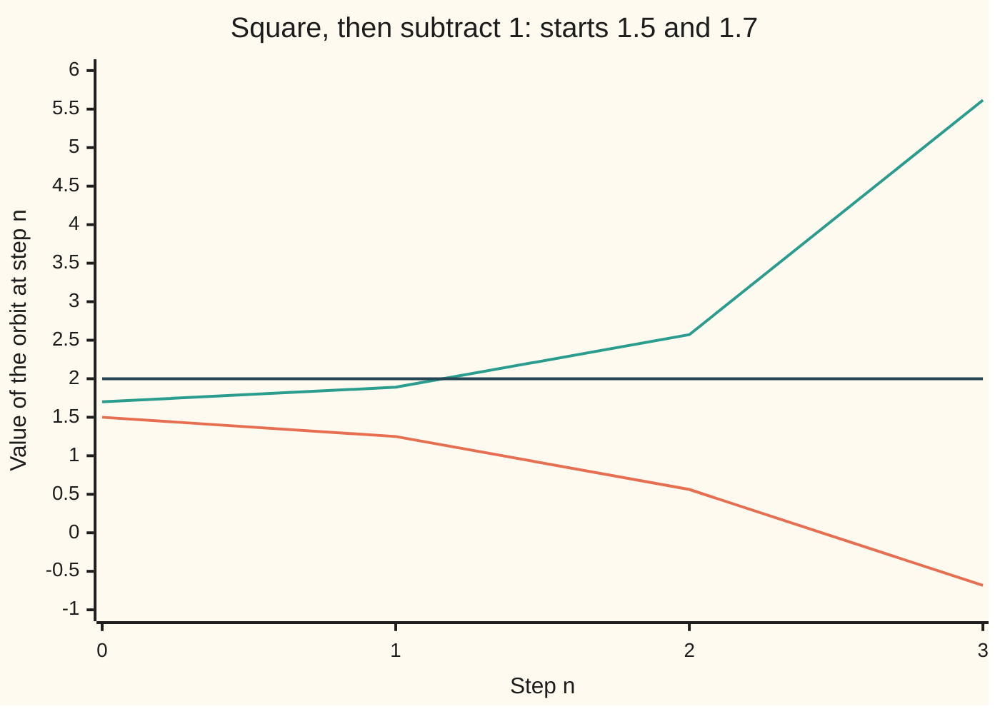

# Filled Julia sets: iterate z squared plus c, and the starting points that never escape usually have a fractal edge

[Syllabus](../../../SYLLABUS.md) → [Complex analysis](../README.md) → [Complex Dynamics](../README.md#s11) → Filled Julia sets

---

## General Overview

Take one rule: square the number, then subtract 1. Feed each answer back in. The list of answers is the **orbit**.

Start at 0 and the orbit is 0, −1, 0, −1, forever: a loop of two values, a **2-cycle**. Start at 2 and it runs off: 2, 3, 8, 63. Start at 1.5 and it wanders but stays small: 1.25, 0.5625, −0.683594, −0.532700, −0.716231. Start at 1.7 and it passes 2 at 2.5721, then jumps to 5.615698.

The same rule works on complex numbers, so every point of the plane is a start. Some orbits stay bounded forever; the rest run off to infinity. The starts that stay form a shape called the **filled Julia set**. Its edge is the **Julia set**: for most rules it is a fractal, a shape with detail at every scale.

A computer runs only finitely many steps, so it needs a test that proves escape when it fires. This card proves one: once the orbit is farther from 0 than both 2 and the length of the added constant, it never comes back.

**For the rule "square, then add c", an orbit that gets farther from 0 than both 2 and |c| runs off to infinity, so the starts whose orbits stay bounded form a closed, bounded set, the filled Julia set, and its edge is the Julia set.**

**What kind of fact this is:** the escape test is a theorem, proved on this card in Why it works. The filled Julia set and the Julia set are definitions. That the edge is a fractal for most c is a theorem stated from the sources, not proved here.

### The picture: two starts, one rule



The first line is the start 1.5, falling back towards the 2-cycle: by steps 999 and 1000 it reads −1 and 0 to every printed digit. The second is the start 1.7: it crosses the third line, the escape radius 2, at step 2 and never returns.

---

## The formula

The rule is a function $`f_c(z) = z^2 + c`$, read "f-sub-c of z": square $`z`$, then add the fixed complex number $`c`$. The orbit of a start $`z_0`$ is $`z_0, z_1, z_2, \dots`$, each the rule applied to the one before. Upright bars, $`\lvert z\rvert`$, are the **modulus**: the distance from 0 to $`z`$ ([Conjugate and modulus](../01-Complex%20Numbers%20and%20the%20Plane/02-conjugate-and-modulus.md)).

```math
z_{n+1} = z_n^2 + c, \qquad \lvert z_n\rvert > R = \max(2, \lvert c\rvert) \implies \lvert z_{n+k}\rvert \ge \lambda^k\,\lvert z_n\rvert \text{ with } \lambda = \lvert z_n\rvert - 1 > 1
```

**Read it aloud:** once the orbit is farther out than both 2 and the length of c, each step multiplies its distance from 0 by more than 1, so it runs off.

The two sets it defines:

```math
K_c = \{\, z_0 : \lvert z_n\rvert \le R \text{ for every } n \,\}, \qquad J_c = \partial K_c
```

**Read it aloud:** the filled Julia set is every start whose orbit never passes the escape radius; the Julia set is its boundary.

Here $`\partial`$ means **boundary**: the points whose every small disc meets both the set and its outside ([Limits and regions in the plane](../01-Complex%20Numbers%20and%20the%20Plane/06-complex-limits-series-and-regions.md)). By the escape test, "never passes R" means "stays bounded".

| Symbol | Plain meaning | In our example | Push it up and the answer… |
| --- | --- | --- | --- |
| $`c`$ | the fixed complex number added after squaring | −1 | the set changes shape; past length 2 it falls apart |
| $`z_0`$, $`z_n`$, $`n`$, $`k`$ | the start; the orbit's value after $`n`$ steps; $`k`$ more steps after that | start 1.7; $`z_2`$ = 2.5721 | past $`R`$, larger $`\lvert z_n\rvert`$ raises the growth bound |
| $`f_c`$ | the rule: square, then add $`c`$ | $`f_{-1}(1.7)`$ = 1.89 | — |
| $`R`$ | escape radius: the larger of 2 and $`\lvert c\rvert`$ | 2 | a looser, still correct test |
| $`\lambda`$ | the least growth factor per step once past $`R`$ | 1.5721 at $`z_2`$ | faster escape |
| $`K_c`$ | the filled Julia set: starts whose orbits stay bounded | on the real line, −1.618034 to 1.618034 | — |
| $`J_c`$, $`\partial`$ | the Julia set: the boundary of $`K_c`$ | contains ±1.618034 | — |
| $`\varphi`$ | the golden ratio $`(1 + \sqrt 5)/2`$, the edge on the real line | 1.618034 | — |

### When it holds

- **The radius is the larger of 2 and $`\lvert c\rvert`$.** With radius 2 alone and $`c = 6`$, the point 0.5 + 2.397916i has length 2.449490, yet the rule sends it to itself.
- **The test is strict: farther than R, not at R.** With $`c = -2`$ the start 2 has length exactly 2 and stays there: 2, 2, 2.
- **The test proves escape; silence proves nothing.** The start 1.6181 waits 8 steps before it leaves (see The usual mistake).

---

## Why it works

### Step 0: squaring a big number outruns any fixed push

Squaring 10 gives 100; adding a number of length 6 removes at most 6, leaving at least 94. Far from 0, squaring outruns $`c`$. The proof finds where "far" starts.

### Step 1: one step, bounded below

The modulus multiplies: $`\lvert z^2\rvert = \lvert z\rvert^2`$. The **reverse triangle inequality** says two points' distances from 0 differ by at most the distance between them ([Conjugate and modulus](../01-Complex%20Numbers%20and%20the%20Plane/02-conjugate-and-modulus.md)). Applied to $`z^2`$ and $`-c`$:

```math
\lvert z^2 + c\rvert \ge \lvert z\rvert^2 - \lvert c\rvert \ge \lvert z\rvert^2 - \lvert z\rvert = \lvert z\rvert\,(\lvert z\rvert - 1)
```

The second inequality needs $`\lvert c\rvert \le \lvert z\rvert`$: that is why $`\lvert c\rvert`$ enters the radius.

### Step 2: the growth compounds

Put $`\lambda = \lvert z_n\rvert - 1`$. Since $`\lvert z_n\rvert > 2`$, $`\lambda > 1`$. Step 1 gives $`\lvert z_{n+1}\rvert \ge \lambda \lvert z_n\rvert > \lvert z_n\rvert`$, so the next point is also past $`R`$, with a factor at least as big. Repeating, $`\lvert z_{n+k}\rvert \ge \lambda^k \lvert z_n\rvert`$, which grows without bound.

For the start 1.7: $`z_2`$ = 2.5721, so $`\lambda`$ = 1.5721. The bound says $`\lvert z_3\rvert \ge`$ 2.5721 × 1.5721 = 4.043598. The real value is 5.615698.

So the filled Julia set lies inside the closed disc of radius $`R`$: it is **bounded**.

### Step 3: c = 0 by hand

With $`c = 0`$ the rule only squares, and lengths multiply, so $`\lvert z_n\rvert = \lvert z_0\rvert^{2^n}`$. Starts shorter than 1 shrink to 0, starts of length 1 stay on the circle, and longer starts grow without bound.

So $`K_0`$ is the closed unit disc, and its boundary $`J_0`$ is the unit circle. A second road: the code tests a 201 × 201 grid of starts, 0.015 apart. 13965 stay, which covers an area of 3.1421, against π = 3.1416 for the disc.

### Step 4: the edge on the real line for c = −1

Real starts stay real, so the real line can be solved exactly. The edge is the **golden ratio** $`\varphi`$ = 1.618034, the positive root of $`x^2 - 1 = x`$. It is a fixed point: the rule sends it to itself.

- **Inside:** if $`-\varphi \le x \le \varphi`$, then $`x^2 - 1`$ lies between −1 and $`\varphi^2 - 1 = \varphi`$. The interval maps into itself, so these orbits stay bounded.
- **Outside:** if $`x > \varphi`$, then $`x^2 - 1 - \varphi = x^2 - \varphi^2 = (x - \varphi)(x + \varphi)`$. The gap above $`\varphi`$ is multiplied by more than $`2\varphi`$ each step, until it passes 2.

Negative starts follow, since $`(-x)^2 = x^2`$. So the filled Julia set meets the real line from −1.618034 to 1.618034: 1.5 is inside, 1.7 outside. The second road is bisection: halving the gap between a start that stays and one that escapes, 40 times, lands on 1.618034 with no algebra.

### Step 5: the Julia set is where nearby starts disagree

Near the edge, starts 0.0001 apart have opposite fates: 1.6180 stays for 1000 steps, while 1.6181 escapes at step 8. That is what boundary means: every small disc round a point of $`J_c`$ holds starts of both kinds.

The escaping starts form an **open set**: each has a small disc round it that also escapes. So $`K_c`$ is **closed**: it contains its boundary (proof in the fold).

<details>
<summary>Detailed proof: the filled Julia set is closed and the rule maps it to itself</summary>

Suppose the start $`w_0`$ escapes, so some $`\lvert w_n\rvert > R`$. The value after $`n`$ steps is a polynomial in the start, so it moves continuously with it. Starts close enough to $`w_0`$ also pass $`R`$ at step $`n`$, and Step 2 sends them off.

So the escaping starts form an open set, and $`K_c`$, the rest of the plane, is closed. By Step 2 it lies inside the disc of radius $`R`$, so it is bounded.

The orbit of $`f_c(z_0)`$ is the orbit of $`z_0`$ without its first point, so:

$`\displaystyle z_0 \in K_c \iff f_c(z_0) \in K_c`$

Since $`f_c(-z) = f_c(z)`$, both sets are symmetric through 0.

</details>

For most $`c`$ the Julia set is a fractal: the rule, applied enough times, stretches any small piece over the whole set. For $`c = -1`$ it is a chain of bubbles pinched together at infinitely many points. Measuring its dimension, in the sense of [Fractals](../../05-Geometry%20and%20trig/07-Points%2C%20Convexity%20and%20Fractals/05-self-similarity-and-fractal-dimension.md), is beyond this card.

---

## Worked numbers, by hand

| Step | Arithmetic | Value |
| --- | --- | --- |
| the 2-cycle | 0² − 1, then (−1)² − 1 | −1, then 0 |
| start 2 | 2² − 1, 3² − 1, 8² − 1 | 3, 8, 63 |
| start 1.5 | 1.5² − 1, 1.25² − 1, 0.5625² − 1 | 1.25, 0.5625, −0.683594 |
| start 1.7, steps 1 and 2 | 1.7² − 1, 1.89² − 1 | 1.89, 2.5721 |
| past the radius? | 2.5721 > max(2, 1) = 2 | yes, at step 2 |
| the guaranteed growth | 2.5721 × (2.5721 − 1) | at least 4.043598 |
| the real next value | 2.5721² − 1 | **5.615698** |
| the edge on the real line | (1 + √5) / 2 | **1.618034** |

The start 1.7 is outside the filled Julia set for c = −1, proved at step 2; 1.5 is inside, below the edge 1.618034.

### What breaks if you drop a piece

| Mistake | Comes out at | What went wrong |
| --- | --- | --- |
| Radius 2 when c = 6 | 0.5 + 2.397916i "escaped", though it never moves | $`\lvert c\rvert`$ = 6 exceeds 2, so Step 1's second inequality fails |
| Testing "at least 2" with c = −2 | start 2 "escaped", though it stays at 2 | the growth factor $`\lambda`$ is 1, not more than 1 |
| Stopping after 5 steps | 1.6181 counted inside, at 1.641536 | it escapes at step 8: silence proves nothing |

---

## Code, from first principles, and it actually runs

The code iterates the rule using only square roots, sines and cosines from the library. It takes three roads: bisection by escape test against the golden ratio, a grid of starts against the area of the unit disc, and the escape inequality by brute force on 69360 pairs of a point and a constant.

### Python

```python
# Filled Julia sets -- the check behind the card.  Standard library only.
# The map is f(z) = z*z + c.  Road one: iterate and watch for |z| > max(2, |c|).
# Road two: exact algebra -- the golden-ratio edge for c = -1, the unit disc for c = 0.
import math

def orbit(z, c, steps):                     # z, f(z), f(f(z)), ... as a list
    out = [z]
    for _ in range(steps):
        out.append(out[-1] * out[-1] + c)
    return out

def escape_step(z, c, cap):                 # first n with |z_n| > max(2, |c|), else None
    r = max(2.0, abs(c))
    for n in range(cap + 1):
        if abs(z) > r:
            return n
        z = z * z + c
    return None
def row(zs):                                # orbits printed here are all real
    return ", ".join(f"{z.real:.6f}" for z in zs)
print(f"c = -1, start 0: {row(orbit(0j, -1, 4))}")
print(f"c = -1, start 2: {row(orbit(2 + 0j, -1, 3))}")
a, b, o = orbit(1.5 + 0j, -1, 6), orbit(1.7 + 0j, -1, 3), orbit(1.5 + 0j, -1, 1000)
print(f"start 1.5: {row(a)}")
print(f"start 1.5: largest |z_n| over 1000 steps {max(abs(z) for z in o):.6f}; steps 999 and 1000: {row(o[-2:])}")
print(f"start 1.7: {row(b)}; first beyond 2 at step {escape_step(1.7 + 0j, -1, 50)}")
bound = abs(b[2]) * (abs(b[2]) - 1)
print(f"escape lemma at step 2: |z_3| >= {abs(b[2]):.4f} x {abs(b[2]) - 1:.4f} = {bound:.6f}; actual {abs(b[3]):.6f}")
worst = min(abs(z * z + c) / (abs(z) * (abs(z) - 1))
            for c in (complex(x / 2, y / 2) for x in range(-8, 9) for y in range(-8, 9))
            for k in range(1, 11) for t in range(24)
            for z in [max(2, abs(c)) * (1 + k / 10) * complex(math.cos(t * math.pi / 12), math.sin(t * math.pi / 12))])
print(f"lemma on 69360 pairs (z, c) with |z| > max(2, |c|): smallest |f(z)| / (|z|(|z| - 1)) = {worst:.6f}")
lo, hi = 1.5, 1.7                          # bisection: 1.5 stays, 1.7 escapes
for _ in range(40):
    mid = (lo + hi) / 2
    lo, hi = (lo, mid) if escape_step(mid + 0j, -1, 1000) is not None else (mid, hi)
phi = (1 + math.sqrt(5)) / 2
print(f"edge of the filled set on the real line, by bisection: {lo:.6f}; golden ratio (1 + sqrt 5)/2 = {phi:.6f}")
near, stays = escape_step(1.6181 + 0j, -1, 1000), escape_step(1.618 + 0j, -1, 1000) is None
print(f"near the edge: start 1.6180 stays for 1000 steps: {'yes' if stays else 'no'}; start 1.6181 escapes at step {near}")
h, inside = 0.015, 0
for i in range(-100, 101):
    for j in range(-100, 101):
        inside += escape_step(complex(i * h, j * h), 0, 40) is None
print(f"c = 0 on a 201 x 201 grid, spacing {h}: {inside} points stay; area {inside * h * h:.4f}; unit disc pi = {math.pi:.4f}")
z6 = complex(0.5, math.sqrt(23) / 2)       # a root of z*z - z + 6 = 0: a fixed point for c = 6
w6 = z6 * z6 + 6
print(f"mistake 1, radius 2 when c = 6: z = {z6.real:.6f} + {z6.imag:.6f}i has |z| = {abs(z6):.6f} > 2, "
      f"yet f(z) = {w6.real:.6f} + {w6.imag:.6f}i: it never moves")
print(f"mistake 2, >= 2 instead of > 2, c = -2: start 2 gives {row(orbit(2 + 0j, -2, 3))}")
print(f"mistake 3, stop after 5 steps: 1.6181 is at {orbit(1.6181 + 0j, -1, 5)[5].real:.6f}, not out yet, but escapes at step {near}")
assert [z.real for z in orbit(0j, -1, 4)] == [0, -1, 0, -1, 0]            # the 2-cycle
assert abs(b[3].real - 5.61569841) < 1e-12 and escape_step(1.7 + 0j, -1, 50) == 2
assert escape_step(1.5 + 0j, -1, 1000) is None and abs(b[3]) >= bound and abs(w6 - z6) < 1e-12
assert escape_step(z6, 6, 10) is None and escape_step(2 + 0j, -2, 50) is None  # mistakes 1, 2 stay
assert worst >= 1 and abs(o[-1]) < 1e-9                                   # the lemma; 1.5 lands on the cycle
assert abs(lo - phi) < 1e-9 and stays and near == 8                         # bisection meets the algebra
assert abs(inside * h * h - math.pi) < 0.05                               # the grid meets the unit disc
print("ALL CHECKS PASS")
```

**Ran 2026-11-23 on macOS, Python 3.14.10, standard library only. All checks passed. Output, pasted from the run:**

```
c = -1, start 0: 0.000000, -1.000000, 0.000000, -1.000000, 0.000000
c = -1, start 2: 2.000000, 3.000000, 8.000000, 63.000000
start 1.5: 1.500000, 1.250000, 0.562500, -0.683594, -0.532700, -0.716231, -0.487013
start 1.5: largest |z_n| over 1000 steps 1.500000; steps 999 and 1000: -1.000000, 0.000000
start 1.7: 1.700000, 1.890000, 2.572100, 5.615698; first beyond 2 at step 2
escape lemma at step 2: |z_3| >= 2.5721 x 1.5721 = 4.043598; actual 5.615698
lemma on 69360 pairs (z, c) with |z| > max(2, |c|): smallest |f(z)| / (|z|(|z| - 1)) = 1.021865
edge of the filled set on the real line, by bisection: 1.618034; golden ratio (1 + sqrt 5)/2 = 1.618034
near the edge: start 1.6180 stays for 1000 steps: yes; start 1.6181 escapes at step 8
c = 0 on a 201 x 201 grid, spacing 0.015: 13965 points stay; area 3.1421; unit disc pi = 3.1416
mistake 1, radius 2 when c = 6: z = 0.500000 + 2.397916i has |z| = 2.449490 > 2, yet f(z) = 0.500000 + 2.397916i: it never moves
mistake 2, >= 2 instead of > 2, c = -2: start 2 gives 2.000000, 2.000000, 2.000000, 2.000000
mistake 3, stop after 5 steps: 1.6181 is at 1.641536, not out yet, but escapes at step 8
ALL CHECKS PASS
```

### Rust

Same numbers, same labels, built with `rustc --edition 2021 -O`. A pair of floats stands in for a complex number.

```rust
// Filled Julia sets -- the same check as the Python, in Rust.  No crates.
// The map is f(z) = z*z + c.  Road one: iterate and watch for |z| > max(2, |c|).
// Road two: exact algebra -- the golden-ratio edge for c = -1, the unit disc for c = 0.
use std::f64::consts::PI;
type C = (f64, f64);                          // a complex number as (real, imaginary)

fn f(z: C, c: C) -> C { (z.0 * z.0 - z.1 * z.1 + c.0, 2.0 * z.0 * z.1 + c.1) }
fn modulus(z: C) -> f64 { z.0.hypot(z.1) }

fn orbit(z: C, c: C, steps: usize) -> Vec<C> {    // z, f(z), f(f(z)), ... as a list
    let mut out = vec![z];
    for _ in 0..steps { let last = *out.last().unwrap(); out.push(f(last, c)) }
    out
}

fn escape_step(mut z: C, c: C, cap: usize) -> Option<usize> {   // first n beyond the radius
    let r = modulus(c).max(2.0);
    for n in 0..=cap {
        if modulus(z) > r { return Some(n) }
        z = f(z, c);
    }
    None
}

fn row(zs: &[C]) -> String {                  // orbits printed here are all real
    zs.iter().map(|z| format!("{:.6}", z.0)).collect::<Vec<_>>().join(", ")
}

fn main() {
    let (m1, re) = ((-1.0, 0.0), |x: f64| (x, 0.0));
    println!("c = -1, start 0: {}", row(&orbit(re(0.0), m1, 4)));
    println!("c = -1, start 2: {}", row(&orbit(re(2.0), m1, 3)));
    let (a, b) = (orbit(re(1.5), m1, 6), orbit(re(1.7), m1, 3));
    println!("start 1.5: {}", row(&a));
    let o = orbit(re(1.5), m1, 1000); let big = o.iter().map(|&z| modulus(z)).fold(0.0, f64::max);
    println!("start 1.5: largest |z_n| over 1000 steps {:.6}; steps 999 and 1000: {}", big, row(&o[999..]));
    println!("start 1.7: {}; first beyond 2 at step {}", row(&b), escape_step(re(1.7), m1, 50).unwrap());
    let (b2, b3) = (modulus(b[2]), modulus(b[3]));
    let bound = b2 * (b2 - 1.0);
    println!("escape lemma at step 2: |z_3| >= {:.4} x {:.4} = {:.6}; actual {:.6}", b2, b2 - 1.0, bound, b3);
    let (mut worst, mut pairs) = (f64::INFINITY, 0);
    for x in -8..=8 { for y in -8..=8 { for k in 1..=10 { for t in 0..24 {
        let c = (x as f64 / 2.0, y as f64 / 2.0);
        let (r, th) = (modulus(c).max(2.0) * (1.0 + k as f64 / 10.0), t as f64 * PI / 12.0);
        let z = (r * th.cos(), r * th.sin());
        worst = worst.min(modulus(f(z, c)) / (modulus(z) * (modulus(z) - 1.0)));
        pairs += 1;
    }}}}
    println!("lemma on {} pairs (z, c) with |z| > max(2, |c|): smallest |f(z)| / (|z|(|z| - 1)) = {:.6}", pairs, worst);
    let (mut lo, mut hi) = (1.5_f64, 1.7_f64);   // bisection: 1.5 stays, 1.7 escapes
    for _ in 0..40 {
        let mid = (lo + hi) / 2.0;
        if escape_step(re(mid), m1, 1000).is_some() { hi = mid } else { lo = mid }
    }
    let phi = (1.0 + 5f64.sqrt()) / 2.0;
    println!("edge of the filled set on the real line, by bisection: {:.6}; golden ratio (1 + sqrt 5)/2 = {:.6}", lo, phi);
    let near = escape_step(re(1.6181), m1, 1000).unwrap();
    let stays = escape_step(re(1.618), m1, 1000).is_none();
    println!("near the edge: start 1.6180 stays for 1000 steps: {}; start 1.6181 escapes at step {}", if stays { "yes" } else { "no" }, near);
    let (h, mut inside) = (0.015, 0);
    for i in -100..=100 { for j in -100..=100 {
        if escape_step((i as f64 * h, j as f64 * h), (0.0, 0.0), 40).is_none() { inside += 1 }
    }}
    println!("c = 0 on a 201 x 201 grid, spacing {}: {} points stay; area {:.4}; unit disc pi = {:.4}", h, inside, inside as f64 * h * h, PI);
    let z6 = (0.5, 23f64.sqrt() / 2.0);           // a root of z*z - z + 6 = 0: a fixed point for c = 6
    let w6 = f(z6, (6.0, 0.0));
    println!("mistake 1, radius 2 when c = 6: z = {:.6} + {:.6}i has |z| = {:.6} > 2, yet f(z) = {:.6} + {:.6}i: it never moves",
             z6.0, z6.1, modulus(z6), w6.0, w6.1);
    println!("mistake 2, >= 2 instead of > 2, c = -2: start 2 gives {}", row(&orbit(re(2.0), (-2.0, 0.0), 3)));
    println!("mistake 3, stop after 5 steps: 1.6181 is at {:.6}, not out yet, but escapes at step {}", orbit(re(1.6181), m1, 5)[5].0, near);
    assert!(orbit(re(0.0), m1, 4).iter().map(|z| z.0).collect::<Vec<_>>() == vec![0.0, -1.0, 0.0, -1.0, 0.0]);
    assert!((b[3].0 - 5.61569841).abs() < 1e-12 && escape_step(re(1.7), m1, 50) == Some(2));
    assert!(escape_step(re(1.5), m1, 1000).is_none() && b3 >= bound && modulus((w6.0 - z6.0, w6.1 - z6.1)) < 1e-12);
    assert!(escape_step(z6, (6.0, 0.0), 10).is_none() && escape_step(re(2.0), (-2.0, 0.0), 50).is_none()); // mistakes 1, 2 stay
    assert!(worst >= 1.0 && modulus(o[1000]) < 1e-9);              // the lemma; 1.5 lands on the cycle
    assert!((lo - phi).abs() < 1e-9 && stays && near == 8);       // bisection meets the algebra
    assert!((inside as f64 * h * h - PI).abs() < 0.05);           // the grid meets the unit disc
    println!("ALL CHECKS PASS");
}
```

**Ran 2026-11-23 on macOS, rustc 1.98.1, no crates. All checks passed. Output, pasted from the run:**

```
c = -1, start 0: 0.000000, -1.000000, 0.000000, -1.000000, 0.000000
c = -1, start 2: 2.000000, 3.000000, 8.000000, 63.000000
start 1.5: 1.500000, 1.250000, 0.562500, -0.683594, -0.532700, -0.716231, -0.487013
start 1.5: largest |z_n| over 1000 steps 1.500000; steps 999 and 1000: -1.000000, 0.000000
start 1.7: 1.700000, 1.890000, 2.572100, 5.615698; first beyond 2 at step 2
escape lemma at step 2: |z_3| >= 2.5721 x 1.5721 = 4.043598; actual 5.615698
lemma on 69360 pairs (z, c) with |z| > max(2, |c|): smallest |f(z)| / (|z|(|z| - 1)) = 1.021865
edge of the filled set on the real line, by bisection: 1.618034; golden ratio (1 + sqrt 5)/2 = 1.618034
near the edge: start 1.6180 stays for 1000 steps: yes; start 1.6181 escapes at step 8
c = 0 on a 201 x 201 grid, spacing 0.015: 13965 points stay; area 3.1421; unit disc pi = 3.1416
mistake 1, radius 2 when c = 6: z = 0.500000 + 2.397916i has |z| = 2.449490 > 2, yet f(z) = 0.500000 + 2.397916i: it never moves
mistake 2, >= 2 instead of > 2, c = -2: start 2 gives 2.000000, 2.000000, 2.000000, 2.000000
mistake 3, stop after 5 steps: 1.6181 is at 1.641536, not out yet, but escapes at step 8
ALL CHECKS PASS
```

### Lean

Lean proves the escape test and the filled Julia set's shape for every complex c, and solves c = 0 exactly.

- Suppose at some step $`n`$ the orbit's modulus $`\lvert z_n\rvert`$ is more than $`R = \max(2, \lvert c\rvert)`$. Then $`\lvert z_{n+k}\rvert \ge \lambda^k\,\lvert z_n\rvert`$ for every $`k`$, where $`\lambda = \lvert z_n\rvert - 1`$. So the orbit runs off to infinity.
- The filled Julia set $`K_c`$ is exactly the set of starts whose orbits stay bounded.
- $`K_c`$ is closed and lies inside the closed disc of radius $`R`$, so it is bounded.
- A start lies in $`K_c`$ exactly when its image under $`f_c`$ does, and $`K_c`$ is symmetric through 0.
- Take $`c = 0`$. Then $`K_0`$ is the closed unit disc, and its boundary $`J_0`$ is the unit circle.
- For "square, then subtract 1", 0 and −1 form a 2-cycle, and the start 2 runs 3, 8, 63.
- The start 1.5 goes to 1.25, 0.5625, then exactly −0.68359375.
- The start 1.7 goes to 1.89, then 2.5721, past the radius 2 at step 2.
- The guaranteed growth 2.5721 × 1.5721 = 4.04359841 is below the real next value 5.61569841.
- Take $`c = -2`$. Then the start 2 stays at 2.
- Take the rule "square, then subtract 1". Then the golden ratio is a fixed point: $`\varphi^2 - 1 = \varphi`$.

The edge 1.618034, bisection, the grid, 1.6181's late escape and the c = 6 mistake are left to the Python and Rust checks.

```lean
-- Filled Julia sets: for the rule z ↦ z² + c, an orbit that gets farther from 0 than both 2 and |c| runs off to infinity, so the starts with bounded orbits form a closed, bounded set, which for c = 0 is the closed unit disc with the unit circle as its edge.
import Mathlib.Analysis.Complex.Basic
import Mathlib.Analysis.Normed.Group.Bounded
import Mathlib.Topology.Order.Basic
import Mathlib.NumberTheory.Real.GoldenRatio
import Mathlib.Tactic.NormNum
import Mathlib.Analysis.SpecificLimits.Basic
import Mathlib.Analysis.Normed.Module.RCLike.Real

open Filter Metric Set

/-- **The escape test.** Iterate the rule f(z) = z² + c from a start z₀, giving the orbit
z₀, z₁, z₂, …, where zₙ is f applied n times. If at some step n the orbit is strictly farther
from 0 than both 2 and |c|, then from there on each step multiplies its distance from 0 by at
least λ = |zₙ| − 1 > 1: |zₙ₊ₖ| ≥ λᵏ · |zₙ| for every k. So the orbit runs off to infinity:
|zₘ| grows without bound as m grows. -/
theorem escape_past_radius (c z₀ : ℂ) (n : ℕ)
    (h : max 2 ‖c‖ < ‖(fun z : ℂ => z ^ 2 + c)^[n] z₀‖) :
    (∀ k : ℕ, (‖(fun z : ℂ => z ^ 2 + c)^[n] z₀‖ - 1) ^ k * ‖(fun z : ℂ => z ^ 2 + c)^[n] z₀‖
        ≤ ‖(fun z : ℂ => z ^ 2 + c)^[n + k] z₀‖) ∧
      Tendsto (fun m : ℕ => ‖(fun z : ℂ => z ^ 2 + c)^[m] z₀‖) atTop atTop := by
  set r := ‖(fun z : ℂ => z ^ 2 + c)^[n] z₀‖ with hr
  have h2 : (2 : ℝ) < r := lt_of_le_of_lt (le_max_left _ _) h
  have hc : ‖c‖ < r := lt_of_le_of_lt (le_max_right _ _) h
  have key : ∀ k : ℕ, (r - 1) ^ k * r ≤ ‖(fun z : ℂ => z ^ 2 + c)^[n + k] z₀‖ := by
    intro k
    induction k with
    | zero => simp [hr]
    | succ k ih =>
      set y := (fun z : ℂ => z ^ 2 + c)^[n + k] z₀ with hy
      have hpow : (1 : ℝ) ≤ (r - 1) ^ k := one_le_pow₀ (by linarith)
      have hyr : r ≤ ‖y‖ := le_trans (by nlinarith) ih
      have hstep : (fun z : ℂ => z ^ 2 + c)^[n + (k + 1)] z₀ = y ^ 2 + c := by
        rw [← add_assoc, Function.iterate_succ_apply']
      rw [hstep]
      have h1 : ‖y ^ 2‖ - ‖c‖ ≤ ‖y ^ 2 + c‖ := by
        have := norm_sub_le (y ^ 2 + c) c
        rw [add_sub_cancel_right] at this
        linarith
      rw [norm_pow] at h1
      have hy0 : 0 ≤ ‖y‖ := norm_nonneg _
      have : (r - 1) ^ (k + 1) * r = ((r - 1) ^ k * r) * (r - 1) := by ring
      rw [this]
      have hA : ((r - 1) ^ k * r) * (r - 1) ≤ ‖y‖ * (r - 1) :=
        mul_le_mul_of_nonneg_right ih (by linarith)
      nlinarith
  refine ⟨key, ?_⟩
  have hlim : Tendsto (fun k : ℕ => (r - 1) ^ k * r) atTop atTop :=
    (tendsto_pow_atTop_atTop_of_one_lt (by linarith : (1 : ℝ) < r - 1)).atTop_mul_const
      (by linarith)
  have hk : Tendsto (fun k : ℕ => ‖(fun z : ℂ => z ^ 2 + c)^[k + n] z₀‖) atTop atTop := by
    refine tendsto_atTop_mono (fun k => ?_) hlim
    rw [add_comm]; exact key k
  exact (tendsto_add_atTop_iff_nat (f := fun m : ℕ => ‖(fun z : ℂ => z ^ 2 + c)^[m] z₀‖) n).1 hk

/-- **The filled Julia set is closed and bounded.** For the rule f(z) = z² + c, let K be the
filled Julia set: the starts whose orbit never passes the escape radius R = max(2, |c|). Then
K is exactly the set of starts whose orbit stays bounded; K is closed; K lies inside the closed
disc of radius R, so it is bounded; a start is in K exactly when its image f(z) is; and K is
symmetric through 0. -/
theorem filled_julia_set_closed_bounded (c : ℂ) :
    let K : Set ℂ := {z | ∀ n : ℕ, ‖(fun w : ℂ => w ^ 2 + c)^[n] z‖ ≤ max 2 ‖c‖}
    K = {z | BddAbove (range fun n : ℕ => ‖(fun w : ℂ => w ^ 2 + c)^[n] z‖)} ∧
      IsClosed K ∧ K ⊆ closedBall 0 (max 2 ‖c‖) ∧ Bornology.IsBounded K ∧
      (∀ z, z ^ 2 + c ∈ K ↔ z ∈ K) ∧ (∀ z, -z ∈ K ↔ z ∈ K) := by
  intro K
  set f : ℂ → ℂ := fun w : ℂ => w ^ 2 + c with hf
  set R : ℝ := max 2 ‖c‖ with hR
  have hK : ∀ z, z ∈ K ↔ ∀ n : ℕ, ‖f^[n] z‖ ≤ R := fun z => Iff.rfl
  have hbig : ∀ z, R < ‖z‖ → R < ‖f z‖ := by
    intro z hz
    have := (escape_past_radius c z 0 (by rw [Function.iterate_zero_apply]; exact hz)).1 1
    simp only [Function.iterate_zero, id, zero_add, Function.iterate_one, pow_one] at this
    have h2 : (2 : ℝ) < ‖z‖ := lt_of_le_of_lt (le_max_left _ _) hz
    have : ‖z‖ ≤ ‖f z‖ := le_trans (by nlinarith) this
    linarith
  have hfK : ∀ z, f z ∈ K ↔ z ∈ K := by
    intro z
    rw [hK, hK]
    constructor
    · intro H n
      cases n with
      | zero =>
        simp only [Function.iterate_zero, id]
        by_contra hz
        have := hbig z (lt_of_not_ge hz)
        have h0 := H 0
        simp only [Function.iterate_zero, id] at h0
        linarith
      | succ n =>
        rw [Function.iterate_succ_apply]
        exact H n
    · intro H n
      rw [← Function.iterate_succ_apply]
      exact H (n + 1)
  refine ⟨?_, ?_, ?_, ?_, hfK, ?_⟩
  · ext z
    simp only [mem_ofPred_eq]
    constructor
    · intro H
      exact ⟨R, by rintro _ ⟨n, rfl⟩; exact H n⟩
    · intro H n
      by_contra hn
      have := (escape_past_radius c z n (lt_of_not_ge hn)).2
      exact not_bddAbove_of_tendsto_atTop this H
  · have : K = ⋂ n : ℕ, {z | ‖f^[n] z‖ ≤ R} := by
      ext z; simp [hK]
    rw [this]
    refine isClosed_iInter fun n => ?_
    have hc : Continuous f := by rw [hf]; fun_prop
    exact isClosed_le ((hc.iterate n).norm) continuous_const
  · intro z hz
    have := hz 0
    simpa only [Function.iterate_zero_apply, mem_closedBall_zero_iff] using this
  · refine (Metric.isBounded_closedBall (x := (0 : ℂ)) (r := R)).subset ?_
    intro z hz
    have := hz 0
    simpa only [Function.iterate_zero_apply, mem_closedBall_zero_iff] using this
  · intro z
    have : f (-z) = f z := by simp [hf]
    rw [← hfK, this, hfK]

/-- **The case c = 0 by hand.** For the rule f(z) = z², which only squares, the filled Julia
set (starts whose orbit never passes the escape radius max(2, 0) = 2) is the closed unit disc
|z| ≤ 1, and the Julia set, its boundary, is the unit circle |z| = 1. -/
theorem filled_julia_set_of_zero :
    let K : Set ℂ := {z | ∀ n : ℕ, ‖(fun w : ℂ => w ^ 2 + 0)^[n] z‖ ≤ max 2 ‖(0 : ℂ)‖}
    K = closedBall 0 1 ∧ frontier K = sphere 0 1 := by
  intro K
  have hit : ∀ (n : ℕ) (z : ℂ), (fun w : ℂ => w ^ 2 + 0)^[n] z = z ^ (2 ^ n) := by
    intro n
    induction n with
    | zero => intro z; simp
    | succ n ih =>
      intro z
      rw [Function.iterate_succ_apply', ih, add_zero, ← pow_mul, pow_succ]
  have hmax : max 2 ‖(0 : ℂ)‖ = (2 : ℝ) := by simp
  have hKeq : K = closedBall 0 1 := by
    ext z
    rw [mem_closedBall_zero_iff]
    show (∀ n : ℕ, ‖(fun w : ℂ => w ^ 2 + 0)^[n] z‖ ≤ max 2 ‖(0 : ℂ)‖) ↔ ‖z‖ ≤ 1
    simp only [hit, hmax, norm_pow]
    constructor
    · intro H
      by_contra hz
      rw [not_le] at hz
      obtain ⟨m, hm⟩ := ((tendsto_pow_atTop_atTop_of_one_lt hz).eventually_gt_atTop 2).exists
      have hle : ‖z‖ ^ m ≤ ‖z‖ ^ (2 ^ m) :=
        pow_le_pow_right₀ hz.le (Nat.lt_two_pow_self).le
      linarith [H m]
    · intro hz n
      have : ‖z‖ ^ (2 ^ n) ≤ 1 := pow_le_one₀ (norm_nonneg _) hz
      linarith
  refine ⟨hKeq, ?_⟩
  rw [hKeq]
  exact frontier_closedBall (0 : ℂ) one_ne_zero

-- The card's exact worked numbers, for the rule "square, then subtract 1" (c = −1).
-- The 2-cycle: 0 goes to −1 and back to 0.
example : (0 : ℤ) ^ 2 - 1 = -1 ∧ (-1 : ℤ) ^ 2 - 1 = 0 := by norm_num
example : ((fun z : ℂ => z ^ 2 + (-1))^[2]) 0 = 0 := by norm_num
-- Start 2 runs off: 2, 3, 8, 63.
example : (2 : ℤ) ^ 2 - 1 = 3 ∧ (3 : ℤ) ^ 2 - 1 = 8 ∧ (8 : ℤ) ^ 2 - 1 = 63 := by norm_num
-- Start 1.5 = 3/2: 1.25, 0.5625, then −0.68359375 (printed −0.683594).
example : ((3 : ℚ) / 2) ^ 2 - 1 = 5 / 4 ∧ ((5 : ℚ) / 4) ^ 2 - 1 = 9 / 16 ∧
    ((9 : ℚ) / 16) ^ 2 - 1 = -175 / 256 := by norm_num
-- Start 1.7 = 17/10: 1.89, then 2.5721, past the radius max(2, 1) = 2 at step 2.
example : ((17 : ℚ) / 10) ^ 2 - 1 = 189 / 100 ∧ ((189 : ℚ) / 100) ^ 2 - 1 = 25721 / 10000 ∧
    max 2 1 < (25721 : ℚ) / 10000 := by norm_num
-- The guaranteed growth 2.5721 × 1.5721 = 4.04359841 is below the real next value 5.61569841.
example : (25721 : ℚ) / 10000 * (25721 / 10000 - 1) = 404359841 / 100000000 ∧
    ((25721 : ℚ) / 10000) ^ 2 - 1 = 561569841 / 100000000 ∧
    (404359841 : ℚ) / 100000000 ≤ 561569841 / 100000000 := by norm_num
-- Mistake 2: with c = −2 the start 2 stays at 2 (length exactly 2, not more).
example : (2 : ℤ) ^ 2 - 2 = 2 := by norm_num
-- The edge on the real line for c = −1 is the golden ratio φ, a fixed point: φ² − 1 = φ.
example : Real.goldenRatio ^ 2 - 1 = Real.goldenRatio := by
  rw [Real.goldenRatio_sq]; norm_num

#print axioms escape_past_radius
#print axioms filled_julia_set_closed_bounded
#print axioms filled_julia_set_of_zero
```

**Checked 2026-11-23 on macOS, Lean 4.36.0-rc2, Mathlib v4.36.0-rc2. Every proof is complete and uses only Lean's standard axioms. Output, pasted from the run:**

```
'escape_past_radius' depends on axioms: [propext, Classical.choice, Quot.sound]
'filled_julia_set_closed_bounded' depends on axioms: [propext, Classical.choice, Quot.sound]
'filled_julia_set_of_zero' depends on axioms: [propext, Classical.choice, Quot.sound]
```

> [!TIP]
> **Try changing**
> Guess first, then run it.
> - **Fewer halvings.** Change `range(40)` to `range(10)`. Guess how close bisection gets: 1.617969, and the sixth assert stops it.
> - **A coarser grid.** In `h, inside = 0.015, 0`, change `0.015` to `0.03`. Guess the area. It reports 3.1545 from 3505 points: still within 0.05 of π, so every check passes.
> - **Radius 2 alone.** Change `max(2.0, abs(c))` to `2.0`. Guess which assert fails: the fourth, because the point that never moves for c = 6 now "escapes" at step 0.

---

## The usual mistake

> [!warning]
> **Treating "has not escaped yet" as "never escapes".** The test proves escape when it fires; quiet proves nothing. The start 1.6181 is still at 1.641536 after 5 steps and escapes at step 8. A computer picture with a step limit counts some late escapers as inside.
>
> - **Radius 2 for every c.** With c = 6, the point 0.5 + 2.397916i has length 2.449490 and never moves.
> - **"At least 2" instead of "more than 2".** With c = −2, the start 2 stays at 2 forever.
> - **The filled set for the Julia set.** For c = 0 the filled set is the disc, area 3.1416. The Julia set is only its rim, the unit circle.

---

## Where you meet it in real life

- **Fractal images.** Drawing programs run the escape test at every pixel and colour it by the step it fired: 1.7 gets colour 2, 1.6181 colour 8.
- **Root-finding.** Newton's method on complex guesses is a rule fed back into itself. A Julia set separates the guesses that reach each root.
- **Sensitive computations.** Near a Julia set, an input error of 0.0001 decides whether an orbit stays or leaves, as 1.6180 and 1.6181 show.

> **Say it back**
> Iterating "square, then add c" sends each start on an orbit that stays bounded or runs off. Once the orbit is farther from 0 than both 2 and the length of c, each step multiplies its distance by more than 1. The starts that stay form the filled Julia set, closed and bounded; its boundary is the Julia set. For c = 0 they are the unit disc and the unit circle. For c = −1 the set meets the real line from −1.618034 to 1.618034.

---

## What this builds on

- [Limits and regions in the plane](../01-Complex%20Numbers%20and%20the%20Plane/06-complex-limits-series-and-regions.md): bounded sets, open sets, boundaries and tending to infinity.
- [Conjugate and modulus](../01-Complex%20Numbers%20and%20the%20Plane/02-conjugate-and-modulus.md): lengths multiply, and the reverse triangle inequality behind the escape test.
- [Fractals](../../05-Geometry%20and%20trig/07-Points%2C%20Convexity%20and%20Fractals/05-self-similarity-and-fractal-dimension.md): self-similarity and a dimension that is not a whole number.

## Where this goes next

- [Attracting and repelling cycles](02-multipliers-and-the-fatou-and-julia-sets.md): why 1.5 falls onto the 2-cycle 0, −1, and why every repelling cycle lies in the Julia set.
- [The Mandelbrot set](03-the-mandelbrot-set.md): one picture of every c, sorted by whether the orbit of 0 escapes.
- [Iteration](../../08-Differential%20equations%20and%20dynamics/11-Discrete%20Dynamics%20and%20Chaos/01-iteration-and-cobweb-plots.md): feeding a rule back into itself on the real line, drawn as a staircase.
- [Fixed points of a map](../../08-Differential%20equations%20and%20dynamics/11-Discrete%20Dynamics%20and%20Chaos/02-fixed-points-of-a-map.md): why a fixed point such as 1.618034 pushes nearby starts away.

Left open: why does 1.5 fall onto the 2-cycle 0, −1 while starts near 1.618034 fly apart? Attracting and repelling cycles answers that next; The Mandelbrot set then answers which c give a one-piece filled Julia set.

---

## Sources

Verified 2026-11-23: every link below resolves to the publisher's page.

- Carleson, Lennart, and Theodore W. Gamelin. *Complex Dynamics*. Springer, 1993. [doi:10.1007/978-1-4612-4364-9](https://doi.org/10.1007/978-1-4612-4364-9). The escape radius, filled Julia sets and Julia sets of polynomials.
- Milnor, John. *Dynamics in One Complex Variable*, 3rd ed. Princeton University Press, 2006. [Publisher page](https://press.princeton.edu/books/paperback/9780691124889/dynamics-in-one-complex-variable). Julia sets as the boundary where nearby orbits disagree, and their fractal shape.
- Devaney, Robert L. *An Introduction to Chaotic Dynamical Systems*, 2nd ed. CRC Press reissue, 2018. [doi:10.4324/9780429502309](https://doi.org/10.4324/9780429502309). An introductory route through the quadratic family, Julia sets and their geometry.
