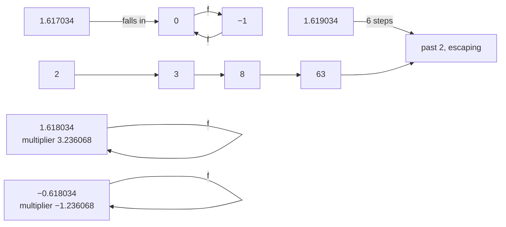

# Attracting and repelling cycles: the multiplier decides, and the Julia set is where the iterates stop being a normal family

[Syllabus](../../../SYLLABUS.md) → [Complex analysis](../README.md) → [Complex Dynamics](../README.md#s11) → Attracting and repelling cycles

---

## General Overview

Take the rule $`f(z) = z^2 - 1`$ and apply it over and over. Start at 0 and the values go 0, −1, 0, −1 for ever: a **cycle** (a list of points the rule visits in turn) of period 2. Start at 2 and they run off: 2, 3, 8, 63, 3968.

The rule also has two **fixed points** (points it sends to themselves): 1.618034 and −0.618034, the roots of $`z^2 - 1 = z`$. Start 0.001 above 1.618034 and the gap grows: 0.003237, then 0.010486, and after 6 steps the value is past 2 and escaping. Start 0.001 below it and the orbit falls onto the cycle 0, −1.

One number predicts this: the **multiplier**, the slope of the rule repeated round the cycle. At 1.618034 it is 3.236068, so nearby gaps triple. Round 0, −1 it is $`0 \times (-2) = 0`$, so nearby gaps vanish fast.

Where nearby starts part ways for good is the **Julia set**. The calm rest is the **Fatou set**.

**A cycle attracts when its multiplier is smaller than 1 in size and repels when larger; the Julia set is where the repeats of the rule stop forming a normal family, every repelling cycle lies in it, and every attracting cycle of z² + c pulls in the point 0, so there is at most one.**

**What kind of fact this is:** the multiplier, the Fatou set and the Julia set are definitions; the rest are theorems, proved on this card in Why it works.

### The picture: the orbits of z² − 1



Two starts 0.002 apart, either side of 1.618034, end in different places.

---

## The formula

Notation first, in words. $`f^n`$ means $`f`$ applied n times, not a power: $`f^2(z) = (z^2 - 1)^2 - 1`$. A cycle of period k is a list $`z_0, z_1, \ldots, z_{k-1}`$ with $`f(z_j) = z_{j+1}`$ and $`f(z_{k-1}) = z_0`$. The slope of $`f(z) = z^2 + c`$ is $`f'(z) = 2z`$.

The multiplier of the cycle is the slope of $`f^k`$ at $`z_0`$. By the chain rule it is the product of the slopes along the cycle:

```math
\lambda = (f^k)'(z_0) = f'(z_0)\, f'(z_1) \cdots f'(z_{k-1}) = 2^k\, z_0 z_1 \cdots z_{k-1}
```

**Read it aloud:** the multiplier is the product of the slopes of the rule at each point of the cycle, which for z² + c is two to the period times the product of the points.

The product is the same from any starting point, so the multiplier belongs to the whole cycle. The cycle is:

- **attracting** when $`\lvert\lambda\rvert < 1`$, and **super-attracting** when $`\lambda = 0`$;
- **neutral** when $`\lvert\lambda\rvert = 1`$;
- **repelling** when $`\lvert\lambda\rvert > 1`$.

The **Fatou set** $`F`$ holds every point z with a small disc round it on which the repeats $`f, f^2, f^3, \ldots`$ form a **normal family**: every list taken from them has a sub-list that converges evenly on each closed disc inside, or runs off to infinity evenly there (wider than on [Normal families](../04-Taylor%20Series%2C%20Zeros%20and%20Rigidity/10-normal-families-montel-and-hurwitz.md), so escaping starts lie in F). The **Julia set** $`J`$ is every other point.

| Symbol | Plain meaning | In our example | Push it up and the answer… |
| --- | --- | --- | --- |
| $`f`$, $`z`$, $`c`$ | the rule $`z^2 + c`$; a point of the plane; the constant | $`z^2 - 1`$; c = −1 | — |
| $`f^n`$, $`n`$ | the rule applied n times; the count | $`f^2(0.1) = -0.0199`$ | — |
| $`p`$; $`z_0, \ldots, z_{k-1}`$; $`k`$ | a fixed point; the points of a cycle; its period | 1.618034; 0, −1; 2 | — |
| $`\lambda`$ | the multiplier: slope of $`f^k`$ round the cycle | 3.236068, −1.236068, 0 | above 1 in size, gaps grow |
| $`h`$, $`w`$ | a small gap from a cycle point; a point of a small circle round it, in the code | 0.001; size 0.001 | — |
| $`K`$, $`q`$ | the filled Julia set: starts whose orbits stay bounded; a point on its edge | holds 0 and −1, not 2; 1.618034 | — |
| $`F`$, $`J`$ | the Fatou set; the Julia set | 0 is in F; 1.618034 is in J | — |
| $`G`$, $`A`$, $`g_n`$, $`U`$, $`r`$, $`R`$ | $`f^k`$; the basin of p under G; a branch of the inverse of $`G^n`$; a disc round p; its radius; a bound on K | for c = 0.2: k = 1, r = 0.1, R = 2 | larger r, smaller cap R/r |

### When it holds

- **A cycle, not just any point.** The test needs $`f^k(z_0) = z_0`$; elsewhere the slope of $`f^n`$ predicts nothing.
- **The product round the whole cycle.** One point's slope misleads: $`f'(-1) = -2`$ looks repelling, but the cycle's multiplier is 0.
- **Size not equal to 1.** A neutral cycle can attract very slowly, or not at all: for c = −0.75 the fixed point −0.5 has multiplier −1, and a gap of 0.1 is still 0.021965 after 1000 steps.
- **One critical point.** "At most one" uses that $`f' = 2z`$ vanishes only at 0. A cubic, with two, can have two attracting cycles.

---

## Why it works

### Step 0: near a fixed point the rule multiplies gaps

For $`f(z) = z^2 + c`$ the expansion round a fixed point p is exact:

```math
f(p + h) = p + 2p\,h + h^2 = p + \lambda h + h^2
```

**Read it aloud:** a gap h from the fixed point becomes the multiplier times h, plus h squared.

For a small gap, $`h^2`$ is tiny, so each step multiplies the gap by about λ. Once $`|h| < (1 - |\lambda|)/2`$, $`|\lambda h + h^2| \le (|\lambda| + |h|)\,|h| < \frac{1 + |\lambda|}{2}\,|h|`$, a fixed fraction of the old gap; for $`|\lambda| > 1`$ the bound turned round makes the gap grow. At 1.618034 the gap 0.001 becomes 0.003237, then 0.010486, 0.034043, 0.111324, 0.372645. At −0.618034 the gap flips sign and grows by 1.236068 a step: −0.001235, 0.001528, −0.001887.

For a cycle, apply the same idea to $`f^k`$, whose slope is λ by the chain rule. Round 0, −1, $`f^2(h) = h^4 - 2h^2`$: the gap is squared each round trip. From 0.1 the values are −0.0199000, −0.0007919, −0.0000013. That is super-attraction.

### Step 1: repelling cycles lie in the Julia set

Suppose the repeats of f were a normal family on a disc round the repelling fixed point p. Pick a sub-list $`f^{n_1}, f^{n_2}, \ldots`$ that converges evenly near p. It cannot run off to infinity, because every $`f^n(p) = p`$. So it converges to a holomorphic limit, and the slopes converge too ([Limits of holomorphic functions](../04-Taylor%20Series%2C%20Zeros%20and%20Rigidity/02-uniform-limits-of-holomorphic-functions.md)).

But the slope of $`f^n`$ at p is $`\lambda^n`$. At 1.618034 that is 354.9 for n = 5, 125943.7 for n = 10 and 15861809082.7 for n = 20. These have no finite limit, so the family is not normal there: p is in J. For a cycle of period k, run the same argument on $`f^k`$.

An attracting fixed point lies in F. A small disc round it maps inside itself, so every repeat stays bounded there, and Montel's theorem makes the family normal.

### Step 2: the Julia set is the edge of the filled Julia set

The filled Julia set K holds every start whose orbit stays bounded. On [Filled Julia sets](01-filled-julia-sets-and-escape.md), any orbit that passes size $`R = \max(2, \lvert c\rvert)`$ runs off, so K sits inside $`\lvert z\rvert \le R`$.

- **Outside K.** Nearby orbits all pass R and run off together. The point is in F.
- **Inside K, with a disc of K round it.** Every repeat stays within R there, so Montel makes them normal. The point is in F.
- **On the edge of K.** Every disc round the point q holds starts that escape. A sub-list converging near q cannot run off, since $`f^n(q)`$ stays within R. So its limit is finite, and it stays bounded on a small disc round q. But an escaping start in that disc grows without bound along it. The point is in J.

So J is exactly the edge of K. The repelling point 1.618034 is such an edge point: 1.619034 escapes after 6 steps, and 1.617034 lands on the cycle.

### Step 3: an attracting cycle pulls in the critical point 0

The **critical point** of f is where its slope is 0: here $`f'(z) = 2z`$, so only z = 0.

If λ = 0, some $`2z_j`$ is 0, so 0 is on the cycle. That is the c = −1 case: the cycle is 0, −1.

If $`0 < \lvert\lambda\rvert < 1`$, the argument runs backwards. Undo the rule near the cycle. The undo multiplies gaps by $`1/\lambda`$, which is larger than 1 in size. If the orbit of 0 did not converge to the cycle, the undo of $`f^n`$ would exist on a whole disc of radius r round the cycle for every n, with values inside $`\lvert z\rvert \le R`$. Cauchy's estimate caps its slope at R/r ([Derivatives from the boundary](../03-Contour%20Integrals%20and%20Cauchy%27s%20Theorem/06-derivatives-from-the-boundary.md)), but the slope is $`1/\lambda^n`$, which grows past any cap.

For c = 0.2 the attracting fixed point is 0.276393, with multiplier 0.552786. A disc of radius 0.1 round it maps into itself, and K lies within 2, so the cap is 2/0.1 = 20. The undo's slope is 19.4 at n = 5 and 35.0 at n = 6, already past the cap. So 0 must be pulled in, and it is: after 100 steps its orbit sits at 0.276393.

<details>
<summary>Detailed proof: the inverse-branch argument for z² + c</summary>

Let the cycle have period k and multiplier λ with $`0 < \lvert\lambda\rvert < 1`$. Write $`G = f^k`$ and let p be a point of the cycle, so $`G(p) = p`$ and $`G'(p) = \lambda`$. Let A be the **basin** of p: the starts whose G-orbits converge to p. A start is in A exactly when its image under G is, and A contains a disc U of radius r round p with $`G(U)`$ inside U.

Suppose the f-orbit of 0 does not converge to the cycle. By the chain rule the slope of G at z is

$`\displaystyle G'(z) = 2^k\, z\, f(z) \cdots f^{k-1}(z),`$

so G's critical points are the starts that reach 0 within k − 1 steps. None of them is in A, or 0 would be pulled in. Every critical value of $`G^n`$ is the image of such a point under a power of G, so none lies in A either.

A polynomial with no critical value in a disc has an inverse branch on the whole disc: start from the local inverse at one point and continue it along paths, which never fails, and the disc has no holes ([The monodromy theorem](../04-Taylor%20Series%2C%20Zeros%20and%20Rigidity/09-monodromy-theorem.md)). So for each n there is a holomorphic $`g_n`$ on U with $`G^n(g_n(z)) = z`$ and $`g_n(p) = p`$.

Since $`G^n`$ sends $`g_n(U)`$ into U, which lies in A, every $`g_n`$ takes values in A, inside K, so $`\lvert g_n\rvert \le R`$. Cauchy's estimate on the circle of radius r gives

$`\displaystyle \lvert g_n'(p)\rvert \le \frac{R}{r}.`$

Differentiating $`G^n(g_n(z)) = z`$ at p gives $`\lambda^n g_n'(p) = 1`$, so $`\lvert g_n'(p)\rvert = \lvert\lambda\rvert^{-n}`$, which grows without bound. The two cannot both hold, so the orbit of 0 converges to the cycle.

</details>

### Step 4: so z² + c has at most one attracting cycle

Each attracting cycle pulls in the orbit of 0, and one orbit converges to at most one cycle.

A second road, by brute force: the periodic points of period dividing n are the $`2^n`$ roots of $`f^n(z) - z = 0`$. For c = −1 the code finds all 2, 4, 8 and 16 roots for n = 1 to 4. Only the points 0 and −1 have multiplier below 1 in size.

---

## Worked numbers, by hand

| Step | Arithmetic | Value |
| --- | --- | --- |
| Fixed points of $`z^2 - 1`$ | $`(1 \pm \sqrt 5)/2`$ | 1.618034, −0.618034 |
| Their multipliers | $`2p`$ | 3.236068, −1.236068 |
| Cycle 0, −1 | $`f(0) = -1`$, $`f(-1) = 0`$ | period 2 |
| Its multiplier | $`f'(0)\, f'(-1) = 0 \times (-2)`$ | **0** |
| Gap 0.001 at 1.618034, one step | $`3.236068 \times 0.001 + 0.001^2`$ | 0.003237 |
| Slope of $`f^{10}`$ at 1.618034 | $`3.236068^{10}`$ | 125943.7 |
| Attracting cycles up to period 4 | roots of $`f^n(z) - z`$ with size of λ below 1 | **one: 0, −1** |

The cycle 0, −1 is super-attracting; both fixed points repel, so they lie in the Julia set.

### What breaks if you drop a piece

| Mistake | Comes out at | What went wrong |
| --- | --- | --- |
| One point's slope for the cycle | $`f'(-1) = -2`$: "repelling" | the multiplier is the product, 0 |
| Iterating the 6-digit value 1.618034 | leaves $`\lvert z\rvert \le 2`$ after 15 steps | rounding error is multiplied by 3.236068 each step |
| Calling a neutral point attracting | c = −0.75, gap 0.1 still 0.021965 after 1000 steps | multiplier −1 gives no shrink factor |

---

## Code, from first principles, and it actually runs

Two roads reach each multiplier: the chain-rule product, and Cauchy's formula, averaging $`(f^k(p + w) - p)/w`$ over 64 points of a circle of radius 0.001. For "at most one", Durand-Kerner root-finding (all roots improved together) finds every root of $`f^n(z) - z`$ for n = 1 to 4, and each root's multiplier is tested. On c = 0.2 the orbit of 0 is followed to the attracting fixed point.

### Python

```python
# Multipliers and the Fatou and Julia sets -- the check behind the card.  Standard library only.
# f(z) = z^2 + c, mostly c = -1.  Multipliers by the chain rule against Cauchy's formula on a small
# circle; gaps followed step by step; every cycle up to period 4 found by Durand-Kerner root-finding.
import cmath, math

def f(z, c=-1): return z * z + c
def cl(x): return round(x, 12) + 0.0             # clears float dust and the sign of -0.0
def it(z, n, c=-1):                               # f applied n times
    for _ in range(n): z = f(z, c)
    return z
def chain(z, k, c=-1):                            # multiplier of f^k at z: product of f' = 2z along the orbit
    m = 1
    for _ in range(k): m, z = m * 2 * z, f(z, c)
    return m + 0.0
def cauchy(p, k, r=1e-3, m=64):                   # road two: average of (f^k(p + w) - p)/w round |w| = r
    ws = [r * cmath.exp(2j * math.pi * j / m) for j in range(m)]
    return cl(sum((it(p + w, k) - p) / w for w in ws).real / m)
def escape(z, c=-1):                              # steps until |z| > 2, or -1 if 500 steps never leave
    for n in range(500):
        if abs(z) > 2: return n
        z = f(z, c)
    return -1
def periodic(n, c=-1):                            # all 2^n roots of f^n(z) - z, by Durand-Kerner
    r = [(0.4 + 0.9j) ** k for k in range(2 ** n)]
    for _ in range(500):
        r = [a - (it(a, n, c) - a) / math.prod(a - b for j, b in enumerate(r) if j != i) for i, a in enumerate(r)]
    return r
s = lambda v, d=6: ", ".join(f"{x:.{d}f}" for x in v)
p, q = (1 + math.sqrt(5)) / 2, (1 - math.sqrt(5)) / 2
print(f"orbit of 0: {s([it(0, n) for n in range(5)], 0)}; orbit of 2: {s([it(2, n) for n in range(5)], 0)}")
print(f"fixed points (1 +/- sqrt 5)/2: {s([p, q])}; multipliers 2p: {s([chain(p, 1), chain(q, 1)])}")
print(f"the same by Cauchy's formula on |w| = 0.001: {s([cauchy(p, 1), cauchy(q, 1)])}")
print(f"2-cycle 0, -1: multiplier f'(0) f'(-1) = 0 x -2 = {chain(0, 2):.6f}; by Cauchy's formula: {cauchy(0, 2):.6f}")
print(f"gap from 1.618034 + 0.001, steps 1 to 5: {s([it(p + 1e-3, n) - p for n in range(1, 6)])}")
print(f"gap from -0.618034 + 0.001, steps 1 to 5: {s([it(q + 1e-3, n) - q for n in range(1, 6)])}")
print(f"from 0.1, two steps at a time: {s([it(0.1, n) for n in (2, 4, 6)], 7)}")
near = abs(it(p - 1e-3, 100)) < 1e-12 or abs(it(p - 1e-3, 101)) < 1e-12
print(f"1.618034 + 0.001 leaves |z| <= 2 after {escape(p + 1e-3)} steps; 1.618034 - 0.001 ends on the cycle: {'yes' if near else 'no'}")
print(f"slope of f^n at 1.618034, n = 5, 10, 20: {s([chain(p, n) for n in (5, 10, 20)], 1)}")
roots = [periodic(n) for n in (1, 2, 3, 4)]
att = [[z for z in r if abs(chain(z, n + 1)) < 1] for n, r in enumerate(roots)]
print(f"roots of f^n(z) - z, n = 1 to 4: {[len(r) for r in roots]}; with |multiplier| < 1: {[len(a) for a in att]}")
print(f"those points, n = 2 and 4: {s(sorted(cl(z.real) for z in att[1] + att[3]))}")
pc = (1 - math.sqrt(1 - 4 * 0.2)) / 2
print(f"c = 0.2: fixed point {pc:.6f}, multiplier {chain(pc, 1, 0.2):.6f}; orbit of 0 at step 100: {it(0, 100, 0.2):.6f}")
print(f"c = 0.2: Cauchy cap 2/0.1 = {2 / 0.1:.1f}; 1/|multiplier|^n, n = 5, 6: {s([1 / chain(pc, n, 0.2) for n in (5, 6)], 1)}")
print(f"mistake 1: one point's slope f'(-1) = {chain(-1, 1):.1f} reads repelling; the product is {chain(-1, 2):.1f}")
print(f"mistake 2: iterating the 6-digit value 1.618034 leaves |z| <= 2 after {escape(1.618034)} steps")
print(f"mistake 3: c = -0.75, fixed point -0.5, multiplier {chain(-0.5, 1, -0.75):.1f}: gap 0.1 after 1000 steps "
      f"{abs(it(-0.4, 1000, -0.75) + 0.5):.6f}")
assert all(abs(chain(z, 1) - cauchy(z, 1)) < 1e-9 for z in (p, q)) and abs(cauchy(0, 2)) < 1e-9
assert [len(a) for a in att] == [0, 2, 0, 2] and all(abs(it(z, 4) - z) < 1e-9 for z in roots[3])
assert escape(p + 1e-3) == 6 and near and escape(1.618034) == 15 and escape(2) == 1
assert abs(it(0, 100, 0.2) - pc) < 1e-12 and abs(chain(pc, 1, 0.2) - (1 - math.sqrt(0.2))) < 1e-12
print("ALL CHECKS PASS")
```

**Ran 2026-11-23 on macOS, Python 3.14.10, standard library only. All checks passed. Output, pasted from the run:**

```
orbit of 0: 0, -1, 0, -1, 0; orbit of 2: 2, 3, 8, 63, 3968
fixed points (1 +/- sqrt 5)/2: 1.618034, -0.618034; multipliers 2p: 3.236068, -1.236068
the same by Cauchy's formula on |w| = 0.001: 3.236068, -1.236068
2-cycle 0, -1: multiplier f'(0) f'(-1) = 0 x -2 = 0.000000; by Cauchy's formula: 0.000000
gap from 1.618034 + 0.001, steps 1 to 5: 0.003237, 0.010486, 0.034043, 0.111324, 0.372645
gap from -0.618034 + 0.001, steps 1 to 5: -0.001235, 0.001528, -0.001887, 0.002335, -0.002881
from 0.1, two steps at a time: -0.0199000, -0.0007919, -0.0000013
1.618034 + 0.001 leaves |z| <= 2 after 6 steps; 1.618034 - 0.001 ends on the cycle: yes
slope of f^n at 1.618034, n = 5, 10, 20: 354.9, 125943.7, 15861809082.7
roots of f^n(z) - z, n = 1 to 4: [2, 4, 8, 16]; with |multiplier| < 1: [0, 2, 0, 2]
those points, n = 2 and 4: -1.000000, -1.000000, 0.000000, 0.000000
c = 0.2: fixed point 0.276393, multiplier 0.552786; orbit of 0 at step 100: 0.276393
c = 0.2: Cauchy cap 2/0.1 = 20.0; 1/|multiplier|^n, n = 5, 6: 19.4, 35.0
mistake 1: one point's slope f'(-1) = -2.0 reads repelling; the product is 0.0
mistake 2: iterating the 6-digit value 1.618034 leaves |z| <= 2 after 15 steps
mistake 3: c = -0.75, fixed point -0.5, multiplier -1.0: gap 0.1 after 1000 steps 0.021965
ALL CHECKS PASS
```

### Rust

Same numbers, same labels, built with `rustc --edition 2021 -O`.

```rust
// Multipliers and the Fatou and Julia sets -- the same check as the Python, in Rust.  No crates.
// f(z) = z^2 + c, mostly c = -1.  Multipliers by the chain rule against Cauchy's formula on a small
// circle; gaps followed step by step; every cycle up to period 4 found by Durand-Kerner root-finding.
use std::f64::consts::PI;
#[derive(Clone, Copy)]
struct C { re: f64, im: f64 }
fn c(re: f64, im: f64) -> C { C { re, im } }
fn r(x: f64) -> C { c(x, 0.0) }
fn add(a: C, b: C) -> C { c(a.re + b.re, a.im + b.im) }
fn sub(a: C, b: C) -> C { c(a.re - b.re, a.im - b.im) }
fn mul(a: C, b: C) -> C { c(a.re * b.re - a.im * b.im, a.re * b.im + a.im * b.re) }
fn div(a: C, b: C) -> C { let m = b.re * b.re + b.im * b.im; c((a.re * b.re + a.im * b.im) / m, (a.im * b.re - a.re * b.im) / m) }
fn md(a: C) -> f64 { a.re.hypot(a.im) }
fn cl(x: f64) -> f64 { (x * 1e12).round() / 1e12 + 0.0 } // clears float dust and the sign of -0.0
fn f(z: C, k: f64) -> C { add(mul(z, z), r(k)) }
fn it(mut z: C, n: usize, k: f64) -> C { for _ in 0..n { z = f(z, k) } z } // f applied n times
fn chain(mut z: C, n: usize, k: f64) -> C { // multiplier of f^n at z: product of f' = 2z along the orbit
    let mut m = r(1.0);
    for _ in 0..n { m = mul(m, mul(r(2.0), z)); z = f(z, k) }
    add(m, r(0.0))
}
fn cauchy(p: f64, n: usize) -> f64 { // road two: average of (f^n(p + w) - p)/w round |w| = 0.001
    let s: f64 = (0..64).map(|j| { let t = 2.0 * PI * j as f64 / 64.0; let w = c(1e-3 * t.cos(), 1e-3 * t.sin());
        div(sub(it(add(r(p), w), n, -1.0), r(p)), w).re }).sum();
    cl(s / 64.0)
}
fn escape(mut z: C, k: f64) -> i64 { // steps until |z| > 2, or -1 if 500 steps never leave
    for n in 0..500 { if md(z) > 2.0 { return n } z = f(z, k) }
    -1
}
fn periodic(n: usize) -> Vec<C> { // all 2^n roots of f^n(z) - z, by Durand-Kerner
    let mut rs: Vec<C> = (0..1usize << n).map(|k| (0..k).fold(r(1.0), |p, _| mul(p, c(0.4, 0.9)))).collect();
    for _ in 0..500 {
        rs = (0..rs.len()).map(|i| { let a = rs[i];
            let d = (0..rs.len()).filter(|&j| j != i).fold(r(1.0), |p, j| mul(p, sub(a, rs[j])));
            sub(a, div(sub(it(a, n, -1.0), a), d)) }).collect();
    }
    rs
}
fn s(v: &[f64], d: usize) -> String { v.iter().map(|x| format!("{:.*}", d, x)).collect::<Vec<_>>().join(", ") }
fn yn(b: bool) -> &'static str { if b { "yes" } else { "no" } }
fn main() {
    let (p, q) = ((1.0 + 5f64.sqrt()) / 2.0, (1.0 - 5f64.sqrt()) / 2.0);
    let o0: Vec<f64> = (0..5).map(|n| it(r(0.0), n, -1.0).re).collect();
    let o2: Vec<f64> = (0..5).map(|n| it(r(2.0), n, -1.0).re).collect();
    println!("orbit of 0: {}; orbit of 2: {}", s(&o0, 0), s(&o2, 0));
    println!("fixed points (1 +/- sqrt 5)/2: {}; multipliers 2p: {}", s(&[p, q], 6), s(&[chain(r(p), 1, -1.0).re, chain(r(q), 1, -1.0).re], 6));
    println!("the same by Cauchy's formula on |w| = 0.001: {}", s(&[cauchy(p, 1), cauchy(q, 1)], 6));
    println!("2-cycle 0, -1: multiplier f'(0) f'(-1) = 0 x -2 = {:.6}; by Cauchy's formula: {:.6}", chain(r(0.0), 2, -1.0).re, cauchy(0.0, 2));
    let gp: Vec<f64> = (1..6).map(|n| it(r(p + 1e-3), n, -1.0).re - p).collect();
    let gq: Vec<f64> = (1..6).map(|n| it(r(q + 1e-3), n, -1.0).re - q).collect();
    println!("gap from 1.618034 + 0.001, steps 1 to 5: {}", s(&gp, 6));
    println!("gap from -0.618034 + 0.001, steps 1 to 5: {}", s(&gq, 6));
    println!("from 0.1, two steps at a time: {}", s(&[2, 4, 6].map(|n| it(r(0.1), n, -1.0).re), 7));
    let near = md(it(r(p - 1e-3), 100, -1.0)) < 1e-12 || md(it(r(p - 1e-3), 101, -1.0)) < 1e-12;
    println!("1.618034 + 0.001 leaves |z| <= 2 after {} steps; 1.618034 - 0.001 ends on the cycle: {}", escape(r(p + 1e-3), -1.0), yn(near));
    println!("slope of f^n at 1.618034, n = 5, 10, 20: {}", s(&[5, 10, 20].map(|n| chain(r(p), n, -1.0).re), 1));
    let roots: Vec<Vec<C>> = (1..5).map(periodic).collect();
    let att: Vec<Vec<C>> = roots.iter().enumerate().map(|(n, rs)| rs.iter().copied().filter(|&z| md(chain(z, n + 1, -1.0)) < 1.0).collect()).collect();
    println!("roots of f^n(z) - z, n = 1 to 4: {:?}; with |multiplier| < 1: {:?}", roots.iter().map(|v| v.len()).collect::<Vec<_>>(), att.iter().map(|v| v.len()).collect::<Vec<_>>());
    let mut pts: Vec<f64> = att[1].iter().chain(att[3].iter()).map(|z| cl(z.re)).collect();
    pts.sort_by(|a, b| a.partial_cmp(b).unwrap());
    println!("those points, n = 2 and 4: {}", s(&pts, 6));
    let pc = (1.0 - (1.0f64 - 4.0 * 0.2).sqrt()) / 2.0;
    println!("c = 0.2: fixed point {:.6}, multiplier {:.6}; orbit of 0 at step 100: {:.6}", pc, chain(r(pc), 1, 0.2).re, it(r(0.0), 100, 0.2).re);
    println!("c = 0.2: Cauchy cap 2/0.1 = {:.1}; 1/|multiplier|^n, n = 5, 6: {}", 2.0 / 0.1, s(&[5, 6].map(|n| 1.0 / chain(r(pc), n, 0.2).re), 1));
    println!("mistake 1: one point's slope f'(-1) = {:.1} reads repelling; the product is {:.1}", chain(r(-1.0), 1, -1.0).re, chain(r(-1.0), 2, -1.0).re);
    println!("mistake 2: iterating the 6-digit value 1.618034 leaves |z| <= 2 after {} steps", escape(r(1.618034), -1.0));
    println!("mistake 3: c = -0.75, fixed point -0.5, multiplier {:.1}: gap 0.1 after 1000 steps {:.6}", chain(r(-0.5), 1, -0.75).re, (it(r(-0.4), 1000, -0.75).re + 0.5).abs());
    assert!([p, q].iter().all(|&z| (chain(r(z), 1, -1.0).re - cauchy(z, 1)).abs() < 1e-9) && cauchy(0.0, 2).abs() < 1e-9);
    assert!(att.iter().map(|v| v.len()).collect::<Vec<_>>() == vec![0, 2, 0, 2] && roots[3].iter().all(|&z| md(sub(it(z, 4, -1.0), z)) < 1e-9));
    assert!(escape(r(p + 1e-3), -1.0) == 6 && near && escape(r(1.618034), -1.0) == 15 && escape(r(2.0), -1.0) == 1);
    assert!((it(r(0.0), 100, 0.2).re - pc).abs() < 1e-12 && (chain(r(pc), 1, 0.2).re - (1.0 - 0.2f64.sqrt())).abs() < 1e-12);
    println!("ALL CHECKS PASS");
}
```

**Ran 2026-11-23 on macOS, rustc 1.98.1, no crates. All checks passed. Output, pasted from the run:**

```
orbit of 0: 0, -1, 0, -1, 0; orbit of 2: 2, 3, 8, 63, 3968
fixed points (1 +/- sqrt 5)/2: 1.618034, -0.618034; multipliers 2p: 3.236068, -1.236068
the same by Cauchy's formula on |w| = 0.001: 3.236068, -1.236068
2-cycle 0, -1: multiplier f'(0) f'(-1) = 0 x -2 = 0.000000; by Cauchy's formula: 0.000000
gap from 1.618034 + 0.001, steps 1 to 5: 0.003237, 0.010486, 0.034043, 0.111324, 0.372645
gap from -0.618034 + 0.001, steps 1 to 5: -0.001235, 0.001528, -0.001887, 0.002335, -0.002881
from 0.1, two steps at a time: -0.0199000, -0.0007919, -0.0000013
1.618034 + 0.001 leaves |z| <= 2 after 6 steps; 1.618034 - 0.001 ends on the cycle: yes
slope of f^n at 1.618034, n = 5, 10, 20: 354.9, 125943.7, 15861809082.7
roots of f^n(z) - z, n = 1 to 4: [2, 4, 8, 16]; with |multiplier| < 1: [0, 2, 0, 2]
those points, n = 2 and 4: -1.000000, -1.000000, 0.000000, 0.000000
c = 0.2: fixed point 0.276393, multiplier 0.552786; orbit of 0 at step 100: 0.276393
c = 0.2: Cauchy cap 2/0.1 = 20.0; 1/|multiplier|^n, n = 5, 6: 19.4, 35.0
mistake 1: one point's slope f'(-1) = -2.0 reads repelling; the product is 0.0
mistake 2: iterating the 6-digit value 1.618034 leaves |z| <= 2 after 15 steps
mistake 3: c = -0.75, fixed point -0.5, multiplier -1.0: gap 0.1 after 1000 steps 0.021965
ALL CHECKS PASS
```

### Lean

Lean proves how the multiplier is built and what its size decides, for every c and every cycle of z² + c.

- Take a cycle $`z_0, \ldots, z_{k-1}`$ of period k. Then its multiplier λ is $`2^k z_0 z_1 \cdots z_{k-1}`$, the product of the slopes round it.
- Take a cycle. Then its multiplier is 0 exactly when the critical point 0 lies on it.
- Take a cycle. Then its multiplier is the same from every point of the cycle.
- Suppose a cycle through $`z_0`$ has λ smaller than 1 in size. Then every start near enough to $`z_0`$ converges to it under repeats of $`f^k`$.
- Suppose instead λ is larger than 1 in size. Then there is a disc round $`z_0`$ that every other start eventually leaves under repeats of $`f^k`$.
- Take a fixed point p and a gap h. Then $`f(p + h) = p + 2p\,h + h^2`$, exactly.
- Take c = −1. Then the cycle 0, −1 has multiplier $`0 \times (-2) = 0`$, and 2 runs off as 2, 3, 8, 63, 3968.
- Take c = −1 and a gap h from 0. Then two steps send it to $`h^4 - 2h^2`$.
- Take c = −1 again. Then its fixed points are $`(1 \pm \sqrt 5)/2`$, with multipliers $`1 \pm \sqrt 5`$, both larger than 1 in size.

The Fatou and Julia sets, the pull on 0 and the decimals are left to the proofs above and the Python and Rust checks.

```lean
-- Attracting and repelling cycles: for the rule z ↦ z² + c, a cycle whose multiplier (the slope of the rule repeated round the cycle) is smaller than 1 in size pulls nearby starts in and one larger than 1 pushes them out, the multiplier is 2^k times the product of the cycle's points and is the same from every point of the cycle, and it is 0 exactly when the critical point 0 lies on the cycle.
import Mathlib.Analysis.Calculus.Deriv.Comp
import Mathlib.Analysis.Calculus.Deriv.Pow
import Mathlib.Analysis.Complex.Basic
import Mathlib.Analysis.SpecialFunctions.Pow.Real
import Mathlib.Order.Filter.AtTopBot.Basic
import Mathlib.Tactic.LinearCombination
import Mathlib.Tactic.NormNum
import Mathlib.Analysis.SpecificLimits.Basic

/-! Setting, in the card's notation.
* The rule is `f z = z ^ 2 + c` on the complex numbers, written `fun z : ℂ => z ^ 2 + c`.
* `f^[n]` is `f` applied `n` times (Mathlib's `Nat.iterate`), not a power.
* A cycle of period `k` through `z₀` is `f^[k] z₀ = z₀`; its points are `zⱼ = f^[j] z₀`.
* The multiplier is the slope of `f^[k]` at `z₀`: `λ = deriv (f^[k]) z₀`.
* "Attracts" means every start near `z₀` has its `f^[k]`-orbit converge to `z₀`; "repels"
  means every start other than `z₀` itself is pushed out of a fixed disc round `z₀`.

Not stated here: the Fatou and Julia sets are defined by normal families that may run off to
infinity, which Mathlib does not define, and the theorem that every attracting cycle pulls in
the orbit of 0 needs inverse branches beyond what Mathlib has. Its super-attracting case
(multiplier 0 puts 0 on the cycle) is the second half of `multiplier_eq_two_pow_mul_prod`. -/

open Filter Topology

namespace MultipliersAndTheFatouAndJuliaSets

/-- Chain rule along the orbit: the slope of `f^[k]` at `z` is `2^k` times the product of the
first `k` points of the orbit of `z`. -/
theorem hasDerivAt_iterate_sq_add (c : ℂ) (k : ℕ) (z : ℂ) :
    HasDerivAt ((fun z : ℂ => z ^ 2 + c)^[k])
      (2 ^ k * ∏ j ∈ Finset.range k, (fun z : ℂ => z ^ 2 + c)^[j] z) z := by
  induction k with
  | zero => simpa using hasDerivAt_id z
  | succ k ih =>
    have hf : HasDerivAt (fun z : ℂ => z ^ 2 + c) (2 * (fun z : ℂ => z ^ 2 + c)^[k] z)
        ((fun z : ℂ => z ^ 2 + c)^[k] z) := by
      have := (hasDerivAt_pow 2 ((fun z : ℂ => z ^ 2 + c)^[k] z)).add_const c
      have e : ((2 : ℕ) : ℂ) * ((fun z : ℂ => z ^ 2 + c)^[k] z) ^ (2 - 1) =
          2 * (fun z : ℂ => z ^ 2 + c)^[k] z := by norm_num
      rw [e] at this
      exact this
    rw [Function.iterate_succ']
    convert hf.comp z ih using 1
    rw [Finset.prod_range_succ, pow_succ]
    ring

/-- Products of a `k`-periodic sequence over any `k` consecutive places agree. -/
theorem prod_shift_of_periodic (a : ℕ → ℂ) (k : ℕ) (ha : ∀ m, a (k + m) = a m) (m : ℕ) :
    ∏ j ∈ Finset.range k, a (j + m) = ∏ j ∈ Finset.range k, a j := by
  induction m with
  | zero => simp
  | succ m ih =>
    rw [← ih]
    cases k with
    | zero => simp
    | succ k =>
      rw [Finset.prod_range_succ, Finset.prod_range_succ' (fun j => a (j + m))]
      have h1 : k + (m + 1) = (k + 1) + m := by ring
      have h2 : ∀ j, j + (m + 1) = j + 1 + m := fun j => by ring
      rw [h1, ha m, zero_add]
      simp only [h2]

/-- **The multiplier decides.** Let `z₀` be a point of a cycle of period `k` of
`f(z) = z² + c`, so `f^[k] z₀ = z₀`, and let `λ` be the slope of `f^[k]` at `z₀`. If `λ` is
smaller than 1 in size, there is a disc round `z₀` from which every start has its
`f^[k]`-orbit converge to `z₀` (the cycle attracts). If `λ` is larger than 1 in size, there is
a disc of radius `δ > 0` round `z₀` that the `f^[k]`-orbit of every other start eventually
leaves (the cycle repels). -/
theorem cycle_attracts_or_repels_by_multiplier (c z₀ : ℂ) (k : ℕ)
    (hcycle : (fun z : ℂ => z ^ 2 + c)^[k] z₀ = z₀) :
    (‖deriv ((fun z : ℂ => z ^ 2 + c)^[k]) z₀‖ < 1 →
      ∃ δ > 0, ∀ z : ℂ, ‖z - z₀‖ < δ →
        Tendsto (fun n : ℕ => ((fun z : ℂ => z ^ 2 + c)^[k])^[n] z) atTop (𝓝 z₀)) ∧
    (1 < ‖deriv ((fun z : ℂ => z ^ 2 + c)^[k]) z₀‖ →
      ∃ δ > 0, ∀ z : ℂ, z ≠ z₀ →
        ∃ n : ℕ, δ < ‖((fun z : ℂ => z ^ 2 + c)^[k])^[n] z - z₀‖) := by
  set g := (fun z : ℂ => z ^ 2 + c)^[k] with hgdef
  set L := deriv g z₀ with hL
  have hd : HasDerivAt g L z₀ := (hasDerivAt_iterate_sq_add c k z₀).differentiableAt.hasDerivAt
  have ho := hasDerivAt_iff_isLittleO.mp hd
  -- local linear estimate
  have key : ∀ ε > 0, ∃ r > 0, ∀ w : ℂ, ‖w - z₀‖ < r →
      ‖(g w - z₀) - (w - z₀) * L‖ ≤ ε * ‖w - z₀‖ := by
    intro ε hε
    have := ho.def hε
    obtain ⟨r, hr, hball⟩ := Metric.eventually_nhds_iff.mp this
    refine ⟨r, hr, fun w hw => ?_⟩
    have := hball (by rwa [dist_eq_norm])
    simpa [hcycle, smul_eq_mul] using this
  constructor
  · intro hlt
    obtain ⟨r, hr, hb⟩ := key ((1 - ‖L‖) / 2) (by linarith)
    set μ := ‖L‖ + (1 - ‖L‖) / 2 with hμ
    have hμ0 : 0 ≤ μ := by have := norm_nonneg L; linarith
    have hμ1 : μ < 1 := by linarith
    have step : ∀ w : ℂ, ‖w - z₀‖ < r → ‖g w - z₀‖ ≤ μ * ‖w - z₀‖ := by
      intro w hw
      have h1 := hb w hw
      have h2 : g w - z₀ = (w - z₀) * L + ((g w - z₀) - (w - z₀) * L) := by ring
      have h3 := norm_add_le ((w - z₀) * L) ((g w - z₀) - (w - z₀) * L)
      rw [← h2, norm_mul] at h3
      rw [hμ]; nlinarith [norm_nonneg (w - z₀)]
    refine ⟨r, hr, fun z hz => ?_⟩
    have bound : ∀ n : ℕ, ‖g^[n] z - z₀‖ ≤ μ ^ n * ‖z - z₀‖ := by
      intro n
      induction n with
      | zero => simp
      | succ n ih =>
        rw [Function.iterate_succ_apply']
        have hpow : μ ^ n ≤ 1 := pow_le_one₀ hμ0 hμ1.le
        have hin : ‖g^[n] z - z₀‖ < r := by
          calc ‖g^[n] z - z₀‖ ≤ μ ^ n * ‖z - z₀‖ := ih
            _ ≤ 1 * ‖z - z₀‖ := by gcongr
            _ < r := by linarith
        calc ‖g (g^[n] z) - z₀‖ ≤ μ * ‖g^[n] z - z₀‖ := step _ hin
          _ ≤ μ * (μ ^ n * ‖z - z₀‖) := by gcongr
          _ = μ ^ (n + 1) * ‖z - z₀‖ := by ring
    rw [tendsto_iff_norm_sub_tendsto_zero]
    have hlim : Tendsto (fun n : ℕ => μ ^ n * ‖z - z₀‖) atTop (𝓝 0) := by
      simpa using (tendsto_pow_atTop_nhds_zero_of_lt_one hμ0 hμ1).mul_const ‖z - z₀‖
    exact squeeze_zero (fun n => norm_nonneg _) bound hlim
  · intro hgt
    obtain ⟨r, hr, hb⟩ := key ((‖L‖ - 1) / 2) (by linarith)
    set μ := ‖L‖ - (‖L‖ - 1) / 2 with hμ
    have hμ1 : 1 < μ := by linarith
    have step : ∀ w : ℂ, ‖w - z₀‖ < r → μ * ‖w - z₀‖ ≤ ‖g w - z₀‖ := by
      intro w hw
      have h1 := hb w hw
      have h2 : (w - z₀) * L = (g w - z₀) - ((g w - z₀) - (w - z₀) * L) := by ring
      have h3 := norm_sub_le (g w - z₀) ((g w - z₀) - (w - z₀) * L)
      rw [← h2, norm_mul] at h3
      rw [hμ]; nlinarith [norm_nonneg (w - z₀)]
    refine ⟨r / 2, by linarith, fun z hz => ?_⟩
    by_contra hcon
    push Not at hcon
    have hpos : 0 < ‖z - z₀‖ := norm_pos_iff.mpr (sub_ne_zero.mpr hz)
    have bound : ∀ n : ℕ, μ ^ n * ‖z - z₀‖ ≤ ‖g^[n] z - z₀‖ := by
      intro n
      induction n with
      | zero => simp
      | succ n ih =>
        rw [Function.iterate_succ_apply']
        have hin : ‖g^[n] z - z₀‖ < r := by linarith [hcon n]
        calc μ ^ (n + 1) * ‖z - z₀‖ = μ * (μ ^ n * ‖z - z₀‖) := by ring
          _ ≤ μ * ‖g^[n] z - z₀‖ := by gcongr
          _ ≤ ‖g (g^[n] z) - z₀‖ := step _ hin
    obtain ⟨n, hn⟩ := ((tendsto_pow_atTop_atTop_of_one_lt hμ1).eventually_gt_atTop
      ((r / 2) / ‖z - z₀‖)).exists
    have : r / 2 < μ ^ n * ‖z - z₀‖ := by
      rw [div_lt_iff₀ hpos] at hn; exact hn
    linarith [bound n, hcon n]

/-- **The multiplier is a product round the cycle.** By the chain rule, the slope of `f^[k]` at
`z₀` is the product of the slopes `f'(zⱼ) = 2 zⱼ` along the orbit, that is `2^k` times the
product of the points `z₀, z₁, …, z_{k-1}`. In particular it is 0 exactly when one of those
points is the critical point 0: a super-attracting cycle passes through 0. -/
theorem multiplier_eq_two_pow_mul_prod (c z₀ : ℂ) (k : ℕ) :
    deriv ((fun z : ℂ => z ^ 2 + c)^[k]) z₀ =
        2 ^ k * ∏ j ∈ Finset.range k, (fun z : ℂ => z ^ 2 + c)^[j] z₀ ∧
    (deriv ((fun z : ℂ => z ^ 2 + c)^[k]) z₀ = 0 ↔
        ∃ j < k, (fun z : ℂ => z ^ 2 + c)^[j] z₀ = 0) := by
  have hd := (hasDerivAt_iterate_sq_add c k z₀).deriv
  refine ⟨hd, ?_⟩
  rw [hd, mul_eq_zero, Finset.prod_eq_zero_iff]
  simp

/-- **The multiplier belongs to the whole cycle.** If `f^[k] z₀ = z₀`, then the slope of
`f^[k]` is the same at every point `zⱼ = f^[j] z₀` of the cycle as at `z₀`. -/
theorem multiplier_same_round_cycle (c z₀ : ℂ) (k j : ℕ)
    (hcycle : (fun z : ℂ => z ^ 2 + c)^[k] z₀ = z₀) :
    deriv ((fun z : ℂ => z ^ 2 + c)^[k]) ((fun z : ℂ => z ^ 2 + c)^[j] z₀) =
      deriv ((fun z : ℂ => z ^ 2 + c)^[k]) z₀ := by
  rw [(hasDerivAt_iterate_sq_add c k _).deriv, (hasDerivAt_iterate_sq_add c k _).deriv]
  congr 1
  have hrw : ∀ i : ℕ, (fun z : ℂ => z ^ 2 + c)^[i] ((fun z : ℂ => z ^ 2 + c)^[j] z₀) =
      (fun z : ℂ => z ^ 2 + c)^[i + j] z₀ := fun i => (Function.iterate_add_apply _ _ _ _).symm
  simp only [hrw]
  apply prod_shift_of_periodic (fun i => (fun z : ℂ => z ^ 2 + c)^[i] z₀)
  intro m
  show (fun z : ℂ => z ^ 2 + c)^[k + m] z₀ = (fun z : ℂ => z ^ 2 + c)^[m] z₀
  rw [add_comm, Function.iterate_add_apply, hcycle]

/-! The card's worked numbers for `c = -1`, exactly. -/

-- The orbit of 0 under z² − 1: 0 goes to −1 and back, a cycle of period 2.
example : (fun z : ℤ => z ^ 2 - 1) 0 = -1 ∧ (fun z : ℤ => z ^ 2 - 1) (-1) = 0 := by norm_num

-- The orbit of 2 runs off: 2, 3, 8, 63, 3968.
example : (fun z : ℤ => z ^ 2 - 1)^[1] 2 = 3 ∧ (fun z : ℤ => z ^ 2 - 1)^[2] 2 = 8 ∧
    (fun z : ℤ => z ^ 2 - 1)^[3] 2 = 63 ∧ (fun z : ℤ => z ^ 2 - 1)^[4] 2 = 3968 := by
  decide

-- The multiplier of the cycle 0, −1 is f'(0) f'(−1) = 0 × (−2) = 0: super-attracting.
example : (2 * 0 : ℤ) * (2 * (-1)) = 0 := by norm_num

-- One point's slope misleads: f'(−1) = −2 is larger than 1 in size.
example : |(2 * (-1) : ℤ)| = 2 := by norm_num

-- The fixed points (1 ± √5)/2 of z² − 1, with multipliers 2p = 1 ± √5.
example : ((1 + Real.sqrt 5) / 2) ^ 2 - 1 = (1 + Real.sqrt 5) / 2 ∧
    ((1 - Real.sqrt 5) / 2) ^ 2 - 1 = (1 - Real.sqrt 5) / 2 := by
  constructor <;> ring_nf <;> norm_num <;> ring

-- Both multipliers are larger than 1 in size, so both fixed points repel.
example : 1 < |2 * ((1 + Real.sqrt 5) / 2)| ∧ 1 < |2 * ((1 - Real.sqrt 5) / 2)| := by
  have h : (2 : ℝ) < Real.sqrt 5 := by
    rw [show (2 : ℝ) = Real.sqrt 4 by rw [show (4 : ℝ) = 2 ^ 2 by norm_num, Real.sqrt_sq (by norm_num)]]
    exact Real.sqrt_lt_sqrt (by norm_num) (by norm_num)
  constructor
  · rw [abs_of_pos (by positivity)]; linarith
  · rw [abs_of_neg (by linarith)]; linarith

-- Two steps round the cycle from a gap h: f²(h) = (h² − 1)² − 1 = h⁴ − 2h², so the gap is squared.
example (h : ℂ) : (h ^ 2 - 1) ^ 2 - 1 = h ^ 4 - 2 * h ^ 2 := by ring

-- Step 0: near a fixed point p (p² + c = p) one step sends p + h to p + 2p·h + h², exactly.
example (c p h : ℂ) (hp : p ^ 2 + c = p) : (p + h) ^ 2 + c = p + 2 * p * h + h ^ 2 := by
  linear_combination hp

#print axioms hasDerivAt_iterate_sq_add
#print axioms prod_shift_of_periodic
#print axioms cycle_attracts_or_repels_by_multiplier
#print axioms multiplier_eq_two_pow_mul_prod
#print axioms multiplier_same_round_cycle

end MultipliersAndTheFatouAndJuliaSets
```

**Checked 2026-11-23 on macOS, Lean 4.36.0-rc2, Mathlib v4.36.0-rc2. Every proof is complete and uses only Lean's standard axioms. Output, pasted from the run:**

```
'MultipliersAndTheFatouAndJuliaSets.hasDerivAt_iterate_sq_add' depends on axioms: [propext, Classical.choice, Quot.sound]
'MultipliersAndTheFatouAndJuliaSets.prod_shift_of_periodic' depends on axioms: [propext, Classical.choice, Quot.sound]
'MultipliersAndTheFatouAndJuliaSets.cycle_attracts_or_repels_by_multiplier' depends on axioms: [propext, Classical.choice, Quot.sound]
'MultipliersAndTheFatouAndJuliaSets.multiplier_eq_two_pow_mul_prod' depends on axioms: [propext, Classical.choice, Quot.sound]
'MultipliersAndTheFatouAndJuliaSets.multiplier_same_round_cycle' depends on axioms: [propext, Classical.choice, Quot.sound]
```

> [!TIP]
> **Try changing**
> Guess first, then run it.
> - **Start nearer the repelling point.** In the line that prints "leaves", change `escape(p + 1e-3)` to `escape(p + 1e-6)`. Guess: a gap 1000 times smaller needs about 6 more steps, since 3.236068 to the sixth is above 1000. The run prints 11, not 6.
> - **Look for longer cycles.** Change `(1, 2, 3, 4)` to `(1, 2, 3, 4, 5)`. Guess the count of attracting points among the 32 roots for n = 5. It is 0, since 2 does not divide 5, and the second assert stops the program, because it expects four counts.
> - **Break the product.** In `chain`, change `m * 2 * z` to `m * 2`. Every multiplier becomes a power of 2, no point counts as attracting, and the first assert stops the program.

---

## The usual mistake

> [!warning]
> **Testing a repelling point by iterating it.** The fixed point stays put, but its 6-digit value 1.618034 sits just off it, and the multiplier 3.236068 grows that gap every step until it leaves $`\lvert z\rvert \le 2`$ after 15 steps. Test a cycle by its multiplier, not by watching an orbit.
>
> - **Reading one point's slope.** $`f'(-1) = -2`$ suggests a repelling cycle; the product round the cycle is 0.
> - **Calling size 1 attracting.** At c = −0.75 the multiplier is −1, and a gap of 0.1 is still 0.021965 after 1000 steps.
> - **Taking the filled Julia set for the Julia set.** The point 0 lies in K for c = −1, but in the Fatou set: K is the whole region, J only its edge.

---

## Where you meet it in real life

- **Newton's method.** Each simple root of a polynomial is a super-attracting fixed point of Newton's update, so correct digits roughly double each step. Its Julia set is the edge between the roots' basins.
- **Drawing Julia and Mandelbrot sets.** Plotting programs follow the orbit of 0 to find the one attracting cycle, if there is one.
- **Iterative solvers.** A repeated calculation closes in on a value by a fixed factor each step only when its slope there is below 1 in size.

> **Say it back**
> The multiplier of a cycle is the product of the rule's slopes round it. Near the cycle it multiplies every gap, so size below 1 attracts and above 1 repels. The Julia set is where the repeats stop forming a normal family: the edge of the filled Julia set, holding every repelling cycle. Undoing z² + c near an attracting cycle would break Cauchy's cap unless the orbit of 0 is pulled in. So z² − 1 has one attracting cycle, 0 and −1.

---

## What this builds on

- [Filled Julia sets](01-filled-julia-sets-and-escape.md): the filled Julia set K, and the escape bound that puts it inside $`\lvert z\rvert \le R`$.
- [Normal families](../04-Taylor%20Series%2C%20Zeros%20and%20Rigidity/10-normal-families-montel-and-hurwitz.md): Montel's theorem, which turns a bound into a convergent sub-list.

## Where this goes next

- [The Mandelbrot set](03-the-mandelbrot-set.md): the values of c whose orbit of 0 stays bounded, mapped by the cycle that 0 finds.
- [Fixed points of a map](../../08-Differential%20equations%20and%20dynamics/11-Discrete%20Dynamics%20and%20Chaos/02-fixed-points-of-a-map.md): the same slope test for rules on the real line, applied to populations.

A neutral cycle, with multiplier of size exactly 1, may lie in either set; which one is left open here.

---

## Sources

Verified 2026-11-23: every link below resolves to the publisher's page.

- Milnor, John. *Dynamics in One Complex Variable*, 3rd ed. Princeton University Press, Annals of Mathematics Studies 160, 2006. [doi:10.1515/9781400835539](https://doi.org/10.1515/9781400835539). Parts II and III (pp. 39–141): the Fatou and Julia sets, multipliers, and why an attracting basin holds a critical point.
- Carleson, Lennart, and Theodore W. Gamelin. *Complex Dynamics*. Springer, Universitext, 1993. [doi:10.1007/978-1-4612-4364-9](https://doi.org/10.1007/978-1-4612-4364-9). Chapters II and III: classifying fixed points by multiplier, and the critical-point theorem.
- Fatou, P. "Sur les équations fonctionnelles." *Bulletin de la Société mathématique de France* 47 (1919): 161–271. [doi:10.24033/bsmf.998](https://doi.org/10.24033/bsmf.998). The original paper: normal families as the dividing line, and attracting cycles pulling in critical points.
